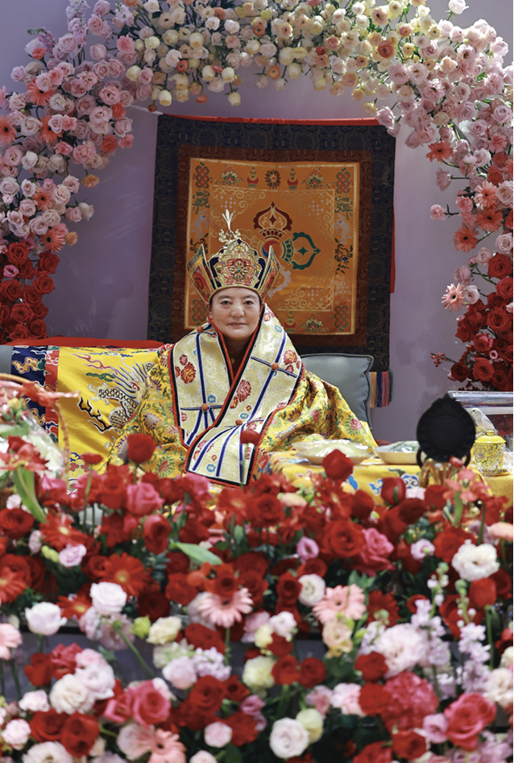

# 上师瑜伽·普降悉地雨

门措空行母·著

索达吉堪布·译

顶礼上师！

充满智悲皎洁光，利他甘露清凉辉，

具德上师月王前，奉以一切敬顶礼。

于此，具备信解恭敬之人，若想实修一切加持与悉地之根本的上师瑜伽，应该放松身心，增上信心、意乐、恭敬心的力量。

皈依发心：

皈处总集具德师，我以不退敬皈依，

为令众生入佛城，发心修行深瑜伽。（三遍）

正行明观：

阿

无缘离戏光明界，自现不灭密严刹，

饰以自成妙庄严，虹光明点云聚中，

本体怙主普贤王，散射诸部坛城海，

法王上师如意宝，与其无二义光明，

释迦沙门女尼相，无边智慧吉祥海，

寂静相好青春姿，身著法衣戴智帽，

右手胜施印持莲，饰以宝剑表断义，

左手示以三宝印，执持青莲表证义，

狮座莲花日月上，双足金刚跏趺坐，

周满浩瀚诸刹土，放射种种无边光，

身周上下方隅中，光明身具智慧藏，

三根本尊如日尘，以敬信心明然观。

七支供：

于佛总集具德师，化刹尘身敬顶礼，

外内密供真意幻，及身受用三时善。

失坏根本支誓言，世世积罪悉忏悔，

三时所积一切善，菩萨行海皆随喜。

众生界尽幻化身，不入涅槃恒住世，

种种所化界根意，请转应机之法轮。

以此为主诸善行，念觉无漏之智慧，

三轮无缘印回向，深寂离戏大法界。

祈祷：

无边轮回悲众前，赐予净慧胜光芒，

海生天女喜悦音，善传尊母前祈祷。

无边通彻本净见，智慧内现本然修，

自现自解如海行，具此导师前祈祷。

三传加持入心间，所见现为幻网舞，

来去风入中脉界，现前本净任运意。

具四直定直断暖，四相顿超觉力圆，

法尽离心密意界，执掌本位赐加持。

以猛励的深情感动上师，尽力念诵此祈祷文。

结座受四灌顶：

如是专心祈祷力，无等具德至尊师，

三处身语意种字，渐次顿时普放射，

白红蓝色甘露光，摧毁习气净四障，

四灌熟心成四道，相续播下四身种。

后师化光融自身，智心无改本性中，

超离分别戏论相，实相大圆满中阿！

在自性觉性界中，无需造作而自然入定。

最后起定时念诵并明观：

后得妙用不灭相，苏醒无边大清净，

现有诸法师游舞，了然呈现如水月。

愿以此善我与众，蒙善知识摄受已，

意传加持入心间，获得遍主上师果。

之后念诵：

于具德上师诸行，不生刹那许邪见，

所做视善具敬信，上师加持入我心。

生生世世不离师，常时享用胜法乐，

圆满地道之功德，愿速成就金刚持。

念诵此等回向发愿文，了知一切现相、声音、心识三者皆为上师之身、语、意，将此运用于凡所显现皆清净的四威仪中。

如是速入加持法，敬信密道师瑜伽，

造此略轨之善根，愿师事业普兴盛。

应具有信心、戒律清净的众弟子再三请求我撰写敬信所依之上师瑜伽，盛情难却，释迦沙门尼门美益西措姆于水虎年（2022年）八月二十八日之吉日良辰，以善愿撰写而成。

译于2024年2月10日

