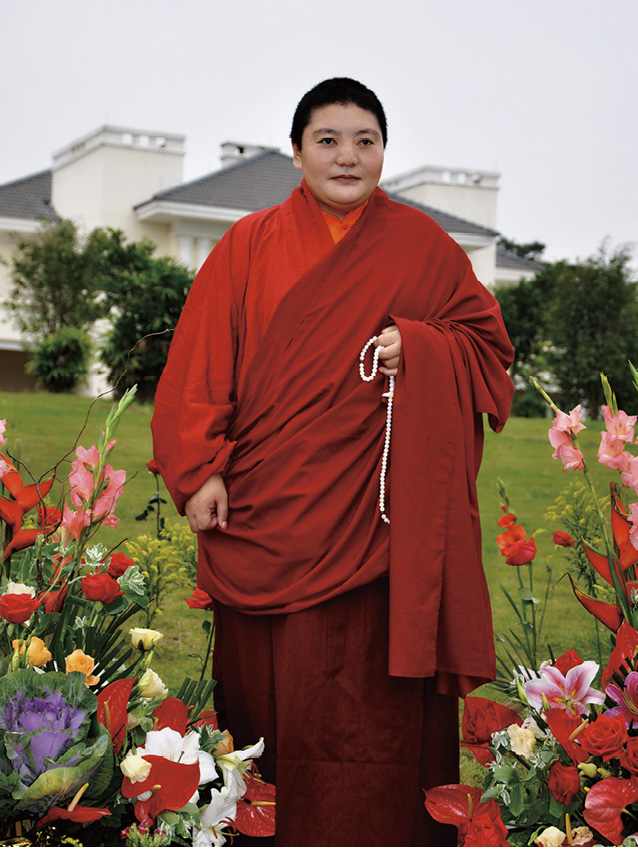

# 善显解脱道

门措空行母·著

索达吉堪布·译

诸佛三密集莲师，无别根本师前礼，

开示解脱道教藏，希求具慧者谛听。

善缘众趋解脱道，最初当寻入道门，

今生来世善资处，净戒守心是为要。

具五德之上师前，受四七断别解戒，

彼无出离不生故，厌离轮回心为要。

具大乘戒智师前，受二宗轨愿行戒，

若无二誓乃形象，故当屡修智悲心。

八相金刚持王前，受四灌顶之誓言，

离二因四缘不得，设法如理得守护。

如是净戒为根本，闻思汇集经义藏，

以胜窍诀要明灯，直观心性奥秘义。

共同不共特修心，渐净自续堪法器，

放纵恶念未调伏，求高深法如冬耕。

于显密巅大圆满，顿行地道之教言，

猛发信乐精进力，精勤实修心要义。

如是暇满具实义，临终无悔得确信，

任运二利之喜宴，心乐舒畅自恩惠。

以此所说之善根，愿佛法兴众生乐，

我亦生生世世中，行持广大利他事。

此乃应受持邬金敏珠林法脉个别僧人之劝请，释迦沙门尼门措于铁龙年（2000年）九月二十四日，在大密虹身成就寂静处撰写。善哉！

译于2024年2月12日

