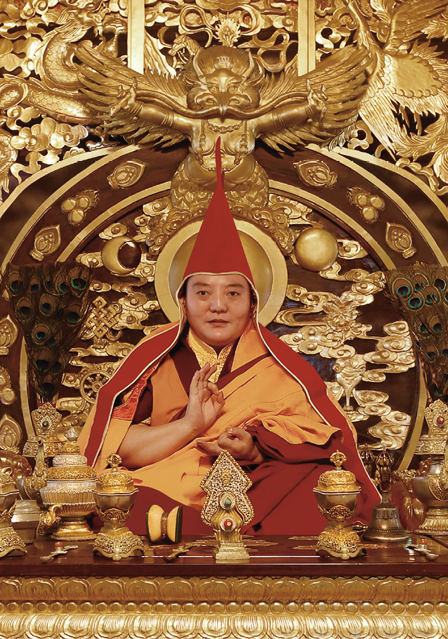

# 略述见修行·开显解脱道

门措空行母·著

索达吉堪布·译

除无明暗文殊尊，大悲自在观世音，

持佛密藏大势至，三融莲师前顶礼。

此世间界无等恩，殊胜导师如意宝，

安住文殊勇识体，现彼加持善书此。

此轮回多不同苦，需寻解脱此方便，

胜师所说之法外，谁人岂能宣此道？

所有浩瀚佛法理，见修行三为纲要，

依此妙方古迄今，无量行者趋解脱。

随乘差别见解要，纵有众多宗派法，

最胜光明大圆满，此法应时适众心。

于此末时诸众生，皆随种种散乱转，

妄念翻涌如海浪，此教甚深更彰显。

纵需博学所知法，广闻断除诸增益，

不悟心性依然迷，犹如盲人漂无依。

三传上师加持光，入于具慧者心间，

知心密要之彼士，拥有佛法胜密藏。

犹如夜晚迷乱梦，外境种种之显现，

未观执实起贪嗔，缚于轮回至今日。

故依教理及窍诀，知此种种境现法，

犹如镜中之影像，无有独立坚实性。

亦如大海为风吹，所现唯是心变现，

若识心性之本面，了悟迷乱则不难。

八万四千法心要，莲师布玛意精髓，

无等上师真口传，百句要义汇此中。

看似存在之此心，专心向内反复观，

彼性无有能所观，明空双运皆俱全。

超心原本真法性，极易难信多臆造，

分别明空等补丁，如意宝为淤泥染。

仅知法性本面者，虽未异于寻常众，

亦无神通神变等，成就验相大功德，

然若护彼实相性，速疾能灭诸障碍，

犹如草木与林石，接近日光皆被焚。

迷乱黑暗渐淡时，安住光明本性中，

如来藏之诸功德，无勤自然而现前。

若已了悟见解性，然未远离众散乱，

纵然日夜勤修行，无法踏入解脱道。

当阅米拉日巴尊，龙钦巴等前辈传，

杜绝散乱世八法，护持实修尤重要。

如理认识实相见，无他护持修行法，

正念远观彼实相，有念有修无念修。

正念犹如坡警哨，终究亦需净法界，

初学者入正道时，不离正念极关要。

护持本净法身道，即身行至双运地，

若系任运光明分，修道堪比日月速。

为净迷乱之业感，解脱通彻虹光相，

修行法界明点觉，纵然此修至极顶，

若无确信直断见，空色净相难道用，

不偏不堕明空融，视此捷径为法要。

攀高山时险处大，学甚深法违缘多，

祈祷供奉护法神，敬信上师最深要。

修心境界得提升，则需结合身语行，

显密众多教义中，虽说诸多行为别，

具出离心之滋润，无垢清净戒田地，

一切功德基础故，当知一切行之最。

并非自利为终极，表里如一真悲心，

从利他众小事学，乃佛子行之核心。

胜乘大圆满自宗，行住四种威仪行，

知实相见道用伴，入定后得双融胜。

尤其睡梦迷乱分，融入光明法界中，

修此道用行为已，具挡中阴迷深要。

如是精进长久修，浊世短暂人生中，

圆满多劫诸资粮，持本坚地殊胜性。

设若修行未究竟，骤然死亡已临头，

先行乐求生净土，安住所识见解性，

则以弥陀发愿力，无等上师之事业，

诸友善缘悉往生，莲花绽放极乐国。

为利依我解脱者，而将胜乘见修行，

汇为简略教言语，以利益心立文字。

以此善愿回向众，见闻忆者了取舍，

成为正道之明灯，修行妙法之助伴。

应虔信于本人的个别觉姆再三劝请：“需为喇荣莲花空行聚集洲全体觉姆为主的众弟子撰写一篇教言。”释迦沙门尼门措于水虎年（2022年）七月二十五日，在喇荣自处空行炽燃大乐宫中口述，并由堪姆敦吉立成文字。善哉！

译于2024年2月16日

༄༅། །ཞབས་བརྟན་སྨོན་ཚིག་བྱིན་བརྒྱའི་

གཏེར་ཆེན་ཞེས་བྱ་བ་བཞུགས།
