# 二百世的回忆

——一位伏藏大师转世之密传

伏藏大师门吉多杰·口述

乔美仁波切·笔录

索达吉堪布·翻译

> 顶礼上师！

> 部主莲花生大士，安住顶严永不离，

> 从天法意伏藏中，伏藏师之转世传，

> 根本偈颂由莲师，及大悲尊亲口宣，

> 彼等详细之历史，化身本人自回忆，

> 舍弃夸大与虚构，以此简略偈撰著。

此分为两部分：胜义智慧之化身传承、世俗世间之业力传承。

首先解释化身传承，又可分为总说、别说。

总说：

一切经续都承许，轮回和涅槃在法性中无二无别。同样，《莲茎经》中说，六道一切众生皆为智慧本尊之化现。如来藏遍及一切众生，一切都是基位金刚持，这是一切经续的共同说法。

别说：

此处所说的是化身传承，不是从基的角度，而是从道和果的角度来说的化身传承。

一切佛陀皆为同一法身，在智慧界中都是一体，对此，经典、续部、伏藏法的观点一致。普贤王如来是诸佛总祖，金刚持是众续之师，他们皆为同一本体更不必说。所有瑜伽续都说，金刚持先于一切佛成佛。普贤王如来的圆满报身，即毗卢遮那佛，这在大圆满历史中都有宣说。毗卢遮那佛的化身是十六位菩萨，这在瑜伽续及其注释中有明说。“金刚萨埵大菩萨”等赞颂中提到“礼敬金刚手”，说明金刚萨埵和金刚手是寂猛本尊的差别，实际上本体相同。阿难和金刚手确定为同一本体，这在《日革阿惹乐续》中有阐明。《白莲花经》中说阿难是十地菩萨，但他自己不知道，以为连阿罗汉都没证得，佛涅槃后他才证得阿罗汉并结集佛经。阿难转世为贝若扎那的情况，莲师授记中有无争议的说明。

上师西日桑哈将大圆满口耳传承传授于译师贝若扎那，并授记道：“你与普贤王如来、金刚萨埵无别。你转世之后，将在一千五百劫中护持佛法。”莲师多次指出，大译师贝若扎那是毗卢遮那佛的化身。莲师被邀请前往汉地时说：“贝若扎那是大智者，是金刚持的化身，我派他代表我去。”莲师的身、语、意、功德、事业的化身各有五位：莲师的功德化身是益西措嘉，益西措嘉的语化身是贝若扎那，事业化身是朗卓。二十五位君臣弟子和所有伏藏师皆是师徒无二的化现，所以肯定是莲师加持的化身。

莲师自己与五大君臣弟子化现合一，即是这位化身。在天法中，莲师说：“我是贝若扎那的身化身，秋布华僧是语化身，朗卓贡却是意化身，纳南耶谢是功德化身，悉日巴杂是事业化身。他们也是邬金我的化身。”由此可以确定，贝若扎那是朗卓贡却炯内、纳南耶谢、悉日巴杂三大君臣弟子和莲师加持的化身。贝若扎那和秋布华僧这两位，于同一时期出现，虽然他们本体相同，但示现为两种身相。在这《天法意伏藏》中，多吉卓罗亲自授记：“嗡！密语！顶礼上师！我就是旺札嘉措本人。毗秋若扎那华僧等都是同一本体。三昧耶！密语！”这与上述的意义相符，转世根本偈中明确提到了贝若扎那。

由于阿难和贝若扎那的本体确定是金刚手，《宣说秘密经》中说：十方诸佛菩萨的化身数量有多少，金刚手就会化现同等数量来护持佛法。

引用经续和莲师语录过多会显得冗长，所以只简单列举了一些典型的依据。总的来说，普贤王如来、金刚持、报身毗卢遮那佛、金刚萨埵、化身金刚手、阿难及其转世贝若扎那，虽然早在无量劫前就已成佛，但仍示现为八地或十地大菩萨，化现亿万化身利益所化众生。每一化身都有各自的前世传记和不同的事业，将来成佛的刹土也各不相同，转法轮的方式也不同。

在《王臣遗教》中，预言印度三十三位持明将依次来藏地并兴盛密法时，对这位化身也做了授记：“在释迦佛刹土的多康地方，将出现一位行持大乘密宗的瑜伽士，密咒之主名为金刚称，他转世后将行持广大行。在此三千世界的北方，有一清净刹土名为旃檀林，他将成为如来、调御丈夫、无上师，教化三千众，佛号为佛智普贤。”

例如，贤劫千佛的本体虽同为观音，但各自发心方式、前世积累资粮的方式、成佛名号、教法住世时间、眷属等都不同。同样，贝若扎那的无量化身各自有许多前世传记，然而，其中一个化身肯定是门吉多杰，接下来将讲述他的前世。

从胜义来说，三时平等，没有先后，但从世俗缘起的角度，我将按前世的顺序来写，这表明十地菩萨随机应化的幻化。从不了义的角度来说，他是从凡夫的相续开始，逐渐积累资粮、历经地道，现在是住地菩萨。对于化身门吉多杰所说的内容，我只是简略地以偈颂记录，并未添加其他赞美与臆造。

为什么这样做呢？因为《般若经》中说，住地菩萨能非常清晰地忆起一世乃至百千多世的种姓、族系等，甚至从一劫乃至百千多劫都能回忆。《梵网经》等中说，有些外道仙人也能回忆百劫，那么菩萨又为何不能呢？当化身门吉多杰讲述他的前世时，我曾心生疑惑。那天晚上，在半梦半醒之际，我得到了明确授记：“这位化身能回忆数千劫。”从此，我便不再怀疑。因此，我只写下化身所说的简略偈颂，不加其他修饰。

他说：在无量劫之前，即从一个无量劫数到两个无量劫这样计数，大约在第一百个无量劫前，出世了一位佛陀名叫觉导。在他的教法末期，有位修禅定的比丘，在寂静的地方禅修打坐。他独自修行时，经常被虱子咬。于是，比丘与虱子商量，最后达成协议：当比丘禅修时虱子不咬他，在他不禅修时可以咬。就这样，比丘的禅定功夫逐日增长，而虱子也遵守诺言，定期咬他得以饱足。这时来了一只跳蚤，和虱子一起住。然而，跳蚤并不守时，咬了比丘。比丘查看时，跳蚤已经逃跑。比丘误以为是虱子所为，对它非常生气，脱下衣服扔进火里烧掉。

那位比丘是迦叶佛，跳蚤是魔头提婆达多，虱子是释迦牟尼佛。当时那位比丘身上有许多虱子，其中一只是门吉多杰，一只是绕嘎阿色[^1]。对此，他能够清楚地回忆。

## （1）蚌

大悲调化众生者所说的转世传记是：在无量劫之前，我转生为蚌时吃了一个人。

意思是：在可数的三大无量劫之前，转生为海中的蚌。最初虽然吃了人，但后来生起悲心，对同类水生动物能稍微讲解因果。

## （2）蛇

由于蚌吃人的果报，后来我转生为蛇。当蛇杀死一只业虫时，另外两只业虫跑来杀死了蛇。

意思是：那条蛇发誓不伤害他众，如果伤害就愿被杀死。所谓的业虫是指巨蚁，它多次刺穿蛇的身体，蛇无法忍受而违背了誓言。

## （3）鹿

之后，以蛇与巨蚁互相杀害的大果报，巨蚁转生为人，我前世的那条蛇转生为鹿，其它巨蚁转生为虫。这时人杀了鹿，鹿用蹄子踩死了虫。

意思是：虽然鹿不会说法，但能修习悲心。

## （4）杀人者

之后，鹿转生为人，我叫阿彭玛，杀了十个人。后来，有一位莲师转世、名叫光明源的善良上师，他对我说：“你杀人不好，应该忏悔，善男子。”听到这话后，我便出家精进修法，取名光幢。从那时起，我生生世世都蒙受莲师的摄受与加持。

在此之前，都是在这四大部洲中。过去佛名为普观，身色红色。从蚌到阿彭玛，都是在这位佛的教法时期。劫名为周遍。

## （5）铁转轮王

往昔，九千九百劫前，在北方世界的任行劫，我转生为一位名叫极光的铁转轮王，统治整个赡部洲。

我没有做太多善恶之事，因为是暗劫，佛法并未兴盛。

## （6）女人

之后，在同一赡部洲，我转生为名叫善女的女人，天生具有慈悲心。年轻时，我穷困潦倒，长期乞讨。后来，一户富裕人家生有一子，于是雇我当佣人，所以，年老时我也有一些财富。

我努力将所有财富用于布施，这是因为，在我前世身为国王时，没有进行布施，临终时对此有些后悔，就布施了一点，从而感召这样的果报。这是示现因果不虚和轮回过患的奇妙本生故事。

## （7）大梵天

往昔，一千三百五十一劫前，在色界天的无量宫中，我转生为大梵天，身体比大山还大，身色金色，拥有四个面，寿命三百大劫。我曾见过过去的无量光佛，他身色蓝色，我获得了甘露正法。

有一次，从东方传来巨大声响，牛头大威德尊威猛降临，他有九个头，三十二只手，十六只脚，令人望而生畏。他的十六只脚在我身上同时踢踏，我吓得魂飞魄散，昏了过去。以此因缘，结束了那一世的生命。

## （8）修行人

往昔，一千劫前，我转生为名叫胜成就者的修行人。

在山洞里修行时，我有一个出家的弟弟，他说：“在对面洞里有一条蛇，你去给它传法吧。”我去了以后，发现盘着的蛇被惊醒。我问它：“我给你说法，你能修持吗？”蛇说“能”，便钻进了岩石缝中。

蛇其实是龙的化现，多次在现实与梦中来求法，因此获得了证悟。之后，它也为其他龙族说法。

弟弟是如今的噶玛，蛇是绕嘎阿色。这是发生在东南方世界的莲积劫中极喜如来教法末期的事。

## （9）禅定者

往昔，九百九十九劫前，在东方世界的观时劫，无边光佛的教法末期，我转生为一位专修禅定者。

由于遭到仇家的追杀，我逃到远方，在一块磐石上发誓：“即使被杀，我也不再逃跑。”随即结跏趺坐入定。由于禅定的力量，敌人退却了。

因为我长时间修行，惊动了一位可怕的世间空行母，她用弯刀劈开了磐石，但我在禅定中依然如如不动。

之后，我飞到东方较高的一个山洞中安住，在那里，利益众生的事业很广大。那位空行母与众人都尊称我为“禅定究竟者”。

## （10）善知识

往昔，九百九十劫前，在西南方世界的光明劫，观音如来的教法下，我转生为一位显宗的善知识，名叫解脱金刚，颇有智慧。

当时，有位名叫饮光的苯教徒，愿以一千万两白银求法。我去到他面前，宣说了内道的功德，并示以佛典，还指出了苯教的过失。最终，他转变为佛教僧侣，对苯教心生厌恶。他持诵了四亿六字大明咒，成就了大悲观音法，虽然未见到观音全身，却见到了观音的头部与面部，听到了六字大明咒的声音。

当时的那位苯教徒，就是绕嘎阿色。

## （11）施主

往昔，九百八十九劫前，在南方世界的光耀劫，普照如来的教法下，我在汉地峨眉山下转生为一位富有的施主，名叫得福。

当时，峨眉山上住着一位修行人，名叫具福，他专心修行已有三十年。然而，众人都辱骂他，谁也不供养他。尽管那位修行人的父母、亲属、施主都是我的仇敌，但我依然对修行人有虔诚的信心，经常供养他修行资具。

那位修行人是绕嘎阿色。

## （12）勇士

往昔，九百八十八劫前，在此世界的成就所作劫，我转生为一位技艺超群的勇士，名叫无过。

在该地上方的森林中，因非人的幻变出现了一只被称为火虎的老虎。一个名叫达勒的地方官，每天要砍七人的头以供养老虎。有个叫拉沃的人要被砍头献供时，勇士无过说：“不要砍人头，我来杀这只老虎。”从那以后，达勒不再杀人，努力行善。后来，天神降下霹雳，将老虎劈死，该虎至今仍在地狱中。

地方官达勒是绕嘎阿色，拉沃是炯波达露。那时的成就所作劫，因处于暗劫，所以没有佛法。

## （13）花狗

往昔，九百零七劫前，在此世界的少光劫，我转生为一只花色的狗，具有慈悲心。绕嘎阿色是一只红羊。

有匝和达名字的两人，想杀死阿达、德达两兄弟的狗，却未能成功。那人悲伤叹息，当时身为狗的我对他生起悲心，尽管我能够害他，但没有这样做。我躺在他的跟前，结果他砍断我的脖子，我以悲心忍受了一切。

## （14）黑脖白羊

往昔，七百零八劫前，在北方世界的内行劫，我转生为一只黑脖白羊，能向同类旁生讲解因果正法。

那时，我为整个羊群传法。有一个名叫度热的人，是魔的化现，我把他撞死了。天真无邪的特瑞，不让我撞。

一个名叫阿日的牧羊人，在仲巴玛山上放着成群的羊。这时，一个名叫日称的商主带着家眷与仆人，驮着货物来到那里。牧羊人向商主示警，商主说：“我不需要警告，你还是看好自己的羊吧，它们正被狼吃掉。”虽然商主这么说了，但牧羊人也没跑去管羊，结果我就送命了。

当时我这只羊的主人，名叫嘎给。商主是现在的阿竹，牧羊人是秋佩，嘎给是陈列，特瑞是绕嘎阿色，狼是名中带有“匝”的人。

## （15）舍事者

往昔，一百零九劫前，在东方俱胝语世界，悲无量佛的教法下，我转生为一位名叫怙主的舍事者，具有大悲心，念诵了一亿遍六字大明咒。

有一次，我转绕佛塔而行时，一个叫阿嘉的牧民砸碎佛塔，并将我一同扔进水中致死。那个恶人的名字中如今带有“那”。

## （16）持戒者

往昔，一百零九劫前，仍是在那位佛的教法下，我转生为一位品行高尚、谦虚低调的持戒者，名叫妙行。

上师是个破戒者，名为霍雪，我几年里一直当他的侍者。我看到了上师的不良行为，上师气急败坏地说：“我白以悲心摄受你了。”第二天，他打了我，并将我赶出去。

我一生都奉行佛法。上师在许多劫中转生恶趣，如今才得以解脱。他就是革日敦珠。

## （17）苦行求法者

往昔，一百零八劫前，在东南方世界的福增劫，光显佛的教法下，我转生为一个名叫嘉吾的人。

我为求正法去拜见一位仙人，供养了四辐金轮、半碗金粉、金刚铃杵、三个大银铃铛、檀香念珠、一匹马和一只羊，请求传授正法。

但是，仙人说不接受供养，如果用涂毒的铁锤击打我一百零八下就传法，我照做了。仙人又问我能否在身上插入一百零八根竹签，我也这样做了，全身都是血。我的朋友乌莫不忍心，哭喊着劝阻。仙人又说再在身上钉一百零八根铁钉就传法。朋友乌莫紧紧拉着我，不让我这么做。我将他的手绑起来，钉了铁钉，可是仙人仍不传法，又说要在原来铁锤击打处再打一百零八下，把竹签都拔出来就传法。我照做了，但仙人还是不传法，又说要把一百零八根铁钉拔出来。我这样做后，仙人才传授一段教言，并接受了供养。

当时我如此渴求佛法，而现在却不想学习，这是为什么呢？

后来，我为那段教言作了一页的注解。一位班智达也作了注解，约有三十页左右。之后又有人对此作了注解，有一函，名为《身价修法》。

仙人的名字中如今带有“达”，朋友乌莫是绕嘎阿色，马是陈列，羊是秋佩。

那位仙人所传的根本教言是：

“南无！

得到暇满人身非常难，即使得到了也是无常的，来世如何全在自己手中，应当明白这一点。

六道轮回和善趣一切众生，都是由善恶业所致，行善生善趣，作恶堕恶趣。

无论堕入哪一道，都没有离苦的安乐。一切善趣都在寻求解脱之道。

皈依三宝，发殊胜菩提心，观想上师在头顶，从其身上流下甘露，净除罪障，供曼茶罗，上师融入自身，安住于寂止，观心了不可得。

观空、细行、除障、净治，这一切的根本，在于观察自己的心。”

## （18）彩虹蛋

往昔，七八劫前，绕嘎阿色转生为一只美丽的小鸟。当我还在蛋中时，母鸟飞往他处，那个蛋就死了。后来，母鸟回来，带走这枚绿松石色的蛋，将它扔在路边。蛋碰到石头碎裂而开，这时彩虹投在上面，花雨纷纷降下。

一个人看到后，堆起了石堆。因为此处常常出现彩虹，许多路人便向石堆礼拜转绕。所有与之结缘的人，都阻断了恶趣之门。

一个名叫嘉的人破坏了石堆，并放入一些晦物，从此彩虹消失，利益众生的事业也中断了。那时，蛋如果活着，不如死后对众生带来的利益大。这个故事发生在阿劫。

## （19）大悲鸟

往昔，一百零八劫前，在东北方的光明顶世界中，我转生为一只具有悲心的鸟。当洪水汹涌而至时，树顶上是我的鸟巢，树腰处有一只猴子。我拿一个芒果想去救猴子，猴子却对我龇牙咧嘴。

当时有龙嘉和阿德两兄弟，他们不和打架，龙嘉摔倒，头破而死。阿德失声痛哭，悲伤欲绝。我知道吃我的肉能止息一切苦，于是想布施身体。我伸展身体，但他没有杀我，只是砍掉我的爪子吃下，由此平息了他的痛苦。

我被砍掉爪子倒下时，用人语说：“谁吃了我的肉，就会消除疾病和痛苦。”可是人们认为这是不祥之兆，谁都不敢吃。这时一个病人来到我面前，说道：“杀了它。”于是他杀死我，吃了一块肉，病果然痊愈。此后，人们将我的肉做成药丸，谁吃了都能平息一切疾病。

病人是名中带有“达”的人。猴子是贡松。砍我爪子的人，名中带有“嘉”。

## （20）长者

往昔，一百零四劫前的无光劫时，我转生为一位名叫帝摩的长者，天生具有慈悲心。

达卢转生为我的儿子，秋佩转生为马。绕嘎阿色那时是名叫达杰的长者。帝摩的妹妹迪玛，嫁给了达杰，迪玛就是如今的拉达。达杰的儿子名叫乌杰，就是如今的琼波却炯。

那一世，没有做太多善恶之事。

## （21）秃鹫

往昔，一百零三劫前的童子所生劫时，在西北方世界，我转生为一只名叫阿迪的秃鹫。我给其他秃鹫讲法，自己也能够修行。

当时，一个名叫达的人是制毒者，他把毒药涂在肉上给了我。我用人语说：“谁吃了我的肉，就不会堕入恶趣。”说完便死了。

一个名叫持光的人吃了我的秃鹫肉，立即能回忆起许多前世，并看到自己未来不会堕恶趣。然而，由于肉有毒，这个人很快便死去。人们知晓此事后，就不吃肉丸，而是用其来熏烟。

## （22）大臣

同在那一劫中，我转生为一位名叫布钦的大臣，具有慈悲心，乐善好施。

那时，绕嘎阿色是我的国王，名叫霍雷，势力和财富都很兴盛。他有一个仆人叫比格，如今是绕嘎阿色的母亲。

作为大臣的我略懂医术，因此做了很多利生之事。我的医术是无师自通，但那时没有佛法。

## （23）网主

往昔，一百零二劫前，在下方世界的如是名劫，我转生为一个名叫萨黑的人。

在我面前，一个叫业网的东西从天而降。沾上此网就一定会被抓住，被抓住就一定会死，死后一定会转生善趣。

一个非人撞在这个网上死了，获得了人身。他的名字叫阿那他。

有一个叫类达的国王，他的妃子用刀切断了网，她立即被网包裹，死后获得了好的人身。

一个名叫阿瑞的老妇人，将网的主人我绑起来，用网包裹，抽走了网绳，烧掉了飞翅。我只是看了一眼，网就滑落，绳索解开，老妇人自己被缠住了。她害怕地哭喊：“不要杀我！”我出于慈悲心解开了网，但她的衣服都融入网中，变得赤身裸体。

那个网升上了天空，后来又降下一个石头金刚杵，若向它供养礼拜，一切所需所欲都能如愿而得。我将金刚杵留给子孙后，就去世了。

那个非人是拉格，王妃是秋佩，老妇人是绕嘎阿色的母亲。许多众生都被此网所救度。

## （24）将军

往昔，一百零一劫前的那纳斯劫时，我转生为一位名叫罗嘉的将军，国王名为宁玛斯嘉。有一次，我请求派兵支援，因为要攻打国王的亲戚，国王勃然大怒，用缠头布打了我。我将缠头布反抛回去，正中国王的脸。国王一气之下，杀死了我和九位随从，还杀了我的马和羊。

彩虹投在我的尸体上，花雨纷飞，出现了许多奇异瑞相，国王后悔不已。为了忏悔，他建造了佛殿、佛塔和灵塔，使见到、顶礼、转绕的众生都抵达了轮回彼岸。

在那一世，我明知后果仍故意献出生命。那个国王是如今的绕嘎阿色，羊是阿休，马是秋佩。因建造佛殿和佛塔，国王得到了解脱。

## （25）侍者

往昔，一百劫前，在上方世界的涅槃劫，超越轮回佛的教法下，我转生为一个名叫阿塔的人。绕嘎阿色那时是名叫嘉杰的上师，我成为他的侍者。

我们带着一只名叫红曲的狗，越过九座山，遇到了一位名叫革瑞的老人。尽管我们已明确拒绝，但他仍强行供养我们一根弯曲的木杖。带回来劈开后，发现里面有一个铜制的五股金刚杵，上面涂有金水。

在上师未圆寂之前，我一直进行承侍。他圆寂后，我终生树立修行胜幢。

老人是陈列，那只狗就是现在的达拉。

## （26）舍事者

往昔，五十五劫前，在北方世界的庄严劫，不动光佛的教法下，我转生为一位名叫阿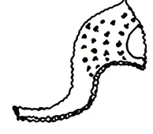提的舍事者，身穿白色布衣，头戴蓝色帽子，脚穿蓝色靴子。我化缘得到了许多茶叶。

我对一位名叫吾其的上师生起信心，前去拜见。上师的眼睛呈三角形，身色红色，鼻子很长，全身赤裸，穿着犀皮围腰，一瘸一拐地走路。我们在路边相遇时，上师说：“把你的手杖给我。”我将手杖递给他，他随手打了个结。我供养了茶叶，却遭到上师的训斥。上师用手击打岩石，岩石上出现了类似梵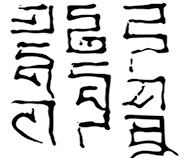文的密纹。上师多次打我，我痛苦地走路时，天上打雷下雹，云中出现了一位黄色身相的天神，右手于心间结救施印，左手拿着托巴，白色甘露从中源源不断流下，灌入我的头顶。之后，我从上师那里得到了教言，树立了终生修行的胜幢。

## （27）母狐狸

往昔，三十九劫前，在此世界的不欲劫，我转生为一只母狐狸，躺在岩石下。绕嘎阿色转生为老虎，故意扑过来吃了我。之后，有人杀死那只老虎。他煮了虎肉给另一个人，搞恶作剧欺骗他。没想到那人刚吃一口，就能跃入空中，获得神通。当被问及原因时，他说：“这是肉的加持。”

那个杀虎者心想：“这肉不能再给其他人了。”结果他在煮的时候，不慎让沸水溢出，溅到了灶上，锅里全是灰，他便不想吃了。后来，其他人拿走了肉，做成药丸，凡是吃了都能关闭恶趣之门。

杀老虎的人是雅嘉。虽然不是每一块虎肉和狐狸肉都有这样的加持，但赞颂这两只动物的功德很大。如果明知故吃，也会获得利益。

## （28）麻雀

往昔，三十四劫前，我转生为一只麻雀，当时我也吃虫子。绕嘎阿色那时是一只红色小鸟，它不杀虫子，只吃死虫和谷粒。我把自己杀死的虫，分一半给那只小鸟。虽然小鸟给了我谷粒，我却没有吃。

这是不清净的前世，对自己和他人的利益都很小。

## （29）吉朵动物  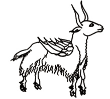

又，三十二劫前，我转生为一种名为吉朵的动物，具备一点飞行能力，有着翅膀，懂得修慈悲心。

绕嘎阿色转生为一只狐狸，它得到了一个装有食物的袋子。它一出现，我便逃跑。我在悬崖顶上，狐狸在悬崖下边吃东西，抬头望向我。我恐惧不已，逃跑时撞上岩壁而死。死后转世为人，能够回忆起前世，因此寻找到了前世吉朵的尸体，将其做成丸子，谁吃了都能治愈眼疾。

那时狐狸双目失明，我出于慈悲给了它药丸，狐狸的眼睛就复明了。这两世可以算作一世。

## （30）孩子

三十三劫前，我转生为一个名叫顿波的孩子，具有慈悲心。我曾发愿：“愿我以慈悲心，精进利益众生。如果生起嗔恨心，愿那时我被杀死。”

有一天，我对母亲生起嗔恨心。舅舅名叫萨瑞，把我喊过去灌酒。一个名叫嘉摩的厉鬼，用萨塔击中我的心脏，我就这样死了。

我死后尸体站了起来，变成一张全人皮。舅舅悲伤哀叹。一位国王梦见供养这张全人皮能增加财富，获得如同如意宝一样的功德。

舅舅是秋佩，那个厉鬼是匝勒。

## （31）天藏师

往昔，二十九劫前，在下方世界的诶所成劫，有一位佛陀名为大调伏。在那个佛的刹土中，我转生为一位会讲因果法、能将身蕴转为食物的天藏师，名叫安札。

鼓匠嘎玛顿珠和木匠阿给砍伐了神树，阿给因此而死。他们请我前去超度，派阿德去把未砍完的神树砍倒。将阿给的尸体埋葬后，阿德也头破而死。阿德是绕嘎阿色，那时我们之间是供施关系。

一个名叫达瑞的亲戚，用船送我回去。达瑞在这一世是我的父亲。我那一世都修持断法，也修习因果法。

## （32）雄鹿

往昔，二十六劫前，我转生为一只具有悲心的雄鹿，能为其它同类讲解因果和慈悲法。

当时，人间没有兴盛佛法。我这只鹿在城市附近念诵六字大明咒。人们问：“它在说什么？”一位具足有漏神通的人回答：“这是一切佛的心咒。”一位有信心的法器，从我这里学会了六字大明咒。

一个叫阿沃的非法器也来请教，但我不愿教他六字大明咒。这个名叫阿沃的猎人，后来转生为一只叫玛古的猎狗。猎人带着弓箭追赶我，猎狗刚抓住我时，突然一块大雷石滚下来，猎人就逃走了。我没被杀而得以逃脱。

猎人的名字现在带有“扎”。

## （33）密咒师

往昔，二十五劫前的放光劫时，欲义佛的教法下，我在一个名为藏的地方，转生为一位叫嘉布的密咒师，获得了一些共同成就的验相，拥有一座很高的修行城堡。绕嘎阿色那时转生为名叫沃札的密咒师。我们俩经常争斗，各自显示神通。

我将身体变黑，骑着黑马而去，杀死了沃札的一个兄弟。我在石头上写字，彩虹投射在上面。沃札把身色变蓝，又变红，拉弓向我的城堡射箭。当时，我烧熏烟做供施，挥舞着经旗，在一只饲养的兔子腰间缠上蓝色氆氇，外面再盖上虎皮，且将血涂在羊身上的弓箭上。我一边烧熏烟，一边舞动经旗。

沃札虽自称能胜过我，但他的随从看见一个头上燃火的黑人说无法战胜，都感到害怕。我放出那只兔子冲向他，获胜后又放出羊，他害怕了。最终我们和解，成为朋友。

我那一世都致力于修行，获得了猛咒的威力，并因此闻名。

## （34）虫

往昔，二十五劫前，我转生为降香树中的一只虫。

绕嘎阿色转生为人，故意砍伐降香树。因为这棵树非常神圣，砍掉一侧，另一侧又会连接上。直到挖出树心，树才终于倒下，虫子也随之腰断而死。当时，降下了雷雹、暴雨和洪水。

如果不砍那棵树，作为虫子的我长期居住其中，就会阻碍我获得善趣之身。这是不清净业力的转世。

## （35）彩蝶

往昔，二十一劫前，我转生为一只雌彩蝶，能向同类昆虫说法。

那时，绕嘎阿色转生为一只麻雀，它来到我身边一起住。我们相互认识，它并没有吃掉我。后来，我与另外两只彩蝶一起住在洞中时，一只名叫嘉的麻雀来到这里，把我们三个都吃掉了。

## （36）声明师

往昔，二十一劫前，在东北方世界的具严劫，大琉璃相佛的教法下，我在印度金刚座北方，转生为一位精通声明学的僧人。我的上师是凡夫班智达，在声明方面无与伦比。绕嘎阿色转生为略懂声明的密咒师。他的上师是三地菩萨，也是一位有智慧又贤善的班智达。虽然我那位凡夫上师在名言上更精通，但实际上，证得圣地的上师更殊胜。

有一次，我和密咒师在路上相遇，辩论时我获胜了，密咒师说要请两位班智达上师来辩论。我说：“我无需请我的上师，你请你的上师来。我虽然赢不了得地者，但可以当面讨论。”

密咒师去了，但他的上师被国王邀请到宫中。密咒师向国王请求同意上师离开，还有两个朋友也非常坚持。国王发怒要惩罚他们，那位班智达只好派弟子去了。

然后在一个花园里，那个弟子与我进行辩论。一开始他似乎占上风，但后来我大获全胜。他气势受挫，转而聆听我的教诲。密咒师气愤不已，向国王告状，国王对我判以重刑。班智达的弟子杀死了密咒师。

密咒师的密咒修持得很好。那个处罚人的国王如今在地狱中，还要再受三劫的折磨。那时的说法辩论不够圆满。

## （37）食人肉者

往昔，二十劫前，我转生为人，谨慎取舍因果，心中充满慈悲。

上师雪哲威猛无比，具有神通，预见到我七天后将被死亡之绳缚住。他看到人肉是长寿增益之物。我明知而享用，寿命得以增长。

## （38）大臣

往昔，二十劫前的俄哈劫时，有位残暴的国王名叫索夏，有位大臣名叫辛巴，有个聋子仆人名叫埃日，还有一个断手者名叫查日。

国王叫聋子去牵马，聋子没听懂。国王拔出剑要杀他，大臣出于慈悲阻止了。大臣割下自己的耳朵给他，之后他的听力变得敏锐。

国王让那个断手者端碗，他端不了。国王又拔剑要杀他，大臣出于慈悲砍下自己的双手给他。但这对他没有任何帮助，大臣自己却因此去世了。

那个国王现在是顿珠，大臣是我门吉多杰，聋子是上师绕嘎阿色，断手者是陈列。

## （39）绘画师

往昔，十八劫前的赡洲劫时，在妙业佛的教法下，我转生为一位精通佛像的绘画师，名叫德瓦。我怀着菩提心，只画佛像。

我的儿子名叫杰雪，就是现在的绕嘎阿色。

## （40）施主

往昔，十六劫前，东南方世界有个叫达拉的国度，在光明佛的教法下，我转生为一位修持正法的施主，名叫古库。那时绕嘎阿色是名叫玛东的施主。我们二人结为朋友，关系非常和睦。

有一次，我们在山脚下喝酒时，突然一块雷石滚下，玛东头破而死。

## （41）铁匠

往昔，十五劫前，在下方世界的则吾劫，我转生为一位名叫悲护的铁匠。

我卖了一把刀给札西嘉，他用来割断了鸟的脖子。我生病临死时说：“这个铁匠职业是罪恶的根源，愿我转生为造佛珠的人，所有用我造的佛珠念诵的人都能成就。”

## （42）造佛珠者

我转生为名叫德甘的人，造了大约一千串佛珠，用它们念诵的人，都能成就大悲。

特别是，卖给一个人后，他念诵大悲观音的心咒，获得了共同悉地。他的转世是瑞巴达拉。

那只鸟，记得是绕嘎阿色。

（43）护金者

在那一劫中，有位名为遍胜的佛，既寂静又忿怒。我转生为一个名叫光善的人，衣服上有这样的图案（ཛི）。当时，我与一个名叫阿格的人发生纠纷。

因为，有一位名叫贡的上师，他有满满一铜盆的金子，不方便放在家里，就想着放在树顶会安全。阿格多次去偷窃。那位上师为了保护金子，用草豹皮包裹树，让我穿上各种丝绸衣服。我抱着树日夜守护，阿格以为这是幻术就逃走了，金子没有丢。我就是这样守护誓言的。

阿格现在是秋佩。

## （44）孩子

往昔，十三劫前，我转生为一个名叫列吉的孩子。

姓嘉的转生为一个名叫扎美的人，他腰间系着绳子，身穿黄色衣服，背着网而来。我用石头打了他，他气得拔出刀就砍，并把我夹在腋下带走了。由此因缘，我送了命。当时大地剧烈震动，但没有伤及其他人。

这是一个不清净的前世，对自己和他人都没有任何利益。

## （45）比丘

往昔，十三劫前，在上方世界的顶髻劫，夏拉佛的教法下，我转生为一位比丘，名叫札西，懂得快速行走之道。我的本尊是大悲观音，咒语是“嗡玛哈班玛索哈”。我念满一亿遍，成就了本尊。

当时，拉嘉转生为一位成就共同谛实语的仙人，名叫多甘。绕嘎阿色转生为一个小偷，盗走了仙人的念珠。仙人发下恶咒，使那个小偷得了一种像经历三千地狱痛苦一样的病，然后死了。小偷的名字是根桑珠。

此后，那个心怀恶念的仙人教给一名猎人邪法，声称杀死一百零八个比丘，将他们的头颅悬挂在墙檐下，就能成佛。猎人杀了一百零七个比丘，随后追赶我。我害怕了，就修大悲观音，向大悲观音祈祷。猎人看到了大悲观音，生起信心，顶礼听法，也获得了共同成就。那个猎人是秋炯扎西。

## （46）香獐

往昔，十二劫前，我转生为一只具慈悲心的香獐。

我睡觉的时候，有一只岩雕在附近潜伏。我跳跃到空中，没有被它杀死。岩雕落到地上时，我以悲心想把这个身体布施给它，于是走到它的跟前。然而，岩雕闻了闻，没有吃我就飞走了。

那只岩雕就是绕嘎阿色。

## （47）修行人

往昔，十二劫前，在东北方世界的大光劫，雪德佛的教法下，我转生为一位修持正法的人，也为他人说法示道，名字叫阿哦。

绕嘎阿色转生为我身上的一只虫子，我知道那只虫子是他。

## （48）狗

往昔，十二劫前，我转生为一只狗。绕嘎阿色转生为我的主人，是一个名叫瑞的长者，做了少许善事。

做狗的我偷衣服、鞋子、肉、干酪，送给贫苦的乞丐，具有一颗悲心。

## （49）汉地僧人

往昔，十二劫前，在上方世界的妙衣劫，无边佛的教法下，我在那个佛土的汉地边境，转生为名叫释迦光的僧人。我以文殊菩萨为本尊，念诵“嗡瓦革休日芒”一亿遍，虽然没有太多成就相，却拥有极大的威力。我习惯穿着蓝色衣服。

在附近的印度，有一位具威严的暴君，他梦到有人说：“僧人释迦光会危害国王的寿命。”国王便命大臣月称去寻找，找到后告诉国王。大臣在汉地边境找到了我，并禀报国王。国王来到那里，用剑砍断了我的手。然而，国王立刻就死在那里。

大臣火化尸体时唱道：“奇哉！具威严的国王，胜也是胜，败也是败。汉地僧人释迦光，败也是败，胜也是胜。我这个叫月称的大臣，坐上王位是胜中之胜，失去王位是败中之败。国王的头巾已化为灰烬，国王头巾上的华丽丝绸也烧成了灰。释迦光的手上全是血肉，血肉模糊的手在跳舞。我们国王和大臣多么可笑啊，我们国王和大臣多么可怜啊，释迦光你多么快乐啊！”说完就回印度去了。

那个国王是魔的化现，大臣的名字现在带有“匝”。

## （50）孩子

往昔，十一劫前，我转生为一个名叫嘎帝的孩子。当时虽然正法不兴盛，但我会给孩子们讲一些法理。

我的父亲名叫温那，他身穿蓝衣，头戴草帽。有一次，我爬到悬崖边的一棵柏树顶上，这时发生大崩塌，父亲接住了差点被毁的我和柏树，我从这个寿障中得救了。那时，附近出现了一道红色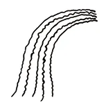的彩虹，看起来就像衣服上的图案。

那个父亲就是绕嘎阿色。

## （51）施主

往昔，十二劫前，我转生为一位非常富有的施主，名叫光明。我具有慈悲心，乐善好施，对所有贫困者进行施舍。

当时，绕嘎阿色是个非常贫穷的舍事者，没人供养他饮食。虽然我给了他马、母牛和小牛，但都被别人抢走了。

他的修法是念诵阿莫拉咒，那时所有人都修持此咒，他也念诵这个咒语。当时看起来像是暗劫。作为舍事者的他，无奈之下偷了稻子，结果被主人抓住扔进河里。

## （52）穷人

往昔，十七劫前，我转生为一个名叫札西的穷人。那时，有位富有强大的小国王，名叫达玛秋嘉。他的大臣名叫库泽，现在是秋旺贡桑。

国王每年向所有臣民征收马匹税，而我仅有一匹马。国王要求我交税，我把马放入他的马群中，但国王仍然要求交纳马税。我说：“我只有一匹马，已经放入马群中了。”国王说：“是吗？去看看。”又说：“你是不是想诬陷我偷马？”说完就挖出了我的眼睛。以此因缘，我念了大悲观音心咒“绕瓦札哦绕俄”三亿五千万遍。

国王死后堕入地狱，之后转生为饿鬼、旁生等，然后转生为上师，现在就是绕嘎阿色。

## （53）猴子

往昔，十二劫前，我转生为一只猴子。

在一座大殿里，有满满一铜盆的酥油长明灯。另一只猴子抓住盆边想倒油，我用拳头打它，阻止它的行为。一只飞蛾扑进灯里死了。

那只飞蛾是顿珠，那只猴子是现在的绕嘎阿色。这也是不清净的前世。

## （54）蚌

往昔，十一劫前，我转生为海里的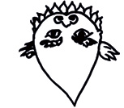一只蚌。一个手持轮子的人落水了，蚌抓住他并将其吞食。那人是邬金仁真。

随后，出现了一个看起来像天人的身体，但不知道是谁，他讲了许多无常法。从那以后，我就懂得修无常了。这也是不清净的前世。

## （55）蓝色狮子

往昔，十劫前，我转生为一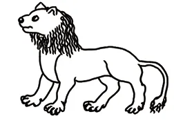只蓝色的狮子。

我向其它猛兽说法：“讲法、修法、听法者，永远不要杀。不听法、不修法的众生，杀了也好。”我一边讲法，一边吃掉那些不听法的众生。

## （56）僧人

往昔，十一劫前，在东南方世界的如是光劫，邬金光佛的教法下，我转生为一位名叫衮波的僧人。绕嘎阿瑟，那时是名为邬金顿珠的上师。陈列当时是名叫嘉宝的僧人。我们师徒三人结伴同行。

一个名叫卡美的人想要供养食物，邀请我们到他家。途中，出现了一个有违缘的征兆：空中乌鸦叼着红食子飞来，打在那人身上，他逃走了。我们就没有去他家。

当时，邬金光佛在世，我一生修持怙主玛哈嘎拉。

## （57）成就者

随后，衮波我去世，转世为一位游方僧，名叫成就者桑杰。我眉毛稀疏，胡须很长，持诵天女心咒一亿遍，并修持大悲尊、金刚手等忿怒本尊，拥有修猛咒的强大威力。我用手指向乌云，就能将其驱散。

当时，我唱了这首道歌：“祈祷诸位上师！当我最初修行时，三年中有大障碍。十三位白衣空行母将我放在白绸上，为了让我观看三界的景象，三次把我举到天空中。为了让我三年中免于障碍，又三次把我放在狭窄的地上。各种景象不可思议，难以描述。之后，我三年中没有障碍。

又一次修行时，本尊及其眷属亲自降临。天界的天人给我灌了三勺白色甘露，龙界的龙族给我灌了三勺黄色甘露，人间的人类给我灌了三勺青绿色甘露。九年中，我的寿命没有障碍。

神鬼向我请教许多法。因为我没有找到法器，象鼻天将我放在头顶，把我抬起三次说：‘你现在看吧。’我说：‘太远了。’他说：‘不远，我带你去。’不到九个驿站的距离，我们骑马大约一个月就到了。随后，有一个僧人出现了。象鼻天用弯刀将他钩起，轮流放至天界、龙界和人间，详细讲述了三界历史，难以尽述。之后，他获得了神通。现在的这首道歌，以前从未唱过。”

我这么说完，弟子也获得了虹光身。我自己也圆寂了。

## （58）长者

往昔，十一劫前，我转生为一位名叫嘉吉的长者，具有慈悲心。

有一次，我听到了“嘎夏恰札”的声音，看到大约二百只大蝴蝶出现，有些已死，有些受了伤，我内心充满怜悯。当时我与仆人埃迪坐在一起。这一世，自他二利都很微小。

## （59）毒蛇

往昔，十劫前，我转生为一条毒性极大的毒蛇，向五百条同类的蛇讲法。

当时山崩了，我的尾巴被压住，身体因疼痛难忍而扭动时，来了一位七世梵志。知道是他后，我用毒舌将他舔杀，然后自己吃了一点，随后对其他蛇作了授记：“五百毒蛇吃了他，都能获得善趣。”之后，我也死在那里。

七世梵志是绕嘎阿色。

## （60）苯教成就者

往昔，九劫前，在下方世界的善妙劫，伊提佛的教法下，我转生为一位名叫巴多的苯教成就者。

临终时，我在一尊佛像前供养了一盏大灯、八盏中灯、十六盏小灯，并发愿道：“虽然我是苯教的成就者，但佛教比苯教更好。愿我来世能成为佛教的成就者。”

## （61）成就者

往昔，十劫前，在西方世界的极善劫，殊胜佛的教法下，我转生为一位名叫德嘉的成就者，拥有众多眷属和弟子。当时，绕嘎阿色是名叫卡本的苯教成就者，具有大神通力，使四百名僧人改信苯教。

为了比试神通，这位苯教徒来到我面前。他骑在鼓上飞向各方，离地一箭之远，无论如何也无法落地。我把他的一块衣服烧成灰，放在手掌上拍了一下，苯教徒连同鼓一起坠落在地。我给了他一个教训，让他站不起来，然后又解开了他。

所有僧人把苯教徒关在一个无门的监狱里。那房子伴随轰鸣声升起至一由旬高，苯教徒也随之升空。我变成火，他变成水；我变成树，他变成斧头；我变成纸，他变成火焰；我变成猴子，他变成树和斧头；我变成蝴蝶，他变成灯；我变成人，他变成深渊……但是他始终无法伤害到我。

苯教徒变成一面鼓，我变成弯钩将其划开。之后，苯教徒的幻化用尽，变回自己的身体。他生起了极大的信心，皈依了佛教。

“如果当时我不这么厉害，你还是个苯教徒呢。”这是我十一岁时对绕嘎阿色说的。

## （62）母犏牛

往昔，九劫前，我转生为一头具相的母犏牛，懂得修持正法。

我的主人名叫阿迪。由于主人不善，我这头母犏牛生下了一个人形怪物；一匹母马从口中吐出一个众生，引来了一只有三只角的小羊。那个主人杀了马、羊和母犏牛。

羊是绕嘎阿色，马是陈列，主人的名字带有“达”。这是不清净的前世，利益众生的事业很少。

## （63）松石蛋

往昔，大约九劫前，我转生为一颗蓝色的松石蛋。

绕嘎阿色是一只母鸟，当它用嘴叼着蛋飞的时候，因为嘴力太大，把蛋弄破了。蛋掉在地上，被当地一位有神通的国王发现。他将其泡在水里，并带到大集市上展示。人们怀疑它有毒而犹豫不决，国王喝了之后，治愈了所有的疾病。随后，集市上的人也喝了。无论是谁喝了，病都随之痊愈，且能阻断恶趣之门。

## （64）蓝蛇

往昔，九劫前，我转生为一条蓝色的蛇，向同类讲法。我不伤害生命，而是尽量避开。

有一次，我在路下面发现了一尊破损的小头佛像。我用嘴衔着它，放在路边一个干净的地方。

当时，绕嘎阿色是一条白蛇。我给它讲法，它也学会了。我们两条蛇缠在一起时，它用力拉扯，将我拉断了。这是前世做人时杀死一个人的果报，所以我没有怨恨。

## （65）长者子

往昔，九劫前，绕嘎阿色转生为一位长者，我转生为他的儿子，发愿做广大的利生事业。那时父亲发疯了，我把他和母亲一起藏在洞中。

这是不清净的前世，未能利益众生。那个母亲现在名叫阿玉拉嘉。

## （66）鸽子

往昔，九劫前，我转生为一只有慈悲心的鸽子，向其它鸽子传讲正法。

有一个名叫班玛嘉的人用箭射中了一只猫的头，猫随即倒下。出于慈悲，我用嘴拔出了箭，猫便苏醒了。然而，有一堆谷粒散落在破布上，我去吃的时候，被猫杀死了。

那个人就是顿珠，猫的名字现在带有“嘉”。

## （67）比丘

往昔，九劫前，在上方世界的大光劫，阿沃佛的教法下，我转生为一位名叫冈卡的比丘，非常有学问和名声，以讲辩著弘扬佛法。

当时，绕嘎阿色是一位名叫雅科的比丘，也以智慧著称。我们两个辩论时，出现了红光，附近的山上起火了。一个名叫阿托的人用水扑灭了火。

阿托是现在的陈列。

## （68）白海螺

往昔，九劫前，我转生为海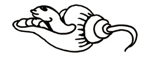中的一只白海螺。

绕嘎阿色转生为名叫珠嘉的人。他在海边走时，一只名叫亚嘎的鳌鱼想吞食他。我想要阻止鳌鱼吃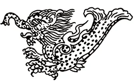人，但鳌鱼不听，最后它被我刺穿而死，那人得救了。因其加持，鳌鱼转生为天人。之后，他现在转生于此地。

## （69）成就者

往昔，九劫前，在西北方世界的自成劫，光催佛的教法下，绕嘎阿色是名叫持桑的大上师，有一百名弟子。他有一个叫光明的成就者弟子，能显示众多神通和成就相，但在功德方面略逊一筹。这位成就者就是现在的我。

我有一个较差的道友叫嘎沃，就是现在的陈列。

## （70）经忏师

往昔，九劫前，在下方世界的具胜劫，光蕴佛的教法下，我转生为一位名叫根嘎的经忏师。我发了菩提心，念诵和修行不间断，终生念诵《般若五百颂》，利益了自己和他人。

当时，绕嘎阿色是一位名叫根协的密咒师，念修非常精进。我们两人成为好朋友。

## （71）缮写者

往昔，八劫前，在上方世界的经眼劫，光网佛的教法下，我转生为一位名叫阿杰的人，精通书法。为了利益自他，我抄写了无量的经典。

绕嘎阿色转生为我的孪生兄弟，名叫如日，寿命八十八岁。我们两人同一天去世。

## （72）美丽鸟

往昔，八劫前，我转生为一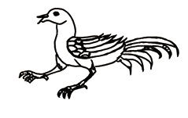只名叫牟尼的美丽鸟，不仅自己修行，还能向同类鸟略微讲些正法。

当时，绕嘎阿色转生为一个名叫策杰的人，抓住那只鸟养了起来。

## （73）蜘蛛

往昔，八劫前，我转生为一只蜘蛛，身体湿软，口中吐丝。

我在空中结网时，一个名叫塔甘的人在制作酵母。一个叫休瓦的孩子，用嘴咬断了蛛丝，我掉在火里死了。

那两个人的名字现在一个带有“达”，一个带有“匝”。这是不清净的前世，没有任何利益。

## （74）获宝者

往昔，八劫前，我转生为一个名叫古古的人。绕嘎阿色是我的兄弟，名叫阿库。

我在山谷的一个岩洞里，偶然发现了各种珍宝。那时一个叫比利的人生起嫉妒心，在通往那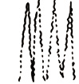里的路上，埋下许多像针一样锋利的铁钉。有一天，阿库去打猎，我去岩洞找珠宝，被铁钉刺死了。我很有慈悲心，修行佛法。

比利的名字现在带有“嘉”。

## （75）行善者

往昔，八劫时，我转生为一位名叫班玛的人，虽然没听过佛法，但自然地以身语意三门行善。我有个女婿名叫竹巴嘉。绕嘎阿色那时叫衮钦。

竹巴嘉曾三次将我赶下船，因此结下了缘分。竹巴嘉就是现在的门朗嘉措。

## （76）管家

此后，在东南方世界的普喜劫，毗婆尸佛的教法下，我转生为一位名叫桑波的管家。绕嘎阿色那时是精通事理的上师。因前世的因缘，竹巴嘉转生为名叫阿嘉的僧人。

这位上师和我二人，为佛殿、经典等佛法事业做了很多贡献。

## （77）鸟

往昔，八劫前，我转生为一只名叫香达的鸟，住在森林中，向其它同类的鸟讲法，并以身作则地修行。

当时，绕嘎阿色是一只叫牟尼的鸟。我们一起生活，轮流给对方提供食物。一个现在名字带有“达”的人杀死了我。

## （78）具神通者

往昔，七劫前，我转生为一位具神通者，名叫罗玛。那时绕嘎阿色转生为狐狸。

有五个人生了重病，快要死了。我知道狐狸的肉能治病，就杀了狐狸给他们吃，结果，两个人痊愈了，三个人不愿意吃。我用狐狸皮盖在那三个人身上，他们也恢复了健康。我把剩下的狐狸肉做成药丸，广泛利益了许多病人。

## （79）行善者

由于这个业缘，在下一世，我转生为一个名叫沃忠的人，那只狐狸转生为一个名叫沃安的人。我非常富有，修行佛法，修造了三宝像。

有一次，我们两兄弟共骑一匹马前往某地。到了以后，沃安让我躺下休息，我照做了，结果沃安用剑杀了我。

我的肉变成了七世梵志肉。人们把它做成药丸，广泛流传，能治愈疾病、清净罪障、阻断恶道之门。有些种姓高贵的人吃了，获得了神通。

## （80）造像师

往昔，七劫前，在西南方世界的放光劫，诸佛主尊佛的教法下，我转生为一位精通造像的工匠，名叫阿康。在一生中，我以菩提心造像，铸造、绘画、雕塑了无数佛像。

当时，绕嘎阿色名叫班玛，是一位精通绘画的画师，也是我的助手。

一位施主同时邀请了我们二人。我有神通，说：“今晚房子会倒塌，谁死了就不会堕入恶趣。”其他人都逃走了，只有我们两个和两位老施主死了。这对施主夫妇转生到了天界。

## （81）彩蝶

又，在七劫前，我转生为一只彩蝶，向同类昆虫说法。

一个名叫彭协的人渡河时，我飞过他的上方。一个叫哲东的人拍了我一巴掌，我掉进汹涌的河里死了。

那两个人的名字现在一个带有“匝”，一个带有“达”。

## （82）孩子

往昔，六劫前，是没有正法的暗劫。那时我转生为一个名叫玛休的孩子。

我向人们讲法，但有思想的人中没有一个肯听。我教孩子们念六字大明咒，指示心性的本来面目，使他们生起了禅定。

有一天出现滚落的石头，我被砸中头部而死。

## （83）公山羊

往昔，六劫前，我转生为一只具有慈悲和禅定的公山羊。陈列那时也转生为公山羊。还有一些有善缘恶缘的人，转生为山羊和绵羊，成为一群羊。

绕嘎阿色是名叫阿嘉的牧羊人。他不打其它动物，还会给它们拔草喂食。

有一天，牧羊人说：“这只山羊很肥，应该宰了吃。我如果不宰，其他人也会宰。”这时我生起悲心，吞下一把小刀，献出了身体。

## （84）燕子

往昔，一劫前，我转生为一只有智慧的燕子。我自己修持禅定，也向其它鸟讲正法。

当时，许多人染上了严重的瘟疫。治病者让所有病人洗澡，用铜盆装满洗澡水，并说这能转移疾病，要求人们将水泼到任何一个生命身上。一个名叫丹安的人，将铜盆里的水泼在了我身上，我当场死亡。

那个人的名字现在带有“达”。

## （85）鹞鹰

往昔，五劫前，我转生为一只鹞鹰，向所有鸟类讲法：“要断恶行善。”

当时，绕嘎阿色转生为一只乌鸦，它对我说：“不能断恶，怎么断？你先自己断吧。”我就用嘴衔起一块土扔掉，说：“就这样断。”乌鸦说：“在轮回中流转没什么意义，转生为旁生没什么意义，还是不要造恶，要行善。”

有一个叫波奇的人死了，我和乌鸦等一些鸟落在尸体上。我衔起一段肠子飞走，被一个名叫色列的人用箭射死。

色列的名字现在带有“嘉”。

## （86）孩子

又，五劫前，我转生为一个叫阿杰的孩子，本来能做一些利益众生的事。

一个现在名字中带有“嘉”的人，那时是个女巫。我们在玩耍时，女巫生气地跑过来，拿起一块石头打在我的脸颊上。经医生诊治，我的脸骨断了，然后就死了。因为这个障碍，我没能利益自他。

## （87）国王

往昔，五劫前，在南方世界的光明劫，大莲花佛的教法下，我转生为一位非常富有的国王，名叫金刚王。

当时，绕嘎阿色是一位名叫遍智的上师，深具学问与成就。我成为这位上师的施主，使佛法兴盛广大。

## （88）鹦鹉

往昔，五劫前，在上方世界的结缘劫，大劫佛的教法下，我转生为一只会说话的鹦鹉，一直念诵“嗡班匝儿萨埵吽”，知道这是修金刚萨埵的法门。

在一座佛堂里，有一尊一肘高的水晶金刚萨埵像。我因信心和修行，常常瞻仰佛像。那尊像和我的主人是名叫极善的上师，就是绕嘎阿色。有个名叫无依的僧人与上师不和，他拿着锤子敲上师的金刚萨埵像，我说“不要打”，但没能阻止，佛像被打碎了，我也被顺便打死。

那个人的名字现在带有“达”。

## （89）班智达

往昔，五劫前，在东方世界的普超劫，善妙佛的教法下，我转生为一位名叫德尊的比丘，非常有学问。那时绕嘎阿色是名叫阿尊的比丘，也很有学问。我们二人都是班智达，还有一位学者名叫阿帕，我们三人在当时被称为“赡部洲佛教的三大庄严”。

阿尊和我长期辩论，我们两人都获胜，声名大噪。阿帕如今转生为策龙巴。

## （90）好上师

往昔，大约五劫前，在西南方世界的行善劫，仁慈佛的教法下，我转生为一位名叫善妙的好上师。绕嘎阿色是我的道友，是名叫极善妙的好上师。我们二人为佛教做了很多事。

一个现在名字中带有“嘉”的人，那时转生为马，使我从马上摔下而死。陈列那时是一匹小马。

## （91）首领

往昔，大约五劫前，在这个世界的美好劫中，我转生为一位有权有势的首领，名叫阿觉。绕嘎阿色是我的仆人，名叫阿迪。我很有慈悲心，广行布施。

## （92）骑马者

往昔，五劫前，在东下方世界的欲善劫，摩尼佛的教法下，我转生为一个名叫希瓦的人。我自然生起了止观禅定。

我有一个舅舅，名叫特克，是马夫。他有一匹叫色巴的野马。

有一天，我吹嘘道：“我今天能骑那匹野马。”舅舅说：“你在我面前骑。”我骑了一下便下马，说这很容易。舅舅让我再骑一次。正当我想骑的时候，野马却用蹄子踢中了我的心脏，我倒下了。舅舅说念观音心咒就不会死，我虽念了咒，但还是立即死了。

那个舅舅的名字现在带有“匝”，马的名字现在带有“嘉”。

## （93）书法家

往昔，四劫前，在南方世界的有衣劫，怙主佛的教法下，我转生为一位优秀的书法家，名叫达利。绕嘎阿色是一位名叫札西的上师。我对他产生信心，供养了一匹马、三盏灯和酥油。那匹马现在是秋佩。

我一生都做这位上师的秘书，修持生起次第、圆满次第，尤其是空性。

## （94）猴子

往昔，四劫前，在东北方世界的极光劫，大悲佛的教法下，我转生为一只专注修禅定的猴子。

有一位名叫喇嘛钦布的上师，他虽无执著，但非常珍视一只黑羚羊角号。我被养在他的身边。

上师圆寂后，一个名叫彭遮的坏人吹那角号。我想：“这是我上师最珍爱的角号，不该吹，这坏人会把它弄坏的。”想着我就抓住角号。那人生气了，用刀刺我的心脏，杀死了我。

那个坏人的名字现在带有“匝”。

## （95）求法者

往昔，四劫前，在北方世界的利损劫，善见佛的教法下，我转生为一个名叫给勒的虔诚之人，勤于求法和听法。

现在名字带有“达”的人，当时是一位名叫散竹的比丘，他很看重佛法。我以敬信心供养了他一幅唐卡。他说：“把你的刀给我。”我把刀给了他，他用刀杀死了我。这也是为求正法而献出生命的。

## （96）西藏国王

往昔，三劫前，在东下方世界的乐作劫，成熟佛的教法下，那时有西藏，我转生为一位西藏国王，名叫极善，统治两地。我建造了一百零三座寺院，复兴了衰败的佛教。

那时绕嘎阿色在印度，是一位著名的外道班智达，他念诵了一亿遍湿婆咒，能力非常强大。我误以为他是佛教徒，派人送去大量黄金，对他说：“随你怎么用来利益佛教。”对此，具髻湿婆不高兴，生气了。我问别人他为什么不高兴，别人说他是外道，于是我就不送金子了。

## （97）上师

往昔，三劫前，在西南方世界的极乐劫，无量光佛的教法下，我转生为一位名叫戒金刚的上师。我只是有班智达的名号，做过一些闻思修和讲辩等事。

当时，绕嘎阿色是我的弟子，是名叫戒幢的比丘，远近闻名——我说“你也不总是我的上师”，说完哈哈大笑[^2]。

那时还有一个名叫戒光的比丘，有大功德，威仪出众，他现在是杨达。有位沙弥名叫阿有子，他现在是策仁布。

## （98）显宗学者

往昔，三劫前，在西北方世界的清净劫，阿难佛的教法下，我转生为一位名叫善上师的显宗学者，持戒清净，主要修空性。

绕嘎阿色是我的侍者，名叫德光，擅长做食子。

## （99）造像师

在那个世界那个教法下，我转生为一位非常精通造像的工匠，在绘画和雕刻方面无人能及，名叫根松，名声远扬。我发菩提心造了无数佛像。

绕嘎阿色是我的父亲，是位擅长绘画的画师，名叫忠勒。他的一生致力于缮写经书。

## （100）施主

在那个世界之后，大力佛的教法下，我转生为一位名叫阿卓的施主，十分富有。我修持念诵，并广行布施。

当时，绕嘎阿色是一位名叫图钦嘉的密咒师，很有能力。我成为他的施主，并将女儿献给他当空行母。

那时我的邻居与这位密咒师有矛盾，密咒师降下雷电，不小心将我劈死了。我们双方都没有伤害对方的心。

## （101）善行者

在那个劫那个世界，我转生为一个名叫果勒的人，弟弟阿觉是绕嘎阿色。我们广行布施等善行，并邀请善上师到家中。

有一只鹦鹉，我们请上师为它加持后，一直养着。有一次，鹦鹉弄洒了糌粑，阿觉生气了，用刀杀了鹦鹉。我们两人因此而争吵打架。

## （102）孩子

往昔，三劫前，我转生为一个名叫布迪的孩子，本想做些利益众生的事。一位有才能的人，名叫潘纳让。孩子们玩耍时，我犯了错，被他打了几下。他把我扔进火里，我就死了。

绕嘎阿色是我的哥哥，名叫列威。他因为弟弟被杀，在路上用棍子打了那个人，说：“你杀了那孩子，犯了罪！”这是不清净的前世，没能利益众生。

## （103）具德上师

往昔，三劫前，在西北方世界的清净劫，大力佛的教法下，我转生为一位名叫欢喜的具德上师。我没有眷属和弟子，只有自己一个人。

那时绕嘎阿色是一位富有的施主，常常供养我食物。

## （104）公鹿

往昔，三劫前，我转生为一只公鹿，对其它鹿有慈悲心，不伤害它们。

那时，人间正遭遇大饥荒。现在名字中带有“匝”的人，那时叫吉措，是个老乞妇，她因饥饿而哭喊。我生起慈悲心走过去，但那里没人，老妇人已离开。我跟着过去，看到老妇人躺在那里快要死了，旁边有一把很锋利的小刀。出于慈悲，我吞下了刀，用人语说了这个偈子：“呜呼老妇莫悲叹，我将此身布施你。”

老妇人说：“鹿知道要布施身体给我，真是太慈悲了。哈哈真稀奇，这里有一个要救我脱离饥荒的，鹿竟然会说话。”说完，她站起来跳舞，然后吃了鹿肉。

## （105）新娘鸟

往昔，三劫前，我在那个世界转生为一只美丽的新娘鸟，向其它鸟讲法。

现在名字中带有“嘉”的人，那时转生为鹞鹰，杀死并吃掉了我。

## （106）铁匠学徒

往昔，两劫前，我转生为一名铁匠的学徒。虽然佛法不兴盛，但我天生具有悲心，努力行善布施。

我名叫札拉。我的主人就是绕嘎阿色，是名叫沃丹的铁匠。他天生也具有悲心，行善布施。

## （107）母狐狸

往昔，两劫前，我转生为一只具悲心的母狐狸。

当时，人们正遭遇大饥荒。现在名字中带有“达”的人，那时名叫无光。他出去乞讨时，在路上生了一堆火，坐在那里。看到他极度饥饿与痛苦，我生起了慈悲心，用人语说：“老父我此身，愿布施于你，你今当享用。”说完跳进火里死了。

那人说了这个偈子：“遭遇如此饥荒年，狐狸布施极善妙，凭其说话方式看，可知本性为菩萨。”说完，他便吃了狐狸肉。

## （108）大修行人

往昔，两劫前，在北方世界的极喜劫，极贤佛的教法下，我转生为一位名叫沃喜的卓越大修行人，那一生，我只修禅定。

绕嘎阿色是一位富有的施主，名叫札西，他常常供养我食物。

## （109）老鼠

往昔，两劫前，在北方世界前面佛陀的教法下，有两只住在割草人屋顶缝隙里的老鼠，像大象一样有长鼻子。一只咬坏了佛经，另一只有智慧的老鼠说：“不能吃经书，这是佛语，不是人的食物。”虽然这么说，但对方不听。

有智慧的老鼠用爪子拉住它，不让它吃。那老鼠就是我，当时我信仰三宝，不损害三宝所依，而且具有慈悲心。我的朋友老鼠就是绕嘎阿色。

## （110）老鼠

此劫之前，在一个大岩洞中，我转生为一只会说法的老鼠，具有慈悲心。绕嘎阿色转生为岩鼠，我向它讲法，它也生起了禅定。

现在名字中带有“嘉”的人，那时转生为黄鼠狼。我想向黄鼠狼讲法，但被它吃掉了。

## （111）虫子

此劫之前，我转生为达嘎布谷鸟栖息的杨树上的一只虫子，向三百只同类的虫子讲法，那些虫子都学会了修禅定。

现在名字中带有“达”的人，转生为布谷鸟。记得吃掉了那三百只虫子。

## （112）孩子

之后，我转生为一个孩子，虽然无人教导，但自然生起了禅定修行。

现在名字中带有“达”的人，那时是我的玩伴。我们一起坐船渡过大河。坐在船头的他推了我一把，我掉进水里死了。

## （113）岩鼠

之后，我转生为一只岩鼠，自然懂得修禅定，但无法清楚地向其它动物讲法，只能像说谚语一样告诉同类：“有一种叫做佛法的东西。”

现在名字中带有“达”的人，那时转生为一个孩子。他用弓箭射死了我。

## （114）大鱼

之后，我转生为河里的一条大鱼，向和自己差不多大小的鱼广说修悲心的方法和功德。

那地方有个病人，医生说他需要用鱼肝来做药。一个人带着一个孩子来捕鱼。其它鱼都逃走了，没被抓住，只有我出于利他心没有逃，被杀了。我成了那个病人等人的药。

## （115）孩子

此劫之前，我转生为一个叫那迦的孩子，虽然无人教导，但常念“嗡班匝儿萨埵吽”。我以玩耍的方式向其他孩子讲法。

现在名字中带有“达”的人，那时转生为熊，把我吃掉了。

## （116）水蛭

之后，我转生为一条水蛭，住在沼泽里。

我咬住一个到处说闲话的人。那人说：“啊呀，我明天就找不到石头了。”想着就用拇指捏死了我。

那个人现在名字中带有“嘉”。这是不清净的前世，没有信仰佛法的心。

## （117）大鹏鸟

之后，我在那个劫中转生为一只红色的大鹏鸟，身体有半座大山那么大。

我飞遍虚空各方，从海中捕食许多龙。我降伏邪恶的龙众，向所有大鹏鸟讲法，但自己没有修行。

有一次，我为了从海里抓龙，俯冲入海，沉溺而死。

## （118）鹅王

往昔，两劫前，在北方世界的善妙劫，有一位名为善妙的佛陀。我在那里转生为一只鹅王，见到那位佛陀后生起了禅定。

我大约有一千只鹅眷属。一位名叫宝王的国王来捕捉我，我的眷属都逃走了。我有神通，知道国王不会杀我，就没有逃。

国王心里有怒气，杀了一位比丘，还用刀杀了一位上师的坐骑。

那个国王就是现在的这只猴子。我很喜爱这只猴子。

## （119）猴子

之后，我转生为一只猴子，向所有猴子说正法。绕嘎阿色转生为一只叫给鲁的猴子。

有人来说要杀猴子，我对其它猴子说：“喂，猴子们，快逃吧！这个人要来杀你们。”给鲁却说：“不用逃，他不会杀我们。”我生气了，跑到岩缝里去了。

## （120）密咒师

此劫之前，在北方世界的善妙劫，善妙佛的教法下，我转生为一位名叫陀佐的密咒师，拥有神变威力，所有人都怕我且憎恶我。

我成就了金刚手、阎魔敌等本尊。我还有名为降雷和雷王的本尊，名为雷甲兵器的护法，还有一种叫雷顶的法，可以想杀谁就杀谁。

当时，我有一位叫阿根的侍者，就是现在的绕嘎阿色。

## （121）密咒师之子

之后，我在那个世界转生为密咒师的儿子，名叫吉祥光。我是最小的儿子，做过无量念修。我像父亲一样有神通和神变。

我的父亲是绕嘎阿色，那时是一个叫莲花雷猛的密咒师。他念诵了一亿遍胜乐七字咒等，修持了无数本尊和护法。他有各种神变和无碍的威力。

## （122）巴巴野兽  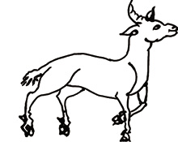

此劫之前，我转生为一只名叫巴巴的野兽，有红色的角和耳朵，向一千只同类的野兽和阿卢鸟说正法。

当时，绕嘎阿色转生为名叫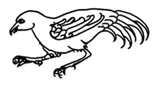格勒阿勒玛的鸟。一只狮子想吃那只鸟，我用计策引开了狮子，鸟得救了。

## （123）读经人

此劫之前，在东方世界的善眼劫，莲花佛的教法下，我转生为一位名叫桑珠、很有智慧的读经人。我有一个叫扎西的朋友，也是读经人，和我一样。

我们在经书堆旁披着衣服诵经时，一只虫子缓缓爬过，结果被麻雀叼走。当时，扎西说不想读经了。我说了一个偈子：“且观前方爬行虫，无常被鸟叼上空，一切变化皆如此，精进诵经修正法。”

我通过认真学习，成了班智达。扎西成为我的学生，他就是绕嘎阿色。

## （124）菩萨

此劫之前，我转生为名叫希沃的长者，是一位隐秘的菩萨。我邻居是一位叫提卡的长者。

我们在割如孔雀颈般的上等草时，发现了一种像湿婆标志一样卷曲的草。提卡用这根草刺死了我。有神通的人知道，我的肉会变成七世肉，吃一点或制成药丸服用，所有疾病都会好，还能阻断恶趣之门。

提卡是现在的绕嘎阿色。他明知故犯地表现出这个样子，是为了利益众生。

## （125）羊

此劫之前，在西方世界，我转生为一只有慈悲心的羊，向同类的动物讲法。

现在名字中带有“嘉”的人，那时是一个叫沃德的做禳解仪式的密咒师。他说：“我的鼓皮破了，给我一只肥羊的皮来包。”现在名字中带有“匝”的人，那时是羊的主人。他杀了我，把我的皮给了密咒师用来包鼓。

## （126）善行者

此劫之前，在这个世界，我转生为一个叫比雷的人，很有慈悲心。虽然正法不兴盛，但我天生行善，自然修禅定。

当时，我有一个叫阿纽的朋友。我们之间有点不和，阿纽在茶里放了毒药，想让我喝。但茶壶里的水溢出，洒到灶上，灶裂开了。我没喝成，所以没有受到伤害。

阿纽就是绕嘎阿色。这是不清净的前世，善恶都很微小。

## （127）马

此劫之前，在西北方世界的安乐劫，界种住佛的教法下，一户人家的马跑到了山上。小马被埋在一堆草里，无法动弹，但它没有死，吃草渐渐长大。后来，它来到一座破旧的寺院，用嘴衔起一顶丝绸帽子放在背上，又衔了一包茶叶走了。它把这些东西供养给一位名叫光皱的有神通的上师。

它又找到一根下面被火烧过、顶上有叶子的树枝供养给上师。上师观察缘起后说道：“这根树枝上面是白色的，表示这匹马前半生懂正法；下面是黑色的，表示这匹马不久就会死。”

此后，这匹马又找到了混有酥油的奶酪、泥土做成的宝石状物品、金轮、用金银制作的七宝、吉祥草、宝瓶等，一一供养给上师。上师非常欢喜。

之后，有一头犏牛嘴里叼着一捆草走过，马想叼着那捆草带到上师那里供养。这时，一位叫吉德的僧人用石头打犏牛，犏牛受惊跑掉，掉下悬崖落水而死。没过多久，马也死了。

马是化身我，犏牛是顿珠，上师是绕嘎阿色，僧人是秋佩。

## （128）青蛙

此劫之前，我转生为一只青蛙。我自己修慈悲心和禅定，也向其它青蛙讲正法。

现在名字中带有“达”的人，那时是一个挑水的女人，把水瓢挂在肩上。她看到我后，说“啊呀啊呀”，用水瓢打死了我。

## （129）孩子

此劫之前，我转生为一个名叫吉鲁的孩子。虽然正法不兴盛，但我知道如何修慈悲心和空性，只是自己修行，而不向他人讲法。

我的父亲叫美鲁，就是现在的这个孩子本鲁。

## （130）求法者

往昔，一劫前，在东方世界的极乐劫，极乐佛的教法下，我转生为一位名叫秋佩的信徒。当时，我想请教修禅定的法。

现在名字中带有“匝”的人，那时是一位修禅定、有证悟的仙人。我供养了他一匹马，请求传法。仙人说：“你用这把剑砍自己的身体，我就教你法，否则便不传。”于是，我用右手拿剑，砍断了左手。仙人说：“这是恶业。”然后不再说什么。

他给了我一支矛，说：“用这支矛刺自己的身体。”我把矛刺进身体，仙人称赞我很勇敢。

仙人又说：“现在把刀刺进自己的身体。”我把刀尖刺入，仙人说：“善断。”

然后他说：“你现在跳入火中，我就说法。”我跳进火里，仙人说：“哇。”

然后他说：“你从高崖上跳下去，我就教你最后的部分。”我跳下去，仙人说：“修行啊。”接着不再说什么。

我从前就知道要断恶行善，但我说不知道“啊”是什么意思。之后，仙人指出我用刀、矛、跳崖等行为的过失。最终，我去世了，为了佛法而舍弃了生命。

这看起来是魔在制造生命和身体的障碍，但因为是为了佛法，所以成为福德资粮。

## （131）鹧鸪

之后，在这贤劫初形成时，我转生为一只鹧鸪，向其它鹧鸪讲正法。

现在名字中带有“嘉”的人，那时是个牧羊人。他用石头打死了我。

## （132）禅定者

之后，我转生为一个名叫多果的人，很有慈悲心，天生具有禅定。

我死后，头骨被一只狗咬着。那只狗虽是猎犬，但不伤害众生和其它野兽。

那只狗就是现在的绕嘎阿色。它咬着的头骨是七世肉。

## （133）犏牛

之后，我转生为一头犏牛，虽然不能向他众讲正法，但懂得修慈悲心和空性。

绕嘎阿色那时是马，孩子本鲁是羊，我们三个一起生活。我们的主人叫匝德，就是现在的秋佩。

## （134）公羊

之后，我转生为一只公羊，向母羊们讲正法。绕嘎阿色同时转生为马。

有一次，我在渡河时，一个名叫色沃的人用石头打死了我。色沃的名字现在带有“嘉”。

## （135）马

之后，我转生为一匹马，天生有慈悲心，修禅定。我向其它马略微讲些法，和大约九百匹马生活在一起。

绕嘎阿色也同时转生为马。我们的主人是一个叫帕玛的人，具有恶相。他骑上我这匹最好的马，我不听话而狂跳，主人生气了，用刀杀死了我。那个人的名字现在带有“达”。

## （136）蚂蚁

之后，我转生为一只蚂蚁，住在一个叫穹俄的地方，向其它蚂蚁讲正法。

当时，有一个叫松鲁的牧人坐在蚂蚁窝上，将窝弄坏了。那里有大约一千只蚂蚁，九百只爬到了牧人身上。牧人抓住我这只讲法的蚂蚁，用拇指使劲捏死了我。绕嘎阿色当时也是那群蚂蚁中的一只。

那个牧人似乎在放牧很多牦牛。他现在的名字带有“嘉”。

## （137）勇士

这个劫中，在北方世界的称严劫，迦叶佛的教法下，我转生为一位名叫德扎的勇士，非常恭敬出家人。

当时，绕嘎阿色是一位比丘，名叫辛德则。有一个名叫米协的屠夫想杀他。我杀死了屠夫，救了辛德则比丘的命。那屠夫现在叫拉克夏。

## （138）虫子

之后，在这个贤劫中，我转生为一只名叫其结的虫子，具有大悲心和禅定。

当时，绕嘎阿色转生为老虎。有人给老虎设下捕兽圈套，我出于利他心，咬断了圈套的绳子，救了老虎的命。设置捕兽圈套的人，现在叫拉克夏。

## （139）大修行者

这个劫中，在西方世界的极善劫，善光佛的教法下，我转生为一位名叫善妙的大修行者。

当时，绕嘎阿色转生为猫头鹰。它飞行时看到秃鹫飞翔，心想：“我飞不了那么高啊。”于是很难过。它看到我在修禅定，就发愿：“愿我来世能像他那样。”那只秃鹫就是现在的扬达。

## （140）禅修者

之后，我转生为一个叫擦达瓦的人，暗中修行禅定。

我手里拿着一根骨笛，来到绕嘎阿色转生的一位修行比丘那里，问他要不要买骨笛。比丘说：“我不买，我在修禅定。”这是在测试他的禅定境界是否稳固。

## （141）施主

之后，在那个劫那个教法中，我转生为一位名叫根德的富有施主，勤修善法，修持禅定。

当时，绕嘎阿色是名叫宿巴的清净婆罗门，专修莲花顶佛。我成为他的施主。

## （142）施主

之后，我转生为一位名叫桑波的施主，行持十善，修行禅定，非常富有。

当时，绕嘎阿色是名叫日毕宁玛的婆罗门，非常有学问，专修名叫普贤的观音。我成为他的施主。

## （143）施主

之后，我转生为一位名叫沃协的施主，行持十善，修行禅定义。

当时，绕嘎阿色是名叫朗达的持戒婆罗门，修持普贤观音和欢喜观音。我成为他的施主。

## （144）施主

之后，我转生为一位名叫拉沃的施主，具大财富，精进行善。

当时，绕嘎阿色是名叫班玛的清净婆罗门。他专修欢喜观音、普贤观音和莲花顶佛。我常常供养他食物。

## （145）施主

之后，我转生为一位名叫色休的施主，具大财富与权势，而且行善。

当时，绕嘎阿色是名叫格雄的清净婆罗门，专修莲花顶佛。我供养他食物。

## （146）国王

之后，我转生为一位名叫绕吉的国王，权力和财富都很圆满，统治三大区域。

当时，绕嘎阿色是一位比丘，名叫钦巴，持戒清净，专修善光佛。他是终生修行者，而我一直供养他食物。

## （147）比丘

又，在那个劫那个教法中，我转生为一位持戒修法的比丘，名叫乔美。

当时，绕嘎阿色是桑波大上师的侍者。

## （148）明妃

之后，我转生为一位具有空行母法相的女人，是密宗见行圆满的空行母。

当时，绕嘎阿色是一位非常有学问的在家班智达，名叫界巴。我这位叫秋吉玛的具相空行母，成为他的明妃。

## （149）比丘

之后，我转生为一位很富有的比丘，建造三宝所依等，广行善法，名叫沃强。

当时，绕嘎阿色是一位持戒者，名叫嘉钦。我成为他的施主。

## （150）明妃

之后，我转生为一位具有空行母法相的女人，以婢女的形象出现。我修持密宗生圆次第禅定，名叫格瓦玛。

当时，绕嘎阿色是一位很有智慧的在家班智达，行持密法，名叫嘉穹。他有时把我当作明妃。

## （151）明妃

之后，我转生为一位具有空行母法相的女人，名叫塔兰，行持密法。

当时，绕嘎阿色是一位名叫多巴的在家班智达。我成为他的明妃。

## （152）明妃

之后，我转生为一位行持密法的空行母，名叫嘎瓦玛，是位瑜伽女。

当时，绕嘎阿色是一位名叫泽巴、行持密法的在家班智达。我成为他的明妃。

## （153）施主

之后，我转生为一位精通造像、绘画等工艺的人，具有丰厚的财富受用，行善修法，名叫格希。

当时，绕嘎阿色是一位以戒律清净、智慧超群而闻名的班智达，名叫科巴。我既是他的弟子，也是他的施主。

## （154）尼姑

之后，我转生为一位行持佛法、示现婢女相的尼姑，守持戒律，禅定不动摇，名叫镜姆。

当时，绕嘎阿色是一位叫嘎姆的比丘尼，以侄女的形象出现。

## （155）证悟者

之后，我转生为一位具有证悟、禅定圆满的人。

绕嘎阿色是我的明妃，是一位修行的尼姑。我叫希巴，她叫托托。

## （156）空行母

之后，我转生为一位空行母。我没有出家，但行持十善，具有禅定，人们叫我乌姆。

我的女儿就是绕嘎阿色，是一位叫吉玛的比丘尼。

## （157）密咒师

之后，我转生为一位断除贪欲道的密咒师，修法能力非常强。我很有名，名叫绕杰。

当时，绕嘎阿色名叫阿吉玛，成为我的明妃。我们二人一起专心修行。

## （158）瑜伽女

之后，我转生为一位示现婢女相的瑜伽女。我非常精进地修法，名叫哲姆。

绕嘎阿色是我的侄女，是一位叫桑姆的比丘尼。

## （159）瑜伽士

之后，我转生为一位名叫沃阐的上师，是位修大乘密宗的瑜伽士。

当时，绕嘎阿色是一位叫塔协玛的尼姑，具空行母法相。她成为我的明妃。

## （160）住持

之后，我转生为许多比丘尼的住持，名叫洛拉玛。

当时，绕嘎阿色是一位叫桑姆的比丘尼，是我的弟子。

## （161）大臣

之后，我转生为一位维护佛法的大臣，名叫雅桑，勤修善法。

绕嘎阿色是我的国王，名叫格丹，是位法王。

## （162）施主

之后，我转生为一位拥有众多财宝的富有施主，名叫沃坚，广行大善。

当时，绕嘎阿色是我供养的上师，是位戒律清净、智慧超群的比丘，名叫桑拉。

## （163）侍者

之后，我转生为一位有智慧的人，名叫沃穹，守持戒律，勤修善法。

我是一位叫耶桑的比丘的侍者。那位比丘就是绕嘎阿色。

## （164）女侍者

之后，我转生为一位具相的女居士，名叫囊卡措，修持禅定。

当时，绕嘎阿色是一位名叫沃坚、行持密法的比丘。我成为他的女侍者。

## （165）施主

之后，我转生为一位名叫沃协巴的施主，非常富有，勤修善法。

当时，绕嘎阿色是一位戒律清净、具有功德的比丘，名叫绕晋。我经常供养他。

## （166）施主

之后，我转生为一位名叫沃协嘉波的施主，非常富有，是佛教的施主。

当时，绕嘎阿色是一位叫桑波的持戒比丘，他成为我供养的上师。

## （167）施主

之后，我转生为一位名叫小沃协的在家人，非常富有。

当时，绕嘎阿色是一位叫金泽的持戒比丘。我经常供养他，他也非常恭敬佛教。

## （168）明妃

之后，我转生为一位修密法的女居士，具备智慧空行母的法相，名叫泽协玛。

当时，绕嘎阿色是一位修密法的比丘，名叫德兰。我成为他的明妃。

## （169）瑜伽士

之后，我转生为一位示现牧人相的瑜伽士，守持戒律，修行生圆次第。

当时，绕嘎阿色是一位富有的比丘，拥有众多牲畜，以牧人的形象努力修行。

这位比丘叫朵麦，我叫单炯。

## （170）獐子

之后，我转生为一只獐子。

有一个人在点灯，我远远看着，听到有人问：“你在做什么？”那人回答：“我在供灯修法。”我心想：“这是佛法啊！”于是想要自己也这么做。

有一天，那人手里拿着灯盏和弓箭来了。他看到我就拉弓，此时灯盏掉落，滚下坡，我叼起灯盏跑了。虽然我想学那个人供灯，但趁热擦灯的布在他腰上，没有那个布，我无法擦拭，只好把灯盏放在那里。

后来，我在一块石头上看到一盏已经做好的灯，便叼走了。附近山上着火时，我险些被烧到，但仍然没有扔掉灯逃走。我在一位云游上师面前供了灯，然后就跑了。听到上师说：“还有比这更可爱的吗？”这位上师名叫参桑波。

此后，我对所有鸟兽都说“要供灯”，对乌鸦也这么说。有一天，我得到了一盏油灯，却被乌鸦吃掉了。

供灯的上师是绕嘎阿色。供灯的人叫扎卢，就是现在的扬达，拉弓射我的人也是他。问“你在做什么”和在石头上放灯的是同一个人，名叫阿达，就是现在的陈列。

## （171）秃鹫

之后，我转生为秃鹫，向其它秃鹫讲正法。

有一天，我正要落在一具山羊的尸体上时，记得遭遇了雷电和冰雹。

## （172）小秃鹫

之后，我转生为一只小秃鹫，大约一个半月就死了。

一个像屠夫的人发现我的尸体，吃了一点，治好了他的病。村民听说后，都来抢夺屠夫的秃鹫肉，将其制成丸药，治愈了许多疾病。

## （173）班智达

之后，在这个贤劫，迦叶佛的教法下，我转生为一位名叫扎巴的班智达，被称为“赡部洲佛教的庄严”。

我有一位叫坚波的比丘侍者，前半生我们亲近和合，后半生却有些不和，他成为在家人。坚波就是绕嘎阿色。

《天法意伏藏》中说：“转生班智达，精通诸学问，多宣禅定法。”所讲的就是这段经历。

## （174）班智达

在其后一世，“精通诸学问[^3]”，意思是：我是名为沃嘉巴的班智达，精通五明，戒律清净，具有神通，在印度无人能及。

我有一位名叫涅巴的比丘弟弟，就是现在的绕嘎阿色。

## （175）大上师

在其后一世，“转为大上师”，意思是：我转生为名叫根德桑的舍事者上师，利益众生的事业广大，拥有无量眷属和弟子，寺院规模非常大，而我本人是受持舍事行为的禁行者。

我有一位名叫乐措的比丘尼妹妹，就是现在的绕嘎阿色。

## （176）上师

在其后一世，“转静居善师”，意思是：在尸弃佛的教法下，我转生为名叫达瓦的上师，只在山谷里修禅定，利生事业不是很大。

我有一位名叫嘉灿的侍者，就是现在的绕嘎阿色。

## （177）出家人

在其后一世，“转为出家人，彼以生嗔心，夺取一人命，于夜晚奔逃”，意思是：我转生为名叫扎西的人，是守持中戒的出家人，通达各种才能，拥有一些财产，行持过许多闻思修。

我将一尊尸弃佛的金像借给一个人，那人后来不肯归还。我们之间发生争执，我发誓说：“我不待在这里了！”就在我准备离开时，大家都劝我留下。我留下后，那人又挑衅我。

到了十号晚上，我和我的弟弟秋佩居士一起出去。对方敌人骑着好马追来，用刀砍了弟弟的肩膀。然后，弟弟割断了那人的脖子，杀死了他。

弟弟就是绕嘎阿色。那个敌人名叫秋空，就是现在的夏札。

## （178）毒蛇

因这件事的果报，在其后一世，“当知转为蛇”，意思是：虽然我转生为毒蛇，但知道如何修禅定，没有伤害他众。

## （179）獐子

在其后一世，“虽转为獐子，彼已供养灯”，意思是：我转生为獐子时，自己有禅定，也向同类讲法。

有一位密咒师在食子上插了一根长长的火焰牌，抛在山间。我叼着火焰牌，供在一尊玛尼石的佛像前。其它獐子问我在做什么，我说：“供灯是修行。”它们说：“没有灯，只有火焰牌。”这时我感到很伤心。

## （180）班智达

之后，“生为班智达”，意思是：在迦叶佛的教法下，我转生为名叫阿日志的班智达，是一位有大智慧的持戒者。我建造了两座佛殿，讲了很多法。

那时有一位名叫阿杰的僧人，就是现在的陈列。特杰就是现在的扬达。当时没有绕嘎阿色。

## （181）成就者

之后，“成就者杰巴”，意思是：在天法中，有邬金莲师所述的广传，这在别处有记载。

我是获得最胜虹身的成就者，后来成为莲花生大士的上师。

## （182）乌鸦

之后，“佛前一乌鸦”，意思是：因为因果不虚，对根本上师大成就者说过“像乌鸦”，所以示现转生为乌鸦。我向同类的鸟讲正法。

在释迦佛为太子悉达多时，我落在他面前，得到了食施。记得佛陀用手抚摸过我。

## （183）阿难

之后，我转生为佛陀身边的阿难，相关传记在经续中均有记载。

化身我在十一岁时，回忆起那时的许多情景：出家成为比丘；做佛陀的侍者；当狮子王出现时，其他眷属都逃走了，而佛陀用手抚摸狮子；佛陀头部和背后的光芒等，不像画得那样，而是前后都被光芒笼罩，佛陀并不是常常坐狮子座，也不是总是持触地印……说起这些稀有的事迹。

当时，绕嘎阿色是比丘嘎玛巴夏，向我请教了很多法。他刚刚见过佛陀的面容。

## （184）比丘

之后，“莲花生比丘”，意思是：在印度果拉地方，我有无碍的神通和神变，但不是特别有学问，拥有一百多位出家眷属。

现在的绕嘎阿色，那时是一位叫绕都雄瓦的比丘。我的上师是名叫班嘉的班智达。我利益了无量众生。

## （185）班智达

之后，“阿瓦惹智者”，意思是：我是具有学问、获得成就的班智达，拥有四百五十位出家眷属。

绕嘎阿色是我的眷属，名叫嘉迪。我弘扬佛法，广泛利益众生。这也是在印度果拉地方。

## （186）贝若扎那

之后，“贝若扎那尊”，意思是：对此我也亲口承认。其传记广为人知，此处不再详述。

当时，绕嘎阿色是藏王萨纳拉，后来成为我的弟子。我们同属一个时代，虽然身相不同，但本体相同。

舒普巴森与贝若扎那也是一体。舒普的传记，是我从心底流露出来的，在其他地方有详细记载。

## （187）班智达

之后，“噶玛德智者”，意思是：在印度拘尸那罗附近，我是一位学识渊博、戒律清净、获得成就的班智达，拥有五百五十位眷属。我修持显密二者，以显宗为主。

我有一位叫贡却嘉的侍者，就是现在的绕嘎阿色。我建造了一座寺院，广泛利益众生。

## （188）班智达

之后，我转生为名叫阿帕拉的班智达。我的故事详细记录在《天法意伏藏》中，可以从那里了知。

## （189）上师

之后，我转生为名叫贡桑莱的上师。“贡桑莱上师，称尼泊尔师，属于宁玛巴”，意思是：那时绕嘎阿色是名叫拉桑的上师，受到极大尊敬。我出生在尼泊尔，来到西藏后，既是他的道友，也是他的弟子。我们同样拥有‘上师’的名号，后来一起去了印藏边界。

他去世后，我在尼泊尔做广大事业，聚集了约三千名眷属，但寿命不长就去世了。

## （190）上师

之后，“邬金贡上师，于藏尼边界，修新旧两派”，意思是：在藏尼边界，我修持新旧两派的教法。尽管我功德不大，但具有禅定，念诵了阿玛惹尼咒一亿遍以上。

我有一位名叫桑杰的弟子，他也是我的上师。我们师徒轮流去村里做法事，人们对我们没什么信心。我们二人都长寿，擅长修生起次第和圆满次第。

## （191）上师

之后，“名贡嘎上师，身住于不丹，护持宁玛法”，意思是：我名为贡嘎嘉措，人称苏札瓦，在闭关处利益众生很大，拥有二百五十位眷属和弟子。

当时，绕嘎阿色名叫迪庆，是我的管家。我见到他时，得到了金刚亥母灌顶，结下法缘。我从酿上师的一位亲传弟子那里，得到了酿派的许多法，并进行修行。

## （192）茶工觉者

之后，我转生于康区的布域。

当时，绕嘎阿色在康区，成为一位名叫戒光、修方便道的上师，拥有众多眷属和弟子。我长期担任上师的茶工，因此被称为“茶工觉者”。我一边做茶工，一边修大悲观音，曾多次见到莲师等圣者。

之后，我到了家乡与印度边界，被称为戒幢，也叫慧光。我开启小圣地，取出了三十个伏藏卷，以及“系解脱”大中小三函。我拥有一百多名僧人，念诵了两亿五千万遍咒语。

我有一个儿子名叫上师王，也念诵了上亿遍咒语，持戒清净，利益众生非常广大。他就是现在的陈列。

## （193）茶工上师

之后，我转生为茶工上师，“师旺秋扎西，弟子为茶工，以上师得名，称毗苏瓦师”，意思是：在贡域，那时绕嘎阿色是一位修方便道的大圆满瑜伽士。我是一位施主的独子，对他生起信心，成为侍者后，被派为茶工。我帮上师开启小圣地，取出了小伏藏。上师把一个儿子供养给噶玛巴希，我也顺便拜见了他，并得到“胜海观音法”的传承。

之后，我成为茶工上师，利益众生非常广大，究竟证悟了大圆满，身体能示现幻变，手印和脚印都留在石头上。

## （194）汉地上师

之后，“扎洛巴上师，人称汉上师”，意思是：我出生在涅玛，去过汉地，具有神通与一些成就相，在汉地是位出名的成就者。

当时，绕嘎阿色生于央氏族，是让雄巴的弟子。因为我是雍敦大师的侄子，汉地皇帝迎请我并尊为上师。

后来，小雍敦、雍敦香穹、噶玛绕杰等去某地的路上，向我借用食子器具，我没有借，因此，他们说了一些“像山羊”之类的闲话，大臣割了我的鼻子等。

作为果报，小雍敦转生为山羊，被牧人割掉了鼻子。我见到那只山羊后，说起前世的因缘，它想起自己的前世，流下眼泪并生起悔意。之后，它的异熟果很快清净，转生为人。

## （195）舍事者

之后，“名希拉班扎，众人称策多，意为戒金刚”，意思是：在印度和尼泊尔的边界，我唯一修持宁玛教法。通过专心修行，后来获得了神通和神变。我以隐秘的方式住世，利益众生不算太广。

## （196）舍事者

之后，“成为舍事者，众人称为秋，后世即为你……”，意思是：在汉地峨眉山上，我舍弃俗事，专一修持，修的是大圆满。我有一些神通和神变，利益众生不太广大，以隐秘的方式住世。

## （197）舍事者

之后，“江域舍事者，人称为布切”，意思是：我出生于炯域，是一位居无定所的舍事瑜伽士，念修大悲观音并刻六字真言，四处游历。

我遇到一位强盗密咒师，因威胁而被那强盗密咒师诅咒，导致耳朵失聪，双脚也瘸了。

有一次，我飞过一条大河。由于四处云游，我没有弟子。

## （198）上师

之后，“在印藏边界，生为革绕师，众人称为革”，意思是：我精通新旧各派，修持方便道，具有神通和成就相。虽然所化众生不多，但我的儿子成为一位优秀的密续修行者。

我的父亲名叫邦桑，是一位住在拉萨的阿里商人，他就是现在的绕嘎阿色。我晚年住在印藏边界。

## （199）上师

之后，在噶陀寺，我转生为一位上师，行持了大量闭关和修行，没有很大的利他事业，也没有太多所化弟子。

我年轻时大部分时间用于画佛像，并生起相应的大圆满证悟。

## （200）上师

之后，我转生为嘎陀旺扎，又名嘉措，人称让卓巴。众所周知，我树立了修行的胜幢。

化身我在十岁时，讲述了那一世通过祈祷本尊降临，本尊亲自降临，在古拉洞中居住的情形、洞中的景象，以及为小牛那么大的山羊挤奶等种种事迹。

之后，就是我门吉多杰。

萨玛雅，印印印！卡塔姆固耶，密文！

以上是化身在十三岁时邬金莲师所说，以及阿玛玛密文等是他在十二岁时大悲观音所说的两种前世传记和零散记忆，另外也包括化身自己回忆的内容。他在十二岁时，零零散散地回忆起许多前世，并将其绘制成图进行解说。这些前世的顺序不定，数量众多，均分别记在备忘录上。在十三岁年底，他圆满获得天法的精髓，证得宿命通，随后将先前所写的内容按顺序整理出来。尽管他对这一世的传记和未来后世的情形也了然于心，但因寿命等缘起，在此没有清楚地写出来。

西日桑哈在向贝若扎那传授大圆满耳传时，授记道：“你与普贤王如来、金刚萨埵无别。你自此命终后，将在一千五百大劫中护持佛法。”由于在天法与化身亲自承认的内容中一致指出他就是贝若扎那，因此，他将于一千五百大劫中在十方护持诸佛教法，以无法想象的化身和再化身，必定随缘利益众生。

同样，在《王臣遗教》中，预言三十三位持明将依次来到藏地并获得菩提时，授记道：“在释迦佛刹土的多康地方，将出现一位行持大乘密宗的瑜伽士，密咒之主名为金刚称，他转世后将行持广大行。在此三千世界的北方，有一清净刹土名为旃檀林，他将成为如来、调御丈夫、无上师，教化三千众，佛号为佛智普贤。”

化身自己心里知道并承认，该授记指的就是他自己。他说那佛号的文字略有不准确，应该是“佛智遍智”。他提到，第一次聚会有一百位比丘，第二次三千人，第三次一万人，所讲的法是显密二者，寿量为一中劫，教法住世三中劫，佛身红色，具足化身的装束和相好。

如是以天法中前世传记的根本偈和化身所言为证，我绕嘎阿色，以偈颂非常简略地记录下来。如有任何错误或相违之处，向三根本忏悔。愿以此善根令深藏教法增长、广大！

芒嘎朗！格兰德休布，密文！

译于喇荣

2025年1月16日之吉祥日

[^1]: 绕嘎阿色：乔美仁波切。他是门吉多杰的根本上师，也是本书的记录者。
[^2]: 这段内容是门吉多杰在回忆前世时，对上师乔美仁波切（绕嘎阿色）说的。
[^3]: 这是《天法意伏藏》中对他前世的描述，后面也是如此。
