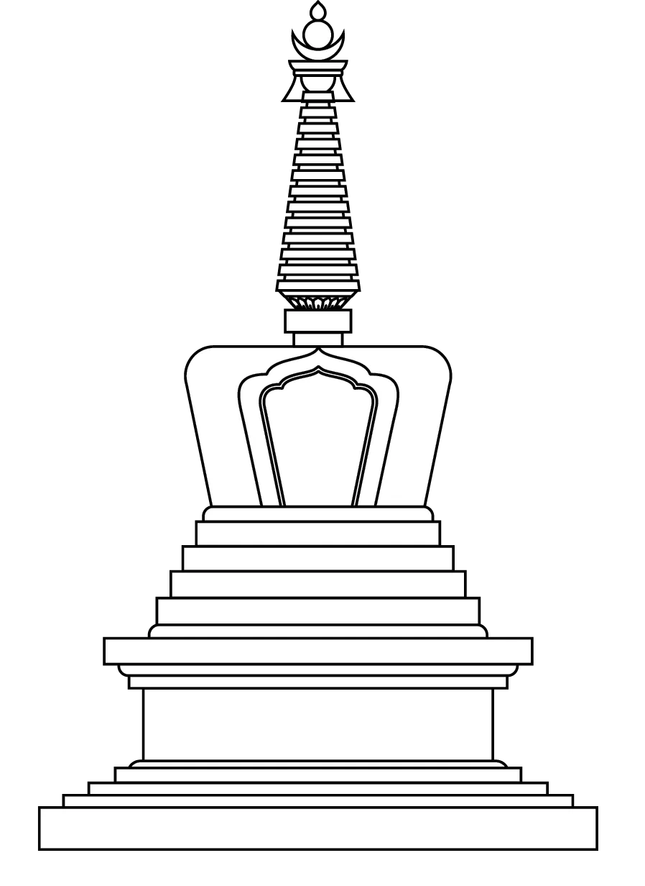
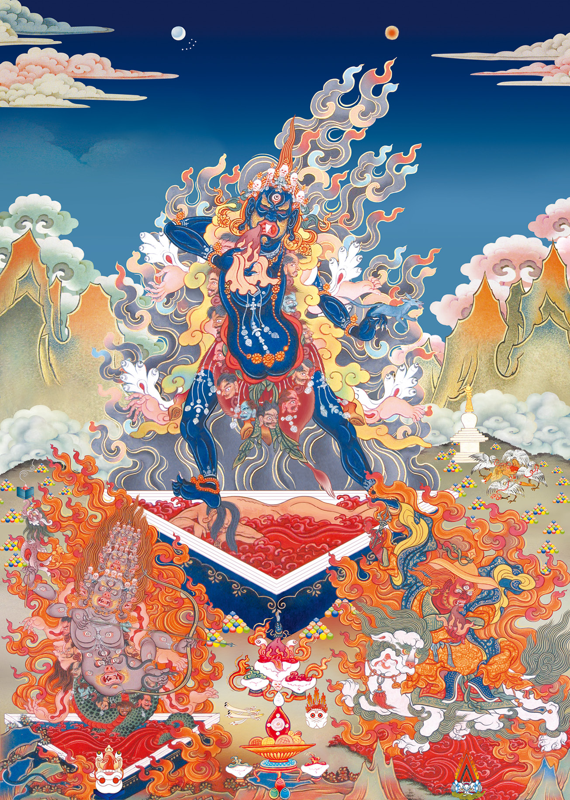

# 二十三 五毒息灭类

顶礼莲师身！

莲师及四部空行眷属加持的三种要诀是：外息灭男女夜叉鬼魔，中息灭四大不调疾病，内息灭五毒分别念。

1．外息灭男女夜叉鬼魔的要诀

1）以悲心息灭魔障的外修法

对于损害自他的魔众，心里观想：“他们是由恶业牵引才生起恶念恶行的，实在可怜。如果他们都能离开害他的心行，那该多好！”观想上师及四部空行眷属在自己头顶，念诵“嗡啊吽 班匝儿格热巴玛色德吽”进行祈祷。观想上师身语意三处放出三色光，照触魔众，平息其恶念恶行，令其不再作害，转而利益众生。

对自身也应无贪执，将血肉骨等先供养上师、本尊、空行，再将自己的血肉骨、内脏心肺等，无贪执地布施给那一鬼魔。若产生贪执，则会对自己有害；若无贪执，则能息灭其作害的恶念。

这是以悲心息魔的外修法。

2）以上师加持息灭魔障的内修法

观想自己头顶上有莲师及四部空行眷属，如前一样祈祷。依此，上方上师赐予加持，前方空行赐予加持，后方护法赐予加持，右方勇士赐予加持，左方勇母赐予加持，他们均赐予加持：加持身体安乐，加持语言具有威力，加持心中生起证悟。由此连鬼魔、违缘的名字都不复存在，天龙八部如仆从般听命，加持与悉地纷至沓来，身心温暖喜悦。

保持信心、意乐心、恭敬心进行祈祷至关重要。对他人进行加持，同样能够息灭他们的魔障与违缘。

这是以加持息魔的内修法。

3）以见解息灭障碍的密修法

首先，猛烈祈祷上师、本尊、空行。

上等智慧者了知：非人是心的分别念，心性不成立任何本体，远离根本，空性中没有神、没有鬼、没有病，连作害的名称也不存在。

中等智慧者观察：非人是害心还是害身？若害身，身是四大假合的无情物，不可能被带走；若害心，那心是空性，无从伤害。因此，能害与所害二者皆不成立，这即是了知心是空性的意义，应安住于其中。

下等智慧者应祈祷上师、本尊、空行，对身体无爱恋贪执，想到：“此魔本无实体，我的心也无实体，他想害我就害吧，不害就不害吧。”放下执著而安住，依此可息灭魔障。通过这种方法，能遣除自己的障碍，也能如是传授给他人以遣除障碍。

这是以见解息魔的密修法。

以上是外息灭男女夜叉鬼魔的方法。

2．中息灭四大不调疾病的方法

1）以悲心息灭疾病的外修法

无论是加持自己还是他人的疾病，普观一切病人都很可怜，特别是对自己或某个病人要修悲心。

接着，观想上师、本尊、空行安住于自己头顶，并进行祈祷。观想自己的右手掌心有代表诸佛大悲本体的白色“杭（ཧཾ）”字，疾病为黑色的“冈（ཀཾ）”字，以“杭”字挤压“冈”字，观想疾病如太阳照霜般瞬间融化消失。一边观想一边猛力挤压，念诵“嗡啊吽 班匝儿格热巴玛色德吽”而祈祷。依此能息灭许多疾病，应当专注观想。

这是以悲心息病的外修法。

2）以上师、本尊、空行息灭疾病的内修法

观想自己头顶上有上师、本尊、空行，猛烈祈祷上师、本尊、空行。观想上师的心间放光，照射到疾病上。依靠上师的加持，疾病如太阳照霜般瞬间消失。或在病痛处观想上师，或观想病痛处有“嗡啊吽”三字穿来穿去。

以信心、意乐心、恭敬心，猛烈祈祷上师、本尊、空行：“祈请消除我与他人的这一病痛。”口中也如是诵念，这样必定能息灭疾病。

这是以上师、本尊、空行的加持而息灭疾病的内修法。

3）以明觉心息灭疾病的密修法

首先祈祷上师、本尊、空行，然后寻找疾病，看看是身体在痛还是心在痛：若是身体在痛，那尸体也应该有痛，但尸体并无痛感；若是心在痛，那心应该有实体，但心并无实体，而是空性，空性没有所痛的。

那么是谁在痛呢？

其实，是自己的分别念在痛。断定这个病痛就是分别念后，分别念的对治则是放任分别念，无论自他何人生病，都压风而集中精力专注于那个痛处，发现自己和病痛二者均不成立，在不成立任何本体的觉性中安住。

另外，对于热病，猛力长诵“哈”字排气，观想病痛呼呼排出。

头痛时，观想开启梵净穴，蓝红色病气嗖嗖冒出。

胃痛时，压上风，提下风搅动，打嗝。

下半身痛时，压上风，排下风，观想黄浊病气从下门或肛门排出。

肢体病痛时，安住于病处而观修。

风引起身心紊乱时，将心识安住于自然了然的状态。

如果一次不成功，就反复修持，这样不可能不息灭疾病。这是以明觉心息病的密修法。

以上是中息灭四大不调病痛的方法。

3．内息灭五毒分别念的方法

1）以对治息灭五毒的外修法

五毒为愚痴、嗔恨、贪欲、傲慢、嫉妒。

首先，愚痴是由什么产生的呢？由无知无明产生，其对治是智慧，智慧即了知一切法无自性、无我——寻找我，会认识到我执与我所执不成立，如是以智慧摧毁愚痴。

嗔恨是对他人有加害之心，并进行憎恨，其对治是慈爱。慈爱即对众生生起悲悯，对未证无我者生起悲心，如是以慈爱摧毁嗔恨。

贪欲是对某个对境爱恋贪执，其对治是了知无自性。了知此对境无自性，即能解脱爱恋贪执，如是以无自性摧毁贪欲。

傲慢是执著唯我独尊，其对治是无我。了知自我无自性，即能摧毁傲慢。

嫉妒是对他人排斥的邪念，其对治是需证悟自他皆无实体之义。自不成立，则他不成立，以自他无二摧毁嫉妒。

如是五毒为对治所摧毁，这依赖于上师的口诀。依上师教言寻找我执与我所执，找不到我与我执；找不到我执，就会认识到我与二取的一切法均无自性，从而达到中观见解。

这是依对治净化五毒的外修法。

2）将五毒转为五智而息灭的内修法

对外生起猛烈的嗔恨时，就是纯粹的嗔。向内观察嗔恨，发现嗔恨不成立形色也不成立显色，明而不灭，依此嗔恨即为大圆镜智。

对外生起猛烈的傲慢时，就是纯粹的慢。向内观察傲慢，发现傲慢不成立，自他平等互不混杂，依此傲慢即为平等性智。

对外生起猛烈的贪欲时，就是纯粹的贪。向内观察贪欲，发现能执贪欲者并不成立，各自明了不杂，体验为乐，依此贪欲即为妙观察智。

对外生起对他人的邪念时，就是纯粹的嫉妒。向内观察，发现嫉妒本性不成立，自性清净，依此嫉妒即为成所作智。

外观为无明执我坚固的愚痴，向内观察，发现我执不成立，了知一切法无自性，依此愚痴即为法界性智。

要了知这一点，依赖于上师的口诀。依上师教言，对外生起五毒时，向内观察心，见五毒本体自性不成立，显现为明空五智，由此达到密宗见解。

这就是将五毒转为五智的内修法。

3）了知五毒不断不住而道用的密修法

嗔恨、愚痴、傲慢、贪欲、嫉妒五毒，最初与自身同时俱生，故难以断除；中间与自身同时存在，故难以转变。当五毒任意一种生起时，不用断除，也不用转变，心性无改无转，将心安住于明而不灭中，五毒自清净自解脱，如水泡融入水、雪花落入海洋，不断却不住于平庸而自解脱。

这也依赖于上师的口诀。依上师教言，了知五毒无自性，证悟心性无自性，由此达到大圆满的见解，它又称大手印，显宗称为中观、般若波罗蜜多，也称为五毒不断不住而自解脱的教言。

如此以外内密三种方法息灭五毒，也称为将五毒转为道用的口诀、将五毒转为法性的口诀。

此为莲师口授，由卡钦萨·益西措嘉空行母立成文字。为利后代而将这三种息法口诀隐藏为珍宝伏藏，唯愿具宿缘者值遇。

俄特！革哈雅！印！印！印！

2024年11月22日

译毕于成都天府机场

（1995年版，密法部分）

（2004年版，密法部分）

护法三怙主
