## 当物理学遇到缘起空性

慈诚罗珠堪布·著

索达吉堪布·译

如今的人们，对各类知识早已不再是一知半解，尤其是那些有幸接受过高等或中等教育的人，对现代的新兴学科都有所涉猎。加之当今时代，无论想学什么，条件都很优越，学起来也容易。

然而，在这些新知识中，有不少内容似乎与我们的传统文化、宗教信仰相矛盾。因此，出现了很多不同的情况：有的人觉得传统那一套是错的，便带着轻视的态度将其抛弃；有的人分不清真假，感到迷茫，失去了方向；有的人对新知识心怀敌意，极力排斥；还有的人因为新知识与自己的信仰冲突，内心倍感痛苦。既然如此，若能理清传统文化与现代新学之间的关系，搞懂它们是如何对立统一的，显得尤为重要。

所以，这里我想尝试通过现代物理学的角度，来解读佛教见解中的三个核心要点：一切显现皆为空性，此空性即是缘起，此缘起即是心所造作。希望这能给当代的年轻人们带来一点点启发和帮助。

内容主要分为四个部分：一切显现皆为空性；此空性即是缘起；此缘起即是心所造作；通过电影原理来进行演示。

## 一、一切显现皆为空性

这又分五个方面：色是空性、声是空性、触是空性、香是空性、味是空性。

#### 1．色是空性

在“色是空性”中，又分为两点：颜色是空性、形状是空性。

1）颜色是空性

我们要讲的是第一点：颜色是空性。

关于这点，绝大多数人从出生到死亡，都默认这个世界就像我们眼前看到的那样真实存在。以此为前提，人们进行着各种取舍，怀揣着各种希望与担忧，直到在这样的状态中死去，从未对“这世界是否真实”产生过一丝一毫的怀疑。但是，有极少数人，会对“眼前的世界是否真的如看到的这样”产生怀疑，并进行观察分析。结果发现，世界根本不是我们看到的那个样子，而是一种虚假的幻象，就像梦境一样。一旦确认了这一点，那些基于“真实感”而产生的执著、患得患失和痛苦，自然就瓦解了。

打个比方：在梦里看到老虎追来，你会恐惧逃跑；但如果你知道这是梦，恐惧就会立刻消失。所以，把梦里的老虎当成真的那种“执著”，才是对老虎产生恐惧的主因。这时候，要消除梦中老虎的恐惧，大家都知道有两种办法：一种是转身逃跑，努力从虎口脱险；另一种是明白那老虎根本不是真的。与之相应，佛陀为了让众生消除世间的恐惧与痛苦，也宣说了两种方法：一种是世间的人天乘，另一种是出离乘。世间人天乘就好比是逃离梦中老虎的方法；而出离乘——即声闻、缘觉、菩萨的道法，则如同了知梦中老虎并非真实存在的方法。

虽然看破“老虎并非真实存在”的方法有很多，但这里我只想用现代物理学的原理略作阐述。按佛教术语讲，我们平时执著为实有并进行取舍的对境叫做“五蕴”。其中，论证“色蕴”是空的，相对容易一些，特别是用现代科学来讲，就更轻松了。

首先，如果要证明外在的这个世界是存在的、真实的、客观的、不欺骗我们的，归根结底，所有证据都来自于我们的眼、耳等五种感官（五根识）。感官只要判定有，那就是有；感官判定无，那就是无。世间人都把“亲眼所见、亲手所触”当作真理。在此之上，人们觉得无法找到、也不需要寻找其他理由。就连逻辑学家也说“火是热的、水是湿的”是事物的本性，不需要其他理由证明。然而，断定“火是热的、水是湿的”的判定者，其实是感官知觉。所以，无论是普通世间人还是逻辑学家，最终除了感官知觉之外，找不到任何其他的证据。普通百姓相信感官，认为感官决定的就是客观真理；而在逻辑学家中，如主张万法皆无实有的中观派，虽然完全不相信以感官成立的证据，但暂时出于必要的缘故，也会承认感官所得出的结论。

那么，这些感官知觉到底有几分可信度呢？让我们用一种新的逻辑（科学）来看看。首先，眼睛看见物体，如果是视力正常的眼睛看见的，佛教称之为“现量”，并以此为真。眼睛看到的色法有两种：颜色和形状。

先说颜色，主要有红、橙、黄、绿、蓝、靛、紫七种，以及它们混合后的白色等多种颜色。按照人类与生俱来的认知：这些颜色是客观存在的、真实的。所有物质都有颜色，颜色是物质世界的一部分，是实实在在的。这一点，不需要谁教，大家天生就是这么认为的，没人怀疑过。这在佛教里叫“俱生实执”。但是，如果从物理学的角度来讲，所谓的“颜色”，在物质世界里压根儿就不曾存在过！

请大家仔细听好这一段。对于不懂什么是“空性”，或者不知道怎么给别人讲“空性”的初学者来说，这一点非常有帮助。不仅如此，对于“缘起性空”“万法唯心造”等许多佛教宗派的教义，也能形成一种简单易懂的理解。

要想搞懂这个，首先得知道眼睛是怎么看见物体的。谁都知道，眼睛要看见物体，必须得依靠“光”。那么，“光”到底是个什么东西呢？光的本质，其实是电场和磁场发生震荡而产生的一种电磁波。当电子等携带电荷的粒子上下震荡时，电场和磁场也随之震荡。这种震荡就像水面的波纹一样，向四周扩散传播。电和磁的关系非常密切：电场震荡会引发磁场震荡，磁场震荡反过来又会引发新的电场震荡。这种变化的电场和变化的磁场，组成了一个不可分割的统一体，就叫“电磁场”。电磁场在空间中传播，就叫“电磁波”。就像微风吹过水面，水面上泛起涟漪，这也可以叫“电波”。

所谓“场（Khams）”，是物理学家用来描述电和磁如何对其他物体产生作用力的一种状态。比如，电荷会产生电力，当这种电力能影响到周围空间里其他的带电物质时，我们就说那片空间里存在“电场”。

电磁波根据其波长或频率（振动次数）按顺序排列，就叫“电磁波谱”。把这些波段按频率从低到高排列，依次是：工频电磁波、无线电波、红外线、可见光、紫外线、X射线、伽马射线。

在这些所有的光（电磁波）里面，我们人类眼睛能看见的，只有“可见光”这一种。它在整个电磁波谱里，只是非常微小的一段。除了这一小段，其他的波我们都看不见。但这“可见光”在人眼看来，却呈现出七种颜色：红、橙、黄、绿、蓝、靛、紫。像太阳光，乍一看好像只是白色的，但如果用三棱镜之类的仪器去分解它，就能看到它其实是由这七种颜色的光组成的。

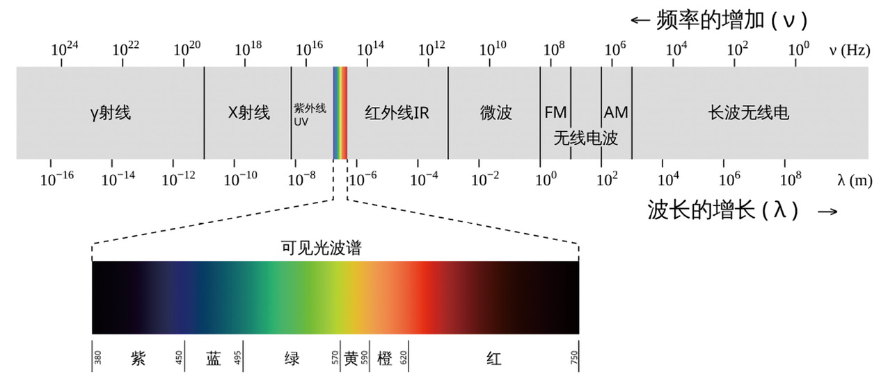

在这里，大家必须抓住的一个核心要点是：无论我们人类的眼睛看到了多少种颜色，事实上，这些颜色在外部的物质世界里，从来就没有存在过。正如前面所说，光的本质是电磁波，而电磁波本身是没有任何颜色的。这一点，在所有的物理学家那里都是公认的、没有争议的事实。所以，大家要明白：虽然依靠光，我们会产生各种颜色的视觉体验，但光本身，并没有任何颜色。

那么，所谓的“眼睛看到物体”到底是个什么过程呢？首先，像阳光这样的光波，从光源（如太阳）发射出来，照射到我们要看的物体（如一朵花）上。接着，光从物体上反射回来，射入我们的眼睛。在我们的视网膜里，大约有800万个状如锥形的感光细胞（视锥细胞）。当光波刺激到它们时，这些细胞就会一个个按顺序向大脑的神经中枢发送生物电信号。这些电信号传导到大脑后部的视觉中枢，刺激那里的神经元群，引发神经放电。就在这一刻，人的视觉意识中就产生了各种颜色的体验。普通人把这种内在的体验，称为“外境”。但是，请注意：此时此刻，那束光本身没有颜色，视锥细胞发给大脑的电信号也没有颜色。因此，我们必须了解：颜色只存在于人的视觉感知里，根本不在外面的世界中。

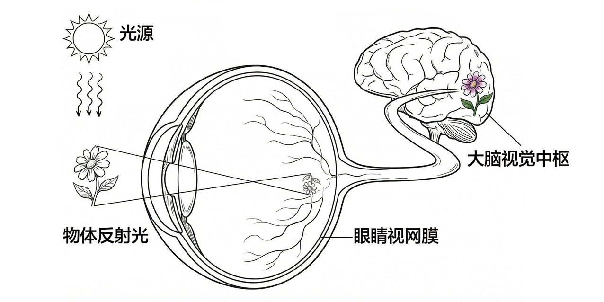

奥地利著名的物理学家、诺贝尔奖得主埃尔温·薛定谔（Erwin Schrödinger）曾在《生命是什么》（What Is Life）中这样说：如果有人问物理学家“什么是黄光？”，物理学家会回答：“那是波长约为590纳米的横向电磁波。”如果继续问：“那黄色的颜色是从哪儿来的？”他会说：“依我看，根本就没有‘黄色’这种东西。这只是当特定频率的震荡波接触到健康的视网膜时，让人类产生的一种感官体验。”假如再追问下去，他会解释：不同的波长会引发不同的颜色体验。但这只发生在波长约800到400纳米之间的光波上，并不是所有波长都有用。对物理学家来说，红外线、紫外线，和人眼能看见的那段800~400纳米的光波，本质上是一模一样的。那为什么我们的眼睛会如此“挑食”，只选择这一段光呢？这显然是因为要适应太阳光的辐射特性。在太阳发出的光波中，这一波段的能量最强，两端的则较弱。人眼感觉最明亮的光是黄光，这正是因为黄色处于太阳辐射最强的峰值区域。

我们可能会继续问：“难道只有波长正好是590纳米的光才能让人看到黄色吗？”不是的。波长760纳米的光波产生红色，波长535纳米的光波产生绿色，如果把红光和绿光按一定比例混合，也会产生黄色的视觉效果。而在我们的体验中，这种混合出来的黄色，和单一590纳米波长产生的黄色，看起来没有任何区别。

英国物理学家彼得·罗素（Peter Russell）在《从科学到上帝》（From Science to God）中也说：以绿色为例，在物质世界里，虽然光有不同的振荡频率，但光本身不是绿色的；我们的眼睛发给大脑的电信号也不是绿色的。我们看到的绿色，实际上是意识创造出来的一种“精神产物”，它只存在于大脑的体验之中。

简单讲完了物理学的观点，现在回到我们要探讨的重点：空性、缘起、显现即心的自性。

首先说“空性”。除了专门学习和修持佛法的一部分人之外，大多数人对空性很难获得一个直观的理解。但是，如果我们借用刚才讲的“颜色”的原理来思考，就豁然开朗了。

试想，当你走进一个花园，看到那些色彩斑斓的花丛：绿色的叶子、红色的花瓣、黄色的花蕊……你会认为：“这些颜色是花朵自带的，是真实不虚的。不管我看没看它，它都是早已存在于那里的东西，我只是现在刚巧看到了而已。”没人会怀疑这一点。这时候，如果有人说“这些五颜六色其实根本不存在”，谁能听得进去？这就叫“俱生实执”。但现在，如果你明白了“这些颜色仅仅是显现于我眼中的，花朵本身从来就不曾拥有颜色”，那你就懂得了花朵颜色的“空性”。

再细致一点说：虽然花上本无颜色，但眼中却清清楚楚地看到了各种颜色，这叫“显现”。虽然眼中看着真实不虚，但花上其实从来就没有颜色，这叫“空性”。花叶上没有绿色，但在没有的情况下眼中却显现为绿色；眼中虽然显现为绿色，但这显现的同时花朵上从来就没有绿色，这两者在同一事物上互不矛盾地并存，这就叫“现空双运”。

以此类推，我们要明白：躲在帘子背后的花，锁在衣柜里的衣服，它们根本没有颜色。只有当帘子拉开、衣柜打开，光线照进去被你看到的那一刻，它们才“变得”有了颜色。这个道理，虽然和我们的常识完全相反，让人很难接受，但你不得不接受。因为这不仅仅是佛教的逻辑，更是物理学以上已经证实的真相。

如果不把这个关于颜色的科学事实当成耳旁风，而是以此为契机深入思考，你就能很好地领悟“空性”的真谛。

2）形状是空性

有人可能会问：“就算花朵等的颜色不存在，那形状总是有的吧？”我们眼里的世界，充满了方形、三角形、长条形等各种形状。普通人都认为这些形状是实实在在地存在于外界的，并因此产生各种贪嗔，或接受或排斥。

但如果按物理学来讲，我们肉眼看到的这些粗大的物体，比如桌子、砖头等，都是由被称为“分子”的较粗微尘构成的；分子是由原子构成的；原子是由原子核和电子构成的；原子核是由质子和中子构成的；而它们又是由夸克构成的；夸克则是由弦构成的。这一层层细分下去，所有物质最基础的基石——粒子，最终都是由“弦”构成的。

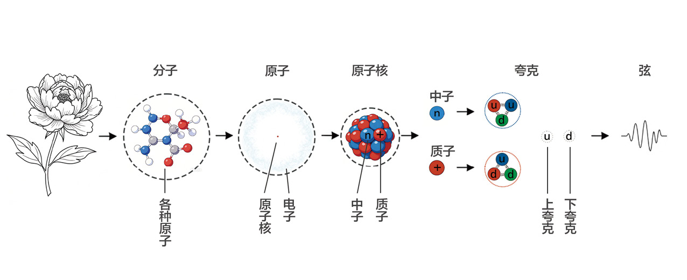

让我们看看构成那些粗大物体的基本单位——原子（atom）。原子的体积中，99.9999999%都是空的。真正算得上是“实体物质”的，只有不到0.0000001%。即使这极少的一点点“实体”，如果再细分下去，其实也算不上实体。但为了方便理解，我们姑且认为原子核这部分是有一点“东西”的。那么，原子的“空间感”是怎么来的呢？它完全是由电子飞速绕着原子核旋转，从而产生的一种虚幻的“即视感”。既然占了99%以上体积的原子是空的，那么由原子组成的分子自然也是空的；由分子组成的这些粗大物体，除了是空的之外别无他路。所以，我们肉眼看到的这些物体的各种形状，本质上并没有真实的实体存在。

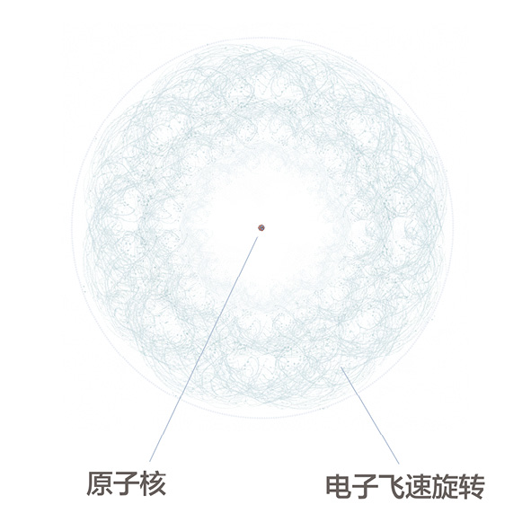

为了讲清楚这个道理，我们引用佛经的例子。佛陀在《楞伽经》中对大慧菩萨说：“大慧，沙门、婆罗门若观一切法无自性，如云、如旋火轮……”在《正法念处经》中也说：“三界一切有为法，皆如旋转之火轮。”用“旋火轮”这个例子来解释，最容易懂。所谓“旋火轮”，就是拿一根顶端带着火的棍棒或火把——就像点燃的香火头一样，如果快速挥舞旋转，在人的眼睛里就会看到一个光圈，这就叫“旋火轮”。这个圆圈形的“光环”，其实只存在于我们的视觉残留里。在客观现实中，根本就没有这么一个圆形的实体物质。

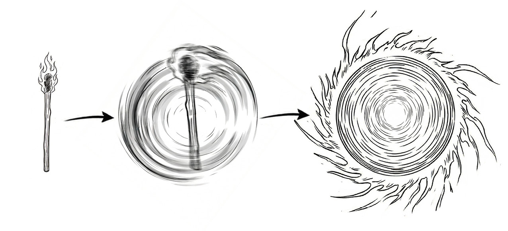

既然事实上没有，为什么眼睛会看到呢？这是因为速度。如果慢慢转，我们看到的是火把本身在移动，而不是一个圆轮；一旦速度加快，火把的样子就消失了，而显现为圆轮。这是因为超过了人眼的捕捉速度，所以那火光就显现为一个连贯的圆环。

一般来说，一个圆周有360度。其中，只有在1度的位置上显现的火是事实上实有的，而显现于其他359度上的火，只存在于眼识之中，在事实上根本就没有。在客观上，除了那1度，其他359度全是空的。但在我们眼里，这360度却同时充满了火光。这360度中，只有1份是真，其余全是空。因此，佛陀所说的“一切法无自性，如云、如旋火轮”，其中旋火轮无自性的道理就是这样的。

现在有一种利用这个原理制造的广告设备，叫“智能裸眼3D全息风扇屏”。这种设备能显示各种动物、物品的动态或静态影像。它的构造很简单：在一个像扁平棍子一样的细长叶片上，排列着224或388个发出各种光的小灯珠。当叶片高速旋转时，这些小灯珠发出光，利用人眼的“视觉暂留”效应（就像旋火轮一样），呈现出各种各样的画面。当叶片转得飞快时，我们看到的是一个完整的圆盘，圆盘上填满了图像。但实际上，在圆盘的360度里，只有叶片所在的左右那1、2度的位置是有实体的，其余所有位置都是空的。

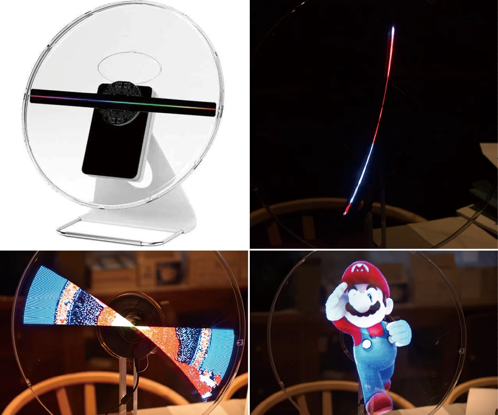

它的原理和旋火轮一模一样：因为转速太快，人眼跟不上，就把移动的点看成了线，把无数的线看成了面，最后组合成了动物等物体的形象。那些“光线”只存在于我们的视觉里，外界并没有。但人们却觉得这些影像是在外面真实存在的，并对画面中的形象信以为真。如果你用快门速度极高的相机去拍它，拍不到完整的图像，只能拍到那些排列着的灯珠；如果用和人眼视觉暂留时间相当的速度拍，就看不到灯珠，只能看到完整的图像；如果用中等速度拍，可能看到一半图像、一半是空的。可惜人眼的“快门速度”没法调节，所以我们只能看到假象。

这些都是比喻。如果回到现实的物质世界，道理是一样的：这个世界，就是一个巨大的“旋火轮”幻象。为什么这么说？因为构成物质的基础——原子，其体积的99.9999999%是空的。那个“体积”感，纯粹是因为电子绕着原子核飞速旋转，像旋火轮一样，“转”出了一个很大的空间范围。虽然看起来体积很大，但实际上除了几个极微小的电子和原子核，什么都没有。因此，除了那约0.0000001%的体积之外，其余所有部分都是本身没有却显现为有。既然如此，原子体积的99.9999999%就像旋火轮一样，只显现于观看者的眼识之中，而在事实层面上并不存在；那0.0000001%虽然像火把本身一样，若不详细观察，姑且算它是真的，但若进一步详细观察，连它也不是真的，因为它又是由更微小的粒子组成的。

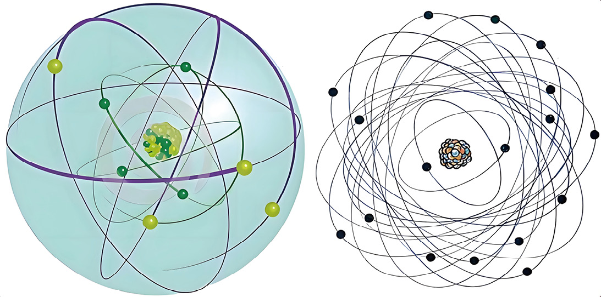

我们这个血肉之躯，也是由无数个像“旋火轮”一样的错觉集合而成的。如果去掉了这些错觉的部分，我们的身体可能只有一颗豌豆那么大，甚至根本看不见。所以，我们这一米多高的身体，纯粹是视觉错觉堆积出来的幻影。周围所有的物体，也都是这样——看着有，其实不成立。

因此，外部世界到底长什么样，并不是由外境——物质本身的体性决定的，而是由有境——眼根等感官决定的。我们现在看到的这个外在物质世界之所以是这个样子，其原因何在呢？不能说“外在世界本身就是这样而成立的”，而应该说“因为我们的眼睛等感官长这样，所以外在世界才呈现出这个样子”。如果我们眼睛能看到的光不是光谱中的可见光，而是别的光，世界绝对不是现在这个样子。比如，如果我们能看到红外线，那人的身体可能就没有颜色，或者是黑色的，但头发却是白色的。所以，人体的“颜色”取决于看它的眼睛，而不是取决于身体本身。

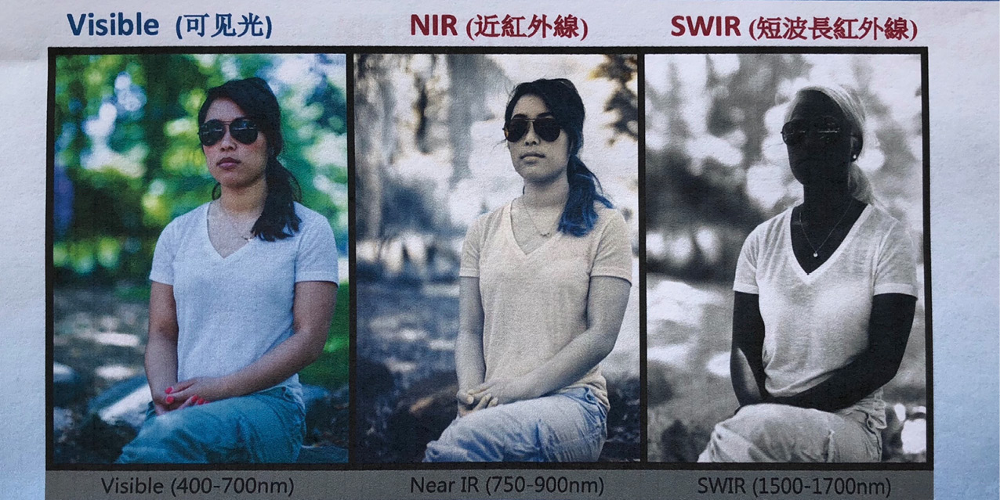

外部世界的各种“形状”，也不是由物质本身决定的，而是由眼睛等感官决定的。如果我们的眼睛捕捉速度比现在快得多，那桌子、砖头这些看似坚固的东西，根本就不会是静止的，而是像水面上的波光一样，时刻在颤动；形状也不会是现在这个样子，因为由速度导致的许多错觉都已经消失了。反之，如果我们眼睛能捕捉的速度比现在慢得多，那人手脚摆动、步行奔跑就会变成一条条光带；而比这稍快转动的汽车轮子等，就会显现为静止不动的物体；极快速的物体即使从眼前经过，我们也完全看不见。

显现在我们眼前的所有动态和静态的物体，之所以显现为连续不断的相续，这也纯粹是事实上根本不存在的错觉。量子力学的伟大科学家埃尔温·薛定谔在《生命是什么》一书中提到：查尔斯·斯科特·谢灵顿（Charles Scott Sherrington）向我们讲述了一个非常神奇的“闪光融合频率”实验。我简单复述一下：在实验室里制作一个闪光装置，让它每秒钟快速闪烁亮灭，比如40次、60次、80次或100次。当光的闪烁频率增加到一定程度时，人眼就再也看不出它在亮灭了，而是觉得它一直在亮着。达到多少次才会消失，这取决于实验的具体情况。此时，实验者用肉眼观察，会看到断续的光变成了连续的光。也就是说，灯光实际上是有生灭的、前后中断的、前后各异的，但当生灭的速度很快时，在人眼中就显现为连续不断的样子。这是因为人眼跟不上那个速度，从而产生了前后一体的错觉，实际上连一点不间断的事物都没有。

电影也是这个道理。胶卷上是一格格静止的画面，如人脚的起、落等动作，前后各不相同。但当它们以每秒24格的速度通过放映机时，我们眼里就看到了连续的动作。但实际上，哪里有“连续的动作”这回事？如果去看胶卷，现量可见全都是前后中断、各不相同的画面。

同样的道理，所谓的“众生”、“人”、“我”或者“自我”，其实也是由五蕴的无数个不同“刹那”在飞速地生灭。我们的眼等感官被欺骗了，把它们看成了连续不断的整体。基于这种错觉，意识将其整合，认为有一个前后一致的“我”。但实际上，哪里有一个连续的实体呢？全都是前后各异的，前一刹那存在时，后一刹那还没生；后一刹那生起时，前一刹那已灭去。真相是：除了当下的这一刹那，什么都没有。因此，所谓的“我”或“自己”，既然只有一刹那，而这一刹那又构不成完整的“自我”概念（常、一、主宰），所以佛陀才说“无我”。

这种因为生灭速度太快而产生的错觉，在佛教因明典籍中早有论述。法称论师在《释量论》中说：“因其运转速，愚者执为一。”文殊怙主萨迦班智达在《量理宝藏论》中说：“纵次第取然速疾，故诸愚者执为一。”文殊怙主麦彭仁波切在《释量论大疏》中解释道：“像旋火轮、挥舞的手杖等，因为转动迅速，以此错觉作为因，以有缺陷的眼根作为增上缘，把实际上是先后产生、互不连接的影像，误认为是一个连续不断的圆轮。”这里也说明了由于速度快而产生显现为相续的错觉。

此外，把花瓶放进箱子里，看不见的时候，它的形状比如大腹圆底，其实并不像我们看着时那样存在，因为由眼识错觉所产生的部分已经消失了。所以，这个世界的本质究竟如何，完全是由眼根等感官来决定的，这个道理非常清楚。

#### 2．声是空性

在我们世间普通人的观念里，声音这种东西，不管有没有人听，它都实实在在地存在于外界。我们会评论声音好听不好听、喜欢不喜欢等，从而产生各种贪嗔取舍。比如：在一片没有任何生命迹象的荒野里，一棵大树倒在地上，到底有没有声音？普通人会说：“就算没有生物在听，声音肯定也是有的。”

但从物理学的角度来看，所谓的“声音”，在外界根本就不存在。它只不过是听者在自己的耳朵或大脑里产生的一种特定的感官体验而已。

要理解这一点，得先知道耳朵是怎么听到声音的。对此稍作阐述：例如，大树倒地撞击地面，会引起周围空气的振动。这种振动在空气中形成“疏密波”（声波）。声波通过空气传入人的耳朵，引起鼓膜振动。在耳蜗内产生微小的波浪，这波浪冲击排列在耳蜗内基底膜上的毛细胞。这些细胞受刺激后，产生生物电信号，通过听觉神经传给大脑。这些信号进入听觉皮层，然后进入更高级的听觉联合皮层，依靠这一过程，人类才产生了“声音”的体验。

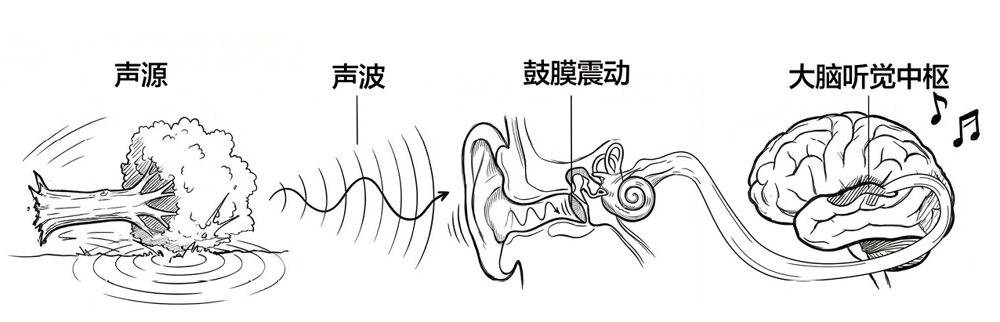

声音的来源：是某种物质发生了振动。比如人的声带振动，琵琶等乐器的琴弦振动，以及笛子等内部的空气振动等等。

声音的本质：实际上除了耳识的体验之外，什么也没有。由人的声带等物质振动后产生的，只是空气波或微细的气流，除此之外别无他物，而那气流并不是声音。如果在那个地方没有生物的耳朵、神经、大脑等，那么除了微细的气流在流动之外，什么也没有。

声音的介质：是空气、固体和水。声音大多依靠空气传向他处，也可以通过金属等固体物质，以及水等液体传播。若没有任何介质，声音无法在真空中传播。

声波：就是空气的波动。比如，像往水中扔石头会产生许多圆形的波纹一样，空气受到振动的影响，其中也会产生类似波浪的形态。并非所有的波都能让人的耳朵产生声音的体验，只有20到20000赫兹之间的波能引发声音的体验。其中，对1000到4000赫兹之间的声波最为敏感，人类日常交流沟通所需的信息大部分都在这个范围内。低于20赫兹的称为“次声波”，高于20000赫兹的称为“超声波”，这两种波都是人耳无法听到的。

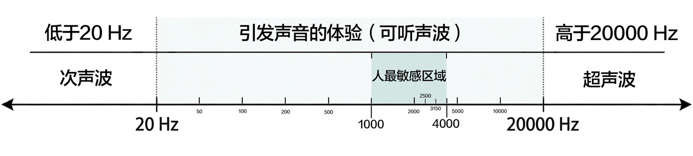

声音的速度：在干燥且摄氏零度的空气中，每秒约移动330米，或者说每小时约1200公里；在潮湿且温暖的空气中，据说比这还要快一些。既然介质是空气，除了空气本身之外，没有所谓的“声音”，所以实际上这只是空气波动本身的速度。

“声音”这东西，在我们普通世人的生活中非常重要，也是我们执著极深的对境，是基于认为外界实有此物而安立的。如果说“外界实际上并不存在声音”，大多数人恐怕极难接受。因为平时的悦耳与刺耳、赞扬与毁谤、善语与恶语等许多事物都是基于声音而安立的，若说声音实际上不存在，虽然心里难以接受，但也不得不承认。

既然如此，在这个物质世界中，“声音”这种东西根本从未存在过。我们要明白：平时我们耳朵听到的，只是耳根受空气振动影响而产生的耳识体验而已。这仅仅是显现于自己认知中的景象，并非在外界实有成立。那种仿佛在外界真实存在的感觉，是将显现于自己意识面前的东西，误认为就是外界的物质本身。

#### 3．触是空性

我们所有世间人都认为，手接触到土石等物体，手就感受到了土石粗糙或光滑的触觉。这是大家公认的常识，在普通人中没一个人会对此怀疑。不仅如此，若说不是这样，也很难让人接受，会被认为是胡说八道。

然而，若按物理科学家的说法，手和土石永远不可能接触。因为手和外在的土石都是由原子构成的，而原子如前所述是空荡荡的，所以无法相互接触。手的原子和土石的原子，除了约0.0000001%的部分外，其余全是空的，所以无法接触。

因此，所谓的触觉，是两个原子的电子层上的电子，围绕原子核在各自的内外层道上保持一定距离运转，这些电子具有一种不让同类电子靠近并将其向外推排的力量，即“电子斥力”。正是这种力量，阻碍了手的原子继续向前移动，从而产生了触觉，据说这最初也是发生在大脑中的。

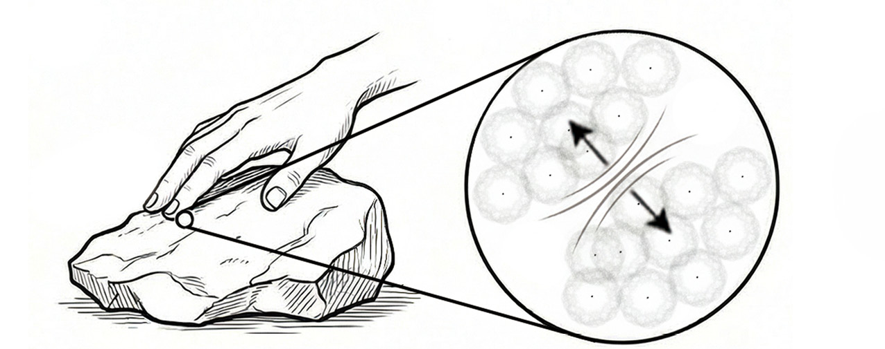

简而言之，手感觉接触到土石，是因为手和土石的构成原子在各自轨道运转时，存在一种不让彼此靠近的排斥力，是源于此，而并不是因为接触才产生了触觉。

被公认为世界杰出科学家的罗伯特·兰萨博士（Robert Lanza，MD）说：“如果触碰到某样东西，那是怎么回事？它不是固体吗？当你伸手去触碰倒在地上的树干枝丫，确实能感觉到压力。但这种体验首先发生在大脑中，然后才被传送到手指的位置，这种体验也是存在于意识之中的。

此外，这种压力的感觉并非源于触碰到固体。因为所有原子的外部都有带负电的电子，据我们所知，性质相同的粒子会相互排斥，所以树皮的电子排斥手的电子，正是这种斥力阻挡了手指继续向前。当你伸手去举起树枝时，固体之间根本没有接触。因为构成手指的每一个原子，就像一个空荡荡的美式足球场，中间50码线上停着一只苍蝇，其余空无一人，全是这种状态。如果固体之间真的必须接触才能产生阻碍，那么我们的手就会像穿过浓雾一样，轻而易举地穿过树枝。”

所谓的“电子斥力”，就是原子的电子层将其他具有相同电荷的原子的电子层向外推斥，是一种不让靠近的力量。即便电子之间没有接触，也有一种不让彼此靠近的能量。假如把原子的空旷部分比作足球场那么大，其核心（原子核）不过像只苍蝇，所以空荡荡的原子之间不可能接触。这就像两个飞速旋转的火轮，实际上并没有相互接触一样。

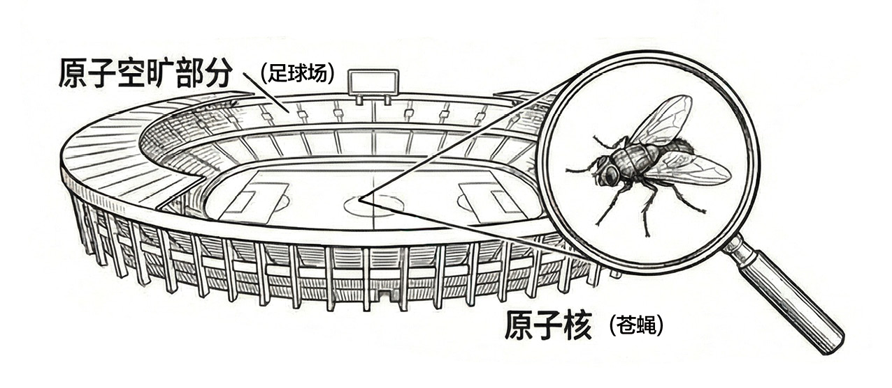

由此可见，我们认为真正存在的“接触”，根本就不成立；认为“接触到了”是错误的。当你觉得触碰到某物并正在感受其触觉时，这其实是错觉，因为永远没有与该物接触过。因此，对我们来说，现量所见的“接触”，这叫“显现”；实际上根本不可能接触或不存在接触，这叫“空性”；虽然不可能接触却现量见到接触，现量见到接触实际上却并未接触，这叫“现空双运”。

#### 4．香是空性

比如花朵或腐肉等物质散发出气味，接触到鼻子，然后鼻子闻到了香或臭，这是我们的想法。若按科学家所说，当人们正常呼吸或特意去闻某种气味时，被闻气味的分子进入鼻孔，粘附在鼻腔上端或深处粘膜内的嗅觉感受器上。那里有超过1000种嗅觉感受器，它们与被闻的气味分子结合后，向嗅球的神经基质发送信号，最终这信号在人的大脑中产生了嗅觉的体验。

#### 5．味是空性

甜味等与舌根相互接触，舌根就尝到了甜味等，这是世间普遍的看法。现代科学家说，食物等的任何一种味道，刺激了位于味蕾细胞中的味觉受体，使其发生变化，进而向大脑发送信号，由于该信号的作用，人的舌识便显现出尝到了味道。味觉细胞位于味蕾之中，人的口腔中约有10000个味蕾，大部分在舌头上。所谓的味蕾，是产生味觉的舌头器官，形状像花蕾，即像花朵尚未开放时的样子，顶端有个小孔，这个孔被称为味孔。

无论是嗅觉还是味觉，气味与鼻子、味道与舌头并没有接触。正如上面讲触觉时所说，气味和味道、鼻子和舌头都是由原子构成的，原子之间无法接触。若不接触，鼻子闻到气味、舌头尝到味道也是不可能的。

因此，接触后产生的感受和体验，这种现量“显现”是错觉显现；事实上没有通过接触而产生感受和体验，这是“空性”；虽然没有接触却显现为接触并产生感觉体验，显现的同时实际上并不存在，这叫“现空双运”。
