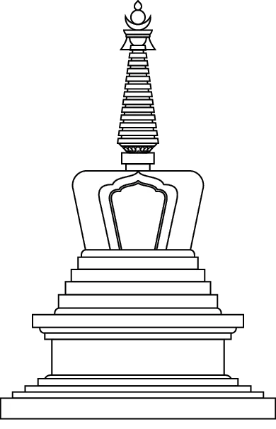

# 后记

这部《定解宝灯论讲解》是堪布索达吉上师于1994年春天为汉族四众弟子开讲，经过百余日讲授圆满。在整个讲授中，我们作了详细录音，并发愿在因缘成熟时，整理出书，一者为报上师赐法乳之恩德；二者为使汉地修学者从闻思修，趣入菩提道，提供一部精要论释，由此对显密教法能生起无伪的定解。若生起正见，则解决了修行途中关键的问题，即树立起了正见，其修行自然会随彼见解而行，如是则不难走上真正的修行觉道。由以上两种缘由故，现在终于圆满了初衷，经堪布索达吉上师许可，并通过录音带整理成书，在整个整理过程中，诸位金刚道友和信心居士们给予了许多帮助与指正，在此谨表谢意！

由于整理时间仓促，其中所有错谬之处，愿于上师三宝前诚心忏悔，并期盼诸位大德指正。所有善根，回向一切有情，速证菩提，共成佛道！

愿诸时诸方增上吉祥！

1998年5月

戒律：

俱舍：

因明：

中观：

般若：

