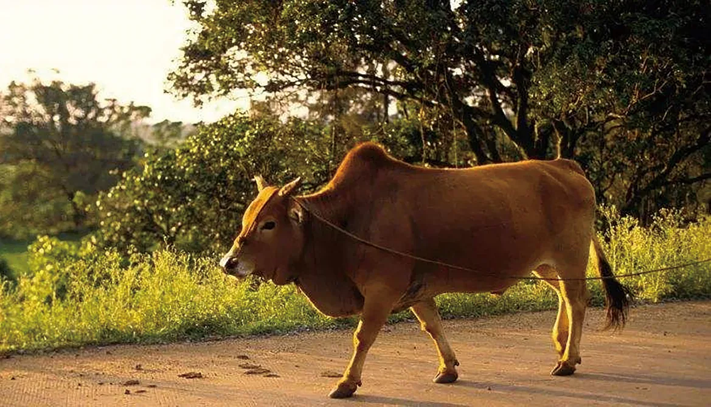

# 第100课

通过前面观察，涅槃并非有实法，否则会有“具老死相、成为有为法、成为因缘法”三种过失；也不是无实法，否则会有“不成立、无依靠”两种过失。

对于上节课讲的最后一颂“若涅槃是无，云何不依有？未曾有不依，而名为无法”，麦彭仁波切的《中论释》中做了广述，尤其对无实法和石女儿子等问题分析得非常细致，今天主要宣讲《中论释》的这部分内容。

前面分析了，对方将灭尽苦谛、集谛的无实法执为涅槃，但这不合理，因为无实法必须依靠有实法才能成立，而有实涅槃已被遮破，故无实的涅槃也不可能成立。

## ◎ 石女儿有实无实之本体皆不成立

对方辩驳说：无实法不依靠有实法也可以存在，就像石女的儿子一样。石女儿子也是无实法，但他不必依靠有实法就可以成立。

驳曰：谁说石女儿子的本体存在或者其本体是无实法呢？如果他是无实法，就应该具有无实法的法相，即无实的一种所知，然而这根本不成立。从广义角度讲，所知包括有实法的所知和无实法的所知，虽然石女的儿子可以作为一种比喻使人了知万法的空性，然而石女儿自身不具有任何本体，因此不可能成为真正的所知。如月称论师《入中论自释》云：“当知此宗（中观宗）以不生因及石女儿喻，广破一切计我者所计我之自性差别。”

对方问曰：那么，石女的儿子究竟又是什么呢？

答曰：说石女儿只是为了遮止石女存在儿子的分别念，并不是要建立石女儿子无的本体。实际上，石女儿子有实和无实的本体都不可能成立。《显句论》也云：“‘若石女儿’之说，仅为息灭分别妄念而已。若有实与无实之法皆不可得。则该自性不可得之法，又岂能安立为无实？”以差别事[^1]不存在，所以差别法也不存在的理由对此进行了阐释。

我们对涅槃所进行的剖析，是从遮破独立自成的无实观念而言的，并非针对名言而言的。也就是说，石女的儿子并非名言中的所知之法，因为其自本体都不成立，只是一种虚假的无实概念。在因明中也这样承许，如《量理宝藏论自释》云：通过石女儿、龟毛、兔角等无实法，可以了知事物的本体不存在。

## ◎ 石女儿也不是有实无实二者皆非之法

如果对方认为，既然石女的儿子不是有实法，也不是无实法，那他应该是有实无实二者皆非的一种法吧。

驳曰：这种观点也不合理，因为这样的法根本不存在，故也不应该耽执二者皆非的性相。所谓石女的儿子，只是为了遮止有实之边而安立的一种比喻，因明、中观当中常以此喻来说明万法的体相不存在，除此之外，石女的儿子不可能具有有实、无实、二俱或二非的体相。

涅槃同样远离了四边的体相，是从我们分别念前得不到的角度而言，称之为涅槃。说涅槃是有实、无实、二俱或二非都不合理，因为它已超离了有实、无实等所有边。

## ◎ 按照《显句论》的观点分析

关于涅槃离四边的道理，麦彭仁波切在《中论释》中引用了月称菩萨《显句论》的观点进行说明：

按照月称菩萨的观点：任何所谓“有实法”与“无实法”，如果其二者的事相都不可得，则不应该赋予其有实或者无实的概念，就像不能说“石女的儿子是白色的”一样。意思是，有实和无实的体相在涅槃本体上都得不到，因为二者的事相不可得之故。

关于事相、法相、名相的概念，我们在第五品《观六种品》中已经学习过，《中观庄严论释》中也有解释，因明《量理宝藏论》第八品中讲得比较细致。

一切名言法都可以用这三相来表示。所谓法相，是指认定一个事物的时候，它的定义或者说不共特征，比如，黄牛的法相（特征）是垂胡、项峰，即具有垂胡、项峰的动物就称为黄牛。以前法王如意宝去印度的时候，有一天，索顿管家指着一匹印度马大声地喊道：“你们看，黄牛！黄牛！”法王听到后一直不停地笑……因明中常说，黄牛的法相是项峰、垂胡。黄牛背上长鬃毛处比较高，故叫项峰；脖颈处垂下来的肉像胡子一样，故叫垂胡。

所谓名相，是指这个事物的名称，比如“黄牛”是名相；事相是指由法相所表示的事物本身，即具体的某法，比如，花色或者黑色的黄牛。又如，“知言解义”是人的法相；“人”是名相；某某居士、某某出家人，具体点出了一个人物是事相。

一般来讲，学因明和中观的时候，要认识一个事物的本体，必须要知道其独有的法相、可以周遍其所有种类的名相，以及具体表示某法的事相。

月称菩萨认为，因为有实法和无实法的事相皆不可得，故不应给予涅槃有实或无实的概念，或者说，如果涅槃的事相或本体真正存在，在此基础上，安立其为有实法或无实法也可以，但实际上，不论有实法、无实法，还是所谓的涅槃，都只是分别念，本体丝毫得不到，因此不可能成立。就如同石女儿如果真的存在，说他是白色或红色也可以，但石女儿根本得不到，所谓白色、红色的概念如何安立呢？

再者，因为涅槃不是有实法，既然有实法的情形都不存在，又怎能认为涅槃是无实法呢？不能将无实的说法强加于涅槃，因为所谓的无有，只不过是遮破其违品而已，除此之外没有其他义。比如，柱子不存在的无遮部分“无柱”称为无实法，但“无柱”的本体丝毫不可建立，因为其所依的柱子有实法不成立之故。

我们说诸法并非有实法的目的，只是为了遮止有实的分别念，而不是为了建立无实的分别念。

## ◎ 按照清辩论师的观点分析

对方认为：涅槃应该是一种无实法，因为它是一种寂灭的果。

中观宗驳曰：这种无实法，是不可能以自性而成立的。因为在获得灭尽苦谛、集谛的境界之前，涅槃并不存在，因为无需观待的涅槃并不存在的缘故，如果需要观待，则以其自性就不可独立存在了。

也就是说，在“若涅槃非有，何况于无耶？涅槃若非有，无实亦不成。若涅槃是无，云何不依有？未曾有不依，而名为无法”这两个偈颂中的第一个偈颂表示：如果承许无实的涅槃以自性而成立，这种无实的涅槃则没有所依。既然没有所依，则不能依靠他法而成立，所以最终无实也不可成立了。

换言之，一个人尚未获得寂灭之前，涅槃的本体并不存在，因此，首先涅槃就没有观待。如果后来依靠前后一些因缘而转变，则涅槃就成了有为法，但这不合理，前面已经破斥过；如果涅槃不依因缘而转变，那么它原来不存在，后来也不可能变成无实法。

第二个偈颂（“若涅槃是无，云何不依有？未曾有不依，而名为无法”）表示：作为所依之法，也以自性或者本体不可成立。也可以表示为：如果承许涅槃不是以有实法的自性而存在，则该宗派所谓的“无实”，也不应该以所知法而存在。因为，既然“不是有实”的前提可以成立，则“无实”就不可能存在了。

也就是说，承许涅槃是无实法不合理，因为无实法一定要在有实法成立的前提下才能成立，而前面已经分析过“不是有实”，故涅槃是无实的说法也不可能成立。

该偈颂还可以表示为：如果有人询问“涅槃究竟是否存在”？在名言中不能说“不存在”，因为现在正在分析的主题就是涅槃，对此不能予以否认；也不能说涅槃的体相真正“存在”，如果回答说“存在”，则可以追问：“既然存在，那么究竟是以有实，还是以无实的方式而存在呢？”

如果答案是第一种“以有实的方式存在”，则在前面已经予以了遮破。如果认为涅槃以无实的方式存在，则也不合理，因为所谓无实法就是什么也不存在的意思，这样一来，是否意味着你们不承认涅槃存在呢？

如果对方回答说：无实法并非什么都不存在，它是以无实法的本体而存在，因此，涅槃是以无实的本体而存在的。

如果这样承许，就会有无实法本体存在的过失。这样一来，涅槃为无实法的立论就无法立足，因为“无实”不是以自性而存在的，也就是说，无实法与其违品——自性存在，是两个相违的法，不可能在涅槃的本体上同时存在。

## ◎ 认为涅槃不存在无实本体，也不合理

如果对方又反过来说：涅槃不存在无实法的本体，则也不合理。针对这一点，我们可以从两方面进行观察：涅槃的不存在究竟是否存在呢？

首先，如果涅槃的不存在存在，则存在与不存在又怎能不相违呢？存在和不存在应该是直接相违的。其次，如果涅槃的不存在不存在，则有涅槃变成存在的过失，因为两个否定词加在一起就变成了肯定。比如，“石女的儿子不存在”存不存在呢？如果说存在，就与石女儿的不存在相矛盾了；如果说不存在，就等于说石女儿存在了。

此外，因为对方承许业和烦恼的产生等等有实法在涅槃本体上不存在，因为业和烦恼灭尽以后才称之为涅槃，就如阿罗汉的相续一样。既然如此，如果承许涅槃无实法的本体不存在，就等于说有实法的体相已经存在了，这就与对方自己的观点相违。

因此，如果对方认为涅槃无实的体性不存在，也不合理，因为无实法不可能再次变为无实法的缘故。

对方反驳说，无实法不用变成无实法，它是以自本体的方式单独存在。这种观点也不合理，因为既然无实法存在，就必须有其因缘，但成立无实法所必需的因，在整个世间无论如何都不可寻觅。

虽然有些经论中有“涅槃是无实法”的说法，但这只是从阻断生之相续反体的角度，或者说从有实法不存在的角度，才安立涅槃为无实法，实际上，涅槃自身的本体是了不可得的。

## ◎ 说法有异，因角度不同

各经论因为观察的角度不同，也有广狭之别，故对涅槃的解释会有不同。比如《大般涅槃经》云：“涅槃是常，恒不变易。”这种说法与本品颂词“无弃亦无得，不断亦不常，不生亦不灭，是说名涅槃”并不相违。因为，若从分别念的角度讲，涅槃远离了常、断等所有边戏；若从大乐本性的角度，或者说超离世俗分别念境界的角度讲，则可以说涅槃是常有、大空性等。宣讲如来藏时也经常这样讲。

有些精进闻思的道友因为不会善加辨别，经常觉得论师们的说法有点矛盾，对此不知所措。刚才就有位道友给我写纸条说：月称论师前后的说法是不是有点矛盾呢？其实不会矛盾的，分析的时候一定要会区分名言和胜义、广义和狭义。

比如，讲虚空的时候，有些经论说虚空不存在；有些说虚空是无为法；有些说虚空既非有为法，也非无为法，只是未遮障他法而已；有些则说，虚空在名言中存在……所以，若不能结合不同角度，只从一面来理解，是很难真正通达虚空本义的。

“涅槃”亦是如此，有些经论说涅槃存在，是因为很多世间人，包括小乘有些论师，都认为阿罗汉趋入涅槃时已获得寂灭，这相当于入定一样，入定之后什么都不存在的一种状态是真实存在的。之所以他们持这种观点，是因为凡夫的分别念只能缘“有”或“无”，超离有无等一切戏论的境界是无法显现的。

学习中观和因明的时候，一方面拓展思维很重要，认为什么都不用辨别，一切都不矛盾是不行的，但另一方面也不能过于开发，因为因明中很多词句和概念特别细微，稍微靠一个边就有了过失，如果一直咬文嚼字，觉得什么都矛盾也不行。有些道友初学中观，经常觉得这也相违，那也不合理，这一方面是认真观察的标志，但另一方面也说明还需继续深入思维。

## ◎ 何为真正的涅槃

在凡夫以分别念执取“涅槃”事相的前提下，无论说涅槃是有实还是无实，都不能超越存在的范畴。这就如同说“是白马”或者“不是白马”，都不能超越马存在的可能性一样；又如，说“虚空不是白色”与“虚空的自性”，虽然说法各异，但其所表达的含义却不存在异体，都是建立在虚空本身存在的基础之上。

如果对方提出：既然涅槃既不是有实法，也不是无实法，那么涅槃究竟是怎样的呢？

虽然在名言中可以承许三有轮回的来去之法，但在实相中，它们不但远离了缘起生，也远离了依各种名相而假立的存在。一并遮破缘起生和假有这两种戏论，才是真正的涅槃。也就是说，仅仅承许涅槃本体不是缘起生还不足够，也必须破除假立的戏论，这才是真正的涅槃。

总而言之，对方若想从词句或意义上承许涅槃存在，则不可能超出有实和无实的范畴，然而通过观察，涅槃既不是缘起的有实法，也不是假立的无实法，它已经远离了缘起实有与假立无实这两种戏论。所以，涅槃无论以有实、无实，还是二俱、二非的方式都不可能成立。

实际上，大乘所讲的涅槃并非我们的分别念所能想象，因为它是超离了四边或者说六边、八边戏论的一种境界。

[^1]: 差别事：也即事物本体。特征、属性或状态依存之处。
