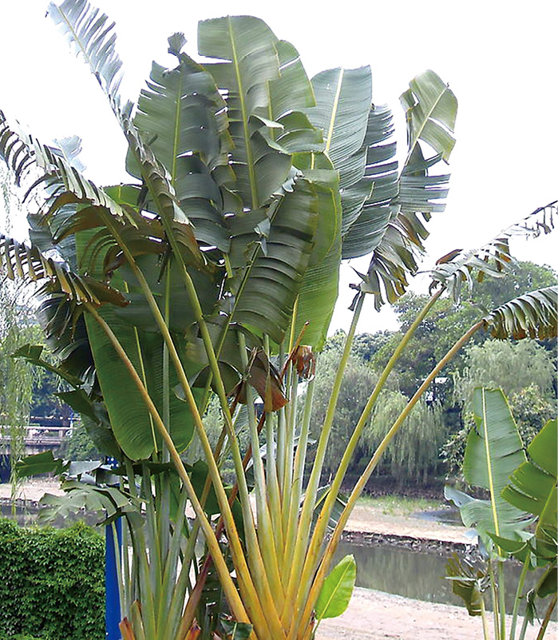

# 第41课

科判“破火薪自性成立”的前两部分已经讲完了，今天学习第三部分“彼二之摄义”。所谓“彼二”，是指火薪本体不成立及其能立不成立，“摄义”是指最后得出一个总结性的结论。

> 癸三（彼二之摄义）：

> 可燃即非燃，离可燃无燃，

> 燃无有可燃，燃中无可燃。

> 所燃的木柴不是能燃的火；离开所燃的木柴也无有能燃的火；火不具有木柴；木柴不依靠火，火也不依靠木柴。

本颂是通过遮破火薪之间一体、异体、具足、能依、所依的五相推理，来抉择人无我。虽然是五种推理，但只有四句颂词。

## ◎ 以五相推理遮破火薪

第一句“可燃即非燃”，所燃的木柴不是能燃的火，这是从一体方面破。如果认为两者是一体，用前面“若燃是可燃，作作者则一”的推理即可遮破。

第二句“离可燃无燃”，离开了所燃的木柴，并没有能燃的火，这是从他体方面破。如果认为两者是他体，用“若燃异可燃，离可燃有燃”就可以遮破。

第三句“燃无有可燃”，能燃火不具有所燃木柴，这是从具足方面破。如果火具有木柴，则两者或者以一体的方式具有，或者以他体的方式具有，除此之外没有其他具有方式，但前面观察过，火薪一体异体都不成立，由此间接就可推出火不具有木柴。

第四句“燃中无可燃”包括了两种情况：火作为能依，木柴作为所依不成立；火作为所依，木柴作为能依也不成立。具有能依所依关系的法必定是异体法。但前面通过观察，火薪之间异体关系不成立，因此，两者能依所依关系也无法安立。

由此可见，火薪之间不是一体、不是他体，火也不像人具有财产一样具足可燃，并且火作为能依，木柴作为所依不成立；木柴作为所依，火作为能依也不成立。这样观察之后即可了知，所谓的火薪不可能成立。

## ◎ 由火薪而破人我

怎样以此遮破人我呢？可以把人我对照火、五蕴对照木柴，运用五相推理观察：

一、人我与五蕴并非一体。如果人我是五蕴，即两者为一体，那么五蕴有五种，人我也应变成五种了，并且其中色蕴有五根、五境、无表色十一种（第四品《观五阴品》中讲了四种因色和十一种果色），受、想、行、识也有多种分类，这样就有了人我变成众多的过失。另外，五蕴具有刹那迁变的无常性，如果我是五蕴，则我也变成了无常性。

总之，人们所执著的人我是唯一、常有的体性，如果我与五蕴像火与火的热性一样是无二无别的一体，人我就成了多分、无常的法，但这既不符合众生的执著，也不符合真正的实相，已经违背了现量。

二、人我与五蕴并非他体。如果我和五蕴像瓶子和氆氇一样是分开的他体，那么离开了五蕴还会有人我，离开了人我也会有五蕴，二者就不必互相观待，但是否有这种情况呢？根本没有。众生都把五蕴的聚合执为自己，在五蕴之外，无论怎样观察也不可能找到所谓的我，用现量或可现不可得等比量就可了知。

三、人我不具有五蕴。具有分为两种情况：1．他体的具有，如天授具有财产、人具有房子；2．一体的具有，如火具有热性。但刚才分析过，人我和五蕴非一体、非他体，这样人我就不可能以一体或他体的方式具有五蕴。也可以通过第九品的方式观察：因为所谓人我（本住）的自性不成立，既然我不存在，我的五蕴又怎么可能成立呢？就像石女儿自身尚未成立，他的五蕴更无法成立一样。

四、我作为能依，五蕴作为所依，就像飞禽栖息在树上、狮子居住在雪山中，能否成立呢？也不成立。因为人我和五蕴要想成立能依所依关系，必须是自相的他体法，然而两者的他体关系并不成立。此外，对人我和五蕴一一观察后，两者的本体都不存在（前面分析过，人我在五蕴之前、之后或两者同时都不成立，所以无有本体，由此五蕴的自性也不能成立），既然两者都无本体，我作为能依，五蕴作为所依的观点就不可能成立。

五、我作为所依，五蕴作为能依也不成立。推断方法与第四种推理相同，如果我和五蕴非他体且本体都不成立，所谓的能依所依怎么成立呢？

如果我们深入细致地思考这些推理，并将其真正融入自心，就能从根本上推翻、瓦解无始以来对我和我所根深蒂固的执著。

## ◎ 介绍七相车理

龙猛菩萨在此处只用了五种推理来抉择人无我。中观也经常运用七相车理来抉择人无我。这七种推理也被称为七相“木车因”，因为古代的车一般都由木头制成。

关于七相车理，月称论师在《入中论》中做过具体宣说：人们一般认为木车是由各种零件聚合而成，但实际上木车的本体并不存在。为什么？因为，一、零件不是木车；二、除了零件以外，木车并不存在；三、零件上不具足木车；四、零件作为所依，木车作为能依不成立；五、木车作为所依，零件作为能依也不成立；六、零件聚合在一起不是木车；七、零件聚合起来的木车总形也非木车。

月称论师在《入中论》里抉择人无我时，考虑到众生的执著千差万别，因此，在五种推理的基础上加了“汇聚”和“形状”两种，即所有零件聚合在一起不是木车；所有零件聚合起来的木车总形，也不是木车。

月称论师在《入中论》[^1]中云：“如观察车七相无，由余世间共许有。”意思是，如果真正用瑜伽士的智慧——七相车理来观察，所谓的人我不可能存在，但在人们的分别妄执面前，却可以承许人我和五蕴存在。

无论是月称论师的七相木车因，还是龙猛菩萨的五相推理，最终要说明什么呢？即人我不存在。虽然为了随顺世人，佛陀在不了义的经典中说过人我存在，但真实意义上，所谓的我和我所皆了不可得，这一点佛陀在了义经典中讲得非常清楚。

## ◎ 精进才能让“我”远离

经常运用五相或七相推理观察非常重要！以前很多中观论师和密宗修行人，都要首先运用自己最敏锐的智慧，详详细细观察所谓的我在五蕴上到底怎样存在？观察之后，我与五蕴之间无论以一体异体、能依所依，还是以具足不具足的方式存在都不合理，最后就会真正了悟，所谓的我完全是子虚乌有。

这一颂非常重要，大家一定要通达！如果对中观最根本的五相、七相推理都不懂，想抉择人无我将无有是处。

这些推理其实并不难，但对一些人来说，简单的问题也成了难题。有些二三十岁的年轻道友，看起来好像还不如世间一些七八十岁的老年人清醒。前段时间纪念邓小平诞辰一百周年，记者采访了很多老年人，有些九十多岁，有些已经一百多岁了。虽然他们讲的都是世间法，但很多老人思路都很清晰：我当天正在做什么事，然后见到了周恩来总理，我说了什么什么……

我们有些道友也已经七八十岁了，有的牙齿几乎都掉光了，但他们却非常精进，学得也特别好，把《中论》每一品都记得清清楚楚。很多年轻人在他们面前都会感到汗颜。以前这些老道友因为种种原因未能值遇佛法，直到六七十岁才进入佛门。虽然已至暮年，但能遇到这么甚深的中观法，并在临终前对般若空性生起信心，具有了中观正见，也是非常值得庆幸的。正因为他们有了这种难得心和精进心，所以分析中观甚深理时，已经远远超过了有些年轻人。有的年轻道友特别贪吃，还爱睡懒觉，早晨不愿起来背书（众笑），你们真应该好好向这些老道友学习。

对于这样殊胜的中观甘露妙法，大家一定要认真思维，无论青年人还是老年人，任何人学了之后，都会得到极大利益！

学了此颂之后，希望大家能运用五相推理详详细细观察，看看我们无始以来执著的我与五蕴之间到底是什么关系？虽然有部宗想以火薪喻成立人我，但观察之后，火薪之间任何关系都不成立，我与五蕴之间亦是如此，以此就破了对方人我存在的观点。

仅明白无我之理还不足够，要想从根本上断除我执，必须依靠修行。但首先一定要从理论上通达，如果道理明白了，执著自然就会减弱，如同前面所讲的花绳喻一样。

> 壬二（以此理类推他法）：

> 以燃可燃法，说受受者法，

> 及以说瓶衣，一切等诸法。

> 以抉择燃与可燃不成立的方法，可以说明所受法与受者以及瓶子、衣服等一切诸法皆不成立。

受者，即指《观本住品》所讲的能领受者——人我；所受法，即见闻触等所有人我领受的对境法。

本品通过各种方法对燃可燃不成立的道理作了全面抉择，以此类推，便可抉择出受受者不成立，也可抉择出瓶子与氆氇、支分与有支，以及因果等法我所摄的一切法皆不成立。

比如，可以用五相推理观察有支和支分。有支和支分是因明里的专用名词，中观里也经常使用，用现代的话讲，就是整体和部分。有支、支分不存在，意即整体和部分不存在。《显句论》中对此也有阐释：瓶子的整体叫做有支，它是由瓶口、瓶尾、瓶腹等很多支分组成。有些人认为瓶子的支分存在，有些认为有支存在，但这些观点都不合理，以五相推理即可遮破。

以此还可推出因和果不存在。《显句论》中说：人们一般认为，瓶子形成的因有工人、手工、泥土、工具等，这些因缘聚合后可以产生盛水的瓶子（果）。但通过五相推理观察，瓶子的因和果都不能成立。

《入中论》云：“瓶衣帐军林鬘树，舍宅小车旅舍等，应知皆如众生说，由佛不与世诤故。功德支贪相薪等，有德支贪所相火，如观察车七相无，由余世间共许有。”颂词里面用了瓶子、衣服、帐篷、军队、森林等很多比喻，来宣讲万法不成立的道理。

实际上，如果懂得了一法空，即可推知万法皆空，如《中观四百论》云：“以一法空性，即一切空性。”对治烦恼也是如此，若通达了嗔恨心的本来面目，以此类推，就能通达贪心、嫉妒等一切烦恼皆为空性。

总之，前面通过一体异体的观察破了火薪的本体，之后又通过破观待之能立和现量之能立破了火薪之能立。最后以此类推要说明什么呢？即人我、法我所摄的一切万法皆为空性。

> 壬三（呵斥所破之见）：

前面人我不存在之理已经宣讲完毕，此处是讲呵斥违品之见。违品之见，即相违人无我而执著有我的恶见。

> 若人说有我，诸法各异相，

> 当知如是人，不得佛法味。

> 如果有些人说存在我和我所，而且诸法各具不同的体相，我们就应当了知这些人尚未获得佛法的甘露味，即没有通达佛陀的真正密意。

在清辩论师的《般若灯论》里，这一颂被译为：“若计我真实，诸法各各异，应知彼说人，不解圣教义。”通过查看不同译师的翻译，就会明白一些不懂的道理。

青目论师的《中论释》认为，颂词中的“如是人”是指犊子部等有些小乘宗。

如果对方仍固执地认为，人我和我所领受的五蕴存在，果法、经纬等诸法也以一体或异体的方式存在，龙猛菩萨只能说，此人并未真正品尝到佛法的甚深甘露妙味。

什么是佛法妙味呢？缘起法即是佛法妙味，因为佛教所讲的主要内容就是缘起法。缘起法可分为本来缘起和名言缘起。本来缘起[^2]，是指离四边八戏的实相境界；名言缘起，是指在名言中，万法依因缘而有的如梦如幻之生。

如果对方通达了名言缘起和本来缘起，就绝对不会认为万法存在实体。虽然名言中万法有如幻如梦的显现，但它们就像水泡一般不堪一击，一吹即灭。正如《金刚经》所说：“凡所有相，皆是虚妄。”

龙猛菩萨已经彻底通达了所有佛法，了知佛教的究竟观点是缘起性空，所以在此处说，如果认为万法存在不空的实相，那只是未通达释迦牟尼佛所宣说的般若空性，没有此缘分而已。

## ◎ 万法皆无可堪忍之本体

无论人我所摄的法，还是法我所摄的法，未观察时似乎真实存在，一经观察，都没有点滴可堪忍的实体，与水泡无有任何差别。很多佛经常用芭蕉树、彩虹、梦、幻等来做比喻。

昨天我问有些道友：“你们是否见过芭蕉树？我很想知道它长什么样，如果你们以后有机会见到，记得给我带一块。”原来我不知道芒果什么样，当时在课堂上说：“谁有芒果的话，给我拿一点。”后来大家拿的芒果太多了，现在我都不喜欢芒果了（众笑），很想认认真真研究一下芭蕉树。

可能很多人认为：我的身体这么结实，怎么能用水泡、彩虹来比喻呢？其实这只是你未观察而已，若用中观推理详细观察，你的身体与水泡毫无二致。有人又会想：我的执著、我的心这样真实，应该与水泡不同吧？但这也只是你的分别念罢了，真正观察之后，一切分别执著都了不可得。

《中观庄严论释》云：“如果这般观察他派的观点，则如同极强的阳光照射到雪片上使之无碍融化一般。”万法的本体经不住任何观察，就像雪片被强烈的阳光照射之后，瞬间就会融化，继而消失无踪一样。无论外界的万事万物，还是内心对我和我所的执著，以中观理观察之后就会知道，它们都只是梦幻泡影而已。

## ◎ 此妙法，唯佛陀能宣说

这样远离一体多体以及生死的空性之理，只有佛陀才能真正通达。果仁巴大师和宗喀巴大师都引用了《赞法界论》[^3]的一个教证来赞颂佛陀：“众生如谷声，远离一异体，远离生死性，正说汝了达。”意思是，众生就像空谷声一般，空谷声与声音一体、异体都不成立，也远离了生死，真正能宣说无我实相的人，就是释迦牟尼佛您。

自古至今，成千上万个智者都来过这个世间，然而，无论是仙人、梵天、自在天，还是世间的文学家、科学家、理论学家、心理学家等除佛陀以外的任何人，对人我本质之谜从未真正解开过，他们所了知的只是世俗的迷乱现象。我们作为后学者，应该对佛陀所宣讲的般若空性，以及龙猛菩萨、月称论师等高僧大德的中观思想生起不退转的信心，这一点极为重要！

## ◎ 佛法让我们获得自由

千千万万的世间人，尤其在熙熙攘攘的大城市里整天为了我而奋斗的人，因为不知无我之理，一直认为自己以及自己喜欢的事物，包括感情、生活、地位、名利、财产等都真实存在，每天为此患得患失，身心备受折磨。

我们虽然也有一些烦恼、痛苦，有时还会有业力的各种显现（不要说凡夫人，甚至连阿罗汉在最后获得涅槃时，以前一些因缘成熟时，也会有这些情况），但因为学了中观，从道理上已经明白了我并不存在，与梦幻泡影无异，所以烦恼热火很快就会熄灭无余，与世人的强烈执著完全不同。

很多佛教徒都有这种体验，没学佛之前，自己的烦恼非常深重，遇到佛法之后，发自内心地认为佛法太殊胜了！觉得自己早点遇到该多好啊！我想道友们在学了殊胜的空性法之后，应该也会有很多不同的感觉。

> 辛二（以教证总结）：

清辩论师在《般若灯论》里引用了一个《梵天王问经》的教证：“离身不见法，离法不见身，不一亦不异，应当如是见。”意思是，离开身体不可能见法，离开法也不可能有身体，所以，身体和蕴之间是不一不异的关系，谁懂得了此理，谁才算真正通达了空性。

经云：“燧木及燧砧，手作三者聚，此等缘生火，生后速失灭。智者寻其来，以及所去处。然于诸方隅，不得若来去。蕴界以及处，内空外亦空，无住我所空，诸法如虚空。”

《三摩地王经》云：“若历数百劫焚燃，虚空从未被烧及。证诸法同虚空者，彼于火中永不焚。”

火薪喻应该通过以上道理来总结。平时大家接触火和木柴的机会比较多，虽然现在有些人条件比较好，可以买煤气燃火，把木柴和牛粪一直关在牛粪棚里，但这只是少数人的事，一般人每天还是要跟牛粪打交道，这样每天都有机会观察。能否把我和我所强大的执著推翻，还是要靠自己平时经常观察、串习。

在此过程中，祈祷也非常关键！对于有些信心很大，智慧具足的人来说，若能经常以稳固的信心虔诚祈祷自己的本尊、上师，通过传承上师和诸佛菩萨、本尊的加持，因缘聚合时，无我见很容易在自相续中生起。但对于业力深重，充满邪见的人来讲，想在自相续中马上生起定解可能有点困难，但也会在阿赖耶上种下殊胜的善法种子，不久的将来必定会开花结果。所以无论是谁，遇到这么殊胜的法，都值得精进努力！

《中观根本慧论》之第十观燃可燃品终

“破人我之能立”中的第一部分“破人我之比喻——观燃可燃品”已经宣讲完毕，下面讲第二部分“破人我之所依——观本际品”。

## 十一 观本际品

## ◎ 何为本际

所谓本际，即轮回的边际。关于本品的品名，鸠摩罗什大师译为《观本际品》，波罗颇蜜多罗译师译作《观生死品》，藏文版本则为《观轮回品》。本品虽然是在生死或本际上抉择，但究竟要成立的内容是落在轮回的本体空上面。因此，多了解一些其他译本，对我们深入理解本品的所诠会有很大帮助。

## ◎ 为何宣讲本品

有实宗提出：人我和轮回是能依所依的关系，因为所依轮回存在，故能依——流转者人我也应该存在。如果人我不存在，六道众生的流转，即从前世来至今世，以及从今世趋往后世的一生一死的承接，是由谁来进行的呢？

并且佛陀也云：“生、老、死之轮回无始亦无终。”“众生具备无明之遮障，三有之普行者为三有之连环结所缚而行于轮回，其流转之前际不可得。”既然佛说轮回无有始终，就说明轮回肯定存在，这样轮回者人我也应该存在。

实际上，轮回并不真实存在，佛在了义经典《般若经》中云：“前际不可得，后际不可得，中部亦不可得”，以此宣说了无有本际（轮回）的道理。在本品中，龙猛菩萨以理证对此进行了推断。

> 庚二（破人我之所依——观本际品）分二：一、以理证广说；二、以教证总结。

> 辛一（以理证广说）分二：一、破轮回自性成立；二、以此理类推他法。

> 壬一（破轮回自性成立）分二：一、轮回前后中间不成立；二、生死前后同时不成立。

> 癸一（轮回前后中间不成立）：

> 大圣之所说，本际不可得。

> 生死无有始，亦复无有终。

> 若无有始终，中当云何有？

> 中观宗驳曰：轮回并不存在，因为大圣者——我等本师释迦牟尼佛在经典中说过“本际不可得”，因为生死轮回没有开始，也没有终结，如果没有始终，那中际又当如何存在呢？

释迦牟尼佛住世期间，有些弟子在佛面前询问轮回是否有边际。佛回答说：“本际不可得”。小乘宗认为，既然佛说轮回无始无终，那说明轮回肯定存在。而中观宗正好相反，认为佛说轮回无始无终，说明了轮回了不可得。

任何一法如果存在，就应该有其开始，比如一个人如果在这个世间存在，就应以他的降生为开端。同样，轮回如果存在，就必须有开始，然而，轮回却如旋火轮[^4]一般，前际分根本得不到，这样轮回的后际必然也不可得。既然轮回的前、后际都得不到，中际怎么会存在呢？当然也不会有，因为中部需要观待前后际才能成立。

可是很多世间人，包括无神论者们却认为：不必观察我生前是怎么来的，死后还有没有，这样观察很让人头痛，反正我现在活着一定要过得美满，一定要把我的孩子都安排好，一定要每天过得快快乐乐……事实上，这样只承认中际，而不承认前后际的观点是非常愚痴的。

## ◎ 对轮回是否有前后际的辨析

关于轮回是否有前后际的问题，很多人在辩论场里经常辩论。《现观庄严论注疏》中对此有广述。麦彭仁波切的《中论释》中说：在胜义当中，轮回没有前际、后际，也没有中间，本体了不可得；在世俗当中，按照显宗观点，总的轮回无始无终，但对个体众生而言，轮回没有开始，却有终点。

为什么说个体众生的轮回无始有终呢？

圣天论师的《中观四百论》云：“如见种有终，然彼非有始，如是因不具，故生亦不起。”意思是，自然界的植物种子，就每粒种子进行观察，其生因可以一直往上推，无有最初的起点[^5]，然而每粒种子都会有毁坏之际，比如将其煮熟或用火烧焦，使其以后不能再生长，这时种子就有了后际。

同样的道理，每个补特伽罗投生轮回无法追溯到最初的起点，然而依靠佛法的各种因缘，他一定会有结束轮回的终点。只要趣入内道证悟了人无我，依靠无我智慧之火，烧尽业和烦恼种子，断除引发后有之因，有情就不会再投生到痛苦的轮回当中。至此轮回就已结束，可以打上句号了。

为什么说总的轮回没有终结呢？因为众生无边无际之故。如果众生有边，他们早已被度尽，轮回早就空了，但因为三界众生如同虚空一样没有边际，所以总的轮回无有终结。

有人可能会想：既然总的轮回无有尽头，为什么《地藏经》中地藏王菩萨的发愿是“地狱不空，誓不成佛”？为什么释迦牟尼佛[^6]和文殊菩萨[^7]也发愿“众生没有度尽之前，自己不成佛”？这该如何解释呢？

这主要表示了佛菩萨广大的发心量和无与伦比的利他精神，并非说地狱真的能够空掉，或者轮回真的能够终结（无垢光尊者在有些教言[^8]中对此问题也有说明）。当然，个别地狱，比如金刚地狱、无间地狱里的众生，依靠业力和佛菩萨的加持力，也有空的说法，但整个地狱、轮回不可能全部空完。

> 癸二（生死前后同时不成立）分三：一、略说；二、广说；三、摄义。

刚才是以大圣者佛陀的教言来说明轮回的前、中、后际不存在。下面通过观察生死前后、同时不成立来遮破轮回，首先是略说。

> 子一（略说）：

> 是故于此中，先后共亦无。

> 对于轮回中的生死，无论生在死之前、之后，还是两者同时存在，都无法成立。

前面以教证说明了，轮回因为没有前中后际的缘故，所以本体不存在。

如果对流转其中的众生进行分析，他们开头的生、最终的死、中间的老也不能成立，因为无论生在死之前存在，还是生在死之后存在，或是生死同时存在，都不合理。

生老死是能依，轮回是所依，既然能依的生老死不存在，所依的轮回也不可能有，以此就遮破了轮回。此颂是略说，下面广说中会有详细阐述。

[^1]: 《入中论》亦云：“虽以七相推求彼，真实世间皆非有，若不观察就世间，依自支分可安立。”意思是，虽然以七相理推求，胜义世俗中都无木车，但不作观察而随顺世间名言时，依车的支分仍可假名安立为木车。
[^2]: 此本来缘起亦名本性缘起或胜义缘起《心性休息大车疏·第八品》也称为本性缘起。本性缘起：现有轮涅之法性或者彼之自性未曾从何处来，也未曾去往何处，又不住于任何处。法性依赖于有法，而有法正在显现生灭之时也是远离生住灭一切戏论的，此即称为中观之观点。《根本慧论》中云：“众因缘生法，我说即是空，亦为是假名，亦是中道义。”，在《缘起赞》第一课讲记中上师讲：佛陀依靠、凭借自己的能力，完全照见了缘起空性的意义。所谓缘起分胜义缘起和世俗缘起：世俗缘起指万事万物都是依靠因缘而起，因缘聚合而不起的法，或不是因缘而生的法，在这个世界上是没有的；胜义缘起则指这样因缘而起的法在胜义中远离四边八戏等相状，而这就是万事万物的本性。
[^3]: 《赞法界论》是龙树菩萨将整个第三转法轮关于如来藏的经典加以浓缩，而形成的一部短小精悍的论典。其主要内容是讲心的本性——如来藏。在藏传佛教中，弥勒菩萨的《宝性论》与龙树菩萨的《赞法界论》，都是相当重要的论典，因为二者都浓缩了第三转法轮中所有关于如来藏的内容。
[^4]: 旋火轮：迅速转动线香或柴头余烬形成的环形火光。
[^5]: 如果种子有最初的起点，此种子就会有无因生的过失。
[^6]: 《释迦牟尼佛广传·白莲花论》中世尊发愿：为了知恶劣众生，愿我能最后显示涅槃。有众生堕于旁生、阎罗世界、贫穷夜叉、食肉鬼诸类中。愿它们再勿堕落，而我则愿堕入诸恶趣中，唯愿它们得解脱。 人中聋、哑、无舌、无脚、无手、神志不清者，造此诸业之人或感受此种果报之人，尚有食不净粪众生，愿此类众生皆能于各自所处位置而得解脱；如若未能灭尽他们业力，则我愿堕入无间地狱；我得菩提果位时若未能满此类众生愿，则我愿于无边轮回中，恒时于地狱、饿鬼、旁生、夜叉、非天、罗刹、人间感受种种痛苦。 若我愿众生得菩提之誓愿能满足，则我现前如来正等觉智慧，请十方世界无量无边如来为我加持，愿我获得智慧。
[^7]: 《八大菩萨传》中文殊菩萨发愿：何时虚空界成为有色，彼时我才成佛。同样，何时幻师所幻之人证得菩提，彼时我才成佛。 我不愿速得成佛，乃至未来际，纵然为利一个有情也奉行菩萨道，修行不可限量、不可思议的佛刹，愿于诸十方，皆听闻、传布我名号。
[^8]: 《大圆满心性休息》第三品轮回痛苦：如是解脱依自己，释尊已示解脱法，他众骤时不能度，如眠醉梦无他遣。若能佛菩萨悲光，早令轮回成空无，是故今披精进铠，时至踏上解脱道。自己方能遣除自己所积累的自现之业，如同睡梦消除与否主要取决于自己能否从梦中醒来，依靠他人破除梦境是不可能的。如果有这种可能，那么以一尊佛的大悲光，于无量劫以前就应使此轮回完全空无了。
