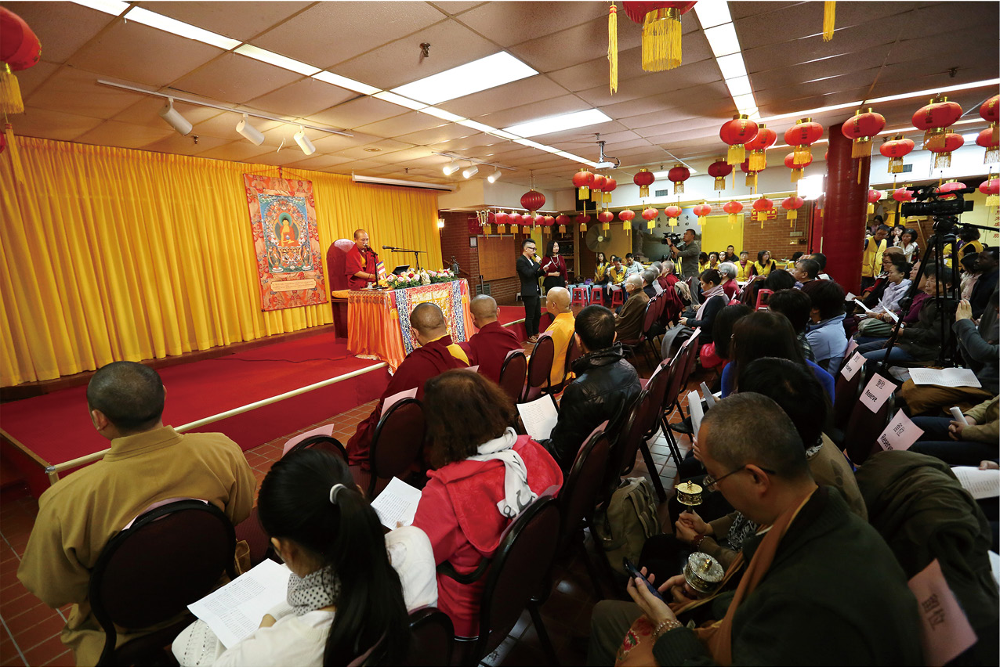
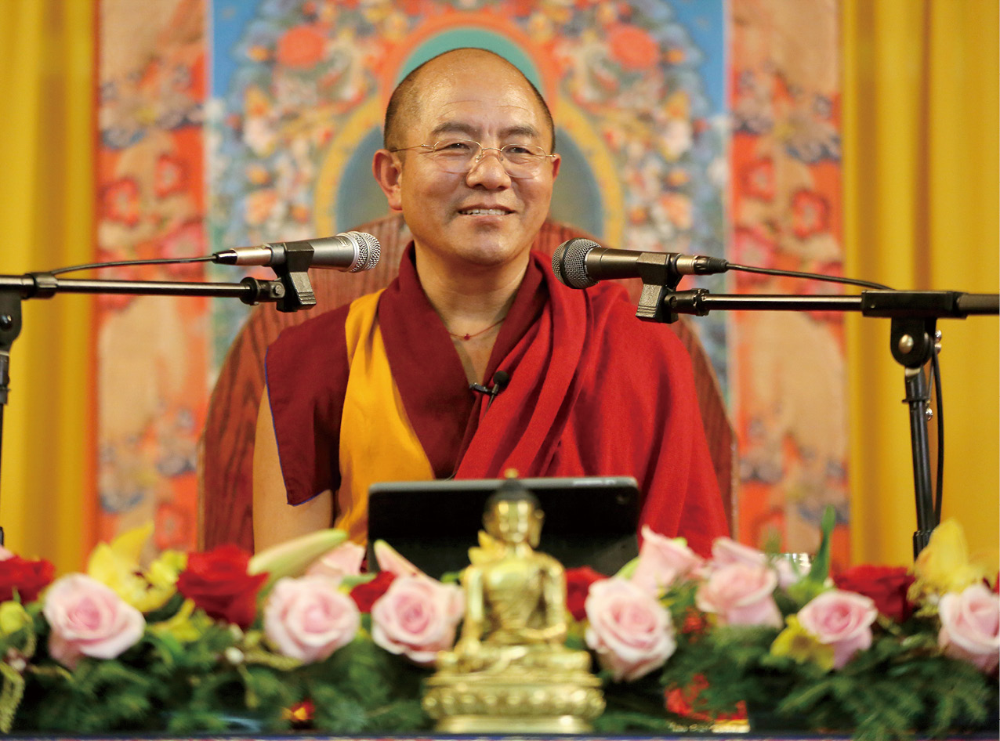
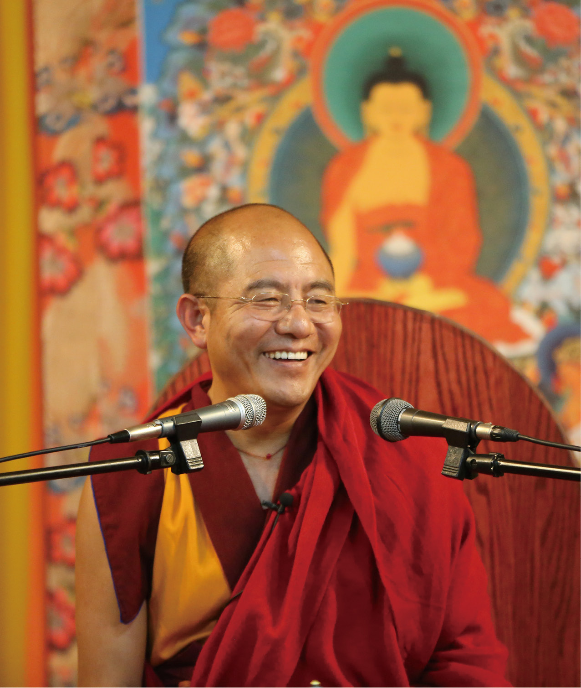
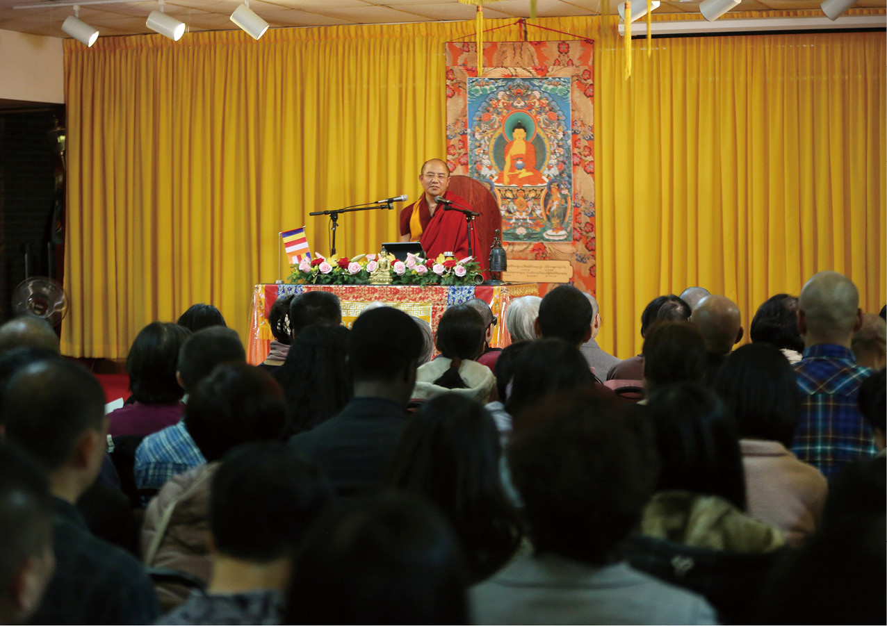
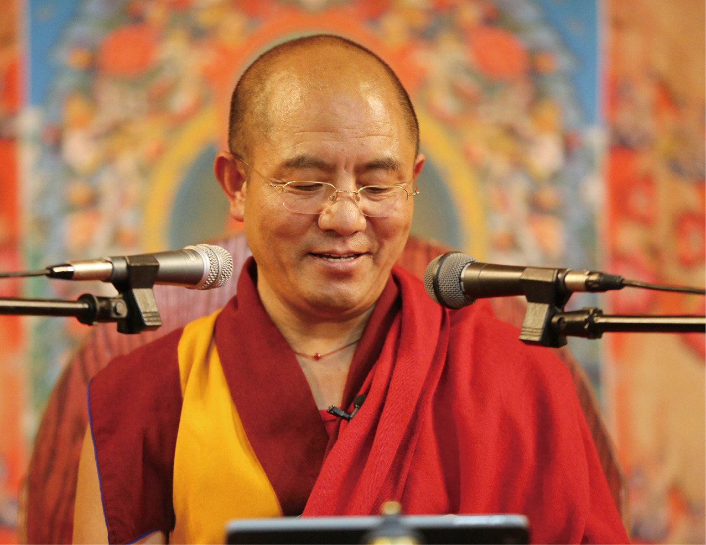
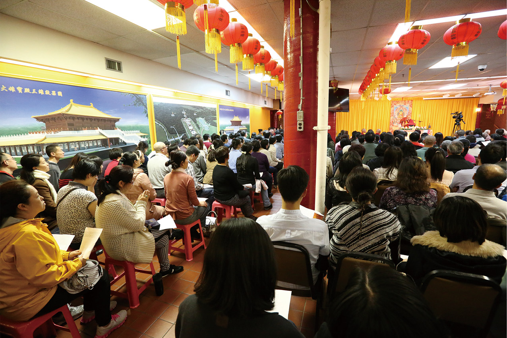
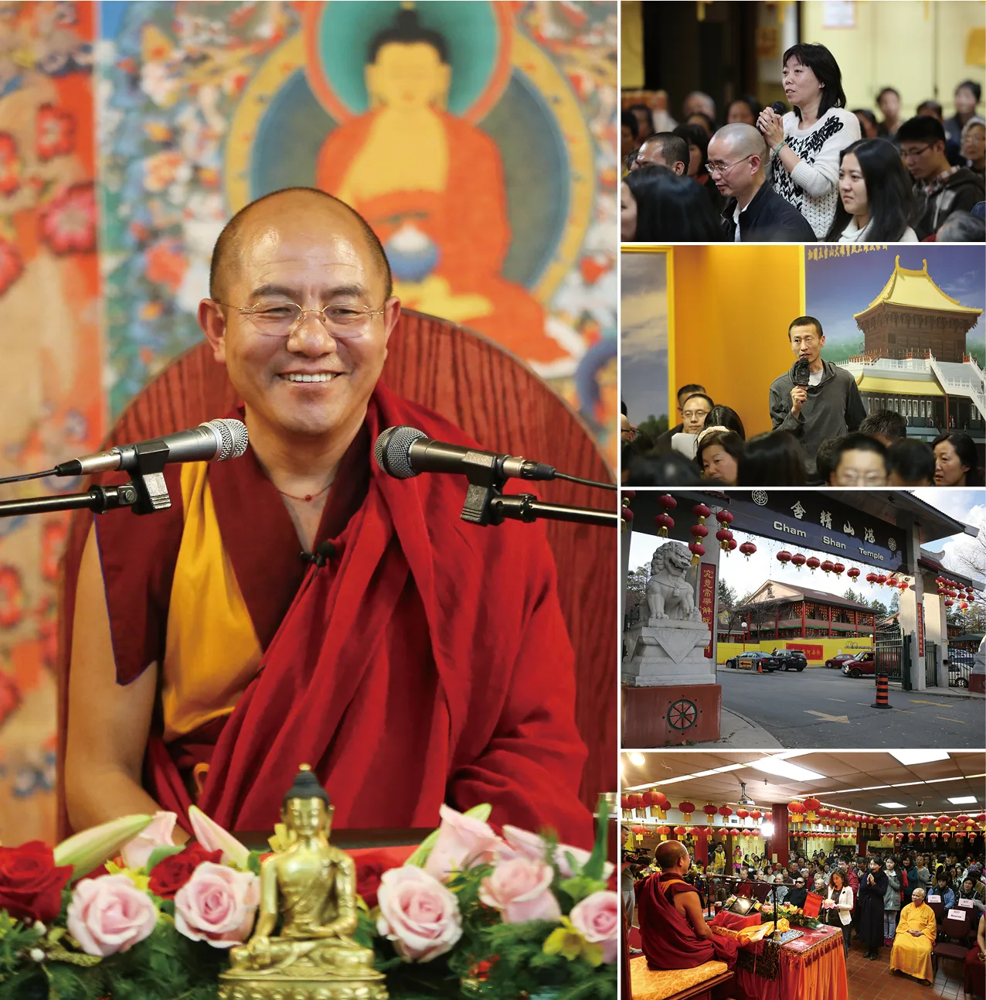
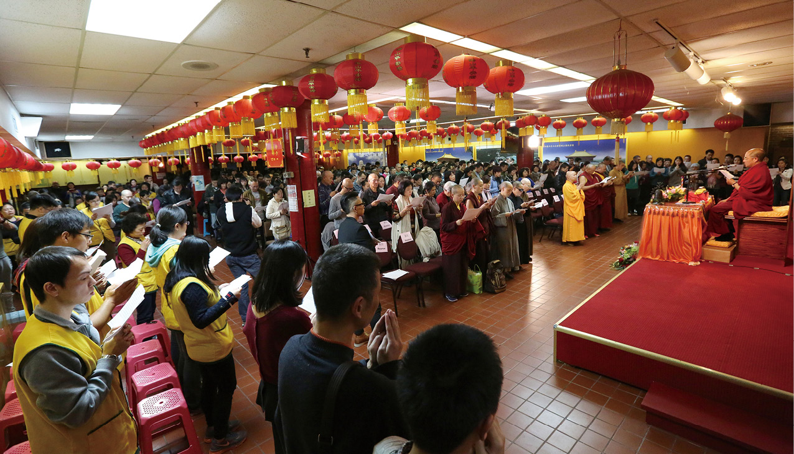
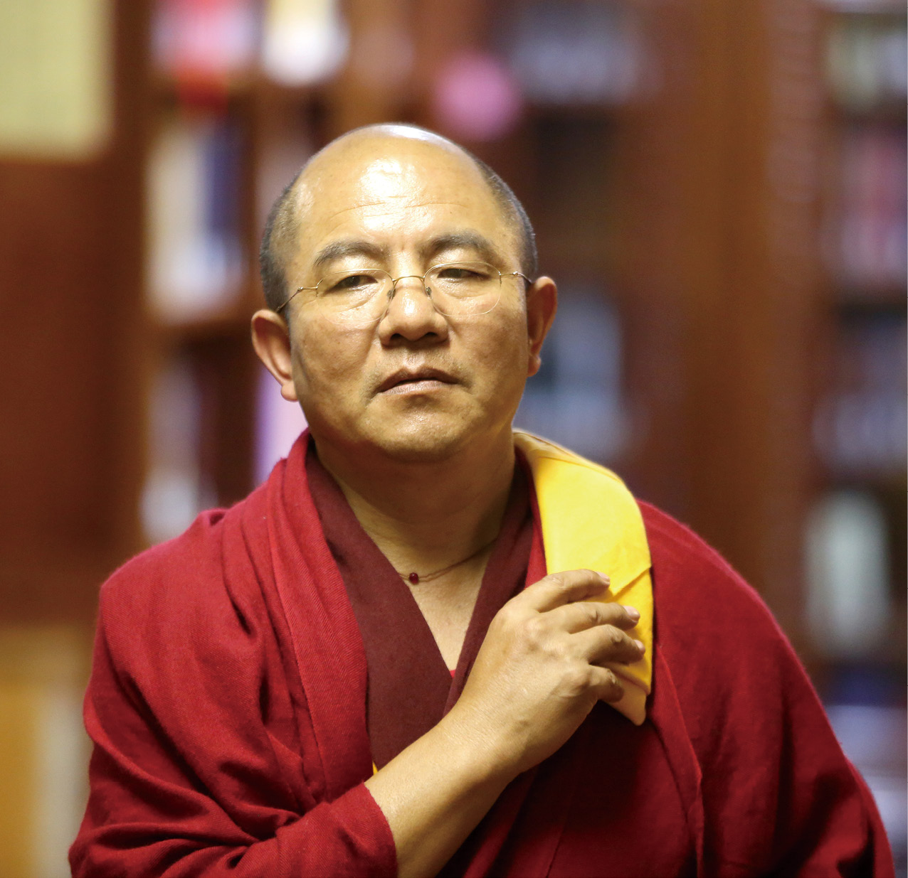

《入行论·菩提心利益品》讲解

第1课

2014年10月25日

今天，我很高兴能够在加拿大湛山寺与众多佛教徒共同学习。刚才有些佛友背诵了《入菩萨行论》的第一品——《菩提心利益品》，它有三十多个颂词，我准备在今天、明天和星期五，共分三堂课来为大家讲解。

佛教徒要广闻博学

我觉得这次和大家一起学习很有意义。你们不仅信仰佛教，而且这里大部分人已经皈依。不管你学的是汉传、藏传还是南传佛教，这些都是释迦牟尼佛传下来的教法，都是殊胜的佛法。虽然我主要学习藏传佛教，但同时我也学汉传和南传佛教。而作为地球上的一份子，我认为佛教徒都有必要了解这个世界上的其他宗教，以及世间科学理论方面的知识。

作为佛教徒，一方面我们需要学习佛法，使自己对佛法生起信心，另一方面我们也要学习世间的知识，然后以佛法的智慧来看待世界和佛教。这方面大家应该非常清楚。今天，在我面前有穿着不同颜色袈裟的法师，他们来自不同的寺院和教派，此外，这里也有很多来自不同国家、教派以及不同肤色的在家人，而我们聚首在此的目的没有其他，就是为了共同学习《入菩萨行论》的第一品。

每天讲课之前，我会先用藏文给大家念一遍当天所讲的偈颂。这次我来到加拿大，觉得因缘很殊胜，所以在没有道友要求的情况下，我想另外给大家念三个传承。今天，我准备为大家念宗喀巴大师的《三主要道论》，明天会念《佛子行三十七颂》，而在最后一堂课，我将会念《修心八颂》的传承。我们佛学院的所有人都必须背诵这三部法，法王在世时对它们非常重视，而我在上师面前得过很多次它们的传承，可以说自己的传承是非常清净的。现在我首先念《三主要道论》和《入行论·菩提心利益品》的部分颂词。

（堪布念《三主要道论》和《入行论·菩提心利益品》传承）

一些入门不久的道友可能不了解，我刚才用藏文给大家念了今天将要讲解的法本内容，这称作传承。今天，我会用大概一个小时来讲解《入菩萨行论》第一品的部分内容，在字面上简单地介绍菩提心的密意，之后我们会有简短的问答环节，最后是一起回向。

《入菩萨行论》由寂天菩萨所著，它对任何人都非常重要。不管你们属于哪个传承，我特别希望这里所有人都可以完整地学习此论。现在讲《入行论》的大德非常多，我曾经分别以汉语和藏语传授过，其中一次我用汉语讲得比较广，共计201堂课，最后整理为10本讲记，可算是一个大工程。

今天是个很好的机缘，我们可以共同学习这部论典的第一品，看看菩提心有什么样的功德。学习佛法不是两三天的事情，这次我们在三节课中虽然学不了太多内容，但是可以让大家与这部法结上善缘。我自己对《入菩萨行论》非常有信心，它有几个不同版本的汉文翻译，刚才我在湛山的图书馆里也看到了。至于《入行论》的英文译本，目前共有四个版本在美国和加拿大流通，对一些生活在这里的道友来说，可能看英文译本会比较相应。

这部论典非常重要，大家一定要把它学好。如果你实在没有时间，或者本身容易发脾气、爱吵架，你最好学习它的第六品“安忍品”。前段时间我在新西兰讲解了这一品，课程完毕后，一些经常跟家人吵架的道友发愿从此以后不再吵架。当然，你们来到国外很不容易，可能本身也不轻易和别人吵架，对吧？

现在，我们开始讲菩提心的利益：

敬礼一切佛菩萨！

通过学习《入菩萨行论》，我们可以趋入一切佛菩萨的境界，在此之前，大家一定要打好闻思修行的基础，这非常重要。现在很多佛教徒比较迷信，他们把佛法看成一门超世间的知识，认为佛法不是凡夫所能理解的，自己完全相信就可以了，这是不合理的。当今的佛教徒应该把佛法看作是一门教育，以理性的智慧来趋入，否则我们的行为会变得很可笑，别人也会觉得我们的宗教十分奇怪。作为佛教徒，我们需要烧香、拜佛、念佛，这些很重要，但更重要的是我们要了解大乘佛教的甚深教义。

善逝法身佛子伴，及诸应敬我悉礼，

今当依教略宣说，趋入佛子律仪法。

这是顶礼句。寂天论师在造论之初，首先顶礼善逝、法身和佛子。这里的“善逝”指佛陀，“法身”指法宝，“佛子”指一切僧众和文殊菩萨等大乘菩萨。然后作者对佛陀的教法、证法以及世间中值得敬礼的对境顶礼。不管我们的根基如何，作为佛教徒，一定要对三宝生起信心。

然后是“当依教略宣说”。依靠释迦牟尼佛所说的经典，寂天论师宣说了这部《入菩萨行论》，它的内容是关于趋入菩萨行的法门。此颂最后一句的“佛子律仪”是指菩萨的律仪，即严禁恶行戒、摄集善法戒和饶益有情戒。

显现上，作者很谦虚地说：

此论未宣昔所无，诗韵吾亦不善巧，

是故未敢言利他，为修自心撰此论。

寂天菩萨非常谦虚地说：“从意义上讲，此论的内容及其见解并非前所未有；从词句上讲，此论没有优美的辞藻和美妙动听的韵律。所以，我不敢说造论的动机是为了利益众生，我是为了修持自己的菩提心才撰写此论。”

寂天论师的境界非常高，他肯定有利益众生的发心，只不过为了在众生面前示现谦虚，他才说自己没有这样的发心。虽然作者说《入菩萨行论》的内容并非前所未有，但实际上也是谦虚之词，这与他的稀有传记有一定关系。寂天论师的生平有七件稀有的事迹，称为“七种稀有传记”，他当时造《入行论》的背景与其中的一些稀有传记有关。

寂天论师本来是王太子，马上就要登基继承王位，举行登位仪式的前一夜，他梦见了文殊菩萨。梦中文殊菩萨坐在王座上，对他说：“这是我的宝座，我是你的上师，你和我同坐一座，是不应理的。”第二天醒来后，他觉得自己不应该做国王，后来就去了那烂陀寺出家。

那烂陀寺是当时亚洲最古老和最成熟的大学之一，它传承下来的真理都非常有说服力和具有合理性，这就是我们现在佛教徒所拥有的佛法。那烂陀寺是当时最高等的大学，汉传佛教的玄奘大师就是去那里取经、求法的，而藏传佛教和印度佛教的很多传承也源于那里。当时在那烂陀寺，讲辩著的风气十分兴盛，可惜很多现代人都没有机会感受那种佛法的味道。

寂天论师在那烂陀寺出家后，显现上并不精进，当时有些僧人想找一些借口把他开除。后来寺里安排了法座，要求不同的比丘轮流在法座上背诵所学的经典，这时候一些人想趁机羞弄寂天，便要求他上法座，他本来不愿意，但是最后应允了。上座后寂天论师问道：“你们想听从前已有的著作，还是前所未有的著作？”想戏弄他的人故意要求他背大家没有听过的经论，于是寂天论师便开始念诵《入菩萨行论》。所以，在他传授此论之前，《入行论》的确是在世界上前所未有，而他这里说“此论未宣昔所无”是谦虚的表现，是指本论的意义在过去的经典和论典中已经宣说了。

当时寂天论师从《入行论》的开头一直诵下去，念到第九品《智慧品》的时候，他的身体逐渐腾空，终至不见身影，只有从虚空中传来的朗朗诵经声，一直到全论诵完为止。现在有些人不一定能够相信，但实际上这就是他的稀有传记之一。那时候很多具有不忘陀罗尼的班智达把刚诵完的《入行论》记在心里。之后，他们在吉祥功德塔[^1]附近找到寂天论师，论师说《入行论》的颂文以印度中部班智达所记的一千个颂词为准，从此《入菩萨行论》就被广泛弘扬，流传至今。

珍惜暇满，断除散乱

总之，寂天论师在《入行论》的开头宣说这个颂词是在示现谦虚。他然后说，愿所有见闻此论的人，能够欢喜地得到益处：

循此修习善法故，吾信亦得暂增长，

善缘等我诸学人，若得见此容获益。

如果我们学习这部论典，依此来修习善法，那是非常有意义的。寂天菩萨自己也是通过这样的修学和训练，最终对菩提心生起了很大的信心，以此因缘，凡是与本论结缘的人，都会获得真实的利益。

正在学习《入行论》的各位都跟大乘佛教有缘，这种善缘来之不易，你们应该把握时间，系统地学习佛法，这非常有必要。否则你像一些从来没有学佛的世间人一样，整天只懂忙着挣钱，忙着家庭琐事等世间法，那是不值得的。他们不懂因果、不懂修行，而你已经皈入佛门，还自认为是一名佛教徒，如果你没有好好地修行，那是不合理的。

我不会在其他宗教徒或者世间人面前直接批评佛教徒，但实际上有些佛教徒的表现让我心凉，因为我看到很多佛教徒非常散乱，把时间花在没有意义的事情上。当然，佛教并不要求所有人都不要赚钱，不要做世间的事情，但是佛教徒应该断除散乱的因，合理地运用时间，好好地做一些有意义的事情。

人生非常短暂，一些人虽然学佛很多年，却总是忙于世间的琐事。若你临终之时，才发现自己在今生除了种下一些善根之外，根本没有实修正法，那你将会感到非常可惜。希望你们这次与《入行论》结上善缘、明白了菩提心的利益之后，可以经常修持佛法，这非常重要。

事实上，修行解脱的因缘是我们人类的身体和心，我们依靠这个人身能够获得巨大的利益，这是其他许多众生得不到的：

暇满人生极难得，既得能办人生利，

倘若今生利未办，后世怎得此圆满。

在茫茫的轮回之中，转生为地狱、饿鬼、旁生的众生数目非常非常多，而获得人身则极为困难。如今我们已经获得了远离八无暇[^2]、具足十圆满[^3]的暇满人身，此时我们一定要好好地修行，成办自己的利益，否则后世怎么可能再得到这么好的人身呢？这一点值得大家仔细地思考。

确实，我们即生没有转生到三恶趣或者长寿天，没有成为业际颠倒之人，而且已经遇到释迦牟尼佛的教法和有缘的上师，我们在今生成办解脱的善缘、条件已经应有尽有，如果我们每天只是浑浑噩噩地度过，浪费光阴，那真是非常可惜。

我一直都要求学习藏传佛教的修行人要修完五十万加行，但是很多人花了一二十年还没有修完，他们既不顶礼也不念佛。另外，很多人在学习汉传佛教的过程中半途而废，他们今天听一节课，明天就消失了。现在很多修行人的行为非常可笑，他们的心态很不稳固，这样的人若想在来世再得人身，真的非常困难。

获得人身需要诸多善缘，像清净的戒律、积累众多殊胜的资粮、断除障碍等等，如果大家现在不修这些善因，那你在来世是不可能得到人身的。当然，如果你是一位不承认前后世的无神论者，那就另当别论。但各位都是佛教徒，若你的行为还是和那些不承认因果的人一样，就是自欺欺人，比那些无神论者更可笑。

可能大家觉得我的语气比较重，但是我无论如何也要指出这方面的问题，因为它值得我们重视。不管在东方还是西方，现在很多佛教徒都受到当今一些文化的影响，尤其是住在大城市的修行人，他们完全不做一些真正有意义的事情，例如连一座暇满难得也不观修，反而只顾每天看手机、看电视、上网和跟朋友散乱。要是你把今生如此空耗，你很有可能在来世转生到旁生界，那时候就再也没有修行的机会了，这是非常可怕的。试想你失去了这个人身，你的后世将在三恶趣中如何度过？这值得大家认真地反思。

为什么寂天论师在此论开头要宣说暇满难得？有些人觉得世界上有七十多亿人，因此人身并不难得。听说你们加拿大有三四千万人，人口比中国少，可能中国几个城市的人数已经等于你们整个国家的人口。中国的人口密度非常高，大城市里都密密麻麻地挤满了人，所以一些人觉得人身并不难得。

一般来说，造恶业的人身不难得，但是暇满珍宝的人身非常难得。此处所讲的是真正远离八无暇、具足学修顺缘的暇满人身。你们虽然没有转生到八无暇的地方，但很多人可能已经转生到第九种无暇之中了。为什么呢？一些人虽然没有投生于地狱、饿鬼、旁生等无暇之处，但是每天都是忙得不可开交，我问过很多佛教徒他们的修行情况如何，他们都说自己忙碌得很，没有时间修行。

其实，你不可能每天都忙得连一点修行的时间也抽不出来。一天24小时，你在工作上花8小时，再把一两个小时用在家庭方面，那你还是有空闲的。你可以把部分时间用在生活方面，可是你也需要安排时间来修行，因为修行是一件大事，它关乎我们的生生世世！

世间的事情最多只对今生的几十年有影响，与你后世的几百年、几千年、几万年相比，那简直是微不足道。如果你一直盲目地忙着今生的事情，像名声、金钱、车、房、自己的身体等等，结果当你死的时候才发现这些都带不走，才发现生前没有造过任何善根，那是多么愚痴啊！

如今很多人总是盲目地忙于世间的事情，最后自己也不知道是为了什么而忙碌，迷失了人生的方向，这就是现代人的特点，真的非常可怜。当然，我们需要处理一些世俗的事情，尤其是你们在家人，要解决生活上的各种问题，不过大家也应该安排时间来闻思修行，否则你便与非佛教徒没有差别，这方面大家要注意。

此处讲到的暇满难得除了跟修行善法有关，也跟菩提心的所依有关。在佛教中，旁生道和天人道的众生也有生起菩提心的情况，但是非常罕见。珍贵无比的菩提心能依靠人身而产生，现在我们已经获得了暇满人身，所以大家应该珍惜这个机会，不要随便空耗。

抓住学佛的机遇，稳重前行

犹如乌云暗夜中，刹那闪电极明亮，

如是因佛威德力，世人暂萌修福意。

这个偈颂很重要。此处用了一个比喻，说明我们生起菩提心非常难得。在乌云密布、下着大雨的黑夜，一刹那的闪电虽然特别明亮，但是它稍纵即逝。凡夫人产生一个善念或者发菩提心的念头，在自己漫长的人生旅途中，是一件非常短暂的事情，就像黑夜中的闪电一样，所以你在善心生起的当下，一定要抓住机遇来好好修行。

凡夫人很不容易才能产生一些善念，很多人偶尔生起想学佛、想当居士、想听一堂课、想去寺院拜佛、想禅修的念头，在你茫茫的人生中，能够产生这些念头确实非常难得、罕见，但是它们稍纵即逝，所以一旦生起这些善念，你要立刻抓住机遇。

当我遇到一些说自己想学佛的道友，我都会告诉他们：“赶快学，赶快学！”因为他们的心态可能在很短的时间内就轻易改变，你们知道吗？可能这里的一些法师也遇过这样的人，他们今天来寺院学佛，明天就放弃了，后天已经跑到其他的宗教场所。他们看起来很稳重，但是一两天后，他们的心态和行为已经完全改变。

现在人们的心态很不稳定，你们可以观察自己，如果你此刻有学佛的心，那确实非常难得，是百千万劫之中的难得，因此你应该尽量保持这颗初心，看看能不能保持十年二十年。你余下的人生也就是这几十年，若你一直坚持初心，你会成为一位名副其实的佛教徒，以此身份来走完人生是非常有意义的。

有些人一生中换了很多身份，他们上半生是非佛教徒，中间是佛教徒，下半生又变回非佛教徒，如此变来变去，真的十分可笑。你们身边也有这样的朋友吧，他们学佛一段时间后就“无疾而终”了。所以说，一个人能够在相续中生起善念真的很不容易，这时候我们一定要抓住机遇，好好地修行。

下面开始讲菩提心的利益。作者分了几个方面来阐述，首先，菩提心是断除罪业的一种方法：

以是善行恒微弱，罪恶力大极难挡，

舍此圆满菩提心，何有余善能胜彼。

凡夫人相续中的善心十分薄弱、短暂。我经常劝一些道友系统地学习佛法，但是有些人学了一部论典的两三节课后，就放弃不学了，能够圆满学习一部论典的人非常少。在藏地，很多修行人在二三十年当中，仍然坚持每天不断地闻思，而在大城市，如今让人们散乱的因太多了。

昨前天我来到这里，遇到一些住在加拿大的老朋友，他们有些学佛大概有六七年，有些则有十多年。我对他们说：“你们还没死啊？还在学佛啊？那很不错。因为有些学佛的人退得太快了，没有坚持多久，所以你们这些学了大概十年的，已经算是老修行人了，还是不错啦。”我看这里有很多年轻人，今天你们都带着诚挚的心来学佛，但是我不知道你们的身份会不会朝令夕改，可能两年后这里很多人都不再是佛教徒了，所以我很担心，毕竟现代人的心态很不稳定。

当今人们造善业的心很薄弱，可是很多人在造恶业、造十不善业的时候总是兴致勃勃，而且他们做起来也得心应手。现在，世界上各个城市都充满着很多造恶业的地方，例如有各样的舞厅，但是比较而言，让人们行持善法的地方非常稀少，不知道加拿大有多少寺院、道场。总之，真正行持善法的人少之又少，而造恶业的人多之又多。

凡夫人经常造恶业，我们若要断除恶业、增长善心，那除了依靠菩提心以外别无他法。刚才主持人也讲了，菩提心是所有善法中最殊胜的，不管你在学什么传承，我都希望大家以后好好地学习《入行论》。当你做任何善法或者世间的行为时，只要以菩提心摄持，你就是真正的大乘修行人。如今很多人都自认为是大乘行者，但它的标准是你一定要有菩提心，没有菩提心的人称不上是大乘修行人。

那什么是菩提心呢？就是无条件地利益众生，而且这不是暂时性的，你要考虑到众生的长远利益，让他们获得佛果。可能大家都认为自己是大乘佛教徒，那你可以扪心自问：“我有没有无条件地帮助过身边的众生？”

有时候我们佛教徒不仅没有发菩提心，甚至彼此之间的勾心斗角、内部矛盾、说过失的情况比没有学佛的人更严重。当我知道一些佛教团体有诸如此类的情况后，真的感到很伤心。当然，凡夫人聚在一起的时候，什么事情都可以发生，但是，我看其他宗教徒或者非佛教徒的群体，他们很多时候都能和睦相处、互相不说过失，反而佛教徒的群体内部有很多不和，为什么会这样呢？因为我们没有很好地闻思、没有菩提心。

如果你有了菩提心，在群体中，你不可能会把个人的事情当作一回事，你一定会无条件地帮助众生。当彼此都愿意无条件地付出，一般来说人与人之间的冲突是不太可能出现的。冲突和矛盾全都来自我和我执，如果我们都有菩提心，那么我们人与人之间的许多问题都可以解决，而自己的许多功德都可以增上。

现在，各个地方的很多佛教徒正是因为没有利他心、没有闻思，所以他们的身口意都不如法，产生了很多问题。尤其部分佛教徒总爱说一些神通之事，他们那些究竟是“神通”还是“鬼通”，确实很难说，因为真正的神通不是普通人的境界。总之，作为大乘佛教徒，大家一定要有菩提心。要是你不承认自己是佛教徒，那你有其他想法或者行事方式都是可以的。

菩提心能成办利乐

佛于多劫深思维，见此觉心最饶益，

无量众生依于此，顺利能获最胜乐。

菩提心有什么好处呢？佛陀在多生累劫中深深地思维，发现唯有菩提心对众生最有利益。有些人通过给别人地位、送别人东西等来饶益众生，其实这些不是最重要的。那对众生最重要的是什么呢？就是菩提心，因为无量众生可以依此顺利到达轮回的彼岸。

无量众生一直沉溺在轮回苦海之中，只有依靠菩提心、利他心，众生才能获得真正的利益。事实上，无论你获得多少钱财，都不能保证自己永远快乐。比如你今天获得了50万美金，初时你会很开心，但是之后你要盘算怎样处理这些钱财，做生意还是存银行？此时烦恼、痛苦就随之而来。另一方面，我们暂且不说那些前辈的成就者们，如果你真的有一颗非常纯正的利他心，那你在世界上任何一个国家、地方或者群体当中，都会过得非常快乐。所以，利他心对无量众生来说确实非常重要。

此外，像《入菩萨行论》这些宣说菩提心的论典，也能利益无量无边的众生。前段时间，我看了在北大校园举行的两位诺贝尔奖得主的对话，他们分别是获得物理学奖的杨振宁和获得文学奖的莫言。其间杨振宁问莫言：“假如把爱迪生请到21世纪的今天待上一周，哪样东西会让他感到最不可思议？”莫先生回答是手机。当时我想，如果把寂天菩萨邀请到我们这个时代，他可能会获得诺贝尔文学奖，因为他造的论典比那些获奖者的作品更好。

在贡献方面，很多诺贝尔奖得主并没有对我们人类有很大利益，他们甚至可能发明一些让人类感到惶恐的东西，但是寂天论师在久远之前所造的论典，至今仍然利益无量众生。一些没有学过《入行论》的道友，也许不知道它的影响力有多大，否则你会明白为什么它有四五个英文译本。大家应该想一想，这样的论典影响了多少人的心灵、利益了多少众生？为什么一位真正有利他心的大德能够影响那么多人？这就是菩提心的力量，佛陀再三思维后也觉得它是最重要的，于是便给众生宣说了菩提心。

下一个颂词与三士道相对应。一些学过《菩提道次第广论》的道友，应该清楚什么是三士道——小士道、中士道、大士道。若你想获得大士道的功德，也需要菩提心：

欲灭三有百般苦，及除有情众不安，

欲享百种快乐者，恒常莫舍菩提心。

此颂的第一句是讲中士道，对那些希求自己灭除三界轮回的各种痛苦以及获得自我解脱的人来说，菩提心十分重要；第二句是讲大士道，已趋入菩提道的菩萨希求灭除众生的一切痛苦，这些大乘菩萨也需要菩提心；第三句是讲小士道，即希求自己获得百种人天福报的人，他们也需要最尊贵的菩提心。总之，不管你是小士道、中士道还是大士道，你都不能舍弃菩提心。

生死狱系苦有情，倘若生起菩提心，

即刻得名诸佛子，世间人天应礼敬。

束缚在生死轮回苦海中的有情，如果相续中生起了菩提心，便跟以前的自己完全不同，哪方面不相同呢？在名称上，他的名称已经由原来的“众生”变成了“菩萨”；在实际意义上，他已经具备了名副其实的功德，从此以后，所有人道和天界的众生向他供养、顶礼，他也完全承受得起。

刚才也讲了，大家要发心：“从现在开始，我要真正无条件地利益无量无边的众生”，你们能不能生起这颗心？如果你生起了这种菩提心，那就可以称为菩萨。菩萨有两种，一种是具有胜义菩提心的菩萨，是证得一地以上的圣者；另外一种是只具有世俗菩提心的菩萨，只要你发了菩提心，就是这种意义上的菩萨，也是此处所指的菩萨。

我们发了菩提心就可以称为菩萨，成为人天的应供处。此时有些人会想：“一地以上的菩萨具有诸多功德，可是我的相续中还没有生起真正的断证功德，那我可不可以称为菩萨呢？”在名称上是可以的，就像降生在皇宫的太子一样，虽然他还未当上真正的国王，但是他已经转生为国王的儿子，住在皇宫里面，终有一天他会成为国王。同样，虽然你尚未有能力去真正利益无量众生，但是你已经生起了菩提心，因此可以称为菩萨。

在学修的过程中，我们不应该在特定的条件、回报下才去利他，我们要发愿从现在开始无条件地利益无量众生，生起这种菩提心很重要，如果你没有这样的发心，你就没有资格说自己是大乘佛教徒。

我这次没有跟大家讲人间佛教那些比较容易明白的道理，也没有讲一些说说笑笑、迎合大家的世间名言，因为你们大部分人已经学佛多年。当然，这里也有一些刚学佛或者从来没有接触过佛教的人，可能你们听说我是从藏地来的，于是便抱着好奇心来到这里，你们是不是有这种想法？其实这没有什么可好奇的，我不是来这里作秀演戏。

今天讲课的内容，在你们面前的海报里也说得清清楚楚——《入菩萨行论·菩提心利益品》。以此为题，我按照藏地传统的讲法方式来为大家讲解，过程中你们应该好好地思考菩提心的利益，想到在生死轮回中，自己至少要真诚地发起菩提心，这很重要，否则你便不是大乘佛子。

你们不仅要明白菩提心所带给你的名称及意义，也要反观自己究竟有没有生起菩提心，如果答案是否定的，那你算不上是大乘佛教徒。此时你可能想：“我可以在将来再学大乘佛教，纵使我现在不符合大乘佛教徒的要求，我还是一名小乘佛教徒。”即便如此，小乘佛教徒希求自己从生死轮回中获得解脱，你也要反观自己有没有这颗强烈的出离心，如果答案又是否定的，你就算不上是小乘佛教徒，那你的身份究竟是什么呢？佛教爱好者而已。

成为一名佛教徒的标准，是你首先要有皈依三宝的心态，这很关键；在此基础上，如果你只是希求自己从三界轮回中出离，你就是小乘佛教徒；如果你发愿真正利益众生，那你是大乘佛教徒。有些人自认为皈依、学佛多年，非常傲慢，其实他们什么也没有学，莫说大乘的发心，他们连佛教最基本的皈依也不了解，在我看来，他们根本还没有入道，是佛教的门外汉。

以比喻来赞颂菩提心的功德

下面从六个方面来赞颂菩提心的功德，第一个是点金剂：

犹如最胜冶金料，垢身得此将转成，

无价之宝佛陀身，故应坚持菩提心。

在古印度，少量的点金剂能够使巨大的铁块变成金子，就像我们加一点蜂蜜到水里，会让水全部变甜。此处的铁块比喻我们现在的身体，我们这个由各种垢染集聚的肉身很不清净，表面上每个人看起来都很干净，但实际上我们的身体，像肉、骨头、内脏、皮肤等等，里里外外都不干净。但若我们相续中真的生起了菩提心，就像点金剂能使铁变成黄金一样，我们这个不净的凡夫身体，也能变成非常清净的佛陀身相。

如果你认为自己是个好人，或者想自己的人生有价值，你一定要在相续中生起菩提心。虽然表面上你长得不好看、衣着不漂亮，各方面也没有过人之处，没有让众人欢喜的地方，但实际上只要你有菩提心，愿意今后不害任何众生，以及在此基础上一心一意利益无量众生，那你就是非常伟大的菩萨。

你们可以观察自己到底有没有菩提心。其他人没有的话我也理解，毕竟世界上有各种各样的人，但是我们自称为大乘佛教徒，如果你的心态很丑恶，总想伤害众生，口头上也经常以各种语言来攻击他人，那你应该感到非常惭愧。当然，我们现在没法断尽所有烦恼，佛教徒还是会有一些细微的嫉妒心、贪心等等，但若你心中有很多粗大的烦恼，那你应该好好地反思。此处说我们有了菩提心后，自己的身体便和佛身没有差别，所以大家一定要坚持、稳固地受持这颗菩提心，如此你的人身会有与众不同的力量。

第二个比喻是以如意宝来说明菩提心非常珍贵：

众生导师以慧观，彻见彼心极珍贵，

诸欲出离三界者，宜善坚持菩提心。

众生导师释迦牟尼佛在多生累劫以智慧反复观察，究竟什么东西对众生最有利益，最终他彻底照见菩提心极为珍贵，唯一对众生最有利的就是菩提心。如果我们想自己超出三界轮回并让无数众生获得佛果，我们一定要生起菩提心，并且坚定地行持它。

有些人的相续中没有菩提心，却经常在口头上说自己要度化众生。其实，度化众生不是一件容易的事情，过程中你会遇到各种情况，如果你没有菩提心，你可能会因为一点小事情而感到痛苦。虽然我们要好好发愿度化众生，但是也不能不自量力，一定要先学习，把基础打好。

现实之中，不管是幼儿园、小学、中学还是大学的老师，他们在求学阶段都要充实自己的知识；一名在五星级宾馆里工作的服务员，要先接受培训；人们也要先学习很长时间才能自己驾车。但是，现在有些佛教徒没有经过学习和训练，认为只需到上师那里办个皈依证，“啪”的一声盖上章，他就变成了佛教徒，这是不现实、不切实际的。

真正的佛教徒一定要长期学习，当你明白佛理的时候，你才称得上是佛教徒。现在不论国内、国外，都有很多由佛教徒引发的不良现象，去年我出访新加坡、台湾等地，看到很多人没有如法地闻思修行，甚至还以佛教的名义做了很多坏事。至于加拿大，我在二十多年前去过哈利法克斯，没有来过多伦多，这回是第一次来，所以我不清楚这边佛教徒的状况。

事实上，不管我们身在何方，最重要的是让自己拥有佛教的知识、智慧和大悲心，如此我们才是真正的佛教徒。若你没有生起菩提心，你的善行会举步维艰，甚至有一天当你的相续中充满自私心和邪见，你会像当今的某些人一样，以佛教的名义来做很多不如法的事情。因此，我希望大家都能生起真正的菩提心。

第三个比喻是从过失的角度说明菩提心的重要性：

其余善行如芭蕉，果实生已终枯槁，

菩提心树恒生果，非仅不尽反增茂。

一般磕头、念经等善根就像芭蕉树一样，生完一次果后就不会再次产生，但是菩提心的果实会不断地出生，如是以菩提心摄持的善根不会耗尽。

《入行论》的第六品“安忍品”中说到[^4]，一个人只要生起一刹那的嗔恨心，便会毁坏自己多生累劫所做的善根，但是根据相关的讲义和大德们的解释，以菩提心和回向摄持的善根不容易被毁坏。所以，当大家做完任何善法，念诵《普贤行愿品》回向的时候，你要想到把善根回向给天下无边的一切众生，如此你的善根就不容易失坏，否则你只能享用一次相关的果报，然后善根就耗尽了。

大家无论行持任何善法，刚开始的时候一定要发菩提心，中间的时候要不离正知正念、以菩提心来摄持，最后要用菩提心来回向，这样你的善根都会十全十美、非常圆满。你们平时可能会做很多佛事，我希望大家以后行持任何善法都能以菩提心摄持。

如今不管在藏地还是汉地，佛教徒普遍都会做一些佛事，像会供、念诵等等。一般来说，汉藏两地的很多寺院不论早晚都有很多念诵，这很重要，若此期间你没有以菩提心等善心摄持，那你的念诵也许只是口头上的声音，跟播放佛教音乐没有多大差别。当然，你依经典来唱诵也是一个善根，但是由于过程中你没有发心，所以这个善根成熟一次后就用尽了。

以菩提心摄持的善根如同落入大海中的一滴水，大海未干涸之前，这滴水永远也不会消失，同样，以菩提心摄持的功德，乃至菩提果之间都不会耗尽。佛教徒一定要懂得这个道理。如果你没有发菩提心，你所做的善根在成熟一次果报后便会耗尽，就像一次性筷子一样，使用一次后就再也没有用处。

如人虽犯极重罪，然依勇士得除畏，

若有速令解脱者，畏罪之人何不依。

如同一名犯了重罪的罪犯要去某个地方，依靠勇士的护送，他可以毫无恐惧地顺利到达目的地，同样，我们这些造业非常严重的人，若想很快从三界轮回获得解脱，为什么不依止菩提心呢？

以前你们在年轻或者还没学佛的时候，可能曾经杀鸡、吃海鲜、吃活鱼等等，现在你们是佛教徒，应该没有再干这些事情吧？作为佛教徒，我们尽量不要杀害众生，这一点非常重要。如果你是佛教徒，却经常到饭馆里点杀、吃活物，那是很可怕的。确实，我们在还没有学佛的时候，可能因为愚痴、不懂因果以致杀害了很多众生，或者造下各种罪业，如果我们想在短时间内就从这些罪业中获得解脱，依靠菩提心是最重要的。

以前大天比丘曾经造过三个五无间罪，后来他去边远地区给人讲经说法。他圆寂后，有一次他的一位阿罗汉弟子在洗手的时候，突然想知道上师转生到了什么清净刹土，于是弟子以神通观察，却发现大天比丘正在地狱中受苦。这位弟子觉得特别遗憾，他洗完手后又再观察，此时大天比丘已经转生到三十三天。这个公案说明什么呢？虽然大天比丘造了三个五无间罪，但是因为他生起了菩提心，所以即使他堕入地狱，也能很快从中解脱。

汉地有些人经常说定业不能转，其实这要看你有没有依靠菩提心来很好地忏悔，如果你的答案是否定的，那你恶业的果报决定会成熟；如果你的答案是肯定的，那你不一定会感受恶报。现在有些人认为定业不能转，一切都是命中注定。可是，根据相关的经典和前辈大德对定业的解释，其实一切都不是命中注定，若你没有如法忏悔，你一定会感受罪报；相反，若你好好地忏悔，尤其是在忏悔过程中生起了菩提心，那即使你在过去的人生造了最严重的恶业，你也不用害怕了。

佛陀时代的未生怨王杀了自己的父亲，也做了很多伤害佛教的事情，后来他在释迦牟尼佛面前忏悔，相续中生起了菩提心，当下就清净了罪业。如果你不相信因果那就另当别论，否则，你应该想尽办法让自相续生起菩提心，这是最好的忏悔方法。

菩提心如末劫火，刹那能毁诸重罪。

第五个菩提心的比喻是末劫火，什么是末劫火呢？这个世界有成住坏空四个阶段，在最后毁灭的时候，会出现这种末劫火，它能够在刹那间摧毁整个世界。同样，菩提心犹如末劫火一样，当你在心里生起菩提心的一刹那，你无始以来的全部罪业当下就被摧毁无余。

正如刚才所说，相续中具有菩提心的人根本不怕堕入三恶趣，让自己生起菩提心就是最好的忏悔方法。《涅槃经》中说：“何人一刹那，观修菩提心，彼之诸福德，佛陀不能量。”意思是，任何人在一刹那间观修菩提心，其福德和功德连佛陀的智慧也无法衡量。

当我讲完这一《菩提心利益品》后，你们可能会想：“哇，我一定要学好《入行论》，原来只有菩提心才是一切善根的根本。如果我没有菩提心，纵使表面上我一辈子都在修法，但实际上也许只是人天福报而已，根本没有成为究竟解脱之因，那真是十分可惜、可怜。”所以说，佛教徒入门后一定要尽快闻思，大乘佛教的经论多不胜数，当中至少有几部论典是非学不可的，你们应该争取时间去学习。

菩提心如同末劫火，一刹那间就可把我们无始以来所造的罪业统统烧坏。我们大部分人可能在前世都做过很多坏事，就算是今生，我相信很多人的相续中也有很多罪业。如果我们在离开人间之前没有把这些罪业消除，下一世便很可能堕入地狱等恶趣，之后我们要在那里受多少苦、待多久才能解脱啊？

我真的发自内心地渴望能够在自相续中生起非常稳固的菩提心，而且这颗心可以永远不退，如此我在临死之时，就算自己没有神通或者其他成就，我至少不会堕入三恶趣，还可再次获得人身，为自己生生世世的利生事业提供很好的方便和因缘。

事实上，我们佛教徒一方面不要把自己看得太高，切勿自赞自夸，自认为很了不起或者学得很好，但另一方面我们也不用把自己看得太差。之前我在澳洲的时候，一位佛教徒说他非常恨自己，因为他觉得自己的烦恼太重，所以经常都想打自己，我对他说你惩罚自己也于事无补。有时候我们没有故意做一些事情，但是烦恼自然就现前了，我们没有必要为此埋怨自己。

我觉得大家可以算是很不错了，在茫茫人海你们即生遇到佛法，已经是特别有福报的人，但是大家不能就此满足，一定要学习大乘佛教的精髓，如此你的所有行为才会变得如法，这也是我们今天学习菩提心利益的原因。

智者弥勒谕善财，彼心利益无限量。

菩提心的功德难以一一道尽，为了补充说明，此处引用了《华严经》中的一些内容[^5]：智者弥勒菩萨曾对善财童子说，菩提心的功德无法估量。

《华严经》中记载了许多弥勒菩萨和善财童子之间的对话，其中弥勒菩萨用各种比喻来宣说菩提心的诸多功德，以下是一些例子：菩提心犹如良田，能增长众生善法；菩提心犹如日月，能普照整个世界；菩提心犹如雨水，能息灭一切烦恼；菩提心犹如良药，能治一切烦恼病。《华严经》中宣讲了很多菩提心的功德，你们方便的时候应该好好学习。

现场互动

⊙ 问：堪布仁波切你好！听了刚才的课后，我觉得菩提心非常好。不过有些人可能想：“我现在可以随意犯戒、做十不善业，反正我之后生起菩提心便可以把这些罪业全部消除。”请上师开示我们该如何对待这种心理。另外，我们此刻生起菩提心和在干了一系列坏事后才发菩提心有什么区别？谢谢！

堪布：《入菩萨行论》的后面部分讲到，具有菩提心的人诚信因果，因此他不可能肆无忌惮地做坏事。事实上，一个人要真正生起菩提心并不容易。你所形容的那种心态可能比较幼稚，所谓做了坏事后马上发菩提心，这时候的发心可能不是真正的菩提心。

菩提心有胜义菩提心和世俗菩提心两种，其中世俗菩提心又分为愿菩提心和行菩提心。如果你对菩提心的分类、学处有所了解，你会知道生起菩提心是不容易的，而你真正有了菩提心后，你可能不会再做坏事。我觉得你应该反过来想，在准备干坏事之前，你先看看自己是否生起了菩提心，然后你可能没有兴趣再去干这件坏事。

⊙ 问：尊敬的师父上人，我听过藏地有一部《西藏度亡经》，请问它有没有中文译本？我在哪里能够请到这部经？

堪布：这部经在很久以前已经有几种不同的译本。早在1927年，一位美国学者和一个藏族喇嘛就把它翻译出来了，之后也有另一版本的译本，此两部都是先从藏文翻译成英文，再从英文翻译成中文，我以前也看过这两种版本的中文译本。但是到目前为止，市面上还没有直接从藏文翻译成中文的译本。《西藏度亡经》中关于六中阴法的部分，我已经翻译出来，但是它属于密法，不能公开。大概五年前，我在德国的时候给一些受过灌顶、修过加行的佛教徒传授了这部法，不过这是内部的传法，所以法本没有公开。

⊙ 问：堪布，我是从你的家乡四川来的，我是成都人。我在2006年买了一辆越野车，想自驾去五明佛学院，但是最后没去成，想不到跟您的缘分是在多伦多，非常感谢您的来临。

刚才听课的时候，我觉得不散乱对我来讲特别重要，因为我一直都想修行，却不能坚持下去。另外，我找不到一位上师，像你这样的上师，我肯定没有机会在你的面前修行，因为我自己平时也有很多事情，请问怎么样才能找一位好上师呢？我觉得有了上师的指导才能修行。我在成都的时候接触过很多藏传佛教的师父，但是都感觉自己跟他们没有缘分。今天听了你的课，我或许可以在之后的一两个月对治自己的散乱，好好修行，可是日子久了，我没有师父又怎样继续修下去呢？像我们这些城市人应该怎样修行？

堪布：你的越野车是在哪里买的，加拿大还是成都？如果是在加拿大买的，你不能开过去，应该是在成都买的。可是最后你没去成学院，就来到这边了。

你的问题非常好。在座有很多佛教徒，这是很好的，不过为什么今天我的语气比较重呢？其实，我不知道你们的修行怎么样，但是我接触过很多地方的佛教徒，他们的状况都令人伤心。当然，很多在家人都不可能像出家人那样，每天把大量时间全部用在闻思修上。像我们佛学院的一些佛教徒，他们每天要听四五堂课，除了做饭和睡觉之外，基本上其余时间都在修行。对在城市生活的佛教徒来说，这是不现实的，我们也不会这样要求，但大家至少要具足佛教徒应有的状态，像每天最少安排一两个小时来闻思修行，你们是绝对做得到的。

如今让人们散乱的外缘非常多，可能你本来想去修行，但是发现当今有很多上师，也有很多道场，最后你已经被各种信息弄得眼花缭乱。这时候你首先要选好一个实体的道场，如此你的心会稳定下来，这很重要。至于选择道场的条件，就是当中要有法师讲经说法，同时要有闻思修行的风气。

如果你实在找不到这样的一个道场，现在网络上有很多上师在公开授课，你可以选一位自己有信心的上师，然后通过网络来学习。过程中你最好找几位朋友跟你一起学修，因为现在是一个需要互相督促的时代。以前人们习惯自顾自地做事情，无论是管理企业还是学佛都是如此，但如果现在还是这样行持，你会很容易掉队、堕落。如果你能够与一些道友集体学习，那种无形的推动力可以让你坚持下去。

我不太清楚加拿大这边的具体情况。总的来说，你想学佛的话有两种方法：其一，寻找一个有讲经说法的道场，然后你跟着里面的法师、上师的指导来闻思修行；其二，如果你实在找不到适合自己的道场，那你可以在网络上寻找一些佛学课程，然后自己定期按时完成。前段时间我跟一位堪布通电话，他问我在干什么，我说我在大洋洲听课，他不明白我的意思，然后我说现在是网络时代，即使在海岛上也能听到很多上师的课。通过现代的一些技术，我们确实有很多学习的途径。

不管怎样，我们切勿成为口头上、表面上的佛教徒。你们有些人可能以前很虔诚，但是慢慢就堕落了，现在已经失去了初心，这是很可怜的。作为佛教徒，如果你还没有菩提心，你应该尽力让它生起；如果你已经具足菩提心，你在临死前都不要让它退掉。

⊙ 问：尊敬的仁波切！首先，感恩您今天像父亲一样殷勤地咐嘱我们：一定要生起菩提心，不要浪费今生宝贵的人身。您出版过两本书，名叫《有求》和《能断》，请问我在多伦多如何请到这两本书？

堪布：我昨天才抵达多伦多，也不知道在哪里找。如果是在国内，我能够想办法。你在网上应该能够找到，是吧？

主持人：你可以留下你的电话，我们也许能够帮到你。

⊙ 问：顶礼上师！我们说任何事物和修行都有信、解、行、证四个阶段，我们先要对某件事有信心，然后去理解它、修行它，最后通过自己的验证去证悟它。上师您今天为我们开示了菩提心，请问菩提心是否有一个修行的过程？我们是否要不断地重复信、解、行、证这四个步骤，才能让自己对菩提心的信心不断地增长？

堪布：《入菩萨行论》前三品的内容，开始是令未生起菩提心者生起菩提心；中间的部分是生起了菩提心后，如何使它稳固不退，而且增上；最后的部分是将生起菩提心的善根回向众生。你刚才所说的四个步骤是汉传佛教常见的讲法，但实际上也可以用来解释菩提心的修行过程，我们通过信解、修行等方式，可以使菩提心不断地增长。

⊙ 问：请问上师，我们怎样生发菩提心？如果我们已经生起了菩提心，又如何保持、长养它？谢谢上师！

堪布：《入行论》的第三品是关于如何生发菩提心，这次我没有足够的时间来为大家讲解；至于如何护持和增长菩提心，这在《入行论》的第四品至第九品有详细的宣说；此论的最后一品是《回向品》，它讲到如何让菩提心的功德永不耗尽、不断增长。

其实，我今天所反复强调的，就是你们要全面地学习《入菩萨行论》。不然你今天知道菩提心很好，有很多利益，但实际上你却不知道怎样发心、怎样护持、怎样不断地让它增长。这些道理和方法，对很多人来说都比较陌生，所以，你们应该安排两三年的时间，把《入菩萨行论》的全部内容学习一遍。

刚才这里有些道友背诵了《入行论》的第一品，背得不错，我十分赞叹！在汉地的学会，很多学员能够背诵整部《入菩萨行论》，想不到加拿大也有背诵此论的道友，那天安排的时候，我说乐意接受大家背诵的法供养！希望你们以后能够把全论背下来，并且认真地学习它的内容。刚才也说了，《入菩萨行论》有英、汉的译本，也已经被翻译成很多国家的文字，可见它十分重要，我们一定要依靠它来发起真正的菩提心。

⊙ 问：顶礼大恩上师！今天您讲了发菩提心的利益，我觉得菩提心确实非常殊胜，连做梦都想生起真正的菩提心。不过在发心做事的过程中，虽然我感觉自己是一心一意、不杂有私心来发心，但是还会遇上很多违缘，请问上师，我应该在什么时候用菩提心来对治这些违缘？什么时候该用一些降妖伏魔的方便？

我知道藏地有两位祖师——静命论师和莲花生大士。静命论师的戒律很清净，菩提心也修得很好，但是他没法对治当时藏地的邪魔外道，最终他迎请了莲师到藏地降妖伏魔。如果没有莲花生大士的降妖伏魔，说不定现在的藏地还是落在邪魔外道的手里。

在我发心的过程中，有些人总以烦恼心来给我制造违缘，虽然他们不是真正的邪魔外道，但是他们对我的影响可能比邪魔外道更严重，那我应该在什么情况下用菩提心来对待他们？当然我不能像莲师那样降妖伏魔，但我应该在什么情况下祈请莲师来帮我降妖伏魔呢？

堪布：确实，我们在生起菩提心后，行持善法会有一些违缘，这是正常的，不管是汉传、藏传还是印度的很多大德，通过看他们的传记，我们可以了知他们的人生在显现上也有一些违缘。一般人在做事的时候如果出现一点不顺，自己就开始担心、伤心，但是，真正有菩提心的人会视违缘为一种修行机会，他们不会感到特别痛苦。对一个真正有利他心的人来说，即使他在做事的时候出现一些违缘或遇到别人来障碍，他也会觉得这是修行过程中的一种享受。

作为修行大乘佛法的人，我们不能回避违缘，一定要坦然接受。最近，我有一个很重要的发现：有些佛教徒只想跟自己喜欢的人待在一起，而尽量避免与自己不喜欢的人见面，例如不愿意跟某些人吃饭，这些佛教徒会事先打听：“那个人会来吃饭，那我不来了。”“那个人已经在了？我不去了。”如果你是一位大乘佛教徒，却说出这样的语言，那你修得太差劲了。你竟然没有勇气与自己不太喜欢的人一起吃饭，还说要度无量无边的有情父母，怎么度呢？这是一个大大的问号。

你刚才提到静命论师和莲花生大士，其实他们都具有菩提心。静命论师的戒律很清净，对藏地有很大贡献，传统上我们祈祷两位尊者的时候，会先念诵静命论师的祈祷文，这是以显宗和密宗的层次来分的。如果你以后在修行过程中需要莲师的威力，你可以多念《七句祈祷文》和莲师心咒“嗡啊吽班匝儿格热巴玛色德吽”，依此可以遣除你做事过程中的一些违缘。同时，你也要发愿日后在面对违缘的时候，自己要坚强地应对，不能回避。你越回避，违缘就会越多。

我们不能总是想着远离坏人，应该要融入他们的世界。作为佛教徒，如果我们没有勇敢的心去踏入那些坏人或者与我们关系不好之人的群体，不敢去了解他们的世界，那我们的修行确实是太差了。一般世间人只喜欢寂静、喜欢顺利、喜欢和最爱的人待在一起，而不想跟自己不喜欢的人接触，可是有菩提心的人正好与此相反，他们偏要和怨敌待在一起。为什么阿底峡尊者要找一个脾气不好的人当侍者，让他永远待在自己身边呢？因为尊者要修安忍。我们修行人是需要一些违缘的，这很重要。

⊙ 问：喇嘛千诺！今天我学习了《入菩萨行论》，明白了原来发菩提心有非常非常大的利益，但是当我真要发菩提心的时候，我说服不了自己，因为我纯粹是为了那些功德利益才去发心，那是真正的菩提心吗？若我只是为了菩提心的利益才去发心，那就著人相、我相、众生相、寿者相，不名菩萨了。我觉得自己的发心不够纯洁、纯正，请问我该怎样调整自己的发心？

堪布：这很简单，著人相、我相、众生相、寿者相是关于胜义层面的说法，你在世俗层面还是需要有相。即使你不发菩提心，世俗中你仍会有很多相，比如生而为人的相、吃饭的相、走路的相、开车的相等等，你在生活中做这些事情和这些相的存在是不矛盾的。

其实，你起初为了那些利益来发心也是很重要的。我们做任何一件事情，得佛果也好，度众生也好，当中都是为了某种利益。佛陀在佛经中也讲，在暂时没有到达彼岸之前，我们还是需要有这些相，而《金刚经》中也没有破斥、否定世俗层面的相。你不能以胜义谛的道理来破世俗中的善根，这是不合理的。

虽然现实中没有梦中的种种相，但是那些相在梦中还是有的。因此，身在梦中的你，现在要依靠一些功德利益来生起世俗菩提心，当你慢慢趋入胜义菩提心的时候，你才不会著任何相。现在我们都是凡夫众生，哪会有人真正达到无相的境界啊？没有的。世俗之中，即使你没有菩提心的相，你永远都会有吃饭的相，对吧？话说回来，如果你吃饭的相还没有灭，而你菩提心的相早就灭了，那就太可惜了，对吧？（众笑）

⊙ 问：上师，请问无造作的菩提心一定要在证悟之后才能生起吗？

堪布：无造作的菩提心有两种。第一种是你现在还没有完全生起胜义菩提心，但是你在相似的空性境界中安住，这是稍微接近胜义菩提心的状态，可以称为相似的无造作。第二种是真正无造作的菩提心，是在获得一地菩萨的时候才能生起，这在《入中论》中有所描述。

所以，只有开悟者才有无造作、无相的菩提心，凡夫人只有世俗菩提心。不管是愿菩提心还是行菩提心，这些都是造作的菩提心，但我们现在还是需要的，到了成佛时才不需要，就像我们渡过大海的时候需要船只，抵达岸边后就不需要了。

[^1]: 有说此处是尼泊尔的香根佛塔，有说是印度南方，具体地点不清楚。
[^2]: 八无暇：地狱、饿鬼、旁生、长寿天、边地、持邪见者、佛不出世、喑哑。
[^3]: 十圆满：所依圆满、环境圆满、根德圆满、意乐圆满、信心圆满、如来出世、佛已说法、佛法住世、自入圣教、师已摄受；前五种为自圆满，后五种为他圆满。
[^4]: 《入行论》第六品：“一嗔能摧毁，千劫所积聚，施供善逝等，一切诸福善。”
[^5]: 《华严经》：“菩提心者，成就如是无量无边乃至不可说不可说殊胜功德。”
