# 第2课

2014年10月26日

今天，我们继续在湛山精舍学习《入菩萨行论》的第一品，这是三堂课中的第二堂，因为时间关系，我此次跟大家的共同学习在这次课程完结后就会圆满。我这次没有在加拿大待很长时间，但我个人很欢喜。虽然我们除了问答环节外没有其他的沟通交流，但是从大家的提问中，我可以看出这里很多佛教徒非常有水平，你们不仅非常关心自己的修行，也很关心弘扬佛法和饶益有情这些重大的事情。

佛教徒应与世人分享人类的精神良药

作为佛教徒，一方面，我们都是希求解脱者，要为自己的解脱着想，大家即生成为佛教徒，如果我们临死之时没有不堕恶趣的把握，那确实非常可惜；另一方面，我们既然遇到了这么好的大乘佛法，我们应该向世人认真地宣扬佛教的教法，以及尽可能去帮助社会上一些有需要的人。

你们的身边有很多其他宗教的信徒，像天主教徒、基督教徒等等，他们会用自己宗教的教义和一些资源来为世人创造美好的生活环境和精神方面的利益，这是有目共睹的。相对其他宗教，佛教的理念和内涵完全是有过之而无不及，这不是我们自赞自夸，而是客观的评价。可是从利生的角度来看，很多佛教徒由于欠缺了大乘发心，以至于对世间人没有什么影响，尤其在精神方面，这值得大家深思。

现在，许多佛教徒会去建道场、朝圣、拜佛等等，这非常好。但更重要的，是我们平时要把佛教的教义提供给有缘众生。佛教的甚深法理是人类的精神良药，大家要尽量把它提供给世人——高等知识分子也好，身边的人也好，这是我们佛教徒应做之事。

不管你是什么身份和民族的人，居士也好、出家人也好，男人也好、女人也好，作为佛教徒，我们一定要先充实自己，打好闻思修的基础，这是最重要的。然后我们要在短暂的人生中，尽量依靠佛法来完善自己、强大自己，同时为社会和身边的人提供佛法妙药，让他们得到真实的利益，这也是非常非常重要的。

我们活在这个世界，并不只是为了自己的家庭和衣食住行，我们的人生价值不止于此，莫说佛教徒，即便是世间中高尚的人也不会认为那是人类最高层次的追求。现在，大家都知道人类比动物有更高层次的、精神上的追求，那可以是艺术、信仰或者超世间的一些境界，而佛教独特的见解能够满足人们在这方面的需求，我们佛教徒一定要把它分享给其他人。

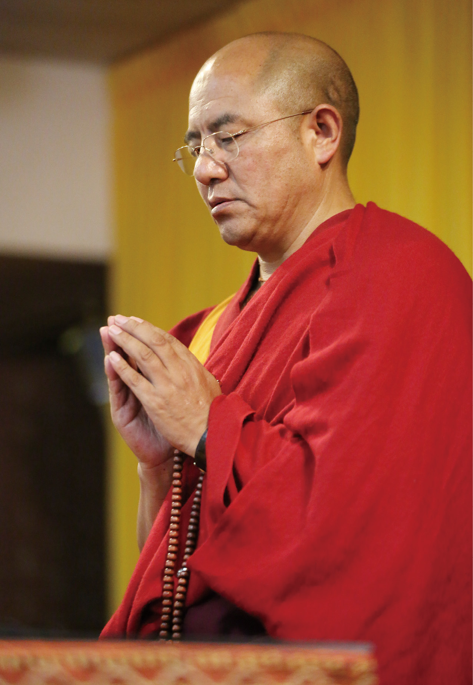

昨天我的语气可能比较重，但是我们佛教徒不能只懂互相赞叹。如果大家都没有功德，却互相赞叹说：“你多么了不起啊”“你长得好漂亮啊！”这样双方听起来都觉得很舒服，大家都好像沉溺在欢愉快乐的大海之中，但实际上没有任何意义。藏传佛教中有句话：“殊胜窍诀为击中要害。”如果佛教徒之间的交流没有击中要害，只有互相赞叹，那对大家都没有多大价值。

佛教徒应该先认识自己，你要自问：“我到底是什么样的身份？”你是一位佛教徒，这很简单，此时你要观察：“我是一位南传、北传还是藏传的佛教徒？我的身语意与自己的传承教法相应吗？”南传佛教着重修持释迦牟尼佛第一转法轮的教义，我去过一些南传佛教的国家，发现有些南传佛教徒利益众生的心，远远超过我们这些所谓北传和藏传佛教的修行人。

很多藏传佛教徒行持善法只是为了自己的解脱，他们经常造佛像，也天天念咒、念佛、观想本尊，这些善法都很重要，但你的目的是什么呢？佛陀降生于世的最根本原因就是利益众生，佛陀利生的教言就是佛法，它们都正确无误，能够真实地给众生带来无量利益，所以我们应该尽己所能去弘扬佛法。

基于智慧的信仰很重要

每次我参观不同寺院的藏经楼或者佛教图书馆，里面都有很多古老的《大藏经》，全都摆得整整齐齐，因为很多经书都镶了金子，所以非常好看，但是我们佛教徒到底能看懂多少本呢？你们自己想一想。我刚才参观了湛山的图书馆，它非常壮观，但是里面有很多门都是锁着的——这不是个别的情况，是很多地方十分普遍的现象。在藏地，有些寺院也摆放了《大藏经》，摆得很美观，但是那些门几十年来都未曾打开，因为从来都没有人真的进去查阅那些典籍，人们只是把它作为顶礼的对境。

佛教的真正精神、精髓就在《大藏经》里，前辈大德们尤其是昨天所讲那烂陀寺的大智者们，他们已经通过这种方式把佛教的教义传给我们了。现在，佛教的传承已经落到我们这一代人的手里，我们是否准备好把它传递给下一代人？这里应该有90%以上的人是佛教徒，我从你们的表情可以看得出来，对吧？如果你是一名佛教徒，现在佛法已经传到你的手里，你有责任把它传给其他人。若你找不到一些可以度化的有缘众生，你可以把佛法传给你的孩子，因为他们是你的继承人，但是你给他们传授了吗？

佛教徒至少要皈依三宝，如果你的孩子对佛教一无所知，你怎样跟他们介绍三宝？也许你能够答得上，说是佛、法、僧，然后他们会追问：“什么是佛？什么是法？什么是僧？”此时你就变得迷迷糊糊了，因为自己也弄不明白，于是你以自己有限的认知来回答：“佛应该是指寺院里的那些像吧；法应该是指《金刚经》那些书吧；僧应该是指寺院里的那些和尚吧。”

若你如此解释，那生活在当今科学时代的小孩可能会想：“佛应该跟电影明星差不多，但没有明星那么好看。法本应该跟《弟子规》这些书差不多，都不及动画片那么精彩。僧就是那些没有头发的人，再穿上一些与众不同的衣服而已。原来我父母信仰的所谓佛法僧三宝就是这些，它们好像没有什么特别超胜之处。”

现在一些佛教徒对三宝的理解就是如此，他们认为三宝跟世间的事物差不多，纯粹是外在的形象有所不同，此外，他们也分不清佛教和其他宗教在教义上有什么区别，既然你分不清楚，为什么你要选择皈依三宝？我们真的需要系统地学习，才能解答这些问题。通过学习可以增上智慧，然后你会发现佛教真的可以给自己带来无量的利益。

历史上汉传佛教讲经说法的风气十分浓厚，湛山这里也有讲经说法，我非常随喜，这是很有必要的。现在，很多寺院都失去了讲法的传统，而在家的居士团体也没有系统学习的风气，很多人都只是形象上的佛教徒，他们只懂在每月的初一、十五等日子到寺院里烧香，从来不会学习佛理。不过，如今国内外信仰佛教的人越来越多，尤其是年轻人。

佛教认为众生趋入信仰有两种方法：钝根者以信心来趋入，利根者以智慧来趋入。因此，我们应该用智慧来剖析和观察，以理性来接受佛教的所有教义及其见修行果，而要获得智慧，我们至少要花上一定的功夫。比如，你刚来加拿大的时候要学英语，否则你在工作和生活上的交流都会有困难，为了学好英语，你需要下功夫。同样，如果你想以佛教徒的身份过生活，你用在佛法上的时间至少要比你学英语的时间更多，这样你才能成为一位名副其实的佛教徒。

我不清楚这边的情况，现在中国内地信佛的人越来越多，每逢一些节日，汉地的寺院都是人山人海、水泄不通，如果驾车的话，你只能把车停在老远的地方，那么这些信众在寺院里干什么呢？都只是烧香和诵经。这些行为是很好的，可以让你种下善根，佛教中也说初学者种下善根非常重要，但是你只懂烧香和诵经是不行的，你要学懂佛教的知识。

最近几年，我一直强调、呼吁、提倡，每个寺院一定要为出家人提供系统性的佛教教育——讲经说法，而更重要的，是每个寺院一定要为信众提供定期的开示和长期的佛学课程，给他们讲解佛教的道理，例如为什么要烧香？在佛像前烧香有什么功德？为什么烧香会对自己的事业、健康有利？虽然你有十万个为什么，但是通过学习，你会明白这十万个道理，最后你的信心便不容易退转，而且自己也能跟得上这个时代，这是非常必要的。

如今无论在任何地方的任何群体，只有具足智慧的人才能进入这个群体的最上层；如果一个人没有智慧，纵使他长得再好看、资产再富裕，也还是无法跻身其中。这就是当今时代的特点，它跟人们以往的生活和处事方式很不相同。

以前，大部分人的生活圈子比较狭小，他们不用具足很多知识，比如农民只需要有种植粮食的知识，工人只需要有某种简单的技能，他们不用通达不同的语言和极多的科学技术知识。但是，现在是一个讲求知识的年代，在将来的22、23世纪，知识应该会更加受到人类社会的重视。在知识为主的时代，如果你自称为一名佛教徒，但是你的信仰不是基于智慧，而是依靠非常盲目的信心，恐怕你会变成这个时代中最底层的人，处处受到别人的歧视，这时候你可能连自己的生存都成问题，更别说要做一些广大的利生事业了。

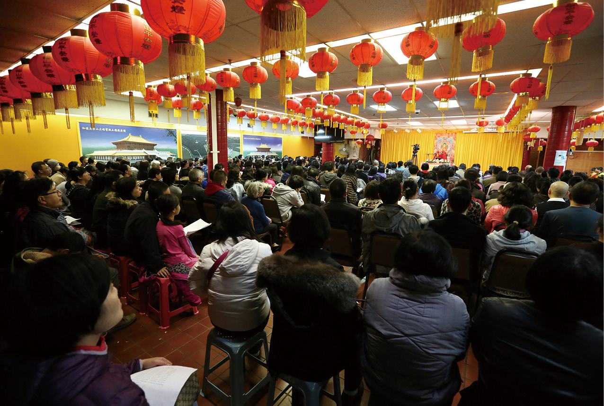

实际上，很多佛教徒在世间知识的层面完全能够跟得上这个时代，尤其是来到这边的你们，我想你们大部分都是从大陆来到这里吧。我觉得你们能够越过大海，都是很了不起的人。海洋的面积那么大，你们要花长时间在上面飞过真不容易。每次我坐十多个小时飞机去到另外一个地方，都觉得自己算是厉害了。有时候在飞行途中我从飞机窗户往下看，看到的都是无边无际的大海，我会想：“万一飞机掉进海里，那怎么办呢？”然后飞机降落的时候，我会想：“这次没有死，终于顺利到达目的地。”可能你们没有这些想法。无论如何，你们很多人应该都有一定的能力，所以才有机遇来到这边，对吧？那此时此刻你想自己成为一位什么样的佛教徒？这一点正是我此次主要强调的内容。

佛教徒要广闻博学，也要稳重

现在我给大家念《佛子行》的传承，它非常殊胜，任何人仅仅是耳边听到，也会自然地在相续中生起菩提心。我先用大概五六分钟，以藏文为大家念诵今天要讲解的《入行论》颂词和《佛子行》的传承。

（堪布念《佛子行》和《入行论·菩提心利益品》传承）

昨天，我们共同学习了《入行论》第一品中的十多个颂词，今天我会继续讲解。希望这里的年轻道友可以把《入行论》的全部颂词背下来，它总共才一千个颂词左右，要把它全部背诵并不困难，这里很多道友应该都能做到。此外，你要把《入行论》当作是你生命中最重要的一部法，经常把它的法本带在身边，终生不离。作为佛教徒，你们要恒时把自己有信心的法本、佛像等三宝所依带在身边，无论你出差还是去其他地方，你都要把它们带上，这是很重要的。

总的来说，你们大部分都是佛教徒，这方面我们都没有差别。佛陀所宣说的八万四千种法门在不同的民族、国家、地区流传，由此形成了藏传佛教、汉传佛教等众多不同的教派，但是归根结底，所有佛法的目的就是断除我们无始以来的无明烦恼，所有佛法都是贪嗔痴的对治法，就像妙药一样。确实，不同教派的大德就像不同的医生，所有医生的目的都是治病，而他们给我们的妙药全部都能治好我们的病。

所以，任何地方不同传承的佛教徒都应该团结一致，彼此要有凝聚力，共同为利益众生而努力。而且，我们的团结不能只局限于自己所属的佛教群体。现在，国内外的很多佛教徒都在拉帮结派，他们把某位上师及其团队视为自方而排斥其他，这样很不好。

我不会要求大家听完我的课，就不能去听其他上师的课。只要那是一位具格的上师，那么不管他是什么教派，你们都可以在他面前求法，这是非常好的，大家没有必要因为依止了一位上师，而去排斥其他上师。但是另一方面，如果你已经在学习一个法门、传承或者依止了一些上师，那你最好终生依止这些法门和上师，不要换来换去。

现代人尤其是年轻人都喜欢自由和尝鲜，比如在吃东西方面，他们喜欢今天尝点酸的、明天尝点辣的、后天尝点甜的。你在这些方面变来变去是没有问题的，但是学佛可不一样了。有些人今天尝一下汉传佛教，觉得这位法师讲的没有什么味道，于是明天就去尝一下南传佛教，然后也是觉得没有味道，事实上这是你烦恼深重的表现。若你总是在不同的道场之间跑来跑去，那么你在任何一位上师面前都难以得到真实利益。

如果你有清净的心，对三宝有真正的信心，平时有良好的闻思修行，那么你在任何一位具格、有法相的上师面前都会得到相应的解脱法门。我们不能把广闻博学的人与“跑跑居士”混为一谈，后者今天跑这个道场，明天跑那个道场，他们一辈子都在跑来跑去，结果自己在人生完结的时候也没有得到真实利益，这是很可怜的，我们做人一定要稳重。

有时候我很佩服那些西方人，一般来说，要说服他们趋入佛法是很困难的，就算我们说得再有道理，他们也不会轻易地踏入佛门，但是一旦他们趋入佛法，便会持之以恒地在这方面努力。二十年前我来北美的时候认识了一些西方人，当时他们刚开始学佛，现在二十年后他们还在很认真地学习，虽然他们起初对佛教很抗拒，但是通过学习，慢慢就接受了，之后也不轻易言弃，这是很重要的。

我们可以了解和学习各种教法，但同时要有自己的原则，此二者不能混为一谈。以我为例，我主要学修藏传佛教，同时我也接受各方面的信息和知识，但是藏传佛教是我自己的主心骨，这方面我终生都不会改变。具体来说，虽然我愿意学习所有的教法，甚至其他宗教和世间的知识，但是在信仰方面我不会改变自己一直以来的修行法门，例如本尊——没有必要改。

所以，若你已经在学习某个传承，汉传佛教也好，藏传佛教也好，你应该好好地学下去，这些教法都能让你解脱，如果一直换来换去，说明你不稳重，如此你修学哪个传承都得不到很大利益。

以上讲了一些学佛的态度问题，现在我们继续讲《入行论》的第一品。昨天我们说到菩提心很重要，但是可能很多道友还不知道什么是菩提心。有些人觉得：“我心地善良，已经具足菩提心了。”其实不然。我们要弄清这些佛教术语的意思，为什么我不断跟大家强调佛教徒一定要学习佛法呢？现在很多人根本不懂得什么是菩提心、什么是慈悲心、什么是信心，他们把这些混为一谈，即便是世间中的一些概念，我们也不能互相混淆，毕竟每个概念都在表达不同的意思。

菩提心之分类及其差别

今天，我们一方面要了解菩提心的本体，另一方面要了解它的分类。

略摄菩提心，当知有二种，

愿求菩提心，趣行菩提心。

菩提心有很多分类，但是归纳而言它可以分为两种，一者是愿菩提心，另一者是行菩提心。

什么是愿菩提心呢？就是你发起这种心态：“从现在开始，我要度化所有众生，让他们全都获得佛果。”你可以观察自己有没有这样的心。很多人觉得自己有时候会帮助别人，或者自己看到某些可怜众生后会生起哀悯心，因此就自认为有菩提心，实际上这是相似的慈悲心，你只是对个别众生起了怜悯，这不算是菩提心，是菩提心的因而已。

什么是慈心？它是愿众生得快乐的心念。什么是悲心呢？它是愿众生离开痛苦的心念。那什么是菩提心呢？就是愿所有众生获得佛果，如果你生起了这样的心念：“我一定要想办法度尽所有众生，让他们获得佛果。”这种心态就是愿菩提心。

什么是行菩提心呢？你不但有了愿菩提心的想法，还在实际行动中精进行持，就是说，你的发愿离不开自己的行为，这就是行菩提心。

至于此二种菩提心的差别，作者用比喻来说明：

如人尽了知，欲行正行别，

如是智者知：二心次第别。

二者的差别就像一个人有了“想做这件事情”的发愿，而另一个人不单有了这种想法，还要具体地行持。比如，你心里生起了“我明年夏天要从加拿大去中国”的想法，这种发愿相当于愿菩提心，我们发愿“从现在开始要好好地度化一切众生”也是如此，此时你还没有真正启程。

但若你已经购买了飞机票，已经与伙伴一起出发，就是说事情正在实行，这时候你的心便是行菩提心。同样，你在愿菩提心的基础上，开始行持诸多度化众生的行为，如讲经说法、帮助众生、不害众生等等，对象方面你可能由近及远，从身边的众生开始，渐渐扩展到世界上的所有众生，这时候你已经有了行菩提心。

此二种菩提心相当于一者是发愿度化众生，另一者是实际行持的心态。前辈的智者也是如此区分的，如弥勒菩萨在《现观庄严论》中说：“发心为利他，求正等菩提。”这句话非常重要。我们一定要知道什么才是真正的菩提心，我遇过很多人说自己有菩提心，但是他们可能从来没有想过让所有众生获得正觉的果位。

正觉果位的利益与世间的利益完全不相同。比如你给乞丐一点东西、给众生一点财物，这些只是暂时的人天利益，而真正对众生有利的就是让他们获得正觉的果位。可能有些人不知道什么是正觉的果位，就像刚才所说，现在一些人连佛是什么也不清楚，他们会想：“佛是不是佛像呢？”佛像是一种表示，真正的佛实际上是觉悟者，对精神和物质世界所有事物的真相全部通达无碍者就是佛，而在公众面前，我们可以简单地说佛像是佛。

这时候一些人会想：“历史上到底有没有出现过佛陀这个人呢？”你阅读《大藏经》就知道了。正如我问你：“历史上有没有爱因斯坦这个人？”我们看他的科学著作就知道了。同样，我们现在看到佛陀对人类的贡献就知道他曾经出现于世。

世界上有没有出现过坏人？肯定有。虽然本·拉登前几年已经死了，可是我们从世贸中心的毁灭，就知道他曾经存在。我第一次去纽约的时候，世贸中心的两栋大楼还屹立于世，但我去年在纽约已经看不到这两栋建筑，所以我肯定历史上确实有本·拉登这个人。世界上有没有出现过好人？有的。我们看到一些对人类社会有贡献的事物，就知道有些好人曾经存在于世。

那么世界上有没有出现过觉悟者？肯定有。我们看看佛经就可知道历史上确实出现过智慧程度极高的人。佛经记载了佛陀在二千五百多年前的教言，如今当我去到不同的高等学府，我可以毫无畏惧、大胆地宣说它的道理，因为佛教的教义绝对经得起任何观察，即便是世间中最有智慧的人来问难，我也不会害怕。

确实，不管是微观还是宏观世界，佛陀早就把这个世界的真相给我们说得非常清楚。虽然我从佛法大海中学得非常少，只是沧海一粟，但是经过多年的学习，我发现佛陀的确是所有智者中的智者，他是最了不起的。你看人类的科学发展才几百年，科学家们还有很多需要探索的领域，可是两千多年前东方文化的智慧已经十分成熟，而且它没有被时代淘汰，至今仍然给人类带来利益。

如果佛教徒在信仰上精进，让自己具足智慧，那么其他宗教徒肯定比不上我们。如果我是其他宗教的信徒，我应该会感到心虚，因为我不能理性地回答别人的诸多问难。当然，这也许是我没有深入研究其他宗教的教义而得出的结论，但是根据我表面上的研究，佛教应该是最切合这个时代的宗教。为什么爱因斯坦和罗素等科学家非常赞叹佛教？这都是有原因的。

总之，彻底照见万法实相的佛陀已经开示，我们若要成佛，就要如此发心：“从今天开始，我要想尽一切办法让所有众生获得佛果。”你何时生起了这种心态，你就具备了受菩萨戒的条件。在最后一堂课那天，我会给大家传授皈依和菩萨戒，若你以前没有受过菩萨戒，而现在愿意受的话，到时候你可以正式发心。

你们以前可能只是懵懵懂懂地信佛，从来没有真正受过菩萨戒和发过菩提心，从今天到最后一堂课之前，你们有几天时间去深思熟虑。菩萨戒的戒体不像别解脱戒那样，前者的戒体在我们死后仍然存在，因为它的依处不是身体而是心，所以从你受戒开始乃至生生世世，只要你没有生起失坏菩提心之因，你相续中菩萨戒的戒体就不会被破坏。

你做世间的大事业之前，要用一两年来考虑，虽然我们只有几天的时间，但是你应该把受菩萨戒看成是一件重要的事情，在这段时间好好地考虑自己要不要发菩提心。如果你以前没有发过菩提心，你要想自己以后愿不愿意去度众生，愿意的话你到时候可以发心，不愿意的话也不会勉强，反正我们都没有他心通，只看到你的身体坐在这里，不会看到你的内心到底有没有发菩提心。

愿行菩提心在功德上之差别

下面宣说愿菩提心和行菩提心在功德上的差别：

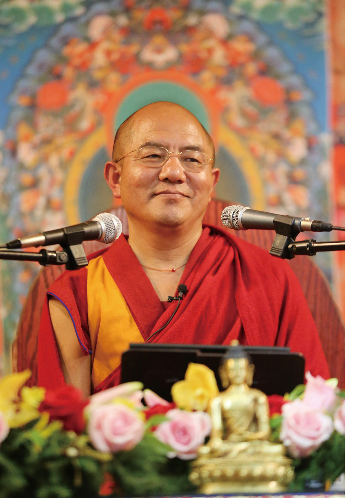

愿心于生死，虽生广大果，

犹不如行心，相续增福德。

首先是愿菩提心的功德，它非常殊胜，是凡夫从生死轮回中获得解脱之因。

如果你已经发愿要利益无量众生，纵使你没有实际的行动，但也已经种下了佛果之因。可能你暂时因为各种原因以致不能行持菩提心，例如：你刚移民过来还没适应，要照顾孩子，经济状况不好，要先学好英语，有各种困惑，等等。不过，只要你已经在心里发愿，即使你要待以后因缘具足的时候才去实行，你愿菩提心的善根也超过你生死轮回中的其他善根。我们昨天提到，轮回中的其他善根如同芭蕉树，长出一次果后就耗尽了，但是愿菩提心能够产生广大的果报。

至于行菩提心，它的功德是刹那不断地增长的，它使我们相续中的“利润”不断提高，让我们的善根越来越增上。这就是愿菩提心和行菩提心之间的差别，前者的功德没有后者那么大。什么是行菩提心呢？

何时为度尽，无边众有情，

立志不退转，受持此行心。

当你在法本、佛像或者上师面前发了菩提心后，自己通过再三思维，觉得人身确实难得，立志不管遇到任何困难，事业问题也好，家庭问题也好，总之你永不改变自己菩提心的誓言，如此受持行菩提心的功德不可思议。

现在的世间人喜欢记下对自己有意义的一些日子，像某年某月某日是自己的结婚纪念日、自己的生日等等，同样，你可以选择一个良辰吉日，在当天发愿要度尽无边众生，然后在此基础上，发誓以后不管遇到什么困难、痛苦，自己的菩提心永远都不退转，这时候你就真正受持了行菩提心。世间人经常说：“即使我再穷、再苦，我也不会舍弃这个誓言”，我们也要如此坚定地受持菩提心。

愿菩提心和行菩提心确实有些差别，前者是在心里发愿，后者是在发了愿菩提心后立志受持，纵遇命难也不退转，并且真正去行持。可能你们很多人以前都没有想过发菩提心，或者理论上也不知道什么是菩提心，正如刚才所说，大家不要觉得自己心地善良，就是具足了菩提心，我们不能把菩提心和善心混为一谈。现在有些人经常说：“我不用皈依、不用受戒，反正我心地善良，那就可以了。”说这种话的人很愚笨，且不说别的，他们很可能连什么是真正的善良也不知道。所以说，我们有必要弄清一些概念。

即自彼时起，纵眠或放逸，

福德相续生，量多等虚空。

什么时候你的相续中生起了行菩提心，从那时起，无论你是处于睡眠、放逸、散乱、昏厥、麻木等何种状态，哪怕行为上你不做任何善事，只是行住坐卧等，你相续中的功德也会自然增上，而且其增长率非常高，会让你的福德犹如虚空一样广大。

菩提心的功德非常大，我们善根的力量会因为自己是否以菩提心摄持，最终有很大差别。比如你来到这个国家，当你真正取得这里的国籍，你便可以享用这里的医疗福利和其他的社会待遇。我在澳洲的时候看到很多人在等着拿到当地永久居民的身份，如果你取得了某个国家的合法身份，这个国家自然就会无条件地给你提供很多国民专享的待遇。

表面上这是某个国家的制度，实际上这是一种规律。刚开始你只是有了移民的想法，后来你实际去行动，你想尽一切办法来让自己满足所有移民条件，最后对方也认为你已经合格，此时对方自然会在自己的能力范围内给你创造一些方便。行菩提心也是同样，如果你符合了它的标准，有了要度尽天下所有众生的决心，立志不退，那根据它的规律，即使你没有修行或者处于散乱的状态，你自相续中的善根和福德自然就会越来越增长，这很重要。

我认识一些美国的道友，他们在十几二十年前发过菩提心，他们说自己之后比较懈怠、散乱，修得不好，因此近年我去那边的时候他们说自己感到惭愧，不敢见我。其实见不见面倒不重要，最重要的是他们在发心后不退转，如此他们相续中的功德会在这十多年里自然地不断增长，如同我们把钱放到银行，通过复利滚存，经过3年、10年、20年，你的资金放得越久，所得到的复利会越来越多，就像瑞士银行一样——我没有去过瑞士，但听说是这样的。

对我们佛教徒来说，受不受持行菩提心是非常关键的问题，大家应该仔细地想一想，毕竟人身如此难得。事实上，我们要用实际行动来行持菩提心很困难，但是发起永不退转的决心并不太难，你可以在平时的行住坐卧或者修行的过程中，尽量以此来摄持。

怎样才算破菩萨戒呢？如果你以恶心来伤害众生，或者产生“我今后再也不度任何众生或者某个众生”的恶念，你便失坏了菩萨戒。总之，你发了菩提心后，只要这颗利益众生的心不退转，即使你不精进修持，你菩萨戒的戒体还是存在的。所以，你们要好好考虑受不受菩萨戒，在我们短暂的人生中，它的功德非常大，只要我们不破戒，它的戒体会在我们的相续中生生世世存续，其功德会不断地增长，这是对我们最有意义和最有利益的事情。

你在菩提心摄持下所做的任何事情，纵使它们表面上不是善事，但实际上全都会变成功德。你们可能都看过《大宝积经》中大悲商主的故事：当时有五百商人一起到大海取宝，船上的短矛黑人准备杀了他们并夺走他们的财宝，大悲商主知道短矛黑人的计划后，他为了救护那五百人的生命以及不想让短矛黑人因为杀业而堕恶趣，他最后把短矛黑人杀了。纵使大悲商主表面上杀了人，但是因为他以菩提心摄持，所以实际上他的杀业没有变成罪过，反而因此圆满了许多劫的资粮。为什么大悲商主杀人的行为没有构成过失，反而变成功德呢？因为他是以善心来摄持的，完全没有任何自私心。

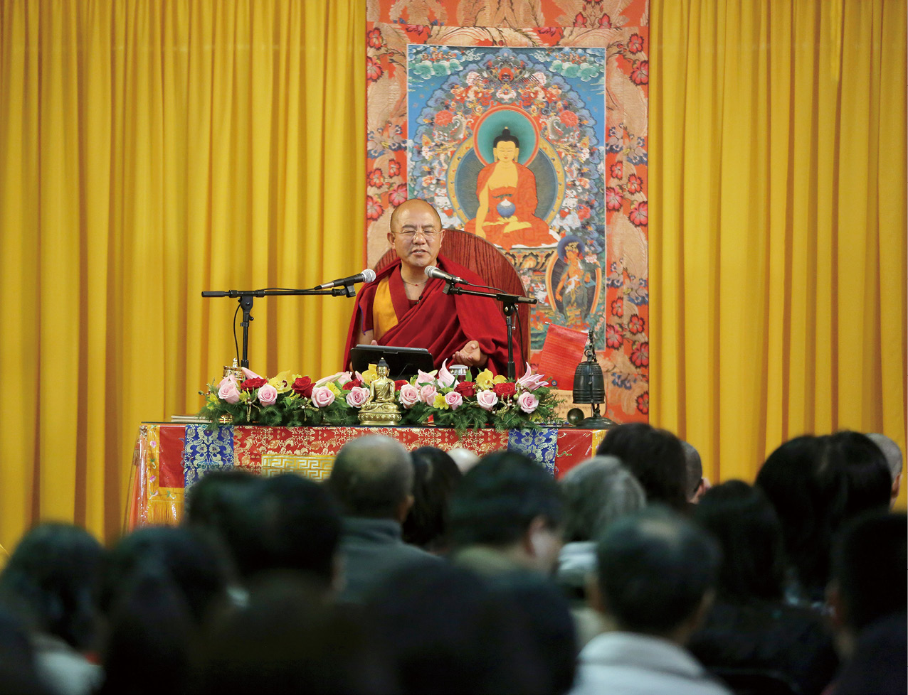

当然，你们不要以所谓的好心来杀人，虽然你口头上说自己是以菩提心摄持，但其实是出于自私心。凡夫人经常都是这样的，比如吵架的时候，我们会给自己找一些借口，说自己是以利他心来打对方，但实际上是自己生起了非常强烈的嗔恨心，这样很不好，对吧？

还有一个以善心来行持不善法的公案：星宿婆罗门在寂静地行持了很长时间的梵净行，后来有一女子对他生起贪爱，想与他成婚，否则就要自杀身亡。星宿婆罗门不想这位女子因他而死，最终与她结成夫妻。虽然此举看似舍弃梵行，但实际上星宿婆罗门因此圆满了许多劫的资粮。

一般来说，杀盗淫妄有非常大的过失，但若你真正具有菩提心，在不杂有丝毫自私心的情况下行持这些行为，你也会获得无量无边的功德。如果你的相续有了菩提心，即便是做看似不如法的行为也能出生功德，那你平时的睡眠、放逸就更不用说了，你的功德会一直增上。大家不要认为：“受皈依、受菩萨戒只是一种形式或者仪轨罢了，总之我如理如法地修行就可以了。”事实上我们的修行要做到如理如法是很困难的，因此我们有必要去争取每个让功德增上的机会。

菩提心有如此殊胜的功德，这种说法合不合理？《入行论》确实讲得很广，下面寂天菩萨用教证和理证来证成菩提心有很大功德是合理的。首先是用教证，你们知道什么是教证吗？就是依据佛经论典的原文来支持自己的观点。释迦牟尼佛在经中说得非常清楚，菩提心有无量无边的功德是合理的。

藏传佛教的典籍都会引用很多教证，这很重要。我们也要学会引用教证，因为现在很多世间人的想法都是一厢情愿的，他们单凭自己的分别念就觉得如何如何，好像自己的想法、感觉就是事实一样，但其实他们的想法没有任何依据。

作为佛教徒，大家以后开导他人也好，自己的修行也好，总之我们的言行举止都一定要先符合佛菩萨的经论和前辈大德们一代一代传下来的教言，然后我们要通过自己理性的剖析，以智慧来接受。如果你觉得一些修行不合理，却勉强自己去行持，你不会获得什么功德，因为你本身不相信这些修行会带来利益。你不是心甘情愿地行持善法，但又想获得广大果报，这是不可能的。

以教证说明菩提心具功德之合理性

以下用教证来说明菩提心的功德：

为信小乘者，妙臂问经中，

如来自宣说，其益极应理。

为了接引一些小乘根基的人，释迦牟尼佛在《妙臂请问经》中宣说了菩提心有广大无边的利益是合理的。佛陀宣说了什么呢？他亲口说道：“设若我为利乐无边众生而披上盔甲，则利乐一切有情之所缘无边，善根亦无边故，即使放逸或睡眠……善根亦增长、强盛、圆满。”为什么我们发菩提心能够产生无量的功德呢？因为菩提心所缘的众生无量无边，所以当你对他们发起善心，你所得的功德和所积累的资粮也是无量无边的，这在《妙臂请问经》中讲得非常清楚。所以，菩提心能生无量功德并不是无中生有的说法。

一些小乘根基的人会想：“我这样一个平凡人，恐怕很难做到像菩萨那样，布施头目脑髓，积累三大阿僧祇劫的资粮，放弃自己的全部利益等，那多难啊。我还是做一个普普通通的凡夫吧，那多舒服啊。”可能你们部分人也有差不多的想法吧。一些人没有遇过什么痛苦，觉得自己的人生很快乐、很满足，因此他们不愿意学佛和发菩提心，直到生老病死等痛苦现前，他们才思考什么是人生中最有意义的事情。

我遇过很多人都是这样的，本来他们觉得：“我不需要发菩提心、不需要生出离心，我的人生很快乐。”后来他们因为家里发生了一些事情，如自身患上疾病、父母去世，于是就大哭起来，我开玩笑说：“你不是觉得人生很快乐吗？为什么今天有那么多眼泪？”一般人在开心、放松的时候也许会觉得佛教的道理跟自己没有关系，但是当他面对一些特殊的人生境况，比如感情或者工作上遇到一些问题，那时候他才发现佛教所讲的都是真理。

尤其是一些被关在监狱里的人，他们对人生有很深刻的反思，这也让他们的修行变好。我有时候会探访一些监狱，我每次探访都尽量与那些正在服刑的人士交谈，所以从中了解到他们在监狱中的一些想法、感受。总结起来他们一般有三方面的感悟：一、拥有自由的人生很快乐；二、渴望与自己的家人和朋友重聚；三、人生是痛苦的，当中的很多事情都没有意义。这是他们最深刻的体悟，明白这一点后，他们自然就对佛教的道理产生信心。大家确实要想到人生是很苦的。

刚才提到，佛陀已经为我们开示了菩提心的利益，为什么它有利益呢？因为众生无量无边，我们缘无量众生发心便能在短时间积累无边资粮，这是唯一的理由，也是佛经所宣说的。

表面上凡夫要花很长时间才能成佛，因此有些人决定干脆不发心，特别是一些小乘根基的人，他们也知道发菩提心很不错，是一件好事，但是他们满足于现状，或者把自己看得太低，于是面对发心却步不前。大家千万不要有这些想法，为什么呢？因为菩提心能够让你在短暂的人生中积累无量资粮。以我亲眼所见，很多人发了菩提心后在修行方面有很强的感应，这让他们的人生有了很大变化，最后一些修行境界就自然呈现了，这很重要。

以理证说明菩提心具功德之合理性

此处的科判是证成菩提心的利益广大，分别用教证和理证来说明。以上讲了教证，下面是理证方面：

若仅思疗愈，有请诸头疾，

具此饶益心，获福无穷尽，

况欲除有情，无量不安乐，

乃至欲成就，有情无量德。

我们发心去利益无量无边的众生，从而获得无量无边的功德是合理的，为什么呢？某人仅仅怀着慈悲心肠来治疗一个众生的头痛，以此善良的饶益之心，他会获得无量的功德，那我们发愿让所有众生全部获得解脱，这个功德就更不用说了，这一点大家都能想象吧。

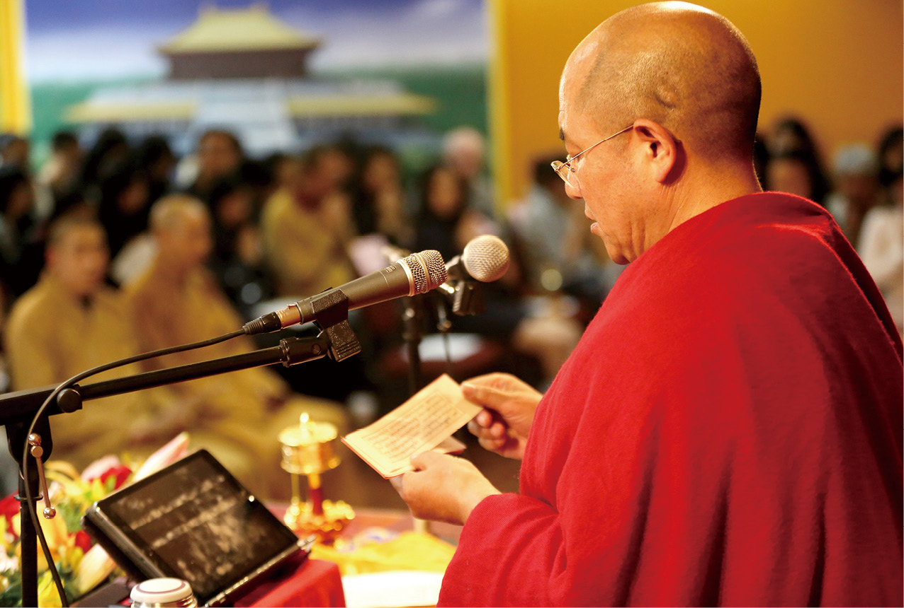

关于此处的疗愈头疾，很多讲义都引用了佛经中匝哦之女的公案来解释。以前印度有一个人名叫匝哦之女，有次他跟母亲吵架，期间他用脚踢母亲的头。他死后堕入地狱，在里面感受铁轮在头上旋割以致脑浆四溢横飞的痛苦。这时他想：“世上肯定还有许多像我一样用脚踢母亲头的不孝子来这里受苦，愿他们的痛苦由我一人来承受，愿他们获得快乐。”在他如此发心的当下，铁轮自然腾空，他一下子转生于天界。尽管他造了对母亲踢头的恶业，但依靠一刹那的善念，他马上就从地狱的痛苦中解脱出来。这是佛教中的一个公案。

如果你不乐意听受佛教的公案，我们可以用世间的事情来说明菩提心的功德广大。现在，不管是哪个国家的人，他们对好人的定义都是大同小异，除非这个国家有一些颠倒的文化风俗，那就另当别论了。一般来说，现在任何一个国家都认为世界上最好的人，是那些对别人有帮助、对社会有贡献和对全人类有饶益之人。

有些人在世界上被公认为好人，其实他们所做的事情只是对个别的人或者群体有帮助，像最近的诺贝尔和平奖得主，他们对处在战争、贫困中的一些妇女和儿童提供了援助，虽然他们帮助的只是某些地区的一部分人，但是已经获得了世界级的奖项。

我看过很多诺贝尔奖得主的资料，了解他们是因为什么成就而获奖，我觉得跟大乘佛教的利他心相比，后者对人类的作用更广大，毕竟前者只是在某个短暂的时期中，对某个范围的部分众生带来帮助，非洲的曼德拉便是其中一个例子。的确，很多得奖者只是对人类的某个方面有贡献，而有些得奖者甚至看来对人类没有什么贡献，最后却获奖了。

诺贝尔奖是世间中认可度最高的奖项，但很多获奖者只饶益了一些众生，跟此处所讲的菩提心不可同日而语。我们要利益的对象不仅是人类，还包括世界上所有动物在内的一切有情，而我们的目标是要灭除他们的一切痛苦，让他们获得快乐、所有人天福报以及最究竟的正等觉果位。这颗心真的非常广大，而且它不是暂时性的，它持续的时间不是短短的一两天、一两个月或者一两年，我们是永远都要保持这样的心。

所以，菩提心真的是世界上最好、最珍贵的心态，不管是西方人还是东方人，我们不可能在一般世间人之中找到这样的心。前段时间我去了南半球的澳洲，我问一些当地人：“你们这里有没有比菩提心更好的心态？本地人认为什么是最好的心态？”最后我得出的结论是，现在全球没有一种心态比菩提心更广大、更有深度和更长久。

既然菩提心——愿永远无条件地利益无量众生的心，是世界上最伟大的心态，那可想而知它的功德有多广大。比如一个人的家庭有五六位成员，他是全家的经济支柱，同时他在其他方面也把家人照顾得很好，这时候人们都会对他特别赞叹；另外，如果一位住持特别关心自己寺院里的修行人，纵使他的管理范围仅仅限于这个寺院，但是人们都会说这位师父特别好，是真正的菩萨。

世间上我们要判断一个人是好是坏，最根本的区分界限就是利他心，这在任何地方都是一样的。关于利他心有广大的功德是否合理，上面我们用了佛经的依据来说明，现在是以理性来分析。大家可以思考，即使我们仅以自己的智慧观察，也会发现世界上最好的人就是有利他心的人。那什么样的利他心是最好的？是范围广大、持续时间长的心更好，还是狭隘、短暂的心更好？

事实上，心越狭隘就越不好，现在很多家庭、民族、国家之间的冲突都是由狭隘的心引起，冲突不是由广大的利他心产生的。因此我们应该清楚，当今时代，广大的利他心确实非常重要。

如果有人想帮助一位病人，让对方没有病痛，人们会觉得他非常了不起。国内有一个《感动中国年度人物评选》，有些人在过去一年做了一些感动众人的事情，最后通过大会和公众的评选，每年大概有十名人士当选。在领奖的时候，有些人会向得奖者献花，那些得奖者也非常自豪，感到特别开心。实际上其中部分人只不过是有些运气而已，他们可能帮助了几位学生、几位艾滋病人，反正不超过几百或者几千人。他们只是在一个小范围内，依靠利他心对一些众生发挥了作用，如此就能感动那么多人，试想我们要是真正发起去帮助无量无边众生的心，那将会感动多少人啊？大家应该清楚。

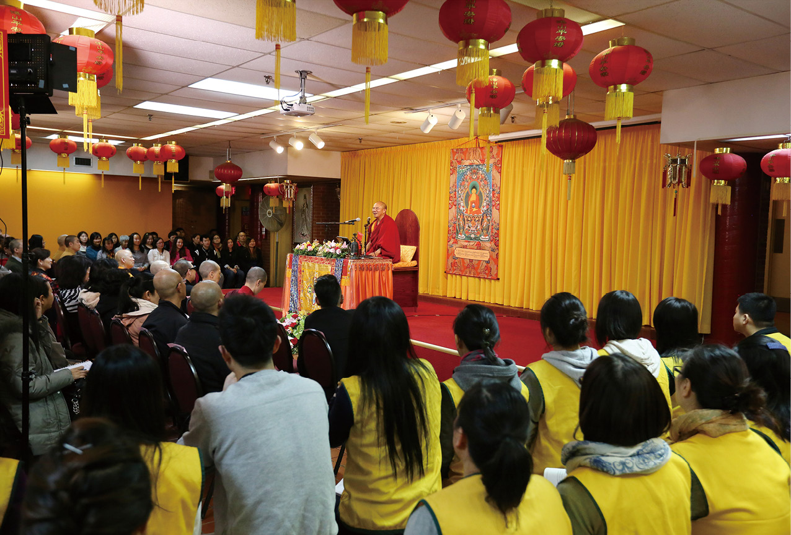

相对于其他众生，人类确实有一种特殊的智慧，我们应该用此智慧来观察，究竟世界上最合理、对所有众生最有利益的精神是什么？对所有众生最有害的精神又是什么？分析下来，你会发现利他心的确非常重要，而且它不会过时、不会过期。

世界上的一些国家领导人，他们很想把自己的思想永远延续下去，虽然他们在任的时候大家都对这些思想特别崇拜，他们卸任后可能也有部分人追捧这些思想，但是此后再过一二十年，那些世间名人的思想、精神就已烟消云散。而佛陀所宣扬的利他心，它在任何时候都适合所有人。

世间有各种各样的人，不同种族的人各有不同的肤色，住在地球东南西北不同地方的人各有不同的生活习惯，甚至不同文化的人也各有不同的笑点。例如一些东方人觉得特别好笑的东西，西方人觉得一点都没意思，后者甚至觉得有人为此而笑是因为精神有问题，反之亦然；即使是东方人之间，一些中国人觉得好笑的东西，其他东方文化的人不一定觉得有趣。可是，来自不同种族和文化背景的人，都会认同利他心是很重要的。

我们通过以上的理性分析，可以知道菩提心确实有无量无边的功德。下面讲菩提心比世间人的善心和利他心更加超胜：

是父抑或母，谁具此心耶？

是仙或欲天，梵天有此耶？

在世间中，谁有这种殊胜的菩提心呢？是我们的父母吗？还是梵天等天人？都不是。

父母对孩子非常慈悲，他们总想把儿女照顾得特别好，纵使在临终之际，他们还会不舍地看着自己的孩子。前两天我接触了一位母亲，她马上便会知道自己是否得了癌症，她说：“我的孩子还没有找到结婚对象，我现在如果因为癌症而死，会死不瞑目；除非他找到对象，成家立业，我才可以闭上眼睛，安详地死去。”父母最关心的就是自己的儿女，虽然孩子已经长到三四十岁，但是父母还是会一直牵挂。

实际上父母对儿女的关心是什么样呢？父母所关心的只是儿女今生的几十年生活，他们不会想到让孩子生生世世获得快乐和究竟解脱；此外，父母从来没有想过让自己儿女以外的所有众生获得无量快乐。当然，如果一些父母是大乘佛教徒，那他们不仅关心自己的孩子，也会同时关心所有众生，但一般的父母不会生起利益所有众生的心。

世间上有一些天人和成就真实语的仙人，他们有没有菩提心呢？比如说梵天，器世界逐渐形成的时候，第一个众生就是梵天，当时世界上没有其他众生，后来才逐渐出现其他众生，于是他认为：“我是第一个来到这个世界的，后面的众生全部都是由我所造，他们都是我的孩子。”所以梵天对众生有慈悲心和爱心。但是，世间的梵天等天人都没有愿所有众生获得正觉果位的菩提心。

彼等为自利，尚且未梦及，

况为他有情，生此饶益心？

刚才上面说到的那些众生，他们即便是为了自己的利益，连在梦中也没有想过发起菩提心，更何况是为了利益有情而真实地生起这种饶益心呢？

我们很多人可能从来都没有想过去利益无量无边的众生，或者无条件地帮助他人，所谓“日有所思，夜有所梦”，如果你在白天都没有想过利益众生，你在晚上根本不会做这样的梦。很多人白天只是想着吃火锅、去旅游、跟别人吵架等乱七八糟的事，从来没有想过度化众生，所以他们晚上只会做一些迷乱的梦，不可能做善妙的梦。

作为大乘佛教徒，我们最好把家庭和生活中所遇到的事情看淡一些，不要对此日思夜想，而最根本的是我们不能失去菩提心，不能忘记它的价值，这很重要。世间人即使为了自己的利益，都没有想过要发菩提心，若要他们为了所有众生的利益而发菩提心，更是难上加难。

现在各个国家的元首，无论他的头衔是什么，总统也好、总理也好，也不管他是通过民主选举还是其他方式产生，每个国家的人民基本都会认为自己国家的最高领导人是最关心百姓的人。那么世界上的国家元首有没有发菩提心呢？肯定没有。

他们只想让自己国家的人民安居乐业，让人们得到更好的医疗、养老等福利，他们同时也想提高自己国家的国防、政治、经济等实力，尤其是让GDP（国内生产总值）越来越高，如此他们在下一届选举中会有更高胜算，这可能是他们的想法。不过，那些国家元首从来不会想到自己国民以外的其他众生，例如自己国土上的很多动物，或者邻国、全球乃至无量世界中的无量生命，他们从来都没有想过让所有众生离苦得乐，甚至连世间最伟大的人物也没有这样的发心。

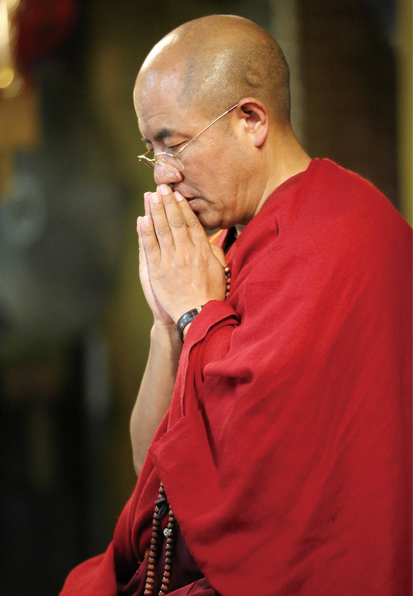

我们用智慧来观察的时候，会发现大乘佛教的确十分殊胜。作为修学多年的大乘佛教徒，虽然我很惭愧自己的修行不好，修持的时间也不多，但是不管怎样，自己即生遇到菩提心这样的法门，我真的感到非常荣幸。若我遇到一些让自己的心变得狭隘、自私的学说，那真是如同服了毒药一样，最终只会害己害人，没有任何意义。而我现在已经遇到大乘佛教，确实是三生有幸，因为我知道自己只要在有生之年，不退转这颗利益众生的大乘之心，它的善根一定会在自相续中发芽，并且慢慢地茁壮成长。

大家想一想，世间上有很多非常了不起的人物、伟人，但是他们到底有没有生起过如此珍贵的菩提心？他们白天都没有生起，晚上做梦就更不用说了。藏族有句俗话：“这种事情连做梦都没有想过。”的确，那些人连做梦都没有想过要利益天下无边的众生。

你们身边也许有很多优秀的人，他们可能十分敬业，有很高的个人素质或者有相当不错的智慧，比如现在的一些人，他们通过电脑便能瞬间把所有事情查得清清楚楚，做事方面也非常灵活，但是他们只不过是有非常敏锐的智慧而已。实际上我们更需要关注的，是他们有没有利用自己的专业知识、技术来帮助所有众生，以及他们有没有发起无条件地利益众生的这颗菩提心。

菩提心极其珍贵

其实我们现在发起菩提心，真的非常稀有：

他人为自利，尚且未能发，

珍贵此愿心，能生诚稀有！

世间人为了自己的利益，例如让自己永远快乐，他们尚且没有想过要发菩提心，但是我们今天依靠殊胜的因缘，已经认识到菩提心的功德，并且想要发起珍贵的菩提心，这真是非常稀有，完全无法以金钱来衡量，这种难能可贵是你付出几十万、几十亿也不能买到的。

我们相续中或者精神方面的珍宝，与物质上的珍宝不相同，后者可以通过某种方式来衡量。世界上的富翁像比尔·盖茨和李嘉诚，此二者有巨额的财富，但若他们相续中没有珍贵的菩提心，他们临终之时只会赤裸裸地离开世间，而下辈子也不一定再次成为世界首富和华人首富。也许他们还会在人间待一段时间，但是总有一天他们都会离开，那时候他们的财产会由包括自己敌人在内的其他人共享，亡者自己肯定享用不了。相反，如果我们永不舍弃这颗珍贵的菩提心，它的善根还会在我们的来世不断地增上。

今天我们生起了想利益一切众生的心，那是非常稀有难得的，菩提心的价值、功德和意义无法言说，它确实难能可贵。有时候我们突然得到一个特别珍贵的东西或者中了彩票，会觉得今天的运气太好了，因为自己不用勤作就获得了很好的东西。在商业社会也是同样，尤其一些人通过买卖股票，可以突然赚到好几十万，此时他们会高兴得不得了，要马上到卡拉OK厅或者其他地方享用美酒，以此来自我陶醉一番。我听说有人通过炒股票，好像在一个晚上就赚了70万，面对着这些钞票，他最终按捺不住，决定跑到其他地方去享受快乐，由于他太高兴、太忘我，那时候他听不到别人对他所讲的任何话。

一般凡夫很执著物质上的东西，虽然我们生起了菩提心，有了精神上的无价之宝，但是我们有些人可能还没有真正认识到它的珍贵性，事实上，菩提心比任何东西都更重要、更珍贵、更稀有、更难得。

不管你学的是汉传、藏传还是南传佛教，这里很多人可能都认为自己是一位非常好的佛教徒，但是你要真正成为一位好的佛教徒，最关键的是要断除自私心。我们在生活上遇到的很多问题和痛苦，都是源于我们对自己太过在意，对自己的要求太过苛刻，完美主义者就是痛苦主义者，如果你经常对这个不满意、对那个不满意，会让自他都感到很痛苦。比如你在家里非要管家人的事情，非要干预他们的生活，如果你越追求这样的完美，你和你的家人只会越痛苦。

这个世界不可能完美，即便在一个月当中月亮也有阴晴圆缺，如果我们凡事都要完美，那会让自己很痛苦。所以，大家应该把执著自我的心尽量削弱，把利他的心尽量增上，如此我们才会快乐。的确，有利他心的人无论在什么地方或者群体，他们都乐于接受周围的事物，他们可以享用任何食物、住在任何环境中，而且他们与任何人都能沟通，做任何工作都能坚持，总之不管外境如何，他们都会过得很开心。

相反，如果你有很强烈的自私自利心，尽管你住在一个十分豪华的地方，里面充满着金银财宝，你也不一定会过得很快乐。现在有很多住别墅、开着宝马的人，他们的眼泪特别多，这是我亲眼所见。《大圆满前行》中说[^1]，如果我们拥有一匹马，就会有一匹马的痛苦，甚至连有一块茶叶也必定会有一块茶叶的痛苦。所以，我们有一辆车就会有一辆车的痛苦，有一栋房子就会有一栋房子的痛苦，但如果我们连这些都没有，那也是很痛苦的，这就是轮回的本性。

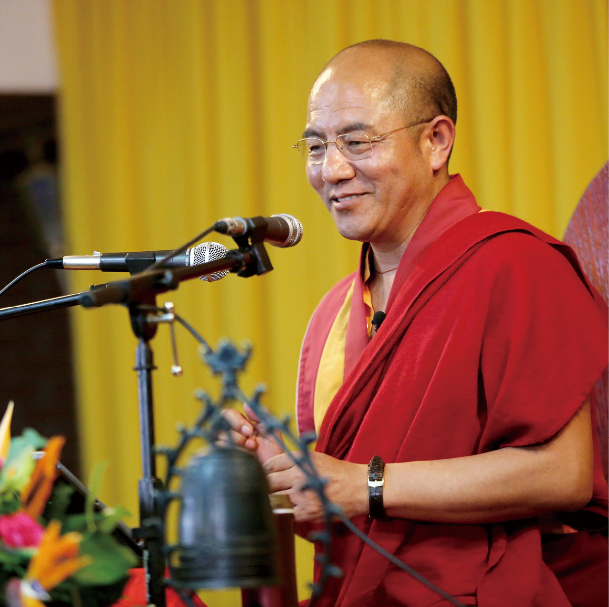

现场互动

⊙ 问：顶礼上师，请上师加持我在学佛的道路上精进不退转，消除我的一切违缘，谢谢上师！我已经发了出家的愿，请问师父，我有没有出家的因缘啊？

堪布：因缘方面，我说不定，但是我会加持你：如果你的出家会对众生有利，你就当出家人；如果你维持在家的身份会对众生有利，你就当在家人。你看这样行吗？

⊙ 问：请教尊贵的上师，我们凡夫可不可以带业往生？

堪布：这方面一般来讲有两种说法。其中一种说法是，往生者到极乐世界之后，都是一地以上的菩萨，他们已经完全断除了粗大的业和烦恼，但是还有一些细微的烦恼。另外一种说法是，在九品往生中，当这个众生以最下品位往生到极乐世界的时候，他还是有一些凡夫的业。按照这种说法，我们应该是可以带着自身的业往生的，然后我们在极乐世界修行，并且在那里逐渐清净一切业障。

关于带业往生，高僧大德们也有不同的说法。我以前讲解过《观无量寿佛经》，其中我对带业往生的不同说法做过详细的介绍，也加上了自己的一些观点，讲记已经整理出来，你方便的时候可以看一看。

⊙ 问：尊敬的堪布，如果我们发了愿行菩提心，那我们是不是要替众生背业？我们只是普通的居士，有没有替众生背业的能力呢？另外，我想发菩提心的话，要不要做一个特别的仪式，还是我只需要今天在佛菩萨面前，或者在您面前说一下就可以呢？

堪布：关于背业的问题，我们凡夫人可以如此观想、发愿，但是凡夫人并不会真正背上其他众生的业。一些高僧大德的传记中记载，当他们看到别的众生正在感受痛苦，他们会观想对方的痛苦临到自己的身上，让自己来代受，我们也可以这样观想。不过，若你要真正代受其他众生的痛苦，你需要有一些修行境界。如果我们没有一定的修行境界，要代受其他众生的苦是很困难的。

至于受菩萨戒有没有仪式，这有两种说法。受持菩提心方面一般有龙猛菩萨的甚深见派和无著菩萨的广大行派两种观点。龙猛菩萨的观点是，受菩萨戒者不一定要具足别解脱戒，我们可以在佛像前自受菩萨戒。无著菩萨的观点是，修行人在受行菩提心之前，一定要先受别解脱戒，从此角度来说，受戒者最初必须要在一位上师面前受别解脱戒，如果受菩萨戒者已经具足别解脱戒，他也可以在佛像前自受菩萨戒。

严格来说，我们受菩萨戒需要一些仪式——至少要念诵三遍发心偈，并且心中也如是作意、发愿。我们的发心仪轨里有一个偈颂，它是说往昔诸佛菩萨如何发起利益天下无边众生的愿，我今天也如是发愿，此时我们要在心中真实地作意，并且念诵这个发心偈，念完第一遍后我们得受愿菩提心，第二遍后得受行菩提心，第三遍后愿行菩提心同时在相续中稳固。正如我刚才所讲，如果你们有兴趣、有信愿，真的从心底里想发菩提心，我们在最后一堂课的时候，可以大家一起在佛像面前发愿和受菩萨戒。

⊙ 问：顶礼上师！我是滑铁卢菩提小组的学员，我在十四年前来到加拿大这里结婚，生了两个儿子，这段时间我一直都是当家庭主妇，最近我在考虑应该出去工作，还是继续在家带孩子。我在去年的三月趋入了学佛的道路，刚开始的时候，我就是学习上师所讲解的《入行论》第一品。学佛之后，我自己想继续在家里当家庭主妇，如此我会有更多时间去闻思修行，但是我的先生却持相反的意见，他希望我出去工作。可以说，我在这一年多的学佛过程中遇到一些违缘。请问上师，为了更好地利益众生，我应该出去工作，还是继续当家庭主妇呢？另外也请上师加持我的先生，让他支持我的学佛道路，也使他早日趋入佛法。谢谢上师！

堪布：哇，你要求高啊。我在澳州的时候，发现他们带孩子的方式与中国的传统不一样，不知道加拿大的情况如何。在澳州，小孩在路上摔倒后，父母不会去扶他们，为的是让孩子学会自己站起来，这是一种很好的训练；而当孩子过了18岁，父母会让孩子自立地生活，他们不会对孩子有过分的关注，如此孩子可以尽早培养出自身的能力。

而在藏地和汉地，很多父母在儿女长大后仍然把所有注意力放到孩子身上，对他们有过度的关心。那些父母把儿女视为一生中最惦记的人，把自己的所有希望全都寄托在孩子身上，但是很多孩子成年后，他们不一定对自己的父母那么关爱，尤其是当今时代，儿女越来越不孝顺父母，长大后回报父母养育之恩的人越来越少。

我觉得你带孩子已经带了这么多年，你不一定永远都要为孩子做太多事情，你在家里可能有很多空闲的时间。虽然我对在家人的生活没有经验，但是以我的推测，你不应该待在家里，应该好好地上班，该做的事情还是要去做，对吧？作为佛教徒，我们一定要好好地学佛，不能把它放弃，因为即生遇到佛法十分难得。上班和学佛两者并不矛盾，你的时间应该可以安排得过来。

你有了工作之后，可以看看你丈夫的心态会否慢慢地转变。如果他的压力减轻了，可能你们的家庭矛盾也会逐渐减少。我们通过自身的行为来改变别人是很重要的，佛教徒应该随顺他人，尽量减少摩擦。佛教徒在待人处事方面真的要有善巧方便，我们的周围有各种各样的人，包括非佛教徒和其他宗教的信徒，佛教徒要学会怎样跟他们融洽地相处，当中的确需要一种智慧，如果我们因为自己的信仰而随便得罪别人，这是不合理的。

你们学佛之后，可能经常因为观点不同，而跟很多非佛教徒的家人和朋友吵架，此时你应该把他们对你所说的语言、给你所造的违缘，全都看成是修安忍的最佳对境。

前段时间我在新西兰传讲《入行论·安忍品》，很多人发现原来自己的家人“很好”，让自己有修安忍的条件。“安忍品”中说，世间上有很多像乞丐等可怜众生，菩萨可以依靠他们来修布施波罗蜜多，但是菩萨很难找到修安忍波罗蜜多的对境，因为菩萨生生世世不害众生，所以没有什么怨敌，他们很难找到一个坏人来害自己。

明白了这一点后，那些道友就觉得自己非常幸运，因为自己的家人反对他们修行，在学佛方面经常给他们制造障碍，这其实是修安忍的顺缘。那些道友经常都有修安忍的机会，早上一次、中午一次、下午一次，一天跟家人吃三顿饭就有三次修安忍的机会，所以他们的修行很不错，每天修三座安忍的话，他们至少快要成就六波罗蜜多中的安忍度了。我们学佛修行有很多方法，大家不用把违缘看成是真实的违缘，你可以把它看成是顺缘，只有把违缘转为道用，修行才会进步。

无论如何，我们都不要放弃自己的修行。有些人可能在踏足社会后，就迷失了自己的人生方向，因为现在不管是东方还是西方，我们的社会都比较复杂。当今是一个金钱时代、经济时代，人们很容易把自己的价值观全部放在金钱上面。据说这边人与人之间的竞争没有国内那么激烈，比较而言这里可能好一点，你们的生活应该相对轻松。听说你们下午四点就下班了，但是我看这里晚上七点还在堵车。

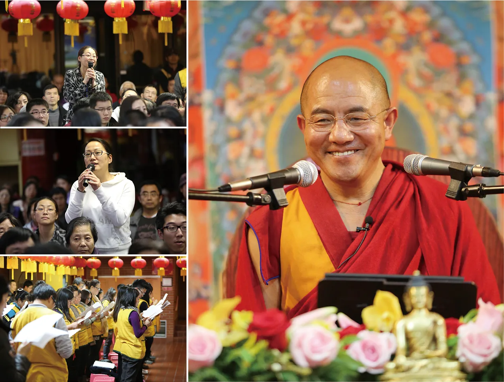

⊙ 问1：顶礼堪布！刚才您讲到菩提心分愿菩提心和行菩提心，对于后者，我自己肯定做不到，虽然我有一些利他心，但是在某些情况下，我不知道自己该怎样做才能真正利益别人。比如，我和对方都产生了烦恼，然后我通过佛法的道理把自己的烦恼消除，而对方还是有烦恼，这时候我真的想去帮助他，但若他是一位非佛教徒，我觉得自己没有智慧或者善巧方便去减轻他的烦恼，我也不知道是否会用了错误的方法以致加重他的烦恼。所以，我最后没有再跟对方讨论相关的问题，我只能自己修安忍，消除自己的烦恼。

不过，对于身边的一些同修，当我们都产生了烦恼的时候，我想以实际的行动来帮助他们，因为我觉得大家都是佛教徒，有相似的观点，所以我觉得自己可以说服对方，而且我的动机是从利他心出发，我真心想跟他们在修行方面一起增上。可惜的是，我跟他们沟通之后，事情都有反效果。请堪布开示，我应该以什么标准来决定要不要跟对方谈及大家之间的矛盾？抑或只要自己的发心是善的，我就可以去尝试化解大家的矛盾？还是我现在应该什么都不要说，应该等自己修炼到一定境界，才去化解双方的矛盾？

堪布：你每次面对的情况可能都不一样，所以你需要不同的处理方法。原则上，如果我们的发心只有利他，没有自利心，那便没有过失。至于方法上，你应该跟对方说些什么或者为对方做些什么，那需要根据当时的情况来决定。我不知道你具体的情况，所以很难给你一个具体的建议。

归根结底，我们佛教徒确实需要有智慧。为什么佛陀会对其他宗教徒说“我”是存在的，或者会对一些不善于逻辑思维的人讲很多世间中因果不灭的道理？因为善巧方便，正如我刚才跟你们说要随顺家人一样。如果你有了智慧，无论在任何地方你的身语意都不会违背佛教和世间的真理，更重要的是你会找到真正帮助别人的方法，此后你便不会在意别人的闲言闲语。只要你发心清净，方法上没有违越佛法和社会的规则，那就足够了。可能你很担心别人对你有负面的想法、说你的坏话，但是这些都不重要，最重要的是你的心要清净，然后在此基础上尽量帮助别人，过程中最好不要杂有三毒烦恼。

在学佛修行的过程中，我们学会随顺别人很重要，如果你在这方面做得好，那自他的很多事情都容易成办。与以前高僧大德的苦行相比，如今你们在家人无论在生活还是修行方面都没有什么痛苦。往昔高僧大德要翻山越岭求法，然后在多年中于气候严寒的环境下过着苦行的生活，恐怕你们不会有这些磨炼，但是在日常生活中忍受别人对自己的一些伤害、诽谤，你们应该可以做得到。

我们在学佛方面要有长期打算，如此才会容易成功。很多道友都有一个毛病，就是急于求成。有些人经过一段时间的学修，由于还没有达成自己的目标，所以便生起很多烦恼，他们觉得别人没有为自己提供最好的学佛顺缘，然后就跟对方吵起来。现在很多佛教徒都有这方面的烦恼。其实，我们要护持自己的修行，最根本的是不能同流合污。如果你整天随顺坏人，最后失去了自己的修行，那就很不合理了。

问2：如果我做了错误的抉择，最后导致情况比之前更差。但若我发心清净，那就没有问题，是吗？

堪布：对。

⊙ 问：顶礼上师三宝！弟子是《入行论》班的学员，我在此忏悔，因为自己学得不好，感到很惭愧。但是我在学习的过程中，确实觉得《入行论》的利益非常大，它让我的身心内外都有很大的变化。现在，我觉得即生能够遇到佛法，遇到这么殊胜的法，遇到这么殊胜的上师，真是百千万劫难遭遇，我每天都打从心底有这种感受。

《入行论》讲到菩提心有很大的利益，而很多教言中也提到，像我们刚学佛的人要修出离心，那我们修行的时候应该怎样把出离心和菩提心圆融？此二者如何相辅相成？请上师开示。

堪布：这边的学会确实有个别人不太精进，有些人刚开始就退下来了，有些人学到中途就完全退了，也有一些人现在是半退状态，总之有各种情况。这不仅仅是学会独有的现象，其他学佛群体也有这样的情况。基本上，你们能够从中学懂一些法理，我已经感到满意。至于你们要不要退出、想不想学习，那都悉听尊便，毕竟学员人数的多寡对我没有影响。但是总的来说，学会从2006年成立到现在，应该有相当多的道友一直都在非常精进地学习，他们初时什么都不懂，现在虽然也不是全懂，但是他们至少明白了一部分基本的法理，而且还在不断地学习和了解，我觉得这是很好的。

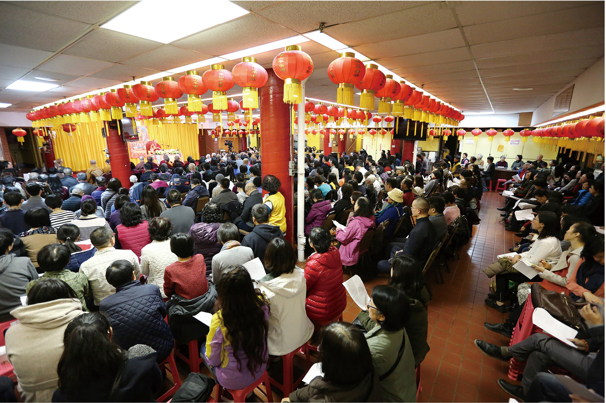

你刚才问到出离心和菩提心之间的关系。出离心就是一颗希望从轮回苦海中得到解脱的心，南传佛教的修行人一定要有出离心，其实它也是所有修行人最基本的心态。如果我们没有出离心，便要不断在六道中流转，你今世是人，下世可能是天人，再下世可能是旁生……如此你生生世世都没有办法从轮回中解脱。

我们即生获得了人身，并且已经遇到殊胜的佛法，我们现在就要珍惜成办解脱的机会，这时候我们一定要想：“三界轮回犹如火宅，当中没有什么可欢喜、可贪恋的，我一定要从这个火宅中出离。”当你生起这样的心，你就有了出离心。但若你只有出离心，没有菩提心，那么你的出离心不会是成佛之因，只会是成为阿罗汉之因，仅让你获得暂时的解脱。因此，我们一定要有菩提心。

昨天我给大家念了《三主要道论》的传承，三主要道就是出离心、菩提心和无二慧。我们首先发出离心，希望自己从轮回中获得解脱。至于解脱的果位，我们希求的是佛果，如此我们一定要具足成佛之因——利他的菩提心。我们光有菩提心和出离心仍不足够，还要有无二的智慧，否则我们不能把烦恼断尽，获得佛果。实际上，烦恼跟菩提心并不完全相违，生起了菩提心并不表示烦恼会马上消失。如果我们想断除烦恼，最后还是需要显宗或者密宗的智慧，我们要以无我的智慧来断除烦恼障和所知障，断尽了此二障后，我们才能得到完全的解脱，也才能究竟利益一切众生。

出离心和菩提心的确很重要，我们首先要发愿从轮回中出离，然后要以菩提心来摄持自己的修行。比如说，你不想待在国内，于是你来到这里，这就是出离；来到这边之后，你通过学习新的知识、技能来完善自己，让自己在此处的生活更加圆满，能够更好地帮助众生，这相当于菩提心。当然，如果你还没有生起这两种心，你可以同时在此两方面努力。

⊙ 问：我正在修加行，每天花在这方面的时间非常多，同时我也要上班，所以我每天都没有很多空余时间来陪伴家人和教育孩子。家人因此对我有很大的意见，爱人对我不做家务感到很不满意。我现在没有足够的智慧和福报，没有能力说服家人信仰佛教，有时候甚至让他们生起邪见，所以我内心很烦恼。

我想早点修完加行，然后发菩提心去利益很多众生，我也很想出家，不过这是后话。我现在感到很困惑，因为我不顾家人的感受，只想自己尽快修完加行，那究竟是不是一种我执、自私的表现？我是大乘佛教徒，但是我想自己尽快成就，那是不是小乘的修法？爱人对我说：“要么你就出家，要么你就好好地做个普通人。”我现在好像做不了一个好的世间人，也做不了一个好的佛教徒，所以我感到很矛盾、很纠结，不知道自己应该怎样取舍，请上师开示。另外，祈请上师加持，让我们的爱人和家庭都信仰佛教。

堪布：（堪布笑）到你真要出家的时候，你的另一半就不同意了。此次我来到这里，就是加持你们和你们的众多家人，毕竟大家在学佛过程中都有很大压力。

至于你的情况，我刚才也讲了，佛教徒不能总是跟家人产生矛盾。当然，有些道友的家人特别挑剔、严苛，若你学习一点佛法，他们就看不惯，若你于法道上散乱，他们就很欢喜，有些人的根基就是如此。我们与人交往的时候，刚开始会因为不了解对方的性格而觉得他很好，但是经过一段时间的接触，我们才发现对方的性格有缺陷，之后双方经常发生矛盾，最后自他都很痛苦。可能你们有些人今天来到这里的原因，就是因为和家人发生了“战争”。

我给你的回答跟我刚才对那位道友所讲的差不多，我们最基本的原则就是不要舍弃自己的修行，无论你的压力来自单位，还是家人——比如父母，等等，你都不能舍弃修行。但是刚开始的时候，你也不能完全不管自己的家庭和工作，刚入佛门的人大都有强烈的出离心和修行之心，这时候他们想把全部精力放在修行上面，从而忽略了生活的其他方面。一段时间之后，他们的家人已经变成“敌人”，修行上也遇到方方面面的压力，最后他们别无选择，只能完全放弃自己的修行来迎合身边的人。佛教徒不要过于极端，我们不能为了修行而对家庭和工作漠不关心，但是我们也不能为了世间的事情而舍弃修行。

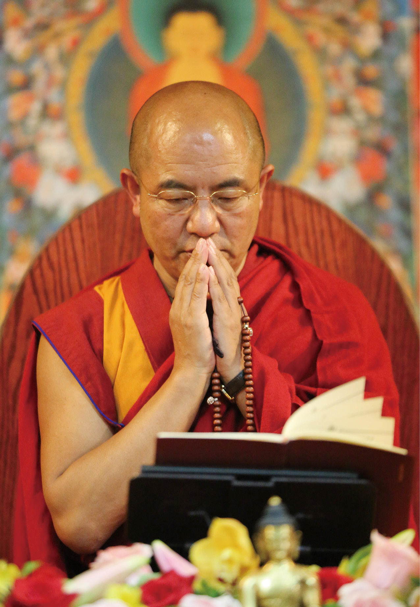

我想你应该跟你的另一半好好地“谈判”，大家各自退让一步。比如，你可以把完成加行的截止日期延后，在不放弃修行的情况下，为家人做一些事情。老实说，作为在家人，家里的事情全由别人来做是不好的。你的家人要照顾孩子，要做家务和处理家庭的各种事情，那是很辛苦的，而你却在快快乐乐地修加行，闭着眼睛不管家事，如此你的另一半确实很容易生烦恼。除非你刚开始已经出家，不然你有责任去减轻一些家庭压力，如果你什么都不管，把所有家庭责任推到别人身上，那真的很不好。

你应该与家人好好地沟通，达成一个共识。如果你们各自退让一步，初时大家可能都不适应，但是到了一定时候，反对你学佛的声音会变得越来越少，而你的道心也不会像初学佛时那么刚烈，变得细水长流。你们慢慢可以找到一个平衡点，此后你的家庭会圆满，工作也圆满，修行更圆满，最后凡事都圆圆满满。

[^1]: 《大圆满前行》：“拥有一匹马的主人也会担心它被敌抢走、被贼偷走、草料不足等等而整天顾虑重重，虽然只有一匹马，却给自己增添了许许多多的苦恼。同样拥有一只羊也会有一只羊的苦楚，甚至仅仅有一条茶叶也必定会有一条茶叶的痛苦。”
