# 第3课

2014年10月31日

今天的讲课形式与之前的两堂课差不多，我会先念一些传承，然后从字面上讲解每个颂词的意义。第一个传承是朗日塘巴格西所造的《修心八颂》，很多大德经常传这个法，我在求学的时候也得到了很好的传承，所以今天想提供给大家。之后我会念诵《入菩萨行论》第一品后面部分的藏文传承，也就是我们今天所要讲解的内容。

（堪布念《修心八颂》和《入行论·菩提心利益品》传承）

做何善法前都应观察发心

这次我们共分三节课来学习《菩提心利益品》，现在你们已经得到它的传承。藏传佛教对传承非常重视，因为它不仅是藏传佛教，而是整个佛教的法脉。传承有很大的加持力量，它源自佛菩萨们，然后经过前辈大德毫无间断地传到我们的相续之中。若你有了传承，你的修行会得到非常大的力量和加持。

大家以后不管学什么法都最好善始善终，这次我们因为时间关系，不能给大家传讲整部《入菩萨行论》。如果你们日后有机会，应该在有此论传承的人面前求一个完整的传承。例如你可以找这里的很多藏地师父，他们应该都有《入行论》的传承；在汉传佛教中，现在讲解《入菩萨行论》的法师也越来越多。

一方面，你们要得到《入行论》的传承，就是说要在一位有此法传承的人面前，你的耳根听到他把全部颂词念诵一遍，这很重要；另一方面，你们要对每个颂词的意义、内容有所了解。《入菩萨行论》约有一千个颂词，这次我们所讲的第一品大概有三十多颂，你们之后应该好好地学习其余的九百多个颂词。这里有个别的道友已经学了其他品的一些内容，例如第九品，这非常好。总之，我希望大家以后可以圆满学习整部《入行论》。

我们在佛教道场中可以供养佛菩萨的像，也可以烧香、拜佛、念佛、念经、受八关斋戒，这些行持非常重要，但更重要的是我们要通过学习了解佛教中的解脱法门。佛教分几个层次，第一层是人天乘，第二层是声闻乘，第三层是大乘——最高是密乘。

如果我们做一些善行或者参与一些慈善，而自己没有以出离心、菩提心和无二的空性智慧摄持，那我们的这些善根不能成为解脱之因，只能成为人天福报之因，所以这种道果称为人天乘。我发现不管是大陆、台湾还是佛教兴盛的某些地区，现在大多数佛教徒的信仰都属于人天佛教。人天佛教好不好呢？很好的，只是可惜他们所做的善事，根本没有以出离心摄持。他们有没有“三界轮回如火坑，我一定要从中获得解脱”的想法呢？如果师父没有传过这些道理，那弟子更不会依此而修了。

虽然你一辈子做了很多善事，包括披上袈裟成为出家人，但若自己从来没有想过要从轮回中出离，你所做的善法不会成为解脱之因，你不会得到声闻的果位，更别说是大乘的果位了。如果我们的善行以出离心摄持，它就是中士道；如果我们的善行以菩提心摄持，它就是上士道；如果我们的善行以无二的智慧摄持，那它的层次就更高了。

现在的一些佛教徒应该好好地观察自己的发心，虽然你不会造严重的恶业，也会行持一些善法，像念佛、拜佛等等，而依靠这些善法所带来的人天福报，你的生活可能比很多世间人过得快乐，自己的心态也比其他人轻松，不过这些是否就是佛教的根本意义呢？

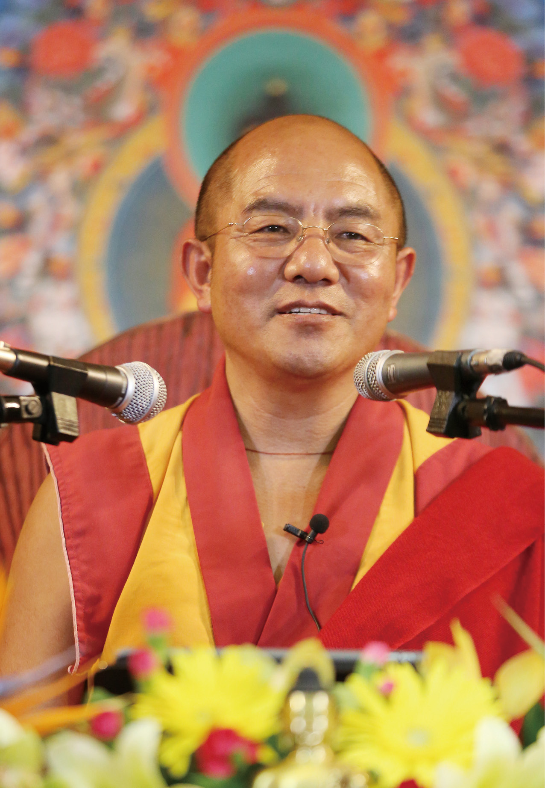

佛教最根本的目的就是让我们获得解脱。正如刚才所说，你一辈子披着袈裟，但是没有生起出离心，你能不能脱离轮回呢？不能。你一辈子披着袈裟，但是没有生起菩提心，你能不能成佛呢？不能。什么是解脱之因？出离心。什么是成佛之因？菩提心。我在第一堂课给大家念了宗喀巴大师所造的《三主要道论》传承，当中提到的出离心、菩提心和无二慧就是整个佛教的核心，非常值得我们重视。

虽然这次我在多伦多的时间比较短，但是旃檀师和他的团队给我们提供了很多方便，特别感谢他们和这里的很多义工！同时也感谢在座的很多师父，感谢你们提供了这么好的道场，如果我们要在别的地方举行同样的活动，那我们在人力和财力方面都应该有很大压力。

这次我本来想给大家传授一些较深的法，但是我的水平有限，不是传讲深法的材料，以老师的素质来说，我不太适合给大家传授深法，而且我第一次来到这里，不了解这边道友的学佛情况和需求。不管怎样，这次我们共同学习菩提心的利益是很好的，今天是最后一堂课，听说也是西方的一个重大节日，看来这次传法很圆满。你们想吃糖果吗？好，我给大家的糖果就是菩提心的甘露。（众笑）

菩提心之功德广大

现在，我们继续讲菩提心的利益。在上一节课，我们介绍了愿菩提心和行菩提心，前者就是发愿从今天开始去利益天下无边的一切众生，后者就是把这个发愿落于实际行动。之前我们讲到愿菩提心的一些功德，关于这方面的道理，今天还有一个颂词要讲，它说愿菩提心的功德不可思议：

珍贵菩提心，众生安乐因，

除苦妙甘霖，其福何能量？

珍贵的菩提心能赐予一切众生无比的幸福和快乐。

世界上很多人每天都在忙忙碌碌地过日子，那他们为何而忙呢？就是要遣除痛苦，获得快乐。人们每天奔波的目的就是如此，每个众生都想获得安乐，以及遣除自己身心上的一切痛苦。

有些人心地善良，很想通过自己的力量来帮助很多众生，他们会给众生提供一些物质上的帮助，例如帮对方买一栋房子、买一辆车，但是这些帮助都是暂时性的，长远来说，这样的帮助也许让对方更加痛苦。比如，这个人之前没有车，你送他一辆之后，初时他会特别高兴：“啊，我有新车，太好了！”但是一段时间后，他发现养车和油费都是负担，而且找地方停车很麻烦，堵车就更麻烦了。此时他所拥有的一辆车就成了自己许多痛苦的来源，很多人都不知道这个道理。

所以，不管我们给予别人财物、地位，还是世间的其他东西，表面上对方看起来很快乐，但实际上那不是永久的快乐。如果我们令其他众生在心里产生无伪的菩提心，一颗真正想利益众生的心，那对他来讲，这才是无比的甘霖、最好的甘露妙药、最好的糖果。这颗菩提心的糖果没有副作用，而且任何众生都可以享用。

你们很多人都想帮助别人，那应该用什么方法呢？如前所说，本师释迦牟尼佛在多生累劫中深深地思维：“饶益众生最好的办法是什么呢？”最后他发现除了菩提心以外，没有其他更好的方法。因此，佛陀选择以劝发无上菩提心的方式来饶益三界轮回中的一切众生。如果你们以后想要度化众生或者真正帮助别人，像父母和亲人等，要尽量让他们发起菩提心，这才是你对他们最永久和最可靠的帮助，能够解除他们生生世世的痛苦。

大家不仅要让别人生起菩提心，我们自己也要好好地修持，如此我们就能在短短的时间中获得广大的功德。龙猛菩萨在《菩提心释》中说：“若人一刹那，修持菩提心，所生诸福德，佛亦难衡量。”意思是说，如果一个人在一刹那间观修菩提心，它所带来的功德，就连遍知的佛陀也难以衡量，更何况其他菩萨或者凡夫人了。因此，我们应该好好地修持菩提心，如此就能积累广大的资粮。

另一方面，我们要通过佛教的道理来饶益众生，大家不能只在口头上说度化众生，但实际上什么也不做。现在，有些人经常讲自己要弘法利生，他们说得十分动听，但实际上是“挂羊头卖狗肉”，用佛法的招牌来欺骗别人，谋取自己的利益，如今这样的人比比皆是。

可以说，佛教徒之中也有一些腐败者吧，他们以佛教的名义来成办自己的利益，过程中他们会做很多不如法的行为，对其他众生造成损害。许多人看到那些不如法的行为后，会认为是佛教的过失，但事实上佛教没有过失，那只不过是个别人的一些行为，跟大乘佛教的教义没有丝毫关系。作为大乘佛教徒，我们一定要尽量断除自私心，并且真实地利益众生。

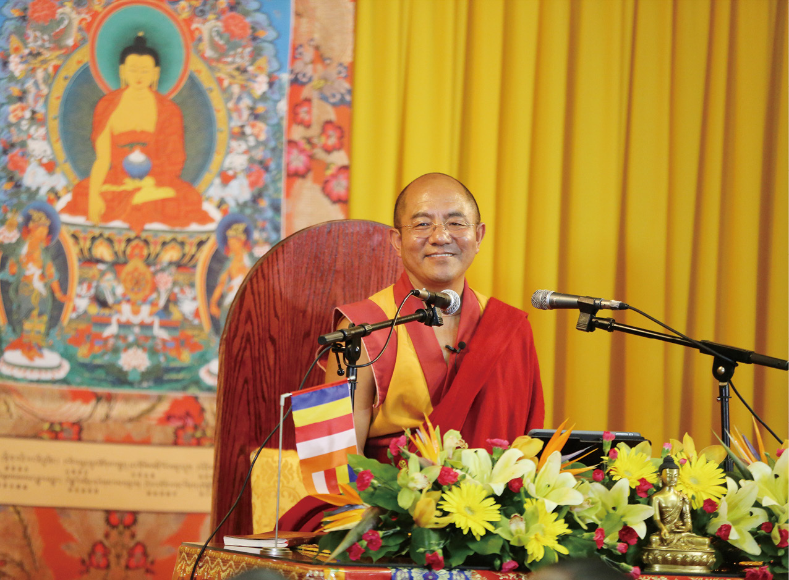

下面讲行菩提心的利益。我们在上一节课也讲了，我们的善根若以行菩提心摄持，它的功德就会完全不同。这里以理证的方式，即通过一些道理来说明菩提心的功德为什么如此广大：

仅思利众生，福胜供诸佛，

何况勤精进，利乐诸有情。

为什么菩提心的利益那么殊胜呢？我们仅仅在心里生起一个想要帮助一切众生的念头，如此就能产生无量无边的福德，然而它只是愿菩提心，即我们心中的一个想法而已，我们还没有实地行持。佛经中说[^1]，若有人在等同恒河沙数的刹土当中，用金银等七宝供养无数如来，其功德是非常惊人、广大的，但是这个功德与你在自相续中生起一刹那的菩提心相比，后者的功德更超胜。这就是愿菩提心的功德。如果我们只是在一个念头的时间中生起愿菩提心，就能产生这么广大的功德，那我们以实际行动去利乐一切有情，精勤地饶益他们，这样的功德就更不可思议了，这一点大家可以推想出来。

佛经中已经讲得很清楚，我们在短短的时间中观修慈悲心，就能获得巨大的功德。这个颂词的第一句“仅思利众生”有两种解释方法：有些人认为它是指愿菩提心，就是说，修愿菩提心的功德超胜于供养诸佛的功德；另一种解释是“仅仅想帮助他人、利益他人”，就是说，我们仅仅生起一种慈悲心或者想去帮助他人的心，这种功德也超过了供养诸佛的功德。

部分佛教徒会在某些节日拿着鲜花、糖果、水果等来供养诸佛菩萨，也有些人特别喜欢供养出家人，他们会按师父的喜好来供养很多东西，像巧克力、咖啡等等，还包括一些鸡腿，有没有这种情况？没有吧，汉传佛教应该没有这种情况。但是因为传统不同，我看一些南传佛教徒会买很多肉来供养自己的师父。以前，有些藏传佛教徒也会给自己喜欢的上师供养一些肉，但现在基本上没有这种情况。

总的来说，如今佛教徒供养诸佛菩萨或者上师的供品各种各样，包括一些不太如法的。事实上，我们供养十方诸佛的功德都不及愿菩提心的功德，更何况是行菩提心了。所以，你们以后应该在菩提心的摄持下，尽量做些弘法利生方面的事情。

等一下我们会通过一个简单的仪轨来发菩提心，不知道你们有多少人准备在今天发菩提心，你们可以看看自己有没有意乐。如果你有意乐，在发菩提心后，未来只要你没有舍弃它，而是一心一意地护持这颗清净的发心，那么不管你做任何事情，哪怕是走七步路、擦桌子或者做一件普通的世间事情，你所获得的功德都远远超越你的财供养。供养有三种，最上等的是法供养，次一等的是承侍供养，再次一等的是财供养，《华严经》中也讲了相关的道理。本来诸供养中供佛是非常殊胜的，但你若为了利益众生而行持菩萨道，后者的功德远远超过前者，两者有非常大的差别。

假设你在这里当义工，但是你从来都没有皈依三宝、没有发过菩提心，你只是对做善事有一些意乐，如此你会有一定的功德，因为你为寺院和弘法利生做了一些事情；不过，若与另外一位发过菩提心的义工相比，虽然你们都在做同样的事情，但是那位义工的功德会比你的更广大，这就是发了菩提心和没有发菩提心的差别。

简单来说，如果有三个人，一者没有皈依也没有发心，一者已经皈依但是没有发心，一者皈依后发过菩提心，虽然他们做相同的善行，但是此三者所得的功德会完全不相同。这方面我们可以用很多世间的事情来比喻。例如把钱存到银行，此三者所得到的利息有差别；或者在同一个国家之中，三个人可以有完全不同的际遇。世间中有很多相似的规律，表面上有些人的行为是一样的，但实际上他们在其他方面不一样，以致最后的结果也不一样。

这堂课结束的时候，我们会念诵一遍《普贤行愿品》，如果一个人没有发菩提心，另一个人发了无上菩提心，虽然他们都同样念一遍《普贤行愿品》，但是后者会有无量无边的功德，前者则没有如此广大的功德，而随着时间发展，就像世间的复利效应一样，两者在功德上的差距会越来越大。你们有些人以前没有学过这方面的专业，所以也许会越想越疑惑，有越来越多的邪见，但是也没有办法，这也是世间的规律之一。

通过长期学习，我们才能帮助可怜众生

下面讲到很多世间人都追求快乐，但是他们的行为和心理都是颠倒的：

众生欲除苦，反行痛苦因，

愚人虽求乐，毁乐如灭仇。

此颂的意思是，世界上每个众生日日夜夜都想解除自己的痛苦、获得幸福，可是他们现实中怎么做呢？他们因为愚痴，所以不懂得远离痛苦的方法，反而经常制造一些痛苦之因，那是非常可怜的；另外，很多愚痴的人都在追求快乐，但是他们不知道要用什么方法，最后他们就像消灭仇敌一样，把自己的快乐之因全部毁灭。

这也是现代人盲目和愚痴的地方，比如，现在很多人为了长寿，他们经常吃活鱼、吃乌龟等生命，但实际上你为了长寿而杀生，那怎会有道理呢？有些人经常说：“我想长寿，要补充营养，要杀一只鸡来补一下。”然后就开始点杀，他们如此杀生是不可能长寿的，因为其中的因和果完全颠倒。此外，有些人为了发财而做一些偷盗、抢劫等坏事，结果只会事与愿违。

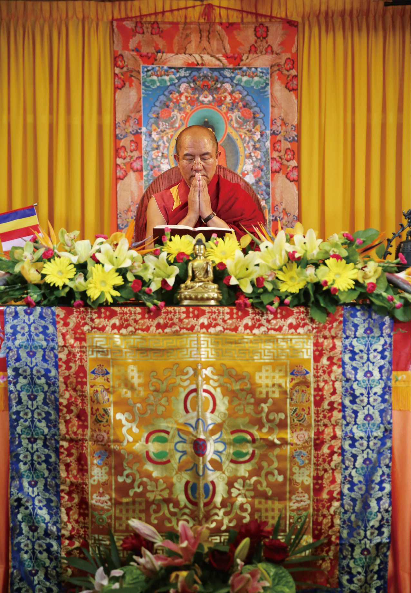

世间许多人本想得到某种快乐，但是在实际的因果取舍上，他们却选择了痛苦之因。说实话，我们在学习佛法后，长远来讲真的会对自己的解脱有无比重大的意义，这里一些刚学佛的道友不一定很了解，所以我暂且不谈。暂时来讲，佛法对你平时的心态调整和情绪控制都有非常大的利益和作用。

一些人在还未学佛的时候，他们的内心经常都很浮躁，住在大城市的人更是如此，可能加拿大好一点，这边的人口比较稀少。我注意到这里的人在过马路或者在街上行走的时候，他们的步伐不像香港、北京的路人那么急促。不过，我也注意到这边有些路人的脸色不太对劲，虽然他们表面上穿得很光鲜，看起来很不错，但是他们的心里有很多不同的压力。

一般世俗人难免有很多烦恼和困扰，今年要面对这方面的压力，明年要面对那方面的压力，生活上也有很多自己一直都想不开、解不开的烦恼，如今这种现象非常普遍。如果我们学习了佛法的智慧，那我们面对生活上各种问题的时候就会有一种把握。

我们真的需要把佛教的信仰融入生活。佛教徒有没有生老病死呢？有。佛教徒要不要吃饭睡觉呢？要。但是佛教徒因为有智慧，所以他们的处事方式与世间人不相同。我们不是在自赞自夸，你在学佛之前可能觉得佛教的许多价值观非常虚无，但是经过一段时间的学习，你会明白其中的很多道理，也会发现佛法确实能够帮助你面对生活中的诸多问题。

希望大家以后不会如这里所说，像消灭仇敌一样来毁灭自己的安乐之因。我们可以看看身边的人，他们经常造各种恶业，像杀生、吸毒等等，也许他们暂时会有一点快乐，但是他们将来的境况是非常可怕的，这一点对因果有信解的人应该清楚。的确，佛教徒必须学习佛教的道理，这是我今天再三强调的。希望大家以后通过各种途径来学好佛教的基本道理，像业因果、前后世等，否则你当了一辈子的佛教徒，但最后离开人世之时还是对这些道理懵懵懂懂、迷迷糊糊，那就很不值得了。

如果一位非佛教徒对佛教的道理不清楚、有盲点，那我可以理解，因为他不是佛教徒。而我们作为佛教徒，如果自己从来没有闻思一些佛教的教义，没有修行一些佛法，只以不稳定的情绪来过自己的信仰生活，这是不合理的。一位佛教徒的修学好不好，我们从他在佛教团队中与别人的互动、协调就可以推断出来。如果每一位佛教徒都有不错的闻思修行，那我们的佛教群体自然就会和谐、团结。各个地方、不同教派的佛教徒确实需要团结一致，而我们与其他宗教徒也要和平团结，这在当今时代十分重要。

在个人层面，我们要以佛法来努力充实自己，不能让自己空空如也，就像一个空袋子一样。另一方面，佛教徒也不要让这个袋子装着满满的世间八法，如果我们心中根本没有佛法的内涵，只有疑惑、邪见和烦恼，这算是什么佛教徒呢？只不过是徒有佛教徒的外表而已，就像今天外面的小孩穿上不同的装扮一样，这是什么节日？哦，Halloween（万圣节）。

如果我们佛教徒光是办个皈依证，却对佛教的见修行果、戒定慧、闻思修等意义都不清楚，那我们的皈依证是没有用的。佛教徒自己不能是个空袋子，里面应该要有闻思修三慧、戒定慧三学、慈悲心和智慧等知识，而佛教徒获得这些知识的途径就是教育，要以其他方式来获得是很困难的。

我们必须通过长期学习，才能学好世间的任何一门知识，哪怕我们在饭店里当一名服务员，之前也要经过很长时间的培训。一些高级的服务员要学习站姿、走路的姿态、怎样对客人展露笑容等，这些都需要很长时间的训练。这里可能有些企业家，你们应该清楚这个道理。佛教徒要想改变自己根深蒂固的习气，那在学佛方面所花的时间应该比学其他知识的时间还要多，对吧？

菩提心之殊胜性

在此世界上，菩提心是最殊胜的：

于诸乏乐者，多苦诸众生，

足以众安乐，断彼一切苦，

更复尽其痴，宁有等此善！

宁得似此友！岂有如此福！

世界上很多众生缺乏快乐，也有很多众生正在感受痛苦，包括身体上和心理上的各种痛苦。现在很多人患有抑郁症、自闭症等心理疾病，这些都属于心理上的痛苦。那我们用什么方法来断除众生的痛苦呢？就是菩提心，只有它才能治愈众生的所有痛苦，因为菩提心具有大慈心、大悲心和大智慧。

什么是大慈心呢？就是愿无量众生获得快乐的一种心态。什么是大悲心呢？就是愿无量众生离开身心痛苦的一种心态。很多人十分愚痴，他们不知取舍，那我们怎样断除众生的愚痴呢？依靠大智慧，它跟前两者一样，都是菩提心的一部分。胜义菩提心就是甚深空性的智慧，世俗菩提心也具有智慧，像名言中的前后世、业因果等道理，众生有了智慧就能遣除自相续中的愚痴。

我们最初发菩提心的时候，要具备以智慧缘佛果和以悲心缘众生这两方面的内容。菩提心具有大智慧、大慈心和大悲心，此三者的作用分别是断除众生的愚痴、让众生获得无量安乐和消除众生的痛苦。这个世界上哪有这么好的善法啊！菩提心既能让众生得到一切快乐，又能灭除他们的一切痛苦，还能将其相续中的愚痴全部消除，世间中有没有比它更大的善法呢？其他善法恐怕都无法与之相比。

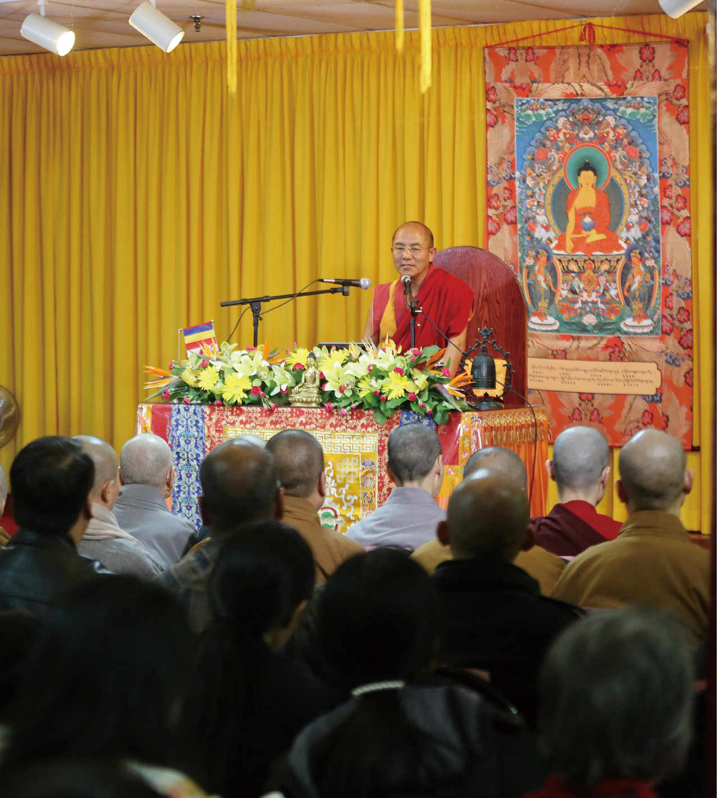

我们在寺院里当义工也好，到佛学院出家也好，我们所做的任何善法，如果没有以菩提心摄持，那不一定能够让众生获得快乐，以及断除众生的痛苦和愚痴，但若我们以菩提心摄持，就能成办以上三方面的功德。这就是菩提心的威力，它是世界上最广大的善心。如果你有了菩提心，你在世间没有任何朋友也不成问题，菩提心就是你最好的朋友，也是你最超胜的福德。

事实上，缺少福德的人没法在自相续中生起菩提心，他们可能遇不到相关的法本，即使自己得到一些法本，他们也不一定对其有意乐，也许一两节课后他们就会失去兴趣而放弃学习。按照《大乘经庄严论》来讲，一个人要生起菩提心，有身份上的要求，也有福德方面的要求，总之我们要具足诸多因缘才能生起真实的菩提心。

在你所获得的福分之中，菩提心是最好的，它也是你最好的朋友，不会让你感到孤独。现在，很多世间人都渴望身边有些亲朋好友，好让自己有个依靠，比如一些老年人想老有所依，便把希望放在儿女身上，一些年轻人则把自己的人生希望和快乐寄托在朋友或者伴侣身上，而当那些亲眷对自己不太好，或者达不到自己的要求时，他们便哭哭闹闹，跟对方吵起来，然后互相热战、冷战。这些“战争”的源头是什么？自私心。

如果我们相续中有了菩提心，那我们不会在意其他人对自己的言行。因为有菩提心的人会想：“我热爱所有众生，也明白他们都很可怜。虽然他们怀着自私心，但我毕竟发了无上的菩提心，所以我一定要体谅和帮助他们。”大部分世间人所流的眼泪都是源于自私心，他们出于利他心而流的眼泪非常稀少。相反，佛陀在因地时为众生哭过无数次，而有些学过大乘佛教的人可能也曾为一切老母有情而哭。

世间人有很多流泪的时刻，但是当中利他心的眼泪绝无仅有。你看婴儿出生的时候，他们所发的第一个声音都是哭声，没有人是带着笑声来到这个世界的，不知道加拿大有没有？（众笑）在电影的场景中，只要有婴孩出生的画面，就一定会有哭声。有一部纪录片叫《玄奘之路》，它讲述的是一位高僧大德的事迹。玄奘大师很了不起吧，但是介绍他降生的状况时，场景是他“哇哇哇”地哭着，哭得很厉害。我觉得像玄奘大师那么厉害的人，可能是哼着歌降生的，对吧？（众笑）

具菩提心者之功德

具有菩提心的人，他自己有非常大的功德：

若人酬恩施，尚且应称赞，

何况未受托，菩萨自乐为。

世间中有些人在得到别人的帮助后，他们会知恩图报，在日后酬谢、报答那位帮过自己的人。此时，其他人都会觉得这位念恩报恩的人很好，因为他没有忘记别人对自己的帮助。

其实，这样的行为不一定值得赞叹，因为这相当于一场交易，你以前帮过对方，现在他来酬谢你，按理来说，他回报你是天经地义的，这并不是什么高尚的行为。但现实中的情况是，如果一个人没有对帮过自己的人报恩，那其他人会觉得他很坏；如果这个人知恩图报，那其他人就觉得他非常值得敬仰：“哇，这是一个很好的人，会知恩报恩。”

按理来讲，感恩图报的人不一定非常值得赞叹，毕竟对方以前给他提供过帮助，他之后给对方一些反馈很正常，这是基本的为人准则，并不代表这个人非常高尚。那什么人才是真正的高尚呢？发了菩提心的菩萨才是名副其实的高尚，为什么呢？因为菩萨没有受到任何人的恩惠或者委托劝请，他们就自愿地利益众生。菩萨可能由于自己的大乘种姓成熟，学习了大乘论典，依止了一些善知识或者交上了一些贤善的大乘佛友，然后就自愿地关心和帮助众生，以求他们获得安乐。

在世界上任何一个国家或者民族中，人们都很难找到比菩萨更伟大、更高尚的人了。这一点大家可以慢慢思维，如果你对此有怀疑，今天晚上你躺在床上的时候可以想一想，菩提心到底值不值得人们赞赏？这是可想而知的。世间中高尚的人会受到很多赞赏，实际上他们利益众生的范围很狭小，而菩提心的核心是无条件地帮助所有的众生，这方面一般凡夫根本做不到，所以有菩提心的人肯定比世间所公认的好人更高尚、更值得赞叹。

可惜的是，现在人们从小所受的教育都是自私的教育，如果我们的小孩从小就能接受大乘佛法的教育，那整个世界肯定会减少很多杀戮、战争等不和平的因素。现在，全世界很多国家的教育体系都渗透着一种自我宣扬，例如当我们看到敌人的时候，要把对方杀掉、灭掉，对吧？当今不管是东西方哪个国家的教育都是如此。

在这种教育环境下成长的人，他们日后哪怕是遇到一些细微的冲突——且不说国家之间的冲突、民族之间的冲突，即使是家人之间的冲突，他们的相关言行只会从自己的利益出发。这样不单解决不了问题，还会因为不断地串习自私心而令自己的心越来越狭隘，而狭隘的心会使自己非常痛苦。为什么现在全世界人们的自杀率越来越高？原因就是我们的自私心太强，以致有很多解不开的心结。

怎么今天现场有这么多出家人？第一堂课的时候这里有较多的出家人，第二堂课的时候少了一些，今天比第一堂课那天有更多的出家人，你们是从哪里来的呢？那天有人提议我们去看这里的瀑布，因为它非常美，传说这个瀑布是天堂的一小部分，然后由于某种原因，它就掉到人间来了。今天这些出家人是否也是从天上下来的？（众笑）

发菩提心的人非常好，他们是所有众生的怙主：

偶备微劣食，嗟施少众生，

令得半日饱，人敬为善士，

何况恒施予，无边有情众，

善逝无上乐，满彼一切愿。

此处讲了一个简单的比喻，有人以偶然的机缘或者在很短暂的时间中，准备了一些微劣、不上等的食物，以嗤之以鼻、轻蔑的态度布施给少数众生，解决了他们半日的温饱问题，这样的施主也会受到人们的赞叹。

现在，像中国或者其他地方的一些富翁，他们会到一些比较贫困的国家，在城市中的十字路口给乞丐发钱，一百块一百块地发，他们因此有了一些负面的新闻，但是大多数人都觉得他们很了不起。印度也有一些富豪会偶然请很多乞丐到饭店里大吃一顿，之后人们都会觉得这些施主非常好。

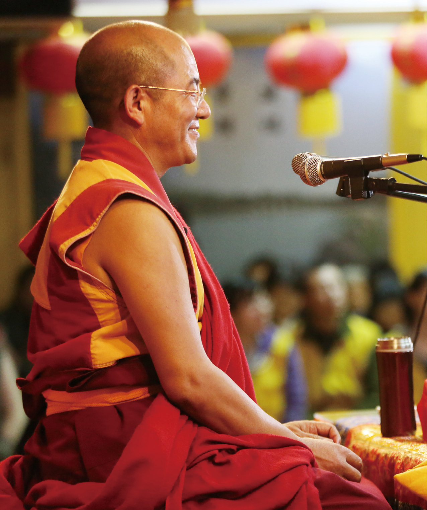

有些人给一百位乞丐提供一顿饭，或者给他们每人一百块钱，如此就能获得人们的认可和赞叹。其实，从所施物上讲，他们所布施的食物量非常少；从时间上讲，他们的善行很短暂，只能解决别人半天的温饱；从态度上讲，他们对乞丐不恭敬，甚至以蔑视和歧视的态度来行持布施。不过，他们最后还是得到人们的赞叹。

现在，很多慈善家在获得一些慈善奖项时，他们都激动不已，有的甚至跳起来。实际上他们行善的范围小、持续时间短，发心也不纯正，比如有些人只是帮过一位患有恶疾的人，有些人只是在一两年中做了一些慈善，有些人做慈善的目的只是为了提高自己的名声，当他有了慈善家的身份，别人都会觉得他很善良、很了不起。

而发菩提心的人是完全不同的，怎么样不同呢？在时间方面，他们是要永远、恒时不断地利益众生；在对境方面，他们要帮助无量无边的众生，而不只是个别的民族或者国家的人；在所施物方面，他们暂时给予众生所有人天福报，究竟把善逝佛陀的无上、无漏功德全部赐予众生，而在将来自己有能力和有必要的时候，他们愿意为众生付出一切，包括自己的身体；在态度方面，他们对众生没有任何轻蔑或者歧视，完全是以恭敬和欢喜的心态来满足众生的所有愿望。无论在任何一个国家、民族或者教育体系中，我们的的确确找不到比菩提心更伟大的心态了。

可惜，现在人们所受到的教育都与此不同。以前我读书的时候，学过《东郭先生与狼》《农夫与蛇》等故事，它们所传递的信息是：“人不犯我，我不犯人；人若犯我，我必犯人。”受到这些教育的影响，人们成年后便会想着远离坏人，要是他们认定对方是个坏人，他们就不会给对方提供帮助，因为坏人始终都会加害自己和危害社会，这是一种短视和负面的教育。俗语云：“可怜之人必有可恨之处，可恨之人必有可悲之苦。”所有众生都有自己的缺点，这是非常正常且值得被理解的。

按照菩提心的观点，我们应该去帮助每一位众生，就算是一个国王，也最好以善法去对待每一位百姓。早前我刚到这里的时候问了一些人，他们说加拿大没有死刑，这是很好的。现在中国正在往这个方向发展，昨前天他们在会议上讨论修改《刑法》的事情，现行的死刑罪名有五十多项，他们拟取消其中的九项。按照佛教的教义，我觉得世间上最坏的人顶多被判终身监禁，不应该被判死刑。当然，世界上每个国家的法律都不尽相同，例如朝鲜的法律就跟北美国家的不一样，但是现在很多国家的法律正在慢慢地改变。

不管怎样，虽然世界上暂时有一些坏人，但是发了菩提心的人应该以善心，而不是恶心来对待他们，这就是菩提心的伟大之处。这一点刚接触这些道理的人可能不会认同，也许你觉得这是软弱的表现：“现在别人来欺负我，我一定要报仇。”其实，你是因为以前的教育和一时的怒火才会产生这种心态，如果你冷静地思考菩提心的理念及其价值，你会发现自己过去的一些做法和心态都不合理。

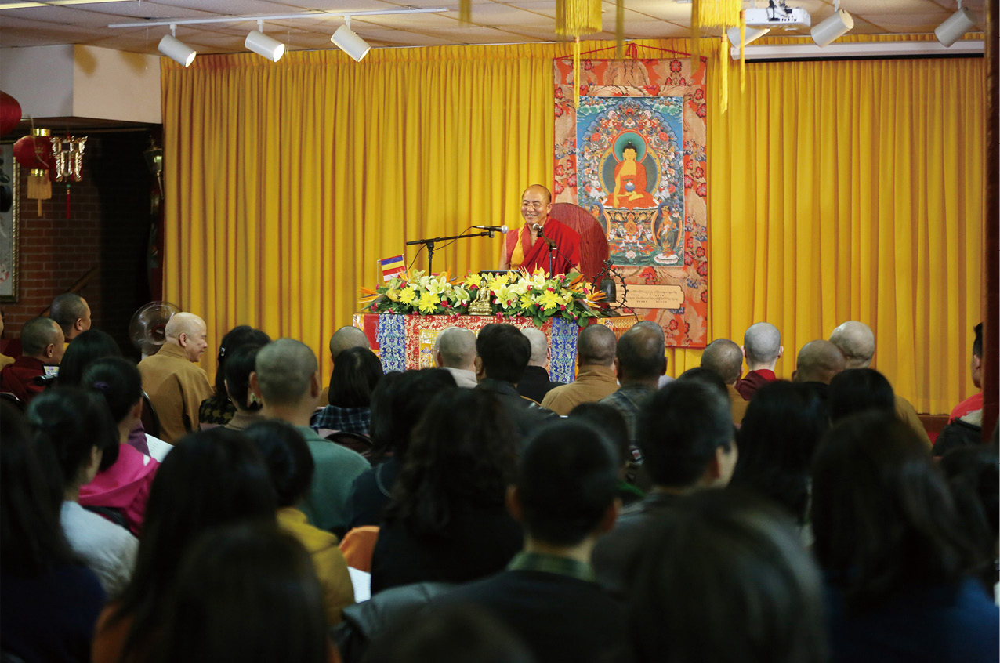

若你刚开始无法接受这些教言，你可以慢慢地思维，也可以把整部《入菩萨行论》好好地学习一遍。之后你会发现，世间上最好的教育就是大乘慈悲心的教育。不管你是一位老师，还是从事其他的职业，你都应该向身边的人传递慈悲的理念，这非常重要。尤其是你们为人父母的，要尽量让自己的儿女接受良好的教育，科学、技能方面的知识没有那么重要，最关键的是你们给孩子讲解一些做人的道理，让他们生起利他心和慈悲心。

我们的心就像宝藏一样，每位小孩都有很多潜力，关键是看父母如何开发他们心中的宝藏资源。比如，你可以开发、栽培孩子在音乐方面的技能，但是他们最后能不能在音乐方面获得成就，这取决于很多不同的因素。但若你开发、培养孩子的菩提心，这颗心肯定会在将来发挥作用，这才是最重要的。对孩子的一生，甚至对整个社会和世界来说，我们让孩子在相续中生起利他菩提心都是最重要的。

刚才也讲了，人们生活上的很多痛苦都由自私而来，如果你的孩子有了菩提心，那他以后在任何地方都会过得很安逸、很舒服。因为有菩提心的人不论在什么环境或者人群之中，尤其是在职场上，他不会有非常强烈的争名夺利之心，不会整天想着把别人的权力、财产和名声据为己有，既然他没有这种如毒药般的自私心，生活自然过得快乐。所以说，菩提心确实非常重要。

具菩提心者是严厉的对境，亦是殊胜的福田

菩提心那么殊胜，具有菩提心的人是殊胜的福田，同时也是严厉的对境：

博施诸佛子，若人生恶心，

佛言彼堕狱，长如心数劫。

菩萨能够赐予一切众生无上的精神财富，他们是一切众生的施主，也是非常严厉的对境。佛陀在相关的经典中说，如果有人对发了菩提心的人生起嗔恨，那他产生了多少个刹那[^2]的嗔恨心，就要在地狱待多少个大劫。试想要在那么漫长的时间中待在地狱受苦，确实非常可怕。

这些因果听起来很可怕，不过严厉的对境也是殊胜的福田，我们依此可以产生过患，也可以产生功德。如果我们只知道如何产生功德，而不知道如何避免过患，那就很可怕了。此处说，我们对发了菩提心的人产生多少个刹那的嗔恨心，以后就要在地狱中待多少个大劫。按照一些大德的观点，这里所说的“刹那”和“大劫”可能跟一般佛教中所定义的单位不完全相同。

无论如何，此处的菩萨不仅仅指一地以上菩萨，也包括凡夫菩萨，什么是凡夫菩萨呢？就是发了菩提心的凡夫，他已经受了菩萨戒，而之后没有失毁戒体。如果一位凡夫菩萨对另一位凡夫菩萨产生嗔恨心，那确实有极大的罪过。可能你们一些人现在不敢发菩提心，而另一些人可能发过菩提心，不过现在感到十分害怕，因为你有很多道友，但是分不清楚哪些道友是凡夫菩萨，所以你特别紧张。

佛陀在讲因果的时候，其中确实有很多让人毛骨悚然的道理，对此我们一方面要非常谨慎，另一方面我们要明白，如果自己依靠这样的对境来行持善法，我们会获得更超胜的功德。寂天论师在《学集论》中引用了这个教证，里面也讲到此处所说的菩萨包括凡夫菩萨，如果一位凡夫菩萨对另一位凡夫菩萨产生嗔恨心会有非常严重的罪过。那我们今后该怎么办呢？我们尽量不要对其他人，尤其是佛教徒生起恶心，即使生起了恶心，也要马上忏悔。

大家可能想：“我身边的人，哪些是菩萨，哪些不是菩萨呢？”这方面的确很难分析，因此我们要对一切众生作如来想、本师想，佛陀在《迦叶请问经》中有相关的教言。若你能够把所有众生都看成是佛，那你不容易对众生产生嗔恨心，这非常重要。一旦你不小心生起恶念，应该马上励力地忏悔，如此你的罪业应该可以清净。

在其他严厉的对境面前，如果我们生起了恶念，也会得到类似的果报。《时轮金刚本续》[^3]和《事师五十颂》的讲义中也说，弟子对上师产生多少刹那之恶心，就会在多少个大劫中于地狱中受苦。无论如何，业因果唯有如来才能了知，凡夫人要完全通达它的意义非常困难，我们平时一定要注意自己的身语意。

菩萨是严厉的对境，如果我们对菩萨生恶心，便要感受极大的痛苦，以上已经说明了这种规律。下面是从另一方面来说，如果我们对菩萨哪怕生起一刹那的信心、欢喜心、恭敬心，其功德会翻倍增长。比如说，你跟一位发了菩提心的道友吵架，过程中你对他产生了恶心，但是过了一会儿，你对他产生真实的欢喜心和信心，如果这个时间比你对他生恶念的时间长，那你生恶念的过失已经被抵消了，而且你的功德还会不断地增上。

若人生净信，得果较前胜。

因为发了菩提心的人确实是非常严厉的对境，如果你对他生起清净的信心、欢喜心、恭敬心，会获得非常大的功德。我们之前已经讲了，发菩提心的人是人天应供处，值得人和天人对他供养。如果你和道友都发了菩提心，你们彼此都应该谨慎，因为对方是严厉的对境；另一方面，你们彼此都是供养的对境。正如这里所讲，你们互相产生信心、欢喜心的话，双方的功德都会翻倍地增长，这是非常有意义的。

佛子虽逢难，善增罪不生。

真正发了菩提心的人，哪怕在修行的过程中遇到最大的危难、困难，他也不会增长罪恶，反而让自己的善法越来越增上，这一点很重要。

不学佛的人一旦遇到违缘、困难，他们就感到很痛苦，很想从中逃离，这是世间人的基本观念。但是学了大乘佛法的人，他们会把痛苦和危难转为修道上的动力。比如说，你的家人死了，如果你平时没有修行，便会想：“啊，我的家人死了，真痛苦啊……”然后就哭闹起来，感到十分伤心；如果你修学大乘佛法，此时你会明白苦才是人生，原来生命那么无常，死亡可以随时到来，然后你会对人生的无常和生老病死有深刻的体会，进而悲悯众生。

在平凡的环境中，我们很难把修行人和非修行人区分开来，很多时候他们都做着同样的事情，像吃饭、走路、喝水，但是两者的心态截然不同，这是旁人看不出来的。在某些时代，非修行人好像比修行人更开心、心态更平衡，这时候不修行的人看起来很快乐、很安宁，而修行人却整天说这个痛苦、那个痛苦。现在，一些世间人也有相似的说法：“为什么你们学佛的人有那么多烦恼啊？我不学佛，生活也过得很开心、很平安，你们到底是学佛还是学习增上烦恼？”实际上，一个人学佛与不学佛还是有些不同。

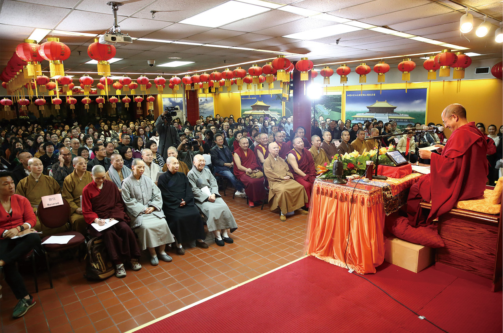

修行人学了生老病死的道理和把违缘转为道用的方法后，他可以把生活中的诸多违缘转为修行的助缘。比如，他生病时会想到佛陀在佛经中所讲的道理：“人有生老病死，就算我现在病死，也是正常的规律。”因此他不会伤心，还会精进地念佛。又比如，当自己最爱的人离世的时候，非修行人会特别痛苦、伤心，他们甚至想通过吃安眠药等方法来自杀，但是修行人会想：“很好。我从此之后就不用再执著他了，我现在减少了执著，可以好好地修行，那多平静、多快乐啊！”

以前一些被关在监狱里的修行人也能把违缘转为道用。我在大概十年前讲解《入行论》的时候，提过学院一位老医生的故事。他是来自青海的一位喇嘛，现在应该八十多岁了。他年轻的时候被关进了监狱，与他同狱的是一位当时在藏地很出名的大圆满密法上师，名叫门色堪布。他很想从门色堪布那里求法，上师要求他在两个月中好好地念修百字明。

两个月以后，门色堪布准备给他传法。当时堪布脚不方便，不用每天参加劳动，而他每天都要去劳动。为了争取听法的时间，他就开始假装生病，不去劳动，连中午饭也不吃，而堪布就天天给他传法。半个月后，他好不容易从另外一些喇嘛那里找到一些纸和笔，最后他在余下的二十多天里，基本上把上师的教言全部记录了下来。那段时间他都吃不到饭，因为他要假装生病，而且监狱里所提供的食物本来就特别少。

后来，他用另外的纸把那些教言抄下来，完整地立成文字。我当时看了他最初记录用的小纸片，一小片上有四十二行字，字数特别多，每个字都写得特别特别细。他觉得这个法本非常珍贵，于是就把它放在自己的嘎乌盒里。他说：“我在监狱里得到上师的教言后，一直把这个法本装在嘎乌盒里，从不离身。”那一年我在传讲《入行论》，当时他已经把这个法本藏在身上48年了！

修行好的人，即便是在监狱里仍然不忘修行，他不会想：“我被关在监狱，好痛苦啊！我是不是要死在这里？什么时候才能离开这里？”相反，他可以把违缘看成是机会，把它转为修行的助缘。这是我们非常需要学习的，毕竟没有人的一生会永远平安顺利。

我还要跟大家分享另外一个故事。我们寺院有一位老法师，现在大概是八十八岁，他在二十多岁的时候离开了家乡，去了藏地的其他地方求法。在求法的过程中，他的上师亲笔写了一些教言，然后把这张纸交给他。他那时才二十多岁，现在是八十多岁，在这中间的五十多年，他在藏地经历了“民主改革”和“文革”等翻天覆地的事件，也曾经遭受很多批斗，但是他一直都把那张写着上师教言的纸留在身边。这次出行之前，我去探访他，我问：“听说在你二十多岁的时候，你的上师亲手给你写了一些教言，那个文稿还在不在？可否让我看一看？”这位老喇嘛对我很好，他听到我的请求后，就把文稿送给我。我今天把它带过来了，大家可以看看。（堪布展示文稿，众鼓掌）

这个文稿在他手里已经五十多年，虽然藏地出现过一些风风雨雨，而且当年的纸质不太好，但是他还是把这个文稿完好地保存了下来。我看过里面的内容，当中有一些教言，其中他的上师嘱咐他要好好地独自修行，不要与很多人接触，守持清净的戒律，等等。后来，我用文本里的教言对照他的言行，我发现他一辈子都把上师的这些教言作为自己做人的原则。

现在，我们求法十分方便，非常容易就能获得一些佛法，例如可以在网上下载法本，或者自己到书店里买，于是很多人对法不珍惜，他们觉得少听一两堂课也无所谓。以前的老法师们可不一样，他们不管遇到什么违缘，都会把对自己有用的知识珍藏起来。

我并不是特意把这个文本带过来的，只不过那天探访老法师后，我把它藏在一本书里，然后我出行的时候就把这本书带上了，刚才正好看到。这位老法师一辈子都贴身珍藏着上师给他的法本，同时也以当中的教言来衡量自己，如此他的言行举止肯定会有变化。如果你对法没有重视，今天学了一点，下课后就把它扔了，明天又是同样，那你的心相续不可能有所改变。

如今很多人的求学方法和态度，都跟古代的真正修行人很不相同。在那个特殊的年代，一些修行好的人即使遇到再大的违缘、痛苦，他们也不会舍弃佛法。而现在有个别的佛教徒，他们只是在家庭里遇到一点困难，就马上放弃学佛。那些人会说：“我家里出现问题，所以现在学不了了，真没办法，对不起啊。我的家人很麻烦，我唯有随顺他们。”有些人甚至以生了孩子、出差等无关痛痒的理由而中途退学，最后更对佛法退失了信心。

我确实在自己的朋友圈见过这些情况，有时候我会去了解为什么一些道友退出了修行、学佛的行列，而我得到的答案，大多是生了小孩、移民、换了工作、家人反对等不痛不痒的原因。可能对某些人来说，学佛只是一个简单的行为，所以他们很容易退失，对吧？

何人生此心，我礼彼人身，

加害结乐缘，归依乐源尊。

任何一个人，如果他相续中具足了珍贵的菩提心，那《入行论》的作者寂天菩萨也会对他非常恭敬、对他顶礼。

不管你是什么身份，老年人还是年轻人，男人还是女人，西方人还是东方人，非洲人还是其他地方的人，只要你在心里产生“从现在开始，我要无条件地利益一切众生”的想法，那我们都应该向你顶礼。有些人说：“你不要对我顶礼，意礼或者问讯就好了。”事实上，如果你有菩提心，别人可以向你顶礼，你承受得起；如果你没有菩提心，别人向你顶礼可能对你有害。

大家平时可以观察，谁想真正无条件地利益众生，我们就可称他为活菩萨。这样的人非常了不起，但是他不一定很出名，不一定是人所共知的。有些人虽然得到大众的赞叹，“哇，他很了不起啊”，或者得到别人为他们唱诵赞歌，但这只是一个口碑而已，这些有名气的人可能没有菩提心。反而我们平时没有注意到的一些人，他们可能正在无条件地利益众生，例如一些在背后默默耕耘的义工，真正的菩萨也许就在他们的行列当中，这样的人连寂天菩萨也要向他顶礼，那更何况是我们这些凡夫呢？我们要知道菩提心的珍贵性，谁人具有真正的菩提心，他就是人天的顶礼之处。

另一方面，那些对发心菩萨作出危害的人，虽然他们以菩萨为对象造了恶业，但实际上他们因此与菩萨结上缘，这会成为他们后世安乐的源泉。

有些人可能会想：“前面说我们对菩萨产生恶心的话，便会在数劫中堕入地狱，但是这里说，即使我们危害菩萨，也会因为跟菩萨结上缘而获得安乐，这两种说法有没有矛盾呢？”其实二者并不矛盾。前面是从对境来讲的，菩萨是严厉对境，危害菩萨会有严重的果报；后面是从长远利益来讲的，即使你危害菩萨，最终结果跟你危害其他众生并不完全相同。你伤害其他众生的话，要在地狱待很长时间，此后也不一定能够解脱；如果被害者是位菩萨，那依靠他的发心力和法性力，虽然你暂时要受一些报应，但是最终你依靠菩萨的度化一定会获得解脱。所以说，你与菩萨结恶缘也会成为安乐之因。

无论我们在哪一个群体，如果当中有人发了菩提心，而且真正在相续中生起了这样珍贵的心，那他确实非常伟大，值得我们对他尊重、尊敬、供养，我们应该天天对他顶礼、让他坐在高高的法座上。像我这样相续中没有菩提心的人，你们每次对我顶礼，我都毛骨悚然，心想：“完了，我的福报要耗尽了。”然后就感到很伤心。但是我没有办法，有时候自己业力现前，只好装模作样地给大家作一些“表演”。

珍惜光阴，做好人生规划

不管怎样，大家以后要仔细地思考，人身很难得，佛法很难遇，我们现在已经遇到佛法，一定不要让自己变成名相上的佛教徒，我们至少要尽心尽力地闻思修，让自己对大乘佛法有所了解，然后落于实修。同时，我们应该趁现在有机会的时候，或多或少做一些饶益身边人的事情。

我们不一定要成为一位非常伟大的人，不一定非要改变整个世界或者国家，但是我们也可以有自己的人生规划，比如在未来一年，你要去做一件善事，或者让自己的内心有些转变。大家应该好好地计划人生，找到自己的定位，这非常重要。我们的一生转瞬即逝，8年、10年、20年很快就过去了，人生的确如梦，它过得非常快。若你现在没有规划，而当这场梦快要完结的时候，你才发现空过了一生，那就太可惜了。

我希望你们每一位都能好好地规划自己的将来。比如说，你今年28岁，那在未来的一年，你有什么目标，或者要做什么事情呢？你也可以计划在自己33岁前，即五年之内至少要做多少件事情。至于具体的项目，你不一定要做一些非常伟大的，你应该在自己的能力范围内，做些与弘法利生相关的事情，这就是行菩提心。同时，你在修行方面也要为自己定下一些目标，然后切实地执行。如果你的人生在浑浑噩噩中度过，那真的没有意义。

现在有些人每天都是为了活着而活着，他们除了吃饭睡觉以外就是散乱，最后自己就把人生空耗了，真是非常可惜。在藏地，一辈子中念了三亿遍、五亿遍观音心咒的大有人在。如果你实在没有能力去进行广大的闻思修行或者帮助别人，那你每天念经和念咒语也是很好的。你可以每天念几遍刚才我们所诵的《般若心经》，或者每天念一遍《普贤行愿品》，对佛教徒来说，这些要求根本不过分，你们应该能够做得到。

我希望大家珍惜光阴，不要过于懒惰，不要睡懒觉。有些人特别爱睡觉，对吧？如果你的睡眠时间过长，那不仅对你日常的时间安排有影响，也对你的身体不好。现在，世界上很多爱睡之人的寿命都不长，他们很快就死了（众笑）。真是这样的。我去年看了一个科学研究，它说人们以前的一般认知是，成年人每天要睡八个小时才足够，但是现在有些医学家和生命学家，他们通过一些科学方法进行研究，发现成年人每天的睡眠时间不应超过八小时，否则会对身体里的很多内分泌有破坏性的危害。所以，大家最好少睡一点。刚开始你可能觉得有些困难，但是你会慢慢习惯，而且你们这里的咖啡品质非常高，多喝一点咖啡是很好的。（众笑）

这次我们《入行论》第一品的共同学习已经圆满。下面是传皈依和授菩萨戒。

首先是皈依。如果你以前没有皈依，但是现在有意乐，那你就可以皈依。如果你已经皈依，那就不用再次皈依了。我不是皈依的对境，你们不是来皈依我的，大家现在是要皈依三宝——皈依佛、皈依法、皈依僧，我只是一个中间的媒介而已。

这里有些人从未皈依，也有些人以前已经皈依过，但是当时纯粹是想进入佛门而已，对于皈依的意义并不是十分清楚，因此我现在简单地说一下。按照每个人自己的发愿，皈依可以分为三种层次：上等皈依，是为了利益天下无边的众生而皈依；中等皈依，是为了自己从轮回当中获得解脱而皈依；下等皈依，是为了自己和眷属获得平安、快乐、身体健康等世间福报而皈依。至于你现在的皈依属于哪一种层次，就看你自己的决定了，对吧？

（堪布授皈依）

下面是传菩萨戒。你受不受菩萨戒也要看个人的意乐，如果你觉得有了皈依已经足够，你可以不受菩萨戒。

今天我们在诸佛菩萨面前受持菩萨戒，我会念诵三遍《入行论》中的仪轨，你们也跟着重复三遍，同时观想自己在念完第一遍时获得愿菩提心，第二遍念完时获得行菩提心，第三遍念完时愿行菩提心在相续中获得稳固。

不管是汉地还是藏地，传授菩萨戒的仪轨非常多，我刚才在湛山的图书馆里也看到了，汉地的菩萨戒仪轨特别长。藏地的各个教派有不同的仪轨，有些传承授菩萨戒时可能念诵要超过三四个小时，不过我们这次用一个简便易行的仪轨，一些前辈大德们过去也是这样传授的。

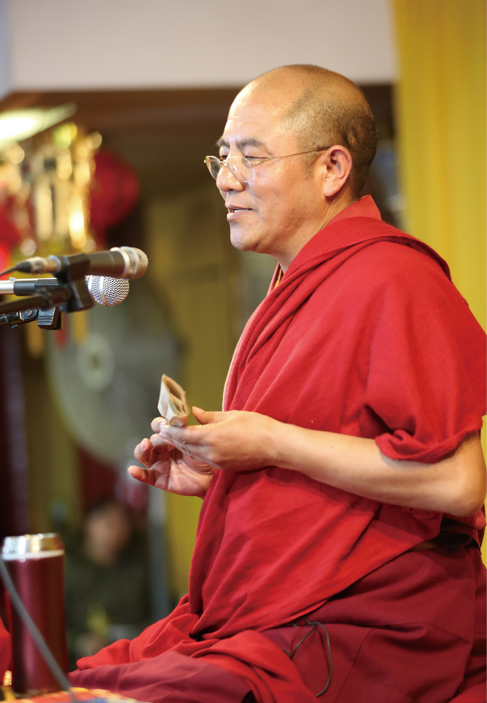

我现在简单地介绍仪轨中的内容。它的意思是，往昔诸佛菩萨怎样发菩提心，我现在也怎样发菩提心，这是第一步；当自己生起了菩提心后，就发下一个愿，往昔诸佛菩萨怎样按照次第来行持菩提心，我从今开始也怎样行持菩提心。你要生起以上两个发愿，然后通过念诵仪轨三遍，自己就能得受菩萨戒。

大家一边这么想，一边跟着我重复：

ཇིི་ལྟར་སྔོོན་གྱིི་བདེེ་གཤེེགས་ཀྱིིས། །

杰达温杰得夏吉 如昔诸善逝

བྱང་ཆུབ་ཐུགས་ནིི་བསྐྱེེད་པ་དང་། །

香确特呢杰巴当 先发菩提心

བྱང་ཆུབ་སེེམས་དཔའིི་བསླབ་པ་ལ། །

香确森慧拉巴拉 复此循序住

དེེ་དག་རིིམ་བཞིིན་གནས་པ་ལྟར། །

得达仁印内巴达 菩萨诸学处

དེེ་བཞིིན་འགྲོོ་ལ་ཕན་དོོན་དུ། །

得印卓拉攀敦德 如是为利生

བྱང་ཆུབ་སེེམས་ནིི་བསྐྱེེད་བགྱིི་ཞིིང་། །

香确森呢杰杰样 我发菩提心

དེེ་བཞིིན་དུ་ནིི་བསླབ་པ་ལའང་། །

得印德呢拉巴拉昂 复于诸学处

རིིམ་པ་བཞིིན་དུ་བསླབ་པར་བགྱིི། །

仁巴印德拉巴杰 次第勤修学

（堪布念一句，大家跟着重复一句，共三遍，然后堪布弹指）

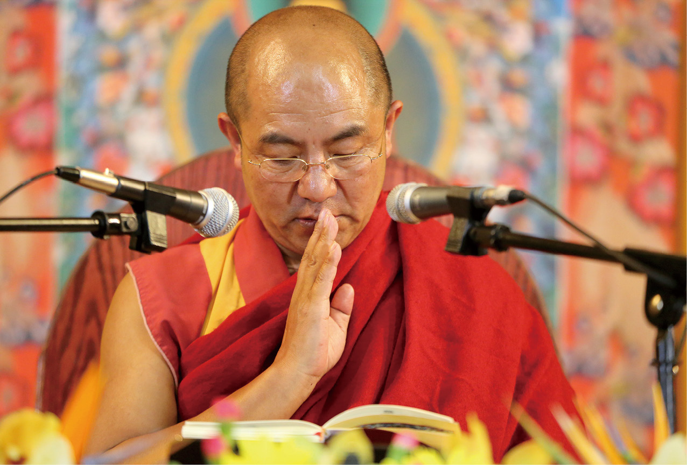

接下来是开光。昨天他们请我加持大家的法物，你们不一定要把那些东西拿出来，毕竟三宝的加持无有阻碍，有很强的穿透力。（众笑）

（堪布念开光仪轨）

现场互动

⊙ 问：堪布好，阿弥陀佛。《中论》里讲了八不，即不生不灭、不常不断、不一不异、不来不去，请问我们在修胜观（毗婆舍那）的时候，应该如何在心上运用这种智慧？

堪布：你刚才所说的，是《中论》的第一个偈颂：“不生亦不灭，不常亦不断，不一亦不异，不来亦不去。”释迦牟尼佛在第二转法轮中，讲到万法远离四边八戏，或者说远离八种边，即万法不是生、不是灭、不是常、不是断、不是来、不是去、不是一体、也不是异体。远离此八种边的道理实际上就是大空性的道理，我们内在的心也好，外在的物质世界也好，一切诸法的本体如果远离了八种边，便没有其他的存在方式，这就是万法的本性。

我们修胜观的时候，应该以远离八边的智慧来摄持，就是说，无论你当下的心如何寂静，你也要用这种智慧来摄持，否则就算你的心再寂静，甚至安住时不起任何分别念，但是这种修行不一定让你获得最究竟的果位。

《中论》的作者龙猛菩萨为什么在第一个偈颂就宣讲了远离八边呢？其实这个颂词是顶礼句，世界上能够真正宣说缘起空性妙义的，唯有本师释迦牟尼佛，所以他非常值得我们对他恭敬顶礼。如今末法时代，人们的分别念非常炽盛，而人类的社会也极其复杂，在这样的环境下，我们即生能够皈依佛教，应该感到非常非常荣幸。在当今这么多思想、学说之中，我们遇到这么殊胜的佛陀教法，真的很有福报。

我们暂且不说佛陀的加持和慈悲心，从智慧方面来说，佛陀所宣说的道理的确超胜世间任何一门学术知识。我自己对各个宗教都有大概的了解，我对其他宗教都有恭敬心和欢喜心，但是在理论方面，我以理性来观察的话，确实佛教才是最具说服力的。此外，我也在不断学习和了解世间的各种知识，例如天文学、生物学、心理学、古文明、不同民族的传统文化等等。但是，我没有发现一门世间知识可以比得上佛教缘起性空的道理，佛陀用了非常尖锐的智慧来剖析，然后宣说出最完美的要诀，佛法可说是人类文明的智慧巅峰。所以，我觉得大家能够成为佛教徒，你应该为自己的身份感到非常荣幸。

我们不是自吹自擂，而是发自内心地感到自豪，这种自豪依赖于什么呢？依赖于长期的学习。如果你没有学习佛教的教义，只懂从外相上说佛陀很好，释迦牟尼佛的身相很庄严，那是很难说服别人的。当然，若与其他宗教相比，我也觉得佛陀的身相很庄严，但是，可能有些人确实觉得其他宗教的某些外相也很庄严。再者，一些坏人也长得非常好看，有外表并不一定有内涵，所以我们光从外表上赞叹佛陀并不一定有说服力。

作为佛教徒，我们感到自豪是因为佛陀具有慈悲和智慧，此二者就是佛教的超胜之处，我们完全可以在这两方面以理服人。我接触过一些很有科学成就的人，我们会以智慧、理性来分析很多事情，在互相交流之后，他们也觉得佛陀确实非常伟大。

你刚才所讲的“八不”，出自《中论》的第一个偈颂，为什么龙猛菩萨用远离八边的道理来赞叹佛陀呢？因为这就是万法的真相，而世间唯有佛陀才能阐明此甚深妙义。如果我们学懂了远离八边的道理，然后以此来摄持自己的修行，那我们的修行肯定100%正确，最后肯定会获得解脱。

⊙ 问：顶礼尊贵的上师！祈请上师能够借此机会给我们传授八关斋戒，好让我们在家居士日后能够在家中修持八关斋戒，谢谢上师。

堪布：我这次没带八关斋戒的法本，而且八关斋戒是在早上传授的。从时间等各种因素来看，这次是没办法了。看看以后有没有机会，好吗？

⊙ 问：尊敬的堪布，昨天您在多伦多大学演讲的时候，有位女孩子提了一个关于时间的问题，当时您好像回答说：“过去已经灭尽。”我对藏传佛教不太了解，而在汉传佛教中，我们会做礼忏、念忏悔文，如果如您所说，过去的事情已经过去了，那我们现在做拜忏和念《大忏悔文》，对忏净自己过去所做的业障还有没有用？

堪布：时间是过去了，但业障是存在的。

关于空性方面，从科学的角度来讲，爱因斯坦说时间和空间是虚假的，它们都是一种错觉。从佛教的角度来讲，当我们剖析时间，你会知道“过去”已经灭尽，过去所发生的显现和事情此刻已经不存在，而“未来”还没有产生，因此未来所发生的显现和事情都不存在，那“现在”呢？我们可以用刚才的方法，从未来和过去两个层面来继续观察，比如我们所谓的“现在”是当下的一秒钟，但是它还可以分成更微小的万分之一秒、亿分之一秒……所谓的“现在”其实也不存在。以上所说的是胜义谛，即从物质实相的层面进行分析。

而在现相的层面，我们不会说过去的显现是不存在的，我们也承认“过去”有过去的显现，“未来”有未来的显现，包括有些佛教论典也认为现在的本体是存在的，得绳有过去、未来和现在三种。所以，从名言、现相的层面来说，我们现在要忏悔过去所造的罪业，也要为未来的梦想而发愿。在名言的显现上，佛教都不会否认这些行为。

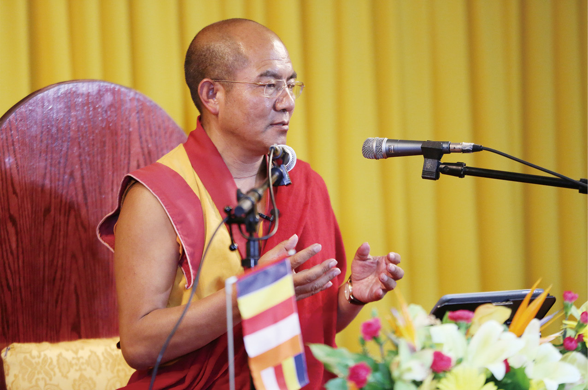

⊙ 问：好紧张，我终于抢到麦克风了。我想问上师一个关于有为和无为的问题，像我刚才那样，我应该抢麦克风还是不抢？我们已经受持愿行菩提心，对于一些事情，我们以后该如何抉择做还是不做？另外，还想请上师简单地讲一下空与色的关系。

堪布：刚才你问，自己该不该抢麦克风，实际上这不是一个很严重的问题，因为你的提问不会对众生构成很大危害，别人抢不到麦克风的话，对他自己没有什么损害。诸如此类的事情比较中性，只能体现出一点菩提心，或者说是利他心。

我觉得最根本的是我们先要生起菩提心。如我前面所讲，我们每个人都是社会的一员，而你们每一位都是自己家庭中的一员，你们有些人是家里的最高领导，有些人在家里的地位中等，有些人在家里的经济、政治等方面都没有实权（众笑）。好像西方这边跟内地不一样，每位家庭成员的经济都是独立的，不像内地一样要全家共享，我不清楚相关的情况。

无论如何，我觉得大家应该要懂得菩提心的利益，要善发菩提心，这很重要。当你懂得一些大乘的教义，有了一些慈悲的理念，你自然就会有利他的光芒。此时你在自己周围的环境中，家庭也好，社会也好，你随时随地都能找到非常好的利他机会。

你们部分人可能想为世界作出一些贡献，可是我们不能好高骛远，应该从点点滴滴做起。其实，不管是处理身边所发生的一些小事，还是应对自身所面临的一些境况，它们都能体现出你的利他心，如果你能够把这些小事情做好，你的利他心就是落到了实处。有些人把自己的愿景吹嘘得很宏大，听起来像是什么世界性的大事，但是当真正落实执行的时候，他们连一件小事也不会做，这样的空谈没有意义。

作为修行人，哪怕我们每日仅做一些小事，例如天天不间断地念一遍《心经》，对身边的孩子和邻居展露一点微笑，或者说露出一副让人悦意的表情等等，但只要我们把这些小事当作自己最重要的事情来做，把这些行为变成习惯，我们的利他心就会逐渐增长。此时你抢麦克风也不会紧张，因为你的心感到踏实，这时候空与色方面的问题，对你来说回答与不回答都没有分别。

⊙ 问：尊敬的上师，很多上师像顶果钦哲法王、宗萨蒋扬钦哲仁波切等，他们好像都开示过佛法跟世间法相违背，但是也有说佛法“不离世间觉”，此二者是否有矛盾？请上师开示。我一方面想精进学佛、想发大乘菩提心，但是另一方面也要工作，我该如何平衡各方面的时间？

第二个问题，我修金刚萨埵的时候有各种业障现前，比如亲人得了脑梗，丈夫突然想要离开自己，损失了金钱，请问有没有办法在修金刚萨埵的时候，不会有如此壮烈的牺牲？

最后一个问题，听说修密法的人就像竹子里的一条蛇，不是往上走就是往下堕，请上师开示这方面的道理。如果我们修了几十年，但因为没有如理如法地修持，最后仍然有机会往下堕，那听起来真的很恐怖。谢谢上师。

堪布：六祖惠能大师在《六祖坛经》中说：“佛法在世间，不离世间觉。”藏地非常有名的华智仁波切，即《大圆满前行》的作者，他也说过相似的话，什么话呢？他说：“对于具有善巧方便的菩萨，世间法和佛法一点也不相违。”这句话很重要，我经常对此思维。如果修行人没有善巧方便，他会经常觉得世间法和出世间法相违、相矛盾。佛教徒应该学会在生活中修行、在修行中生活，大家能够做到这一点是非常好的。

在藏地，很多人一边念咒一边工作；坐车的时候，他们也会念咒语，或者拿着转经轮。总之，藏人在生活中有很多行持善法的习惯。现在，有些人想专门安排一段时间来闭关，若你可以实行，那是很好的，但在21世纪的今天，对很多人来说，要单独抽出一段时间是很困难的。因此，我们非常有必要在生活中修行、在修行中生活。

关于第二个问题，我们修金刚萨埵的目的是忏悔业障，这很重要，但是最重要的，是我们平时要学习佛法的空性智慧和慈悲菩提心。如果你缺少这方面的学习，光念咒语是很难解决问题的。比如说，你的爱人或者亲朋好友突然离开了你，不管是生离还是死别，此时很多人都觉得难以接受，他们会哭个不停，感到特别痛苦。佛教中讲爱别离苦和求不得苦，每当我看到这些教言，我都深深地感受到佛陀的伟大。如果你学佛比较好，不会哭得很厉害，因为你明白了这些都不是很严重的事情。

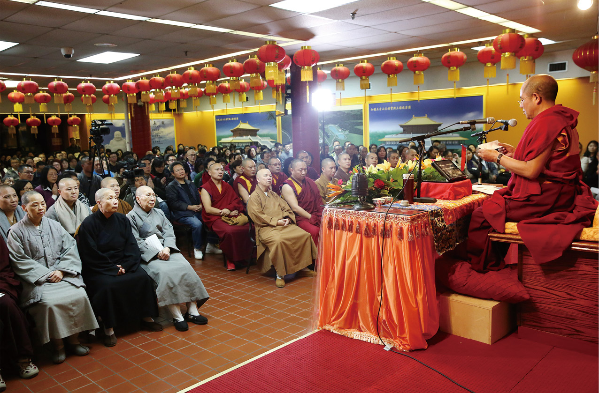

至于第三个问题。修密法的人就像竹筒里的蛇一样，要么往上走，要么往下堕，实际上这不仅是密宗的说法，基督教中也说做善事的人上天堂，做恶事的人下地狱。智悲光尊者在《功德藏》中说：“入密士夫之去处，恶趣佛外无三处。”修密法的人要么上得佛果，要么下堕恶趣，这是就大多数的情况来说的。造了严重恶业的人会下堕地狱，造了很大功德的修行人会获得解脱，当然，现实中肯定有个别的人既不造善业，也不造恶业，那按因果来推理的话，他们应该会有中等的果报吧。

⊙ 问：堪布您好，很感恩您来到这里。现场大部分人都是为了求您的加持而来的，请问您的加持是生灭的，还是永恒的？

堪布：我们佛教徒需要得到一些加持，这很重要，但更重要的是我们需要有智慧，所以大家以后要求法、学法，这非常重要。现在，很多道友喜欢参加一些灌顶、法会，或者请一些加持品，这是一般佛教徒的行为，我觉得是很好的，毕竟诸佛菩萨的加持不可思议。

如果佛教的群体只有外在的形象，没有受过佛法的教育，同时弟子只懂把自己的希望寄托在某个上师身上，每次求上师加持只是为了自己人生顺利、远离痛苦，这样的发心不太好。所以，我不喜欢太多人来求加持。当然，加持有两种，一种是像大部分人所理解的那样，上师给你摸顶；另一种加持就是智慧的传递。不过最重要的是，你自己以后要学习，对吧？

以佛教近代的发展来说，在上世纪七八十年代，信仰佛教的大部分都是老年人，尤其是在汉地，那时候学修净土宗的佛教徒比较多，特别是在80年代，很多老年人都会念佛。自90年代开始，在全球范围内信仰佛教的人越来越多，包括很多西方人和年轻人，后者以中国大陆的为主，他们很多都在学习佛法。

一般来说，有两种方法趋入佛教，利根者以智慧趋入，钝根者以信心趋入。利根者会用智慧去寻找真理，而通过学习，他们最后便会认识到真相。其实，我们不应该盲目接受上师和佛陀的教言，无论他们说什么，没有经过思索理解就全盘接受，这是不合理的。

法本可能天天在你身边，但你一定要思考其中的道理，用智慧来纳受，把它变成自己的东西，之后你就能把佛法应用到生活中。比如一个产品，它在工厂里对你没有作用，在商店里也对你没有作用，直到你付出金钱把它买下来，它就属于你了，此时你就可以享用。我们今天所讲的菩提心也是如此，你知道菩提心的功德对你没有作用，你要去学习、思维，用智慧来纳受，然后去修行，最后菩提心就成了你平时的为人处世之道，此时你就是一位真正的大乘佛教徒。

这时候你可以说加持是永恒的，虽然显现上它是一刹那一刹那地生灭，但是它的相续是永恒的，它的价值也是永恒的。这种永恒不仅限于我们的今生，菩提心的利益从我们发心开始，乃至菩提果之间一直是永恒的，这就是真实的加持。而我在这里给你们的加持是无常、生灭、不稳固、不可靠的。

⊙ 问：尊敬的仁波切，请问在您离开了多伦多之后，我们应该持诵哪些咒语来加持自相续，以保证自己的闻思修会不断地进步？

堪布：我离开多伦多之后会到蒙特利尔。事实上，我离不离开这里，你们的修行都是一样的。你们湛山精舍平时会念很多功课，像《普贤行愿品》、金刚萨埵心咒、观音心咒、莲师心咒等等，这些你都可以念。另外，你也可以选择念一些佛教的经典。总之，无论我离不离开，你们的修行都应始终如一。

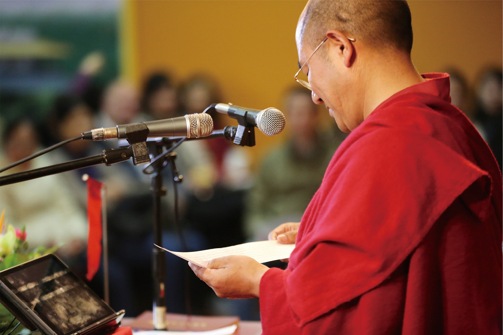

⊙ 问：尊敬的上师，我有一个很困惑的问题，是关于念诵咒语的。我喜欢在平常做事的时候，念诵不同的咒语。我念咒时会发菩提心，希望利益无边的众生。而我对佛顶尊胜陀罗尼咒很有信心，佛陀波利尊者当时花了六年时间，才把它带进中国，我觉得此咒很殊胜，很想经常念这个咒。但是我很困惑，因为根据密宗的说法，念诵一些咒语一定要有灌顶和传承，否则就算犯戒。现在我不符合这两个条件，若我在念咒之前发了菩提心，那算不算犯戒？另外，我很难遇到具格的上师来传授这个法的灌顶，那我可不可以跟佛菩萨说：“虽然我暂时没有相关的灌顶，但是我不想浪费时间，所以我现在就开始念诵，日后因缘具足我一定会去受灌顶”，请问这样可以吗？谢谢。

堪布：念诵咒语是不是一定要有灌顶和传承呢？不一定。严格来说，不管你念诵什么咒语，如果你有相关的灌顶，那是最好的。但是，有些咒语也出现在显宗的经典之中，如往生咒、楞严咒、大悲咒、药师七佛咒、六字真言等等，由于显宗没有灌顶的说法，所以你不一定要有灌顶才可以念诵这些咒语。

密宗分外密和内密，内密无上瑜伽部有一些特别的咒语，它们附有相关的修法，如果我们要修持这些咒语，最好先得到相关的灌顶。以前在我们学院，当全体僧众准备共修个别的咒语之前，我们的上师法王如意宝会给我们灌相关本尊的顶，然后大家才可以共修，当中的本尊修法需要非常保密，不能公开。所以说，一些特殊的咒语，像无上内密中的个别咒语，我们应该在得到灌顶后才去念修。

我们平时所念的一些咒语，应该没有特别的灌顶要求。至于传承方面，不管是什么法，如果你有传承，那当然是很好的，毕竟传承绝对有其特殊的加持和力量。如果你因缘不具足以致得不到传承，那只要你对这个咒语、本尊或者法脉有一定的信心，你就可以念诵相关的咒语。

在藏地，基本上所有人都会念诵观音心咒，但是，几乎没有人为了念观音心咒而祈请相关灌顶，它已经成了一个习惯。每个藏人从小都会念：“嗡玛呢巴美吽……”但若你去问他：“你得过这个咒语的灌顶吗？”大部分的答案都是否定的。莲师心咒、药师佛心咒等也是如此，很多藏人都在念诵这些咒语，但是他们都不会说：“你必须有灌顶，才能念这些咒语。”没有这种说法，所以不会有犯盗戒的过失。

大家对灌顶、念咒语和念仪轨方面不要有过多的担忧。刚开始你不了解佛法的时候，会觉得需要排斥的东西比较多，可以接纳的东西比较少，而学了一段时间后，你会发现可以接纳的东西比较多，需要排斥的东西比较少，这是学佛过程中的一个普遍状况。

一些刚入佛门的人不敢做这做那，因为他们很害怕，不知道会不会遭受惩罚、恶报，所以他们觉得这样不行、那样也不行。尤其是他们身边有些人不懂装懂，经常吓唬他们：“你不能这样！这样的话诸佛菩萨会不高兴，然后就惩罚你了。你不能这样，也不能那样，否则就违背了密宗的誓言。”其实不然，只要你是好心好意地学修，很多学佛方面的事情都不可能让你受到惩罚。比如你念佛、念咒语，你能修就修，不能修的话诸佛菩萨也会原谅你的懈怠和烦恼。

刚才那位女士问到，我离开了多伦多之后，她应该念什么咒语，你的问题基本上跟她的提问差不多。老实说，我觉得修行人在自己的一辈子中，所念的咒语越多越好，如果你每天都有一些约束，修行自然就会增上。而且每个咒语的功德都是不可思议的，早前我看了《大乘庄严宝王经》，里面宣说了观音心咒的功德，我看完后就想一辈子只念这个咒语，觉得不修其他法也不要紧了。这部经同时收录在汉文和藏文的《大藏经》里。我想现在人们的福报还是挺大的，观音心咒那么殊胜，即使你没有做其他善法，只要自己每天念诵“嗡玛呢巴美吽”，你就能获得非常殊胜的功德。

不论你学的是汉传、藏传还是南传佛教，你都可以念诵观音心咒。现在一些人对其他的传承、宗派十分忌讳，其实大家最好不要排斥佛教中的其他法门，我们现在要看重的是它们的实用性，并不是来源。比如，你现在需要一件产品，只要它实用和可靠，那不管它是中国还是加拿大制造，也不管它产自什么工厂，你还是会把它用上。

有些人会特别关注某个法是从哪位上师或者哪个寺院传来的，其实这些都不是最重要的，重要的是它来自正统的佛教，正如你购物的时候，最重要的是买到正品，而不是假货。美国从中国进口很多货物，他们店铺所卖的很多商品都是中国制造的，可能加拿大的情况也差不多，是吧？可能现在中国制造的很多产品都不错，除了食品以外……（众笑）

总之，大家以后可以修学佛教中任何教派、传承的法门，佛教非常包容，大家不要有一颗特别狭隘的心，如果你的心很狭隘，你可能会成为世界上最可怜的人。佛教的精神可以包容一切，我们修行人跟不上是我们自己的过失。不管你是哪个法脉、传承，我希望大家以后多念一些经咒，若你能以此充实自己，你会活得非常有意义。

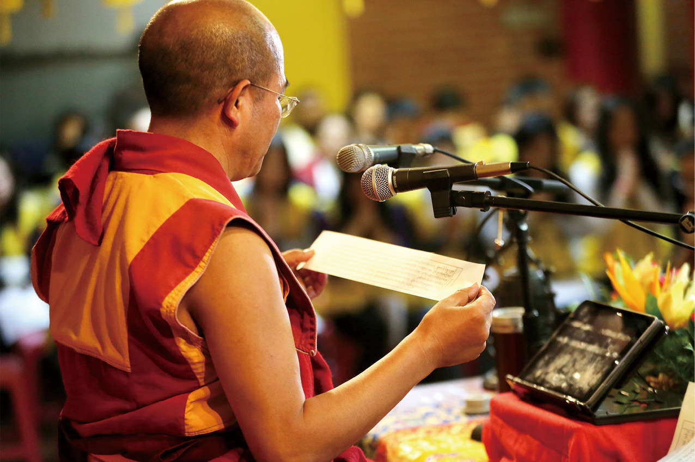

主持人：

非常感恩上师的法布施。每一次聆听上师讲解菩提心的利益时，弟子都会生起极大的法喜，心想：“哇！菩提心这么珍贵，哪怕有一刻可以听闻菩提心的利益，都是今生极大的福报。”今天是索达吉堪布在加拿大多伦多公开弘法的最后一站，大家要不要一起祈请上师以后多来加拿大呀？（众鼓掌）

我们加拿大的弟子任何时候都会诚挚地欢迎上师，祈请上师能够早日再次来到加拿大，给我们宣讲《入菩萨行论》的其余九品。现在请大家起立，我们一起念《普贤行愿品》回向……

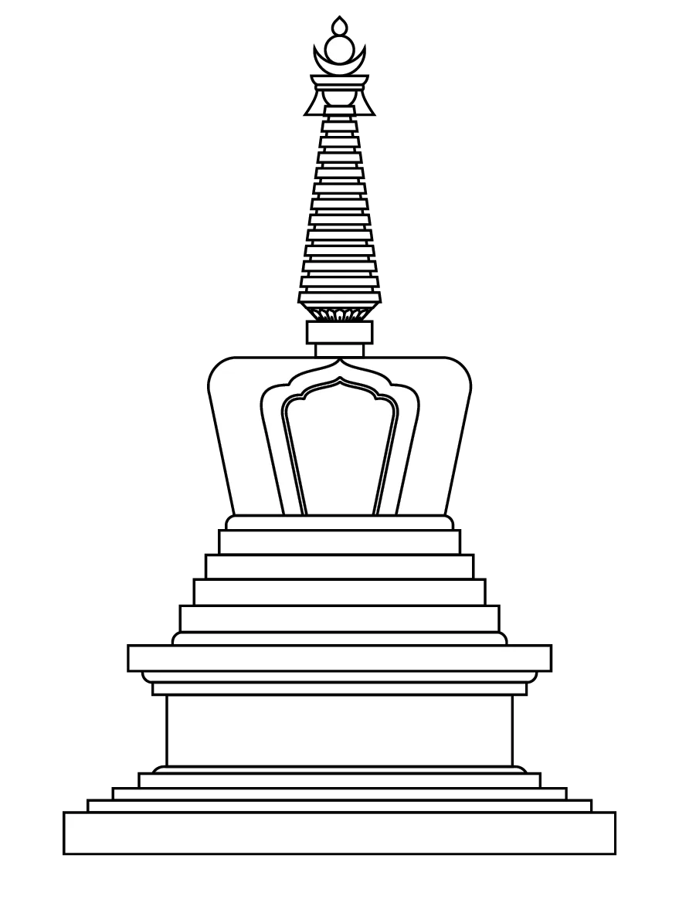

[^1]: 《佛说无畏授所问大乘经》：“若人于河沙，等数诸佛剎，满以七珍财，供养正等觉；若人但合掌，归向菩提心，此胜供养因，超过诸供养。”
[^2]: 按照《俱舍论》的观点，一弹指有六十四个或六十五个刹那。
[^3]: 《时轮金刚本续》：“密乘弟子对金刚上师生多少刹那之恶心，必定会堕多少个大劫的无间地狱。”
