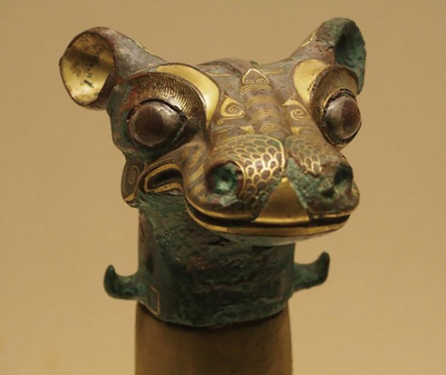
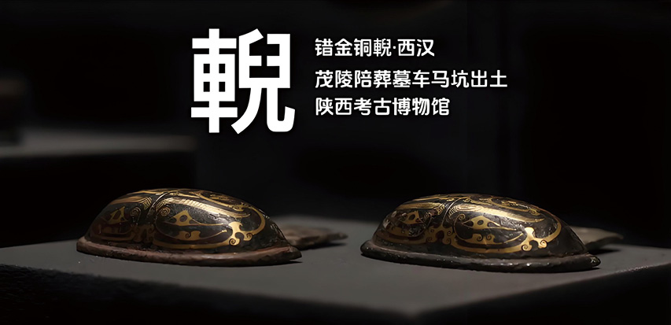
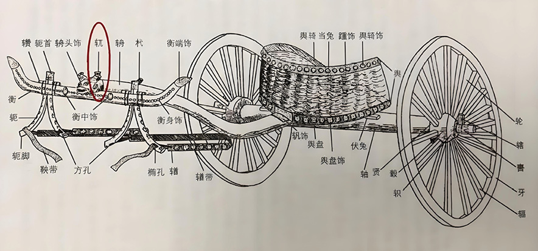
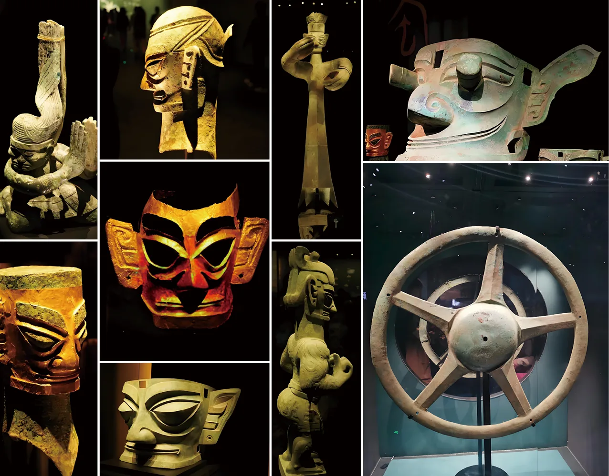

# 第11课

2025年8月30日

## 佛弟子的“人设”管理课

今天，我们继续学习孔子的《论语》。

在《论语》里面，既没有讲获得解脱与遍知佛果的窍诀，也没有讲中观般若的甚深见解，也没有像《入菩萨行论》那样，讲大乘佛教广大的利他行为。那我们作为佛教徒，为什么要学习这样一部国学经典呢？因为里面有古人的智慧，这些智慧在二十一世的今天依然用得上。不管怎样，多学一点不会吃亏。

学习《论语》，还可以了解两千多年前，人类除了佛教以外，还有怎样的世间文化和思想。尤其汉族是世界上人口众多的民族，了解一下他们的传统文化和传统思想很有意思。现在，很多汉族人对本民族的古老智慧和思想精髓都不是特别清楚。在上个世纪六七十年代，他们基本上已经失去了所谓的孔孟思想，很多人甚至对此全然不知。这是非常可惜的。

我们学习《论语》，主要是学习做人。选择做什么样的人，对每个人都非常重要。在做人方面，古人的思想大同小异。龙猛菩萨、萨迦班智达和麦彭仁波切等圣者所著的人规教言与格言，跟《论语》所讲都有相通之处。

学习这些道理，对弘法利生的人至关重要。希望大家在学习过程中，多反观自己，看看有没有什么体悟，有没有在某些方面得到利益。

## 走中道，拒绝“社恐”与“社牛”

现在的世间人，要么没有主见，完全跟别人打成一片、“融为一体”；要么特立独行，不跟人交往，走到哪里都格格不入。前者叫社牛，意思是社交牛人，跟什么人都能混到一起。虽然随顺他众很好，但完全跟别人“融为一体”，很容易被染污。“社牛”在社会交往方面非常厉害，也可以说是一种“症状”。

后者叫做社恐，意思是有社交恐惧症，社交能力差，害怕跟人交往，跟谁都不想接触。如果你修行特别好，当个“社恐”也没事儿——反正不见任何人，独自在山里修行。这是我们的榜样，非常好。但现在很多年轻人，只是单纯不想见人，甚至连父母都不想见。这就有点说不过去。

在外面社交也好，在家里跟亲朋好友接触也好，都要有分寸。掌握分寸是智者的行为。如果不知道分寸，到社会上肯定吃亏。因为社会自带衡量的标尺，如果你超越标尺、做过了头，别人会看不惯，自己的很多事情都不顺利。如果你没有到达标准，大家还是看不惯，你同样痛苦。

所以，我们应该时时用前辈大德和智者们的教言或格言，来衡量自己的言行。做什么事，都不要太过头、太过分；说什么话，也不要太过头、太过分。这样别人看你才顺眼，自己心里也觉得踏实。

不管和谁交往，自己都能适应，这一点非常重要。我们有些人很有利他心，闻思修行也很不错，但社交能力却比较差。最后，弘法利生基本没有希望。有些人虽然智慧不是特别高，但对世间那一套搞得比较懂，在弘法利生方面反而有一些因缘和能力。

我们所学的孔子教言，和大家平时的思想并没有大的冲突——至少前几堂课讲的是这样。尽管它是一部古老的典籍，但思想理念有没有自相矛盾的地方呢？现在看来没有。不仅没有，而且逻辑非常清晰。里面的每一句话，我们如果深入挖掘，都有值得深思和参考的地方。

## 第二十二章

> 子曰：“人而无信，不知其可也。大车无輗，小车无軏，其何以行之哉？”

| 子曰：“人而无信，不知其可也。”

孔子认为做人一定要有诚信，要值得信赖，有较高的可信度。比如我们招一个人，或依止一个人，都希望对方诚实可靠。如果一个人不诚实，不可靠，不讲信用，不值得信赖，肯定没法用——不知道能他用来做什么。

前面不是说了吗？选择人的时候，“视其所以，观其所由，察其所安，人焉廋哉？人焉廋哉？”观察一下他过去的动机、现在的行为和心态，以及未来的目标等，他怎么藏得住呢？他怎么藏得住呢？

比如我招发心人员，先征求大家的意见：“这个人怎么样？”如果他诚实可靠，大家会异口同声地说：“这个人很好，没有问题！”纷纷介绍他以前的行为、现在的情况等，最后一致同意：“这个人不错，可以招进来。”

一个人到底好不好，大家都有判断，不用我来说。每个人身边都有很多眼睛，看得一清二楚。你如果可信，大家都会选你；如果不可信，大家会直接否定。人跟人还是有差别。但很多人好像没有自知之明，自己认为自己很不错，人人都喜欢，事实却并非如此。

一个人的诚信，主要体现在思想成熟、言行一致、说到做到。龙猛菩萨在《亲友书》中说：“当知心如于水面，土石之上绘图画。”众生的心如同在水面、土上、石上画的花纹，有不稳固、稳固、极稳固的差别。智者的心极其稳固，一般不会轻易承诺，一旦承诺就像刻入石头的花纹，到死都不会变。一个内心坚定，不管遇到什么危险都信守承诺的人，肯定值得依赖。

| “大车无輗，小车无軏，其何以行之哉？”

就像大车没有輗，小车没有軏，它靠什么行走呢？

大车是牛车，小车是马车。在车厢和牲口之间，有一个用于连接的关键零部件，类似钉子，大车的叫做輗，小车的叫做軏。如果没有这个零件，车厢和牲口就会脱节，车子根本没办法行走。这是一个比喻。

下面给大家看几张图片。

第一张图是小车的軏。用黄铜做成一个马头的形象，很精致。考古学家认为，这是战国中期的出土文物，离现在有两千多年。

第二张图是大车的輗，看起来像铜片。是西汉的出土文物，也比较古老。

第三张是马和马车之间的连接图。用红圈圈起来的部位，就叫做軏，是辀木和衡木的连接处，有点像木钉子，把辀木和衡木钉在一起。有时候会做成动物的头形。如果没有这个小小的部件，马车就没办法行进。

我们的信用就像车的輗和軏，如果失去了，人生的马车就没办法驾驭。孔子用的这个比喻很有意思。《贤愚经》里面讲：“夫人生世，诚信为本。”人生在世，诚信是根本，非常重要。以前有位学者讲过，诚信是一笔无形的财产，有一种无形的力量。如果没有诚信，那就没办法做人。世间法也好，出世间法也好，都会失去根本。

自己到底是什么样的人，按理自己应该清楚。但实际上，每个人都觉得自己很好。不管说话能不能兑现，都到处装聪明人。麦彭仁波切说过，耍聪明的人看起来有能力、有智慧，其实是无惭无愧的表现，非常糟糕。只有相似智慧，没有稳定人格或坚定信念的人，没办法做任何事情。

在世间，大家对可信的人会交口称赞，非常欢迎；对人格特别不好的人，会直接拉入黑名单，根本不和他交往。一个失信之人，连最起码的朋友和信任者都是没有的。所以，不管古代还是现代，经常自我观察、自我反省都是做人的必修课。

以前，法王如意宝经常给我们讲做人的教言。那时候我比较年轻，没怎么深想，反而觉得不理解：“经常讲人规法，好像太浅了吧？为什么不多讲一点深法，比如密法窍诀之类的？”后来才知道，相续中境界再高，如果不会做人、不会做事，很多功德都会成为冰上建筑，不可能实现自己的价值。

古人对人格、品质、诚信、信用等非常重视。其实现在也一样。向人借钱也好，和人交往也好，如果你人品好，很多友善的力量都会集聚在你身上。相反，如果你品行不端，那你在人群中会寸步难行，很多事情都无法成办。做不好人，所有功德和机会都会远离你。

这是古人的重要思想，大家下来认真思维。

## 第二十三章

> 子张问：“十世可知也？”子曰：“殷因于夏礼，所损益，可知也；周因于殷礼，所损益，可知也。其或继周者，虽百世，可知也。”

这一章主要讲孔子的预判思想，也即预知未来的思想。

不同的弟子有不同的性格，问问题也有不同的目的。子张可能爱学历史，经常思考各个朝代的状况，包括礼仪制度、国家兴衰等，比较重视这些问题。

| 子张问：“十世可知也？”

子张问孔子：“您上知天文、下知地理，无所不通，那你知不知道未来十个朝代的礼仪制度、社会状况呢？要不要打个卦、算个命、说个神通？”

在古代，三十年为一世，“十世”是指未来三百年。这是两千五百多年前的问题。下面我们看一看，孔子对未来的授记或预判到底是怎样的。

| 子曰：“殷因于夏礼，所损益，可知也；”

孔子是分几个方面来回答的。他说，这个问题可以根据过去的夏朝、商朝和周朝的情况来推测。前面讲过，在汉地历史上，尧舜禹时代没有真正的国王，最高统领当时叫“帝”或“后”，被后世称为“禅让时代”“圣王时代”等。最早建国称王的是夏朝——有点像藏地最早的“天赤七王”[^1]，然后才是商朝和周朝。这里的“殷”，指的即是商朝。

孔子说：“商朝延续和传承的是夏朝礼制，其所废除和增加的部分，是可以知道的。”意思是，商朝在延续夏朝的礼仪制度时，不是全盘照搬，而是既有删减，又有增加。对他们不利的部分，他们会舍弃；同时，他们会根据新时代的需要，增加新的内容。而这些变化，都是我们后人可以知道的。

| “周因于殷礼，所损益，可知也。”

商朝过了是周朝。周朝承袭商朝的礼仪制度，所废除和增加的部分，也是可以知道的。

| “其或继周者，虽百世，可知也。”

周朝过了以后，未来延续周朝的朝代，即使有一百世，也是可以预知的。

三十年为一世，一百世就是三千年。从夏、商、周、春秋、战国、秦、汉、三国、两晋、南北朝，到隋、唐、宋、元、明、清等，每一个朝代都有很多帝王出世，国家的文化、经济、政治等都会有很多变化和调整，但只要把握了继承与变革的核心规律，即使预测再遥远的未来，也是可能的。

表面上看，孔子好像回答了，但又说得不是特别清楚。实际上，孔子强调的不是具体的制度变化，而是历史演进的规律。孔子认为，文化基因也好，社会制度也好，未来基本上不会有太大的变化。从夏商周到春秋战国时期，社会制度和礼仪规矩是什么样，未来三百年乃至三千年的朝代，基本上都会有所延续。

很多人——包括有些历史学家，都觉得孔子很厉害。因为正如孔子所说，每个地方都有相对固定的制度，如果没有遇到特殊情况，会一直以它特有的方式运行下去。从汉地历史来看，有些制度确实比较坚固。

世间人喜欢说：“这个领导如何如何好、那个领导如何如何不好。”实际上，许多时候，哪个领导都差不多，换汤不换药。统治者的思想模式、管理制度、掌权风格，包括出现贪污腐败如何制裁等，很多都是从过去延续下来的，属于同一种风格、同一种模式。未来基本上也是这样。

当然，也不是原原本本、一成不变，每个朝代或时代都会有增有减。统治者需要的东西，他自己肯定会加上去；不需要的条条款款，也肯定会废除。

包括我们学院，从法王圆寂到现在，每一个管理者，无论在位一年也好，两年也好，三年也好，都有他自己的执政方法或管理特色。他有一定的权力，旁边的人怎么说，也不一定听。虽然大的原则不会变，但在细节问题上，他会进行一些调整。比如前一任认为应该这样，他如果觉得没必要，马上就会减掉；他如果觉得要增加新的条款，马上就会加上。这是很多人做事的方式，不会有太大改变。

这就是孔子对未来文明的推测。全世界很多历史学家认为，孔子这一思想很有深度。一些大的文明——华夏文明就不说了，一直延续至今，影响非常深广，就连古希腊文明、古埃及文明、古印度文明等，距今好几千年，尽管它们的政治实体已经更迭或消失，却依然有很多核心精神遗产被延续下来，影响本土乃至全世界。

从古至今，人类社会经历了翻天覆地的变化。举几个简单的例子：通讯方式上，几十年前我们通过书信联系，后来发展为座机电话，再到手机和短信，现在几乎都是用微信；交通方式上，古人乘坐牛车、马车，现代人先是骑自行车，如今多以私家车、公共交通为主。虽然物质条件不断改善，但人类或某个民族的思想状态依然时而开放、时而保守，许多传统习俗和思想基因也都改变不大。

有人认为，未来藏族人的信仰可能会发生变化。但实际上，如果没有特殊情况，藏地老一辈传下来的信仰、经验、道德和文化，基本上都会继续延续。这几乎是必然的。

我们去年讲了《楞严经》。里面讲到“见精不灭”，一个人三岁看到的恒河和六十岁看到的恒河，虽然流淌的河水是不断变化的，但能看到它的见精不会变。同样，有时候换了一个人，我们就觉得有新东西出来。实际上，很多因缘和相续基本上都不会变。这是孔子的一种思想。

当然，现在对未来会有什么样的预判，全世界都在关注。希望大家也多关注一下。将来，文化冲突可能非常厉害。关于这个问题，我昨天稍微提了一下。

AI技术可能会给人类带来全新的变化。我给大家看一个视频，内容是我在讲法——虽然有些不好意思，但如果使用别人的视频，又涉及肖像权，不太方便。原本这个视频是我用汉语讲《入菩萨行论》，但通过AI处理后，它可以用英语、韩语、日语、德语、法语、孟加拉语、泰语等多种语言呈现，而且口型和表情完全匹配。

大家可以好好思考，这其中包含的含义，以及对未来的启示：我的相貌、动作、口型、声音都是原来的，但语言却变成了其他国家的。通过一种语言表达的内容，可以呈现为七十多种语言，而且每种语言的表达方式都符合该国家听众的心理特点。英国人、韩国人、日本人观看时，都会觉得这是专门为他们讲的。若放在过去，无论多少人同时努力，也无法实现这样的效果。因此，未来世界将会呈现怎样的格局，确实值得我们深思。

下面，大家看一段只有一两分钟的视频。

（播放视频）

这还只是语言方面。我那天也提到，AI在其他功能上同样非常强大。比如，你可以拍几张照片或录一段视频，然后把这些数据放到电脑里“喂”给AI。AI通过不断的学习和处理，最后能生成一个与我一模一样的数字人。这个“我”不仅能唱歌，还能出演电影，几乎可以做任何事情。

今年春天，我们做了一个尝试。我录制的视频，AI能够同步生成韩语、日语、法语等七十多种语言版本，几乎全部自动完成。我几乎不需要做额外操作，只是提供了一点视频素材，AI就能生成一个完全一样的数字人。

在这个高科技时代，确实存在不少挑战。未来会怎样发展，值得我们深思。孔子曾说，每个时代都可以进行推测，但人类未来会变成什么样，却难以断言；另一方面，过去的某些推测，即便看似合理，也未必符合事实。现在，国外对这些问题也有很多质疑。

按照传统说法，人类文明已有五千年或更长历史。人类最早是极其原始的生物，经过漫长的演化和变迁，才形成今天的模样。经过逐步发展，才有了尧舜禹等上古时期的文明，最终才发展到今天的社会。但事实真的是这样吗？

在四川广汉，有一个著名的三星堆博物馆。那里出土了各式各样的器物，完全颠覆了历史课本中某些说法。据说，现在三星堆已受到严格保护，不允许继续挖掘——真伪不得而知。但考古队曾出土的象牙、铜器、金器以及各种动物形象器物，其制作工艺非常精巧，有些甚至超过了当时中原地区的水平，颠覆了许多历史学家的认知。

此外，三星堆的面具与传统观念中的汉族面貌完全不同，因此有人推测，这可能代表一种与中原文化截然不同的古代文明。如果有机会，大家不妨亲自去看看。

参观以后，会感觉人类世界还有很多值得探索与深思的领域，还有许多未解之谜。虽然历史书上说，公元多少多少年，人类文明才开始出现，但事实却有待进一步探索。

这里有些人以前是读过书的，对文明或文化的理解，可能趋于简单化。实际上，佛陀在不同经论中，都讲到了几千年、几万年乃至多少俱胝劫人类的生存状况。这些说法，可以为解释这些出土文物的来源提供一些参考。很多专家的分析、推测，也都跟我们平常的认知不太相同。我只能说到这一点。

希望大家打开思路，好好观察。现在，民间也有一些关于史前文明的说法——跟我们这期人类的文明存在较大差异，我觉得很有必要深入研究。

接下来，我们讲最后一章。

## 第二十四章

> 子曰：“非其鬼而祭之，谄也；见义不为，无勇也。”

| 子曰：“非其鬼而祭之，谄也；”

这里的“鬼”，指自己的祖先。汉地民间传统观念认为，人死了会变成鬼。到了清明节，很多人都会烧纸祭奠祖先。所谓的祖先，是传承自己种姓的祖辈，不能搞混。如果明知不是自己的祖先，却跑去祭祀、供养，比如我为了讨好领导，故意跑到领导那里，参加领导家的祭祀活动，就是一种谄媚和狡猾的做法，非常不好。

| “见义不为，无勇也。”

明知某件事情应该做，自己却袖手旁观，置之不理，或推给别人，这叫做怯懦。这种人特别没有能力，是真正的懦夫。

字面意思很简单，“不要参加别人家的祭祀，见到该做的事要做，否则就是懦夫”，实际上却并不简单。孔子在这里批评了某些道德之贼的行为：该做的不做，不该做的却非常积极。

为了巴结领导，经常拍领导的马屁，说各种好听的话，做各种谄媚的事，或者为达到个人目的，故意讨好某个人。这类虚伪谄诳之事，本不该做，却特别喜欢做。而自己应该做的事情，却抛在一边不管，比如做慈善时，有些企业舍不得付出，全部让别人做，或者装模作样做一点，这不太合理，是懦弱无能的表现。

孔子认为，不管什么事情，只要有意义，就应该去做。在藏地，如果有人出车祸或遇到困难，很多人都会不顾一切，前去帮忙——这一点我以前也讲过。有个成语叫见义勇为，意思是看到正义的事就勇敢去做。如果只为讨好别人，或者跟风而做，特别没有意义。

做人要真实、本分，该做的事一定要做，不该做的事坚决不做。为了让领导高兴，得到领导的提拔，让自己将来有地位、有钱财，故意在领导面前装恭敬、装体贴，这是狡猾者、谄诳者的行为。

我们应该老老实实、表里如一，不要当面一套、背后一套，心里想着一件事，口上说着另一件事。古人非常注重内外一致。表面上喜欢你，内心却讨厌你，甚至仇恨你，这样的人，孔子不认为是什么好人。真正的好人是什么样的呢？不谄诳、不懦弱，只做该做的事情，不该做的事情一律不做；有意义的事，别人不劝也要做；没有意义的事，即使很多人劝也不做。

某件事明明很有意义，自己却一直逃避推脱，不太合理。但我们有些工作人员却很擅长这一套，特别会“踢皮球”。不要说见义勇为，连自己份内的事都要推给别人。今天我让他们办一件事情。本来该有些负责人自己做，他们却给我发来一个微信：“你跟这个人联系。”我就跟这个人联系。这个人又给我发了另一个人的微信：“你跟那个人联系。”我又跟那个人联系——本来他们可以相互联系的。没想到，那个人又给我发了一个微信：“你跟这个人联系。”后来我想：“哇，我今天遇到的事情，跟孔子说的有点像啊！”

这样的结果是什么呢？做事的经验没有丰富，相互推诿、耍小聪明的经验却有一大堆。

有些人说话也好，做事也好，给人感觉非常舒服，实际上却是在推脱责任。可能各种短文章、短视频看多了，这方面经验比较丰富。虽然事情很有意义，但做起来有点辛苦，所以也不愿意参与。

孔子认为，做人应该实在一点、坦荡一点，不要在别人面前显得比较聪明。都是自己欺骗自己。完全没有必要。前面不是说过吗？“君子坦荡荡，小人长戚戚。”“君子周而不比，小人比而不周。”现在很多人，小人的小动作比较多，君子的大智慧不知道有没有。值得观察。

接下来讲第三篇。

## 八佾篇第三

## 第一章

> 孔子谓季氏：“八佾舞于庭，是可忍也，孰不可忍也？”

| 孔子谓季氏：“八佾舞于庭，是可忍也，孰不可忍也？”

“佾”，是指人的群体或组合。“八佾”就是八个群体或八个组队的意思。在古代，一个佾有八个人，“八佾”就是六十四个人。这里是指六十四个人的表演。当时人们表演奏乐、舞蹈等有不同的规格，周天子使用八佾，诸候为六佾，卿大夫用四佾，士用二佾。

孔子谈起季氏时说：“他用六十四个人在自己的庭院中奏乐、舞蹈，这样的事如果都能容忍，还有什么事不能容忍呢？”季氏即季平子，是鲁国的卿大夫，势力很大，超过了鲁国国君，平时非常狂傲。他作为一个卿大夫，却越级使用周天子的规格，所以孔子非常不满。

按照当时的等级制度，第一位是天子，第二是诸侯，然后是大夫，最后是平民。这一点，前几年讲《论语》和《孝经》时都讲过。依照《周礼》，天子来了——相当于现在的国家领导人来了，应该安排“八佾”，即六十四个人给他跳“金刚舞”——开玩笑；如果是诸侯来了——相当于现在的省长或省委书记，应该安排“六佾”，即四十八个人奏乐、跳舞；如果大夫来了，一般是“四佾”，即三十二个人表演；如果是平民，则安排十六个人。不同的等级有不同的待遇。

现在很多地方接待领导，都有相应的规格和要求，包括接待方法、保护措施等，都分第一级、第二级等。季平子这个人，既不是天子，又不是诸侯，却经常让“八佾”——六十四个人给自己奏乐、跳舞。本来不是最高领导，却私下享受最高领导的待遇，行为确实有点过头。

比如我们出去，可能堪布堪姆是一个接待规格，辅导员是一个接待规格。如果一个人什么都不是，却要求别人：“我来自佛学院，你们要给我佛学院最大堪布或法王级别的接待。”那就有点越级了。

我明明不是法王，却说：“我就是法王。你们接待法王什么规格，对我也要用同等规格。”或者一个小小的村长，却要求别人用国家领导的规格来接待他，大家肯定反感。

所以孔子说，季平子用六十四个人给自己奏乐、舞蹈，如果这都能忍，那还有什么不能忍的呢？一个连基本规矩都不懂的人，大家如果都能容忍，在这个世界上就没有什么不可以容忍的了。

我经常想：“学了孔子的思想，再来看现在的社会现象，有时很有感触。”有些人经济条件很一般，连最便宜的车都买不起，却在结婚当天搞来十几辆沙漠王子越野车，甚至开着特别高级的劳斯莱斯。形式确实隆重，看起来很有面子，但符不符合自己的身份呢？根本不符合。

虽然每个人都有自己的身份、地位、财富和阶层，但有些愚笨者好像根本不知道自己什么身份，想当然地认为应该这样、应该那样，觉得越隆重、越出格，自己越有面子。实际上不是这样的。野心太大了，对自己不一定有利。

《礼记·曲礼上》中说：“人有礼则安，无礼则危。”麦彭仁波切在《君规教言论》中则说：穷人喜欢打扮和富人穿破衣，都是非常可笑的事情。[^2]比如我特别贫穷，却故意在别人面前显摆，装出特别有钱的样子，或者我很有福报，却故意穿很破的衣服——现在有些贪官，贪了几个亿，却经常穿一件破衣服，骑一辆烂自行车，大家肯定会偷偷笑话。

做人也好，做事也好，里里外外都要符合自己的身份——包括穿衣服。出家人应该穿出家人的衣服，在家人应该有在家人的样子。出家人穿西装、打领带很不庄严，只有你自己觉得好看。明明是个在家人，却非要穿僧服，同样不合理。

一些到学院来旅游的人，在坛城上用红色披单把头发裹起来，做出飞的样子，是为了表演，另当别论。但严格来讲，还是不符合自己的身份。你自己觉得开心、好玩儿，但有人却觉得你破坏了别人的制度和规则，也显得自己“无头无脑”。

外面有些团体也是这样。我看到有一个镇，他们的建筑修成了天安门城楼的样子；还有一个区，他们的大楼干脆修成了“白宫”。很多人都在笑他们，他们自己却认为很好看。

这些建筑的规格、意义和代表的身份是什么，我们自己又是什么，大家心里都非常清楚。集体也好，个人也好，如果行为或形象不符合自己的身份，只会沦为大家的笑料。

但如果不注意，很容易犯这样的错误。自己本来是一介平民，虽然比较富贵，但还是属于普通老百姓。因为突然有了钱，就给自己搞大国王的规格和待遇，没有任何意义。

现在，好像各个民族的婚礼都办得特别隆重。很多平台都有这样的视频，感觉有点过头。这对自己好还是不好，很难说。在穿着方面，很多人也喜欢追求“高大上”。有些老年人已经老得不行，瘦得不是一般的厉害，还要把珊瑚、玛瑙、金子、银子等各种财宝往身上挂，走起来特别特别重。可能是自己喜欢吧，对社会不一定有什么危害。

穿着打扮也好，居住的地方也好，都要符合自己的身份、经济水平和传统习俗。用我们的肉眼来看，现在有些人做的事确实不太合理、有点出格，值得观察。

[^1]: 天赤七王，是指吐蕃王朝第一代至第七代赞普，因名字均带赤字而得名。据说此七王寿终腾空而去，没有尸骨留下，犹如虹身成就，故称“天王”。
[^2]: 《君规教言论》：“喜欢打扮之穷人，身着破衣之富者，此二世人所笑处，故当适宜用衣饰。”
