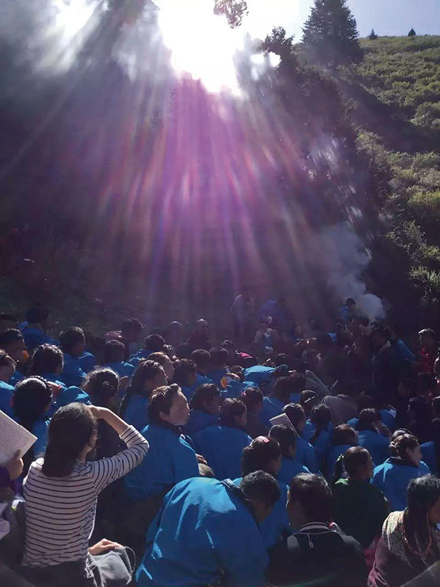
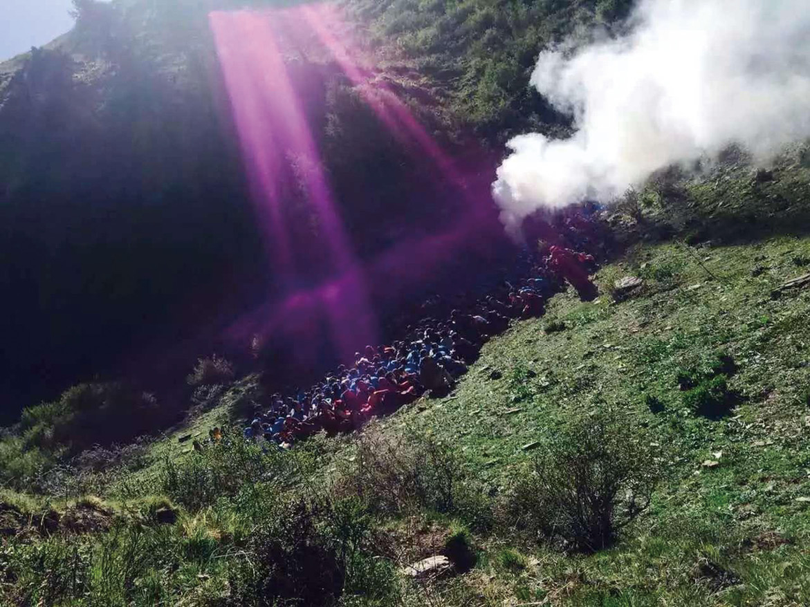

# 第5课

2016年6月20日

（念诵藏文传承）

《法华经》正在讲第一品，本经的缘起——当时佛陀入定放光，显现了自土六瑞和他土六瑞，弥勒菩萨想知道其中原因，就去请教文殊菩萨。

文殊菩萨显现上是法王子，但实际上，往昔的许多佛都曾在他面前发过菩提心。佛经中对此也有记载，如《大乘瑜伽金刚性海曼殊室利千臂千钵大教王经》中说，释迦牟尼佛有一次问普贤菩萨：“你是否知道在久远以前，是谁最早让众生发菩提心，并引化他们成佛的？”普贤菩萨说：“是文殊菩萨。很久以前，在还没有佛的时候，文殊菩萨就劝无数众生发菩提心。有一次他在大众中问：谁能与我同愿同行，一起发无上菩提心，度化无量众生？这时有五个人站出来跟文殊菩萨一起发愿。后来他们逐渐成佛，分别是：东方的阿閦佛、南方的宝生佛、西方的观自在王佛（即阿弥陀佛）、北方的不空成就佛、中央的毗卢遮那佛。”

不单是五方佛，包括释迦牟尼佛，昔日也在文殊菩萨面前发过菩提心。原本比弥勒菩萨晚四十二劫发心，不过释迦牟尼佛比较精进，先于弥勒菩萨成就了佛果[^1]。

很多经论中说，文殊菩萨实为古佛再来，只不过显现为菩萨形象。当然，文殊菩萨的示现有各种各样，这一点，麦彭仁波切在《八大菩萨传》中引用不同的经典进行过说明——有些经典说他是未来佛；有些说他早已成佛；有些说他是现在佛，如今正在某个世界转法轮。

这些教证，我在《五台山圣地记》中也引用过。这本书是我25岁时用藏文写的，记录了应该如何朝拜五台山。现在很多喇嘛朝五台山时都会参考，说这书还可以，不像有些游记讲得那么略。之所以写这本书，是当年法王如意宝去五台山时，德巴堪布让我翻译关于五台山的资料，我就查阅了藏传、汉传很多经论，然后进行编著的。前几年本想重新校对一下，但没有时间。懂藏文的人如果想朝五台山，看看这本书也可以。不过你们不懂藏文，说这些也没用。（众笑）

以上讲了文殊菩萨的功德。下面讲文殊菩萨对弥勒菩萨的回复。

| 尔时，文殊师利语弥勒菩萨摩诃萨及诸大士：“善男子等，如我惟忖，今佛世尊欲说大法，雨大法雨，吹大法螺，击大法鼓，演大法义。诸善男子，我于过去诸佛曾见此瑞，放斯光已即说大法。是故当知，今佛现光亦复如是，欲令众生咸得闻知一切世间难信之法，故现斯瑞。

> 这时，文殊菩萨对弥勒菩萨摩诃萨及诸位大士说：“善男子们，依我看来，佛陀今天打算宣说一部大法，降大法雨滋润众生，吹大法螺召唤众生，击大法鼓唤醒众生，演大法义觉悟众生。各位善男子，我在过去诸佛面前也曾见过这种瑞相，诸佛只要放出这种光，必然会讲无上大法。所以大家应当知道，今日佛陀放光也是如此，应该会像过去诸佛一样，想让众生都能听闻这世上最难以相信的大法，所以显现这样的瑞相。”

《法华经》讲了最深的道理，是大乘了义之法。很多大德也是从这里悟入的。

| 诸善男子，如过去无量无边不可思议阿僧祇劫，尔时有佛，号日月灯明如来、应供、正遍知、明行足、善逝、世间解、无上士调御丈夫、天人师、佛、世尊，演说正法，初善、中善、后善，其义深远，其语巧妙，纯一无杂，具足清白梵行之相。

> “诸位善男子，过去无量劫之前，有一尊佛，名号为日月灯明如来、应供、正遍知、明行足、善逝、世间解、无上士调御丈夫、天人师、佛、世尊。他为众生演说的正法，具足初善、中善、后善，意义深远，语言巧妙，纯一无杂，具足清白梵行之相。”

这些都是“法宝”的功德。《大乘经庄严论》和《随念三宝经》也介绍过，只不过用词稍微不同而已。

| 为求声闻者，说应四谛法，度生老病死，究竟涅槃。为求辟支佛者，说应十二因缘法。为诸菩萨说应六波罗蜜，令得阿耨多罗三藐三菩提，成一切种智。

> “日月灯明佛应机说法，为求声闻乘者，讲了苦集灭道四谛之法，令其解脱生老病死，趋入涅槃；为求辟支佛乘者，讲了十二缘起法；为求大乘道的菩萨，讲了六度之法，令他们证得无上佛果，成就一切种智。”

可见，日月灯明佛也像释迦牟尼佛一样，宣讲了三乘。《地藏十轮经》中说：“如如意宝珠，随所愿皆满，如是三乘法，能满众生愿。”就像如意宝可满足不同众生的愿望一样，佛陀也能满足不同根基众生的需求——有些人喜欢声闻乘，有些人喜欢缘觉乘，有些人喜欢菩萨乘，佛就分别讲了三乘法引导其趋入解脱。

| 次复有佛，亦名日月灯明，次复有佛，亦名日月灯明，如是二万佛，皆同一字，号日月灯明，又同一姓，姓颇罗堕。

> “此佛之后，又有一佛，也叫日月灯明。之后，又有一佛也叫日月灯明……如此共有二万尊佛，都是同一个名字，叫日月灯明；也都是同一个姓，姓颇罗堕。”

颇罗堕，在梵语中有三层意思：快速、利根、圆满。是大家普遍认为的一个很好的种姓。

| 弥勒当知，初佛后佛皆同一字，名日月灯明，十号具足，所可说法初中后善。其最后佛未出家时，有八王子：一名有意，二名善意，三名无量意，四名宝意，五名增意，六名除疑意，七名响意，八名法意。是八王子，威德自在，各领四天下。是诸王子，闻父出家得阿耨多罗三藐三菩提，悉舍王位亦随出家，发大乘意，常修梵行，皆为法师，已于千万佛所植诸善本。

> 文殊菩萨说：“弥勒菩萨，您应当知道，从最初的佛到最后的佛，这两万尊佛都叫日月灯明，他们具足佛的十种名号，所说的法都具足初善、中善、后善。最后一尊日月灯明佛，还没有出家时，有八位王子：第一位叫有意，第二位叫善意，第三位叫无量意，第四位叫宝意，第五位叫增意，第六位叫除疑意，第七位叫响意，第八位叫法意。这八位王子都有极大威德，各自统领四天下。诸王子得知他们的父王已经出家，并获得无上正等觉佛果，于是也纷纷舍弃王位，随父王一起出家，发大乘菩提心，修学大乘法，长久修持梵行，最后都成为大乘法师。之所以能这样，皆因他们往昔曾在成千上万的佛面前积累资粮，广植善根。”

| 是时日月灯明佛，说大乘经，名无量义，教菩萨法佛所护念。说是经已，即于大众中结跏趺坐，入于无量义处三昧，身心不动。是时，天雨曼陀罗华、摩诃曼陀罗华、曼殊沙华、摩诃曼殊沙华，而散佛上及诸大众，普佛世界六种震动。尔时，会中比丘、比丘尼、优婆塞、优婆夷，天、龙、夜叉、乾闼婆、阿修罗、迦楼罗、紧那罗、摩睺罗伽、人非人，及诸小王、转轮圣王等，是诸大众得未曾有，欢喜合掌一心观佛。尔时，如来放眉间白毫相光，照东方万八千佛土靡不周遍，如今所见是诸佛土。

> “当时日月灯明佛演说了一部大乘经典，名叫《无量义经》[^2]，这是教化菩萨的法门，深受诸佛垂念护持。讲完这部经之后，于大众中结跏趺坐，入于无量义三昧，身心如如不动。这时，天上散下曼陀罗花、摩诃曼陀罗花、曼殊沙花、摩诃曼殊沙花，散落在日月灯明佛及大众的身上，世界出现六种震动。当时，法会中的比丘、比丘尼、优婆塞、优婆夷，还有天、龙、夜叉、乾闼婆、阿修罗、迦楼罗、紧那罗、摩睺罗伽、人非人，以及诸小国王、转轮圣王等，这些大众从没有见过这种稀有的瑞相，欢喜不已，纷纷合掌，目不转睛地注视着佛陀。与此同时，日月灯明佛眉间的白毫处放光，照耀东方一万八千个世界，无不周遍，就像大家今天所见到的诸佛刹土一样。”

| 弥勒当知，尔时会中有二十亿菩萨乐欲听法。是诸菩萨见此光明普照佛土，得未曾有，欲知此光所为因缘。时有菩萨，名曰妙光，有八百弟子。是时日月灯明佛从三昧起，因妙光菩萨说大乘经，名妙法莲华，教菩萨法佛所护念，六十小劫不起于座。时会听者亦坐一处，六十小劫身心不动，听佛所说谓如食顷。是时众中，无有一人若身若心而生懈倦。

> 文殊菩萨说：“弥勒菩萨，您应该知道，当时法会中有二十亿菩萨乐于听法。这些菩萨见到佛的白毫放光照耀诸佛土，之前从未见过，很想知道这些光明出现的因缘。当时有一位菩萨叫妙光，他有八百个弟子。那时日月灯明佛出定之后，因妙光菩萨的祈请，为大众演说了大乘经典，名为《妙法莲华经》（可见此经在久远劫以前就有），并于六十小劫中一直宣讲，没有起座。那时，法会中的大众也都端坐一处，身心不动，全神贯注地听法，六十小劫就像一顿饭的工夫。当时大众当中，没有一个人的身心产生疲倦，乃至生厌烦心。”

六十小劫就像一顿饭的时间，有些人对此可能不太理解[^3]。其实，爱因斯坦讲过：“时间和空间，是人类的一种错觉。”在修行人的境界中，时间长短也并非真实存在。以前虚云老和尚在山里修行时，边煮芋头边打坐。他出定后，以为芋头刚煮好，结果一看，芋头都长毛了——他在定中感觉只有一小会儿，实际上已过了二十多天。所以，日月灯明佛在六十小劫中一直讲，诸眷属就一直听，依靠佛的加持，这么长的时间犹如弹指，很快就过去了。当然，六十小劫也可以说是实际的时间，因为当时人的寿命比较长。

不仅时间是错觉，空间也是错觉。就像米拉日巴尊者在牛角中，他自己没有变小，牛角也没有变大。这个故事是怎么讲的呢？

传记中说，米拉日巴尊者有个弟子叫惹琼巴，他依止尊者一段时间后，就到印度求学了，求了很多甚深密法。从印度回来后，他非常得意，心想：“如果换作别的上师，肯定会对我做盛大的迎接。可我的上师连吃穿都没有，哪里谈得上款待我呢？”他生起很大的傲慢心，对上师也生起恶劣的邪见，米拉日巴尊者立刻就知道了。

这时，路上正好有一个被扔掉的牛角，尊者对惹琼巴说：“你把这个牛角捡起来，我们带走吧。”惹琼巴不高兴地想：“上师有时候说一切法都要舍弃，有时候他的嗔心比老狗还狠，贪心比老乞丐还大。这个牛角既不能吃又不能喝，捡起来有什么用？”于是拒绝道：“算了吧！这个东西毫无用处。”尊者说：“捡这样的东西，还不至于增长贪念，不久也许会用得着。”说着，自己就将牛角捡起，拿在手中。

走了一会儿，他们来到一个平原。这里平旷辽阔，连个小老鼠藏身的地方都没有。此时突然乌云密布，狂风骤起，下起很大的冰雹。惹琼巴被砸得很惨，突然发现上师不见了，牛角里却传出上师的声音：“这里广大宽敞，舒服得很，你也进来吧！”他俯身向牛角内部看去，只见牛角并未变大，尊者的身体也未缩小，就像镜子中照见万法一样。

他也很想钻进去，但努力了半天，连一只手都放不进去。这时他想：“上师太坏了，以前学过降冰雹的咒术，今天特意教训我。”他一边这样打妄想，一边以颤抖的声音求饶，承认自己的境界不如上师。后来米拉日巴尊者出来，念了个咒，冰雹一下子就停了。然后，师徒二人继续赶路——我在读初中时，有一次病得很厉害。治病期间，每天晚上都要去一位老喇嘛那里，听他讲米拉日巴的故事，特别喜欢听。

总之，时间和空间是虚幻的。哪怕六十小劫，也可以是很短的时间。

## 听法不要有厌倦心

佛陀传讲《法华经》时，在场没有一个人生厌倦心，其实这个很重要。我们佛学院中也有些人，十几年来对听法特别有热情、有意乐，越听越有感觉，这肯定是三宝的加持融入了心，再加上正如《大乘经庄严论》所说，跟自己前世的善根也有关系。而有些人，如果看乱七八糟的连续剧，熬夜都没有问题，可是听一堂课的话，就像波斯匿王最初一样——波斯匿王是怎样的呢？最初听佛陀讲法也特别痛苦，特别不想听。

这个故事在《佛说未曾有因缘经》中有描述。经中说，佛陀在成道后，有一次派人去接儿子罗睺罗出家。耶输陀罗[^4]特别不高兴，说：“我们成婚后本来好好的，结果你出家不要我了，只剩我们母子相依为命。现在又让儿子出家，这太残忍了！”她还说：“以前有八国王子向我求婚，我都没有答应，最后选择了你。你既然想要出家，当初为什么娶我？”

于是，佛陀加持她回忆起多生以前的誓愿：佛往昔行菩萨道时，从她那里买过几朵莲花供养定光佛，她求与其生生世世结为夫妻，发愿何时何地都任其修行，绝不违逆他的意愿。想起了这一切后，她执著儿子的心念当下消失，同意罗睺罗出家。净饭王为了安慰耶输陀罗，让王公大臣也各选一子，共选了五十个孩子，随自己的孙子一起出家。

波斯匿王听说佛的儿子出家了，感到很好奇，就带人前去看望。正好释迦牟尼佛在传法，波斯匿王平时养尊处优惯了，听法的时候，腰也痛、腿也痛，一直坐不住，就想离开。佛陀知道他坐不住——这个不需要神通，我有时候也看得出来，尤其是有些新来的居士听法，一节课当中不停地动来动去，变换好多“坐式”。

佛陀知道波斯匿王刚有些觉悟，信心还不坚固，为了利益他，就让阿难召集罗睺罗和那五十名孩子前来听法。波斯匿王一听，连忙说：“我要走了，听法实在太苦，有点受不了。”佛陀说：“这不算什么苦，三界中最苦的莫过于三恶趣。你还是等等吧，罗睺罗马上就来。”

罗睺罗来了之后，说自己年纪太小，听不懂深奥的佛法，现在还是想好好玩，长大以后再听。佛陀问他：“生命无常，你凭什么认为自己可以活到长大？”“我是佛陀的儿子啊，佛陀您一定会保佑我。”佛陀回答：“我连自己都保佑不了，又怎么能保佑你呢？”罗睺罗说：“但我确实听不懂，所以，听法也没什么意义。”佛陀告诉他：“即使听不懂，这对你未来也有很大利益。佛法犹如甘露、妙药、大船……”佛陀用很多比喻和公案讲了正法的功德，后来罗睺罗就比较听话了，再后来波斯匿王腿也不痛了，基本上能坐得住，没有厌倦心了。

我们很多的道友，尤其是在外面通过光盘听课的一些人，刚开始可能也有类似情况，所以，辅导员应该给他们讲一讲闻法的功德。当然，佛学院的出家人闻法多年，一般都能坐得住。我讲课的时间也不长，希望大家在听的过程中，把它当作生命中很重要很重要的事情来对待。现在你所听的每一节课，也许多年以后会成为最好的回忆，是你人生最永恒的财富。你现在拼命赚来的钱，死时不一定带得走，但听一课大乘佛法，这个功德，死时一定可以随你而行。所以，听法不要有厌倦心。

刚才我讲了一个故事，有时候讲故事的话，大家不容易打瞌睡。记得有个居士跟我说：“我不是故事根基，是理论根基。您最好多给我讲一下因明，我想听因明的遣余……”（众笑）

| 日月灯明佛，于六十小劫说是经已，即于梵、魔、沙门、婆罗门及天、人、阿修罗众中，而宣此言：‘如来于今日中夜当入无余涅槃。’时有菩萨，名曰德藏，日月灯明佛即授其记，告诸比丘：‘是德藏菩萨，次当作佛，号曰净身多陀阿伽度阿罗诃三藐三佛陀。’佛授记已，便于中夜入无余涅槃。

> “日月灯明佛在六十小劫中宣说这部经之后，对梵天、魔王、沙门、婆罗门及天、人、阿修罗等大众宣布：‘我将于今天中夜入于无余涅槃。’当时有一位菩萨名叫德藏，日月灯明佛当众为他授记，告诉比丘们：‘这位德藏菩萨将在我涅槃后成佛，号为净身多陀阿伽度（如来）、阿罗诃、三藐三佛陀。’佛陀授记之后，便于中夜趋入无余涅槃。”

| 佛灭度后，妙光菩萨持妙法莲华经，满八十小劫为人演说。

> “佛陀涅槃后，妙光菩萨受持《妙法莲华经》，在八十小劫中不断为大众宣说。”

作为弟子，在上师圆寂之后，一定要讲经说法，这很重要。法王如意宝圆寂以后，佛学院内外法王的法子们，一直在全世界各地竭尽所能地讲经说法。我也希望佛学院的很多堪布堪姆圆寂以后，他们的弟子也能坚持讲法。

要想报答法师的恩德，给他修一座塔，把他的遗骨、头发放在里面，这不是最重要的，最重要的应该是继承他的法教。比如这个法师生前讲了《法华经》，或者讲了因明、中观，你在这方面有个很好的传承，就应该去给别人讲，这才是对他最好的报恩。

| 日月灯明佛八子，皆师妙光，妙光教化令其坚固阿耨多罗三藐三菩提。是诸王子，供养无量百千万亿佛已，皆成佛道。其最后成佛者，名曰燃灯。

> “日月灯明佛出家前的八位王子，都依止妙光菩萨为上师，妙光菩萨教化他们，让他们坚固了阿耨多罗三藐三菩提心。这几位王子，在供养无量百千万亿佛之后，最终都成就了佛果。其中，最后一位成佛的，就是燃灯佛。”

这里讲了《法华经》的传承次第。

| 八百弟子中有一人，号曰求名，贪著利养，虽复读诵众经而不通利，多所忘失，故号求名。是人亦以种诸善根因缘故，得值无量百千万亿诸佛，供养恭敬，尊重赞叹。

> “妙光菩萨的八百弟子中，有一个人叫求名，贪求利养，追求享乐，虽然能读诵很多佛经，却没有通达，读过就忘，所以被称作‘求名’。不过，此人善根因缘很好，也由于曾种过许多善根的缘故，得以遇到无量百千万亿佛陀，并且供养、恭敬、尊重、赞叹。”

| 弥勒当知，尔时妙光菩萨，岂异人乎？我身是也。求名菩萨，汝身是也。今见此瑞与本无异，是故惟忖，今日如来当说大乘经，名妙法莲华，教菩萨法佛所护念。”

> 文殊菩萨说：“弥勒菩萨，您应当知道，当时的妙光菩萨，难道是别人吗？正是我的前世。求名菩萨，正是你的前世。（弥勒菩萨多不好意思啊！）今天我见到释迦牟尼佛所现的瑞相，与过去日月灯明佛说法时的瑞相没有差别，所以我认为，今天如来要宣讲一部大乘经典，名为《妙法莲华经》，这是教化菩萨的法门，深受诸佛垂念护持。”

| 尔时，文殊师利于大众中，欲重宣此义，而说偈言：

“我念过去世，无量无数劫，

有佛人中尊，号日月灯明。

世尊演说法，度无量众生，

无数亿菩萨，令入佛智慧。

佛未出家时，所生八王子，

见大圣出家，亦随修梵行。

时佛说大乘，经名无量义，

于诸大众中，而为广分别。

佛说此经已，即于法座上，

跏趺坐三昧，名无量义处。

> 此时，文殊师利菩萨在大众中，为了重新宣说这些内容，又以偈颂的方式说道：

> “我想起在过去世无量劫之前，有一位人中至尊的古佛，叫日月灯明佛。他演说佛法度化了无边众生，令无数亿菩萨入于佛的智慧。这位佛陀没出家前有八位王子，他们见大圣父王出家成道，也随之一起出家，在寂静的地方修梵净行。有一次，日月灯明佛在大众中广讲了一部大乘经典，叫《无量义经》。讲完之后，便在法座上结跏趺坐，入于无量义三昧的禅定。”

天雨曼陀华，天鼓自然鸣，

诸天龙鬼神，供养人中尊。

一切诸佛土，即时大震动，

佛放眉间光，现诸希有事。

此光照东方，万八千佛土，

示一切众生，生死业报处。

有见诸佛土，以众宝庄严，

琉璃玻瓈色，斯由佛光照。

及见诸天人，龙神夜叉众，

乾闼紧那罗，各供养其佛。

又见诸如来，自然成佛道，

身色如金山，端严甚微妙，

如净琉璃中，内现真金像。

> “这时，天上降下曼陀罗花，天鼓自然奏响，诸天龙鬼神前来供养佛陀世尊，一切佛土出现大震动，日月灯明佛的眉间发出光芒，显现出种种稀有的景象。这光照耀到东方一万八千个佛土，为大众展示了那里所有众生的生死、业报，以及不断轮回的场景。同时，大众还见到有些佛土以各种珍宝庄严，呈现为琉璃、玻瓈的颜色，都来自于佛光照耀；还见到很多天人、龙神、夜叉、乾闼婆、紧那罗，用各种供品供养他们的佛陀；又见到诸佛自然成道，身色如金山，相好庄严，微妙殊胜，就像清净琉璃中所现出的金像。”

世尊在大众，敷演深法义，

一一诸佛土，声闻众无数，

因佛光所照，悉见彼大众。

> “这些佛陀在大众中演说甚深教义，每一个佛刹中，随佛听法的声闻弟子多得难以计数。由于佛光照耀的缘故，大家都清清楚楚地见到那些佛刹之中大众的情况。”

或有诸比丘，在于山林中，

精进持净戒，犹如护明珠。

又见诸菩萨，行施忍辱等，

其数如恒沙，斯由佛光照。

又见诸菩萨，深入诸禅定，

身心寂不动，以求无上道。

又见诸菩萨，知法寂灭相，

各于其国土，说法求佛道。

> “见到有些比丘住在山林中，精进护持清净的戒律，犹如守护明珠一样。又见到有些菩萨行持布施、忍辱等六度，其数多得像恒河沙，这一切都处在佛光的照耀之下。又见到有些菩萨入于甚深禅定，身心不动，寂然而住，以这种方式求取无上佛道。又见到有些菩萨依靠智慧了知万法无实、本性寂灭的实相，并在各自国土中宣讲正法，化导众生，以此功德求取佛道。”

尔时四部众，见日月灯佛，

现大神通力，其心皆欢喜，

各各自相问，是事何因缘？

> “当时四众弟子见日月灯明佛显现这样的大神通，心里产生极大的欢喜，互相询问这是什么因缘。”

前几天，我带一些学生到德钦朗巴取伏藏的神山，大家在那里念了些经。结果有人拍的照片中，出现了一些比较稀有的光。我们当时也没看到这些，我一般对光、彩虹不太相信，但看了照片后，确实感觉这个地方很殊胜，人到了以后，通过各种因缘，会产生一些感应和信心。当然，也可能是阳光比较强，相机对着阳光的时候出现各种光，这是自然现象。或许是这样，或许另有原因，但这到底是什么，我也不知道。

天人所奉尊，适从三昧起，

赞妙光菩萨，汝为世间眼，

一切所归信，能奉持法藏，

如我所说法，唯汝能证知。

世尊既赞叹，令妙光欢喜，

说是法华经，满六十小劫，

不起于此座。所说上妙法，

是妙光法师，悉皆能受持。

> “此时，天人所供奉的世尊——日月灯明佛从禅定中出定，当众赞叹妙光菩萨：‘你是世间的眼目，一切众生的皈依处、信奉处，你能奉持如来法藏，我所说的如是妙法，只有你能证知。’佛的赞叹让妙光菩萨非常欢喜。接着佛开始讲这部《法华经》，历时六十小劫，没有从法座起身。佛传讲的无上妙法，这位妙光菩萨都能受持。”

日月灯明佛当时说的法，全部是妙光菩萨受持的，一直传到现在。可见，听法之后“受持”很重要。希望你们也能发愿：“我以后要转《法华经》的大法轮。”哪怕你是个八十岁的人，最好也能发这个愿，即使这辈子找不到徒弟，下辈子也许能找到很多。（众笑）

总之，我们这次的因缘很殊胜。

佛说是法华，令众欢喜已，

寻即于是日，告于天人众，

诸法实相义，已为汝等说，

我今于中夜，当入于涅槃。

汝一心精进，当离于放逸，

诸佛甚难值，亿劫时一遇。

> “佛宣讲这部《法华经》，让无量众生欢喜之后，在当天告诉天人大众：‘诸法的实相，已为你们宣说圆满，我将于今天中夜入于涅槃。你们要一心精进修行，远离放逸，要知道诸佛是非常难遇的，亿万劫才会遇到一次。’”

佛陀也好，上师也好，圆寂之前经常会要求弟子这么做。

其实，人面对死亡时，不管是上师还是弟子，应该有一种淡定。尤其是修行人，面对一般人很难接受的事情时，应该有不同的方式。比如说生病的时候，要想“我是个修行人，不能大声地哭叫，否则，修行人都哭得这么惨，这让非修行人情何以堪？”

有些人有修行境界，面对一切都不在话下；而有些人比较能忍，通过自己的意志力可以保持淡定。这样也比较好，否则，稍微有点头痛，或被什么碰了一下，就“哇！我要死了！”——其实也没有那么严重。我听到过很多道友的故事，还比较精彩。

世尊诸子等，闻佛入涅槃，

各各怀悲恼，佛灭一何速。

圣主法之王，安慰无量众，

我若灭度时，汝等勿忧怖，

是德藏菩萨，于无漏实相，

心已得通达，其次当作佛，

号曰为净身，亦度无量众。

佛此夜灭度，如薪尽火灭，

分布诸舍利，而起无量塔。

比丘比丘尼，其数如恒沙，

倍复加精进，以求无上道。

> “世尊的儿子和大众，听说佛将要涅槃，无不悲伤万分，觉得佛怎会这么快就离开。当时圣主法王——佛陀安慰大家：‘我入灭的时候，你们不要忧伤恐惧。虽然我离你们而去，但还有一位德藏菩萨，他已通达无漏实相，继我之后将会成佛，号为净身如来。到时他也会像我一样，度化无量众生。’日月灯明佛在这天夜里入于无余涅槃，犹如薪尽火灭。之后，弟子们将佛的舍利分散至各地，建造了无数宝塔。多如恒河沙的比丘和比丘尼，在佛陀涅槃以后，更加精进修行，以求无上佛道。”

其实，不管是佛陀、上师，包括我们身边的人，一旦离开了，这种现象都会给我们一个提醒：要更加精进！

是妙光法师，奉持佛法藏，

八十小劫中，广宣法华经。

> “这位妙光法师护持佛陀法藏，在八十小劫中广泛宣讲《法华经》。”

我也希望不管是哪个法师，在自己的上师圆寂以后，应该多讲《法华经》，这很有必要。

有些人跟我讲：“您讲《法华经》是不是不好的缘起？日月灯明佛讲完就涅槃了，您千万不要死啊！”我说：“也没有那么简单。以前很多大德讲《法华经》多少次了，讲完了也没有圆寂。”

是诸八王子，妙光所开化，

坚固无上道，当见无数佛。

供养诸佛已，随顺行大道，

相继得成佛，转次而授记。

最后天中天，号曰燃灯佛，

诸仙之导师，度脱无量众。

> “日月灯明佛涅槃后，他的八位王子就由妙光菩萨来教化，从而坚定了无上道心，渐渐见到无数佛。八位王子供养诸佛以后，顺应菩提道而修行，相继获得佛果，依次进行授记。其中，最后一位佛陀，名叫燃灯佛，他是诸仙人的导师，度化了不计其数的众生。”

是妙光法师，时有一弟子，

心常怀懈怠，贪著于名利，

求名利无厌，多游族姓家，

弃舍所习诵，废忘不通利，

以是因缘故，号之为求名。

亦行众善业，得见无数佛，

供养于诸佛，随顺行大道，

具六波罗蜜。今见释师子，

其后当作佛，号名曰弥勒，

广度诸众生，其数无有量。

彼佛灭度后，懈怠者汝是，

妙光法师者，今则我身是。

> “当时这位妙光法师有一个弟子，常常怀有懈怠之心，整天搞世间八法，贪求名利无有厌倦，经常出入于名门大户，舍弃自己该诵的经典，对经论也不通达，看了就忘，以此因缘被称为‘求名’。不过，他有个好处是，也曾行持过很多善业，得以见到无数佛陀，并在佛前做供养，从而渐渐顺应菩提大道，具足六度。他今日有缘见到释迦牟尼佛，并将于释迦牟尼佛之后成佛，名为弥勒佛，广度无量无边众生。日月灯明佛灭度后的那位懈怠者，就是你弥勒菩萨的前世，妙光法师就是我文殊菩萨的前世。”

还可以啊，快解释完了。今天有点忙，刚才在车上备的课，这样给你们讲还是有一点紧张。现在看来没问题了。

我见灯明佛，本光瑞如此，

以是知今佛，欲说法华经。

今相如本瑞，是诸佛方便，

今佛放光明，助发实相义。

诸人今当知，合掌一心待，

佛当雨法雨，充足求道者。

诸求三乘人，若有疑悔者，

佛当为除断，令尽无有余。”

> 文殊菩萨说：“我往昔见到日月灯明佛示现的光明瑞相，与今天释迦牟尼佛示现的一样，由此推知，今天佛可能要讲《法华经》。今天的瑞相跟昔日一样，是诸佛的一种善巧方便，今天佛陀放出光明，有助于开显诸法实相义。所以，大家应当心中有数，恭敬合掌，一心等待佛陀降下妙法之雨，以此满足求道者的愿望。诸位希求三乘的行者，若有什么疑惑、后悔，佛陀将会一并断除，令其永远灭尽、消失无余。”

好了，“讲考”终于完了。（众笑）

[^1]: 《弥勒菩萨所问本愿经》中，释迦牟尼佛回忆说：“弥勒发意先我之前四十二劫，我于其后乃发道意。于此贤劫，以大精进，超越九劫，得无上真正之道，成最正觉。”
[^2]: 藏文此处与鸠摩罗什版基本相同。智者大师主张这两部经其实就是一部，对此《法华文句》有详细辨析，与先前藏文所述的意思一致。
[^3]: 《法华义疏》云：“问实是六十小劫，云何能令如食顷耶？答长若定长不可促长令短，短若定短不可延短使长，以长短无有定性，因短故长长名短长，由长故短短名长短，以长名短长故长可为短，以短名长短短可为长，所以然者，以道既无二即长短不二，不二即长短无碍，可得促长为短也。”
[^4]: 耶输陀罗：罗睺罗的母亲，佛陀未出家时的妻子。
