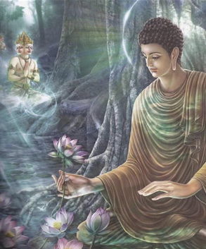
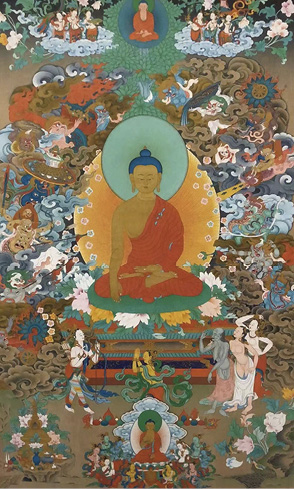
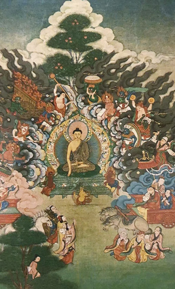
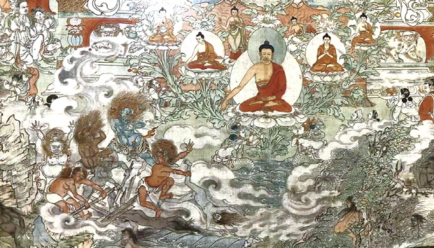
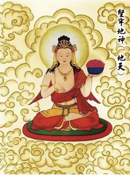
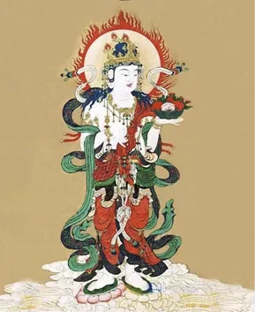

# 第21课

2020年8月25日

## 被地藏菩萨接走的智藏尼师

讲《地藏经》之前，先讲一则与地藏菩萨有关的公案。

宋朝时，太原有一位法号“智藏”的尼师，向往极乐世界，尤其信仰地藏菩萨。她专门花钱请画师画了三幅佛菩萨像，即一幅阿弥陀佛像、一幅观音菩萨像、一幅地藏菩萨像。

本来，西方三圣是阿弥陀佛、观世音菩萨和大势至菩萨，但她特别信仰地藏菩萨的缘故，就请人画了地藏菩萨作为阿弥陀佛的胁士。

画师画好后，智藏师便将画像请回家里，每日虔诚地礼拜供奉。

一日，狂风大作，大风将她的房子吹倒，连同屋内的三幅圣像也一起刮走了。她第二天出去寻找，结果一幅也没找到，特别伤心，于是一心祈祷地藏菩萨。没过多久，她看见远处有东西飘在虚空中，慢慢地向她靠近，最后落在她附近。她过去一看，发现是她丢失的圣像。圣像失而复得让她非常欢喜。她将圣像带回，继续供奉在家中。

两年后的一天，她告诉朋友：“地藏菩萨明天来接我去极乐世界。”第二天，她将地藏菩萨、观世音菩萨和阿弥陀佛的圣号各念了108遍后，便端坐着示现圆寂了。[^1]

## 色不异空

从这则公案中我们知道，一方面，依靠地藏菩萨的加持也能往生极乐世界。另一方面，佛菩萨的圣像具有不可思议的加持力。无论是金、银、铜、铁、树脂塑造的圣像，还是唐卡上的佛菩萨画像，甚至是手机、电脑上的佛菩萨图片，它所带来的力量，确实不可思议。因此，作为佛教徒，我们应该以清净心和恭敬心对待自己的本尊、空行和护法的圣像。这非常重要。

不仅佛教如此，世间也很重视形象的力量。比如说，在弘扬某种文化时，常常依靠画像来彰显其精神；世间人崇拜某位国王或君主时，也会用他的画像来加强影响力；追星的人会把他们崇拜的偶像的照片贴在床边。我们去大学参观时，看见很多大学生将喜爱的明星、歌星、球星的画像贴在床边。

前段时间我去了一所佛学院，在个别年轻出家人的宿舍里，一边挂的是佛菩萨的唐卡，一边贴的是现代歌星的画像。我当时问一位负责的老喇嘛：“这个是谁？”老喇嘛说：“不清楚，我还不知道现在和尚喜欢这样的‘本尊’。”我说：“你是不知道这其中的甚深意义。”（众笑）

反过来说，有些世间学校也有佛菩萨像，这说明他们不仅崇拜明星，而且对上师和佛菩萨也有信仰。

我们不能否定“相”的作用。有些人似乎觉得这是对“相”的执著。当然，如果你真的通达了明空无二的境界，的确不再需要这些“相”了。在没有通达之前，心会随境而转，转善转恶，则与环境和自己的行为有关。

## 地神护法品第十一

接下来讲《地藏经》的第十一品，这一品主要讲坚牢地神与地藏菩萨之间的故事。

## 大地女神

坚牢地神是佛陀在菩提树下成道时的一位见证人。

佛陀在成道之前，魔王波旬和成千上万的魔众前来干扰。佛陀对魔王说：“你伤害不了我。你之所以能投生在天界成为魔王，只不过是因为在斋戒日供养过一位独觉一钵食物而已。而我则在三大阿僧祇劫中供养过无量诸佛菩萨和声闻阿罗汉，同时也以悲心无数次地将头目脑髓布施给众生，所以你根本伤害不了我。”

魔王怒气冲冲地说：“我积累过资粮，你已为我作证。但你说你在三大阿僧祇劫中积累过资粮，谁能作证？”

佛陀说：“大地可以作证，大地上的众生也可以作证。”佛陀话音刚落，坚牢地神便从大地中显现出上半身，对魔王说：“我可以为佛陀作证。从大地形成初始，我就一直存在。大地上所发生的一切，我一清二楚。佛陀的的确确积累了三大阿僧祇劫的资粮。”魔王听后，羞愧而逃[^2]。

关于坚牢地神的形象，不同地方，有不同的塑造和描绘。但一般而言，坚牢地神通常是女性形象，所以常被人们称为大地神女。

我找了几张坚牢地神的图片，放在屏幕上给大家看一下：

第一张是印度的一幅画像，很有名。佛陀坐在菩提树下，旁边有一位四面地神，据说就是坚牢地神。

第二张也是印度风格的图片。魔王波旬为了干扰佛陀，幻化出无量的野兽、魔女与魔军。坚牢地神为了保护佛陀，从地涌出，与魔众作战。

藏传佛教中，有不同形象的坚牢地神的画像。在这两张图片中，佛陀结降魔印，右手指地。在佛陀的前面，身相黄色、下身好像龙女的那位就是坚牢地神。

在《释尊广传》中，坚牢地神是于佛前双手合掌的龙女形象。

汉传佛教中也有坚牢地神的画像，有些寺庙还专门设置了殿堂，用以供奉坚牢地神。从这几张图片看得出来，汉地大部分佛像以唐代的造像为准。其实造像的度量是很重要的。

总之，坚牢地神是一位非常重要的护法神，各个地方的土地神都由她管辖。在这一品中，佛陀特别赞叹了坚牢地神。

|   尔时坚牢地神白佛言：“世尊，我从昔来，瞻视顶礼无量菩萨摩诃萨，皆是大不可思议神通智慧，广度众生。是地藏菩萨摩诃萨，于诸菩萨，誓愿深重。”

> 这时，坚牢地神对佛陀说：“世尊，我从往昔以来，瞻仰、顶礼了无量的大菩萨，如观世音菩萨、文殊菩萨、普贤菩萨、大势至菩萨、虚空藏菩萨等千千万万的菩萨，他们每一位都具有不可思议的神通智慧，度化众生的力量极其强大，度化众生的事业广大无边。在这所有的大菩萨中，唯有地藏菩萨度化众生的誓愿最为深重。”

|   “世尊，是地藏菩萨，于阎浮提有大因缘。”

> “世尊，这位地藏菩萨与阎浮提的众生，相互之间有特别殊胜的因缘。”

有大因缘：很多佛经中说，释迦牟尼佛与我们南赡部洲的众生特别有缘。实际上，地藏菩萨与我们也有深厚因缘。

## 有缘易相应

因缘很重要。一位高僧大德或大成就者如果与某个众生的因缘很好，那么他的所作所为，会对这个众生非常有利。如果因缘不好，即便是再了不起的大成就者或高僧大德，也不一定能给这个众生带来多大利益。

菩萨度化众生，需要观待因缘。毋庸置疑，每一位菩萨都是慈悲众生的，但因为菩萨们各自的发愿不同、与众生的因缘不同，所以我们南赡部洲的众生与某些佛菩萨更有缘。与自己有缘的佛菩萨，能赐予不共的加持与力量，因此，我们应该经常祈祷、顶礼、供养，这很重要。同时，我们也应该以最欢喜的心态，将那些与自己有着殊胜因缘和法恩的上师们，当作人生中最重要、最值得恭敬的对境来依止。如此，智慧与慈悲便能轻而易举地在自相续中生起。

我们也许听说过这样的情况——“虽然某位老师很有智慧，但与我不投缘。”“某位高僧大德确实是位真正的成就者，世间的名声也很不错，但不知道怎么回事，我就是很难对他生起信心。”所以说，因缘非常重要。每个人如果回顾自己的一生，就会发现某些因缘确实不一样。

|   “如文殊、普贤、观音、弥勒，亦化百千身形，度于六道，其愿尚有毕竟。是地藏菩萨教化六道一切众生，所发誓愿劫数，如千百亿恒河沙。”

> “像文殊菩萨、普贤菩萨、观世音菩萨、弥勒菩萨，他们同样化百千身形，在六道中以种种方式度化众生，但与地藏菩萨相比，他们的誓愿仍有究竟之时。而地藏菩萨为了度化六道中的一切众生，所发的誓愿、所经历的劫数，就像千百亿恒河沙数那么多，根本无法衡量。”

## C位大菩萨

文殊、普贤、弥勒、观音，这四位菩萨都很了不起，但某些方面与地藏菩萨相比，还是有差距。

也许有人想：“就算其他菩萨发愿有毕竟，但只要轮回不空，文殊菩萨应该不会放弃利益众生吧？《大教王经》、《大宝积经》和《文殊师利宝藏陀罗尼经》中都提到过文殊菩萨所发的十大愿与十八大愿，从发愿来看，文殊菩萨的愿力应该与地藏菩萨相同[^3]？而且观世音菩萨度化众生的精神也非常伟大，这在《千手千眼观世音菩萨广大圆满无碍大悲心陀罗尼经》中有详细记载[^4]。”

的确，文殊菩萨曾发愿劝三世诸佛发菩提心，只要有一个众生未发菩提心，文殊菩萨就绝不成佛[^5]；观世音菩萨度化众生也很厉害。但他们与地藏菩萨“地狱不空，誓不成佛”的愿力比较起来，还是有一定的差距。

尤其是《地藏十轮经》中说，假如有人想要成就所愿，在一百劫中皈依、称名、念诵、顶礼、供养弥勒菩萨、妙吉祥菩萨、观自在菩萨、普贤菩萨等非常了不起的上首菩萨，不如在短时间内皈依、称名、念诵、礼拜、供养地藏菩萨——后者更能迅速成就所愿。这个道理麦彭仁波切在《地藏赞》中也提到过[^6]。

因此，从满愿方面来讲，地藏菩萨最为殊胜；从发愿方面来看，地藏菩萨度化众生的誓愿也无有穷尽之时。坚牢地神主要是从这两方面来赞叹地藏菩萨。正因为地藏菩萨誓愿无尽，所以我们南赡部洲的众生一定要跟地藏菩萨搞好关系，结上善缘，因为他是最重要的领导，也是最重要的老师——是一位最了不起的大菩萨。

|   “世尊，我观未来及现在众生，于所住处，于南方清洁之地，以土石竹木作其龛室，是中能塑画，乃至金银铜铁，作地藏形像，烧香供养，瞻礼赞叹。”

> 坚牢地神说：“世尊，我照见未来和现在的众生，若能在自己所住之处的南方，选择一块清净的地方，以泥土、石头、竹子或木头做一间龛室，在里面绘画乃至用金银铜铁塑造一尊地藏菩萨圣像，然后在圣像前，焚香供养、瞻仰、礼拜、赞叹。”

## 为什么是南方？

这里说“南方清洁之地”，为什么是南方呢？有些大德解释说，“南方”并不是东南西北方位上的南方，而是指智慧之方。但这样解释不是很好懂。实际上，如果解释为方位上的南方是合理的，因为不同的佛菩萨修法，的确会有方位上的差别。比如五方佛里面，不动佛在东方，阿弥陀佛在西方，宝生佛在南方。而且息增怀诛四种事业分别有不同的颜色表示。一般来讲，增上名声、财富等世出世间功德属于增业，以黄色表示，方位在南方。而地藏菩萨的身相，无论藏传还是汉传中，都以黄色为主，地藏菩萨又属于宝生部，所以这里才说“于南方清洁之地”。可以这样理解。

既然如此，那阿弥陀佛的像是不是就一定要放在西方，不能放在东方或北方，或者地藏菩萨像只能放在南方，不能放在西方或东方呢？也不是非要如此。但如果各方面因缘具足，最好将地藏菩萨的佛龛设置在南方。

## 家有佛堂

这里还提到将佛菩萨的圣像供养在佛龛内。所以，如果有条件，最好在家里布置一间佛堂。我一直觉得，藏传佛教的佛堂很有美感，设计上也充满层次感。尤其是比较好的佛龛，中间摆放的是一尊大的释迦牟尼佛像或阿弥陀佛和莲花生大士的圣像，两边像嘎乌盒一样的空间内，摆放的是稍小一些的两尊圣像，周围则摆放更小的圣像，然后在其余的格子内放入经书。佛龛前面还有一层一层的供台，可以将明灯、净水、神馐等供品整齐地供在供台上。这样的佛堂，看上去特别庄严，让人见而生信。

当然，布置佛堂时要考虑自身的条件，如果屋子不大，佛堂却弄得特别大的话，可能不太方便。如果有条件，还是应该将佛堂布置得庄严、美观。尤其要注意的是，佛菩萨像摆放的位置一定要高于腰。如果放在腰以下的位置，或直接放在地板上，其实很不恭敬。如果条件不具足，将佛龛做成像书柜那样一格一格的也可以。

总之，佛堂一定要布置得有美感和层次感，主次要分明。主要供奉的佛像，无论是一尊释迦牟尼佛，还是三尊佛菩萨像，应该安放在佛龛的中间，其余的则摆放在周围。

对于三宝所依的摆放，以恭敬为主要原则。有的人将佛像放在下面，供品却摆在佛像上面，这样既不恭敬也不庄严。甚至有人把最珍贵的密法等经书放在最下面和地板平齐的那层柜子里，却将钢琴、武功、搏击等世间书籍放在最高的地方。他们说，之所以将佛经放在大家都看不到的地方，是为了让佛经有一个安静的空间。这样不太好，佛像、佛经、佛塔应该放在较高的地方。

## 好的习气，从娃娃抓起

在地藏菩萨像前，烧香供养、瞻礼赞叹有极大功德。我们应该在这方面多串习。

我很小就有这方面的习气。小时候，佛像很难找，偶尔能捡到一些三角形的石头或骨头，我就把这些石头当作佛像放在一块大石头上，再召集周围的牧童，让大家去山上采集野花，然后一起供佛、礼佛。这是很好的习气。

《妙法莲华经·方便品》中说：“若于旷野中，积土成佛庙，乃至童子戏，聚沙为佛塔，如是诸人等，皆已成佛道。”也就是说，在旷野中用土堆积成佛庙，乃至小孩子玩耍的时候聚沙成塔，这些人都已经成就了佛道。

若能培养孩子在玩耍时建造佛像或佛塔的习气，会很有意义。尤其是居住在海边的孩子，在玩耍时可以用沙子堆建佛像和佛塔，堆好后再洒一些海水当作供养。从小这样熏习，种下好的习气，将来会成熟不可思议的功德果报。不过我看到许多住在海边的孩子，玩耍时好像不是用沙子堆佛塔，而是用沙子打仗……

|   “是人居处，即得十种利益。何等为十？一者土地丰壤，二者家宅永安，三者先亡生天，四者现存益寿，五者所求遂意，六者无水火灾，七者虚耗辟除，八者杜绝恶梦，九者出入神护，十者多遇圣因。”

> “设龛室供养地藏菩萨，能为居处及周围带来十种利益。哪十种利益呢？第一，土地肥沃，收成好。第二，家庭平安、快乐、安宁。第三，亡故的亲人生天受乐。第四，现存的眷属，增福延寿。第五，世出世间的所求，能够如愿以偿。第六，不会遭遇地水火风等的灾害。第七，虚损衰耗，悉皆除灭。第八，遣除恶梦。第九，出入有善神护持。第十，经常遇到善知识、善友等解脱的因缘。”

一者土地丰壤：当地土壤肥沃，风调雨顺，五谷丰登，基本上不会出现粮食危机，也不用存很多粮食。只要有一尊地藏菩萨像，不存粮食也可以的，对吧？粮食存太多了也麻烦，容易被老鼠吃。（众笑）

二者家宅永安：家中不会出现横死或横病，也不会有导致不团结或不和谐的因素。一家人都会健康、快乐，而且财富圆满。

我今年造了一批地藏像，准备结缘给大家。老百姓有时候真的很可怜，虽然很想获得财富和名声，可是因为没有积累过资粮，所作所为又常常与心中所欲背道而驰，所以总是不能如愿以偿。这次结缘地藏菩萨像，不敢保证百分之百能给所有众生带来利益，毕竟每个众生的业力不同，但有些众生内在善的因缘很不错，再加上外在地藏菩萨像的加持，一定会有利。

也许我们这边一提倡，外面做生意的就开始抬价，做各种各样的宣传。

三者先亡生天：依靠《地藏经》和地藏菩萨的加持，家族中亡故的亲人可以转生人天善趣。已故的亲人如果无法转生，有时会经常缠着你，给家族和子孙后代带来损害和灾祸。因此，希望地藏菩萨加持他们早日转生到安乐的地方。

四者现存益寿：活着的人增福增寿、平安健康、快乐圆满，世间的一切都顺顺利利。

五者所求遂意：凡是自己追求的，无论是世间的相貌端严、财源滚滚、地位显赫，还是出世间的解脱、成就，都能遂心如意，无有任何障碍。

六者无水火灾：不会遭遇水灾、火灾。最近美国加州的森林火灾很严重，新闻中说加州24万人被迫撤离。中国最近很多城市的水灾比较严重，听说四川乐山大佛的脚趾都被洪水淹没了。如果我们多行持善法，地水火风的灾难自然会消失。

七者虚耗辟除：有些人的财富积累不起来，经常耗尽。如果造地藏像，就不会有这方面的问题，更不会遭遇经济危机。还有些人，经济紧张，欠款太多，自己的房子、车子又卖不出去，不知道怎么办，觉得活在世上很艰难，最后甚至做出不明智的选择。实际上，若能一心祈祷地藏菩萨，世间的贫穷、损害、损耗等都可以遣除。

八者杜绝恶梦：经常做恶梦的人，最好多祈祷地藏菩萨，依此可以遣除恶梦。即便做了不好的梦，只要立即祈祷地藏菩萨和药师佛，恶梦也不会给你带来灾祸。

九者出入神护：昼出夜入，鬼神护持，护法善神，如影随形。我想我不管去哪里，应该有很多护法神护持吧。坚牢地神也会时刻保护受持地藏法门的人。一个人如果有护法神护佑，很多事情都会特别顺利，否则，不该发生的很多事情也会发生。

十者多遇圣因：经常遇到善知识、善道友等解脱的善缘。有些人很顺，遇到的都是好人，有些人恰恰相反，遇到的全是坏人，今天被这个骗，明天被那个骗，财富被骗，感情被骗，甚至连修行方面也被骗，好像周围没有一个不是骗子。幸好受持《地藏经》以后，就再也不会遇到骗子了，对吧？

|   “世尊，未来世中，及现在众生，若能于所住处方面，作如是供养，得如是利益。”

> “世尊，现在和未来的众生，如果能在住处设龛供养地藏菩萨像，一定能得到如上所说的利益。”

我们这边给大家发了一尊地藏像，给了吧？（下面有人回答：“给了！”）

这么凶啊，好像把他的地藏像抢了一样。法王以前说过，如果有恩德，虽然没有报答，但表情上至少要表示感谢，说两句感谢的话。

|   复白佛言：“世尊，未来世中，若有善男子善女人，于所住处，有此经典及菩萨像。是人更能转读经典，供养菩萨。我常日夜以本神力，卫护是人，乃至水火盗贼，大横小横，一切恶事，悉皆消灭。”

> 坚牢地神继续禀白佛陀：“世尊，未来如果有善男子善女人，其住处有这部《地藏经》和地藏菩萨像，这个人还能读诵《地藏经》并且供养地藏菩萨的话，我一定以自身的神力日日夜夜卫护他，乃至水灾、火灾、盗贼等大大小小的一切横事、恶事，悉皆消尽。”

许多道友每天都会读一遍《地藏经》，尤其是汉地特别重视《地藏经》。有些道友每天的课诵很多，上午念了下午念，下午念了晚上念，还是念不完，欠了很多。今天这里发愿，明天那里发愿，最后欠了一大堆“债”。藏地有种说法：“发愿容易行愿难。”发愿很容易，但实行起来却十分艰难，最后弄得自己也很苦恼。

如果实在没办法每天念诵《地藏经》，可以将地藏菩萨像随身携带，坚牢地神也会保护你、帮助你。

## 护国保家经

人们一般比较担心受到自然灾害和疾病的损害，有种种忧虑，为了防止这些，最好经常祈祷地藏菩萨以及随身携带《地藏经》，这很重要。

还有一部《金光明经》，藏地特别重视，几乎家家户户都会请一部供养。不知道这样的传统是什么因缘而产生，也不知道是什么时候开始的。《金光明经》中也提到读诵受持供养此经的人，会得到护法圣众的保护[^7]。

通常而言，藏地每家每户都会请一部《金光明经》和一部《般若八千颂》供奉在家中。这是很好的习惯。以后别人结婚、成家、买了新房，我们就送他们《地藏经》、《金光明经》和《般若八千颂》等三宝所依，这对他们的家庭非常有利。

在汉地，《妙法莲华经》、《金光明经》和《仁王护国般若波罗蜜多经》被称为“护国三经”，非常重要。藏地尤其重视《金光明经》，这部经典对家庭平安、事业顺利有很大帮助。它有好几个汉译本，其中义净的译本比较出名。方便的话，你们也可以请一部。作为在家人，家里最好请一部《地藏经》和一部《金光明经》。

藏地的修行人特别重视《金光明经》和《圣大解脱经》。《圣大解脱经》也是一部特别重要的经典。我现在用的这个大转经轮里装的就是《圣大解脱经》和观音心咒。《圣大解脱经》很有加持，以后方便的话给大家念一下传承，能不能讲再看因缘。

|   佛告坚牢地神：“汝大神力，诸神少及。何以故？阎浮土地，悉蒙汝护，乃至草木沙石，稻麻竹苇，谷米宝贝，从地而有，皆因汝力。又常称扬地藏菩萨利益之事。汝之功德及以神通，百千倍于常分地神。若未来世中，有善男子善女人，供养菩萨及转读是经，但依地藏本愿经一事修行者，汝以本神力而拥护之，勿令一切灾害，及不如意事，辄闻于耳，何况令受。”

> 佛陀对坚牢地神说：“你具有无比的大神通力，诸神中很少有能与你相提并论的。这是为什么呢？这是因为整个南阎浮提的土地都蒙你的神力保护，也由你管理，而且这片大地上的所有草木沙石、稻麻竹苇、谷米珍宝、矿产等凡是存在于大地上的事物，都是因为你的力量才得以存留、生长。你又经常称扬赞叹地藏菩萨广利众生之事。你的功德与神通之力，远远超胜一般的地神百千倍。如果未来世有善男子、善女人供养地藏菩萨、转读《地藏经》——凡是依照《地藏本愿经》来修行的，你都应该以你的神力保护他们，不要让他们的耳边听闻任何灾害或不如意的事情，更不能让他们亲自感受了。”

## 健康平安、升官发财、学业事业、求子求姻缘

看得出来，坚牢地神是一位有权力、有势力的护法神。

因此，只要我们读诵《地藏经》、供养地藏菩萨，灾祸就不会降临。人人都想得到保佑，大家都希望家庭平安，许多人去寺院烧香拜佛时，也是一边拼命地作揖，一边拼命地求菩萨保佑，“我要平安！平安！平安！”但如果不明白方法，即使心里再怎么想，也不一定能实现。

如果你真的想让自己的所求——健康、财富、平安等得到满足，方法是什么呢？很简单，就是供养地藏菩萨、读诵《地藏经》。这是如来的无欺之语。

## 脑科学与心

《月灯三昧经》中说：“假使虚空星宿落，地海城邑悉坏灭，虚空无为性变异，如来终无不实语。”假使天上的星星全都落到地上，地上的大海、城邑悉皆坏灭，甚至连虚空也改变了无为法的本性，佛陀也永远不会说出任何欺诳不实的语言。为什么呢？因为佛陀彻底断除了妄语之因。也许有人怀疑：“不一定是这样吧？佛陀所说的真是千真万确的真理吗？”先不说其他方面，仅是了解佛陀对众生心所做的分析，我们就能对佛陀生起无比的信心。

如今许多人对佛法的了解不够，不知道佛陀所说的每字每句，都是亘古不变的永恒真理。相比之下，大部分的人们对科学家特别信仰，觉得只要是科学家说的，就一定是对的。但实际上，他们的研究范围很有限。比如说，我们佛教中非常简单的关于心的分析，长期以来，科学家认为感受并不是由意识来领受的，而是由大脑中的神经系统来领受的，他们一直认为，是一个无情法在感知另一个无情法。

大脑中的神经系统的确与知觉有关，这一点我们不否认。大脑就像一个接收器，当大脑受损，上面的脑神经也受到损害时，身体的感官系统自然会受到影响。这是科学家以白鼠为研究对象，通过实验后所得出的结论。哈佛大学和伯克利大学的一些神经学家对人脑进行剖析和研究后，也证实了这一结论。但这一结论只说明了脑神经与知觉有关。

直到最近，许多科学家对神经系统进行进一步的研究和观察后发现，当神经系统没有发生任何变化时，意识仍在起作用。这说明，虽然脑神经能对我们的生活产生一定的影响，但起根本作用的，其实是无形的意识。也就是说，我们除了神经系统以外，还有独立的心识，这是最关键的地方。大家知道，当我们在观想时，虽然身体没有动摇，但在心识的作用下，仍然会产生不同的觉受与反应。

实际上，科学家对心灵的认识——暂且不说究竟胜义谛的空性光明，就是对世俗层面的六根缘六尘的状况，也知之甚少。到目前为止，他们虽然知道有一个独立的心识存在，但依靠所谓的实验研究，除了找到脑神经以外，并没有更深的认识。

## 无垢光尊者的心性直指法

对于心识的分析，佛陀早在两千五百多年前就已经讲得明明白白。当我们学习经论和密续时也许会惊叹：“佛陀竟然将意识的分类、特性与本质分析得如此究竟。”这并不只是理论上的说说而已，通过修行，每个人都能现量认识。

无垢光尊者在《如意宝藏论》中讲中观应成派时，专门讲了一个认识心性的修法。这个修法看似简单，但实际上是认识心性最殊胜、最直接的方法。

他说，无论是外在的事物，还是内在的分别念，你要当下安住于它的本性，在远离一切分别、远离一切戏论、远离一切有无是非的境界中自然安住，这就是中观的见解。接着，无垢光尊者引用了《入菩萨行论》中的教证：“若实无实法，悉不住心前，彼时无余相，无缘最寂灭。”

后得，将一切显现观为如梦如幻。然后在不离这样的境界中行持善法——精勤礼拜、转绕、诵经、作擦擦像、水施等，以积累有相福德资粮[^8]。

这种方法能帮助我们真正认识心的本性。而且，这样的方法，平时在日常生活中就可以修。只要方法对了，修行其实很容易。

如果我们对心有了一定的认识和了解，就会知道，佛陀的语言的确没有任何欺诳。并不是因为我是佛教徒，所以才赞叹佛陀。通过对比现代科学家们依靠仪器和实验研究所得出的结论就能看出，佛教对心识的认识程度，远非任何心理学家、哲学家或其他宗派所能企及。这一点，有智慧的人应该明白，尤其是有修行、实际行持过的人，更是一清二楚。

|   “非但汝独护是人故，亦有释梵眷属，诸天眷属，拥护是人。何故得如是圣贤拥护？皆由瞻礼地藏形像，及转读是本愿经故，自然毕竟出离苦海，证涅槃乐。以是之故，得大拥护。”

> “修持地藏法门的人，不单受到你的保护，也受到帝释天、梵天等诸天及其眷属的保护。为什么能得到这么多护法圣贤的拥护呢？由于瞻视、顶礼地藏菩萨像，以及读诵《地藏经》的缘故，将来必定出离生死苦海，证得涅槃大乐，所以才能得到一切天神、圣贤的拥护。”

世间的土地神，出世间的护法神，都会好好保护修持地藏法门的人。为什么会这样呢？原因很简单，就是因为他重视地藏法门，经常瞻视、顶礼地藏菩萨的像，以及读诵《地藏经》的缘故。

密法的结尾处，通常会注明此法交付给某某护法神守护。这在显宗中也有，一般是在嘱累品中，人或天神等护法圣众会承诺保护、流通那一法门。

道宣法师在《祇洹寺图经》中说，坚牢地神是一位女神，有八十亿眷属[^9]。可见，坚牢地神很不简单。我们人类才七十亿，而坚牢地神，光眷属就有八十亿。所以说，得到坚牢地神等护法圣众的保护很重要。如果能得到坚牢地神的保护，肯定不会有问题的，即便晚上没有路灯，只要有坚牢地神在，也不用害怕。

[^1]: 《地藏菩萨像灵验记》：“太原尼智藏。特事地藏菩萨。欣求西方净土。舍钱二百文。画阿弥陀像。左右胁士。地藏观音二体。安置房舍。信心礼供。太平兴国五年庚辰。大风吹破人屋。尼之屋舍。同坏毕。明日寻像所在。都失之。心生忧恼。祈念地藏菩萨。瞻仰虚空。遥见一物。飘飖在虚空。数数放光如电。一时计下地。即所求像也。欢喜。如旧安置屋内。七年二月二十三日。语朋友曰。地藏菩萨。导吾于净土。明日决定往生。烧香散花。唱三尊名号。各一百八遍。端坐向西。合掌而逝。”
[^2]: 《方广大庄严经》：“尔时菩萨语魔王言。魔王波旬汝当谛听。我今于此断汝怨仇。灭汝恶业。除汝嫉妒成就阿耨多罗三藐三菩提。汝宜回心生大欢喜。复告波旬。汝以微善今获天报。我于往昔无量劫来修习圣行。今者当得阿耨多罗三藐三菩提。时魔波旬语菩萨言。我昔修善汝所能知。汝之累德谁信汝者。尔时菩萨徐举右手以指大地。而说偈言。诸物依何得生长。大地能为平等因。此应与我作证明。汝今当观如实说。 尔时地神形体微妙。以种种真珠璎珞庄严其身。于菩萨前从地踊出。曲躬恭敬捧七宝瓶。盛满香花以用供养。白菩萨言。我为证明。菩萨往昔于无量劫修习圣道今得成佛。然我此地金刚之齐。余方悉转此地不动。作是语时三千大千世界六种震动。出大音声有十八相……是时魔王波旬与其眷属退散而去。还其自宫。”
[^3]: 关于文殊菩萨十大愿，详见《大乘瑜伽金刚性海曼殊室利千臂千钵大教王经》；关于文殊师利十八大愿，详见《大宝积经·文殊师利授记会》。
[^4]: 《千手千眼观世音菩萨广大圆满无碍大悲心陀罗尼经》：“南无大悲观世音，愿我速知一切法；南无大悲观世音，愿我早得智慧眼。南无大悲观世音，愿我速度一切众；南无大悲观世音，愿我早得善方便。南无大悲观世音，愿我速乘般若船；南无大悲观世音，愿我早得越苦海。南无大悲观世音，愿我速得戒定道；南无大悲观世音，愿我早登涅槃山。南无大悲观世音，愿我速会无为舍；南无大悲观世音，愿我早同法性身。我若向刀山，刀山自摧折；我若向火汤，火汤自消灭；我若向地狱，地狱自枯竭；我若向饿鬼，饿鬼自饱满；我若向修罗，恶心自调伏；我若向畜生，自得大智慧。”
[^5]: 《大乘本生心地观经》：“文殊师利大圣尊，三世诸佛以为母，十方如来初发心，皆是文殊教化力。”《不退转法轮经》：“文殊师利白佛言。世尊。如来未发菩提心时。我已转此不退法轮。”《华严经》：“善男子。文殊师利常为无量百千亿那由他诸佛母。常为无量百千亿那由他菩萨师。教化成就一切众生。名称普闻十方世界。常于一切诸佛众中为说法师。”
[^6]: 《地藏赞·大地庄严》：“文殊普贤弥勒观自在，此等极为殊胜大菩萨，多劫之中供养并祈祷，佛说不如顷刻忆念您，如意满足一切所求愿，极为超胜佛之最胜子，与佛无别如是赞叹您。”
[^7]: 《金光明最胜王经》：“护世四王众，及大臣眷属，无量诸药叉，一心皆拥卫。大辩才天女，尼连河水神，诃利底母神，坚牢地神众，梵王帝释主，龙王紧那罗，及金翅鸟王，阿苏罗天众；如是天神等，并将其眷属，皆来护是人，昼夜常不离。”
[^8]: 详见《如意宝藏论·法门广义》。
[^9]: 《祇洹寺图经》：“又寺大院四角内各有一院。西北角地神坚牢云是女神。部属八十亿当门立大神像。”
