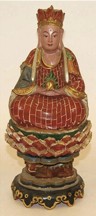
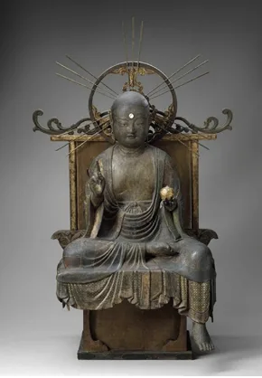
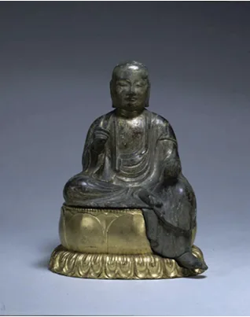
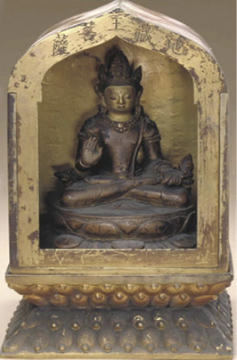
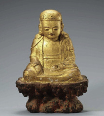
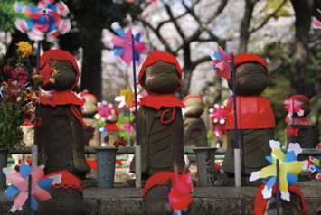
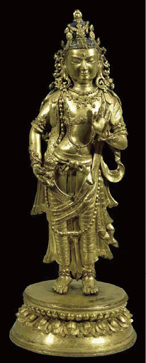

# 第23课

2020年8月28日

## 降伏凶恶鬼神

今天讲的公案出自《三宝感应要略录》。

当年，佛陀在灵鹫山，而地藏菩萨则游行各地教化众生。地藏菩萨到了毗富罗山下，见到一位长者家内有五百人被恶鬼夺取精气，昏厥了十天之后，依旧不省人事。

见此情景，地藏菩萨心生悲悯，觉得这些众生特别可怜。为了救度他们，地藏菩萨立即前往灵鹫山佛陀那里，并将原委告诉了佛陀，希望佛陀开许自己去救度他们。

佛陀听后，顶上放光，照地藏菩萨身。周围的眷属见佛陀放光，知道一定有特殊的因缘缘起。地藏菩萨也明白，这是佛陀对自己的开许。于是地藏菩萨继续说道：“我在因地时也曾遇到过类似状况。我后来在一位仙人面前求得神咒，依靠神咒的力量治好了被鬼神所扰的众生。”

在得到佛陀的开许之后，地藏菩萨回到毗富罗山，用神咒加持长者一家。经地藏菩萨加持，长者家内的五百人全都苏醒了过来，而且得到了菩萨的教化。《三宝感应要略录》中的这则公案，出自《峚窖大道心驱策法》。

这则公案后来广为流传。唐朝时期，有一户李姓人家，家里三十多人在恶神的干扰下，有的吐血，有的晕厥，有的内心被折磨得特别痛苦。他们实在没办法摆脱，只好请来一位僧人，希望僧人能告知解决办法。

僧人来了以后，对他们说：“我在佛经中看过一则公案，说是有五百人被恶神捉弄，后来是地藏菩萨救了他们。所以，你们也应该祈祷地藏菩萨、塑画地藏菩萨像、称念地藏菩萨名号，这也许可以解决你们的问题。”

这家人按照僧人的指点，摹写了地藏菩萨的画像，同时称念地藏菩萨名号。很快，一家人摆脱了恶神的干扰，恢复了往日的生活。在后来的五十年里，当地再也没有出现过类似的怪病。[^1]

某些地方或家族，有时会出现包括瘟疫在内的集体性怪病。家庭成员中，这个生病，那个也生病，整个家族里没有一个健康的人，特别可怜。如果有这种情况，最好真诚地祈祷地藏菩萨、塑画地藏菩萨像，依此可以遣除厄运。

实际上，恶鬼神有时会夺人精气，有时会散发病毒让人生病。在遇到这种情况时，祈祷地藏菩萨非常重要。

这个时代的众生确实感受了很多痛苦，暂且不说新闻中提及的其他疾病，单就新冠肺炎，据官方统计，到目前为止已经导致了八十万人死亡。现阶段，不丹、锡金等东南亚国家，包括西方国家，疫情都非常严重，很难说今年冬天会不会出现新一轮的大爆发。

今年2020年初，很多人发朋友圈“爱你爱你”，结果，很多人在今年失去了自己最爱的生命。我们明年是否还在这个世界上呢？谁也没办法确定。假如寿命已经尽了，那么即使死，也没有什么遗憾，但在寿命耗尽之前，如果因为疾病、灾祸而横死，就太不值得了。所以，为了包括自己在内的全人类，乃至整个世界的众生，减少痛苦、远离痛苦，也为了让每一位众生尽享所拥有的福德，我们以最真诚的心祈祷地藏菩萨——

> 向却森华森华钦波萨耶酿波拉香擦洛巧多嘉森且噢（顶礼、供养、皈依、地藏菩萨摩诃萨）

这次，很多人学了《地藏经》之后，都对地藏菩萨生起了更强烈的信心。一方面，大家很愿意弘扬地藏法门。其次，可以的话，大家也想在各自的地方造圣像、印经书。而且，每个人都特别想修持地藏法门。

这样的效果，我刚开讲这部经典时，并没有想到。这也许是上师们的加持。我讲任何法，都对所讲之法很有意乐，哪怕是俱舍、因明等相对冷门的法，我讲的时候还是充满信心和欢喜心，会有一种特殊的感觉，这次讲《地藏经》就更不用说了。

另外，这可能也和外在的环境以及大家的心态有关。以前很多人不爱听课，整天出去散乱，现在因为外在的环境不太好，大家都害怕灾难降临到自己头上，害怕失去宝贵的生命，所以降低了自己的标准，觉得“只要有一个办法，怎么样都可以”，于是都来听地藏法门。

我自己也是，无论讲什么法，都很有信心，而且依靠前辈们的加持，讲法时会有一种感染力，能很快让大家产生共鸣。

汉藏两地的诸位大德基本上都弘扬过地藏法门。这次弘扬的范围、听法的人数以及大家的修行意乐等各方面都比较令人满意。不过，不知道大家能不能长期坚持？每次刚听一部法时，大家都有意乐：“我一定要念这部经，一定要弘扬这部法。”过了两三年，可能又忘了。无论如何，我相信大家种下这样的善根习气后，以后肯定会弘扬。出家僧人也好，在家居士也好，大家都有弘扬地藏法门的因缘，而且弘扬地藏法门对众生有极大利益。

|   “复次观世音，若未来世，有善男子善女人，欲求现在未来百千万亿等愿，百千万亿等事，但当归依瞻礼，供养赞叹地藏菩萨形像，如是所愿所求，悉皆成就。”

> 佛陀又告诉观世音菩萨：“未来，如果善男善女的心中有百千万亿等愿望，也有百千万亿等事情要成办，只需在地藏菩萨像面前，至心皈依地藏菩萨，一心瞻礼地藏菩萨，恭敬地供养、赞叹地藏菩萨，那么所有的愿求，都能如愿以偿。”

欲求现在未来百千万亿等愿，百千万亿等事：有些人对现在有很多希求，对未来也有特别多的梦想以及想要成办的事情。

除了那些没有任何理想和愿望、对于自他的利益毫不关心——唯一关心的就是一天吃三顿饭的人，以外，一般来讲，大乘修行人一定会有许多利益众生的发愿，以及许多饶益有情的事情。

但当归依瞻礼，供养赞叹地藏菩萨形像：为了让地藏菩萨满自己的愿，首先要皈依地藏菩萨，然后经常瞻仰、礼拜、供养、赞叹，这些都是产生信心与获得加持之因。我们在庙的佛殿中见到特别庄严的佛像时，会自然而然地生起信心，然后双手合掌，一边瞻仰尊颜，一边真诚祈祷，这时，你甚至会感觉佛像发出光芒融入了自己。

如是所愿所求，悉皆成就：如果能这样做，自己的所有愿求，地藏菩萨都会加持令其成就。

《地藏十轮经》中说：“求诸谷药田，男女衣仆使，归敬地藏者，所求皆满足。”无论是希望田地肥沃、庄稼药材丰收、得到好的伴侣和仆人，还是希望衣食无缺，只要以恭敬心皈依、瞻仰、礼拜、供养地藏菩萨，一切所求都能得到满足。

## 他为什么是满愿第一？

《占察善恶业报经》中讲过，地藏菩萨为什么在满愿方面如此殊胜呢？其实，这和地藏菩萨的发愿有关[^2]。关于这个问题，以前弘一大师回答过，但他的回答和我们所想的不完全相同。地藏菩萨之所以在满愿方面如此殊胜，关键还是愿力。地藏菩萨发愿满足众生的愿望，文殊菩萨发愿赐予众生智慧，将众生从无明黑暗中解救出来；观世音菩萨则发愿让众生离苦得乐。

每位菩萨发愿的侧重点不一样。就像一所大学里的学生，各有各的专业。诸位菩萨在因地发愿后，为了使愿力成就，进而在多生累劫中勇猛精进。由于地藏菩萨的愿力已经成就了，所以，只要众生至心祈祷地藏菩萨，地藏菩萨一定会迅速满足众生的愿望。

有些人可能是最近学《地藏经》学得比较好，说：“地藏菩萨原来这么厉害，加持力这么大！我在学院参加了那么多次地藏法会，从来没有好好念过。以后参加地藏法会，一定要好好念！”但以后还有没有法会也不知道。

每个人都可以在地藏菩萨面前发愿：“我将来一定要像地藏菩萨那样弘法利生、满足众生的所愿。”有时候，我们很难满足众生的愿望，比如说，我们虽然很想饶益众生，但因为每个众生的苦难和诉求各不相同，所以确实有一定的难度。但只要我们好好发愿，愿力是不可思议的，将来就一定能真正地饶益众生、满足众生的愿望。

|   “复愿地藏菩萨具大慈悲，永拥护我，是人于睡梦中，即得菩萨摩顶授记。”

> “地藏菩萨具有大慈悲心的缘故，如果有人希望永远得到地藏菩萨的守护与加持，这个人便会在梦中得到菩萨的摸顶授记。”

## 关键是信心

对修行来讲，信心尤其重要。若对地藏菩萨和莲花生大士有特别强烈的信心，修任何法都会很快成就。如果能像思念自己的恋人那样忆念诸佛菩萨的功德和他们的发愿，那么，日有所思夜有所梦，诸佛菩萨的加持力也会有立竿见影的效果。

假如祈祷的心不是那么的强烈、迫切，得到的加持自然会比较缓慢。有些人看上去很精进，“我闭关了多少年，念了多少咒语，每天做多少功课”，其实修法时心很散乱，行为也不太如法，所以得不到多少感应和加持。这不能抱怨诸佛菩萨没有力量，只能怪自己没有如理如法地修持，就像没有按照医嘱服药，自己随便抓些药来吃，病没有好却责怪医生一样，肯定是不合理的。

|   “复次观世音菩萨，若未来世，善男子善女人，于大乘经典，深生珍重，发不思议心，欲读欲诵，纵遇明师教视令熟，旋得旋忘，动经年月，不能读诵。”

> “再者，观世音菩萨，未来如果有善男子、善女人，珍视大乘经典，对大乘经典心生欢喜，信心强烈，虽然发了不可思议的大心，想要将大乘经典读熟、背熟，也得到了通达显密经论且有实修实证的上师指点，可是由于业障深重，随学随忘，经过了很长的年月，依然无法读诵。”

“明师”不是指名师。出名的上师也有各种情况。一般来讲，上师不出名好一点，有了名声反而不一定好。

这里是说，这个人自己很想精通大乘经典，而且遇到了一位精通教理、有实修实证的明师。明师也为他传授了大乘经典，同时做了相关的开示和引导，但他自己业力太重，得法之后很快就忘了，所以始终没办法读诵大乘经典。

|   “是善男子等，有宿业障，未得消除，故于大乘经典，无读诵性。”

> “这个善男子或善女人，宿世的业障没有消除的缘故，才导致无法读诵大乘经典。”

有宿业障：以前可能造过谤法、吝法、杀生、邪淫、五无间罪等深重的恶业。这些恶业还未清净，所以一直没办法读诵大乘经典。

## 从小笨笨为何因

有些人真的有点笨。大家一起背诵，别人在短短的时间内背了很多颂词，他花了很长时间，却连一个颂词也背不下来。

《毗奈耶经》中讲过周利槃特迦（小路尊者）的公案。小路尊者出家后，他哥哥让他背一句偈颂：“身语意业不造恶，不恼世间诸有情，正念观知欲境空，无益之苦当远离。”意思是，身语意不要造恶业，也不要恼害世间的众生，应该以正念观一切欲望的对境本自空性，同时远离无意义的苦行。

这句偈颂很简单，我们连三分钟都不用就能背下来，可是小路尊者背了三个月，还是记不住[^3]。

后来佛陀讲述了小路尊者前世的因缘。小路尊者过去有一世，是迦叶佛时代的三藏法师，他特别吝法，连一偈一颂也舍不得传。那一世死后，他转生在了天界。在天界待了漫长的时间以后，下堕人间成了杀猪的屠夫。

一次，他在杀猪之前想到，如果把这些猪全杀死了，到时候卖不出去，肉会坏掉，我应该把猪带过去当场杀。于是他带着一群猪一起乘船过河。结果那群猪在船上动来动去，把船弄翻了，连人带猪一起掉进了河里。他随流漂荡，漂到了河岸边。岸边住着五百位独觉。其中一位独觉在取水时看见了屠夫，就用神通将他救了回来。

他醒过来后，一直和独觉们住在一起。独觉修行的地方，没有猪可杀，他就每天采摘水果服务独觉，休息时也学着他们参禅。他因为之前当过天人，所以禅修还不错。那一世死后，他转生在了无想天。又过了漫长的时间，他再次来到人间，成为佛陀时期的周利槃特迦。他因为之前当法师时吝法，在天界又经常生邪见，转生为人时又杀害了许多众生的缘故，所以从出生起就特别愚笨[^4]。

所以，如果我们觉得自己很愚笨，不能怨天尤人：“为什么我妈不让我好好念书？为什么我爸不管我的学习？”不能怪他们，这其实和自己前世的因缘有关。

我看到有些笨笨的学生，他们对自己没有信心，又特别羡慕成绩好的同学。虽然他们很想好好学，但确实力不从心。尤其是在考试的时候，没有智慧的学生还是很可怜。但可怜之人也有其可恨之处，以前因为做过太多坏事，所以今生才笨笨的。

如果谁觉得自己比较笨，一方面，忏悔很重要，另一方面，要祈祷地藏菩萨和文殊菩萨，这样也许能在即生中打开智慧。

## 地藏水修法

|   “如是之人，闻地藏菩萨名，见地藏菩萨像，具以本心恭敬陈白。更以香华、衣服、饮食、一切玩具，供养菩萨。”

> “这样的人，在听到地藏菩萨名号、见到地藏菩萨像以后，以恭敬心向地藏菩萨禀白自己的发心。之后尽己所能地以香花、衣服、饮食等一切自己所喜欢的资具供养地藏菩萨。”

饮食：藏传佛教中一般用神馐表示食物。寺院里或开法会时供养的酥油花，看上去特别庄严，它不仅有装饰的作用，也作为饮食供养给诸佛菩萨。

玩具：世间的一切都是游戏，所以任何东西都是玩具。我这个茶杯是玩具，我喝茶就是在游戏，是吧？

|   “以净水一盏，经一日一夜，安菩萨前，然后合掌请服，回首向南，临入口时，至心郑重。”

> “将一杯清净的水供养在地藏像面前，经过一日一夜后，双手合掌，请求服用。服用时，朝向南方（南方是与地藏菩萨很有缘分的方位），然后至诚恳切地将水喝下，不要掺杂犹豫、怀疑或其他杂念。”

|   “服水既毕，慎五辛、酒、肉、邪淫、妄语及诸杀害。一七日或三七日，是善男子、善女人，于睡梦中，具见地藏菩萨现无边身，于是人处，授灌顶水。其人梦觉，即获聪明，应是经典，一历耳根，即当永记，更不忘失一句一偈。”

> “在服用地藏水期间，不能食用五辛，不能饮酒食肉，也不能杀生、邪淫、妄语。像这样修持一个七天或三个七天，如法修持的善男善女便会在梦中见到地藏菩萨现无边身，以水灌顶，赐予加持。从梦中醒来，已经得到聪明智慧，任何经论，只要听闻，便能记住，连一句一偈都不会忘失，获得了不忘陀罗尼。”

五辛：关于五辛，有不同的说法，通常是指葱、蒜、韭菜、薤、兴渠。吃了这些以后，会散发出臭气，导致本尊、天人不愿意接近[^5]。

有些具缘者或具信心者，虽然刚开始笨笨的，后来依靠勤奋努力以及诸佛菩萨的加持，智慧大开。这样的人，我们的闻思群体中就有。他刚来到这里时，看上去呆呆傻傻的，世间的学历也不高，跟他说句话，他半天反应不过来，“啊？什么？你说啥？”后来，人越来越聪明了，背诵、辩论都特别厉害。

有些人的智慧是先天的，有些则是通过后天努力而得到的，还有一些人，再怎么努力也很难改变。不过，大部分人实际上都可以改变。包括现在讲经说法的有些堪布、堪姆和辅导员，在我的记忆里，他们每个人都有一部“传记”。

有的刚来时，各方面都很不错；有的刚来时，在我的印象中是不怎么样，但现在还是很不错的。当然，这也与各自的福德和善根有关。有的人智慧是很不错，但走到后面，由于道德、戒律、行为等很多因缘不具足的缘故，以致在弘法利生上，并没有起到当初想象的作用，甚至见解和行为也越来越不理想。我们只能叹息：“唉，这个人讲经说法非常不错，但好可惜哦。”

有的人刚开始既没有智慧，也没有修行，可是后来在闻思修行方面很有效率，整个人也有脱胎换骨的改变。

有一次，法王如意宝把每位大堪布刚来学院时的落魄经历都说了一遍：“某位大堪布刚来时，身上满是虱子；某某大堪布，只有一套衣服，每次洗衣服时都要去找别人借衣服穿；坐在那边的大堪布最初来到这里时，连果腹的口粮都没有，每天都要挨家挨户地去乞食……”

我当时想：“完了完了，等会儿要说到我了！”法王的表达能力很强，无论说到哪位堪布，大家都觉得这位堪布特别可怜。不过幸好法王说我说得不是很严重，当时很多堪布被法王说完后，自己都觉得特别不好意思。

我们现在的一些堪布堪姆，如果让我说，也有很多可说的。有必要的时候，应该好好说一下每位堪布、堪姆过去的“故事”。班上的道友听完之后，也许会觉得：“哇，原来我们堪布堪姆之前是那么可怜的人呐！”不过，他们后来喝了地藏水的缘故，现在不是那样了。

|   “复次观世音菩萨，若未来世，有诸人等，衣食不足，求者乖愿。或多病疾，或多凶衰，家宅不安，眷属分散。或诸横事，多来忤身，睡梦之间，多有惊怖。”

> “再者，观世音菩萨，未来如果有人无吃无穿，凡有所求皆不如愿；或者生来体弱多病；或者倒霉、灾祸、不吉祥的事情频频发生；或者家里很不顺，难以安宁，眷属也分离失散；或者经常遇到横病和意外事故，甚至睡梦中也是噩梦连连，常被噩梦惊醒。”

衣食不足：由于疫情的影响，国与国之间的贸易有了一些变化，如今全球各个国家对粮食问题很关注。像泰国和马来西亚等，原来虽然是农业大国，后来因为旅游业的发展，荒废了大量农田，几乎不再关心农业，但最近也不得不重新关注。不仅是他们，现在各个国家几乎都在重新思考粮食问题。所以，大家也应该节约粮食。

求者乖愿：有的人做什么都不顺利，任何事情都不能如愿以偿。有的人真的很倒霉，只要是想做的事情，就无法成功，无论做什么，总是违缘重重。他自己也觉得：“我好倒霉，什么都做不成，做什么都不顺利……”

或多病疾：有些人从小体弱多病，每天要吃一大堆藏药、西药、中药。

我这边就有一大堆要吃的药，一会儿吃藏药，一会儿吃西药——西药现在不得不吃，也没办法。

或多凶衰：车祸、地震、海啸、海难、空难等灾祸频发。

家宅不安：家里很不顺。我觉得，一个人去世了，不一定会对社会和他所在的单位带来多大损失，但对他的家庭来说，的确是一场灾难。原本完整的家庭，忽然失去了一位成员，就再也不完整了。

自从我母亲去世，我们兄弟姐妹好像分散了一样。以前母亲在的时候，我们兄弟姐妹会经常聚在母亲身边，可是现在，即便大家聚在一起，也有种失去了重心的感觉。

这方面，出家人可能好一点。就算出家人死了，家里不会觉得有什么损失，他死了就死了。但在家人不同，真的死不得呀。

假如寺院有哪一位堪布、上师或住持圆寂了，刚开始，家人可能会叹息：“可惜可惜。”但再过一段时间，大家逐渐淡忘了，不会一直怀念。在藏地，出家人去世后，家人一般会给他念49天的经，然后就放下了。因为作为出家人早已离开了家庭，所以他的离世不会给家里造成太大影响。

在家人就不一样，哪怕是几岁的孩子去世了，家里都会伤心很长时间，那种悲伤的气氛一直没办法消散。

有的家庭特别不顺，年年都死人，像这样家宅不安的情况，最好多念诵地藏菩萨名号。

眷属分散：无论是家庭成员，还是公司员工，都纷纷离自己而去。今天工厂倒闭，明天员工就跑完了。有的管家、负责人，总是管不好下面的人，跟谁都充满矛盾，自己也痛苦不堪。

或诸横事，多来忤身：经常遇到横病和飞来横祸。

睡梦之间，多有惊怖：噩梦连连，经常梦见死人和鬼神。尤其是身体不好的时候，容易做噩梦。

我昨晚梦见上师了，是很好的梦，但不说。这些我写在了日记里。我在日记里记录了很多梦，活着的时候暂时不公开。不过，这些只是梦而已，没什么可执著的。

|   “如是人等，闻地藏名，见地藏形，至心恭敬，念满万遍，是诸不如意事，渐渐消灭，即得安乐，衣食丰溢，乃至于睡梦中，悉皆安乐。”

> “像这样的人，在听到地藏菩萨名号、见到地藏菩萨像之后，以至诚恳切的心念诵地藏菩萨名号，念满一万遍时，上述不如意的事，便会逐渐消灭，进而身心安乐、丰衣足食，夜晚也能酣然入睡，十分安恬。”

至心恭敬，念满万遍：世间有各种各样的灾祸，这些灾祸基本上可以被包括在上面讲的情况里。有句俗语说：“在大风刮来之前，建围墙；在洪水冲来之前，造水坝。”同样的道理，在灾难临头之前，最好多念佛号和地藏菩萨名号。

## 课后作业

这次这么多人一起学习《地藏经》，我希望从现在起，每人在一两个月内念满一万遍地藏菩萨名号，大家共同创造一个缘起。如果藏文的不会念，念“南无地藏菩萨”也可以。汉文的很快就能念完，一天就可以念好几万遍。

有些人至今为止还没有和地藏菩萨结过缘。我这边准备了一批地藏菩萨像，到时候结缘给大家。你们没有必要急着筹钱，我已经做了安排。学院人不多，所以不需要很多地藏像和《地藏经》。你们有能力的，最好去各个地方结缘，无论是结缘地藏像还是《地藏经》，都非常好。

刚才讲，这次学《地藏经》的，每个人都要念满一万遍地藏圣号，或者念藏文的“香且森华森华钦波 萨叶酿波拉 香擦洛 窍多嘉森且哦”。如果实在不会念藏文，念“南无地藏菩萨”也可以。一年之内要念完。《地藏经》里好几处都提到，念满一万遍地藏圣号，能消尽一切灾难。

在家人离不开家庭、国家等群体，也需要钱财和生活资具，而这些又需要善的因缘，如果没有，的确很难维持世间的生活。出家人稍微好一点，对出家人来说，处处无家处处家。藏地有一种说法：“乞丐死在哪里，拐杖就坏在哪里。”乞丐的全部财产，就是手中的那根拐杖，所以无论死在哪儿，都不会有太多牵挂。出家人也是如此，死在哪里都无所谓，很潇洒。我们最执著的可能是自己的身体，但后来学了《般若经》，已经“四大皆空”了，所以问题也不大。

在这样一个时代，真的特别需要地藏菩萨的无形加持。同时，自己要有一颗勇敢、坚强的心，无论发生什么事情，要以智慧、精进和耐心来面对。不应该遇到一点点事，玻璃心就支离破碎，从此一蹶不振，再也爬不起来。这样不行，大家要加倍奋进。

|   “复次观世音菩萨，若未来世，有善男子善女人，或因治生，或因公私，或因生死，或因急事，入山林中，过渡河海，乃及大水，或经险道。是人先当念地藏菩萨名万遍，所过土地，鬼神卫护，行住坐卧，永保安乐，乃至逢于虎狼师子，一切毒害，不能损之。”

> “再者，观世音菩萨，未来如果有人为了维持生活，或者因为公事，或者因为私事，或者为了生死大事，或者因为急难之事，需要进入森林，渡过大河大海，或者要经过危险的道路等等。在出门之前，应当先念诵地藏菩萨名号。念满一万遍后，无论去哪里，都会得到土地神、护法神的保护，而且在行住坐卧四威仪中，护法善神始终如影随形地护佑。即使遇到了老虎、饿狼、狮子、毒蛇等猛兽，也不会被它们伤害。”

有些人每次出门时都担心：我明天要出远门，不知道能不能一路平安？要不我先念一下经，祈祷佛菩萨保佑保佑？

只要不是去深山老林，现在遇到虎狼狮子的概率比较小，但比猛兽更可怕的，是车祸、空难、瘟疫以及人非人的危害。如果有这方面的担心，出门前最好先念一万遍地藏菩萨圣号。念完以后，一路都会很顺利。

|   佛告观世音菩萨：“是地藏菩萨，于阎浮提有大因缘，若说于诸众生见闻利益等事，百千劫中，说不能尽。”

> 佛陀告诉观世音菩萨：“这位地藏菩萨与南阎浮提的众生有极深的因缘，若详细说明众生见闻地藏菩萨而得利益的事情，纵使经过百千劫，也无法说尽。”

有大因缘：佛陀多次提到地藏菩萨与南阎浮提有大因缘。刚开始佛陀说：“你观世音菩萨与南阎浮提很有缘。”现在佛陀又告诉观世音菩萨：“不仅你与南阎浮提的众生有缘，地藏菩萨也与南阎浮提的众生有缘，而且比你更有缘。”（众笑）

百千劫中，说不能尽：众生见闻觉知地藏菩萨而获得利益的事情，即使诸佛在百千劫中一刻不停地宣说，也无法说尽。

## 广宣流布

|   “是故观世音，汝以神力流布是经，令娑婆世界众生，百千万劫永受安乐。”

> “因此，观世音菩萨，你应当以不可思议的神力加持，使这部经典得到广泛地弘扬，令娑婆世界的众生，在百千万劫中永远享受安乐。”

流布是经：佛陀在这里叮嘱观世音菩萨：“你一定要以你的大威神力弘扬此法，将这部经典弘扬到全世界各个地方，令整个娑婆世界的众生离苦得乐。”

一方面，观世音菩萨会尽全力弘扬此法，也会加持这部法得到广泛的弘扬。同时，我们浊世的众生，也应该想尽一切办法将这部经典弘扬于全世界。

现在《地藏经》有许多不同语种的译本，仅英译本就有6种，大概是在1960年翻译的，韩语《大藏经》里有4种不同的译本，除此之外，还有意大利文、越南文等许多语种的译本。

所以，像《地藏经》这么重要的法，我们要最大程度地去弘扬。出家人要弘扬，在家人也有责任弘扬。

《贤愚经》中说：“行者欲成佛道，当乐经法，赞诵演说。正使白衣说法，诸天鬼神，悉来听受，况出家人？”意思是，修行人要成就佛果，应当喜好经法，时常读诵，并为他人宣说。即使在家人说法，一切天神都会来听闻受持，更何况是出家人了？按照经中所说，只要是弘扬正法，诸天鬼神都会来听受，所以肯定会有人来听的。

有的在家居士，以讲师身份说法。有的出家人出去讲法时，觉得出家身份不方便，于是穿上一件不伦不类的衣服之后站在讲台上讲。但我有点不习惯，如果他们实在不欢迎我穿僧衣，那我就不去了，因为我实在不愿意脱下僧衣然后换上便衣去讲。有的学校要求必须穿便衣，不能穿僧衣，那我只能：“对不起了，我下一世再来吧。”僧衣，这一世肯定没办法脱下来。

地藏法门确实很重要，每位道友可以用不同的方式弘扬。而且，在汉地和西方国家也有弘扬《地藏经》的机缘。

梦参老和尚曾说：“在西方弘法，讲《华严经》有点困难，讲《地藏经》就很容易了，大家普遍能接受。”净空老法师在新加坡讲《地藏经》时也说过：“先讲《地藏经》，再讲《无量寿经》，这样能让每个众生得到最大的利益。”以这样的模式宣讲，也许会有更好的效果。

净空法师当时讲《地藏经》，是先讲解一段经文，然后再引用《地藏经科注》里的解释。《地藏经科注》是康熙年代的青莲法师所著，在所有的《地藏经》注疏里面，是特别有名的一部。

由此可见，诸位大德也认为，在世界各地包括在西方弘扬佛法的话，《地藏经》是很好的选择。因此，我们每个人应该发愿：今生，来世，乃至生生世世都要弘扬地藏法门。

弘扬地藏法门，可以有多种不同的方式。因为《地藏经》本身就有不同语种的译本，而且地藏菩萨也有种种不同的形象。

## 珍藏版地藏像

这里给大家分享几张世界各地博物馆里珍藏的地藏菩萨像：

第一尊是收藏于英国大英博物馆的近代彩绘地藏菩萨坐像。

第二尊是收藏于美国波士顿美术馆的地藏菩萨半跏像。这尊像的姿势与报身菩萨比较相似。

第三尊是收藏于日本东京国立博物馆的地藏菩萨半跏像，塑造于14世纪，是特别珍贵的文物。

第四尊是乾隆皇帝供奉过的藏传地藏菩萨像，被安放在嘎乌盒样式的佛龛中，由北京故宫博物院收藏。

第五尊是收藏在韩国国立中央博物馆内的石雕地藏菩萨像，看上去很可爱。这尊与日本传统的地藏菩萨像有点相同，像戴着红领巾的小孩子。在日本，地藏菩萨被认为是儿童的守护神。

第六尊是收藏在美国鲁宾艺术博物馆里的藏传地藏菩萨像，塑造于17世纪，是鲁宾博物馆里非常重要也特别有名的藏品。藏传佛教的唐卡中，八大菩萨是站立着的，这尊地藏像就是一尊立像。

也许因为我是藏族人，相对来说，藏传佛教在塑造、绘画佛像时，对度量的要求更严格。当然，不同的民族和国家，都有各自风格的佛菩萨像。无论什么风格的佛菩萨像，我们要对其有信心和恭敬心。

## 微妙法，大格局

我们以后在不同民族和国家弘扬佛法时，最好以当地所信仰的风格为主。比如说，印度的释迦牟尼佛像，各个国家的佛教徒都能接受，而泰国的释迦牟尼佛像，也许泰国本地人更喜欢。虽然佛菩萨像有各种风格，显现上有区别，但本质是相同的，都代表佛菩萨。因此，我们在弘扬的过程中，格局不能太小，不能只弘扬某一种，而放弃其他的，这样不行，应该以广大的格局弘扬所有诸佛菩萨的妙法，以包容的心态接受所有诸佛菩萨的形象。

总而言之，大家要发愿以最大的力量弘扬地藏法门，这样我们的人身是有价值的，这一生也会非常有意义。

[^1]: 《三宝感应要略录》：“如来昔在灵鹫山时，地藏菩萨游行诸国，教化众生，到毗富罗山下，至乔提长者家。其长者家内，被鬼夺其精气，其家五百人，并皆闷绝，不省人事，经于旬日。地藏菩萨见此情景，即作是念：‘实可苦哉，实可痛哉；世间有如是等不可说事。我今愍此众生，而作救济。’说此语已，便即腾身，往灵鹫山，白佛言：‘世尊！我见乔提长者家五百余人，皆被恶鬼夺其精气，闷绝在地，已经数日。我见是事已，生怜愍心，生爱护心，唯愿世尊，许我设此救济之法。令诸恶鬼降伏于人，令诸行者随意驱使，复令长者还得如故。’尔时世尊，从顶上毫，放光万寻，照地藏身。与会大会各相谓曰：‘今日如来，放光照地藏身，此菩萨必成大法，教化众生。’时地藏菩萨白佛言：‘我今有一神咒，能去邪心，复驱使诸恶鬼等。我念过去无量无边久远有佛，号烧光王。其佛灭后，于像法中，我住凡夫地。有一仙人，在俱特罗山，善行道术。我见众生被诸鬼所恼，如彼长者家无异。我于尔时作是誓愿：遇知识，求学降伏之法。即往俱特罗山，语彼仙人。仙人心生欢喜，于三日内，授我预知万理，消除罪恶。又一切恶鬼，招集我所，依师法教，调伏其心，令发道心。于须臾间，一切地狱受苦众生，各乘莲花，诸苦停息。尔时仙人，见我得如是神力，与我授记，而作是言：“汝于无量无边世，佛与授记，名曰地藏。于五浊世中，人天地狱，常当化身，救度众生，令离灾难。”今见长者，如本无异，我今往彼家，特救护之。’世尊听许。菩萨往化，五百余人。一时复活。”
[^2]: 《占察善恶业报经》：“以是菩萨本誓愿力，速满众生一切所求，能灭众生一切重罪，除诸障礙，现得安隐。”
[^3]: 《根本说一切有部毗奈耶》：“兄慰问曰：‘愚路与汝久别，若为存养？’答曰：‘辛苦为活。’问曰：‘何不出家？’答曰：‘我既至愚至钝，谁肯教我出家？’大路便念：‘不知此弟有善根不？’因即观察见有善根，虽有善根与谁相属？观知属己，告言：‘可来，与汝出家。’答曰：‘善哉！’便与出家并授圆具，授一伽他令勤习诵。‘身语意业不造恶，不恼世间诸有情；正念观知欲境空，无益之苦当远离。’尔时愚路诵此伽他，虽经三月不能诵得。”
[^4]: 《根本说一切有部毗奈耶》：“时诸苾刍更复有疑，问世尊曰：‘具寿愚路先作何业得受人身至愚至钝？’世尊告曰：‘此愚路苾刍曾所作业，增长时熟果报现前。汝等苾刍！凡诸有情，自所作业善恶果报，非于外界地水火风令其成熟，但于己身蕴界处中而自成熟。说伽他曰：假令经百劫，所作业不亡；因缘会遇时，果报还自受。汝等苾刍！乃往过去人寿二万岁时，有迦叶波佛出现世间，如来、应、正等觉、明行足、善逝、世间解、无上士、调御丈夫、天人师、佛、薄伽梵。时声闻众有二万人，俱于婆罗痆斯国住。愚路是彼众数，明闲三藏为大法师，禀性悭法曾不教人，乃至四句伽他亦不为说。命终之后生在天宫，从彼死已堕在人趣，生贩猪家，年渐长大屠猪为业。于其村侧有一大河，渡河不远有一聚落。节会日至，屠者念言：“我今若多杀猪持肉卖者，傥无交易肉皆烂坏钱有损失，宜并猪命将至彼村，至日方屠以卖其肉，此无损失得利尤多。”遂以绳缚猪安在船上。猪相触摇动船艚，其猪及船一时倾没，救济无处猪并命终。时彼屠人亦随流而去，于河岸边有五百独觉，依林而住。是时有一独觉取水河滨，遥见一人随流而下，乃作是念：“此沿流者为死？为活？”审细观察知是活人，即现神通长舒右手如象王鼻，牵取其人，于干砂潬合面而去。时彼溺人吐水既尽，即便起立四观方城，见有人踪寻迹而行，至独觉处致礼敬已，求依止住。于日日中为诸独觉，采花摘果取诸根叶以相给侍。时彼独觉各以残食共相供济，时诸独觉咸加趺坐静虑而住。屠人见已亦学加趺，频修不已得无想定。于后命终生无想天处，从彼终已生此人中。汝诸苾刍勿生异念！往时屠猪人者即此愚路苾刍是，由彼昔时悭吝于法，乃至四句伽他不为人说，又多屠杀诸畜生故，复由生在无想天中，由彼业缘至愚至钝。是故汝等苾刍不应悭法，以清净心为他说法，当如是学；于诸有情常生悲愍，远离邪定，当如是学。’”
[^5]: 《楞严经》：“是诸众生求三摩提，当断世间五种辛菜。是五种辛，熟食发淫，生啖增恚。如是世界食辛之人，纵能宣说十二部经，十方天仙嫌其臭秽，咸皆远离。诸饿鬼等，因彼食次，舐其唇吻，常与鬼住，福德日销，长无利益。是食辛人修三摩地，菩萨、天仙、十方善神不来守护，大力魔王得其方便，现作佛身来为说法，非毁禁戒，赞淫怒痴，命终自为魔王眷属，受魔福尽，堕无间狱。阿难，修菩提者永断五辛，是则名为第一增进修行渐次。”
