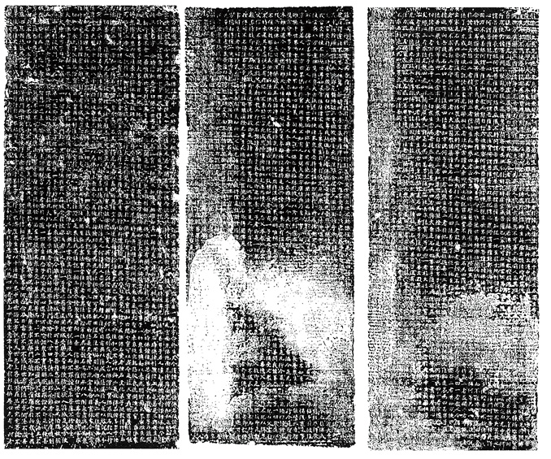
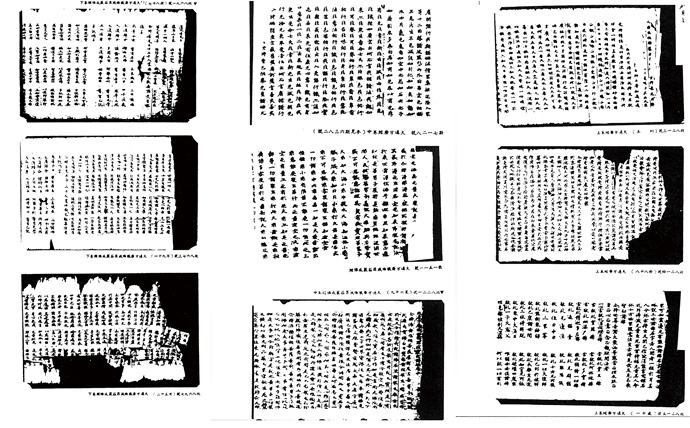
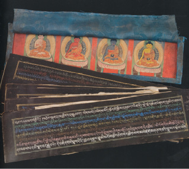
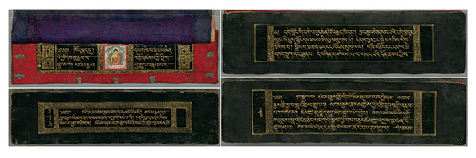

# 第1课

2020年9月7日

今天开始讲《大通方广忏悔灭罪庄严成佛经》，即《圣大解脱经》。

传讲这部经，是前段时间才决定的。很长时间以来，我一直想讲这部经，但不知因缘能否成熟，就没有跟大家说。前两天确定下来了，才向大家宣布。

但现在各方面情况都不方便，听众太多不一定合适。而且这部经很深，听众也是越少越好。现在的人很复杂，有些人有信心，有些人没有信心，有些人听法时抱着各种目的。所以，前两天我跟大家说：“除了平时听课的少数人以外，尽量不要通知其他人。”你们也比较听话，我比较满意，这次的听众不多不少——人太多了很麻烦，太少了也有点困难。

## 闻法要求

对于听闻《圣大解脱经》的人，我没有其他要求，只希望大家以后不要改变自己的信仰，即使做不到，也不要诋毁三宝、诽谤大乘佛法。如果连这一点也做不到，最好不要听闻。

一般来讲，一部法开讲时听众比较多。因为有些人比较好奇，想知道《圣大解脱经》到底讲什么，就来听一下。其实，只听一节课也听不出什么。就像在世间，若想了解物理、化学、生物、历史、数学等学科，只听一节课而不系统学习，也是不行的，只能结个缘、种个种子而已。

所以我希望，若无特殊原因，大家最好善始善终地听完。做任何一件有意义的事都需要善始善终，如果只有开头而没有结尾，就会给生生世世带来同样的缘起。前辈上师在窍诀中讲：故意断传承有毁坏佛塔的过失。大家应该非常清楚。

我讲课一般不会超过一个半小时，大家每天要抽出这么长时间听课，肯定很辛苦，我能理解。但是你们可能没有想到，其实我比你们更辛苦。作为听者，大家只要坐着听就可以了——能思维的时候思维，不能思维的时候就安静地坐在那里，只要不打瞌睡、不玩手机，旁边的人也不会觉得你讨厌；如果你一直玩手机、说话或睡觉，旁边的人可能会给你一些“加持”，对你产生不好的印象。相对而言，大家对讲者的要求就高了。如果我在法座上玩手机、打瞌睡或者说废话，大家就会说我。而且，我要提前翻阅很多藏文、汉文资料，否则讲课时就会有一定压力。

大家也可以换位思考：如果让你在这样的场合讲课，你会有何种心理压力？其实，如果我不讲课，天天到处玩也是可以的。我可以说：“我头痛，我晚上睡不着觉，我有高原反应，我心跳得厉害，我肝不好、肺不好……”我们这个臭皮囊肯定有很多不好的地方，尤其是像我这样的身体，随时可以说出一百个不讲课的理由。但我总觉得人生很短暂，佛法又如此殊胜，即使再累，我也要努力给大家讲法。所以，尽管里里外外有各种违缘，我还是一直在努力。

在座各位也要坚持听课，有了开头就要有结尾。当然，如果你是来玩的、来试探的或者来了解情况的，我就没什么可说了。因为你的目标、你的工作是这样，我的话你不一定会听。至于其他佛教徒，则要善始善终。

有些人不能坚持听课，并非因为没有时间，而是因为懒惰、懈怠、散乱，总找各种借口，确实是业障比较深重的表现。对于非法的、无聊的、造罪业的事情，有时间，有兴趣，有顺缘；对于行持解脱法，如听课、修加行、做善事，就会以心情不好、工作很忙、家里有事等给自己开绿灯。长此以往，诸多恶业习气会不断滋长。

这次我们好不容易有机会讲《圣大解脱经》，希望大家珍惜机缘，如理如法地听受。不知今年能讲多少堂课，因为除了讲课，我还有很多其他事情，但最晚明年应该能讲完。城市里的一些人，如果实在不愿意听，或者特别忙碌，至少要把藏文传承听完。我曾在帝察活佛和拉雪堪布面前得过非常清净的藏文传承，包括《大藏经》中的版本和未收入《大藏经》的版本。

前几天，我跟一些发心人员、工作人员说：“希望大家都能听一遍《圣大解脱经》。”一般来讲，人去世以后，如果请出家人、在家人等佛教徒在49天内，每天为他念一遍《圣大解脱经》，他就会获得解脱。而我们现在还没有死，用自己的耳根亲自听闻这部经，利益更大。关于本经的诸多功德，后文也会讲到。

我想，无论是谁，一味贪著名利地位，追求水泡般虚无缥缈的事物，都毫无意义，不如多积累对今世来世有益的精神上的资粮。

听课需要专门付出一定的时间，不能胡思乱想或同时做其他事情，也比较辛苦。按照佛法的要求，闻法时要一心一意，不能心不在焉、不在状态。对于修行比较好的人来说，这没有任何问题，即使连续听一百天传承，身心也很堪能，可以如如不动。佛学院中有些喇嘛，已多次听闻《大藏经》《麦彭仁波切全集》等传承。他们在听《麦彭仁波切全集》传承时，每天听12个小时，连续听三十多天，但完全没有问题。相比之下，我们上课的时间并不算很长。

如果我不讲课，你们也不听课，我们都没有约束地想吃就吃，想喝就喝，随意聊天，到处游玩，仿佛获得了“大解脱”。但我们都是人，还是要考虑今生来世，那就很有必要以闻法来增长信心、积累福慧资粮。

能传讲这部经，我感到非常欢喜。但我也担心无法讲圆满，希望大家好好配合，也祈求世出世间的护法神加持、保佑我们善始善终地学完这部经。当今是末法时代，无论个人还是集体，违缘都非常多，常常接连不断，想要圆满做成一件善事并不容易。前段时间我们圆满了《地藏经》，当天晚上我特别开心，我想：“今年是这么特殊的一年，我能讲完如此殊胜的一部经典真的很幸运！”接下来，也希望各位好好关注这部《圣大解脱经》。

## 发愿弘扬

汉地基本上没有《圣大解脱经》的讲闻传承。但在藏地，这部经可以说是家喻户晓，人们普遍对其非常重视，而且很有信心，几乎每个家庭都会供奉这部经典。然而对于经文的意义，不知道有多少人学习过。

在座各位，无论你是在家人还是出家人，不仅要自己通达此经，还要发愿：在得到传承后为有缘众生传讲，将其弘扬到世界各地，就像《心经》《金刚经》《妙法莲华经》《维摩诘经》《阿弥陀经》等大乘经典那样，在各个地方广泛流传。哪怕仅将经中的佛菩萨名号在一个众生耳边传一遍，都有非常不可思议的功德。所以，大家从今天开始，就要由衷地发愿弘扬这部经；如果今生没有机会，就下一世、再下一世去弘扬，发愿的力量是不可思议的。

在开讲的第一天，我们以不同语言、不同方便为世界上不同地方的众生传授这部经典。以后，大家也可以到非洲、欧洲等地去传讲。如果实在没有这样的能力和机缘，那么到某个非常偏僻的地区、山村或某个家庭当中，为那里的人们念一遍《圣大解脱经》也可以，用汉文念一遍大概需要两三个小时，这样也非常有意义。经中诸多佛菩萨的名号，能为当地的人们带来善的气氛、种子和光明。

## 始于童年的信心

我从小就对《圣大解脱经》有信心。不到10岁时，我还在放牛。当时，隔壁的日嘎喇嘛经常念这部经，他家里还有一个《圣大解脱经》的转经轮。这是我对此经生信的原因之一，但今天不着重讲，以后有必要再讲。

我今天想讲的是，那时我跟父亲去农区时的一些见闻。当时，牧区距农区大概有二三十公里，而且路很不好，要走一两天才能到。但为了生活，牧民会经常拿酥油、奶渣去农区换一些土豆、糌粑、豌豆、锅盔等。

我记得，我和父亲到了炉霍县城以后，去了中学附近一个叫桑当的地方，我们要去的那一家，有一个人叫桑当噶洛。我以前提到过他，他是一位特别慈祥的老人，平日没有任何琐事，家人也待他很好。他有一个属于自己的佛堂，每天的上午、下午，他都在那里念《圣大解脱经》，并转绕装有这部经的转经轮。

有时候，我会跟他们家的几个孩子到他房间里去，他就给我们一些黄糖，还给我们讲《圣大解脱经》的功德。当时，我们都是很爱玩的孩子，也听不太懂，我只记得他说：“这部经真的非常好，你们长大以后要好好念诵。”从那以后，那位老人的形象就经常浮现于我的脑海。

我跟他接触得并不多，只在冬天见过几次。我读小学、中学和甘孜师范学校时，每年放假回来去他家，都会看到他在念诵《圣大解脱经》。这部经，应该是他一辈子当中常年如一日所修之法。

来到佛学院以后，我得到了一部《圣大解脱经》，当时特别欢喜，心想：“这是那位噶洛舅舅每天念的经。”于是我也念了一遍，觉得经中的佛号非常殊胜。

当年，我是一个很调皮的孩子，并没有好好听他讲《圣大解脱经》的功德，但是，他常常手持大解脱转经轮、口念经文的形象深深影响了我。他虽为在家人，看起来也很普通，但是听说他圆寂时出现了很多瑞相。

总之，我对《圣大解脱经》的信心来自一位非常普通而又慈祥的老人，由于他的加持，我从小就觉得这部经非常重要。他常年如一日地翻阅、念诵此经，看起来心情特别愉悦，我很羡慕。现在的很多修行人、出家人，都不一定有他那样的心态。

有时候我会想：小孩子虽然很调皮，但他们在讲经说法、开法会等场合当中，内心会被播下强有力的善根种子。所以，有些家长一放假就带着孩子去寺院拜佛或在家里抄写经典，这非常有意义。不过，今年由于疫情影响，去寺院可能不是很方便。

以上就是我与这部经的一些因缘，以后有必要可以再详细讲。

## 汉文资料

### 1．汉译本出现时间

今天主要讲《圣大解脱经》不同译本（汉文、藏文、蒙文、日文等译本）的相关缘起。这部经虽然在藏地很出名，但不像其他一些经典那样为全世界所熟知。不知此经有没有英文、德文、法文等译本，我没有听说过。

汉地很多经典的结尾并无译师署名，《圣大解脱经》也是如此，因此很难推测此经译成汉文的时间。但在1900年，敦煌文献出土，许多不同时期的珍贵历史资料和书籍残本被发掘，其中有资料记载：公元590年，董仙妃的丈夫去世后，她向三宝祈愿，其亡夫生前曾造过一部《大通方广忏悔文》，以此善因，愿其往生净土、面见诸佛。据此可以推知，《圣大解脱经》的汉译本大概出现于南北朝或更早，即公元6世纪之前。

另外，唐朝的道宣律师收集了古代的很多忏悔文，其中就包括南朝陈文帝时期的《大通方广忏文》（《圣大解脱经》）、《金光明忏文》、《妙法莲华经忏文》等。可见，《圣大解脱经》应该在南朝之前就被翻译成了汉文。

### 2．版本选用

学者们在敦煌文献中发现了与《圣大解脱经》相关的21种残本，这些资料虽然不太完整，但很多字迹仍可辨别清楚。

我们这次使用的，是北京雍和宫的出家人、北京居士林的佛教徒对照藏文、汉文（包括敦煌本）、日文等各种版本后校对出来的版本。之所以用这个版本：一是因为《大正藏》中的译本缺少部分内容，所以我们没有选择；二是因为有些道友动作比较快，已经印了很多该版本的书籍。

所以，现在我们这里有不同封面的《圣大解脱经》，有红色的、黄色的、白色的。如果你们得到了三四本，可以将多的结缘给亲朋好友。我没想到大家印那么多，否则会建议印不同版本，包括《大正藏》中的译本。

当然，书是越多越好，不像世间有漏财产，拥有越多就越痛苦，如华智仁波切所说：“有一匹马，就有一匹马的痛苦；有一只羊，就有一只羊的痛苦；有一条茶叶，就有一条茶叶的痛苦。”在华智仁波切的时代，最珍贵的东西就是马、羊和茶叶了。而现在，我们应该说：“有一栋房子，就有一栋房子的痛苦；有一辆车，就有一辆车的痛苦；有一部苹果手机，就有一部苹果手机的痛苦……”有些人可能会想：“要是我有一部很好的手机，我可高兴坏了，哪里会痛苦啊？”

此次所用版本，补充了以前译本中缺失的3000多字内容。该内容在很长时间内一直没有找到。后来，人们在北京云居寺附近的房山石窟中发现了一些经典，被称为“房山经”。在九个房山石洞中，第八个石洞中就有《大通方广经》。刚才提到的北京的僧人和居士，在校对《圣大解脱经》的过程中也对照了“房山经”中的《大通方广经》。

据说，在“房山经”中，《圣大解脱经》缺失的3000多字经文是附在《阿弥陀经》后面的。一开始，很多人不知道那些内容是什么，后来才发现那是《圣大解脱经》的经文，于是将其补录入此版，使其成为一部完整的经典。

我们使用的这个版本可能还有一些缺漏和差错，也许是他们在校对过程中不懂得经文的意义而改错了。所以，我们在讲解过程中，有必要对照藏文本、敦煌本做些增补、校订。希望这部经讲完以后，会形成一个比较可信的版本。你们也可以参考《大正藏》和“房山经”中的版本。大概从1915年到2000年间，三十多部房山石经曾对外界开放，不知网上有没有这些经典的内容。

### 3．房山石经

房山石经的存在很有意义。

在一次灭佛运动中，皇帝下令摧毁所有佛像、佛经、佛塔等。劫难过后，为了保护经典，僧人慧思打算把佛经刻在石头上，但此想法还未付诸实施，他就示现了圆寂。后来，其弟子静琬等人开始刻经。到了唐朝，唐玄宗的妹妹金仙公主得知此事，就利用自己掌握的资源支持刻经工作。目前已经发现的房山石经，内容非常丰富，所刻佛经共计1122部，刻有经典的石块有一万四千多块。

刻经是保存经典的有效方式。纵观隋、唐、宋、元、明、清各朝代，有些皇帝很重视刻经功德，并非常支持佛经刻版工作；也有一些皇帝并不重视保存佛经，反而下令摧毁佛经。尽管历史上曾发生过很多重大历史事件，但值得庆幸的是，房山石经仍存于世。

房山位于北京一处比较寂静的地方，房山石经现在可能没有对外界开放。但石经的部分内容已经有了拓本，我给大家看一些图片。

房山石经

石上刻经是保护佛经的重要方法。现在，很多人将佛经等资料存在电脑上、网络上，其实这种做法很危险。一旦发生电子科技战，所有电脑、软件中的数字信息，就会被迅速摧毁。因此，将佛经刻在石头上就显得更为安全。

在藏地，德格印经版的历史非常悠久。刚开始，大家一般手抄经论，后来随着印刷技术的发展，才开始用藏纸和汉纸印刷经论。用藏纸印制的《大藏经》（含经典和论典），现在全套要八十多万，以前我们寺院请的时候才几千块钱。在藏地历史上，《大藏经》有卓尼版、拉萨版、北京版、理塘版等很多刻板，其中最著名的就是德格印经版。

总之，印刷纸质书籍是保护佛经的一种方式，但若发生灾难，纸质书籍也可能被摧毁；将佛经论典放在网络上也不是最安全的方式；而将佛经刻在石头上就比较安全。像房山石经被发现后，人们从中得到了很多佛经残本，这非常有意义。可见，有些国王、皇帝和前辈大德在保护佛经方面所做的努力确实很值得称赞。

### 4．敦煌残本

敦煌文献也非常有价值。我给大家看一下与《圣大解脱经》有关的敦煌残本图片。在这些残本当中，有些内容已无法识别，但也有很多内容是可以辨认清楚的。

《圣大解脱经》敦煌残本

以上是汉文资料，我再简单介绍一下藏文资料。

## 藏文资料

据说，藏文《圣大解脱经》有可能译自汉文本，因为经文末尾写了“汉译本七百一十二颂，合二卷零一百一十二颂”。但这样的标注也可能表示汉文本有多少颂，确切的含义不得而知。我最近查阅了不同《大藏经》中的很多资料，发现《圣大解脱经》在藏地历史上也特别受重视。大概在19世纪时，蒙古图书馆中珍藏着由金、银、珊瑚、玛瑙、松石、砗磲等七宝制成的《圣大解脱经》，请看图片资料。

七宝写成的《圣大解脱经》

金粉写成的《圣大解脱经》

七宝制成的《圣大解脱经》，每一页都有不同颜色。用金粉手写的《圣大解脱经》，现在保存于德国巴伐利亚州立图书馆，制作时间不详，但译者身份比较清楚，因为经文末尾写道：《圣大解脱经》译于藏地前弘时期，译者为印度班智达则那莫扎（前弘时期的很多经典都是他翻译的）和藏地罗扎瓦——僧人益西得（译成汉文为“智军”）。后者为赤松德赞的九大译师之一。当时，赤松德赞国王开了七个大译场，由一些非常伟大的译师做组长，组织译师们进行翻译。

益西得译师生活于8世纪，即前弘时期的赤松德赞时代，藏文《圣大解脱经》就在那时出现于世。这样看来，这部经的藏文译本很可能不是译自汉文本。我对照了藏文《大藏经》中的《圣大解脱经》和德国巴伐利亚图书馆中的《圣大解脱经》的前、中、后三个部分，发现二者一模一样。

## 学术分析的必要

今天的课也许有点枯燥，不研究学术的人不一定感兴趣。但这些内容还是很重要的，为什么呢？因为在汉地，有些人曾怀疑《圣大解脱经》《涅槃经》等是伪经，包括唐朝之前出现的很多大乘甚深经典，他们都提出过怀疑。我们学《六祖坛经》时了解过梁武帝之前中国的社会状况，当时的许多众生并非广大、甚深法门的根基，所以人们才会提出如此怀疑；而在唐朝时期，甚深经典则被广泛弘扬。

了解了上述内容，面对怀疑《圣大解脱经》是伪经的人，我们就可以说：德国巴伐利亚图书馆中收藏的《圣大解脱经》中显示，公元8世纪的前译时期，《圣大解脱经》就被译成了藏文；汉文译本出现的时间更早，敦煌出土的古书中记载的资料显示，公元6世纪时，汉地就非常重视这部经，像现在的藏地一样用这部经超度亡人。

以前有些人将真实的佛经说成伪经，造下了非常严重的罪业，特别可怜。若从学术层面分析，就可以确定《圣大解脱经》并非伪经。

公元8世纪，《圣大解脱经》被弘扬到日本，当时的天皇非常支持该法的弘扬。公元823年，日本天皇召请空海等高僧专修《圣大解脱经》，这有非常明确的历史记载。大概在公元16世纪，藏文《圣大解脱经》被译成了蒙古文，当时的蒙古王族对此特别重视，该经现收录于蒙文《大藏经》当中。

总之，《圣大解脱经》有蒙文、日文、汉文、藏文等不同译本。在藏地，人们会为亡人念诵49天《圣大解脱经》。从敦煌出土的残缺本中可以清楚了知，在以前的汉地，人们也会为亡人念诵《圣大解脱经》，但不知是否也念49天。

通过以上的分析和研究，我们就能遣除很多怀疑，也能了解到古人特别重视这部经典。大家方便的时候最好看一下敦煌出土的《圣大解脱经》残本。我们这里的个别道友只对念佛有信心，其实也有必要关心一下学术问题。如果汉传佛教徒全部只念佛，藏传佛教徒只是拼命地转转经轮，对理论和历史研究都不感兴趣，也不了解当今时代的新知识，面对人们对于学术、历史问题提出的争议就难以遣除，而且自己也可能懵懵懂懂，越来越迷糊，甚至对法产生怀疑。到那个时候，不要说弘法，连自己的修行都无法成功。所以，大家闻思任何一部法的过程中，都要遣除相关的怀疑和邪见。

我讲解每一部经论时，都很想翻阅大量资料，以了解这部法的背景、历史渊源，能为人们的今生来世带来何种利益，对社会产生何种影响，以前有没有人提出过相关争议等，很多方面都要剖析。这样学习很有意义，自己也会很舒服。所以，我不管学什么，只要有时间就会翻阅很多经论。大家也要用这种方式来学习。

虽然《圣大解脱经》在藏地、汉地、日本、蒙古等地备受重视，但我们弘扬的力度不够。从我们这个时代开始，大家要发愿弘扬《圣大解脱经》。现在，各位看起来不是多么伟大，但我想，你们回到家乡或去往其他地方以后，每个人都应该是很伟大的人物。到那时，你就可以弘扬《圣大解脱经》。

## 经名

这部经名叫《大通方广忏悔灭罪庄严成佛经》。

“大通”就是“大解脱”，有些版本中将其译为“大解脱”。因为“通”表示四通八达、畅通无碍，没有任何束缚和障碍，与“解脱”是一个意思。

“方广”，一般用于大乘经典的名称，因为在大乘佛法中，一切众生皆为平等，故“方广”也叫“方等”。《月灯三昧经》中说：“广大如虚空，是法相如是，此为究竟宝，故名为方广。”大乘佛教思想如虚空般广大、包容，无人我分别，只要是众生，只要是生命，都会用爱去拥抱、去保护。“方”为十方，“广”意为无有边际，表示大乘佛法广大无边，三千大千世界的众生都可以享受其甘露妙味。

“忏悔灭罪”，此经为佛陀接近涅槃时，为令众生灭除罪业而宣说的。

在这个时代，好像每个人都认为自己很好。事实上，很多人在行住坐卧间所做之事无不是罪、无不是业。而且，一个人的贪嗔等烦恼会影响周围人，就像涟漪一样，令其他人也生起贪嗔之心，进而造下罪业。

在末法时代，电影的影响力非常大，明星的诱惑力也很强。身为出家人，本来应该重视的是戒定慧三学的功德，应该仰慕的是月称菩萨和龙猛菩萨等大德圣贤，可是我听说，个别剃成光头的出家人，也在追星，甚至经常为他们交念经钱，请僧众加持保佑。这样愚痴的表现，真的很令人遗憾。

总之，在这个世界上，行持善法的人是很少的，而造恶业的人比较多。

修持《圣大解脱经》确实能灭除罪业。日本流传着一个发生在8世纪的民间故事：一个人天生耳聋，他感到很痛苦，就向一位禅师寻求解决办法。禅师告诉他：“这可能是你前世所造罪业感召的，需要念诵《圣大解脱经》好好忏悔，还要在身上涂一些香水（可能是去除垢气的一种水，不是现在所说的香水），这对恢复听力有帮助。”过了一段时间，他的罪业清净了一些，有一天他正在念诵经中的佛菩萨名号时，一只耳朵就能听到声音了。他继续念，又过了一段时间，另一只耳朵也恢复了听力。后来，这件事在日本家喻户晓，人们都开始重视这种忏悔方式，以此消除前世罪业。

“庄严成佛经”：“庄严”有不同含义，包括装饰庄严、能显庄严，此处指后者——能显的庄严，意为这部经能呈现释迦牟尼佛大乘经典的意趣和密意。“成佛经”，意为依照此经修行、忏悔必定能够成佛。所以说，这是一部能成佛的经典，就像人们常说的“成佛的法华”一样，此经也可以叫做“成佛的大解脱经”。

以上是对经名的简单介绍。

敬礼一切佛菩萨！

这句话是译礼，在《大正藏》的版本中没有，藏文译本中有，应该不是经典原文，而是译师加的译礼。赤热巴巾国王曾规定：翻译经、律、论三藏时，要分别顶礼诸佛菩萨、释迦牟尼佛和文殊智慧勇识。但智军译师与赤热巴巾国王并非同时代的人，也许在赤热巴巾国王如此规定之前，藏地译师就有这种做法。

| 如是我闻。一时佛在王舍大城。

“如是我闻”和“一时”，之前已讲过多次，这里不再赘述。

“王舍大城”，《观经》中也提到了王舍城，该城为频婆娑罗王所统治的摩揭陀国首都。

| 与大比丘八万人俱。诸菩萨三万六千人。

当时佛陀与八万比丘在一起，在场的菩萨有三万六千人。

下面讲这三万六千位菩萨的功德。这是大乘经典，所以主要讲诸位菩萨的功德。

| 于一生中。远离一切盖障。

这些菩萨都非常了不起，是一生补处，在一生当中就能远离一切障碍，获得成就。根本的盖有五种，包括贪欲、嗔恚、掉举、怀疑、昏眠。

| 具足威德自在。

自然具足身语意的威德和功德。

| 于如来前。劝请宣说。方便密意。

诸位大菩萨在如来面前，以善巧方便请求佛陀宣说密意。

此处与敦煌本稍有不同。敦煌本中说：诸位大菩萨在如来面前劝请说法，如来就会宣说其方便密意。如果是阿罗汉或凡夫请佛转法轮，佛陀不一定应允；而菩萨知晓如来所关注的要点，因此会很善巧地请求佛陀传法——这一点，从《地藏经》等很多经典中也能看出来。如此祈求后，佛陀就会为众生宣说其方便密意。

| 能使佛地。悉皆清净。

到了佛地，一切功德悉皆圆满。只有菩萨能使佛地的清净功德得以显现，阿罗汉、凡夫都做不到。佛地本无任何杂染，如极乐世界一般，但若想使这样的清净刹土得以显现，还要依赖菩萨的修行。

此处经文，在敦煌本中是“清净佛刹”，所表达的意思是一样的。《现观庄严论》中讲，菩萨最后要专门修清净佛刹，也就是展现佛刹的清净性。

| 如来事业。任运成就。

诸位菩萨可以任运成就如来的27种事业。

对我们来说，成就如来事业是很难的，任运成就更不用说了。我们可能连上师的事业都很难成就，反而会给上师或道友的事业制造违缘。菩萨们不同，他们可以借助各种方便方法，自然而然成就佛陀事业。

| 以诸佛威德而为建立。

这些菩萨以诸佛的威德而建立。

“威德”在藏文译本中是“加持”。这些菩萨依靠佛陀的无量威德和加持而成就了自己的事业和修证，时时沐浴在佛陀的加持之中。有些道友也经常说：“我在上师三宝的加持下，过得很快乐。”其实，诸佛菩萨无时无刻不在加持着我们，只要我们有信心，就一定能感受到上师三宝的加持，这时无论做什么都会很吉祥，日日夜夜都会很快乐。

了解这些功德确实很有必要。《观佛三昧海经》中说：“若称我名及称南无诸佛，所获福德无量无边。”如果称念我释迦牟尼佛的名号，或称念南无诸佛，所获得的福德无量无边。大家平时也应经常祈祷佛陀。其实，念诵“南无佛”“南无释迦牟尼佛”“南无药师佛”“南无阿弥陀佛”等并不困难，但若昼夜经常念诵，就会行住坐卧都不离佛的加持，非常有意义。

| 为守护法藏故。受持大乘。

原经文中的“法器”，在敦煌本和藏文本中都是“法藏”，可能“藏”好一点。

为了守护法藏，诸位菩萨受持大乘方等教法，包括大乘陀罗尼、经典、论典等。

受持方等经（即大乘经）的功德确实很大。《三宝感应要略录》中说[^1]，曾有一位比丘名道如，他特别懈怠，不念佛，也不好好持戒。61岁时，他患病而死，但三天后又复活了。他对别人说：“我死后见到了观世音菩萨和大势至菩萨，他们呵斥我说：‘你在世时不好好念佛、修行，行为也很糟糕。但是，由于你曾听闻十二部方等经的名称，功德很大，罪垢微薄，而且你的阳寿未尽，可以回到人间。’”后来，他就用余生来弘扬大乘佛法。

有些人可能听不懂《大解脱经》，那也不要打瞌睡，要尽量坐着，哪怕不断看手表，盼着早点结束好早点获得“大解脱”也可以，只要耳边听到这部经，就会获得利益。《十住毗婆沙论》中讲：“若人教恒沙，众生住罗汉，不如教一人，住大乘为胜。”令恒河沙数众生获得小乘果位，都不如令一个人受持大乘佛法的功德大。

| 能师子吼。震大法雷。名闻十方。

这些菩萨以空性狮吼声，于十方世界震大法雷。

诸位菩萨在十方世界发出无我空性的狮吼声，仿佛雷声一般。《文殊所说最胜名义经》中说：“处于无我义，犹如狮子吼，威振诸外道，众魔皆惊怖。”无我空性义犹如狮吼声，可以震慑外道，令魔众惊慌失措。如果我们能像诸大菩萨一样，证悟了无我空性，并安住于空性境界，就不会受到外道的危害，也不会被魔障、违缘所障碍。

诸大菩萨的功德还没有讲完，后面再慢慢讲，今天就讲到这里。

[^1]: 《三宝感应要略录》：“并州有一比丘。名曰道如。此州之人。七岁已上。多解念佛。然此比丘。不修念佛不持戒。畜不净物。身犯不悔。生年六十一。顿中风疾。月余方死。三日始苏。起居轻利。病尽除愈云吾初死之时。见观音势至来。示教利喜曰。汝不修净土业。唯闻大乘方等十二部经名字。以是因缘。罪垢微薄。远来影向。余命未尽。十二年后。将生净土。即合掌流泪方醒活。更舍所有。造方等大集。兼修念佛。至第十二年正月十五日方卒。音乐在室。天花雨降。现所见闻矣。”
