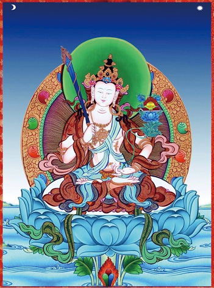
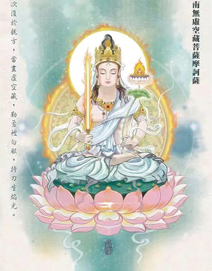
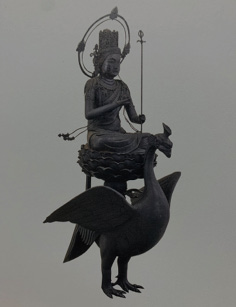
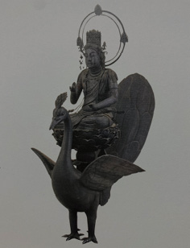
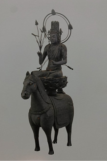
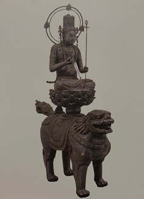
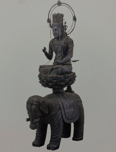

# 第28课

2021年6月15日

今天讲完《圣大解脱经》后就是11天的暑假，也就是耍坝子。如果没有特殊情况，我们会在28号继续讲课，周一、周二讲《圣大解脱经》，周四、周五讲《宝性论》。

上节课讲到，虚空藏菩萨问佛：如果法和如来都了不可得，那您为何要在不同的经典中说要广行善法？佛陀称赞他问得很好，并回答说：在胜义当中，法中没有文字、文字当中也没有法，而在世俗当中，为流布法而说有文字；菩提之理亦然。

| 善男子。实如汝说。如来无灭无生。不修不行。离诸修行。不入正位。亦不退转。

善男子，确实如你所说，如来没有灭也没有生，没有修持六波罗蜜多等法，也没有行持六度万行，远离了一切修与行，没有达到无学位，也无可退转。

《心经》中说：“无智亦无得。”究竟而言，得果与退转都不存在。《宝性论》中也说，法性中实无产生，佛陀依靠智悲力等功德，在世间示现稀有之八相或十二相。

下面会讲，究竟而言，佛陀降生到涅槃之间的十二相均为空性、了不可得。有些人可能会想：“前面说佛陀有三十二种庄严身相，还有降生、转法轮等十二相，此处又说没有十二相，这是否矛盾呢？”其实并不矛盾。说“有”是指有显现，说“无”是指本体无实。有些物理学家也认为：现相中的瓶子虽然存在，但其本质并不存在，除了微尘的积聚以外，瓶子的本体了不可得。当然，物理学家可能仅在理论上如此承许，不一定有修行上的体悟。

| 一生不生兜率陀天。不从天下。不处世胎。

在世俗当中，佛陀曾以一生补处的身份转生兜率陀天。但在胜义层面，他并未转生兜率陀天，也没有以五种观察来到人间，入于摩耶夫人胎中并住胎9个月。

| 于一切法。心无所住。亦不说言。我已过于生老病死。

佛陀在母胎中时，对于一切法心无所住，也未对众生说“我早已超越生老病死”。

| 亦不四维七步而行。亦不自言。我是世间无上之尊。

在名言当中，佛陀从摩耶夫人的腋下降临人间，往四方各跨七步，并说：“天上天下，唯我独尊。”而在实相当中，这些都不存在。

佛陀降生后，为什么要说“天上天下，唯我独尊”呢？主要是为了摧毁众生的傲慢。很多众生觉得自己很了不起，当他们看到佛陀降生时显现了无比稀有的功德后，就会息灭相续中的傲慢。

不同经典对于佛陀的十二相有不同讲法，有些佛经中说：佛陀先学习世间技艺，包括骑象、骑马等，后来在皇宫中享受生活。此处的次第稍有不同。

| 不处中宫婇女娱乐。

佛陀成年后，没有在皇宫中与四大王妃、六万婇女共相娱乐、享受生活。

| 不习世间伎乐之事。亦复不学槃马角力。

在此之前，佛陀没有学习工巧明、文字、伎乐等各种世间知识，也没有学习槃马（槃旋骑马）、骑象、角力。

“角力”，是指较量力气、摔跤等。当时，佛陀与释迦族的王子们会比试力气。

讲到佛陀的成长过程，大家应联想到当时印度的社会环境。在没有枪炮的古代，汉地等地方的国王、大臣、太子，都会通过比武等方式来较量力气。

## 种种示现

| 欲度众生入涅槃故。

佛陀为度化众生，令其趋入涅槃、获得佛果，会示现如下一些行为。

“入涅槃”，有些版本中没有，藏文译本中有。

下面的内容在前面也有涉及，但表达方式有所不同。就像人们在表达同一意义时，会因为情绪和动机不同而有不同的表达方式一样。佛陀为度化不同众生或强调某个要点，也会有不同的表述风格。对于佛陀的十二相，前面是以否定方式来表达，下文则以肯定方式来说明。

佛陀出家前，从王宫的四门出游，看到了老、病、死的情形，又看到了沙门的寂静相，于是生起出离心而出家。但实际上，佛陀早已获得十地末位的境界，成为一生补处，这些行为只是为利众生的示现而已。

| 示现老相为坏贪身。

佛陀示现见到老相而心生出离，是为令众生断除对身体的贪执。

了知佛传的人应该清楚：佛陀见到老者而生起悲心、意识到自己也会衰老，于是生起出离之心，是为令众生断除对身体的贪执。

一般来说，在家人很介意衰老，脸上长了皱纹就很伤心；而出家人觉得，老了也很好，长皱纹也无所谓。

| 示现病相为坏贪寿。

佛陀示现见到病相而心生出离，是为令众生断除对寿命的贪执。

自己没生病、也没看到病人时，很多人都觉得自己还可以活很多年；而见到病人后，往往能断除对寿命的常有执著。

| 示现死相为坏贪欲及我我所。

佛陀示现见到众生死亡而心生出离，是为令众生断除贪欲和对我、我所的执著。

我们在有些舞台表演中可以看到，有人去世后，尸体被四个人抬到外面，这也是印度的习俗。

| 示现沙门相为令众生不求梵天帝释之身。勤求出世无上之法。

佛陀示现见到沙门相而心生向往、很想出家，是为令众生不求后世获得梵天、帝释天的果位，而要勤求出世间的无上菩提。

以上这些经文以及昨天讲的“法中无字、字中无法”这一段，在《大集经》中几乎有完全一致的内容，翻译风格也很相似。

佛陀示现出家，也是为了断除众生的傲慢和贪执之心——像悉达多太子那样有名的王子都能舍弃王位、财富、眷属、所爱之人，那世间一般人对自己所拥有的一切又有何可贪执呢？

以上这些示现，在不同译本中的表述有所不同，但藏文译本和汉文译本基本一致。

| 逾出宫城示现出离三界牢狱。及显此非终极之果。

佛陀生起出离心后出于王城，是在示现出离三界牢狱，并同时表示，这仅仅是证得了自己的解脱，并非终极的果位。

| 前后顾视故示现无嗔爱。

佛陀出宫时前后顾视（佛传中也有此描述），表示佛陀内心已获得自在，没有嗔心，也没有贪心。

| 是故三十二相庄严其身。为示众生良佑福田。

佛陀以三十二相庄严自身，是为众生示现良佑福田。

佛陀离开王宫后，来到清净塔处剃除须发，通过修行获得具足三十二相的庄严之身，成为众生福田。

| 剃除周罗弃舍璎珞。遣马令还放阐陀罗示现远离一切烦恼。

佛陀剃除自己的发髻（周罗）、舍弃璎珞等庄严饰品，并让阐陀罗将白马牵回去，是在示现远离一切烦恼。

佛陀已断除烦恼，否则不会剃除须发、舍弃饰品和白马。佛陀在显现上也很喜欢那匹白马。可以说，那匹马相当于现在最豪华的奔驰、宝马。如果当时印度有车，佛陀会让阐陀罗把自己的车开回去。（众笑）

阐陀罗就是车匿，是服侍悉达多太子的低种姓车夫。后来他也出家了（六群比丘之一），因为以前一直在佛陀身边，他就很傲慢，不把任何人放在眼里，有时还爱告状。佛陀圆寂后很长时间，他才得阿罗汉果。

上师身边的人不能傲慢。很多人觉得自己跟上师关系好，就特别傲慢，经常吹牛，说活佛说了什么、堪布说了什么，让人不辨真假，最后成了阐陀罗一样的人。其实阐陀罗也没什么了不起的，除了给悉达多太子当车夫以外，并没有做很多事情。但由于傲慢，很多人已经得果了，他还是个凡夫。

世界上最了不起的人应该是佛陀，他对身边的人应该会好好加持，但佛陀的亲戚提婆达多、侍者善星比丘（给佛陀当过24年侍者）经常干坏事，最后都堕落了；阿难虽然得果了，但得果的时间也很晚。

有些上师的发心人员也是这样，又傲慢、又忙、又不好好修行，这样还不如离上师远一点，自己好好修行。如果自己修得好，也不需要依赖和上师的关系。

现在有些领导也很傲慢，开会的时候，需要秘书先把茶杯和笔记本拿来放在桌子上。他们的秘书也很傲慢。其实那些秘书也没什么了不起的，只是帮领导拿拿东西而已。我这几年遇到很多领导身边的人，发现领导和秘书的性格往往很像。

上师、领导身边人的言行是很重要的。因为，很多人没有机会直接接触上师、领导，如果接待他们的人性格不好，他们就会认为：这位上师、领导的性格应该也不怎么样。进而心生邪见，再也不想理那个领导，再也不想跟那位上师学法了。

当然，我并不是说，上师身边的发心人都是坏人，有些发心人还是特别好的。麦彭仁波切有个侍者叫沃色，他为了上师的健康和事业，可以完全不顾自己的身体。麦彭仁波切在世时，他造的论典需要刻版，要花费大量人力、财力，堪布根华和侍者沃色对此非常重视。在他们的努力下，很多法本流传至今。可以说，侍者沃色对此功不可没。

| 现剃须发示现无贪著于一切法。

佛陀以剃除须发示现对万法无有贪著。

此处的“须发”指胡子，藏文译本中是“胡须”。古代的印度人、汉地人都喜欢留胡须，现在，中东一带、藏地的炉霍、道孚人也爱留胡须。我有好多亲戚是络腮胡，需要天天梳理。我如果留胡须的话，胡子也比较多，我想以后闭关的时候，可以在几个月当中留一下，但没有头发、光有胡子可能也比较难看。

法王如意宝不太赞叹留胡子。我刚来喇荣的时候，觉得留胡子比较好看，就把上唇的胡须留得比较整齐，齐美仁真堪布经常拿这个跟我开玩笑。我也开他玩笑说：“你的胡子不守纪律，想在哪里长出来就在哪里长出来。”后来，不知谁告诉了法王，法王就在课堂上把这句话说了出来。现在我们两个都没有留胡子了，不再像年轻时那样，什么都要试一试。

| 受持袈裟示现调伏众生。

佛陀身穿袈裟，是在示现调伏众生。

那天我给大家放了一个视频，有人说释迦牟尼佛是最厉害的企业家，因为他的员工全部统一服装——他说我们是“员工”。的确，佛陀可能是历史上最早提倡统一服装的人。无论南传佛教、藏传佛教还是汉传佛教，僧人的服装历来是统一的，看起来很整齐、庄严、壮观，令人见而生喜。现在很多企业也会统一着装。

受持袈裟的确可以调伏众生。比如，对佛教没有信心的人，看到僧众穿着袈裟排队、诵戒会生起信心。以前，法王如意宝举行灌顶等活动时，僧众也会全部披上黄色袈裟，非常庄严。

| 从郁陀伽阿罗边咨问受法示现破坏自高之心。

佛陀从郁陀伽、阿罗（藏文中是“阿罗陀”）这两位仙人面前听受法要，以此示现破坏贡高我慢的谦虚之心。

郁陀伽是数论外道仙人，阿罗是禅定大师，他们都很了不起。按理来讲，佛陀已完全通达仙人所说法要，但为摧毁傲慢、示现谦虚，还是在其面前听闻了禅定、安住等修行方法。当时，那两位仙人已经很老了。佛陀成佛后，虽然很想给他们传法，但是两位仙人已示现圆寂。

| 六年苦行为调伏外道。

佛陀苦行六年，是为了调伏外道。

外道很重视苦行，佛陀若不如此示现，就无法调伏他们。现在人也比较看重苦行。在藏地，如果一个出家人在山洞里修行，洞里除了一袋糌粑空无一物，人们就会很虔诚地说：“嘉森切！”（表达特别想皈依的意思）；如果某位上师开豪车、住在特别豪华的房子里，很多人就生不起信心。可见，人们对于苦行的态度从古至今并未发生改变。

作为佛教徒，在衣食住行等方面行持一些苦行，对自己的修行非常有帮助。当然，如果自己有条件，也不必刻意苦行。

| 现受饮食随世俗法。

佛陀接受牧羊女供养的饮食，是随顺世俗法。

佛陀已获得金刚身，根本不需要以饮食来滋养身体。但为了随顺世间，佛陀还是喝了牧羊女供养的牛奶，因苦行而十分瘦弱的身体马上恢复如初。有些经典中还说，佛陀连呼吸也是随顺世间。

| 现受藁草示于知足。

佛陀在前往金刚座的路上，接受了吉祥仙人供养的吉祥草（“藁草”），以此示现知足少欲。

对于吉祥仙人供养的吉祥草，佛陀并未挑剔，而是立即接受了，这是在为我们示现知足少欲。有些法师条件稍微好一点时，就只接受好的供养，看到自己不喜欢的东西就说：“这个我不要，你拿走！”作为修行人，对于他人的供养最好不要挑剔，无论好坏都应接受，并好好为施主回向。

| 坐草褥上示坏骄慢。

佛陀来到金刚座的菩提树下后，坐在草褥上，以此示现毁坏傲慢。

佛陀仅仅坐在草褥之上，并没有坐在高档的垫子上。我们作为佛的追随者，对物质生活也不要有过高要求。有些人没有这个条件，也无法挑剔。如果稍微有点条件，就要求特别高，“我一定要住豪华房子、吃山珍海味、穿名牌衣服……”其实这些并不是佛教徒的庄严。当然，作为在家人，在自己福德范围内享受物质生活也可以。

很多前辈高僧大德都非常节俭，一件衣服穿几十年，一间破屋住好多年。其实，他们完全有条件享用好的衣食，住好的房子，但他们清楚：这个肉身只要能维持下去就可以了，花费过多精力追求物质毫无意义，只是浪费时间而已。

| 诸天龙神赞叹恭敬示现功德庄严果报。

诸天龙神赞叹、恭敬佛陀，以此示现佛陀获得了功德庄严的果报。

许多天人和龙是很傲慢的，不会轻易赞叹他人。如果连他们都赞叹佛陀，说明佛陀确实功德巍巍，很了不起。

| 降伏外道示勇猛力。

佛陀降伏六本师为主的外道，以此示现他具有勇猛力。

佛陀并不像现在一些名人一样，借助偶然的机会而名声大噪。因为，无论在智慧方面，还是身体的力量方面，佛陀都无与伦比。比如，佛陀的十力就无人能及。

| 右手指地示作福力。

佛陀以右手指地，表示他具有非常大的福德力。

佛经中说，佛陀曾在三阿僧祇劫中积累福德资粮，最后示现入胎、转法轮、降生、获得成就等相，佛以右手压地，地神就现身为其作证。

| 大地震动示报恩故。

大地震动，示现佛陀报答上师、父母、众生的恩德。

| 修无相愿。获得无上菩提之道。示现了知一切法相。

佛陀修万法无相无愿，最后获得了阿耨多罗三藐三菩提之道，以此示现了知一切法相。

以上是佛陀的种种示现。下面讲佛陀的不同名称。

## 不同名称

### ·佛

| 观法平等。名之为佛。

佛陀了知万法实相，对于好坏、高低等一切法都平等而观，对所有众生亦平等看待。

在实相当中，好与坏等相对之法皆为平等。密法中讲“等净无二”，意为万法平等、清净、无二无别。佛陀具足这样的智慧，因此名为佛。

### ·如来

| 佛之智慧。无能胜者。所说法要。如去来现佛。以是义故。名为如来。

佛的智慧无与伦比，世间无有能超越者；佛陀所说法要，与过去佛、现在佛、未来佛无有差别。因此，佛陀名为如来——如三世佛一样而来。

以后如果有人问你：“佛为什么也叫‘如来’？”你就可以这样回答。

### ·一切智智

| 了了见知。三世之事。善不善法。名萨婆若。

佛陀对于过去、现在、未来之事，包括善法、恶法、无记法、一切因果、现相、实相，全部了了分明、悉知悉见，因此佛陀又名萨婆若，即一切智智。

### ·天人师

| 真实语故。名天人师。

佛陀所言皆为真实语，故名天人师。

佛陀因地时亦为实语者、不妄语者，他所说之法千真万确，无丝毫虚假，因此名为天人师，即天人和人的导师。

世间很多人会说不真实语，佛陀则不然，因为他已完全断除无明和妄语之因。

下面是总结：

| 若有学者。能作是观。是名菩萨。

如果学道者能理解上述道理并如是而观，则名为菩萨。

前面讲了，佛陀在胜义中为空性、在世俗中为利众生而有种种示现，若学人能理解此义并如理而观，即名菩萨。

| 若作异观。不名菩萨。则名欺诳一切诸佛。

如果不这样观，就不能称为菩萨。这样的人，可以说是欺诳一切诸佛。

若未按前述道理而观，还相反理解，这种人可以说是骗子。《观经》中说：“作是观者，名为正观；若他观者，名为邪观。”如果按照经中所说去观，即为正观，如此能透彻理解佛陀、佛法的世俗胜义二谛。若能做到这一点，不管你是居士还是出家人，也不管你是汉族人还是藏族人，都可以称为菩萨。若不能这样观，不仅不能称为菩萨，还应称为欺诳一切如来者，肯定是个大骗子。

在网络时代，大家要特别注意一些人的欺骗行为，如各种名义的化缘。前段时间，有些人自称是第七届、第二十届的负责人，还说是我指派的。对此，我以不同方式多次申明：我没有指派过这样的负责人。但他们还是在以负责人的名义敛财，欺骗别人。有些人听他们说“我是上师派来的，我是管学习的，他是管放生的……”就会轻信，还给对方汇款。那些敛财者是明目张胆的欺骗，但相关部门并未介入。有时候，他们对于该管的事管不了，不该管的事什么都管。

还有很多人以供斋、放生、供养上师、供养僧众、造佛像、建佛塔、救助病人、助学等名义敛财。这些名头都是有功德的善事，如果他们确实这么做了，的确能积功累德。但有些人拿到钱以后，只用其中一部分做善事，另一部分自己留下；还有一些人则把钱全部装进了自己的腰包。

我在课堂上再三讲过：我从未安排任何人以建筑、学习等名义化缘、募捐。但有些人认为我的话是有密意的。这些人真的很笨，他们所谓的“密意”只有他们自己能懂，还相信那些人而捐钱，这是很可怕的。那些化缘者是否欺诳了一切如来我不知道，但确实欺诳了很多人。

在网络时代，佛教徒一定要注意这种现象。如果发现身边有人上当受骗，不要不理不睬，应该跟他们澄清事实——要以事实为准，不要以某个人的语言为准，这很重要。

| 善男子。一切诸佛。不出不入。不生不灭。为度众生。唱言出世。为度众生。唱言灭度。

善男子，一切诸佛，皆为不出不入、不来不去、不生不灭。但为度化众生，佛陀也会说“我在蓝毗尼花园降临人间，在娑罗双树间示现涅槃”。

诸佛菩萨的化现——具有法相的上师、善知识们与佛陀一样：在了义层面不生不灭；在现象层面，为断除众生的邪知邪见而示现转生人间、生病、涅槃等。

佛陀的降生、涅槃都能为众生带来利益。比如，很多人见佛陀圆寂便发起精进而得果，因为他们意识到：佛陀的金刚身都示现圆寂了，我们的身体又有何可信赖呢？华智仁波切在《大圆满前行》无常部分讲过一些比喻：“法王松赞干布时，如尊胜宫般的红山宫殿，如今已片瓦不存，连基石也无影无踪了。我们对现在如同虫穴般的城市、住宅、寺庙等如此珍爱耽著又有什么用呢？”

一个伟大人物示现圆寂，会引发很多人深思。法王如意宝在世时，弟子们都觉得上师会经常在；直至上师突然示寂，很多弟子才意识到，巨大的无常可以骤然降临，从而比上师在世时还要精进修行。可见，佛菩萨、高僧大德示现无常，能给众生带来深刻启示。

| 虚空藏菩萨白佛言。世尊。我实久知。法相理空。诸佛如来。无出无没。不生王宫。双树不灭。毕竟常住。为度众生。修诸苦行。而入涅槃。实无动转。诸佛如来。真实常存。

虚空藏菩萨启白佛陀：“世尊，我很早就已了知诸法空性之理，也明白诸佛如来不生不灭，因此如来并未降生王宫，也未在娑罗双树下示现涅槃。究竟而言，如来常住不灭，但为度化众生而示现苦行，随顺世间行持各种行为，最后入于涅槃。佛虽如此显现，实相中并无丝毫动转，一切如来真实常存。”

学过《宝性论》的人都知道，佛陀虽在众生面前显现生灭、来去，但其本性毫不动摇、真实常存。

## 五种法身

| 应身三界。现五种法身。

虚空藏菩萨说：“如来顺应三界众生，显现五种身。”

《圣大解脱经》中讲的如来法身，与《宝性论》中所讲不太相同。此处所说的法身，其实就是如来身。

“五种法身”，藏文译本中没有“法”字。

| 何等为五。一者实相法身。二者功德法身。三者法性法身。四者应化法身。五者虚空法身。

哪五种法身呢？一是实相法身，二是功德法身，三是法性法身，四是应化法身，五是虚空法身。

下面一一介绍。

### 1．实相法身

| 所以名为实相法身。超越实相胜果。恒住法界。是故名为实相法身。

第一种身之所以叫做实相法身，是因为它恒住法界、超越了实有之相。

《宗镜录》中也讲了五种法身[^1]，其中实相法身主要是从无相无为的角度讲的。

“超越实相胜果”，实相法身超越实有之相，是非常殊胜的果。

“恒住法界”，这样的法身恒常住于法界，从本以来与法界无离无合。

实相法身相当于本性身、自性身。

### 2．功德法身

| 所以名为功德法身。为度众生。施功积行。万善备足。是故名为功德法身。

第二种身之所以叫做功德法身，是由于佛陀为度化众生而积累功德资粮、种种善法无不具足。

功德法身相当于色身中的报身，因为报身是受用圆满身，具足一切功德善法，是自性身之因。

### 3．法性法身

| 法性法身者。达悟一切法相。理无不周。从境生于空解。空解满足。从境得名。称为法性法身。

第三种身之所以叫做法性法身，是因为佛陀了知一切法的法相，对于世俗、胜义的一切理无不通达；其证悟方式是，于色声香味触等外境生起空性智慧，这种空性智慧非常圆满。从境得名之故，叫做法性法身——“法性”从对境得名，“智慧”从有境得名。

法性法身相当于智慧身，即从万法的现象中了悟空性，生起尽所有智和如所有智。

### 4．应化法身

| 何故名为应化法身。如来出世。备应五道。善恶悉现。物无不济。从化物得名。是故名为应化法身。

第四种身为何名为应化法身呢？因为如来出世是相应于五道，善、恶都会显现，没有一个形象不救度众生，从幻化万物的角度而得名应化法身。

如来以六能仁的形象在六道中度化众生，或显现饿鬼身，或显现旁生身，或显现人身；在人类当中，也会显现妓女、屠夫等各种形象。但无论佛陀显现的形象是善是恶，是美是丑，都在救度众生。

应化法身相当于化身。

### 5．虚空法身

| 所以复名虚空法身。虚空无边。法身无边。虚空不可度量。法身亦不可度量。如来之身。犹如太虚。

第五种身之所以叫虚空法身，是因为佛身如虚空般遍及一切：众生无尽则烦恼无尽，烦恼无尽则佛的大悲和智慧无尽；虚空无边，法身亦无边；虚空不可度量，法身亦不可度量。所以说，如来之身犹如太虚。

下面是总结。

| 为度众生。应身五分。故知如来。无生无灭。诸法亦尔。为度众生。佛现法兴。

佛陀为度化众生而示现五种法身，因此应当了知：如来无生无灭，诸法亦无生无灭，为度众生，佛陀才出现于世，佛法随之兴起。

我们最近在学《宝性论》，大家对于佛的三身应该有比较好的理解，清楚佛陀在实相中如何，在现相中又是如何示现应化身的。

佛陀和佛法均为度化众生而显现。因此，若众生具足福德因缘，佛陀就会出世，佛法也会兴盛；若众生不具足福德因缘，则佛不出世、佛法隐没。善知识及其教法能否出兴于世，也要观待众生的福德因缘。

| 尔时。佛告虚空藏菩萨言。善男子。汝与如来。同解法相。一切境界。无障无碍。

这时，佛告诉虚空藏菩萨：“善男子，你与如来同解法相，对于一切境界已无障无碍。”——佛陀给予虚空藏菩萨很高的赞扬。

虚空藏菩萨的功德确实很大，因此佛陀说他与如来无别。藏传佛教中有很多关于虚空藏菩萨的经典；汉传佛教的唐密中也有诸多相关经典和仪轨，不空、善无畏、昙无谶等译师均做过翻译。

## 祈祷虚空藏菩萨可以证悟空性

《八大菩萨传》中说，经常祈祷虚空藏菩萨能通达如虚空般的空性境界。从今天开始，大家最好念一万遍“南无虚空藏菩萨”，没有具体时间限制。

有些人觉得自己跟地藏菩萨、观世音菩萨的缘分比较好，而虚空藏菩萨跟虚空一样，好像与自己没什么关系。其实，若想真正通达虚空般的境界，祈祷虚空藏菩萨是很重要的。后文还会讲到他的功德。

在不同的观修仪轨中，虚空藏菩萨有不同形象。

（堪布展示不同的虚空藏菩萨像）

1．这是藏传佛教中的虚空藏菩萨，与文殊菩萨的形象相似，右手持宝剑，左手捻乌巴拉花，花上有经函。

2．这是汉传佛教中的虚空藏菩萨，其姿势和手帜与第一张图类似，即右手持宝剑，左手持莲花，莲花上有如意宝。

唐密中有很多虚空藏菩萨像。公元842年到846年，惠运大师来大唐求法，求到了很多虚空藏菩萨法门，后回日本弘扬。其中，五大虚空藏菩萨（骑不同坐骑）法门被广泛弘扬。

3．骑大鹏金翅鸟的虚空藏菩萨。

4．骑孔雀的虚空藏菩萨。

5．骑马的虚空藏菩萨。

6．骑狮子的虚空藏菩萨。

7．骑大象的虚空藏菩萨。

就像文殊菩萨有五文殊等形象一样，虚空藏菩萨也有不同形象。一千多年来，日本人对虚空藏菩萨一直很有信心。

麦彭仁波切的《八大菩萨传》中有虚空藏菩萨的传记，其中讲到，虚空藏菩萨的加持不可思议，若虔心祈祷定会获得利益。大家都知道，不同菩萨具有不同特点：地藏菩萨善于满众生愿，文殊菩萨善于令众生开智慧，而虚空藏菩萨善于令众生证悟空性。如果你为一直没有开悟而着急，可以试着跟虚空藏菩萨搞好关系，他肯定有办法帮助你。

| 善男子。未来有劫。名曰清净。国名快乐。

善男子，未来世有一个劫名叫清净劫，有国土名为快乐（藏文译本中是“国名受用”）。

最近几天，我们一直在跟工程队谈判。昨天和今天，我们总共见了八家工程队，跟他们谈图书馆的装修，涉及一千多万的合同。我跟他们开玩笑说：“世间人做几万块钱的生意，都要求菩萨加持、念护法，我们可能也需要这么做。”我想，男众图书馆如果装修得比较好，可以像女众图书馆那样发挥很大作用。之前，女众图书馆的设计、建造等过程颇费周折，但我们知道，这座图书馆一旦建好，就会为很多人，尤其是有智慧的人，带来很大利益。

有时候，开会、谈判也是一种很好的修行方式。在此过程中，我们会发现每个众生的性格、意乐、目的都不相同。

| 彼国悉以诸大菩萨论议大乘。初不闻二乘之名。况余恶道。

在这个国土，诸位大菩萨所谈论的均为大乘佛法，连声闻、缘觉的名称都听不到，何况地狱、饿鬼、旁生诸恶道的名称呢？

| 汝于此劫。当得作佛。号曰清净庄严佛如来应供正遍知。他方大士。皆往诣彼。听受大乘大通方广。

佛陀告诉虚空藏菩萨：“你将于此劫成佛，佛号为清净庄严佛如来应供正遍知，其他刹土的大士们都会来到你的国土，听受大乘大通方广经典，即《圣大解脱经》。”

我们最好也要发愿：将来要在一位菩萨面前听闻此经。不然在凡夫面前听闻，无法得到太大利益。

| 是故一切众生。若闻虚空藏菩萨名者。礼拜供养。皆得生彼快乐世界。

所以，一切众生若听闻虚空藏菩萨的名字，并且礼拜、供养，都能往生快乐世界（受用世界）。

此处讲到，仅仅听闻虚空藏菩萨名字，并且礼拜、供养虚空藏菩萨，将来就能往生快乐世界。这个要求很简单，大家可以从现在开始行持。

| 若有众生。求于大乘。未得无生。受持是经。当知是人。不过十佛。便得授记。

如果有众生求大乘佛法而未得无生法忍，一定要受持《圣大解脱经》，因为受持此经者在贤劫千佛的前十尊佛出世之前就能得到授记。

我们也要受持此经，并经常祈祷虚空藏菩萨。

今天这堂课讲完就放暑假了，《大通方广忏悔灭罪庄严成佛经》卷中也刚好讲完，缘起很好，这并非刻意的安排。讲完前两卷很不容易，希望下半年能把卷下讲完，大家一起努力吧。

大家刚考完试，可能比较累，应该放松一下。听说有些法师在佛学院统一放假期间还要讲课，这种精神很值得赞叹，但最好不要强迫每个人都听，要给道友们一个自由选择权。我本来也想在放假的10天当中讲点课，但考虑到大多数人的心意，还是不讲了。如果有些法师在耍坝子期间实在没地方可去、非要讲课的话，可以讲一部简短的法，并让大家自愿听闻。

在讲课等方面，有些法师过于开放，有些法师又过于保守，建议大家把握中道：一方面，遵守教务处关于课程的统一安排；另一方面，如果有个别道友对于听课有强烈愿望，法师也可以给他们讲一讲。

一般来讲，刚皈依、刚出家的人会觉得人身非常难得，不应该出去耍坝子。我刚来佛学院时就是这样。耍坝子的时候，很多人在外面搭帐篷，但我没有出去。一是因为我没有地方可去，二是因为我心里想：“那么好的论典不学不行。法王为什么让大家这样放松呢？”于是就在家里背书。但背着背着，我发现住在周围的人都走了，就有点坐不住，带着一暖瓶茶和一点糌粑去了坛城，看到山顶上有一些小帐篷。我又跑下去，看他们跳格萨尔王舞。看了一会儿就迫不及待地去背书了。

刚学佛的人，出离心特别强烈，认为闻思修行很重要，各方面都非常精进，这种心态我能理解，但学佛时间长了以后，有时还是会觉得疲惫。所以，刚开始不用特别精进，到最后也不要过于放松。如果有法师在假期讲课，我也随喜，但你们需要了知众生根基、把握传法时机，这一点非常重要。总之，法师们不要强行要求大家听课，否则是“犯法”的。（众笑）

[^1]: 《宗镜录》：“语其妙。则无相无为。故曰实相法身。”
