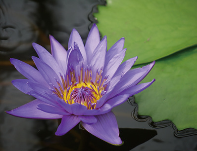
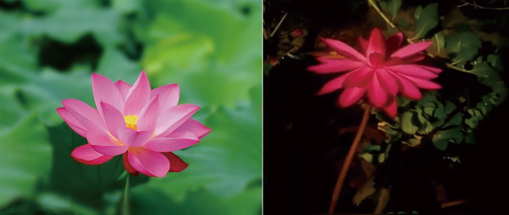
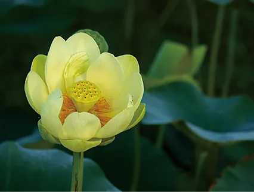
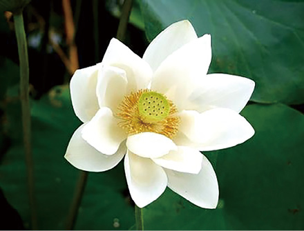

# 第5课

2020年9月14日

上节课讲到，释迦牟尼佛来到了娑罗双树附近，找到一处非常好的地方，准备说法。这时，声闻行人阿难对佛陀说：“您以前喜欢有山、有水、有树的地方，但这里什么都没有，您为何要在这传法呢？”

佛陀还没来得及回答，大智舍利弗就先对阿难说了下面一段话。如果将这个故事拍成电影，此处的情节也比较有意思。

| 尔时大智舍利弗。以佛智力。告阿难言。先应为法。不须余念。

这时，大智舍利弗以佛的加持力告诉阿难：“你应该首先希求佛法，不需要有其他念头。”

此处的“智力”也就是加持力的意思，藏文译本中就是“加持力”。

作为凡夫人，如果要去某个地方听法，也会首先考虑吃穿、住处，担心那里会不会很冷、很苦等等，为了保护自我和肉身，有很多担忧，很少思维大乘佛法的意义、功德和利益。

舍利弗告诉阿难：为了求法，不要顾惜自己的身体。但阿难认为：首先应该吃好，因为吃好了才有好身体，有了好身体才能令生命延续，进而有修法机会；如果连饭都吃不好，身体就会垮掉，长此以往连命都保不住，还怎么修道呢？

其实，阿难的想法也不无道理。但若能为求法而努力苦行，外在的困难也不会很严重。密续中说：“越过刀山与火海，舍身赴死求正法。”为求正法，哪怕越过刀山与火海也在所不惜。求法确实需要这种精神，我们也要像前辈大德一样，甘愿为正法付出一切。

昨天下午我有一点时间，看了十七大续部的目录和大德们对这些续部的翻译情况，发现这个教证的前面还有两句话。当时我想记下续名，并把前两句翻译出来，但后来忘记了。

以前，很多藏地大德前往印度求法，也有很多汉地大德到印度、藏地求法，他们也曾为了佛法而付出一切。如今，藏地仍有前来求法的出家人和居士，我私下了解到，他们为求法克服了很多困难，的确精神可嘉。对于每个人来说，家庭、父母、子女都是生命中非常重要的一部分，离开家而求法，难免要面对很多问题。此外，很多人还要面对工作、感情、他人的议论等诸多问题。如果没有一颗勇敢的心，不要说长期求法，即使是坚持一周、一两个月，也是很困难的。

当然，现代人求法要比以前方便得多，不一定要离开家，因为大家可以通过网络听课——网络的便利是这个时代的优势。虽说在家里听课没有现场感觉强烈，但只要对法有信心，同样能获得法益。

经文中的“先应为法，不须余念”看似普通，实则很有意义。作为大乘求法者，的确有必要放下关于世间琐事的种种分别念，一心寻求解脱生死轮回的佛法。

| 如来世尊。不但十力。四无所畏。如来世尊。有如是无量力。一切无所畏。智慧无量。威神无量。

如来世尊不仅具有十力、四无畏，还具有无量力、一切无所畏。之所以说如来有十力、四无畏，只是为了相应众生根基，象征性地如此宣说而已，如来的智慧和加持无量无边。此处的“威神”意为加持力。

| 无归依者。为作归依。未见佛性者。令见佛性。未离烦恼者。令离烦恼。未安隐者。为作安隐。未解脱者。令得解脱。未安乐者。令得安乐。未涅槃者。令得涅槃。

佛陀与声闻、缘觉、菩萨完全不同：对于没有皈依处的众生，佛陀会做他的皈依处；对于未见到佛性的众生，佛陀会令其见到如来藏佛性；对于未离烦恼障的众生，佛陀有办法令其离开烦恼障；对于未得安隐的众生，佛陀能令其获得暂时、究竟的安隐；对于未获得三解脱者，佛陀可以令其获得三解脱；对于未得安乐的众生，佛陀会令其得到暂时、究竟的安乐；对于未得涅槃者，佛陀能以善巧方法令其获得三乘涅槃。

| 如来世尊。有如是等无量神力。

如来世尊有这么多不可思议的殊胜力量，包括加持力、智慧力、慈悲力等。

有些人可能想：“佛教徒说自己的本师很了不起，是不是自吹自擂啊？”事实并非如此。佛教教主释迦牟尼佛曾说[^1]：“诸位比丘，你们要以智慧观察我的语言。若发现我说的是真理，就接受；若觉得我说的不合理，千万不要因为这些话是我说的就以恭敬心来接受。”《成实论》中也说：“佛告比丘，汝等莫但信我语也，当自知见自身证行。”佛陀告诉诸位比丘：“你们不要仅以信心接受我的语言，要以自己的智慧去观察，理性地分析。如果发现我所讲的是真理，就去实际行持。”

对于佛陀的智慧和功德，学过中观、因明、俱舍等论典的人会比较了解，基于这种了解的信心属于智信，反之可以说是迷信。另外，有些人虽对佛教有所了知，但不能如理行持，也属于迷信；有些人对佛教一知半解，甚至一无所知，却信口开河、肆意诽谤，经常在众人面前驳斥佛教道理，这也是一种非常严重的迷信。好比一个人在不了解某种产品的情况下，就说这是假冒伪劣产品，是否合理呢？

| 何忧如来。而无自然。

你何必担心如来没有这样的能力呢？其实，佛陀自然能解决大家的饮食等问题，根本不用担心。

舍利弗的意思是：你们这些声闻，经常想饮食问题，不思维法义，佛陀难道不能解决这些问题吗？他不可能让这么多人在听法过程中饿死的，你简直是杞人忧天，完全没必要操心这些。

声闻缘觉经常有这方面的毛病，分别念特别多，非常敏感，有很多担忧。真正有修行功夫的人，做任何事、修任何法，心都很淡定、很平静。没有这种境界的人，心就比较浮躁，经常忧虑重重。如果某种担忧、恐惧发展到比较严重的程度，还可能患上恐惧症。

## 恐惧症

今天我再给大家介绍一种心理疾病。现在，很多人听到某种心理症状就开始对照自己，这样也可以，如果知道自己是病人，以后也会去帮助其他病人。

一般来讲，恐惧症患者会经常感到恐慌。西方有些医学家依恐惧的对境将其分成很多种，比如怕狗、怕蛇、怕鬼、怕夜行、怕夜叉、怕车祸、怕空难等，分别对应该种恐惧症。凡夫人肯定有很多恐惧的对境，以此分类未免太过详细。

在现实生活中，有些人对特定对境的恐惧可能是前世业力的延续。比如说，有些人怕狗、怕脏、怕巨大声响、怕坐飞机等。这些不一定是恐惧症，还要看恐惧程度是否严重。

### ·社交恐惧症

社交恐惧症，表现为不愿与人见面、接触，害怕在大庭广众中被人关注。有些法师、修行人也是如此，在自己家里还可以，一出去就谁都不想见，看到人就躲。

有位堪布跟我关系比较好，每次我们商量要不要出去，他都会问：“有没有别人？”哪怕有三四个其他人，他的表情就变了，很紧张地说：“那我不去了，那我不去了。”我开玩笑说：“你是不是真的有社交恐惧症啊？”

作为大乘佛教徒，我们要弘扬佛法、利益众生，如果不见众生，又如何利益他们呢？可能只有暗地里“发功”了。大家可以观察自己，看看自己是否不愿意见人，是否有社交恐惧症。

### ·洁癖引发恐惧

洁癖属于强迫症，也可能引起恐惧症。有洁癖的人往往不愿意与人有肢体接触，很害怕碰到别人摸过的地方。

有一次，我们在小会议室开会，有个领导突然大发雷霆，大家都不知道是怎么回事。后来才清楚，是他的秘书不小心摸到了他的茶杯，他很生气。

有些人经常担忧，就以为自己得了恐惧症，其实也不一定。我们可以观察自己的心态、行为及背后的原因。比如，有些人经常为人际关系而感到担忧，那就可以观察：是现在的社会越来越冷漠了，还是自己的心态有问题？不可能所有人都是坏人吧？另外，还可以观察自己的行为，会不会因为担忧而做些不必要的事情？比如，是否会为了一个月以后的行程而半夜起来收拾行李？以前印度有一部电视剧，讲一个老和尚天天想回家，于是就开始收拾行李。当然，这倒不是讲恐惧症。

### ·对治法

有些人之所以经常感到担忧和恐惧，是因为没有认识自心。若能让心平静下来，减少实执，很多事情看起来就没有那么严重了。这是对治恐惧的有效方法。

### ·无需担忧

哈佛大学有一位教授说：“约有十分之一的美国成年人都患有恐惧症。”不知其他国家有没有相关统计。当今时代，真正心理健康的人是比较少的，但也无需感到害怕。以前，恐惧的心态并不叫“恐惧症”，人们觉得，每个人的心态都不相同，有些人对某种对境感到恐惧是正常的。但现在，医学界对人的心态研究更细，并将很多心态命名为某种心理疾病。于是，很多人开始对号入座，并由此而感到恐惧。

作为修行人，没必要有很多担忧，比如：上师会不会出问题？我会不会出问题？国家会不会出问题？国际局势会不会出问题？中印关系是否紧张？美国怎么办啊？……有些人经常想很多特别大的事情，其实没有必要。你晚上在自己的小屋子里睡得好好的，应该不会突然掉下来一颗原子弹，即使有，也没办法。

前面讲，阿难担心大家的饮食等问题。按理来讲，在佛陀面前不应该这么操心。不过，由于声闻与菩萨不同，无法以神变轻易解决吃饭等问题，他有这样的担心也很正常。对于凡夫人和阿罗汉来说，开法会、听法等过程中，确实需要基本的外在条件。

| 我念往昔。维摩大士。为众说法。他方菩萨。声闻缘觉。威力诸天。龙神大众。集在方室。未曾有食。

于是舍利弗现身说法：“我想起往昔，维摩诘大居士为众生说法时，从其他世界来了很多菩萨、声闻、缘觉和具有大威力的天众、天龙八部等大众。他们集聚在维摩诘居士的小屋子里，没有任何饮食。”

我们讲《维摩诘经》第六品“不思议品”、第十品“香积佛品”时，都提到过维摩诘居士不可思议的神通境界。

| 我时念言。此诸大众。云何得食。

当时舍利弗也很担心，他想：“在场大众吃什么呢？”他看到维摩诘居士的屋子空空的，没有准备饮食，也没有厨房和厨师，不知该怎么办。

| 大士维摩。即语我言。声闻少智。应念正法。云何先观。衣食及以床坐等幻物。

维摩诘居士对我说：“你们声闻行人乏少智慧。按理来讲，应该缘念正法，而你却先考虑衣食、床座等毫无实质的幻化之物。”

原文是“云何先观，邪命衣食”，藏文本中没有“邪命”二字，敦煌本中有。“邪命”在此处不是很好解释，因为他们的食物等并非以邪命获得。所以，这句经文按藏文本调整比较好。

| 维摩大士。说是语时。天人得道。

维摩诘居士宣说这些道理之时，很多天人和人都获得了天眼、欢喜地等果位。

此处结合了《维摩诘经》第六品和第十品的内容。第六品中说[^2]，舍利弗心想：“维摩诘居士的小房子里没有法座，来了那么多菩萨无处安坐怎么办？”第十品中说，舍利弗想：“很多阿罗汉持过午不食戒，中午没有吃的怎么办？”维摩诘居士遂以神通力令在场大众见到了上方的众香世界、香积佛及其眷属，又派幻人到那里取来一钵香饭。舍利弗见到只有一钵饭，又担心这么多人不够吃。维摩诘居士便加持这钵饭取之不尽，令在场大众全部得以饱足。

| 我怀惭愧。汝今所念。亦复如是。

舍利弗说：“当时，我在大众当中十分惭愧。现在，你也在担忧饮食、住处，对生活方面比较关心。实际上，我们都不用担心，饮食、住处等自然会有的。”

以上讲，舍利弗把阿难“教训”了一顿，让他不要瞎操心。

| 尔时如来。即告阿难。实如大智舍利弗语。应念大乘。莫念安身。

这时，释迦牟尼佛告诉阿难尊者：“确实如大智舍利弗所说，应该忆念大乘佛法，不要担忧如何安身。”舍利弗是有经验的，因为他入过一次坑，智慧也增长了。

## 应念大乘，莫念安身

“应念大乘，莫念安身”很重要，我们应该经常缘念大乘佛法，不要总是考虑饮食、住处、健康等问题。大多数人对大乘佛法忆念不多，对个人的生活、资具等方面考虑得比较多，这是修行不成功的表现。有些人想：“修行方面不用担心，我只希望我的大施主长久住世，我也会常转法轮。”但智悲光尊者说：“当你有了一个安逸的住处，有了一个特别得力的施主，那么，在正法修成之前，魔法已经成了。”

大家都听过常啼菩萨的故事[^3]。当时空中有声音对他授记：“你往东方走，决定得以听闻甚深般若波罗蜜多。在路上，你不要害怕疲倦，无须忆念睡眠、饮食与昼夜，勿畏寒热，勿于内外一切法心思散乱。”常啼菩萨便如是而行。可见，真正的信念，是对法有特别深的执著，这很重要。

## 依法不依人

《摩诃般若波罗蜜经》中说：“莫以世利心故随逐法师，但为爱法、恭敬法故随逐说法菩萨。”不要以世间的功利心来追随法师，要因为爱佛法、恭敬佛法而追随说法的菩萨。也就是说，依止善知识不应出于追求名声、钱财等目的，而应出于对法的喜爱和恭敬。

按理来讲，修行人应该依法不依人——人怎么样无所谓，但是他讲的法很重要。而现在有些人恰恰相反，认为法讲得如何不要紧，我要好好地依止人——人要好看一点、可爱一点、胖一点、瘦一点、高一点、矮一点……不同的人有不同的喜好。

## 依师为得法

有些人依止善知识不为得法，而有其他目的，这样修行确实不会成功。所谓依止善知识，并不一定是天天给他炒菜、做饭、劈柴、提水。当然，如果他是真正的得地菩萨，这样做也未尝不可。但是一般来讲，依止善知识的真正意义是得法，这很重要。

还有些人以为，所谓依止上师，就是经常供养上师，请上师打打卦、算算命——“昨天晚上我做了噩梦，您给我打个卦。”“今天我准备出去买菜，路上会不会顺利？您给我算算。”这是寻求正法的表现吗？大家需要观察。

刚才讲到，佛陀告诉阿难：舍利弗说得对，应思维大乘佛法，只要求法成功了，其他都不是很重要。也间接训斥了他。希望大家记住这句话：“应念大乘，莫念安身。”

当然，对于欲界众生来说，基本生活需求是要满足的。但有些修行人对于住处、饮食、穿着等方面要求很低，只要有吃有穿、不饿死冻死就可以了。在喇荣也有很多这样的修行人，他们的求学往往很成功。而有些人则非常重视生活条件，哪个民族都有这样的人。无垢光尊者在《三十忠告论》中告诫我们[^4]：不要无意义地虚度人生，而要断尽一切琐事，这是我的忠告。与此处所讲意趣一致。

无论去藏地、印度还是西方求学，一定要学到一点东西，否则就没有意义了，除非你是去旅游。有些人很疯狂，到了神山、旅游景点就开始狂奔、大声地吼，因为他们是去游玩的。而作为求学者，还是应该得到一些法。

| 作是语已。即入三昧。以威神力。即时其地。有一金华。从地涌出。其华出高。四十万由旬。遍覆三千大千世界。琉璃罗网。弥覆金华。其金华下。有众宝浴池。与华平等。名为八功德。香水弥满。

佛陀说完这些话就入于三摩地，在佛陀的加持下，地下涌出一朵巨大的金莲花，高四十万由旬，周遍三千大千世界，由琉璃宝网覆盖。金莲花下有众宝所成的水池，水池大小与金莲花所覆面积几乎相等，池中有八功德水[^5]弥漫。

| 四岸有种种名华。所谓优钵罗华。拘物头华。波头摩华。分陀利华。有如是等。种种无量名华。庄严宝池。

池岸四周有种种名花，如优钵罗花、拘物头花、波头摩花、分陀利花等，种种无量名花庄严着宝池。

原文中，这句话的开头有“其池”二字（“其池四岸有种种名华”）。敦煌版中说：“名八功德水，弥满其池，四岸有种种名华。”藏文译本中有个“得”字，意为“其”。“其池”二字没有也可以。

“优钵罗华”，藏文中是“乌巴拉”，即青莲花。

优钵罗花

“拘物头华”，藏文中是“格玛达”，即睡莲，有深红色的，也有蓝色的。

拘物头花

“波头摩华”，藏文中是“班玛”，即大莲花，大多数是白色的，也有大红色的。

波头摩花

“分陀利华”，藏文中是“本扎日嘎”，为白色的莲花。麦彭仁波切对《现观庄严论》所作注释，就取名为《白莲花之璎珞》。

分陀利花

有些睡莲在月光下盛开，早上九点左右闭合。在藏文中，睡莲叫“月亲”（月亮的亲戚），因为它会在月亮出现时展露笑颜；白莲花叫“日亲”，因为它会在太阳升起时盛开。

总之，莲花有不同的形状和颜色。在佛教当中，莲花是纯洁的象征，此外还有很多意义。

## 莫奈·睡莲

西方人也很重视莲华。留着大胡子的法国艺术家、画家莫奈就画了很多富有象征意义的睡莲。他经历了第一次世界大战，并于1926年“示现圆寂”。在法国巴黎橘园美术馆中，莫奈创作的《睡莲》组画非常出名，请大家看一段视频。

（播放视频）

莫奈的画表达了他的心境。一战期间，法国总统对他说：“你好好画画吧，你的画能让人获得心灵的宁静。”于是，在距离战场50公里的家中，他一直在淡定地作画。

有些人可能觉得这些画并不稀奇，别人也画得出来。实际上，莫奈作品的艺术境界常人难以企及，懂艺术的人自能体会其中的丰富意境。莫奈在70多岁做过白内障手术，86岁去世，刚才大家看到的有些作品，就是他在做白内障手术以后创作的。他有一幅《睡莲》以4100万英镑（约合8050万美元）被拍卖，可能仅次于梵高画作的拍卖价格。

## 尊重不同的艺术风格

在佛教当中，既有丰富的色彩，也有简约的色彩。在藏地、印度等地，人们很喜欢五彩缤纷、鲜艳绚丽的颜色，因为这象征灿烂、明媚与丰富。而很多现代人则喜欢黑、白、灰为主色调的简约风格，这也无可厚非，因为不同的人有着不同的审美观。

乔布斯对“苹果”的设计就奉行了极简主义。据说，他禅修的房间空空如也，像极了禅师的禅房。印光大师所住的房间里，墙上只有一个“死”字。有些修行人的房间也布置得很简单，墙壁是自然的木色、灰色或白色，有些人甚至住在山洞里。在懂艺术的人看来，这也是很美的。但我们不能因此而否定其他审美观、排斥其他审美文化。

前段时间，我们商量经堂里应如何装饰。很多懂美术的汉族人认为，应该按照藏地传统，在经堂里画色彩斑斓的图案，这样特别美；而有些藏族的新堪布更喜欢日式风格。后来，我们通过民主方式决定：经堂装修采用比较沉稳的木雕风格，不一定要沿用传统绘画装饰。当然，以后如何装修还要考虑具体情况。

在藏地的传统文化中，有很丰富的色彩装饰。比如古人的服饰，仅仅在衣领、袖子或帽子上，就有各种颜色的图案。这种文化非常珍贵，不应任其消失。

其实，有些现代人也喜欢古老的风味。像法国、英国等地，还保留着几千年前的古老建筑。现代建筑几乎都是一色一样的水泥墙，人类穿梭其中，似乎变成了“水泥虫”。当然，对于不同的建筑和艺术风格，我们也不能一概而论。

刚才讲到了种种名花庄严宝池，其实，佛经中讲到的种种庄严，都有其特定的历史、文化背景。

| 若见如是金华宝池。得法眼净。

如果有人见到这样庄严的金莲花珍宝池，会获得法眼清净。

“得法眼净”是指获得小乘预流果或大乘一地菩萨的果位。

| 何况入中。而得洗浴。若入洗浴。即得清净无生法忍。

更何况入于浴池沐浴？在池中洗浴会获得清净的无生法忍。

一般来讲，大乘无生法忍指八地菩萨以上的境界，小乘无生法忍则接近阿罗汉果位。可见，此珍宝池并非世间一般的水池。

| 其金华下。有宝师子座。其师子座。高百由旬。

在金莲花下，有一个七宝所成的狮子座，高一百由旬。

| 尔时如来。坐于宝座。身诸毛孔。上下枝节。放大光明。如来金光明。与金华同色。

这时，释迦牟尼佛坐在狮子宝座上，周身所有毛孔及头部、手、足等上下肢节均放大光明。如来放射的金色光明与金莲花的颜色完全相同。

此处所讲的境界确实不可思议。但是，我们也要尽量以比量智慧来了知。因为除了第三处（指圣教量），就像《释量论》中所讲，接受比量识是最有智慧者的选择。

《法苑珠林》中说：“凡人所信惟耳与目，自此之外，咸致疑焉。”凡夫人只相信自己亲眼所见、亲耳所闻之事，除此之外均会产生怀疑。《法苑珠林》中还说：“山中人不信有鱼大如木，海上人不信有木大如鱼。”山中的人从未去过海边，不相信海里有如树木一样大的鱼；住在海边的人从未去过山里，也不相信那里有如鱼一样大的树木。同样，凡夫人听闻佛经中所讲佛陀的境界，也会产生怀疑，这很正常，应以闻思断除疑惑。

## 如来光明不可思议

佛陀的光明不可思议。《大宝积经》中说：“假无量日月，合为一日轮，不能及如来，一毛孔光明。”假设将无量日月合成一个日轮，其光明也不及佛陀一个毛孔所放射的光明。

《大智度论》中说，佛陀涅槃100年时，比丘优波鞠多获得了阿罗汉果位，他听说有一位120岁的比丘尼曾见过佛陀，便去请教：“您见过佛陀吗？请问佛陀的容貌是怎样的？”比丘尼说：“当时我正年少，有一天晚上，人们说佛陀来了，我就随众人出去，见到光明就开始顶礼。这时，我头上的金钗掉落在地。但由于佛陀的光明照耀，当时黑暗的树林中非常明亮，我立即就找到了金钗。”尊者又问：“佛在世时，比丘们的威仪、礼节如何？”比丘尼回答：“佛陀在世时，最调皮的就是六群比丘了，可他们的威仪仍胜过尊者您。当他们进入我这个房间时，门口盛满麻油的钵丝毫不会动摇，而您进门时，油溢出了好几滴。”

| 从华四面。金光流出。普照十方一切佛土。佛光金华。所照之处。山谷国土。高下平正。皆作金色。无有秽恶。地狱休息。饿鬼解脱。除一阐提。谤方等经。

从金莲花的四面流出金光，照耀十方一切佛土。佛陀的光和金莲花的光所照耀之处，无论山谷还是国土，皆无有高下，平整庄严，而且都变成了金色，没有任何秽恶之物。地狱众生的痛苦全部止息了——就像周末休息一样，饿鬼也都获得了解脱，只有一阐提和诽谤正法者没有解脱。

“方等”，在藏文译本中为“正法”。“一阐提”，在藏文本中为“邪行者”，指断善根、业际颠倒的人，他们所造恶业非常严重。

## 诽谤正法难解脱

《无量寿经》中说：“设我得佛，十方众生至心信乐，欲生我国乃至十念，若不生者不取正觉，唯除五逆诽谤正法。”而在《观经》后面部分说[^6]：造五无间罪的人尚有下下品往生的机会，并未提到诽谤大乘法者有此机缘。《宝性论》中也说：“何人心嗔法，彼焉有解脱？”可见，谤法罪确实非常严重，大家一定要注意。

作为佛教徒，直接诽谤佛法的情况是很少的，但有些人在言谈之间不太注意，经常爱评论：“这个法师说得对，那个法师说得不对；这个宗派的观点正确，那个宗派的观点错误。”这也可能谤法。此外，《极乐愿文》中说[^7]：以三宝作证而发誓，后又违越誓言，也属于舍法罪。

造了舍法罪的人，确实很难往生极乐世界。此处经文也说：在佛陀的加持下，地狱、饿鬼都能从痛苦中解脱，唯有诽谤正法者不能解脱。我们以后一定要注意。

对于自己是否造了五无间罪[^8]，是很容易辨别的，大家也都清楚这样的罪业十分严重。而对于是否造了谤法罪，没有闻思过相关道理的人就很难察觉。有些居士看起来是佛教徒，也声称在维护某个道场、某位上师，其实那位上师从未给他讲过佛法，他自己也没有闻思过，因此缺乏智慧，几乎天天造舍法罪，这是很可怕的。对于佛法一无所知的人，造舍法罪也没办法；而已经皈依佛门、对佛法有所了解的人，还经常造谤法罪就非常不合理了。

总之，此处是讲，造了谤法罪的人和一阐提难以获得解脱，而其他人都有希望。

| 以佛神力。他方国土。及此国中。悉皆一等。无有殊异。

依靠佛的加持力，其他世界的国土及释迦牟尼佛的国土全部变得清净平整，呈现庄严的金色，没有差别。

| 十方诸佛。观此光已。异口同音。俱叹释迦。善哉善哉。大慈世尊。今放光明。异于常明。昔日放光。先照东方。今日放光。四面一时。普照十方。当知此光。欲度苦恼一切众生。使出三界。到大涅槃。

十方诸佛看到这样的光明和庄严景象后，异口同音地赞叹释迦牟尼佛：“善哉善哉！大慈大悲的世尊，今天放出如此殊胜的光明，与以往截然不同。以前佛陀放光时，先照耀东方，再照耀南、西、北等其他方位。而今天，佛陀全身放光，同时照耀东南西北四面、普遍照耀十方。应当了知，此光表示佛陀这次转法轮不同于以往，他想度化一切苦恼众生出离三界，到达大涅槃的彼岸。”

这个信息很重要。佛陀宣讲《圣大解脱经》时，已接近最后转法轮的时间，因此他想将世间一切烦恼最重、痛苦最深的可怜众生全部度化，令其无余出离三界。

我们虽然没有机缘在现场参与法会，但在没死之前遇到这部法还是很幸运的。我从小就听说过《圣大解脱经》，以前也看过、念过几遍，但是一直没有系统地学习过，时光转瞬即逝，现在才有机会真正闻思这部法，我还是很开心的。

希望大家都听一下这部经，包括这边的工作人员。对于我来说，听众多一个人或少一个人、多几百人或少几百人都没有什么，我也看不到谁在听、谁没听。但对你们自己来说，听闻此经确实很有意义。这部经在藏地相当于“闻解脱”，经常用于超度亡人或为在世者祈福。

有些人可能会想：“藏人或汉人的传统做法也不一定是正确的。”其实，若以智慧观察就会明白，《圣大解脱经》确实对众生有利，无论哪个国家、哪个民族，如果很重视这部经，那里的众生就会获得极大利益。

刚才讲到，十方佛陀都赞叹释迦牟尼佛，并说他这次定会度化无量众生。

| 尔时。他方十方诸佛。异口同音。告其侍者。大菩萨众。诸善男子。汝等当知。今日中国娑婆世界。释迦牟尼如来。放大光明。必说妙法。度苦众生。

这时，他方国土的十方诸佛异口同音地告诉其侍者、大菩萨众：“诸位善男子，你们应当知道：今天，在中央国土的娑婆世界，有一位释迦牟尼佛放大光明，定会转大法轮，宣说妙法，度化痛苦众生。”

佛陀不可能无缘由地放光。会开车的人都知道，如果司机突然闪车灯，肯定是有原因的。不像一些新手司机，不该开灯时开灯，该开灯时一直关着，一看就不太会开车。佛陀不会如此，他放光非常应时，既然这次放大光明，就表明佛要转大法轮了。

| 汝等今者。应往彼土。供养彼佛。请决所疑。听受经法。

你们今天一定要前往释迦牟尼佛的国土，供养他，向他请教心中疑惑，听受《圣大解脱经》这部大乘法。

十方诸佛告诉自己的弟子、侍者和周围的菩萨们：这个机会千载难逢，你们一定要去。佛陀自己好像是不来的，就像有些法师告诉自己的弟子：“你们去听法吧，我就不去了。他也是堪布，我也是堪布，我不好意思去他那里听课。”（众笑）

| 彼土众生。昔来刚恶。虚伪不实。不信一乘。

诸位佛陀提醒弟子：“娑婆世界的众生，素来刚强难化，非常狡猾，而且个性恶劣，虚伪、不守承诺，还不信最究竟的胜义谛。”

看来，我们娑婆世界的众生给其他世界留下的印象不是很好，所以那些佛陀如此提醒自己的眷属。

| 释迦大慈。万善方便。为开三乘。度脱三有。

诸位佛陀说：“但本师释迦牟尼佛非常了不起，他以诸多善巧方便为众生开显三乘，令其脱离三有。”

我们前几年学的《妙法莲华经》中也说：“十方佛土中，惟有一乘法，无二亦无三，除佛方便说。”在十方佛土当中，唯有一乘佛法，除佛陀以善巧方便而宣说以外，并无二乘和三乘。这部经还用车的比喻介绍了三乘佛法[^9]。

《涅槃经》中也有相关比喻[^10]，佛陀说：“譬如父母有三个孩子：老大有信顺心，恭敬父母，而且具足智慧；老二不恭敬父母，没有信顺心，但具足智慧；老三不恭敬父母，没有信顺心，且缺乏智慧。父母应该先教育谁呢？”迦叶菩萨说：“应该先教育老大，再教育老二、老三。后面两个孩子虽然没有信心、恭敬心，但父母不会因此而放弃他们，还是会以慈愍心慢慢培养。”佛陀说：“如来也是如此，先度菩萨，再度声闻，最后度化一阐提等刚强难化的众生，绝不会舍弃任何有情。”

| 虽说三乘。上语亦善。中语亦善。下语亦善。义味甚深。纯备具足。

“虽说三乘。上语亦善。中语亦善。下语亦善”，佛陀宣说的三乘法对三乘众生非常有利，上语、中语、下语都很善妙。《随念三宝经》中讲法宝时说：“初善、中善、后善。”初善指听闻佛法殊胜，中善指修行佛法殊胜，末善指得果离垢殊胜。

“义味甚深。纯备具足”，这是讲佛法具足的功德。《随念三宝经》中说：“义妙、文巧、纯一、圆满、清净、鲜白。”与此处所讲基本一致。

| 彼佛世尊。百千万劫。不可值见。所说经法。不可得闻。彼诸大众。不可时会。释迦所生。殊妙金华。不可得见。

十方诸佛说：“释迦牟尼佛在百千万劫当中难以值遇；他所说的经法亦难得听闻；其周围聚集诸多大众也很难得，不会时时有这么殊胜的法会和机缘；释迦牟尼佛所在之处出生的金莲花也难以得见。”前面讲过，见到此金莲花会获得法眼净，其殊胜性可见一斑。

| 是故汝等。今往彼土。得见彼佛。请问所疑。自得利益。复利众生。

诸佛说：“所以，你们应当前往释迦牟尼佛的刹土，面见释迦牟尼佛，向他请教心中的疑惑。如此不仅自己会获得利益，以后还会利益众生。”

| 作是语已。十方佛土。一一各有。十亿菩萨。即从座起。为佛作礼。俱同发来。一一菩萨。各有百千音乐。雨宝妙华。来到佛所。到佛所已。绕佛七匝。为佛作礼。却坐一面。

诸佛如是嘱咐各自眷属以后，十方佛土各有十亿菩萨（共一百亿菩萨）从自己的座位起身，向本国佛陀作礼，前往娑婆世界。每位菩萨都演奏着不同的乐器，并降下珍宝妙花雨，浩浩荡荡地来到了释迦牟尼佛面前，右绕佛陀七匝，恭敬顶礼后坐在一边。

在世间人看来，一百亿菩萨同时来到这个刹土很不可思议，其实也并非不能发生。《正法念处经》中说[^11]：“诸天人有大势力，其手掌中可以无碍容纳五百天人。”《大智度论》中也讲：“如第三禅遍净天，六十人坐一针头而听法，不相妨碍。”《华严经》中也说：“一尘中有尘数刹，一一刹有难思佛。”

在印度的一个平原当中，居然容纳了一百亿菩萨，这似乎很难想象。其实，佛菩萨的身体并不是我们这样的肉身，不具有微尘的质碍。他们不会像有些人一样争座位的。

我前面提到了一个教证：山里人从未见过大海，所以不相信海里有像树木一样大的鱼；海边的人从未见过山上高大的松树，他也不承认有像鱼一样大的树木。同样，凡夫人从未见过佛菩萨的境界，对此难以相信也可以理解。但我们要明白，佛菩萨的境界完全是容有的。

| 俱共发声。异口同音。而白佛言。世尊。我等今者。欲有所问。唯愿世尊。当为说之。利益众生。

诸位菩萨异口同声地陈白佛陀：“世尊，我们今天从各个刹土来到这里，是有问题想请教您，请您为我们转法轮、解除疑惑，以利益现在和后世的众生。”

至于佛陀的回答，我们下次再讲。

[^1]: 如《智藏集经》云：“诸位比丘与智者，当如炼金细观察，切莫因是我之言，欣然接受而恭敬。”
[^2]: 《维摩诘所说经》：尔时，舍利弗见此室中无有床座，作是念：“斯诸菩萨，大弟子众，当于何坐？”
[^3]: 《大般若波罗蜜多经》：佛告善现：“常啼菩萨摩诃萨本求般若波罗蜜多时，不惜身命，不顾珍财，不徇名誉，不希恭敬，而求般若波罗蜜多。彼常乐居阿练若处，欻然闻有空中声曰：‘咄！善男子，汝可东行，决定得闻甚深般若波罗蜜多。汝当行时，莫辞疲倦，莫念睡眠，莫思饮食，莫想昼夜，莫怖寒热，于内外法心莫散乱……’”
[^4]: 《三十忠告论》：“住家之时致力严饰屋，寂静山间寻求圆满福，琐事令自人生虚耗因，断尽诸事即是吾忠告。”
[^5]: 《称赞净土佛摄受经》：“何等名为八功德水？一者澄净，二者清冷，三者甘美，四者轻软，五者润泽，六者安和，七者饮时除饥渴等无量过患，八者饮已定能长养诸根四大，增益种种殊胜善根。多福众生常乐受用。”
[^6]: 《佛说观无量寿佛经》：“下品下生者。或有众生作不善业五逆十恶。具诸不善。如此愚人以恶业故。应堕恶道经历多劫受苦无穷。如此愚人临命终时。遇善知识种种安慰为说妙法教令念佛。彼人苦逼不遑念佛。善友告言。汝若不能念彼佛者。应称归命无量寿佛。如是至心令声不绝。具足十念称南无阿弥陀佛。称佛名故。于念念中。除八十亿劫生死之罪。命终之时见金莲花犹如日轮住其人前。如一念顷即得往生极乐世界。于莲花中满十二大劫。莲花方开当花敷时。观世音大势至以大悲音声。即为其人广说实相除灭罪法。闻已欢喜。应时即发菩提之心。是名下品下生者。是名下辈生想。名第十六观。”
[^7]: 《极乐愿文》：“三宝殿经所依等，以彼作证违誓等，发露忏悔舍法罪。”
[^8]: 五无间罪：破和合僧、杀母、杀父、杀阿罗汉、恶心出佛身血。
[^9]: 《妙法莲华经》：“舍利弗！若有众生，内有智性，从佛世尊闻法信受，殷勤精进，欲速出三界自求涅槃，是名声闻乘，如彼诸子为求羊车出于火宅。若有众生，从佛世尊闻法信受，殷勤精进求自然慧，乐独善寂，深知诸法因缘，是名辟支佛乘，如彼诸子为求鹿车出于火宅。若有众生，从佛世尊闻法信受，勤修精进，求一切智、佛智、自然智、无师智，如来知见、力、无所畏，愍念安乐无量众生，利益天人度脱一切，是名大乘。菩萨求此乘故名为摩诃萨，如彼诸子为求牛车出于火宅。”
[^10]: 《大般涅槃经》：佛言：“善男子，譬如父母唯有三子：其一子者，有信顺心，恭敬父母，利根智慧，于世间事能速了知。其第二子，不敬父母，无信顺心，利根智慧，于世间事能速了知。其第三子，不敬父母，无信顺心，钝根无智。父母若欲教告之时，应先教谁？先亲爱谁？当先教谁知世间事？” 迦叶菩萨白佛言：“世尊，应先教授有信顺心，恭敬父母，利根智慧，知世事者。其次第二，乃及第三。而彼二子虽无信心、恭敬之心，为愍念故，次复教之。” “善男子，如来亦尔。其三子者，初喻菩萨，中喻声闻，后喻一阐提。如十二部经修多罗中微细之义，我先已为诸菩萨说；浅近之义，为声闻说；世间之义，为一阐提、五逆罪说，现在世中虽无利益，以怜愍故，为生后世诸善种子。”
[^11]: 《正法念处经》：“复次修行者。随顺观身。云何观于诸天身耶。若粗若细。若速疾行。彼以闻慧。或以天眼。见诸天身。有大势力。神通微细。于一手中。置五百天。在手而住。各令诸天身不妨碍。亦不迫隘。譬如一室燃五百灯。其灯光明。不相逼迫。诸天手中。置五百天。亦复如是。不迮不妨。”
