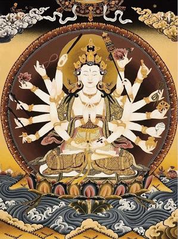

# 第12课

2022年10月28日

今天继续讲《大乘庄严宝王经》，讲到汉译本中有缺漏的地方为止。

对照藏译本来看，汉译本《大乘庄严宝王经》缺十多页，大概两节课的内容，我这两天正在翻译。关于藏译本的译者，前面已经分析过了：虽然译者的名字写的是“智慧军”，但《玛尼全集》里引用过《大乘庄严宝王经》的内容，所以真正的译者，应该是囤弥桑布扎。既然如此，这部《大乘庄严宝王经》就属于前弘时期翻译的经典，距现在已经一千三百多年。由于年代久远，有些地方也不是很好懂。但不管怎么样，我先试试吧，尽快翻译出来。

从明天开始先讲几天《楞严经》，等《大乘庄严宝王经》补译圆满了，我们再接着讲。

前面讲了释迦牟尼佛的前世求取六字真言的经历：释迦牟尼佛首先前往宝上如来的刹土，经由宝上如来介绍，又找到了莲华上如来。莲华上如来介绍了自己的求法经历后——莲华上如来在无量光佛的刹土，从观世音菩萨那里求得了六字真言的传承——便为释迦牟尼佛传授了六字真言。

除盖障菩萨求法的心，本来就很切。听释迦牟尼佛讲完，他对六字真言的希求心更强烈了，于是请问从哪里可以求到这个法。释迦牟尼佛并没有亲自传给除盖障菩萨，而是引介了一位波罗奈城的法师。

那位法师看上去不伦不类的，戒律不清净，行为也不如法，而且有妻子儿女，袈裟上还沾着不净粪，不过，他确实有六字真言的传承，也是一位真正的六字真言修行人。释迦牟尼佛让除盖障菩萨去那位法师那里求法，同时告诫除盖障菩萨不要生起怀疑与轻毁之心，而应该以清净心将那位法师视为佛陀与珍宝之源。

除盖障菩萨将佛陀的教言谨记在心，随后带着种种供品，在菩萨、人、天龙八部等无量眷属的陪同下前往波罗奈城。见到那位法师时，除盖障菩萨一行人以最大的清净心与恭敬心祈请法师传法。

那位法师的名字没有说，我记得其他经典中也有类似的公案。

| 是时，法师白言：“善男子，汝为戏耶？为实有所求圣者，为于世间断除轮回烦恼耶？

> 当时，法师禀白除盖障菩萨：“善男子，你是开玩笑呢（藏译本中是说：‘你不要生悔心，否则会再度沉溺在轮回烦恼中，很难解脱。’）？还是真的想通过修持六字真言获得圣者的果位，断除世间轮回的痛苦与烦恼？

这里用的是“白言”而不是“告言”，看得出来，这位法师很谦逊，对除盖障菩萨也很恭敬。

“汝为戏耶”，有的人并不是真心想求法，只是作秀，或是想戏弄别人，所以这位法师才这样问。

| 善男子，若有得此六字大明王陀罗尼者，是人贪瞋痴三毒不能染污；犹如紫磨金宝，尘垢不可染著。

> 善男子，求得此六字大明咒的人，相续不会被贪嗔痴三毒染污，犹如紫磨金宝不会被尘垢所染。

是不是所有人在得到这个法门的当下，都能立即断尽相续中的贪嗔痴呢？不一定所有人都能立即断尽，但只要持之以恒地修持，相续会越来越清净，贪嗔痴等烦恼也会逐渐减少，乃至灭尽。

有人念了一辈子观音心咒，最终虹身成就；也有人，每天认认真真地持诵观音心咒，十年如一日，临终蒙佛接引，往生清净刹土。这样的人，也不可能有贪嗔痴烦恼。

## 六字真言“系解脱”

| 如是，善男子，此六字大明陀罗尼，若有戴持在身中者，是人亦不染著贪瞋痴病。”

> 善男子，此六字大明咒仅是佩戴在身，就不会染著贪嗔痴等烦恼病（藏译本中，无‘病’字）。”

这里再次提到，只要将六字大明咒戴在身上，就能远离贪嗔痴等烦恼的染污。所以，我们还是很有必要做一个“嗡玛呢巴美吽”的饰品。做之前要好好设计一下，随便做肯定不行。

讲《大乘庄严宝王经》这段时间，很多商店都想做一个观音心咒的标志，但我暂时没有同意。因为，如果要刻印经文和咒语，一定要保证最后不会被践踏，也不会被丢弃在垃圾桶里。否则，如果什么产品都印上“嗡玛呢巴美吽”，最后却被扔在垃圾桶里，任人践踏，这不仅没有功德，反而有过失。刻有观音心咒等佛菩萨心咒的挂坠和饰品，要放在上半身、干净的地方。以前国外有些人因为不懂，随意刻印“嗡玛呢巴美吽”等佛语经咒，甚至连鞋子上都印着《般若心经》，这样很不好。

另外，如果从做生意的角度讲，做生意需要商业头脑，首先要了解市场和客户群体。我们这里的网店，市场主要在外面，但现在了解六字真言殊胜功德的，都是我们内部的道友，外面的人还不清楚。到时候产品先做出来了，宣传却没有到位，请的人也不一定很多。所以你们也不用太着急。况且，我们传法也不是为了做生意。

有的人可能会想：“我现在不仅得到了观音心咒的传承，也将观音心咒戴在了身上，为什么我还会有贪嗔痴烦恼呢？”实际上，诸佛菩萨的咒语，本身确实有着极为强大的功德和作用，但众生能得到多少利益，也需要观待众生各自的因缘。

比如同样一味药，有的人吃了能立即痊愈，而有些人，因为疾病已经到了晚期，所以需要更长的治疗周期——虽然无法立即痊愈，但只要坚持服药，最终也能彻底痊愈。同样的道理，有的人在得到观音心咒的当下就能获得解脱。从古至今，这样的案例比比皆是。而有些人在得到之后，还需要精进地串习与修持，最终才能获得解脱与成就。

| 尔时，除盖障菩萨执于彼足白言：“未具明眼迷失妙道，谁为引导？我今渴法，愿济法味！今我未得无上正等菩提，令善安住菩提法种，色身清净，众善不坏！令诸有情皆得是法！”

> 听法师宣说完六字大明咒的功德，除盖障菩萨的信心更加强烈，心情也极为恳切，于是情不自禁地抱住法师的双足祈请道：“我们就像失却了眼根的盲人一般，迷失了方向，偏离了妙道，恳请您充当我们的眼目，成为我们的指引者，引领我们在无上的菩提道上继续前行。我们的心灵，渴求殊胜的正法，祈请您赐予甘露妙法，救济我们心灵的匮乏。我们如今，尚未证得无上正等正觉，希望您能播撒成佛的法种，令我们色身清净、善根不坏，安住于无上菩提道，同时，祈愿一切有情众生，都能够求得此法！”

这段内容，汉藏两个译本稍有不同。藏文版本中没有“色身清净”。

“令诸有情皆得是法”，除盖障菩萨从始至终都是为了众生的利益而求法。

| 众人说言：“勿怀吝惜！唯愿法师与我六字大明王法，令于我等速得阿耨多罗三藐三菩提，当转十二法轮，救度一切有情轮回苦恼。此大明王法昔所未闻，今令我得六字大明王陀罗尼，无救无依为作恃怙，闇夜之中为燃明炬。”

> 与此同时，众人祈请道：“法师，希望您不要心怀吝惜，恳求您为我们慈悲传授。令我们迅速证得无上正等正觉，转十二法轮，救度一切有情众生出离轮回。此六字大明咒法，甚深稀有，闻所未闻，再次祈请您传授此六字大明咒，作为无救助者之救护、无依靠者之依怙，于漫漫黑夜中，燃亮光明的法炬！”

“勿怀吝惜”，除盖障菩萨一行人，去一趟也不容易，所以希望法师慷慨传授，不要吝惜。

“十二法轮”，即“十二部经”，后面还会讲到[^1]。有时候，佛经里的一个词代表了多种意思，不要一看到“转法轮”就觉得一定是“三转法轮”，从而认为这里的是错别字，于是马上改掉。其实传授六字真言，就相当于传授了十二部经，因为六字真言包括了所有的佛法，一切佛法都摄于六字真言中。

这里的“救护者”“依怙主”“暗夜中的明炬”，既指法师，也指六字大明咒。

这一段内容，主要是描述除盖障菩萨一行人请转法轮的情形。我们在祈请某位上师灌顶和传法时，也会有一些言语上的表达，以促成灌顶和传法因缘的成熟。我们既要祈请诸佛菩萨转法轮，也要经常祈请善知识们转法轮。“请转法轮”属于七支供的一支，非常重要；要是不重要，也不会被放在七支供里[^2]。

他们首先祈请这位法师转法轮——我很想知道这位法师的名字，可是他们只是称呼他为“法师”，并没有提到他的名字。

## 听瑜伽士讲六字真言的功德

| 时，彼法师告言：“此六字大明王陀罗尼难得值遇，如彼金刚不可破坏，如见无上智、如无尽智、如如来清净智，如入无上解脱远离贪瞋痴轮回苦恼，如禅解脱三摩地三摩钵底，如入一切法而于恒时圣众爱乐。

> 经由除盖障菩萨及大众的祈请，法师首先告诉他们六字真言的功德：“此六字大明王陀罗尼极为稀有、极为难得，如同金刚一般不可毁坏，而能摧灭一切烦恼与罪业。此大明咒虽然只有短短六个字，却是诸佛如所有智、尽所有智以及自然本智的精华。因此，见到此六字大明咒，就已经见到了如所有智、尽所有智以及自然本智，如同入于无上解脱道，从而远离贪嗔痴等轮回烦恼，亦如入于禅定、八解脱、善巧方便、无量的三摩地与三摩钵底，以及八万四千一切法门，并且恒时得到圣者的喜爱与垂念。

“三摩地”是“等持”；“三摩钵底”是“等至”，比如“灭尽等至”。二者有差别。

总而言之，禅定、解脱、智慧等世出世间的一切功德都集聚在六字真言中。

听课这段时间，大家都对六字真言很有信心。但很多人的信心不稳固，也许过段时间，又和没学过一样，退失了对六字真言的热情和信心。如果没有信心，就很难接受佛法。

这次学了《大乘庄严宝王经》，希望每个人都能像珍惜如意宝一般珍视六字真言。一般人对黄金、白银、玛瑙、珊瑚和绿松石比较重视，有的人出了家还对这些恋恋不舍。我们对六字真言能有这样的感情就非常好了。

关于六字真言的功德，《玛尼全集》里讲了很多，而且也有中译本，你们最好看一下。包括莲花生大士的伏藏传记中也提到过六字真言的修法和功德。

我们这次得了这个法，未来就要用一生去修持、去弘扬。六字真言只有短短六个字，谁都会念，以后只要有机会就让别人念，“我给你传一个观音心咒——‘嗡玛呢巴美吽舍’，希望你多念这个吉祥的咒语！”观音心咒是真正的灵丹妙药，生病的时候可以念，忏悔的时候可以念，遣除违缘的时候可以念，超度的时候也可以念……而且三根普被，上上下下什么样的人都可以修。像《法界宝藏论》等大圆满甚深的密法，只有具备一定密法见解的人才堪为法器，没有基础的人不一定能听懂，但观音心咒没有拣择，任何人都可以念、都可以修。

大家现在求这个法，并没有经历像除盖障菩萨和释迦牟尼佛那样的苦行，但这个法的传承其实非常珍贵。我的传承是从旺登老喇嘛那里求到的，他老人家是从帝察活佛那里得到的。这个观音心咒的传承，来源清净，加持猛厉，你们以后也可以为别人传授。

| 若有善男子于种种处，为求解脱遵奉种种外道法，所谓敬事帝释，或事白衣，或事青衣，或事日天，或事大自在天、那罗延天，蘖噜拏中裸形外道中，爱乐如是之处；彼等不得解脱无明虚妄，空得修行之名，徒自疲劳！

> 如果有人在在处处，为了解脱却遵奉种种外道法门，所谓敬事帝释天、白衣、青衣、日天、大自在天、那罗延天、蘖噜拏中的裸体外道，对于这些外道法门心生耽著、承侍供奉，仅有修行的名称而已，根本没有实义，因此不可能从无明虚妄中获得解脱，完全是徒劳无益！

现在世界上，五花八门，什么稀奇古怪的宗教和见解都有。有的人本来想获得解脱，可是却误入歧途，行持外道法门，结果不仅无法解脱，反而越陷越深，没有任何意义。

“白衣”，一般指在家居士，但这里指一般的世间人。现在有些出家人也依止白衣。“青衣”，从事屠夫、妓女等低贱职业的人。

外道所谓的“修行”，是迷乱的，也是虚妄的，根本无法让人解脱，空得修行之名，而无实际意义。正如《佛子行》中所说：“己尚缚于轮回狱，世间天神能救谁？故知殊胜无欺处，皈依三宝佛子行。”像那些世间天神，他们自己都没有解脱，仍然被贪嗔痴三毒束缚，沉溺在轮回中无法自拔，又怎么可能让其他人解脱呢？根本不可能。

我们今年在讲《如意宝藏论》时，讲了一部分与外道有关的内容，你们自己再好好看一下。这个世界上有各种各样的宗教，但大部分都没有意义，不可能让人获得真正的解脱。真正的解脱道，唯有佛教中才有。

这位法师首先告诉除盖障菩萨一行人，如果想要从轮回中获得解脱，一定要选择真正的解脱之道，千万不要误入歧途。

| 一切天众、大梵天王、帝释天主、那罗延天、大自在天、日天、月天、风天、水天、火天、阎魔法王、四大天王，而于恒时云何求我六字大明王！彼等得我六字大明王，皆得解脱故。

> 一切天众、大梵天王、帝释天主、那罗延天、大自在天、日天、月天、风天、水天、火天、阎魔法王、四大天王，恒时希求我此六字大明咒的传承！为什么呢？因为他们求得此六字大明咒的传承后，将很快获得解脱。

这位法师说：“我的传承，不仅是人类，连天界的天人也很想求得。”有些上师为了宣传而故意说：“这个法门特别珍贵，之前来了很多人求我，我一直舍不得传。”其实他特别想传。

| 除盖障，一切如来般若波罗蜜多母，宣说如是六字大明王，一切如来应正等觉及菩萨众，而皆恭敬合掌作礼。善男子，此法于大乘中，最上精纯微妙。何以故？于诸大乘契经、应颂、授记、讽颂、譬喻、本生、方广、希法、论议中得。

> 除盖障，一切如来以般若波罗蜜多为母，一切诸佛菩萨亦以六字真言王为母，六字真言与般若波罗蜜多同为诸佛菩萨之母——诸佛菩萨依靠六字真言而成就，因此，一切如来、应供、正等觉以及菩萨众，应该以恭敬心，向六字真言合掌作礼。善男子，此六字大明咒在大乘佛法中，最为无上、最为殊胜、最为深奥、最为微妙，它是大乘佛法的精华。为什么呢？因为得到此六字大明咒，就相当于得到了全部的大乘十二部；念诵此六字大明咒，就相当于念诵了全部的大乘十二部。[^3]

“大乘十二部”，这里只提到了九部，藏译本提到了十二部。根据宗派的不同，有的安立九部，有的安立十二部，但究竟来讲，应该是大乘十二部。

也就是说，大乘佛法不会超出这十二部，而六字真言又是大乘佛法的精华。因此，得到六字真言，就相当于得到了全部的大乘十二部；念诵六字真言，就相当于念诵所有的大乘佛法。

现在要想完整得受世尊宣讲的大乘十二部，并不容易，但我们已经得到了与之相同的六字真言——对有信心的人来说，这就是最殊胜的获得！

| 善男子，获斯本母，寂静解脱何假多耶？犹如收精稻谷于已舍宅，器盛盈满，日曝令干，捣治扇扬弃彼糠皮。何以故？为收精米。如是余异瑜伽如彼糠皮，于一切瑜伽中，此六字大明王如糠米见。

> 善男子，若得到大乘十二部的本母——六字大明咒，获得寂静解脱又有何困难？没有任何困难，解脱唾手可得。比如，将稻谷、青稞、麦子等粮食作物囤积在舍宅中、盛放于器皿内，然后在太阳下将其晒干，晒干后再舂捣脱粒，筛掉糠秕，留下精华。之所以要这样做，就是为了得到精米。同样，其余的瑜伽如同糠秕，而在所有的瑜伽中，唯有六字大明王犹如精米，为法中至尊，超胜一切。

| 善男子，菩萨为斯法故，行施波罗蜜多及持戒、忍辱、精进、静虑、般若波罗蜜多。

> 善男子，菩萨为了求得此法，而行持布施、持戒、忍辱、精进、静虑、般若六波罗蜜多。

六字真言最为究竟，摄一切波罗蜜多；所有波罗蜜多的行持，都以六字真言为核心。仅仅依靠此法，菩萨便能圆满六波罗蜜多的行持。

| 善男子，此六字大明王难得值遇，但念一遍，是人当得一切如来，以衣服、饮食、汤药及座卧等资具一切供养。”

> 善男子，此六字大明王难值难遇，极为稀有，仅念一遍，便相当于以衣服、饮食、汤药、卧具等资具供养一切如来。”[^4]

也就是说，念诵“嗡玛呢巴美吽”，相当于以种种美妙的供品供养三世诸佛。其实，持诵观音心咒就是对诸佛菩萨的法供养，是最为殊胜的供养。

## 讲好第一节课的窍诀

和前面每一位拥有六字真言传承的佛和菩萨们一样，那位法师在传授之前，先为除盖障菩萨一行人宣讲了六字真言的殊胜功德。

在正式传法之前，确实有必要先宣讲功德。有的法师讲法时，没有任何铺垫，一上来就开始讲，一节课讲完，大家还云里雾里，不知所云。

作为传法者，在每次传法的第一节课，至少要先简单地介绍这部法的大概情况。我有这样的习惯，比如讲《中观庄严论》，我在第一节课首先会介绍一下《中观庄严论》的大概内容、历史源流、作者和译者的情况、此论的功德，以及这部法的清净传承，等等。第一节课至少要有这几个框架性的内容。尤其是功德部分非常重要，首先就要让听众了解这部法的殊胜功德。了解了功德，才会对这部法生起信心、欢喜心和希求心。

上师如意宝讲某些法时会讲功德，有些不会。他老人家讲法，任运自成，不需要提前备课，到了该讲的时候，美妙又深奥的法义自然从智慧中潺潺流露。这一点我在《梦尘回忆录》中也提过。在印度南卓林传法时，我问法王：“需不需要给您念一下《定解宝灯论》的注释和科判？”法王说自己没有提前备课的习惯。[^5]而我们是一定要先备课的，需要讲到的公案和教证要提前准备好，但上师如意宝不需要这样。

总而言之，我们以后传讲任何一部法时，首先要介绍一下这部法的功德和大概的内容，以便让大家生起信心与求法欲，这很重要。

我前几年和主管法师说：“过去每次开法会，上师如意宝都会先讲一讲法会的功德，比如‘持明法会的功德’‘金刚萨埵法会的功德’‘极乐法会的功德’……听完之后，本来准备下山的人都会觉得：‘如果连这么殊胜的法会都不参加，我简直成了一个罪人！’”人的记忆就是这样，有的能保留一生，有些只能暂时留存一段时间。在法会之前强调一下法会的功德，至少在一个礼拜内，大家会更有参与法会的意乐和积极性。

| 尔时，除盖障菩萨白法师言：“与我六字大明陀罗尼。”

> 除盖障菩萨禀白法师说：“法师，请您赐予我六字大明咒。”

除盖障菩萨也是用的敬语“白”，可见他们相互之间都很恭敬对方。

听了功德后，除盖障菩萨迫不及待地想得到这个法，“我不想听很多功德，您能不能现在就传给我？”他担心法师讲了一大堆功德后又不了了之了，所以希望法师现在就传授给他。（众笑）

## 传法与本尊授记

| 时，彼法师正念思惟，而于虚空忽有声云：“圣者，与是六字大明王。”

> 正当法师思维到底要不要传法时，虚空中忽然传来声音说：“圣者，请为他们传授六字大明王。”

虚空中发出的声音，应该是来自那位法师的本尊——观世音菩萨。

| 时，彼法师思惟：“是声从何而出？”

> 显现上，法师也不知道声音从何而来，于是思维道：“这是谁在说话？”

| 于虚空中复出声云：“圣者，今此菩萨加行志求冥应，与是六字大明王矣！”

> 虚空中再次传出声音说：“圣者，这位菩萨为了求得此法，行持了诸多苦行，极为精进，你应当为他传授此六字大明咒！”

的确如此，从开始到现在，除盖障菩萨为了求得六字大明咒，经历了不少苦行。也正因为此，观世音菩萨才会一而再、再而三地让法师将六字真言传授给他。

| 时，彼法师观见虚空中，莲华手、莲华吉祥，如秋月色，发髻宝冠顶戴，一切智殊妙庄严，见如是身相。

> 接着，那位法师看见四臂观音显现在虚空中，由吉祥白莲所庄严，身色如秋月一般皎洁，手持莲花，顶戴美妙天冠，天冠之上是一切智阿弥陀佛，殊胜微妙，庄严无比。

在《喇荣课诵集》中的观音修法仪轨里，四臂观音就是手持白莲的形象[^6]。

这位法师作为六字真言瑜伽士，应该随时都可以与本尊对话，但显现上，他在得到了本尊的开许之后才传法。

作为法师，传法是有原则的，并不是别人让你传，你就马上传。在传法之前，也需要观察。有的上师，传任何法都有本尊的直接授记；有的上师会在梦中得到传承上师或本尊的开许；还有的，虽然没有得到明显的指示，但通过观察梦境，也能确定到底该不该传法。

在得到本尊的指示后，法师决定为除盖障菩萨一行人传授六字大明咒。

| 法师告除盖障言：“善男子，观自在菩萨摩诃萨，可令与汝六字大明王陀罗尼。汝应谛听！”

> 法师告诉除盖障菩萨说：“善男子，观自在菩萨命令我为你们传授六字大明咒。希望你们好好听闻！”

从上面这段内容可以看得出来，那位法师真的很了不起。

| 时，彼合掌虔恭，听是六字大明王陀罗尼曰：“唵（引）么抳钵讷铭（二合引）吽（引）。”

> 于是，法师双手合掌，恭敬地念诵六字真言：“嗡玛呢巴美吽。”

我们现在一起念诵100遍。

（堪布带领大家念诵观音心咒）

## 流行法音

其实，以后还可以做一些观音心咒的念佛机，或是将观音心咒制成脍炙人口的歌曲和音乐作品，让解脱的法音以潜移默化的方式滋养人们的心灵。

很多年前，一位著名的歌手——李娜，她在接受记者采访时说，她在一个机缘之下遇到了六字大明咒，从那以后，她豁然开朗，相续和价值观有了很大转变，逐渐开始追寻真正属于自己的人生之路。不久之后，她便在国内出家，后来去了国外。

当然，如果要唱，最好保证心咒完整无误。韩红的《家乡》唱得很好，但不知道她为什么唱的是“嗡玛呢玛呢巴美吽”。我这边找了一首她的音乐短片，大家一起听一下。

她如果直接唱“嗡玛呢巴美吽”可能更好。她的词也写得很好：“我的家乡在日喀则，那里有条美丽的河，阿妈拉说牛羊满山坡，那是因为菩萨保佑的……留下那段动人的歌。”

以后如果有这样的机会，最好还是唱六字真言——“嗡玛呢巴美吽”。

| 于是与彼陀罗尼时，其地悉皆六种震动。除盖障菩萨得此三摩地时，复得微妙慧三摩地，发起慈悲三摩地，相应行三摩地。得是三摩地已，时除盖障菩萨摩诃萨，以四大洲满中七宝，奉献供养法师。

> 那位法师在传授六字大明咒的当下，大地忽然六种震动[^7]。除盖障菩萨得到六字大明咒时，同时得到了微妙慧三摩地、发起慈悲三摩地、相应行三摩地。得到如是三摩地后，除盖障菩萨感到喜悦满足，于是依靠意幻与神变之力，将四大部洲盛满七宝供养法师。

| 于是法师告言：“今所供养未直一字！云何供养六字大明？不受汝供！善男子，汝是菩萨圣者，非非圣者。”

> 法师回绝道：“你现在的供养，一字不值，更何况六字呢？我不受你的供养！善男子，你并非凡夫，而是圣者菩萨。”

那位法师觉得，既然不值，不如不收，不然收了也没有意义。于是法师接着说：“除盖障菩萨，你作为圣者菩萨，应该知道佛法是无价的；再多的财供养，也不如法供养珍贵。所以，你不如好好修行，通过修法和弘法来做最殊胜的供养。”

| 彼除盖障复以价直百千真珠璎珞供养法师，时彼法师言：“善男子，当听我言，汝应持此供养释迦牟尼如来应正等觉。”

> 除盖障菩萨明白此法的价值和意义，知道六字真言有多么的珍贵难得，于是拿出一条价值连城的珍珠璎珞，坚持供养给法师。法师再次婉拒：“善男子，你能够在我这里求得六字真言，是因为释迦牟尼佛的引介。所以你听我的话，请你将这串珍珠璎珞拿回去供养给释迦牟尼佛。”

这里提到了一个与供养有关的话题。法王如意宝早期在传法和灌顶时，没有刻意拒绝接受供养。后来在印度，他去传法的途中，显现上生起了一个恶分别念：“这次去传法应该会得到一些供养吧。”从那以后，法王无论是灌顶还是传法，再也没有接受过包括哈达在内的任何供养。

一般来讲，传法后立即接受供养不太好。平时如果有供养，接受也可以，但传法的时候最好不接受。当然，有的法师也会接受，但收得太多了，传法似乎成了一种买卖，比如“听一节课需要缴纳多少费用”。我外出演讲时，一般不会接受演讲费。不过有的学校说：“演讲费必须收，这是规矩，不收不行。”既然这样，我也不想破坏他们的规矩，费用也不多，一般是几千上万一小时，而且也不是我要求他们付费的，所以有些我收了，但有些没收，看他们的表情。（众笑）

| 尔时，除盖障菩萨，头面礼法师足已，既获满足其意，辞彼而去，而复往诣祇陀林园，到已顶礼佛足。

> 终于求到了六字大明咒，除盖障菩萨心满意足，于是以头礼法师足，辞别法师后便回去了。到了祇陀园林，除盖障菩萨恭敬地向佛陀顶礼。

| 尔时，世尊释迦牟尼如来应正等觉告言：“善男子，知汝已有所得。”“如是，世尊。”

> 那时，世尊释迦牟尼如来、应供、正等觉对除盖障菩萨说：“善男子，想必你已经求得了六字大明咒。”除盖障菩萨回答：“是的，世尊，我已经求到了六字大明咒。”

虽然六字真言只有短短六个字，但这些佛和菩萨，为了求得这个法门，都经历了很多很多苦行。对我们后学者来说，他们的经历就是最好的鼓励。

我们道友在求法的过程中，也许同样经历着各种各样的苦行，比如生活上的困难，以及精神和肉体上的痛苦。但只要考虑到佛法的价值和意义，为了求法，我们可以忍受任何苦行，因为一切都是值得的。

## 准提咒

| 而于是时，有七十七俱胝如来应正等觉皆来集会，彼诸如来同说陀罗尼曰：“曩莫（入声一）　飒钵哆（二合引）喃（引二）　三藐讫三（二合）没驮（三） 句（引）致喃（引四）　怛你也（二合）他（去声五） 唵（引）左隶（引）祖隶（引）噂（上声）祢（引六） 娑嚩（二合引）贺。”

> 当时，有七十七俱胝的如来、应供、正等觉集聚在祇陀园林，他们异口同声地宣说准提咒：“南无 飒哆喃 三藐三菩陀 俱胝喃 怛侄他 嗡 折戾主戾 准提 娑婆诃。”[^8]

这个陀罗尼就是著名的准提咒，也叫做“七俱胝佛母准提陀罗尼”。

准提佛母一般为三目十八臂的形象。藏密、台密、唐密中都有准提佛母的修法。不空、善无畏等译师也翻译过与准提法相关的经典[^9]。在藏密中，准提佛母的藏文音译是“尊达玛”，准提佛母的心咒是“嗡匝咧兹咧怎达娑哈”。

准提咒有许多不共的功德，汉地历来都很重视。至于准提咒的念法，你们以前怎么念的，就按照那样念也可以。咒语的结尾部分，既可以念“娑哈”，也可以念“娑婆诃”。藏文中是“斯哇哈”，连读就是“娑哈”。

## 日光明毛孔

| 于是七十七俱胝如来应正等觉，说此陀罗尼时，彼观自在菩萨身有一毛孔，名日光明，是中有无数百千万俱胝那庾多菩萨。

> 当时，七十七俱胝的如来、应供、正等觉共同宣说了此准提陀罗尼。观自在菩萨身中有一毛孔，名叫“日光明”，无数百千万俱胝那由他的菩萨居住其中。

诸佛在祇陀园林宣说了准提咒之后，现在释迦牟尼佛对除盖障菩萨又继续讲观世音菩萨的毛孔。

| 于彼日光明毛孔中，复有一万二千金山，其一一山各千二百峰。其山周匝莲华色宝以为庄严，而于周匝有天摩尼宝适意园林，又有种种天池，又有无数百千万金宝庄严楼阁，上悬百千衣服、真珠、璎珞。彼楼阁中有微妙如意宝珠，供给彼诸菩萨摩诃萨一切所须资具。

> 在日光明毛孔中，有一万二千座金山，一一金山各有两百座山峰。每座金山都由莲花色的珍宝所庄严，周围环绕着悦意的天摩尼宝园林和天池，以及无数百千万由黄金和珠宝所庄严的楼阁，其上缀饰着成百上千的天衣、珍珠和璎珞。楼阁内又有神圣奇妙的如意宝珠，能够满足当地菩萨的一切所需。

| 时诸菩萨入楼阁中，而念六字大明，是时见涅槃地，到彼涅槃之地，见于如来，观见观自在菩萨摩诃萨，心生欢喜。

> 当菩萨们在楼阁内念诵六字大明咒时，他们能亲见涅槃之地，到了涅槃之地后，又亲见了如来与观自在菩萨，因而心生欢喜。

一切都是现而无自性的，所以诸佛菩萨可以显现任何幻变。我们看他们的游舞，就像看电影一般。

| 于是菩萨出彼楼阁往经行处，而于其中有诸宝园，而复往诣浴池，复往莲华色宝山，在于一面结跏趺坐而入三昧。

> 之后，菩萨们离开楼阁前往经行的地方，那里有珍宝花园和美妙的浴池。经行完毕，又继续前往莲花色珍宝所庄严的金山，在山林中结跏趺坐，入于甚深的禅定。

## 帝释王毛孔

| “如是，善男子，菩萨住彼毛孔。善男子，复有毛孔，名帝释王，其中有无数百千万俱胝那庾多不退转菩萨。于是帝释王毛孔中，复有八万天金宝山。于其山中有如意摩尼宝，名莲华光，随彼菩萨心所思惟皆得成就。时彼菩萨于彼山中，若念饮食无不满足，而无轮回烦恼之苦，恒时思惟，其身无异思惟。

> “善男子，这就是日光明毛孔中的情形。善男子，还有一种毛孔名叫‘帝释王’，无数百千万俱胝那由他的不退转菩萨居住其中。在帝释王毛孔中，有八万座天金宝山。山中有如意摩尼宝，名‘莲花光’，随意满足菩萨所需。那里的菩萨如果需要饮食，当下就能得到满足，不会感受轮回烦恼之苦，他们恒时思维涅槃之法，心无异想。

从“如是，善男子……”来看，这部分内容应该都是释迦牟尼佛与除盖障菩萨之间的对话。

## 大药毛孔

| 善男子，复有毛孔，名曰大药，于中有无数百千万俱胝那庾多初发心菩萨。善男子，于彼毛孔有九万九千山，于此山中有金刚宝窟、金宝窟、银宝窟、帝青宝窟、莲华色宝窟、绿色宝窟、玻胝迦色宝窟。如是山王有八万峰，种种适意摩尼及诸妙宝庄严其上。于彼峰中有彦达嚩众，恒奏乐音。彼初发心菩萨，思惟空、无相、无我，生苦、老苦、病苦、死苦、爱别离苦、怨憎会苦，堕阿鼻地狱苦、堕黑绳地狱诸有情苦、堕饿鬼趣诸有情苦，作是思惟时，结跏趺坐而入三昧，于彼山中而住。

> 善男子，还有一种名叫‘大药’的毛孔，其中居住着无数百千万俱胝那由他的初发心菩萨。善男子，在‘大药’毛孔中，有九万九千座山王，每座山中都有金刚宝窟、金宝窟、银宝窟、帝青宝窟、莲花色宝窟、绿色宝窟、水晶色宝窟。每座山王皆有八万座山峰，一一山峰又由种种悦意的珍宝与摩尼宝之所庄严。居住在山峰之中的，是欢乐的乾达婆众，他们恒时演奏着悠扬的乐曲、美妙的音乐。那里的初发心菩萨们，在山中结跏趺坐，思维空、无相、无我、生之苦、老之苦、病之苦、死之苦、爱别离与怨憎会之苦，以及堕入阿鼻地狱、黑绳地狱和饿鬼趣的有情所要感受的难以堪忍的痛苦，他们如是思维而入禅定。

## 缋画王毛孔

| 善男子，有一毛孔，名缋画王，是中有无数百千万俱胝那庾多缘觉众，现火焰光。于彼毛孔有百千万山王，彼诸山王七宝庄严。复有种种劫树，金银为叶，无数百宝种种庄严，上悬宝冠、珥珰、衣服、种种璎珞，悬诸宝铃、憍尸迦衣，复有金银宝铃震响丁丁。

> 善男子，还有一种名叫‘缋画王’（藏译本中是：种种王）的毛孔，其中居住着无数百千万俱胝那由他的缘觉圣众，他们以神通显现火焰的光芒。在‘缋画王’毛孔中，有百千万的山王，一一山王由七宝所庄严。每座山中都生长着茂密的如意树林，以金银为叶，奇珍异宝作为庄严，并且悬挂着宝冠、耳环、妙衣、璎珞、天衣和宝玲。悬挂在树上的金银宝铃，随着风的舞动而叮当震响。

我的门口也装了一个小小的风铃，有风的时候就会“叮当叮当”地发出清脆铃音。不过院子里的麻雀们，对风铃声的态度各不相同，有的很喜欢，有的就不大喜欢。

## 幡王毛孔

| 如是劫树充满山中，无数缘觉于彼而住，常说契经、应颂、授记、讽颂、譬喻、本生、方广、希法、论议如是之法。除盖障，时诸缘觉出彼毛孔，最后有一毛孔，名曰幡王，广八万踰缮那，于中有八万山，种种妙宝及适意摩尼以为严饰。彼山王中有无数劫树，无数百千万栴檀香树，无数百千万大树，复有金刚宝地，复有九十九楼阁，上悬百千万金宝、真珠、璎珞、衣服，于彼毛孔如是出现。

> 像这样的如意树遍满山林，无数的缘觉圣者于山林中安住，常常演说契经、应颂、授记、讽颂、譬喻、本生、方广、希法、议论等大乘十二部。除盖障，缘觉从‘缋画王’毛孔出来之后，最后还有一个毛孔，名‘幡王’，宽广八万由旬，其中有八万座山王，由美妙悦意的珍宝和摩尼宝作为庄严。每座山中，都生长着成片成片的如意树林、栴檀香树林以及无数百千万的高大树木。‘幡王’毛孔中，还有金刚宝地和九十九座楼阁。楼阁之上，悬挂着成百上千万数不尽的金银珠宝、珍珠、璎珞以及美丽的天衣。

从这里开始，汉文版本中缺了一部分，大家也能看出来，本来还在讲毛孔，结果忽然就是“佛告阿难陀……”，太突然了。不过藏译本是完整的，我这几天先翻译，补上之后我们再接着讲。

[^1]: 十二部经：“契经部”“记别部”“讽诵部”“应颂部”“自说部”“因缘部”“譬喻部”“本事部”“本生部”“方广部”“希法部”“议论部”。
[^2]: 七支供：顶礼支、供养支、忏悔支、随喜支、请转法轮支、祈请不入涅槃支、回向支。
[^3]: 此段内容依藏译本作解。
[^4]: 此段内容依藏译本作解。
[^5]: 详见《梦尘回忆录·第四站》。
[^6]: 详见由活佛大持明者（果吉登彻）于西方红色铜宝藏处开取的伏藏修法——《观音修法·如意宝》。
[^7]: 《圣大解脱经》：“六种震动者。东涌西没。西涌东没。南涌北没。北涌南没。中涌边没。边涌中没。是名大地六种震动。”
[^8]: “嗡”字之前是皈敬词，从“嗡”字开始是正咒。
[^9]: 准提法经典前后数译，地婆诃罗译名《佛说七俱胝佛母心大准提陀罗尼经》；善无畏奉诏译名《七俱胝佛母心大准提陀罗尼法》，内分三部，一、独部别行，二、七俱胝独部法，三、准提别法，此译最为圆融，不简在家出家，饮酒食肉，皆可诵持；金刚智译名《七俱胝佛母所说准提大明陀罗尼经》；不空奉诏译《七俱胝佛母所说准提陀罗尼经》，不空三藏深得密教之传，其所译真言仪规悉详备矣。
