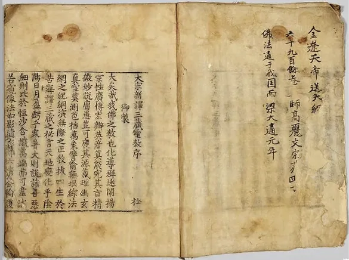
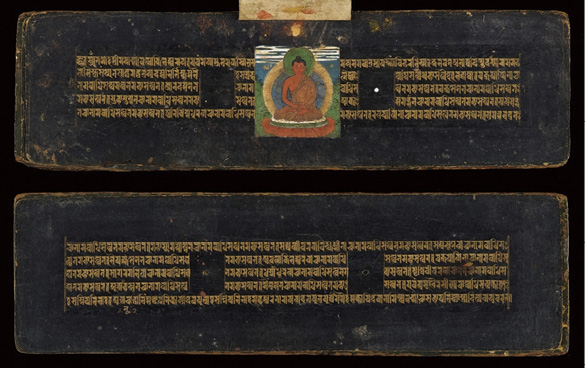

# 第1课

2022年10月5日

今天开始讲《大乘庄严宝王经》。

《大乘庄严宝王经》到底是怎样的一部法？各位一定很想了解。那么，我边念传承边给大家介绍。你们以后一定有弘扬佛法的机缘，这次得到传承，未来弘扬时会很方便。所以，这次得到这部法的传承是最重要的一件事情。

## 大乘宝王，重放光芒

其实在一千多年前，公元983年时，译师天息灾就已经将这部经典译成了汉文。当时，宋太宗亲自下令建立译经场翻译佛经。翻译出来的佛经，在那时得到了普遍的重视与弘扬。不过，这部经典之前的弘扬范围可能并不广。从现有的资料来看，1987年黄念祖老居士在美国的道场提过观音心咒的来历以及《大乘庄严宝王经》的功德。除此之外，并没有发现汉地其他大德传讲《大乘庄严宝王经》的记录，也没有找到任何关于《大乘庄严宝王经》的讲义或注疏。

前辈译师们是发了特别好的心，将自己的一生都用于翻译佛经。有的佛经，虽然被译成了不同的语言和文字，却一直沉睡在藏经阁中，积满灰尘，无人问津……在1990年左右，敦煌的莫高石窟中发掘出了《大乘庄严宝王经》的梵文写本。从古至今，有非常多的人重视佛经论典的弘传与保护，正因为此，这部经典才没有消失在历史的长河中，一直流传至今。但可惜的是，真正了解这部经典功德的人寥寥无几。

这次为大家传讲《大乘庄严宝王经》，希望每个人都能对这部经典生起信心。有了信心，你们以后自然会弘扬这部法。

在藏地，无论是卫藏、安多还是康区，家家户户都会供奉、礼拜观世音菩萨，也会念诵观音心咒。尤其是老年人，基本上会念诵1亿遍以上的观音心咒和阿弥陀佛心咒。藏地不仅重视念诵观音心咒，还特别重视印观音经旗、刻玛尼石。森林间，湖泊边，观音经旗和玛尼石堆随处可见。不仅如此，还有许多大大小小的观音心咒转经轮，比如我们的《圣大解脱经》转经轮上就有一个小一点的观音心咒转经轮。未来，这都会成为历史。

相较于藏地念诵观音心咒的传统，汉地更多的是念诵观世音菩萨的名号，比如“南无观世音菩萨”“救苦救难观世音菩萨”，等等，但观音心咒念的并不多，观音心咒的弘扬范围也不广，这是比较可惜的。

有些法师跟我说，希望我这次能多讲一点，作为以后弘扬观音法门的吉祥缘起——就算现在多讲一点，也不知道以后能传到多少人的耳中。前几年学会比较兴盛的时候，确实应该多讲一点，那时听的人多，学的人也多。现在人这么少，我讲完之后，又有多少人弘扬这个法门呢？

当然，这是一部特殊的经典。它的传承极为珍贵，你们这次得到以后，算是在相续中种下了特别殊胜的善根种子。仅此而言，就已经意义非凡了。

实际上，多年以前我就想传讲这部经典，法王在世时就想过。最近，给大家传讲这部经典的意乐越来越强烈。那么，这次我就以不广不略的方式来为大家宣讲。

## 《大乘庄严宝王经》的译本

实际上，《大乘庄严宝王经》的藏文版本很早就有了。在藏文《大藏经》中，《大乘庄严宝王经》的译者是益西德，于前弘时期翻译而成。不过也有学者认为，《大乘庄严宝王经》的译者是大译师贝若扎那。还有一部分认为，《大乘庄严宝王经》其实是由藏文创始人囤弥桑布扎在松赞干布时代翻译而成。囤弥桑布扎确实翻译过部分佛经，而且许多学者一致认为，《大乘庄严宝王经》其实就是他翻译的。

另外，松赞干布的伏藏文集《玛尼全集》[^1]中，引用过许多《大乘庄严宝王经》中的教证，从这点来看，藏文《大乘庄严宝王经》应该是在松赞干布时代翻译而成。贝若扎那是法王赤松德赞时期（8世纪中叶）的大译师，时间上不吻合，所以藏文《大乘庄严宝王经》的译者是囤弥桑布扎的可能性更大。可是在藏文《大藏经》中，又找不到署名为囤弥桑布扎的《大乘庄严宝王经》藏译本。关于译本问题，以后还需要进一步考证。

如今，全世界都很重视这部特别的经典。这部经典有许多语种的译本，很早之前就有了英译本、日译本和西语译本。听说有几位道友最近花了很多钱请了日文版本的《大乘庄严宝王经》。在所有的版本中，内容最全的应该是藏文和汉文版本。这两个版本是根据梵文原本翻译过来的，而其他语种的版本，要么是根据藏译本再译的，要么是根据汉译本再译的。从各语种的译本数量来看，大家对这部经典的重视程度比较高，但还远远不够。

《大乘庄严宝王经》的梵文本，被收藏在美国、韩国等许多国家的图书馆和博物馆中。韩国国立图书馆中收藏了一份朝鲜王朝时期（1392年—1910年）的汉文《大乘庄严宝王经》。给大家看一下，这是宋太宗写的序言。不知道现在的汉文版本里有没有他的序言？如果有的话，大家也可以看一下。当时的皇帝非常重视这部经典。

美国亚洲博物馆中收藏了一份以金粉书写的梵文本《大乘庄严宝王经》。据说是1687年的手抄本，发现于尼泊尔的加德满都。

## 心灵财富的继承与传扬

实际上，保存于世的梵文、藏文和汉文的佛经论典，除了其本身宗教文化方面的价值和意义以外，还具有历史价值。

许多国家都特别重视法本的保护和保存，无论何种语言文字，只要是法本，他们就会收藏并保存起来。我希望我们的道友以后有能力时，也建一些博物馆和图书馆，将重要的资料全都保存起来。以后，这些都会留于后世，成为历史。这对未来的人类来说，是非常重要的财富。

个别人对吃的、喝的、装修房子很重视，对具有宗教、文化和历史意义的宝贵财富却没有太多概念。我们以后出去时，也有必要多去参观博物馆和展览馆，看看里面保留了哪些珍贵的文物。具有历史性的物件，哪怕体积再小，其中蕴含的价值和意义也不可估量。

通常而言，人们对物质层面的保存比较重视，而内在精神的传递却被普遍忽视。比如说，世界各国的文库都很重视这部《大乘庄严宝王经》，不少国家的图书馆也收藏了这部经典的手抄本——不仅是《大乘庄严宝王经》，许多有价值的经典和书籍都被保留了下来，有些甚至被人们以金银宝汁来抄写，但可惜的是，不少典籍的思想和精神并没有得到广泛的弘扬。虽然纸张被保护得很好，可是文字所要传达的内在意义却没有得到足够的重视，这实在是最为可惜的。

幸运的是，学院在法王如意宝的加持之下，不仅重视文本的保存，更在意经论意义的传承，所以我相信，我们内在的智慧一定能够遍地开花、代代相传。

## 从天而降的圣经

《大乘庄严宝王经》是一部很有意思的经典，藏地刚有佛法时，就有了这部《大乘庄严宝王经》，就像《四十二章经》之于汉地一样，是最早被译成当地文字的佛经。自从译成藏文后，这部经典一直被人们当作礼拜、供养的对境，但可惜少有人传讲和弘扬。

公元5世纪左右，第28代藏王拉托托日年赞在拉萨的雍布拉康执政时，虚空中忽然降下三宝的身语意之所依：身所依是一尊观世音菩萨像；语所依是《百拜忏悔经》《大乘庄严宝王经》等几部佛经；意所依是一尊一肘高的水晶佛塔。当时虚空中还传出声音授记说，再过五个朝代，人们能懂得其中的意义[^2]。后来，国王松赞干布派遣译师囤弥桑布扎前往印度学习声明和文字。囤弥桑布扎学成归来，创立了藏文。玄秘神物也被译成了藏文，人们这才懂得其中的涵义。

后来有人认为，这只是民间的说法，经典不可能从天而降。对于这一观点，第五世达赖喇嘛在《西藏王臣史》中，首先叙述了相关的历史，之后驳斥了前者的说法：诸佛菩萨的加持不可思议，佛法在各地的出现、兴盛，具有微妙与甚深的缘起。显密经续，有的从龙宫取出，有的由天人带来，有的自虚空降下，还有一些，比如意伏藏，则是从证悟者的心意中开取。

从最初佛法在藏地兴起，一直到今天，还一直没有《大乘庄严宝王经》的注疏和讲义。这部经典，虽然过去弘扬得不是很理想，也不像《金刚经》《楞严经》那样出名，但它的内容与加持，丝毫不逊色于任何一部大经大论。大家学了之后，自然会明白，不用我在这里赞叹。

事实上，这部经典对于藏传佛教和众生来说，具有不可思议的缘起。当藏地还是一个野蛮的罗刹国时，这部经典就来到了这里。可想而知，这其中一定蕴藏着某种甚深、奇妙的因缘。我们现在能够学习这部特别的经典，本身就是不可思议因缘的延续。因此，希望大家以欢喜心和恭敬心来听受。

接下来，我给大家讲一下《大乘庄严宝王经》汉译本的历史。

《大乘庄严宝王经》的汉译本，在宋朝时由天息灾翻译而成。唐宋元明清，唐朝共有21个皇帝，其中只有一两个皇帝不信仰佛教，甚至毁坏佛法，其余皇帝都信仰佛教，而且也大力支持佛法的弘扬。唐朝之后是宋朝，这部经典在宋朝的第二位皇帝宋太宗时期译成汉文。

公元10世纪左右，印度发生了天翻地覆的变化，许多地区被回教占领，当地的僧人不得不外逃。那时，天息灾、施护两兄弟和法护、法天一行人，携带着佛经的梵本来到了北宋的都城汴京。

当时是宋太宗执政，宋太宗本人也很想建立译经院。后来在公元982年，他模仿唐太宗的做法，设立了规模宏大、组织完备的译经院。从史料来看，当时的译经院很有意思。他们首先设一座白色的坛城，四周由印度班智达护门。坛城内部摆设了妙香、鲜花、明灯等种种供养物。之后，僧人们面对坛城顶礼，开始大修，持续不断地持诵咒语七天七夜。大修圆满后，才开始着手翻译。

译经院一共设有九个职位：译主、证义、证文、书字、笔受、缀文、参译、刊定、润文。翻译时，集体合作，各司其职。首先由译主天息灾翻译，之后由旁边的两位证义核对梵文的意义，经过反复审核，再由笔受立成文字，最后润色。每一部经典都需要经历这九步流程才算翻译圆满。据说他们一共翻译了250多部典籍，显密经续各占一半。这部《大乘庄严宝王经》是在译经院建成后的第二年翻译完成的。

当时，宋太宗亲自参与，大力支持僧才的培养与佛经的翻译。凡是译成汉文的佛经，包括这部《大乘庄严宝王经》，他都会经常翻阅，反复学习。公元1000年时，天息灾圆寂。之后译经院由施护主持，继续培养僧才，翻译佛经。当时的译经规模，以及翻译的严谨程度，非常值得我们随喜。

2016年时，我就对照过藏汉两种译本的《大乘庄严宝王经》，里面的内容基本一致，只有极个别地方由于版本不同或其他原因而稍有不同。

除了《大乘庄严宝王经》，天息灾还翻译过《入菩萨行论》——我原来看过，实在是看不懂，有段时间对他的翻译还是有一点失望，总觉得他的译本太难懂了。不过后来看到这部经典时，又觉得他的译本其实也没有那么难懂。这可能是因为我的汉文水平提高了吧，又或许他只是把自己翻译的《入菩萨行论》“加持”得比较难懂。那么这部经典到底难懂还是不难懂呢？我们学完之后就知道了。（众笑）

这部经典主要讲到了六字大明咒（嗡玛呢巴美吽）的功德，也提及了准提咒的功德。准提咒在汉地流传很广。希望大家学完之后，能对这个法门生起信心和欢喜心！

接下来，我边念传承边为大家传讲。

| 佛说大乘庄严宝王经

宋西天中印度惹烂驮啰国三藏沙门天息灾奉诏译

前面讲过，这部经典的汉译者是中印度的天息灾。他是奉当时的皇帝——宋太宗之令而译。奉诏译是很难得的。

## 宝王法会的听众朋友们

| 如是我闻：一时，世尊在舍卫国祇树给孤独园，与大苾刍众千二百五十人俱，并诸菩萨摩诃萨众[^3]。其名曰：金刚手菩萨摩诃萨、智见菩萨摩诃萨、金刚军菩萨摩诃萨、秘密藏菩萨摩诃萨、虚空藏菩萨摩诃萨、日藏菩萨摩诃萨、无动菩萨摩诃萨、宝手菩萨摩诃萨、普贤菩萨摩诃萨、证真常菩萨摩诃萨、除盖障菩萨摩诃萨、大勤勇菩萨摩诃萨、药王菩萨摩诃萨、观自在菩萨摩诃萨、执金刚菩萨摩诃萨、海慧菩萨摩诃萨、持法菩萨摩诃萨等，八十俱胝菩萨皆来集会[^4]。

> 我听佛陀是这样说的：当时，世尊在舍卫国的祇陀林园，周围围绕着一千二百五十位大比丘和诸位大菩萨。他们的名字是：金刚手菩萨摩诃萨、智见菩萨摩诃萨、金刚军菩萨摩诃萨、秘密藏菩萨摩诃萨、虚空藏菩萨摩诃萨、日藏菩萨摩诃萨、无动菩萨摩诃萨、宝手菩萨摩诃萨、普贤菩萨摩诃萨、证真常菩萨摩诃萨、除盖障菩萨摩诃萨、大勤勇菩萨摩诃萨、药王菩萨摩诃萨、观自在菩萨摩诃萨、执金刚菩萨摩诃萨、海慧菩萨摩诃萨、持法菩萨摩诃萨，等等，共有八十俱胝大菩萨集会在祇陀林园。

| 是时，复有三十二诸天子众皆来集会，大自在天及那罗延天而为上首。帝释天王、索诃世界主大梵天王、日天、月天、风天、水天，如是诸天众等皆来集会。

> 当时，以大自在天与那罗延天为首，以及三十二天的诸位天子、帝释天、娑婆世界的尊主大梵天王、日天、月天、风天、水天等天众也来到了祇陀园林。

这次聚会，来了许多大菩萨和天人等众生。阿难没有来，不知道他跑到哪里去了，可能没有资格来吧。以前索顿管家说：“上师周围的眷属像曼茶盘一样，有内、中、外三层，我们不能随意揣测。”阿难现在可能跑到最外层去了。

| 复有百千龙王，所谓阿钵逻罗龙王、曀攞钵怛哩（二合）龙王、底铭㘈[口*（隸-木+匕）]龙王、主地龙王、百头龙王、虎虏𥿡拏龙王、得叉计龙王、牛头龙王、鹿头龙王、难陀龙王、跋难陀龙王、鱼子龙王、无热恼龙王、娑蘖哩拏龙王，如是诸龙王等皆来集会。

> 阿钵逻罗龙王、曀攞钵怛哩龙王、底铭㘈[口*（隸-木+匕）]龙王、主地龙王、百头龙王、虎虏𥿡拏龙王、得叉计龙王、牛头龙王、鹿头龙王、难陀龙王、跋难陀龙王、鱼子龙王、无热恼龙王、娑蘖哩拏龙王等成百上千位龙王也集会在祇陀园林。

龙王有不同的种类。守宫龙王，专门守护人类和天人的宫殿；经堂的四周塑造有龙头，就表示龙王的守护。有的龙王，负责兴云降雨；江河湖泊，通常由地龙掌管，他们如果不高兴，就会引起海啸和水灾。还有的龙王，是库藏的主人，专门负责守护宝藏；他们一般待在山水之间。龙王很多，这次聚会，来的都是龙族的“大官”。

不知道我们现场有没有天人或龙王？虽然看不到，但我想，应该有吧。任何一位法师在讲经说法时，都会有非人众生来听法，只是我们无法以肉眼现见——你们如果来了，那就一起好好学习。（众笑）

| 复有百千彦达嚩王，所谓鼓音彦达嚩王、妙声彦达嚩王、千臂彦达嚩王、天主彦达嚩王、身欢喜彦达嚩王、种种乐音彦达嚩王、庄严彦达嚩王、现童子身彦达嚩王、妙臂彦达嚩王、法乐彦达嚩王，如是等诸彦达嚩王皆来集会。

> 鼓音彦达嚩王、妙声彦达嚩王、千臂彦达嚩王、天主彦达嚩王、身欢喜彦达嚩王、种种乐音彦达嚩王、庄严彦达嚩王、现童子身彦达嚩王、妙臂彦达嚩王、法乐彦达嚩王等成百上千位彦达嚩王也集会在祇陀园林。

“彦达嚩”，也就是乾达婆，帝释天的乐神，以妙香为食，所以又被称为寻香神。乾达婆主要为天众演奏音乐，类似于我们的文工团，专门唱歌跳舞的，或者说，他们是帝释天的拉拉队，国王级别的拉拉队——不能这么说，他们都是国王，国王应该不喜欢当拉拉队。我们要比喻的话，也应该恰当一点，不然他们听到了可能会不高兴。

| 复有百千紧那啰王，所谓妙口紧那啰王、宝冠紧那啰王、熙怡紧那啰王、欢喜紧那啰王、轮庄严紧那啰王、珠宝紧那啰王、大腹紧那啰王、坚固精进紧那啰王、妙勇紧那啰王、百口紧那啰王、大树紧那啰王，如是等诸紧那啰王皆来集会。

> 妙口紧那啰王、宝冠紧那啰王、熙怡紧那啰王、欢喜紧那啰王、轮庄严紧那啰王、珠宝紧那啰王、大腹紧那啰王、坚固精进紧那啰王、妙勇紧那啰王、百口紧那啰王、大树紧那啰王等成百上千位紧那啰王也集会在祇陀园林。

“紧那啰”，也就是紧那罗，歌神，似人而头上有角，所以又名人非人。可以在唐卡里找到他们的身影。这些天神或者说非人众生，有的以形相命名，有的以特点和标帜命名。

我们通过做火供等方式，能为龙王、乾达婆、紧那罗等非人众生带来很大的利益。他们得到利益后，就不会伤害众生，而且还会为利益众生的事业创造诸多吉祥的顺缘。

这次参加宝王法会的，好多都是国王级别的。

接下来是天女，我记得来了很多天女。《大乘庄严宝王经》的听众好像女性多一点，我们这边也是女众多一些，是吧？

| 复有百千天女，所谓最上天女、妙严天女、金带天女、庄严天女、闻持天女、甘露月天女、清净身天女、宝光天女、花身天女、天面天女、口演五乐音天女、快乐天女、金鬘天女、青莲华天女、宣法音天女、妙乐天女、乐生天女、妙严相天女、严持天女、布施天女、洁已天女，如是诸天女等亦来集会。

> 最上天女、妙严天女、金带天女、庄严天女、闻持天女、甘露月天女、清净身天女、宝光天女、花身天女、天面天女、口演五乐音天女、快乐天女、金鬘天女、青莲华天女、宣法音天女、妙乐天女、乐生天女、妙严相天女、严持天女、布施天女、洁已天女等成百上千位天女也集会在祇陀园林。

藏文的“拉伊妩摩”，是天女的意思。“最上天女”“妙严天女”“金带天女”“庄严天女”“闻持天女”“甘露月天女”……都是女性的名字，“颜值”都比较高。你看，来了这么多美丽的天女。

| 复有百千诸龙王女，所谓妙严持龙女、母呰邻那龙女、三髻龙女、和容龙女、胜吉祥龙女、电眼龙女、电光龙女、妙山龙女、百眷属龙女、大药龙女、月光龙女、一首龙女、百臂龙女、受持龙女、无烦恼龙女、善庄严龙女、白云龙女、乘车龙女、未来龙女、多眷属龙女、海腹龙女、盖面龙女、法座龙女、妙手龙女、海深龙女、妙高吉祥龙女，如是诸龙女等亦来集会。

> 妙严持龙女、母呰邻那龙女、三髻龙女、和容龙女、胜吉祥龙女、电眼龙女、电光龙女、妙山龙女、百眷属龙女、大药龙女、月光龙女、一首龙女、百臂龙女、受持龙女、无烦恼龙女、善庄严龙女、白云龙女、乘车龙女、未来龙女、多眷属龙女、海腹龙女、盖面龙女、法座龙女、妙手龙女、海深龙女、妙高吉祥龙女等成百上千位龙女也集会在祇陀园林。

刚才是“拉伊妩摩”，现在是“荷伊妩摩”（龙女），“拉”是天人的意思，“荷”是龙的意思。

“百眷属龙女”，有一百位眷属的龙女。“一首龙女”“百臂龙女”……天龙八部里面很多都有点怪怪的——不能这么说，不然她们又会不高兴了——你们很美，无论如何你们都是最美的。

| 复有百千彦达嚩女，所谓爱面彦达嚩女、爱施彦达嚩女、无见彦达嚩女、妙吉祥彦达嚩女、金刚鬘彦达嚩女、妙鬘彦达嚩女、树林彦达嚩女、百花彦达嚩女、花敷彦达嚩女、宝鬘彦达嚩女、妙腹彦达嚩女、吉祥王彦达嚩女、鼓音彦达嚩女、妙庄严彦达嚩女、丰礼彦达嚩女、法爱彦达嚩女、法施彦达嚩女、青莲华彦达嚩女、百手彦达嚩女、莲华吉祥彦达嚩女、大莲华彦达嚩女、体清净彦达嚩女、自在行彦达嚩女、施地彦达嚩女、施果彦达嚩女、师子步彦达嚩女、炬母那花彦达嚩女、妙意彦达嚩女、惠施彦达嚩女、天语言彦达嚩女、爱忍辱彦达嚩女、乐真寂彦达嚩女、宝牙彦达嚩女、帝释乐彦达嚩女、世主眷属彦达嚩女、鹿王彦达嚩女、变化吉祥彦达嚩女、焰峰彦达嚩女、贪解脱彦达嚩女、瞋解脱彦达嚩女、痴解脱彦达嚩女、善知识眷属彦达嚩女、宝座彦达嚩女、往来彦达嚩女、火光彦达嚩女、月光彦达嚩女、遍照眼彦达嚩女、金耀彦达嚩女、乐善知识彦达嚩女，如是等诸彦达嚩女亦来集会。

> 爱面彦达嚩女、爱施彦达嚩女、无见彦达嚩女、妙吉祥彦达嚩女、金刚鬘彦达嚩女、妙鬘彦达嚩女、树林彦达嚩女、百花彦达嚩女、花敷彦达嚩女、宝鬘彦达嚩女、妙腹彦达嚩女、吉祥王彦达嚩女、鼓音彦达嚩女、妙庄严彦达嚩女、丰礼彦达嚩女、法爱彦达嚩女、法施彦达嚩女、青莲华彦达嚩女、百手彦达嚩女、莲华吉祥彦达嚩女、大莲华彦达嚩女、体清净彦达嚩女、自在行彦达嚩女、施地彦达嚩女、施果彦达嚩女、师子步彦达嚩女、炬母那花彦达嚩女、妙意彦达嚩女、惠施彦达嚩女、天语言彦达嚩女、爱忍辱彦达嚩女、乐真寂彦达嚩女、宝牙彦达嚩女、帝释乐彦达嚩女、世主眷属彦达嚩女、鹿王彦达嚩女、变化吉祥彦达嚩女、焰峰彦达嚩女、贪解脱彦达嚩女、瞋解脱彦达嚩女、痴解脱彦达嚩女、善知识眷属彦达嚩女、宝座彦达嚩女、往来彦达嚩女、火光彦达嚩女、月光彦达嚩女、遍照眼彦达嚩女、金耀彦达嚩女、乐善知识彦达嚩女等成百上千位彦达嚩女也集会在祇陀园林。

哇，乾达婆女太多了！之前是国王，现在介绍的都是女众，好像国王少一些，女众多一些，她们是不是国王的王妃？也可能是国王带着王妃来听佛陀讲法。

“志兹”是乾达婆的意思，“志兹妩摩”，也就是乾达婆女。她们很多都是以花来取名，这一点与人类的取名方式比较像。藏地的女孩一般叫梅朵拉姆、梅朵冉姆，梅朵什么什么，但男孩子很少叫梅朵。

“鼓音乾达婆女”，鼓音，“咚咚咚咚咚”，可能她的声音比较粗？

乾达婆女比较有空，所以来了很多。接下来是紧那罗女，她们也来了很多。

| 复有百千紧那啰女，所谓一意紧那啰女、深意紧那啰女、风行紧那啰女、水行紧那啰女、乘空紧那啰女、迅疾紧那啰女、财施紧那啰女、妙牙紧那啰女、无动吉祥紧那啰女、染界紧那啰女、炽盛光遍紧那啰女、妙吉祥紧那啰女、宝箧紧那啰女、观财紧那啰女、端严紧那啰女、金刚面紧那啰女、金色紧那啰女、殊妙庄严紧那啰女、广额紧那啰女、围绕善知识紧那啰女、主世紧那啰女、虚空护紧那啰女、庄严王紧那啰女、珠髻紧那啰女、总持珠紧那啰女、明人围绕紧那啰女、百名紧那啰女、施寿紧那啰女、护持佛法紧那啰女、法界护紧那啰女、上庄严紧那啰女、刹那上紧那啰女、求法常持紧那啰女、时常见紧那啰女、无畏紧那啰女、趣解脱紧那啰女、常秘密紧那啰女、驶总持紧那啰女、釰光焰紧那啰女、地行紧那啰女、护天主紧那啰女、妙天主紧那啰女、宝王紧那啰女、忍辱部紧那啰女、行施紧那啰女、多住处紧那啰女、持战器紧那啰女、妙严紧那啰女、妙意紧那啰女，如是等诸紧那啰女亦来集会。

> 一意紧那啰女、深意紧那啰女、风行紧那啰女、水行紧那啰女、乘空紧那啰女、迅疾紧那啰女、财施紧那啰女、妙牙紧那啰女、无动吉祥紧那啰女、染界紧那啰女、炽盛光遍紧那啰女、妙吉祥紧那啰女、宝箧紧那啰女、观财紧那啰女、端严紧那啰女、金刚面紧那啰女、金色紧那啰女、殊妙庄严紧那啰女、广额紧那啰女、围绕善知识紧那啰女、主世紧那啰女、虚空护紧那啰女、庄严王紧那啰女、珠髻紧那啰女、总持珠紧那啰女、明人围绕紧那啰女、百名紧那啰女、施寿紧那啰女、护持佛法紧那啰女、法界护紧那啰女、上庄严紧那啰女、刹那上紧那啰女、求法常持紧那啰女、时常见紧那啰女、无畏紧那啰女、趣解脱紧那啰女、常秘密紧那啰女、驶总持紧那啰女、釰光焰紧那啰女、地行紧那啰女、护天主紧那啰女、妙天主紧那啰女、宝王紧那啰女、忍辱部紧那啰女、行施紧那啰女、多住处紧那啰女、持战器紧那啰女、妙严紧那啰女、妙意紧那啰女等成百上千位紧那啰女也集会在祇陀园林。

紧那罗女来得更多了。

藏文版本里还有一位叫“金刚拳”的紧那罗女——女性里面也有名字比较阳刚的。

| 复有百千邬波索迦邬波斯迦亦来集会，及余无数在家、出家之众，百千异见外道尼干他等亦皆来于大集会中。

> 另外有成百上千位男女居士、无数在家出家众，以及成百上千位持不同见解的外道，都集会在祇陀园林。

“尼干他”，裸体外道，他们也来听佛陀讲法。藏文版本中，除了“尼干他”以外，还提到了“普行”等外道。

佛陀在宣讲《大乘庄严宝王经》时，听众里面不仅有佛教徒，也有非佛教徒，甚至还有许多持不同见解的外道。所以，即使是没有皈依、没有信仰或持有不同信仰的人，我们也可以将这部经典传给他们。

[^1]: 《玛尼全集》，藏文音译过来是“玛尼观本”，也就是关于六字真言的圣教集。里面讲了许多观音心咒的功德，属于国王松赞干布的伏藏品。
[^2]: 《大圆满前行引导文》：“经过历代王朝，到了圣者普贤菩萨的化身拉托托日年赞期间，永布拉岗皇宫顶层楼上出现了身所依——十一面观音像，语所依——《宝箧经》《百拜忏悔经》经藏，意所依——一肘高的水晶佛塔，这就是正法的开端。”
[^3]: “菩萨摩诃萨”，藏语读音为“向却森华森华钦波”。
[^4]: 也许是因为版本不同，在藏文版本中：“金刚手菩萨摩诃萨”用的是“金刚智慧菩萨摩诃萨”；“持法菩萨摩诃萨”之后，还有“弥勒菩萨摩诃萨”；“八十俱胝菩萨摩诃萨”用的是“俱胝菩萨摩诃萨”。
