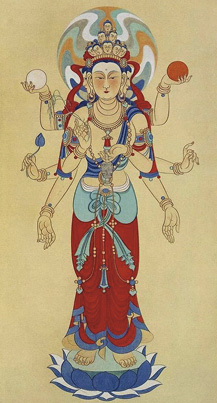
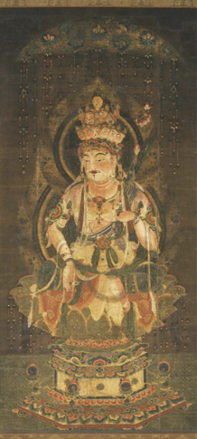
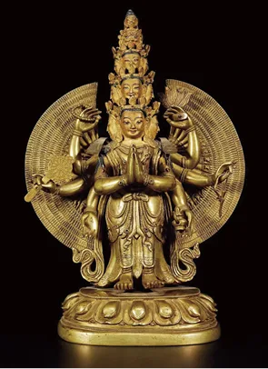
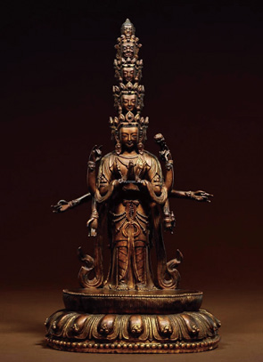
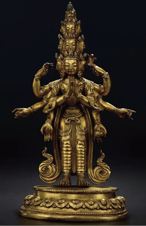
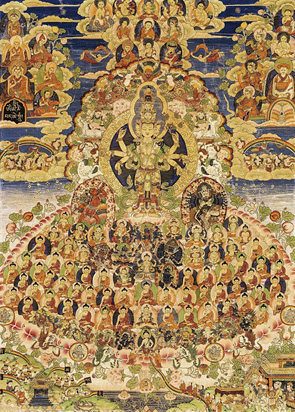

# 第8课

2022年10月24日

我们继续学习《大乘庄严宝王经》。

上节课，我们讲了圣马王的公案。从中我们知道，轮回如同恐怖的罗刹洲，要想成功逃离，需要两方面的因缘：从自身来讲，需要斩断对轮回的贪执；从他缘来讲，需要圣马王观世音菩萨的加持与护佑。

按照一般的思维来看，似乎是释迦牟尼佛先成就，然后才是观世音菩萨等诸位菩萨在未来成就。但在这个公案的最后，佛陀告诉除盖障菩萨，当时多亏了观世音菩萨的帮助，他才从罗刹洲解脱。也就是说，释迦牟尼佛在因地时就得到过观世音菩萨的帮助。

## 补怛洛迦山

藏地的神山，许多都是三怙主的圣地[^1]。不仅藏地有三怙主的神山，汉地也有，比如说普陀山。当然，汉地的普陀山到底是不是《华严经》里讲的普陀山呢？有不同的说法。《华严经》中说：“善男子，于此南方有山，名补怛洛迦。彼有菩萨，名观自在。”[^2]

有些人认为，佛陀说的普陀山是印度南部海上的一座岛屿，而且山径危险，岩谷奇倾，一般人难以到达。也有一些人认为，其实就是浙江的普陀山。如今浙江的普陀山，到底是不是佛陀说的那座普陀山呢？不清楚，但不管怎么样，它的确是观世音菩萨加持过的神山。

浙江的普陀山，在西汉时被称为梅岺山。公元900年左右，有一位法号慧锷的日本僧人从五台山请了一尊观音像，准备带回日本。当他带着观音像，乘船到了舟山群岛附近时，忽然狂风大作，海浪滔天，实在无法前行。他心想，也许是观世音菩萨不肯去。于是他登上岸，在潮音洞附近留下了观音像。后来人们在那儿建了一座寺院，取名为“不肯去观音院”。这就是为什么浙江的普陀山会被认为是观世音菩萨道场的原因。法王1997年去普陀山时，也带着我们一起去了“不肯去观音院”。[^3]

汉地有的神山，比如普陀山和九华山，实际上是大成就者和修行人加持而成为圣地的。当然，汉地的五台山确实是佛陀授记过的圣地，这在《华严经》《佛说文殊师利法宝藏陀罗尼经》等经典中都有记载。峨眉山则是普贤菩萨的道场，《山志》和前辈大德们的传记中都提到过。

我们如果有机缘，也可以去朝拜观世音菩萨的圣地、道场和寺庙。

汉地的寺庙，基本上都供有观世音菩萨的圣像。观世音菩萨为了利益不同根基的众生，显现了不同的身相，比如四臂观音、十一面观音。

佛菩萨的示现无量无边，我们不能说只有这种形象才是正确的，而其他的都不正确。一位好的演员，他在不同的场合，会扮演不同的角色，虽然角色不同，但人还是同一个人——穿西装的是他，脱掉西装换上其他衣服的还是他，我们谁都不会说，那是两个不同的人。甚至，观世音菩萨不仅存在于内道佛教中，还会以不同的形象显现于外道的殿堂，所以，我们要尽量观清净心。

## 祈祷的力量

同时，我们要养成祈祷观世音菩萨的习惯。观世音菩萨的慈悲无处不在，如果想得到菩萨的帮助，就要经常祈祷。无论遭遇何种恐怖、畏惧，只要真诚祈祷观世音菩萨，就一定能从畏惧中解脱。

我们讲《妙法莲华经》时也说过，仅仅见到观世音菩萨的身相，或是忆念观世音菩萨的名号，就能解脱一切恐惧和障碍。无论是个人还是集体，在遭遇灾难、怖畏和困难时，一定要记得祈祷观世音菩萨。心中忆念他，口中也念诵他的名号（南无观世音菩萨）或咒语（嗡玛呢巴美吽），如此便能从束缚和障碍中解脱。祈祷观世音菩萨确实非常重要。因此，无论是藏传佛教还是汉传佛教，大家都特别重视祈祷观世音菩萨。

很多人应该都有这样的经验，尤其是在遇到紧急情况时，由于心很迫切，祈祷而来的感应也很强烈。一般来讲，遇到的违缘不太严重时，大家都会祈祷，但在面临极其猖狂的违缘时，很多人好像愣住了一样，失去了面对的勇气，觉得没办法解决。当人生中最大的违缘来临时，有的人祈祷也想不起来，跑也想不起来，整个人完全呆住了，根本不知道如何应对，只有无可奈何地被迫接受。实际上，尤其是在那个时候，更需要祈祷三宝。

信心坚定、修行较好的人，平时就经常祈祷，在遇到大大小小的违缘时，还是会坚定不移地祈祷上师三宝。如果平时没有串习，在遇到违缘时可能反而觉得：“现在就算祈祷也没什么用了。”所以，我们平时就要养成祈祷上师三宝的习惯，这真的特别特别重要。

## 毛孔里的世界

| 除盖障，我今不能广说是观自在菩萨摩诃萨功德数量，我今为汝略说是观自在身毛孔中所有功德。

> 佛陀继续对除盖障菩萨说：除盖障，观自在菩萨的功德无量无边，我现在不能广说，否则累劫也无法说尽，我现在为你略说观自在菩萨毛孔中的功德。

今天的课，是关于“毛孔”的课，谁的毛孔呢？凡夫人的毛孔没什么可讲的，除了出汗以外没有其他功德。今天专门讲观世音菩萨的毛孔。

观世音菩萨的毛孔所具有的功德，完全超越了我们的想象。没有信心的人，也许很难接受；而有信心的人，听完之后会更有信心，“连观世音菩萨的毛孔都有如此的功德，那他身语意的功德一定更不可思议！”

观世音菩萨的毛孔到底有多奇妙？我们今天一起去参观参观。

## 金毛孔

| 除盖障，观自在菩萨身有金毛孔，而于其中有无数百千万俱胝那庾多彦达嚩，彼等无轮回苦，而常受于最胜快乐，天物受用无有穷尽，无有恶心，无憎嫉心，无贪瞋痴，常行八圣道，恒受法乐。

> 除盖障，观自在菩萨身中有金毛孔，里面住着无数百千万俱胝那由他的乾达婆众。他们没有轮回的痛苦，时常感受最殊胜的快乐，享受的也全是天界的受用，而且无有穷尽之时。他们没有恶心、憎恨与嫉妒之心，也没有贪嗔痴之心，由于经常行持八圣道，因而恒时感受正法的喜悦。

“无有恶心”，我们有时会产生恶心，环境好的时候一般不会，但在欲望得不到满足，或遭遇他人的阻碍和危害时，就容易生起恶心，比如想揍那个人一顿，或是给他制造违缘，甚至发恶愿。我们有这样的恶心和负面心态；金毛孔内的众生没有，他们只有无尽的喜悦。

金毛孔世界真的很幸福，我们也很想转生在那儿，在观世音菩萨的毛孔里待一段时间。我们这里有种种违缘和痛苦，冬天寒冷，有时还停电，连吃的也没有，身体不好，心情又烦躁，对别人的言行也看不惯、想不通，有时很想做一些有意义的事情，可是心有余而力不足……总之有很多的不如意。我们不如祈求观世音菩萨：“菩萨菩萨，能不能在您的毛孔里给我留一间小屋子，我很想去您那儿住一段时间。”

诸佛菩萨的毛孔，确实不可思议。《入中论》中说：“一一毛孔皆能现，无量诸佛与菩萨，如是刹那刹那顷，亦现天人阿修罗。”诸佛菩萨依靠不可思议的神变，在每一个毛孔中，都能示现无量无边的诸佛菩萨和天人、阿修罗、乾达婆等众生。

诸佛菩萨的境界，完全超越了我们的思维、分别。虽然我们很难想象，但这样的现象确实无欺存在。

## 四种“不可思议”

《分别功德论》（《增一阿含经疏》）中提到了四种“不可思议”：“众生不可思议”“世界不可思议”“龙不可思议”“佛不可思议”。关于“龙不可思议”，大家可能在电影里看过了，龙是变化多端的一类众生。

关于“世界不可思议”，论中讲了一则公案：有一次，富楼那尊者和一位梵志（婆罗门）在聊天。梵志说他在莲花水池边思维时，见到四大部队纷纷进入莲花如针眼般的孔隙中。他问富楼那尊者：“我是眼睛花了吗？还是真的有军队进入了莲花的孔隙中呢？”富楼那尊者带他去请问佛陀。佛陀告诉他：“你的眼睛并没有花，确实见到了莲花孔隙中的阿修罗军队。他们和天人战斗，失败后逃了进去。”

相较于其他“不可思议”，佛陀的功德最不可思议。我们最近在学《楞严经》，这部经典只是佛陀和阿难之间的日常对话，我们已经讲了六七十堂课，但这连整部经典的一半都不到。任何翻阅过这部经典的人，即使只从语言和逻辑的角度去理解，也会惊叹佛陀的不可思议。

“众生不可思议”，众生的数量、种类、业力和苦乐都是不可思议的。

若能对这些“不可思议”的道理有所认识，我们接受大乘佛教的教义时，就会更容易；如果对这些道理一无所知，就可能会觉得这也不合理，那也不合理。

我以前翻阅过天文学和神秘学的书籍。国外有许多神学院，学习的内容涉及各个宗教，同时也会提及一些神秘、奥妙的知识。了解得越多，视野越开阔，在面对种种的“不可思议”时，也就越能保持开放的心态。

这个世界上有非常多神秘、奇妙的道理。我们如果一直受世间教育模式的影响，总觉得眼见才为实，除此之外一律不承认的话，那么在面对这些道理时，可能要么产生邪见，要么置之不理。所以，如果你认为这是不可能的事情，那么你也可以反思一下自己的思维模式和认知范围：“为什么我会这样认为？是什么原因导致我这样认为的？”

| 除盖障，于是金毛孔中，复有放光如意宝珠，随彼彦达嚩众思念所须随意满足，于是金毛孔中有斯出现。

> 除盖障，在金毛孔内，还有一颗放光如意宝珠，能满足乾达婆众的所有心愿和需求。

## 黑毛孔

这以上介绍的是金毛孔，一种非常好的毛孔。接下来介绍黑毛孔，也是一种很好的毛孔，但由于众生的因缘不同，所以和金毛孔稍有差别。

| 复有黑毛孔而于其中，有无数百千万俱胝那庾多具通神仙之人。其中有具一神通者，或有具二三四五神通之者，亦有具足六神通者。

> 还有黑毛孔，里面居住着无数百千万俱胝那由他的具足神通的仙人。有的具足一种神通，有的具足好几种神通，还有的具足六种神通。

一般来讲，只有阿罗汉才具足所有的六种神通。因此，这里面也许有出世间的仙人[^4]。

| 于是毛孔之中，复现银地，黄金为山，白银为峰，三十七爱染莲华宝庄严其山。

> 在黑毛孔内，有三十七座以白银为地基、黄金为山体、白银为山峰、爱染莲花宝石作为庄严的山岳（藏译本中是：在黑毛孔内，有七十七座以白银为地基、黄金为山体、白银为山峰、红莲花作为庄严的山岳）。

| 于其山中而有八万四千神仙之众，如是仙众出现劫树，深红为身，黄金白银以为枝叶，放宝光明。又于一一毛孔现四宝池，八功德水充满其中，而有妙华盈满池中。于池岸侧有天妙香树、栴檀香树，又有庄严劫树，上悬庄严天冠珥珰，复有殊妙璎珞而严饰之。又于其上悬众宝铃，又挂妙衣憍尸迦服。

> 山中居住着八万四千位具足神通的仙人（藏译本中是：每座山中都居住着八万位具足神通的仙人）。仙人的周围有许多如意树，树身为深红色，黄金白银为树干、树枝和树叶，每棵树都散发出珍宝般的光芒。每个毛孔中又显现四个珍宝水池（藏译本中是：每棵如意树的周围，各有四个珍宝水池），池内盈满八功德水，水面开敷着朵朵妙花。水池周围，生长着天妙香树、旃檀香树和庄严的如意树，树上缀饰着庄严的天冠、天衣、珍宝铃铛和美妙的璎珞。

| 于斯一一劫树之下，各有一百彦达嚩王，而于恒时奏诸音乐。复有群鹿羽族灵禽，闻斯乐音悉皆思惟：‘诸有情类多受轮回之苦，何故南赡部洲人，见受生老病死、爱别离等如是诸苦？’

> 每棵如意树下，各有一百位乾达婆王，他们恒时演奏动听的音乐。那里的神鹿和灵鸟，随着乐音思维：‘轮回中的众生，感受了无尽的苦难，南赡部洲的人，明明见到轮回里充满了生老死病、爱别离等痛苦，为什么仍然苦苦忍受，而不愿意寻求出离呢？’

黑毛孔内还生活着许多动物，这是和金毛孔的区别之一。乾达婆和居住在那里的鸟兽，并没有完全断尽痛苦，有时还是会感受一点痛苦。所以，那里的灵禽神兽在听到乾达婆众所演奏的幽远乐声时，便开始思维轮回的痛苦，之后推己及人，想到了南赡部洲众生所感受的种种痛苦。

| 此诸禽鸟鹿等，于是思惟此《大乘庄严宝王经》如是之名，于是而有天妙上味饮食、天诸妙香、天妙衣服等物，随彼所思如意满足。”

> 思维了轮回痛苦之后，它们转而思维《大乘庄严宝王经》的经名，于是出现了种种天人的饮食、妙香和衣服等资具，它们随各自的意愿得到了满足。”

从这里我们知道，仅仅忆念、思维《大乘庄严宝王经》的经名，就可以改善生活，遣除生活中的痛苦。

看得出来，那里的动物很有善根，还能想到轮回的痛苦。相比之下，我们这个世界很多人都不会那样想，虽然苦得不得了，但还不觉得苦，还在痛苦中挣扎着作乐。

它们思维了《大乘庄严宝王经》的经名之后，天界的饮食、衣服和妙香，自然而然地出现在面前。它们吃得还是挺不错的，但不知道它们爱不爱穿衣服？有些宠物小狗还是挺爱穿衣服的。所以它们可能也喜欢穿天人的衣服。

| 是时，除盖障菩萨白世尊言：“我今闻是甚为希有，世尊！”佛告：“善男子，于意云何？”

> 除盖障菩萨听了佛陀的介绍，赞叹道：“世尊，我今天听了您对观自在菩萨毛孔和《大乘庄严宝王经》功德的介绍，觉得非常稀有！”佛陀说：“善男子，你是怎么认为的呢？”

## 抄写一个字的功德

| 除盖障菩萨白世尊言：“如是有情，心唯思念此经名号，尚获如是利益安乐。若复有人得闻此经，而能书写、受持读诵、供养恭敬，如是之人常得安乐！或复有人于此经中书写一字，斯人当来不受轮回之苦，而永不于屠儿魁脍下贱之类如是家生，所生之身而永不受背伛挛躄、丑唇缺漏、疥癞等病不可喜相，获得身相圆满，诸根具足有大力势，何况具足受持、读诵书写、供养恭敬之人所获功德！”

> 除盖障菩萨禀白佛陀：“世尊，那里的有情众生仅仅思维《大乘庄严宝王经》的经名，尚且获得了如是的利益安乐。如果有人在听闻了这部经典之后，更能以恭敬心书写、受持、读诵、供养，这样的人将经常感受安乐！即使只是书写这部经典中的一个字，未来尚且不必感受轮回中的种种痛苦，而且永远不会转生在屠夫、刽子手等下贱人的家庭里，所受的身体，也不会感召驼背、挛躄[^5]、兔唇等让人见而生厌的相，更不会得头癣、麻风病之类毁坏形象的疾病，生生世世都能获得圆满庄严的色身相，而且诸根具足，有大势力，更何况以恭敬之心受持、读诵、书写、供养整部完整的经典呢？这样的功德更加不可思议！”

为了与这部殊胜的经典结上善缘，我们有必要每天抄一点《大乘庄严宝王经》。如果希望自己生生世世相貌庄严、身相圆满，最好抄写这部佛经。

有老年人说：“我眼睛不好，为了保护眼睛，我已经好久没看书了。我不想失去光明，所以我不看书。”我想，看书或抄经应该不会让你的眼睛失明。而且，如果你一直不使用眼睛，最后习惯了，也许真的什么都看不见了。即使为了保护眼睛，你也应该看看书、抄抄佛经。电脑和手机真的就不要看了。大多数人眼睛不好，其实是经常看手机导致的。听说这次把大家的手机收上来以后，很多人的眼睛越来越好了，重新恢复了光明——确实有必要收手机。

佛陀和除盖障菩萨已经为我们宣说了这部经典的功德。至于相不相信，是每个人自己的事情。如果什么都不相信，既不相信因果，又不相信佛陀的金刚语，即使听再多的经、闻再多的法，也没什么用。因为你只相信自己的想法，那谁都没办法，每天只是过一个一般的生活而已，除此之外，不会有太大的成长和进步。反之，如果你真的体会到了《大乘庄严宝王经》所具有的功德，你会觉得自己非常幸运，竟然有幸遇到这么殊胜的经典。

| 尔时，世尊赞言：“善哉！善哉！除盖障，汝今善说如是之法。今此会中，无数百千万天、龙、药叉、彦达嚩、阿苏啰、蘖噜拏、紧那啰、摩护啰誐、人及非人，邬波索迦、邬波斯计如是等众，皆悉闻汝说如是法，得闻斯之广博法门，由汝所问。”

> 除盖障菩萨宣说完，佛陀表示认可，并赞叹道：“善哉！善哉！除盖障，你善妙地宣说了这部经典的功德。正因为你的发问，如今宝王法会之中，无数百千万的天、龙、药叉、乾达婆、阿修罗、迦楼罗、紧那罗、摩睺罗伽、人与非人，优婆塞、优婆夷等众生才有机缘听闻这部深广的法门。”

从这部经典的情节来看，有些发生在过去，有些又发生在当时，似乎不是一条直线。实际上，从形式上讲，《大乘庄严宝王经》和《妙法莲华经》一样，经中的大致内容包括咒语等，过去诸佛早已宣说，而其余部分，如说法者、听法者以及整个说法的过程，则发生在释迦牟尼佛时代。就像过去的小说家早已使用过的题材和部分内容，现在的作家仍然可以拿来再用一样。了解了这一点，这部经典的情节线便容易理解了。

| 时，除盖障菩萨白世尊言：“世尊于今说斯妙法，天人众等生信坚固。”

> 除盖障菩萨继续对佛陀说：“世尊，您现在宣说了这样的妙法，让天界、人间等的众生生起了坚固不退的信心。”

刚开始学习佛经时，很多道友常常摸不着头脑，觉得佛经实在是深奥玄妙。在坚持了一段时间的诵经和学经之后，依靠佛经的加持，佛理潜移默化地融入了自相续，心与佛法也越来越相应，自此以后，凡是佛陀宣讲的道理，接受起来都会很容易。不过，这也和各人的缘分有关。

当时的天人等众生，听佛陀宣说了《大乘庄严宝王经》之后，都生起了坚固不退的信心。我相信，具有正信又与观世音菩萨有缘的你们，在听了《大乘庄严宝王经》之后，也一定会发愿好好弘扬这部经典和观音法门。在这个末法时代，观音法门特别重要，弘扬观音法门也特别有意义。

现在有一些外道，本来不是佛教，却打着观音法门的幌子做自己的勾当。以前有段时间，一些气功师让别人给他拍照，然后他把自己P在一朵大大的莲花上，假装自己是观音菩萨。所以你们以后也可以把自己当成观世音菩萨——玩笑归玩笑，大家确实要增上对观世音菩萨的信心。

这次学习《大乘庄严宝王经》，主要目的就是弘扬观音法门，弘扬“嗡玛呢巴美吽”。即使是世间的培训，有的人在接受了短期的培训后，也学到了许多东西，而且受用一辈子。

喇荣和观世音菩萨非常有缘。法王在世的时候，天空中经常显现观世音菩萨的彩虹和心咒，而且还会降下许多舍利。既然我们在这样一个与观世音菩萨有缘的圣地，学习了《大乘庄严宝王经》这部观音经典，那么，每个人的相续中能否生起对观音法门和六字真言的不退信心呢？有信心，以后弘扬起来就会很容易。如果现在学的时候都没什么感觉，甚至还产生邪见和不好的分别念，就谈不上弘扬这个法门了；依靠这个法门，也不一定能利益自他。

| 是时，世尊赞言：“善哉！善哉！善男子，汝能如是重复问是观自在身毛孔中所现功德。

> 佛陀赞叹除盖障菩萨：“善哉！善哉！善男子，你能重复请问观自在菩萨毛孔的功德。

## 宝庄严毛孔

| 除盖障，彼复有宝庄严毛孔，是中有无数百千万俱胝那庾多彦达嚩女，面貌端严，形体姝妙，种种庄严，如是色相状如天女。

> 除盖障，观自在菩萨还有一种毛孔，叫做‘宝庄严’，里面居住着无数百千万俱胝那由他的乾达婆女，她们容貌端严，形体姝妙，具足种种庄严，美貌如同天女。

宝庄严毛孔里住的全是乾达婆女，是一个美女如云的世界。

| 彼众贪瞋痴苦皆不能侵于彼身分，而亦不受人间少分苦恼之事。

> 尤为殊胜的是，贪嗔痴之苦无法侵扰她们的身心，她们也不会感受丝毫人间的苦恼。

对众生来说，最无上的快乐，就是没有贪嗔痴等烦恼。人间有各种痛苦，而且不是少分，是多分、强烈、巨大的痛苦。有的人在业力、烦恼现前时，特别痛苦，好像心都要裂开了，似乎整个世界都在天旋地转，一切的一切都是黑暗的、压抑的、灰蒙蒙的。这样的痛苦，其实在没烦恼和有修行的人看来，可能也算不了什么。

比如，身体的痛苦，放在有些人身上，就是无法忍受的折磨，对有修行的人来说，恰恰是能够增上修行境界的助缘；失恋和失业，是巨大的打击，让人痛不欲生，但若发生在心态较好的人身上，他也许反而觉得，“挺好的，放下这段感情后，我比以前更自由了”“虽然我失去了这份工作，但世界上还有那么多的地方可以供我实现自己的价值，我还能找到新的工作，我照样可以开开心心地过”“被开除了也挺好的，我现在是一个自由的人了，想去哪儿就去哪儿”……无垢光尊者也被开除过，而且他很开心，到了山脚的时候，特地写了一首讽刺诗，托人带回开除他的寺院。

人间的痛苦，有时确实很强烈，甚至可以用生不如死来形容，“我实在是不想活了，我现在要是死了该多好，观世音菩萨，你可不可以让我当下死去……喇嘛钦诺！喇嘛钦诺！我真的太痛苦了，上师加持我现在就离开这个世界吧……”人间的痛苦，让我们饱受折磨；宝庄严毛孔中连人间的少分痛苦都没有，这也让我们特别羡慕。

| 彼彦达嚩女而于三时，念是观自在菩萨摩诃萨名号，而于是时，彼等获得一切所须之物。”

> 宝庄严毛孔中的乾达婆女，在昼夜三时中恒时忆念观自在菩萨的名号，因而获得一切所需。”

仅仅忆念观世音菩萨的名号，就能得到想要的一切，而且没有任何痛苦。我们也很想在那样美好的世界里生活。

| 是时，除盖障菩萨白佛言：“世尊，我欲入彼毛孔之中，看其所有。”

> 除盖障菩萨说道：“世尊，我很想去那个毛孔中参观一下。”

不仅我们想去，除盖障菩萨也想去，“观世音菩萨的毛孔，是那么的美妙，我很想在那边待一段时间，这个人间实在是让人苦恼！”除盖障菩萨可能显现上也有一些烦恼。（众笑）

其实佛经里的公案都很有意思，每个公案就像是一部出世间的电影和连续剧。

| 佛告：“善男子，彼之毛孔无有边际，如虚空界亦无障碍。善男子，如是毛孔，无障无碍亦无触恼。

> 佛陀告诉除盖障菩萨：“善男子，观自在菩萨的毛孔无边无际，如同虚空界一般没有阻隔、没有妨碍，也无法接触。

观世音菩萨的毛孔，就像虚空一般没有边际、不可限量，也没办法受持和接触，完全超越了我们对于空间的认知。

| 彼毛孔中，普贤菩萨摩诃萨入于其中，行十二年不得边际；见诸毛孔一一之中，各有佛部于彼而住。是故普贤不能见其边际近远，余诸菩萨云何而得见彼边际耶？”

> 普贤菩萨进入观自在菩萨的毛孔，在里面找了十二年，一直找不到毛孔的边际（藏译本中是：普贤菩萨找了十二年，一直没有找到观世音菩萨的毛孔）；而且，普贤菩萨见到每个毛孔都有诸佛居住其中。普贤菩萨尚且无法找到观自在菩萨毛孔的边际，其余的菩萨又怎么可能找得到呢？”

普贤菩萨那么厉害，听说都找不到观世音菩萨毛孔的边际，除盖障菩萨有点心生退却，不太敢去了。我现在也不太敢去，去了肯定找不到，连普贤菩萨都找不到，我们怎么可能找得到呢？

| 时，除盖障菩萨白佛言：“世尊，普贤菩萨摩诃萨，于彼毛孔行十二年，不能见其边际，而诸毛孔各有百佛在于其中。普贤菩萨摩诃萨尚不能得见于边际，我今云何而得入于是中耶？”

> 除盖障菩萨禀白佛陀：“世尊，普贤菩萨在观自在菩萨的毛孔中找了十二年，也没有找到毛孔的边际，而且每一毛孔中都有百尊佛陀常住其中。普贤菩萨连毛孔的边际都找不到，我又怎么可能进入毛孔之中呢？”

除盖障菩萨有点心虚：普贤菩萨都找不到，我怎么可能找得到呢？虽然诸佛都居住在那儿，环境又是那么的美好庄严，但我现在也不一定会去。

## 十一面观音

| 佛告：“善男子，我亦不见如是微妙寂静。彼无相故而现大身，具十一面，而百千眼圆满广大，

> 佛陀告诉除盖障菩萨：“善男子，观自在菩萨的毛孔，极为微妙、寂静，连我也无法彻见。以无相却能显现广大之身的缘故，观自在菩萨具足十一面，千手千眼（藏译本中是：具足百千俱胝的手和眼），广大无碍，圆满庄严。

这是从胜义和世俗圆融的角度，描述观世音菩萨不可思议的身相。观世音菩萨无相，却能显现广大之身，这本身就不可思议。前面也提到过，日月与山河大地，都是观世音菩萨的身体。而这里，主要讲到了十一面观音，也就是千手千眼观音。

十一面观音是一位极为重要的本尊，藏地各个寺院基本上都供有十一面观音像。我们以后也可以多讲讲与十一面观音和千手千眼观音有关的经典。

汉传佛教的《三宝感应要略录》中提到，佛陀涅槃800年后，憍萨罗国爆发一场大瘟疫——就像我们现在的新冠疫情一样，历经三年，全国死了一半的人。

当时，国王和大臣共同商议，决定祈请大悲圣尊救护。当天夜晚，国王梦见具有十一面的观世音菩萨为他摸顶加持，并告诉他说：“全国上下若多造十一面观音像，就能平息一切灾难。”国王梦醒后，告知大臣，发动全国塑造十一面观音像。很快，疾疫便销声匿迹了。在后来的百年中，再也没有发生任何瘟疫。

我想，在如今这个动荡的时代，我们真的很有必要多造十一面观音像。但大家不要化缘。现在一般都有十一面观音的模具，大家可以做一些擦擦像放在家里，或者直接请一尊十一面观音供在家里。

按照传承来讲，十一面观音像通常有五层：第一层和第二层，是慈像和悲像，慈爱悲悯一切众生；第三层是喜像，依靠佛菩萨的加持，让众生欢喜；第四层是忿怒像，降伏一切外内密的违缘与魔障；第五层是部主阿弥陀佛——观世音菩萨的怙主。

不同朝代和地区塑画的十一面观音像稍有差别。这里找了几张图片，大家一起看一下。

这是晚唐时期汉传的观世音菩萨像，出土于敦煌。

这是公元700年左右的观音像，收藏在日本。

这是内蒙古的藏传十一面观音像。

这是康熙年间的十一面观音像。

这是乾隆年间的十一面观音像。

这是藏传佛教噶举派的观音修法皈依境。

诸佛菩萨的身相不可思议。我们以后也可以请一尊小小的十一面观音像，随身携带，遣除违缘，同时增上相续中的悲心和信心。

| 得相应地湛然寂静，大智无得无有轮回，不见救度亦无种族，无有智慧亦无有说，如是诸法如影响故。善男子，观自在菩萨，无见无闻，彼无自性，乃至如来亦所不见。于意云何？善男子，普贤等诸菩萨皆具不可思议，不能了知彼观自在之所变化。

> 若能相应法性，则湛然寂静，无二取分别，在大智境界中，照见一切，悉皆空寂，了不可得，无轮回可舍，不见救度，亦无种族，无能得之智，亦无所说之法，一切万法如影如响，现而无自性。善男子，观自在菩萨无有自性，无见无闻，乃至诸佛如来亦所不见。你是怎么认为的？善男子，普贤菩萨等诸位大菩萨，虽然都具有不可思议的功德神力，却无法了知观自在菩萨的神通变化。

这以上是从空性或者说自性的角度来讲的。

| 善男子，观自在菩萨摩诃萨变现种种，救度无数百千万俱胝那庾多有情，令得往生极乐世界，见无量寿如来，得闻法要，皆令当得成菩提道。”

> 善男子，在世俗谛中，观自在菩萨显现无量神通变化，救度无数百千万俱胝那由他的有情众生，令其往生极乐世界，面见无量寿如来（阿弥陀佛），听闻大乘法要，获证无上菩提。”

## 观自在菩萨到底何时来

| 时，除盖障菩萨白世尊言：“不知以何方便，令我得见是观自在菩萨摩诃萨？”

> 除盖障菩萨请问佛陀：“不知道依靠什么样的方法，才能使我见到观自在菩萨呢？”

除盖障菩萨本来很想见观世音菩萨的毛孔，可是听佛陀说，普贤菩萨花了十二年的时间，连观世音菩萨毛孔的边际都找不到，所以觉得可能见不到观世音菩萨的毛孔了。虽然见毛孔没希望，但他不放弃，还是想见一下观世音菩萨。

| 佛告：“善男子，彼菩萨必当来此索诃世界，而来见我礼拜供养。”

> 佛陀告诉除盖障菩萨：“善男子，观自在菩萨必定会来我们这个娑婆世界，顶礼、供养（藏译本中还提到：承侍）于我。”

佛陀说：“除盖障，你不要着急，观世音菩萨肯定会来拜见我的，到时候你就能见到他了。”

| 时，除盖障菩萨白佛言：“世尊，可知是观自在菩萨摩诃萨，而来于此为于何时？”

> 除盖障菩萨继续问道：“世尊，观自在菩萨大概什么时候来呢？”

除盖障菩萨很心急，不停地问佛陀：“观世音菩萨到底什么时候来？”等观世音菩萨真的来了，他的态度可能又不一样了。（众笑）

| 佛告：“善男子，候此有情根熟之时，彼观自在菩萨摩诃萨先来到此。”

> 佛陀说：“善男子，当这里的有情众生善根成熟时，观自在菩萨就会来到这里。”

佛陀告诉除盖障菩萨：“当众生的得度因缘成熟时，观世音菩萨就会来。”因缘成熟时，菩萨就会来。这是一个很好的回答方法，我们有时候也会这样说：“来来来，等因缘成熟的时候我就来。”

| 时，除盖障菩萨摩诃萨，以手搘揌作是思惟：“我今云何有是罪障，寿命虽长而无所益，不得见彼观自在菩萨恭敬礼拜，犹如盲人在道而行？”

> 除盖障菩萨以手托腮思维道：“是不是我的罪业太深重了？如果不能亲眼见到观自在菩萨，不能向观自在菩萨恭敬顶礼的话，我寿命再长又有什么意义呢？就像盲人在路上漫无目的地行走一般。”

除盖障菩萨以手托腮，可能他也有点想不通：“为什么我现在见不到观世音菩萨呢？是不是我的业障太深重了？如果见不到观世音菩萨，那我活着也没什么意义了。”你看，除盖障菩萨有时也觉得活着没有意义。

有的人说：“自从失去他以后，我的人生越来越黯淡，世界也失去了往日的活力与光彩。少了他的陪伴，我也不想再继续活着了。”

| 时，除盖障菩萨复白佛言：“世尊，彼观自在菩萨摩诃萨，为实何时而来于此耶？”

> 思维之后，除盖障菩萨再次问道：“世尊，观自在菩萨到底什么时候来？”

除盖障菩萨特别着急，非要让佛陀告诉他具体的时间——既然这么着急，那我们就明天再回答他。（众笑）

[^1]: 三怙主：文殊菩萨，观世音菩萨，金刚手菩萨。
[^2]: 《大方广佛华严经》：“汝诣彼问：菩萨云何学菩萨行、修菩萨道？即说颂曰：海上有山多圣贤，众宝所成极清净，华果树林皆遍满，泉流池沼悉具足。勇猛丈夫观自在，为利众生住此山；汝应往问诸功德，彼当示汝大方便……渐次游行，至于彼山，处处求觅此大菩萨。见其西面岩谷之中，泉流萦映，树林蓊郁，香草柔软，右旋布地。观自在菩萨于金刚宝石上结跏趺坐，无量菩萨皆坐宝石恭敬围绕，而为宣说大慈悲法，令其摄受一切众生。”
[^3]: 《补陀洛迦山传》：“日本僧慧锷。从五台山。得菩萨像。将还国。抵焦石。舟不能动。望潮音洞默叩得达岸。乃以像舍于洞侧张氏家。屡睹神异。遂捨居作观音院。郡将闻之。迎像入城。为民祈福。未几。有僧。不知何许人。索嘉木扃户刻之。弥月像成。僧不知所在。今所奉菩萨像。即此也。”
[^4]: 六种神通：天眼通、天耳通、他心通、宿命通、神足通、漏尽通。前五种属世间神通范畴，漏尽通属出世间神通。
[^5]: 挛躄：手脚屈曲，不能行动。
