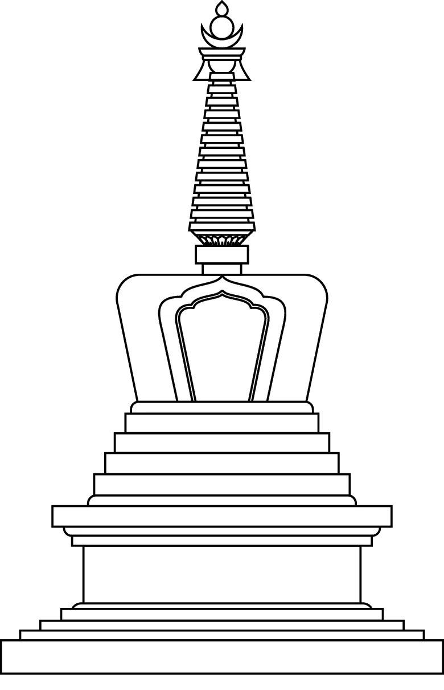

# 第113课

2024年6月8日

接下来我们继续讲解《楞严经》的最后一段内容。上节课讲到，阿难向佛陀提了三个问题：

第一，一切器情世界的根本是五蕴，五蕴的根本是妄想，那妄想的因是什么？

第二，如果要消除五蕴，是一次顿除还是次第消除？

第三，在破除五蕴的过程中，它们各自的深浅界限如何确定？

佛陀先做了总体回答：五蕴的根本是妄想，而妄想无因。

「重明五阴生灭（续）」

接下来，佛陀将逐一阐述五蕴的根本是五种妄想，色、受、想、行、识每一蕴都由其相应的妄想所成。这部分内容分析得非常透彻，但在初闻时可能不易理解，请大家提起心力。

◎ 详示五重妄想

下面具体分析五重妄想，首先是色蕴妄想。

| 汝体先因父母想生，汝心非想，则不能来想中传命。

“你身体最初是由父母情欲之想结合而生。如果你的心中没有憎爱的妄想，就不会依靠妄想传续生命。”

佛陀首先以我们的身体为例，宣说色蕴由妄想产生。

色身的产生始于父母的欲念交合。当父母行不净行时，双方都怀有对对方的贪爱心。如果没有这种贪爱，就不会出现父精母血的结合，所以色身的因首先是父母双方的贪心。

经论中讲，投胎者在投胎时也有自己的贪执：若贪恋父亲则转生为女性，若贪恋母亲则转生为男性，如此便具足了三方面的贪心。“汝心非想”，如果你的心中没有这样的妄想，“则不能来，想中传命”，就不可能在妄想中传续命根。换言之，如果缺乏父母与投胎者三方的“想”，那新的生命不可能来到这个世界。

从表面上看，孩子的诞生只是出生了肉体，但归根结底，身体的来源与贪爱之心密不可分。一个生命要入胎，三种贪心缺一不可：父母交合的贪心是产生父精母血的因缘，带着前世业力的中阴身的贪心是入胎的因缘，因此才有后续在胎内发育的七个阶段——胎中七位。

| 如我先言：心想醋味，口中涎生；心想登高，足心酸起。

“就像我之前说的：心里想着酸梅的味道，嘴里就会流口水；心里想着站在高处，脚底就会发酸。”

佛陀说，我曾经开示过这样的例子：比如，仅仅想到梅子、柠檬等酸涩的食物，口中便会自然分泌唾液；再比如，心中想象自己站在高高的悬崖上，或只是观看别人攀登险峰的影像，自己的脚底也会不自觉地发酸。尤其是有恐高症的人，一想到万丈深渊的景象，便会感到无比恐惧。有些旅游地的透明观光电梯也一样，让许多游客都紧张不已。

| 悬崖不有，醋物未来，汝体必非，虚妄通伦，口水如何因谈醋出？

“实际上悬崖并不存在，酸梅也没有出现在面前，你现在的身体如果不与虚幻之法同为一类，为什么一谈论酸梅就会流口水？”

下面我们来观察这个现象：此刻并没有真实的悬崖存在，这仅仅是自己的想象；同样，引发口水的酸味食物也并未真正出现在眼前。“汝体必非，虚妄通伦”，如果你的身体不与虚妄之法同类，为什么想象登高就会脚底发酸、想象酸梅就流口水？酸梅、悬崖根本没有出现，口水和脚底的酸痛为什么会出现？因缘生法就是这样，它们是依靠妄想而生的。

既然妄想能够产生口水和足底的酸楚，那就说明色法是从妄想而生。以上的比喻是为了阐释这一道理：如果色蕴不与妄想通伦，口水怎么会仅仅因为谈论酸梅就自然分泌？

| 是故当知，汝现色身，名为坚固第一妄想。

“因此你应当明白，你现在的色身，在本质上只是一种顽固的妄想，称为‘坚固第一妄想’。”

佛陀对阿难说，你们应当明白，现在显现的这个色身实际上就是由坚固妄想所产生的。看似实在的色法，究其根源，其起因就是妄想——这个道理已通过前面的比喻进行了说明。

“因明”论典中提到[^1]，习气坚固到一定程度后，就会显现为看似坚固的山河大地，而“习气”也是在心上安立的，在物质上无法安立习气。此外，“色蕴由妄想产生”这一见解，在密法中也阐释得很清楚。

现代生物学认为，如果子女与父母基因相同，代表子女继承了父亲或母亲的某种特质，可能患有同类疾病，或具有相似的性格。也就是说，基因的传承不仅包括身体方面，也可能涉及性格、习气等方面，比如父亲脾气暴躁，孩子往往也容易发脾气；母亲性格和善，孩子也容易善良温和。就身体特征而言，有些人长得像父亲，有些人像母亲。这些看似是物质方面的遗传，实际上也是习气种子的显现。此外，妄想的种子还会显现为外在的相貌特征：嗔恨心重的人显露出凶相，而慈悲心重的人则有一种祥和之态。这就是所谓的“相由心生”，我们可以借此深刻地理解心识与色法的关系。

| 即此所说，临高想心，能令汝形真受酸涩。

“就像前面所说，仅仅因为站在高处的想心，就能让你的身体真实产生脚软酸涩的感觉。”

这里讲受蕴的妄想。

前面提到，当想象自己站在高高的悬崖或山顶时，身体就会产生脚底酸涩的感受。

| 由因受生能动色体。汝今现前，顺益违损二现驱驰，名为虚明第二妄想。

“这些由想象引发的感受，能真实影响由色蕴组成的身体。你现在经历的是由顺益带来的愉悦，或者由违逆造成的痛苦——这两种感受影响并驱动着你的身心。这称为‘虚明第二妄想’。”

当我们在心中想象身处高处，身体会立即产生脚底发酸的感受，这是为什么呢？“由因受生”，因为你的妄想分别影响了受蕴，进而扰动了色身，令其产生反应。

“汝今现前”，你现前的受蕴中，“顺益违损”，如果遇到了顺缘或获得了利益，内心便感到快乐；如果遭遇到违缘、损害，心里便感到痛苦。由于顺缘和违缘，使自己感受到痛苦和快乐。

“二现驱驰”，你的心被快乐与痛苦所驱使，遇到顺缘就快乐，遭遇违缘就痛苦，但其实心里感受的苦乐与妄想有关。何以见得？你如果认定某人待你好，即便他出言不逊，你仍会感到愉悦；如果你认定某人待你不好，即便他大加赞美，你仍会感到不快——这说明受蕴其实是由妄想而生。

我曾在飞机上遇到过一些空乘人员，当我称赞他们服务态度很好时，对方坦言：“其实这只是工作需要，我们必须遵守服务规范。有时遇到无理取闹的乘客，虽然心里很不痛快，但表面上还是得保持微笑，顾客看到也会心情愉快。”其实，顾客就是被自己的妄想欺骗而不自知。

“名为虚明，第二妄想”，受蕴是由虚明妄想所生。所谓“虚明“是指虚妄的同时能够明了地感知。

| 由汝念虑，使汝色身身非念伦。汝身何因，随念所使，种种取像，心生形取，与念相应。

“你第六意识的想念与思虑能驱使你的身体做出反应，而色身与意识并不属于同一类，为什么身体会听从念头的指挥呢？当根尘相对而以心取相时，都是因为心生取相之想，而后才取到诸根之形，由此可知，根身所取之相是与想念相应的。”[^2]

第三，想蕴妄想。

《楞严经》的经文就是这样，乍一看有些头痛，不知道在说什么，但再认真地想一想，慢慢地也能明白一些，我看看要不要找一位道友来解释一下——一说这个大家的头就低下去了。（众笑）

现在讲想蕴由妄想而产生。

“由汝念虑，使汝色身”，你的“想”，即粗大的分别念，会对你的色身发生作用。“身非念伦”，身体属于色法，心属于心法，二者并非同类，但是依靠妄想的力量，心可以对身体产生作用。

怎么起作用？“随念所使”，身体会随着念头而变化。当人产生种种想法时，身体就会做出相应的反应，比如心里感到快乐，脸上就会露出笑容；而产生负面想法时，表情就会变得阴沉。

“种种取像”，取相是“想”的法相，只要根尘相对，心就能取对境的种种相，“心生形取，与念相应”，而只要心中一生起念头，身体就会随之做相应的事，可见身心是互相关联的。

实际上，身体是在妄想的操控下运行的。平时我们可能没有这么细致地观察，所以很少意识到，既然身体与心不同类，那为什么身体的一举一动都会受心念的支配？观察后就会明白，身体受想蕴支配，而想蕴也与妄想有着密切的关系。

| 寤即想心，寐为诸梦。则汝想念，摇动妄情，名为融通第三妄想。

“白天清醒时的各种念头、夜晚睡眠时的各种梦境，都是你的想，是动摇不停的妄念。这称为‘融通第三妄想’。”

人们在白天醒觉的时候，心里会生起各种各样分别念；夜里睡觉做梦时，也都是分别念在起作用，而这些想实际上都是动摇的妄情。

凡夫的心会随着外境而转，而身体的妄动也跟心有关。支配身体的想会跟随妄想而动摇，虽然妄想是无实之法，但它可以驾驭身体，驾驭我们的一切行为。这称为“融通妄想”。有注释说[^3]，所谓“融通”，指消融色法、通于心念，令色心相融互通。

总之，想蕴也是依靠妄想而产生的。

| 化理不住，运运密移，甲长发生，气销容皱，日夜相代，曾无觉悟。

“生灭变化之理一直不断，隐秘难察。如指甲生长、头发变长、气血消耗、容颜衰老，这些变化日迁夜移，但人们却很少能觉察。”

第四，行蕴妄想。

“化理不住”，行蕴是迁流不息的深细变化，此变化的理体一直不断，称为“不住”。“运运密移”，这种变化难以觉察，在隐密中迁变。

“甲长发生，气销容皱”，比如我们的指甲和头发在不知不觉中生长，人的气血随着年龄增长而逐渐衰退，皱纹悄然出现，这些现象主要都是因为行蕴在起作用。有些人很在意自己脸上的皱纹，于是用了很多美容技术来对抗衰老。虽然有人声称这些科技能让人重焕青春，但其实难以控制行蕴。

行蕴在不断地生灭迁移，“日夜相代，曾无觉悟”，日夜相替、从不间断，但众生却毫无觉察，就像三苦中的“行苦”。虽然行苦不太明显，但因为持续不断地变迁，所以它也是痛苦的本性。同样，行蕴无常，在轮回中连续不断地生灭，但一般人觉察不到，只能觉知一些粗大的变化。

这就是行蕴，它也是由妄想产生，为什么呢？

| 阿难，此若非汝，云何体迁？如必是真，汝何无觉？

“阿难，如果这个不断变化的行阴不是你的心，那它为什么能改变你的身体？如果这些就是你的心，为什么你又察觉不到它的存在？”

如果这个念念变化的行蕴不是你的心，那么为什么你的身体会从年轻变为衰老？佛陀问阿难，你说这个行蕴是不是你？如果不是你，为什么你的身上会展现出行蕴的特点——一直不断地变化？

“如必是真，汝何无觉”，反之，如果行蕴真是你的心，那为什么你对这种变化毫无觉察？按理来说，属于自己的东西，自己应该最清楚，你怎么会不知道呢？

◎ 胜妙缘起

外面又下雨了。

我们开始讲《楞严经》的第一天——2019年9月2日，喇荣出现了冰雹和彩虹等天象；而在昨天，当我们将要讲解完“五十阴魔”时，附近又发生了地震和冰雹。

从现代科学的角度来看，下冰雹或发生地震都属于正常现象，不必过度解读，也不应将所有的天气状况都视为缘起。不过，从另一方面来讲，我们也不能完全否认胜妙的因缘。

昨天下课后我回到住处，院子里满是白色的冰雹。我查了一下日记，2019年开讲第一课时也出现了满院冰雹的景象。特别是，就在昨天讲解“五十阴魔”即将结束、距下课约十分钟时，附近发生了地震——或许可以理解为魔宫震动，也有可能是魔王不悦。具体的缘由难以断言。

| 则汝诸行，念念不停，名为幽隐第四妄想。

“你的行阴念念迁变不停，细微隐蔽，称为‘幽隐第四妄想’。”

行阴念念不息，生灭之相幽隐难知，称为“幽隐妄想”，这是第四种。

| 又汝精明，湛不摇处，名恒常者，于身不出见闻觉知。若实精真，不容习妄。

“你那个看似精明而澄澈不动的识阴，被误认为是永恒不变的，但它始终离不开身体的见、闻、觉、知等功能，如果它确实是纯精的本体，就不该掺杂各种习气妄念。”

第五，识蕴妄想。

前面讲过，与色、受、想、行蕴都不同，识蕴是精明、湛然、不动摇的。人们经常误以为它恒常不变，但其实识蕴既不同于迁流不息、扰动不止的行蕴，也并非湛然不动的佛性，而只是比较接近如来藏。

“于身不出”，识蕴自身不出见闻觉知。从其自身的本体来讲，识蕴并没有脱离见闻觉知。

“若实精真，不容习妄”，如果识蕴真是湛然澄明而不动摇的，便不可能杂有妄动的习气，但实际上并不是这样，因为识蕴也是由妄想而产生的。

这一点是通过什么方式知道的呢？下面佛陀用一个公案来说明。

| 何因汝等，曾于昔年睹一奇物，经历年岁，忆忘俱无，于后忽然覆睹前异，记忆宛然，曾不遗失。

“为什么你们对当年一睹的某件奇物，历经多年似乎已经遗忘，但当再次见到时，记忆又宛然呈现，仿佛从未遗失过一般？”

比如，你曾经见过一件奇特的事物，多年后已完全忘记了，包括当时的心境及具体的细节，从来都不会想起，但当那个事物再次出现在眼前时，所有的记忆又突然重现——这说明你的记忆从未真正遗失。比喻对应的意义是：阿赖耶识（藏识）能储存我们所有的经历，而且每个人心中所储存的内容都不相同。即使我们已经遗忘了很长时间，但是从未真正丢失过这些心识的种子。

就像某人多年前去过五台山，但后来忘记了，直到某天看到照片才恍然大悟：“原来我当时去过那里！”我在撰写《梦尘回忆录》时也是这样，有一次慈诚罗珠堪布问我：“这本写满笔记的旧日历你要不要？”我欣然接过，看着上面的文字，那些被尘封的记忆又瞬间鲜活起来。这说明，以前发生过的一切，只要因缘和合，我们就会想起来。

以上比喻是为了说明识蕴的特点：如果我们的心是恒常的，中间就不会忘记；如果我的心是刹那断灭的，忘了以后就不会想起。

| 则此精了湛不摇中，念念受熏，有何筹算？

“那么，这个澄明不动的精明识阴，时时刻刻都受到妄习所熏，如何能够计量？”

“则此精了湛不摇中，念念受熏”，这个识蕴看似明了澄澈而不动摇，却在念念中熏染不同的习气。“有何筹算”，在各种习气的熏染下，心中习气种子的数量已难以估算。

就像有些人的电脑里存了许多文件，日积月累之下渐渐变得杂乱无章、难以清理；同样，我们本自明清的心识中储藏着无数习气，可能是前世当牦牛的习性，可能是豺狼的野性，也可能是国王的傲慢或乞丐的自卑……在我们的阿赖耶识中，潜藏着无量无边的习气种子。这些种子一旦被触发，就会爆发出不可想象的力量。

尤其是修行不好的人，只要遇到相应的因缘，他的不良习气就会立即显现——这种现象随处可见。修行精进的人比较容易开发善的习气，当遇到寺庙、上师或大乘佛法时，内心善的种子被唤醒，他就会在短时间内对法义产生深刻的领悟。

| 阿难当知：此湛非真，如急流水，望如恬静，流急不见，非是无流。

“阿难，你应当知道：这种看似澄澈的状态并非真实，就像湍急的河流，表面平静，实则暗流汹涌，并非没有急流。”

识蕴看似湛然不动，但这并非真相，就像湍急的暗流，表面上看似平静、没有波澜，实际上从未停止流淌。

有注释中举了一个例子[^4]，将一株草药扔到水面上，若草药被迅速冲走，说明看似平静的水面下藏着湍急的暗流。与此类似，识蕴始终是在动摇的。

| 若非想元，宁受妄习。非汝六根互用开合，此之妄想，无时得灭。

“如果不是妄想的根源，识蕴又怎会被虚妄习气所染？除非你能达到六根互用、自在开合的境界，否则这些妄想永远不会灭除。”

如果识蕴不是妄想的根元，怎么会受妄习所薰？除非你的六根能够完全通用开合，否则妄想永无灭时。也就是说，只有当六根互用、自由开合时，妄想才会彻底止息。

这是一个双重否定句：“非汝六根”是第一重否定，即如果不是六根互通；“妄想无时得灭”是第二重否定，那妄想就不会有灭尽的时候。

| 故汝现在见闻觉知，中串习几，则湛了内，罔象虚无，第五颠倒微细精想。

“因此，你当前的见、闻、嗅、尝、觉、知之精（即第八识）念念受薰，始终离不开烦恼种子的串习。这种看似湛然明了的觉知，实则是虚无的幻象。这是第五种最微细的颠倒妄想，称为‘微细精想’。”

你现在见闻觉知的识蕴中，“中串习几”，有很多细微的习气串穿。“几”是细微的意思。

“则湛了内，罔象虚无”，识蕴若有若无，看似湛然明了，实则是由虚幻的颠倒妄想所成。凡夫的见闻觉知不可能完全正确，因为唯有圣者才能彻底断除颠倒妄想，他们的见闻觉知才能如实不虚。

“第五颠倒，微细精想”，这是最后一种颠倒妄想。每一蕴都对应着特定的妄想：色蕴是坚固妄想，受蕴是虚明妄想，想蕴是融通妄想，行蕴是幽隐妄想，识蕴是微细精想。

深入学习这段经文，我们就能明白五蕴都是由妄想所生，而妄想本身也没有真实的因。众生实在是很可怜，被本无实有的妄想所困。只要这些妄想未能彻底断除，我们就会持续在苦海中轮回受苦。

这是对第一个问题的解答。

| 阿难，是五受阴，五妄想成。

“阿难，这五种阴是由五种妄想形成的。”

这是回答第一问题的结文。

佛陀说，阿难，你应当知道，上面所讲到的色受想行识五蕴，是由五种妄想而成的。

◎ 二答阴界浅深

第二个问题是关于次第灭还是同时灭，但佛陀先回答了第三个问题：五蕴的界限如何划分。

| 汝今欲知因界浅深，唯色与空，是色边际。

“现在你想知道五阴的界限。其实，色与空就是色阴的边际。”

前面阿难请教的第三个问题是：五阴的深浅界限是什么。“因界”，有注释指出[^5]，“界”释为“因”义。接下来佛陀将逐一说明。

首先是色阴：有相是“色”，无相为“空”，色是浅界，空是深界。超越色与空二者，此人才能离开色阴的边际。

五蕴每一者的边际都涉及两种法。

| 唯触及离，是受边际。

“取著与厌离，是受阴的边际。”

第二个是受阴：取著为触，比较浅；厌舍为离，比较深。离开这两者，此人就能超越受蕴的边际。

关于这一段，《指掌疏》中解释得比较详细[^6]。

| 唯记与忘，是想边际。

“沉溺于记忆与追求无念，是想阴的边际。”

第三是想阴：“记”指有念，比较浅；“忘”为无念，比较深；有念无念都断尽，行者才能离开想阴的边际。

| 唯灭与生，是行边际。

“微细定心的灭相与粗大散心的生相，是行阴的边际[^7]。”

接下来是行阴：“灭”是入定的念头，比较深细；“生”是散心位粗大的念头，比较浅。如果离开了这两者，行者就能超越行蕴的边际。

| 湛入合湛，归识边际。

“由湛而入，与合湛而无所入，是识阴的边际。”

第五是识阴：“湛入”，可以理解为“入湛”，指粗大分别念融入第八阿赖耶识，这是比较浅的。“合湛”，是指完全安住于阿赖耶识当中，这比较深。离开这两者，行者就能超越识蕴的边际。

以上，佛陀回答了阿难的第三个问题——有时佛陀回答的顺序和提问的次第稍有不同。

◎ 三答灭除顿渐

最后回答第二个问题：五阴是顿时灭还是次第灭。

| 此五阴元，重迭生起。生因识有，灭从色除，

“这五阴是从细微到粗显，这样次第生起的，其产生源于识阴，而灭除则要从色阴开始。”

五阴的根本是妄念，它生起时是一重叠一重地出现的。有注释中讲[^8]，五阴的产生最初源于一念无明，由无明产生“识”；识相续不断而形成了“行”；从行又有了取境的“想”；能取见分就是“受”，包括快乐和痛苦的感受；由此进行取舍，所取相分显现为“色”。因此，五蕴产生时是按识、行、想、受到色的顺序依次而生，这就是“生因识有”；而当灭尽时，则是从色蕴开始，即先灭色蕴，其次灭受蕴，接着灭想蕴、行蕴，最后灭识蕴。

前文讲五阴时是从灭尽的角度展开，先从色阴讲起，最后才到识阴。有大德以穿衣脱衣来比喻[^9]：穿衣服时是从内向外一件件穿上，而脱衣服时则是从外开始脱——这个比喻颇为贴切。五阴的产生如同穿衣，从识阴开始生；而灭尽则如脱衣，从色阴开始灭。

| 理则顿悟，乘悟并销，事非顿除，因次第尽。

“在理上可以顿然领悟，乘此觉悟，五重妄想皆可一并消除；但就事而言，五蕴难以顿断，需要遵循次第逐步消除。”

这句话非常重要，大家一定要记住。

修行到底是顿悟还是渐修？“理则顿悟”，从道理上可以顿悟，如了知烦恼的本性后，可以明白烦恼当下不存在的道理。“乘悟并销”，依靠顿悟的力量，五重妄想可以同时消除，无次第之分。所谓“五蕴皆空”“四大皆空”，我们可以在道理上明白，五重妄想顿时消除之义。

“事非顿除”，在实际修行中却没有那么简单，包括大圆满法门也一样，道理上可以顿悟，我们也希望像六祖惠能那样当下开悟，但在修道过程中，还是需要一步步地断除障碍，因为多数人没有那么深厚的福德因缘。

总之，在道理上可以顿悟并同时消尽五重妄想，但实修时需要次第断除障碍，首先从色蕴开始断，然后渐次灭尽受蕴、想蕴、行蕴直至最细微的识蕴。对此，大家在修行的过程中自会有所体验。

| 我已示汝劫波巾结，何所不明，再此询问[^10]？

“我早已用‘劫波巾结’的比喻向你说明了解结的次第，你还有什么不明白的，为何还要再问？”

佛陀说：“我之前已经开示过这个道理了。五蕴的消除就像解结一样，需要次第解开。阿难你还不明白吗，还有什么可问的？”

前文中佛陀曾用劫波巾结为例，在一条丝巾上打六个结，打结时是次第而系，解结时也要次第而解。

至此，阿难的问题都已得到了圆满的回答。

| 汝应将此妄想根元，心得开通，传示将来末法之中诸修行者，令识虚妄，深厌自生。知有涅槃，不恋三界。

“你应当彻知五阴皆是妄想，内心真正通达，并将此法义传授给末法时代的修行者们，使他们认清五阴的虚妄本质，自然生起深切的厌离心，明白涅槃真实不虚，不再贪恋三界的生死轮回。”

佛陀说，阿难，你们应当了知五蕴的根源，心中要通达《楞严经》中所阐明的道理：一切的根本就是妄想。自己明白这个道理后，还要将其传授给末法时代的修行者，使他们彻底明白妄想是如何产生五蕴的，由此生起极大的厌离心。

人们原本以为五蕴真实不虚，但实际上它们都是由妄想所生——乃至显宗法门，对此也是直接开显的。明白这个道理后，我们应对轮回深感厌离。“知有涅槃，不恋三界”，并且明白涅槃具有无上功德，而不贪恋犹如火坑般的三界轮回。

总之，我们要令自他了知一切法皆是虚妄，从而对整个轮回生起厌离心，不贪著三有，寻求终极的解脱之道。

「结劝传示」

接下来，佛陀开始讲述受持此经的功德。

◎ 流通分

| 阿难，若复有人，遍满十方所有虚空盈满七宝，持以奉上微尘诸佛，承事供养，心无虚度。

“阿难，如果有人用遍满十方虚空的金、银、琉璃等七宝，持奉给如微尘数那么多的佛陀，尽心尽力地承事供养，心中无有虚度[^11]。”

佛告诉阿难，有人以遍满十方虚空界的金银七宝，虔诚供养如微尘般无数的如来，且始终保持着至诚的承侍供养之心。

“心无虚度”，不是今日发心，明日便退失，或只在开心时发心。有些人心情好的时候发愿：“我以后再也不犯某件事了”“我以后一定会好好修行”“我要供养诸佛菩萨，让上师欢喜”，但过段时间就完全变了；而这位供养者始终心无旁骛，昼夜不断地怀着虔诚之心，多生累劫始终如一地行持。

| 于意云何？是人以此施佛因缘，得福多不？

“你觉得，此人通过这样供佛的因缘，获得的福报多不多？”

佛陀问阿难，你对此怎么想？这个人以这种方式供养佛陀，得到的福报是不是不可思议？

| 阿难答言：虚空无尽，珍宝无边。昔有众生，施佛七钱，舍身犹获转轮王位，况复现前虚空既穷，佛土充遍，皆施珍宝。

阿难回答：“虚空没有边际，珍宝也无量无边。过去曾有众生仅供养佛陀七文钱，来世就获得转轮圣王的果报，何况现在有人用遍满整个虚空、遍及所有佛土的珍宝来供养。”

阿难回答，是的，这样的福德无边无际。因为虚空无有边际，如果以珍宝遍满虚空，其数量不可计量。我曾听闻，过去有一众生仅以七钱供养佛陀，就以此福报转生为转轮圣王[^12]。供养七钱尚能得到如此殊胜的果报，更何况有人以遍满虚空的珍宝供养无量诸佛？这样的功德实在不可思议。

| 穷劫思议尚不能及，是福云何更有边际？

“就算用穷尽劫数的时间去思量，也难以想象，这样的福报怎么会有边际呢？”

阿难说，纵经无量劫思惟揣度，我也无法测度此人福德的边际。布施七钱的功德尚且如此广大，更何况是这样至诚供养诸佛的福报？

| 佛告阿难：诸佛如来，语无虚妄。若复有人，身具四重，十波罗夷，瞬息即经此方他方阿鼻地狱，乃至穷尽十方无间，靡不经历。

佛陀告诉阿难：“诸佛如来的话语真实不虚。如果有人犯下小乘四重罪及大乘十重罪，他将在极短时间内堕入此方阿鼻地狱，再移至他方阿鼻地狱，辗转不息，乃至十方世界每一处的无间地狱无不经历。”

佛陀郑重告诫阿难：诸佛如来从不说妄语。如果有人同时违犯杀、盗、淫、妄等四根本戒，以及大乘的“十波罗夷”。

“十波罗夷”即杀、盗、淫、妄语、酤酒、说四众过、自赞毁他、悭惜加毁、嗔心不受悔、谤三宝等大乘十种根本重罪。对此《梵网经》等大乘经论中均有宣说[^13]。

如果同时造作以上所有重罪，此等众生业力深重，首先直接堕入此方阿鼻地狱，乃至十方世界所有阿鼻地狱无一例外，全都要一一经历。这样的果报实在可怕！

如果一个人乃至杀盗淫妄无恶不作，甚至造下了五无间罪等严重的罪业，即便如此，《楞严经》中仍宣说了净除这些罪障的殊胜方便。

| 能以一念，将此法门于末劫中开示未学，是人罪障应念销灭，变其所受地狱苦因成安乐国。

“如果此人能在一念之间顿悟此法门，并将此《楞严经》之圆顿法门在末法时代传授给初学者，那这个人的罪业障碍将当下消除，原本要感召地狱苦报之因，也将转化为安乐净土。”

佛陀说，有人虽然造下极重罪业，但只要至诚发愿：“我虽业障深重，但我誓愿弘扬《楞严经》！”

或许没有人听，或许他受到众人嫌弃而没有宣讲成功——可能有个别法师以宿世因缘，今生难以摄受弟子，但是仅凭这一念善心，在一念间将此法门开示给未学，那么，此人的罪障当下就能消除，不仅感受地狱苦果的因顿时化为乌有，更能往生清净刹土。[^14]

由此可见，弘扬此经确实是极为殊胜的忏悔法门。

| 得福超越前之施人百倍千倍，千万亿倍，如是乃至算数譬喻所不能及。

“他所获得的福报，将远远超过之前用珍宝供养诸佛功德的百倍、千倍、千万亿倍，乃至所有算数和比喻都无法形容。”

此人所得功德，远超之前所说以满大千世界七宝供养功德的百倍、千倍、万倍、千万亿倍，乃至用最精妙的算数或譬喻，也无法衡量。

弘扬此经的功德如此之大，我们应当如是发愿。

| 阿难，若有众生，能诵此经，能持此咒，如我广说，穷劫不尽。

“阿难，如果有众生能够念诵这部经典，持诵此楞严咒，那么他所获得的功德，如果我详细述说，用无量劫的时间也无法说尽。”

佛告诉阿难，如果有众生能念诵《楞严经》、能持楞严咒，正如前文所说，穷尽劫数也无法道尽其功德。

我们有时间就念一念《楞严经》、持一持楞严咒，这样所得的功德非常大。

| 依我教言，如教行道，直成菩提，无复魔业。

“只要依照我的教导如实践行，就能直接成就无上菩提，不再受魔障干扰。”

若人按照佛陀在《楞严经》中的教言，如理如法地修持佛道，乃至成就菩提果之间都不会有魔业的干扰。

我们要以坚定的意志来修持和弘扬这部法，这样一切魔众自会消散。

◎ 结大众法喜

| 佛说此经已。比丘、比丘尼、优婆塞、优婆夷，一切世间天人阿修罗，及诸他方菩萨二乘圣仙童子，并初发心大力鬼神，皆大欢喜，作礼而去。

佛陀宣说这部《楞严经》后，在场的比丘、比丘尼、男居士、女居士，一切世间的天、人、阿修罗，从其他佛土来的菩萨、声闻缘觉圣者、修行成就的仙童，以及初发菩提心、具大威力的护法鬼神，全都充满法喜，恭敬礼拜后各自离去。

佛陀宣说这部《楞严经》后，在场的四众弟子——比丘、比丘尼、优婆塞、优婆夷，以及一切世间天人、阿修罗，还有来自他方世界的菩萨、二乘圣者，以及那些内证圣道、外现仙人童子相的圣仙童子们，乃至初发菩提心的鬼神护法等，无不心生欢喜。

因为佛陀所说之法清净无染，修行之道清净无瑕，最终证得的果位也清净圆满，所以大众都法喜充满，恭敬礼拜后各自离去。

至此，这部殊胜的《楞严经》已宣讲圆满。

[^1]: 《量理宝藏论释》（蒋阳洛德旺波尊者著，索达吉堪布仁波切译）：“现外境乃识本身，此者显现外无有，习气坚固不坚固，能立真实与虚妄。”
[^2]: 《大佛顶首楞严经讲义》（圆瑛法师著）：“念虑，即想阴也，亦即前所谓，浮想是也。谓由于汝之第六意识，想念与思虑，所以能使役汝之现前色身。而身是色法，念是心法，色法本非心法同一伦类；既非念类，不应随念，故难以汝身之色法，何因缘故，随心法之念所使耶？即今现前，根尘相对，种种取像，想阴以取像为义，然皆因想念心生，而后诸根之形方取；则知根身，所取之像，必定与想念而相应也。”
[^3]: 《首楞严义疏注经》（宋·子璇集）：“融色质。通心念。变境像。成梦寐。故云融通妄想。”
[^4]: 《大佛顶首楞严经讲义》（圆瑛法师著）：“尝验其流，抛一草药，于其水面，草药迅疾而去，方觉其流之最急，非无流也。”
[^5]: 《大佛顶首楞严经正脉疏》（明·交光真鉴述）：“今考古训，十八界，乃云界者因义；谓出生诸法，如地生物，而地为物因也。今五阴即界之开合，故名因界，但是阴之别名而已。”
[^6]: 《楞严经指掌疏》（清·通理述）：“意谓汝今既问如是五重。诣何为界。意是欲知从识至色。相因界限。及其中浅深义耶。唯色下。依次而说。正脉云。有相为色。无相为空。是知但尽乎色名浅。兼尽于空名深。若离色守空。祖家谓之堕一色边。唯识谓为空一显色。犹未出乎色阴边际。故凡一切空忍皆非究竟。盖必空色俱亡。乃为色阴尽也。触兼苦乐二受。离即舍受。是知但尽于触名浅。兼尽于离名深。若断触守离。如梵志以不受为宗。犹未出乎受阴边际。故凡一切背舍皆非究竟。盖必触离俱亡。乃为受阴尽也。”
[^7]: 《大佛顶首楞严经讲义》（圆瑛法师著）：“行阴中，以迷位，散心粗行为生相，如二卷喻如瀑流者是也。以修位，定心细行为灭相，如此卷喻如野马者是也。然此细行，似灭非灭，仍是清扰细迁，如定中人，不免爪生发长，足以验之。是知尽生，而不尽灭，亦未出乎行阴边际，而一切灭定，皆非究竟也。”
[^8]: 《大佛顶首楞严经浅释》（宣化上人述）：“这五阴的根元，是由于一念妄动，迷藏性以为识性，成为生因识有。有识相就有行，动必取境就有想，能取见分就是受，所取相分就是色。因一念妄动，便成五阴重叠浑浊相。”
[^9]: 《大佛顶首楞严经讲义》（圆瑛法师著）：“此五阴元，是从细向粗，一重叠一重，次第生起也。生则从细向粗，因迷藏性，以为识性，故曰生因识有。由识而行，由行而想，由想而受，由受而色；如人著衣，必自内向外，而渐著故。灭则从粗向细。须从色阴先除。则受、想、行、识，次第渐除；如人脱衣，必自外向内，而渐脱也。”
[^10]: “询问”在有的版本中又作“诣问”。
[^11]: 《大佛顶首楞严经讲义》（圆瑛法师著）：“心无虚度者：即无有一佛，而空过者，则福田之广，愈可知矣！又以满空七宝供养，是广大心；供养诸佛，是第一心；微尘诸佛，心无空过，是常时心；如是三心并发。”
[^12]: 《大佛顶首楞严经讲义》（圆瑛法师著）：“据达磨显宗论云：无灭尊者即阿那律。昔于殊胜福田诸福田中。佛为殊胜福田，因以七钱，施设食供，后异熟报，七返生于三十三天，七生人中，为转轮王，最后生于大贵释种，余如《阿含》等经不录。”
[^13]: 《佛学大词典》（丁福保编）：“显教十波罗夷（名数）大乘对于小乘之四波罗夷，八波罗夷而说菩萨之十波罗夷：一杀戒，即人畜一切之杀生也。二盗戒，虽一针一草之微亦不与而取也。三淫戒，即人畜一切之淫事也。四妄语戒，即大小一切之妄语也。五酤酒戒，即贩卖酒也。六说四众过戒，举四众（在家菩萨与出家菩萨与比丘与比丘尼也）之罪过（七逆十重也）而说之也。七自赞毁他戒，称自己之功德而讥他之过恶也。八悭惜加毁戒，他人求财请法，悭惜不与而加毁辱也。九嗔心不受悔戒，向他生嗔心加以骂辱打击，犹不息，他求悔善言忏谢亦不容受也。十谤三宝戒，诽谤三宝也。见梵网经戒疏下。”
[^14]: 《楞严经指掌疏》（清·通理述）：“能以一念者谓于临堕之时。一念顿悟此法门也。既已顿悟。又愿将此法门。于末劫中。开示未学禅定者。令其同己。据此则续佛慧命。端赖此人。若但论其化迹。则其功为甚少。以时惟一念。经唯一法。开示者惟未学故。”
