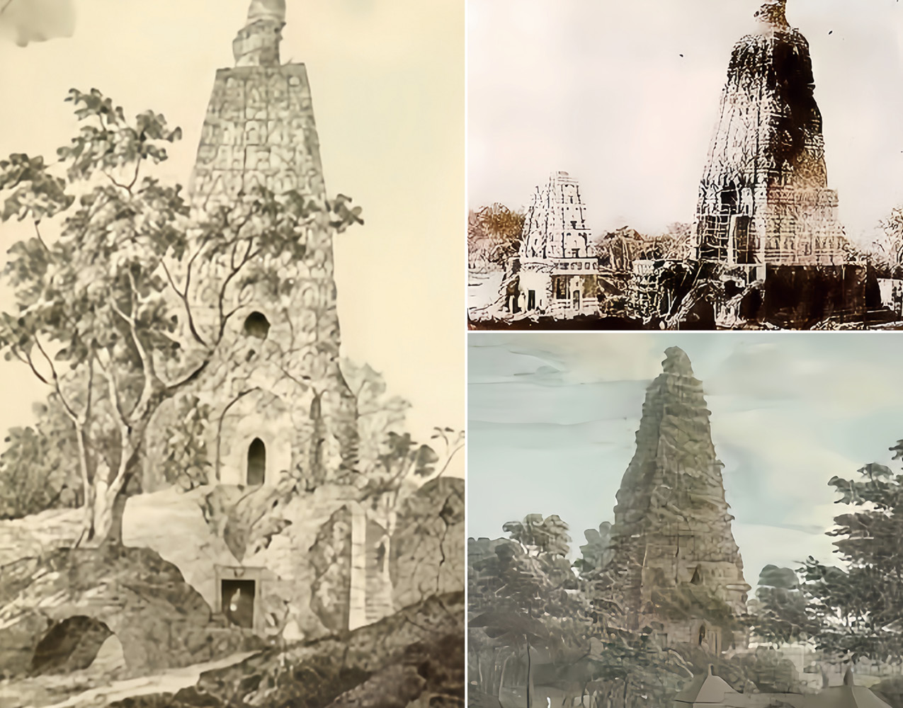

# 第3课

2019年9月9日

「传讲《楞严经》的验相」

这部《楞严经》殊胜难得，尤其在历史等诸多因素的影响下，禅宗在汉地很受推崇，所以本经也倍受重视。与我们之前讲过的《心经》、《金刚经》、《妙法莲华经》、《维摩诘经》以及《阿弥陀经》等经典相比，大家对《楞严经》的信心尤为强烈，这一点从很多方面都能看得出来。

一般而言，宣讲《楞严经》会显现许多瑞相。虽然不必执著于此，但这次讲闻在很多方面的缘起都比较好。我们从今天开始讲《楞严经》的正文——今天是2019年9月9日，“九九九”在世间意味着长久。

我曾经观察过，1999年9月9日我在泰国，《泰国游记》中记下了当时的一些经历，到现在已过去了整整二十年。那个日子对我而言意味深长，自那以后，不管是在国内还是国外，我在讲经说法方面的事业都很顺利。如今我在这个特别的日子里，开讲《楞严经》的第一句经文，也许是执著，也许确实有这么一个胜妙的缘起。

据说当年虚云老和尚讲《楞严经》时，寺中忽然出现无比庄严的优昙花，花瓣很大且长时间不枯萎[^1]。虚云老和尚一生造过注解的经典只有《楞严经》，他在《年谱》中说[^2]：如果阅《大藏经》三年，能种下许多善根佛种，但走马观花地看则意义不大，所以应该逐字逐句专心致志地看；倘若没有时间阅藏，能专读一部《楞严经》，哪怕只熟读正文，不看注解，也会给自他带来巨大的利益。

关于《虚云老和尚自述年谱》，有北大学者说是后人伪造的，包括他住世120年的时间也不一定准确。这种观点并不合理。有学者从虚云的生年到最后圆寂的这段时间中，考证出一些非常可靠的史实依据。比如虚云在显现上因父母之命成过家，通过他和妻子的往来信件，完全能够印证其年龄。而这一点，在发现二人信件之前还尚无定论。

后来，虚云老和尚的弟子本焕和尚担任顾问，拍摄了连续剧《百年虚云》。虚云老和尚自小就有出离心，善根习气完全不同于普通孩子。这部电视剧共有20集，从1840年虚云诞生起拍到120岁圆寂，讲述了他一生的经历，我大概看了，拍得很好。

有些年轻人整天看世间的电影和连续剧，要知道，你喜欢看什么，最终会影响你成为什么样的人。如果心实在不能安住，那不如看一些前辈大德的传记，这样对你或许会好一些。

其实，我们对三宝的信心，很大程度上取决于个人的价值观。学术界有些人总以似是而非的理由向大众灌输偏颇的思想，没有智慧和辨别能力的人就很容易受其影响。前两天我向大家说明了《楞严经》的历史、传承等方面的问题，若非如此，很多人仍然分不清楚这部经的真伪，他们心里始终会带着怀疑。

要是自己没能力澄清，也没能力精通经典的甚深意义，只是跟在人后随声附和，甚至跟着别人诽谤，这样的果报非常可怕。那天我说过，如果诽谤正法，过失比办一个屠宰场更严重。办一个屠宰场，杀害了很多众生，但只是毁坏众生这一世的肉体和生命；倘若制造了一个谬论，则会毁坏众生的法身慧命，造下的罪业多生累劫也无法清净。佛经中说，如果被毒蛇咬死，只是毁坏今生而已，但如果破了戒律、毁坏正见，那就是毁坏生生世世的法身慧命。

希望大家在短暂的人生中，最好不要给自己的未来制造难以忍受的痛苦之因。有些人依止了像提婆达多一样的恶知识，自己又没有辨别能力，就随意以邪见造论、著书立说。如果因此毁谤正法，其罪业很难清净。甚至有些大德在显现上也会造这样的罪业，到晚年又示现忏悔。

佛教徒一方面要认识《楞严经》的功德，另一方面，面对世人对佛法的邪见和误解，在适当的时候，我们有责任、有必要作出澄清。在这一次的讲闻中，我对历史遗留下来的很多疑惑和不同观点作了详细的解释，必要的时候，我还会再进一步为大家分析，这些观点产生的原因，是由于当时的历史背景及某些人为因素等。

现在藏地也有这种情况。比如某位格西或堪布去很重视修证的佛学院参学，学成归来后他就成了难得的弘法人才；如果他所去的地方只重视词句上的辩论——虽然佛法本身具足初善、中善、末善，但若除了执著词句外没有品尝过佛法的真正美味，在这样的道场中学习后，他也会染上耽执词句的习气。

不管哪个民族、地方或团体，老师的影响力都非常大，这种感染力不仅体现在好的方面，也体现在一些不好的方面。历史上的反面人物，比如发动第二次世界大战的希特勒，他每一次演讲都能感动成千上万的人。我看了一些年代较早的德国纪录片，不得不承认希特勒的煽动力极强，一次演讲就能令大众为之疯狂，在人们的心中留下难以磨灭的影响。传法也是一样，善知识能为所化植入善法的种子，而邪知识则为众生植入邪恶的种子，甚至是对社会和个人有害的观点。

在此陈白大众，我讲解《楞严经》并不是以耽著或贪嗔来立宗，而是基于客观、公正的态度，以理为主而建立正道。在时间允许、参考资料具足的情况下，我还想讲一些《楞严经》的功德及前辈大德的感应公案。

「惟悫大师注」

据《宋高僧传》记载[^3]，唐朝有一位惟悫大师，有一次他到前宰相房融家中接受供斋，房融也许是想和出家人结善缘，请出家中十卷《楞严经》，每一卷分别呈于一位僧人前展示，并介绍了整个翻译的过程。

另有一种说法，《楞严经》起初是房融交予度门寺的神秀禅师等人，后经魏北馆陶沙门慧震造科判，从度门寺流传开来，惟悫法师得到科判后为之注疏。这一观点在《宋高僧传》中略有提及[^4]，但普遍观点认为惟悫法师是直接从房融处得到了《楞严经》。

当时可能有特殊的缘起，房融宴请了十位僧人，每人可展阅一卷《楞严经》。惟悫法师面前的经卷为第四卷，阅后生起极大的欢喜心，于是发愿撰写注疏。对古人而言，注疏是很严谨的事，惟悫法师于十年间猛厉祈祷文殊菩萨，终于有所感应。在他的清净梦现中，文殊菩萨骑着狮子入于他口中，此后在注疏过程中下笔如有神助。在撰著完三卷《首楞严经疏》后，又梦到文殊菩萨骑着狮子从他口中离开。

惟悫法师梦见文殊菩萨从口而入，像这样依靠清净显现所得的法，应属净现类的法要。藏传佛教中也有此类情形，如法王如意宝的著作中就包含着伏藏类、撰著类及净现类的内容。

总之，惟悫法师的《首楞严经疏》影响深远，此后陆续有不少大德引用此疏。

「真鉴大师注」

据说，明朝的真鉴大师（别称“交光大师”），最初就是看了《楞严经》后有所觉悟而出家的。他想为本经写注释，然而这并不是个短期工程。与惟悫大师在十年中祈祷文殊菩萨类似，真鉴大师也在十年中不断地读诵《楞严经》。一次病中感得西方三圣前来接引，他向阿弥陀佛“请假”：“往生极乐是我的发愿，但如今《楞严经》的注解杂乱，我欲注疏之愿尚未完成。”阿弥陀佛回答：“确实杂乱。”就这样“批了他的假”。此后，交光真鉴大师的《大佛顶首楞严经正脉疏》一经面世，便广为流传、影响深远。虽然此疏在当时颇受争议，但也难以掩盖其珍贵的价值。

「落于文字需严谨」

讲记和注释是有时效性的，我们的一些发心人员也在很辛苦地连夜做讲记，在大家尚未忘却课堂内容前，及时提供参考资料以方便学习，是很有必要的。但需要注意的是，在成稿之后应标注“暂未定稿”，因为，之前的大德们注疏《楞严经》尚且需要花费大量时间，而我们讲记的最终定稿也需要一定的时间去斟酌和沉淀，若完成得过于匆忙，效果反而不佳。

讲记落于文字是流传百世、延益千年的大计，因此，深厚的文字功底及严谨的法义内容都不可或缺。不论是哪一位上师的教言，若能代代流传，均可利益无数后人。

前段时间，发心人员把编辑好的共八十多章藏文版《法王如意宝教言集》交给了我。最近我开始着手翻译，其间百感交集：有时感恩之情汹涌而生，深觉法王的诸多教言能汇集于此，发心人员做出了巨大的贡献；有时又感到不尽如人意，有些地方并未如实记录法王的开示；有时感觉有所缺漏、不知所云，一个标题下几乎没什么内容，寥寥数语就结束了，而且语气也不像上师如意宝讲法的风格。

这是在法王圆寂十四周年时就整理出来的内容，在翻译时，有些整理得特别好，对此我非常感谢；有些整理得差强人意，我很好奇是谁编辑的，但文档后面却没有任何信息，所以无从知晓。看来，以后还是加上编辑的名字，若有贡献理应赞叹，若有欠缺就要和编辑单独聊聊了（众笑）。其实不管是以文字形式还是音频、视频的形式记录佛法都非常重要，如果要发心整理讲记，那文稿质量、措辞更需谨慎。

「保存并弘传上师的教言」

从今天开始，我们要在女众中招募一些发心人员，整理有关法王如意宝的音频或视频——原本想交给男众负责，但现在男众这边事务较多，难以抽身，并且他们中间也基本找不到精通藏文的发心人员了。

这几年我外出的时间不多，包括去大学做演讲，讲藏语的机会很少，参与藏文编辑的工作也很有限。昨天相关负责人商讨后一致决定：接下来藏语翻译的重心，将放在与法王如意宝有关的音频和视频上。无论是国内还是国外的开示，哪怕是短短的某个偈颂的讲解或是日常生活片段，只要是关于法王的，我们都要搜集起来。再过十年二十年，这些片段将成为非常珍贵的历史资料。我们以后还要逐步对法王相关的音频、视频作后期技术处理，将这些珍贵的史料归档保存。随着时间推移，倘若我们这群跟随法王的老人陆续离世后，就更没有知情人了，到那时再想整理相关的资料只会更难。

之前我提到过国外的创巴仁波切，他的弟子们在保存资料方面所做的工作确实很值得随喜。不管是上师在世间法还是出世间法方面讲法的音频或视频，都得到了完整的保存，加上他们的设备精良，所留存的影音资料质量都很高。

我们当时没有那样的条件，影音资料要么没有、要么模糊不清，确实很令人遗憾。从现在开始，作为上师的传承弟子，若存有音频或视频的，都有责任好好保管。这不仅是我们传承的珍贵记录，更是世界非物质文化遗产及精神财富方面很珍贵的资源，哪怕历经数十年、数百年，对后人也必将产生深远的影响。

创巴仁波切西方弟子们的记录也很客观，只是如实记录上师的一些小故事，并无浮夸的表达，也不会在超越日常经验的事上赞叹上师，如“上师会飞来飞去”“上师不用吃饭”等等。他们只是客观地记录上师的日常点滴，哪怕是上师的一个微笑、一次简单的沟通、与人交往的一个小故事都如实记录，这一切既真实可信，又不同凡响。

这样的记录非常有必要。最近我特别有感慨：以前去印度的好些经历都遗忘了，然后就像《盗梦空间》里看到陀螺在旋转就知道自己在梦境中那样，由于没有文字记录，只能苦苦回忆，凭借一点线索慢慢回到三十年前，往事逐渐清晰起来——“哦，那时候应该是这样。”

人的记忆完全可以依靠一些特殊的方法来重现。比如由俄罗斯人发明的同传和交传翻译，又比如现在一些学者或专业的翻译人员，依靠一些特定的符号进行速记，之后可以把原话复述出来。

我记得以前上师如意宝讲课时，我们就在大经堂的窗边翻译。上师每讲半个小时就停下来，吃药或者喝糌粑汤，给翻译留出时间。我们紧锣密鼓地翻译着，有时时间过长，法王就会问：“你们翻译完了没有？”当时的我也自创了一些速记法：简单记一个“印”表示“印度”，用“阿”表示“阿底峡尊者”……经过这样的训练，哪怕过去了很长时间，所讲之法也能完整重现出来。

在1987年到1999年间，我们主要使用交传方式翻译，有时在重要的法会期间需要同步翻译；有些是法王讲述时我记录下来，然后第二天按译稿做复讲，《百业经》就是这样翻译出来的。追随了我二三十年以上的道友，对此应该记忆犹新。

1999年我们去新加坡期间发现有同传翻译的机器，如获至宝，当即欢喜地置办了设备带回喇荣。刚好赶在极乐法会上使用，法王也显得格外高兴。从那时开始直到老人家圆寂，我们一直都使用同传翻译，它的时效性确实也非常突出。

当时西方的许多大德们还是以交传翻译为主，有些上师的风格不同，翻译也会随之应变。比如有的是逐字逐句翻译的，上师说“我去印度的时候”，下面翻译“我去印度的时候”，然后上师再说“去了那烂陀寺”，翻译紧接着“去了那烂陀寺”。也有些上师一开口就滔滔不绝，说了好久才让译者复述，宗萨仁波切的父亲董瑟·听列·诺布仁波切（第二世敦珠法王之长子）就是这样。他曾在美国科罗拉多州传法，据当时在场的桑珠堪布回忆，仁波切一开始就洋洋洒洒地讲了40分钟才停下来让译者复述。当时法会是在一个大帐篷内举行，翻译期间仁波切就去外面的花园里赏花。当听到译者复述他讲的笑话引起哄堂大笑时，仁波切也边看花边和弟子一起哈哈大笑。他逛了半个小时后，回来问译者：“完了没有？”没完就再出去溜达一圈……总之，不同地方的翻译传统不同。

言归正传，无论我们翻译也好，做讲记也罢，尤其是落到文字上的事需要态度严谨，这一点非常重要。作为这一代的传承弟子，我们有必要把前辈大德们的言教、故事及所有事迹记录保留下来。事实上，一个法脉或传承能否延续并得以弘扬，与每一代传承弟子都息息相关，比如我们这一代弟子若能把上师们的教言保存并流传下去，那就算是比较成功的壮举，之后的下一代弟子也是一样，如此上师们的智慧和思想才能延绵不断、薪尽火传。

关于对上师事业的弘扬，一部分佛教徒比较重视修建寺庙等外在事业，另一部分比较重视闻思修学等内在智慧——其实两者都很重要，但如果从延续的时间长短而言，著书立说等内在智慧的影响会更加长远。就像之前提到的那样，近期我们想汇集整理法王如意宝的智慧财富，编撰好以妥善保存。对我们曾得受过法恩的上师们所传的教言也应如法操办，将上师们的精神传扬后世。

我们做这一切的目的是什么呢？回忆起依止过的上师们时，我发现每一位上师都超然卓绝、殊胜无比，他们不仅从未伤害过任何众生，而且倾其一生都在为众生付出所有。无论显现生病也好、衰老也罢，他们在任何困境中都能任劳任怨、倾尽全力。

这些大菩萨的行传如此可敬，加上传承的加持力，哪怕能令他们的一句教言流传于世，都对后人大有裨益。若非如此，一般的世俗思想和智慧也不值得我们付出这么多的心血。成办这样的事业并非易事，多少都会遇到一些阻碍，需要付出大量的人力、财力，在此过程中还要考虑到不同众生的意乐和根器，但只要我们尽力成办这项伟大的事业，那得到暇满人身也算有一点意义。

卷第一

| 如是我闻，一时，佛在室罗筏城祇桓精舍，与大比丘众千二百五十人俱。

当时我听到佛陀是这样说的。一时，佛在室罗筏城祇桓精舍，与一千二百五十位大比丘众在一起。

去年我们讲《维摩诘经》，开篇是以“五圆满”来宣说的，这次我们按照宋代长水子璇大师所著的《首楞严义疏注经》，以“六成就”的方式来宣讲——很多大德也是依此讲解的。

“如是”，即信成就；“我闻”，即闻成就；“一时”，即时成就；“佛”是主尊，即主成就；地点“室罗筏城”，即舍卫城，具体位置在“祇桓精舍”，即祇树给孤独园，这是处成就；“大比丘众”，即众成就。总共六种成就，与“五圆满”极为相似。

首先，“如是”二字是信成就。

所谓信成就，意思是当时佛陀如理如实地宣讲，在场众弟子如是听闻并如实记录。这些文字都没有偏离佛陀的原意，无有增删地如实记录了佛陀的金刚语，以此可以增上后学者的信心。

在此很多注释都引用了《大智度论》的教证：“佛法大海，信为能入，智为能度。”佛法像大海一般深广，必须凭借信心才能趋入，凭借智慧才可到达彼岸。对于修学佛法者而言，初学时以信心趋入很重要。佛子想要信受奉持佛陀的任何教言，若没有信心，就会在开始时无法趋入，过程中无法坚持，最后关头也无法圆满，所以信心在修学的初中后都不可或缺。

“如是”的说法，与传承上师有一定的关系。西方智者认为：“吾爱吾师，吾更爱真理。”不管老师说得对不对，我自己的想法很重要，我也可以对他进行反驳。当然，我们不排斥开放的思想以及有想象力的表达，但在东方传统思想当中，“如是我闻”中的“如是”具有深刻的意义。

就像我们最近开讲的《论语》，如果没有“如是”的精神，弟子们不一定能如实记录孔子的言论，正因为有“如是”的传统，两千多年前孔子与弟子对话中说出的珍贵教言才得以流传至今。佛经也是如此，弟子唯有依靠信心才能受持佛陀的教言，并将其原原本本地流传后世。每一部佛经的卷首都会加上“如是”二字，这代表着佛法的真实可信、法义无误等重要意义。

第二，“我闻”是闻成就。

按《首楞严义疏注经》[^5]，有四类不同的“我”：凡夫“俱生所执”之我，外道“遍计所执”之我，圣者“假立”之我，以及修行“最终成就”之真我。这里的“我”主要是指在场的阿难、目犍连或舍利弗尊者等已得不忘陀罗尼的行者，也可以泛指现场的闻法者。

“如是我闻”意为，对于佛陀宣说的法，我当时就是这样听到的，不仅听闻明了，而且记忆清晰。这是五圆满中的法圆满。

第三，“一时”即时成就，对应五圆满中的时间圆满。

为什么用“一时”来表示时间？一方面，因为古印度没有记录确切时间的传统；另一方面，佛教的时间概念不仅是指当时，而是指三时。如今一些公文中的时间仅在当时有效，事过境迁之后就意义不大；与之不同的是，佛经中的时间在过去、现在及未来三时都具备时效性，故此处还表达了不会过时的含义。此外，在密法“清净时”的境界中，对“一时”还有另外的解释。

第四，“佛”，即没有欺惑和虚妄的觉悟者，为主成就，对应“本师圆满”。从很多经论中可知：断证功德（断除二障、证悟智慧）圆满的主尊所建立的教法是千真万确、颠扑不破的。

第五，处成就。“室罗筏城”即舍卫城，“祇桓精舍”就是祇陀太子的精舍，对应“处圆满”。

处成就即是佛陀宣说《楞严经》的地方。佛陀在祇桓精舍前后住留了二十五年，在其他地方没有待过这么长时间。关于这一点，《大智度论》中也有提及[^6]。有人问：“迦毗罗卫国是佛陀的故乡，为什么他成佛之后在那里待的时间不长，反而在‘外国’待那么久？”龙猛菩萨回答：“佛陀自己本无染心，在迦毗罗卫国和在其他地方都是一样的。然而，包括释迦族人在内的许多人都是有染心的。若佛久住在迦毗罗卫国，有些人就会认为‘佛陀是我们这边的人’而心生贪执；而有些认为释迦族是怨敌的人，就会产生嗔恨心及诸多烦恼。以此因缘，佛陀久住于他乡度化众生。”

《大智度论》还说[^7]，佛陀并非因某地舒适或其他原因而选择前往，而是看哪里的众生与佛有缘，就去哪里度化。舍卫城与佛特别有缘，那里的国王和民众都特别有信心，所以佛陀在那里待的时间比较长。

关于佛陀说法之处，据法显的《佛国记》和玄奘的《大唐西域记》等相关典籍记载，他们在取经抵达印度时，佛陀曾讲过法的许多地方都已成了废墟，遗址也不明显，经寻找后才发现并做了一定的恢复。我和法王如意宝一起去印度时也参观了一些遗址，并在那里念了《普贤行愿品》——当时的经历写在《梦尘回忆录》里了[^8]。

总之，舍卫城是佛陀待过时间最长的地方，也是最有加持力的圣地之一。

「圣地的勘探发掘者」

在此我也想为大家介绍一下，印度境内如今这些被称为佛教圣地的地方，其中还有一段鲜为人知的历史。

如今的印度并没有着重护持佛教，其境内的佛法大多由藏传和其他教派的信徒在护持，目前佛法造诣较高的印度人也屈指可数；但在印度历史上，却出现过龙猛菩萨、寂天菩萨、月称菩萨、陈那论师等伟大的佛教上师。我们虽未曾与之谋面，但通过学习其论典，也会对他们佩服至极。

由于历史原因，如今修学佛法的印度人少之又少，在其他行业却人才辈出，包括波音公司和硅谷的很多公司都青睐印度科学家。在西方很多尖端领域中，据说除本国人外，印度裔高端人才的录用比例是最高的。班加罗尔被称为印度的硅谷，印度理工学院（简称IIT）甚至可与美国麻省理工学院（简称MIT）相提并论。印度人的世间智慧相当厉害，但与佛教的信仰和古印度的智慧相比，仍然有很大的差距。

近代印度圣地的勘探者、发掘者是英国学者亚历山大·康宁汉姆（Alexander Cunningham，1814-1893）。也许大家对他并不熟悉，但作为佛教徒，我们应该记住这位学者的贡献。

康宁汉姆是一位考古学家，在印度被英国统治期间，他作为工程师被派往印度并驻扎在兵团中。在印度鹿野苑常驻期间，他偶然在石头上发现一些古代文字，将这些石头拿到当时的印度博物馆和考古学院分析时被告知：“石头上的文字应该是印度的古文字，但婆罗门教中没有这方面的文献，可能是佛教或者其他宗教的。”

之后他返回英国，刚好玄奘的《大唐西域记》和法显的《佛国记》被译成英文出版，他对照这两册典籍，意识到之前所发现的文字与佛教有关，于是再次回到印度。

1837年，康宁汉姆开始在印度全心投入考古研究。起初他发现了鹿野苑，即瓦拉纳西城外一处三十多米高的圆顶建筑，被当时的外教徒当作猪圈。在长达25年的考古研究中，他又逐渐发现了佛陀的降生处和转法轮处。他发现并挖掘的古迹有：鹿野苑、蓝毗尼、拘尸那罗、那烂陀寺、祇树给孤独园等遗址，还包括著名的金刚座正觉塔（菩提塔）。

按照根登群佩的记载，菩提塔此前曾遭受过两次较大的破坏，最严重的一次是13世纪伊斯兰军队的入侵，当地僧人害怕敌人摧毁这座塔，连夜用土将塔身掩埋起来，形成了一个小山丘。小山丘下埋藏的正觉塔在地下一睡就是六百多年，直到1861年才重见天日。

康宁汉姆前后历经了25年，依靠种种方法在印度发掘出很多重要的佛教圣地遗址。由于古印度没有记录历史的习惯，几乎什么文献资料都没有，所以法显大师、玄奘大师以及康宁汉姆等人对佛教的贡献可谓功不可没。

在当今时代，虽然世界各宗教间基本能和平共处，但历史上伊斯兰教对印度佛教的破坏是毁灭性的。当时印度的许多佛教圣地几乎都被夷为平地，不少建筑被当作猪圈或墓地。

印度三大寺之一的飞行寺，又称欧丹达布梨。在古代印度，飞行寺曾是与那烂陀寺、吉祥戒香寺齐名的佛法中心。鼎盛时期，曾经有一万二千余名行者在那里求学，包括藏传佛教中赫赫有名的那若巴、玛尔巴、阿底峡尊者等都曾在飞行寺待过。

《那若巴尊者传》中记载，玛尔巴前往印度飞行寺向那若巴尊者求法，他对尊者说：“我在藏地有位弟子叫做闻喜（米拉日巴），他得到了空行的授记，很想得到夺舍法的传承，您能不能传给我？”那若巴尊者听后，口中自然宣说了一个偈颂，意为在北方的黑暗之地，竟有这样一位如太阳照耀雪山般的大丈夫，我要恭敬地向他顶礼。说完那若巴尊者双手合十，向西藏方向点头致敬三次。这时，飞行寺四周的所有山丘、林木也像鞠躬一样向西藏方向弯了三次。直到今日，这些树木山丘仍保持着朝西藏方向倾斜的姿态。

飞行寺的遗址距那烂陀寺仅十一公里左右，当年法王在印度时很想去朝拜，但因为时间太紧，故而未能成行。据说藏地第一座有僧人住持的寺院——桑耶寺的主殿乌孜大殿有好几种不同的建筑风格，底层为藏式风格，中层为汉地风格，上层为印度风格，其印度风格的部分就是以飞行寺为蓝本而兴建的。

不幸的是，飞行寺被伊斯兰教徒摧毁殆尽，如今已成了一处墓地。一位学者在其著作中描述，他见到飞行寺的遗址时感到痛心疾首：“这座曾经无比辉煌的寺院已经面目全非，四处凌乱地散布着墓碑，上面覆盖着伊斯兰教的绿色旗帜……”

从13世纪伊斯兰军队入侵印度，直到1837年英国考古学家亚历山大·康宁汉姆发掘鹿野苑遗址，在这漫长的六百多年中，印度境内几乎没有佛教的任何遗迹。当年正觉塔被发掘并修复后，也曾有一段时间由印度教徒管理。根登群佩在《印度圣迹》中记载：20世纪初，斯里兰卡僧人达摩波罗在印度复兴佛教，他在印度鹿野苑组建僧团，迎请了三宝所依，并上诉法院要求让佛教徒回收祖庭的管理权，最终法院裁决由佛教徒和印度教徒共同管理。

之前我看过一些印度的老照片，其中就有正觉塔，和现在是截然不同的情形。这是当时他们挖掘遗址现场的照片……

（堪布为大家展示照片）

据史料记载，拉萨大昭寺的觉沃佛像供在正觉塔第二层的殿堂里，外道入侵时佛像被扔了出去，后又被人保护起来，辗转流落至汉地，又被文成公主带到了藏地。

回顾历史还是很有必要的。往昔人类思想的碰撞、国家间的争战以及不同宗教间的冲突等等，的确值得人们以史为鉴。现在虽然处于和平时代，但并非所有的宗教及文化都尊崇佛教所提倡的“诸恶莫作，诸善奉行”，因此佛教徒要做好准备面对危机和挑战。虽然历史的兴衰更迭是一种自然规律，但在发生变故之前，对佛教圣地、佛经论典和高僧大德的珍贵资料，我们至少可以提前采取一些保护措施。

作为佛教徒，我们要对英国学者康宁汉姆心怀感恩，认真地了解他的事迹。如果没有他的努力，包括印度阿育王石柱在内的许多殊胜遗迹，也许我们至今都无缘得见。

[^1]: 《虚云和尚自述年谱》：“师升座为大众讲《楞严经》。庭前古栗。忽涌优昙钵华数十朵。大如盆。形若芙蕖。色似黄金。含裹香蕊。中虚体洁。数月不萎。见者称异。鸡山多不闻佛法。今忽得闻。亦如优昙一时现耳。其灵瑞不可思议。”
[^2]: 《虚云和尚自述年谱》：“看藏经。三年可以看完全藏。就种下了善根佛种。这样看藏经。是走马看花的看。若要有真实受用。就要读到烂熟。读到过背。以我的愚见。最好能专读一部楞严经。只要熟读正文。不必看批注。读到能背。便能以前文解后文。以后文解前文。”
[^3]: 《宋高僧传》（宋·赞宁等撰）：“释惟悫（音què）……因受旧相房公融宅请。未饭之前宅中出经函云。相公在南海知南铨。预其翻经。躬亲笔受首楞严经一部。留家供养。今筵中正有十僧。每人可开题一卷。悫坐居第四。舒经见富楼那问生起义。觉其文婉其理玄。发愿撰疏。疏通经义。及归院矢誓写文殊菩萨像。别诵名号计一十年。厥志坚强遂有冥感。忽梦妙吉祥乘狻猊自悫之口入。由兹下笔若大觉之被善现谈般若焉。起大历元年丙午也。及将彻简。于卧寐中见由口而出。在乎华严宗中。文殊智也。勒成三卷。自谓从浅智中衍出矣。于今盛行。”
[^4]: 《宋高僧传》（宋·赞宁等撰）：“一说楞严经。初是荆州度门寺神秀禅师在内时得本。后因馆陶沙门慧震于度门寺传出。悫遇之著疏解之。”
[^5]: 《首楞严义疏注经》（宋·子璇集）：“佛说无我。今称我者。我有四种。一凡夫遍计。二外道宗计。三诸圣随世假立宾主。四法身真我。经指后二。”又《大佛顶首楞严经讲义》（圆瑛法师著）：“我之一字，有四种不同：一、凡夫妄执之我；二、外道妄计神我；三、菩萨随世假我；四、如来法身真我。今阿难称我，乃随顺世间，假名称我也。”
[^6]: 《大智度论》：“问曰：若知恩故多住舍婆提者，迦毗罗婆城近佛生处，何不多住？答曰：佛诸结尽无复余习，近诸亲属亦无异想；然释种弟子多未离欲，若近亲属则染着心生。……出家法应不近亲属，亲属心着，如火如蛇。居家婆罗门子为学问故，尚不应在生处，何况出家沙门！”
[^7]: 《大智度论》：“佛出世间，正为欲度众生，著涅槃境界安隐乐处故，是故多住舍婆提，不多住迦毗罗婆。”
[^8]: 详见索达吉堪布全集126《梦尘回忆录》。
