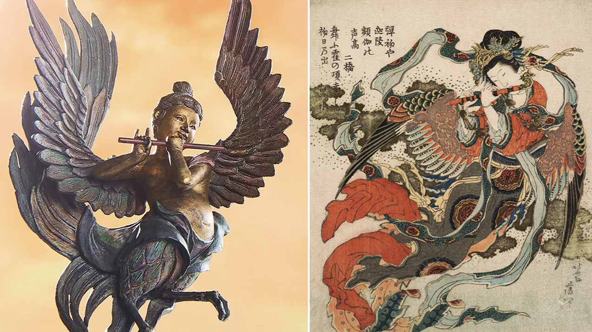

# 第5课

2019年9月16日

「听闻《楞严经》应有欢喜心」

《楞严经》确实非常重要，大家听闻这样的大乘佛法应该有欢喜心。我们为什么要提起欢喜心呢？有以下几个原因。

第一，我们有听闻佛法的自由，故而应生欢喜。

世界上有很多身心不自由的人，有些是身体被囚禁于牢狱之中，有些则是内心一直被各种魔障或精神疾病困扰。前段时间我和一位老乡在草地上小坐，他把脚伸出来并感叹说：“喇嘛钦，现在很幸福啊！”我问他为什么，他说：“前几年我被关在监狱里时不允许这样伸脚，但现在我有把脚伸直的自由。如果没有进过监狱，我也不会知道伸脚的自由是这么快乐。”这样看来，能听法的快乐更是难以估量。

第二，我们身体健康、没有疾病，因此值得欢喜。

有一位老乡患脚病好多年了，去年我们想办法资助他做了一只脚的截肢手术。康复以后，他说感到特别幸福，因为晚上终于睡得着了。以前很多年里脚痛令他每晚都难以入睡、呻吟不已，如今虽然少了一只脚，但他觉得很幸福。

虽然有时觉得很痛苦，但我们不仅身心健康、自由自在，而且还有机会听闻大乘佛法，这是很值得庆幸的。试想，一个人如果双目失明，一定很希望能看到这个世界；如果双耳失聪，只能看到别人嘴唇的动作却听不到任何声音，肯定也会很羡慕能听到声音的人；同样的道理，我们有机会听闻大乘佛法，也是一件快乐的事情，因此大家要以愉悦的心态来闻法。

第三，我们现在听闻的这部《楞严经》很殊胜，所以应生欢喜。

本经提到的“楞严三昧”，在汉地著名的《首楞严三昧经》中阐述得更为详细，后者是由鸠摩罗什翻译的一部经典，大家方便时可以参阅。藏文《大藏经》中有这部经典，我也有此经的传承，以后有机会可以为大家传讲。我对照过藏汉经文，内容基本上是相同的。

《首楞严三昧经》中是如何宣讲楞严三昧的呢[^1]？当时舍利弗问佛陀：“魔王猖狂的时候，佛弟子该怎么办？”——因为宣讲本经会威胁到魔众，不悦之下，他们势必会着力干扰。佛陀答道：“不必担心。虽然魔王意欲阻挠，但是它一起心动念就会被压制，因为一旦想对讲闻本经的人制造违缘，依靠楞严三昧的力量，魔众就会被五种束缚捆绑住，令其恶心不能得逞。”

受持《楞严经》也是一样。自古以来，无论是念修楞严咒还是《楞严经》的人，大多都会修学顺利、善始善终，这也是依靠楞严三昧的缘故。古大德之所以特别重视某部经典，背后必定有着甚深的密意。

太虚大师曾说[^2]，《楞严经》包含了汉地禅宗、净土宗、律宗、天台宗、华严宗和密宗等各宗各派的主要教义，对所有法义都能起到统摄的作用。因此，《楞严经》既可以被视为禅宗经典，也可以说是天台宗的经典，其中讲了很多关于止观的修法，所以当年智者大师求之若渴。本经之于律宗、密宗等宗派，也同样如此。

总之，《楞严经》是汉地各个教派都极为重视的一部经典。

「依《楞严经》超度怨亲」

《楞严经》的感应录不多，也不及《法华经》和《金刚经》的感应录那样有传奇色彩，但依靠《楞严经》而开悟、解脱并以此超度众生的事例却比比皆是。

倓虚大师的《影尘回忆录》里有很多精彩的故事。其中有一个故事说，大概在1910年，一位叫刘文化的人在北京嘉兴寺待了一个月左右，与寺里的和尚相熟，知道“开悟的楞严、成佛的法华”很重要，于是请了一本《楞严经》，如获至宝、欢喜踊跃地回到营口老家。然而《楞严经》的文辞和意义都很艰深，就算跟其他同修一起研读，他依然有很多疑惑。一次，他们向当地寺院里的一位老和尚请教。老和尚说：“我只听说有念经的，没听说有讲经的。”——原来这位老和尚也是糊里糊涂的。刘文化不肯放弃，持续不断地读诵和参阅，时间一晃又过去了七八年。

修学佛法需要长年如一日的坚持。有些人无论是作辅导还是讲考，很多年里都能始终如一地坚持、孜孜不倦地学习。有些人闻思半年就不见踪影，对此我常常百思不得其解：“这个人明明讲考不错，怎么就不见了？”向其所在班级的法师询问：“你们班的某某讲得还不错，他到哪里去了？”对方答复：“不知道，他前段时间还在，但因为心态比较飘，所以待不下去了。”缘着现在所讲的公案，我心中不由得浮现出讲考班中个别人的形象。

刘文化一直用心研学，如果实在看不懂，就长跪在佛像前以极大的精进和信心向佛陀祈祷和顶礼，就这样慢慢地熟悉了《楞严经》的经文，并逐渐通达其中的意义，最后了然于胸。他在七八年间一直不间断地专心研学《楞严经》，最终有所造诣，若我们对任何一部经论能这样滴水穿石般地长期下功夫，一定能以精进力战胜一切障碍。

有一次，刘文化在药铺里看经，管账的黄先生坐在对面算账，两人都非常专注。刘先生读着读着突然恍然大悟，心中顿然现出一种境界来：山河大地、亭台楼阁、宫殿城阙等整个器世界都如琉璃世界一般澄澈通透，有情世界的天龙八部、护法夜叉等所有人和非人都清净无比，各自拿着珍宝供品在虚空中伫候。整个世界清净无垢、格外庄严。

接着，两位已去世的故人出现在刘文化的境现中，这两人曾与他因土地纠纷诉诸公堂，最终因输了官司而气结身亡，之后刘文化对轮回生起了极大的厌离心；又因为他戒酒戒色以致夫妻失和，所以他妻子也被气死了；后来他的女儿因母亲离世、无人照料也死了。当时，这些人都陆续出现在他的境现里。

汉地常常有被气死的情况，希望以后不要有这种事情发生。我问过很多西方人：“你们这里的人有没有被气死的？”他们说：“生气和发怒倒是常见，但还没听说谁是被气死的。”我也问过非洲人：“你们平时会不会说‘气死了’？”他们说：“不会。”虽然有些非洲人性格暴躁，但也不存在被气死的情况。藏人虽然嘴上也会说“我特别生气”，但也没有“气死”这一说法。与之不同的是，汉地的一些影视作品中，常常出现因气急攻心而生病甚至当场死亡的情节——佛教徒最好不要有“气死”这个口头禅，人哪有这么容易就被气死的？

在《影尘回忆录》里，刘文化的两个朋友和妻子先后被气死，随后女儿也离去。两个朋友刚在他境现中出现时，刘文化特别害怕，以为他们是来索取命债的，结果发现并非如此。这两个朋友请求说：“请你超度我们。”

刘文化说：“我自己还没成就，怎么能超度你们呢？”

这两个鬼继续哀求说：“只要你能答应一句，我们就可以踏着你的肩升天了。”

刘文化想：“这何乐而不为呢？”便答应了。于是两个朋友踏着他的肩膀，跃入虚空升天了。

不一会儿，他的妻子和女儿出现了，问他：“你能不能超度我们？”刘文化答应了，他的妻女也踏着他的肩膀升天了。

再之后，他过世的父母也出现了，不过和前面几人略有不同，父母是很欢喜的样子，和刘文化聊了几句，便也踏着他的肩膀升天了。原文说是“升天”，其实也可以理解为超度到清净刹土。就这样，先后六个人依靠《楞严经》被超度了。

刚开始看到这里，我有点半信半疑：“超度会不会这么简单呢？”后来转念一想，因缘缘起确实是不可思议的。就像上师如意宝有一次早晨静坐时，来了一位漂亮可爱的天子，他对法王说：“您认识我吗？我就是您以前的那只黑山羊啊！因为昔日您时常在我耳边传讲显密甚深法要，加上您大慈大悲的加持力，我死后就转生到了香巴拉刹土，变成了十分聪明、通晓两种语言的鹦鹉，并且能够听懂法王玛嘎巴传讲的所有教言。在一个月之前，我已往生到了东方现喜刹土的救畏菩萨座下，救畏菩萨就是麦彭仁波切。我这次前来拜见您，愿您长久住世，事业遍满十方。”说后化作一团光消失了。

说回这个公案，虽然刘文化只是个普通人，但他的精进和信心确实是不同寻常。他花了七八年的时间研读《楞严经》，一有不懂的地方就昼夜祈祷佛陀加持，信心很大又精通经义，所以最终有所成就。同样，藏地也有老妇人依狗牙而成就的故事，虽然狗牙本身没有力量，但因佛的加持入于狗牙，老妇人也以此获得了成就。具信者依靠狗牙尚且能成就，那对于佛经这样殊胜的对境生起信心的功德就更不用说了。

这些不可思议的缘起就像世间的化学反应一样，当不同的条件和化学元素聚合时，固体、液体、气体之间可以互相转换，很多看似不可能发生的事物也能发生。同样，佛教中的加持和能量也可以依靠许多因缘的聚合而产生，刘文化就是依靠自己的信心、《楞严经》的加持力以及他平时对佛陀的祈祷等因缘而超度了六个人。

超度之后，清净的境现就消失了。刘文化回过神来，看到黄先生依然在对面的桌子上低头算账，便问道：“黄大爷，你看见什么没有？”

黄先生抬起头说：“没有啊，怎么了？”他没得到回应，又低头继续算起账来。此时刘文化才明白，原来刚才的情景，只是自己境界中的一种显现。

后来刘文化将此事告诉了当时还未出家的倓虚大师，倓虚大师怕他着魔，便对他说：“这是破识蕴的功夫。识蕴破了之后，往往就能看到这种境界。”并告诫刘文化不要执著。其实倓虚大师对刘文化经历的事是很认可的，所以后来也把这件事写进了《影尘回忆录》里。

这个故事比较长，想要表达的要义是，对于有信心的人而言，若能对一部经典认真研读或专心祈祷，很多常人难以想象的境界也会不求而得。虽然刘文化并不是很出名的人物，但既然他能依靠《楞严经》超度冤亲债主，那相信他自己往生净土也是易如反掌。

可见，这部经典不只对个人的修证和开悟有很大的加持力，而且也可以饶益与自己相关的在世或过世的亲朋好友。通过修持《楞严经》来了清宿债、饶益亡者，对我们过世的父母亲朋乃至怨敌都大有裨益。有些人总说晚上因为有冤亲债主来纠缠而睡不着觉，若果真如此，就可以念念《楞严经》和楞严咒，或者晚上睡觉时把经书放在身边。

很多佛教徒晚上睡觉时把手机放在枕边，把法宝放在远处——按理来讲，应该把《楞严经》放在离自己最近的地方，这样对你身心各方面都有帮助和加持。尤其是冤亲债主来找你时，《楞严经》就是你的护法神。手机等电子设备倒是最好放远点，否则会对身心带来很多危害。

| 摩诃拘絺罗、

摩诃拘絺罗、

现在开始讲正文。佛陀宣说《楞严经》时，在场的都是具足功德的大阿罗汉。前面讲到了大智舍利弗、摩诃目犍连，现在讲摩诃拘絺罗。

摩诃拘絺罗是舍利弗的舅舅，曾经修学外道，后来成为了不起的阿罗汉。他的名字在藏语中叫“斯波切”，意为“大膝”“长爪”。之所以被称为“长爪梵志”，缘于发生在他身上的一段经历[^3]。

摩诃拘絺罗本来精于辩论，但自从姐姐怀孕以后，他就再也无法辩赢姐姐了。他知道不是因为姐姐有多厉害，而应该跟姐姐腹中的胎儿有关。他想：“这个孩子的辩才一定很厉害，我现在与他母亲辩论都那么费劲，如果现在不精进一点，孩子出生长大后，我就更没有胜算了。”于是发愿：“在未精通十八部经典之前，我绝不剪指甲！”——外道的发愿确实很奇怪。

之后摩诃拘絺罗便离家修学十八部外道经典，因长期潜心修习，一直没有剪指甲，所以他被人们称为“长爪梵志”。他精通所有外道经典后，回到家乡打听姐姐的孩子现在何处，人们告诉他：“你的外甥舍利弗8岁时便精通了所有经典，16岁时辩才无碍，与人辩论从无败绩。”他听到这里十分不悦，又听说“舍利弗被瞿昙摄受剃度出家”后更生愠怒。他对佛陀本就无有信心，又很傲慢，于是心想：“我一定要找瞿昙问个清楚！”

这时舍利弗出家不久，正在佛陀身旁摇扇侍奉。摩诃拘絺罗找到外甥时刚好看到这一幕，揣着一肚子的气便上前找佛陀理论，但没说两句就发现自己的水平根本无法与佛陀辩论。

就像良马聪颖，只要看到鞭子的影子就知道应该前行，不必等鞭子抽到身上一样，释迦牟尼佛只说了几句话，长爪梵志就立刻明白了自己不如佛陀，当即皈依三宝，剃度出家，并很快证得了阿罗汉果。

其实，有一定水平和智慧的人有两种情况：一是趋入佛门后具足正见、智慧超胜，获得修证并成为了不起的圣者；而另一种则邪见深重、分别念坚固，因此很难转变。拘絺罗尊者属于前者，在《增壹阿含经》中是这么形容他的：“得四辩才，触难能答，所谓摩诃拘絺罗比丘是。”拘絺罗比丘对任何难题皆对答如流，故为佛陀声闻弟子中的“辩才第一”。总之，拘絺罗（斯波切）是一位了不起的大德，佛陀宣讲《楞严经》时他也在场。

以上是今天介绍的第一位尊者。

| 富楼那弥多罗尼子、

富楼那弥多罗尼子、

“富楼那”是其父之名[^4]，意为满愿，“弥多罗尼”为其母之名，意为慈，尊者的名字是取父母之名合为“满愿慈子”。藏语为“刚波宣密沃”，其中“刚波”是“富楼那”，“宣玛”[^5]是“慈”，“沃”是“子”。

在印度传统中，孩子有的随父姓，有的随母姓，也有将双亲名字结合的——富楼那尊者的名字就属于最后一种。这种起名方式在藏地不常见，比如我父亲叫优波，母亲叫仁措，如果我叫“优波仁措子”就有点不太合适。因为在藏地习俗中，父母过世后不能再直呼其名。要是孩子使用父母的名字，当父母过世后，别人叫他就像呼唤逝者一样。不仅孩子不能与父母重名，而且一个人过世后周围与亡者同名的人也需要改名，否则，大家在亡者的亲人面前叫亡者的名字，就会显得很冒犯。

西方也有与印度类似的命名习俗，有妻随夫姓的，如希拉里·克林顿；也有在姓名中间加父亲或母亲的名字。汉地有从母系社会演变到父系社会的历史，但从目前的社会习俗来看，一字不差地用父母的名字给孩子取名的情况并不多见。

总之，富楼那尊者是佛陀座下说法第一的弟子，非常了不起。《增壹阿含经》中形容他：“能广说法，分别义理，所谓满愿子比丘是。”在广说法理和分别教义方面都特别精通，这就是满愿子（满慈子）。他以善巧方便说法而见长，并不是只会偏颇地宣说空性或光明等任一法门。我们在学习《维摩诘所说经》时也提到过，富楼那尊者先以医生的身份为人疗愈疾患，当人们生起信心和欢喜心时，才逐渐为人说法，所以他应该也是一位很好的医生。

现在有些医生很“厉害”，除了会看病，还会“看”前后世，对此我觉得难以想象。一个医生连前后世都知道，确实也太玄了。我希望医生们为人治病时最好专业一点，中医大夫就按中医的原理治疗，西医大夫就按西医的方法诊断——中医里没有讲前后世的道理，西医中就更没有了，对吧？

当然，富楼那尊者应该是有这种能力的，但他也并没有一把脉就说：“好像你前世造过恶业，是不是杀过人？来，我看看你的舌头。是是是！你的业力很深重，冤亲债主正要向你讨债！”（众笑）

有的医生对该说的病情不说，对不该说的夸夸其谈，究竟是医术不精还是故弄玄虚？关于前后世，一辈子讲经说法的人尚且推不出来，更不要说现量了知，但有些医生看看病人的舌头就直接说“冤亲债主来追你了”——是不是因为他舌头上的黑点有些像冤亲债主？（众笑）

富楼那尊者不是这样的，他是利用诊病的机会为人善巧方便地说法。会医术当然非常好，但尤其是在世间大多数人都很难相信前后世的情况下，佛教徒最好不要把佛教教义与世间医理混为一谈。龙猛菩萨说，空性能以义理宣说，但是对于甚深缘起，就连义理也无法宣讲了。我想，前后世的玄妙因果，确实没那么简单。

富楼那尊者在本经的第六卷中还会讲到，他是一位证悟了甚深、秘密空性义的大阿罗汉。

| 须菩提、

须菩提、

接下来是“解空第一”的须菩提。宋朝的《虚堂和尚语录》[^6]中记载了这样一个故事：

有一天，须菩提在岩洞中闭关，天空突然降下花雨。

须菩提问：“是谁降下的花雨？是谁在赞叹我？”

这时梵天出现说：“是我降下花雨赞叹你。”

须菩提又问：“为何赞叹？”

梵天道：“你是解说般若波罗蜜多第一，讲得极好！”

须菩提说：“我不曾说过一字一句，你为何赞叹？”

梵天答道：“你没说一字一句，我也未曾听闻一字一句，此乃真般若波罗蜜多，我因此而赞叹！”

这个公案很有禅宗的味道，须菩提就是这样的一个人。

《大般若经》中有很多关于须菩提与佛陀的对答。藏地有请僧人到家里念经的习俗，有时也会念《金光明经》《贤劫经》等，大多数时候还是念《大般若经》，它的篇幅很长，约有十函，其中藏文最常出现的词就是“让久”，也就是须菩提。

以前我还没出家时，家里请僧人念《大般若经》。有个老乡一直在旁边听着，他问我：“他们一直念‘让久’‘让久’，是什么意思啊？”那时我也不懂，就说：“是不是人名或地名啊？”当时大环境很紧张，念经必须秘密进行，一旦听到外面有犬吠或风吹草动的声音，就得立刻将经书藏好。

之前提到的惟悫法师，他曾祈祷文殊菩萨十年，最终感得菩萨以骑狮子的形象入于口中，此后便像须菩提通达空性一般对《楞严经》了如指掌。

无论是“广般若”、“中般若”还是“略般若”的经典中，全都赞叹须菩提是证悟般若空性的大成就者，誉之为“解空第一”。

还有个公案我以前也讲过[^7]。释迦牟尼佛从天上回到人间的时候，无数身着妙衣的天人恭敬相送，世间的转轮圣王携众人恭敬迎接。正在山洞中补衲衣物的须菩提也准备去见佛，他站起身来，当右脚接触到地面时想：“释迦牟尼佛到底是谁呢？是色声香味触法、眼耳鼻舌身意或是地水火风？”逐一剖析，发现一切都是空性，他想：“既然佛陀是空性的，应以慧眼观佛的法身。”于是他坐下继续缝补旧衣。

浩浩荡荡的迎接队伍中，有波斯匿王、频婆娑罗王等五大国王，还有化作转轮圣王的莲花色比丘尼。几位大国王远远望见转轮圣王到来非常欢喜，恭敬地将队伍最前面的位置让给他，但就在“转轮圣王”接近世尊的时候，莲花色还复本形，以比丘尼的身相顶礼佛足。

见此情景，国王们非常气愤：“这个比丘尼竟然变成位居我们前面的转轮圣王，她凭什么这样做？”这时比丘尼已经见到了佛陀，她骄傲不已地对佛说：“我是您的弟子莲花色比丘尼啊！”此时须菩提还在山洞里补衣，根本没有出现。那么，到底是谁第一个见到了佛陀？

《增壹阿含经》云：“若欲礼佛者，当来及过去，当观空无法，此名礼佛义。”还有几个偈颂大意相同[^8]，意思是若要礼敬如来，当观过去、现在、未来都是空性的，这才是真正的礼佛。

很多人在求灌顶时争先恐后：“我先来！我先来！”听课时也要提前好几个小时去占前排的位置。当然，求法的意乐也是一种善妙的缘起，非常有必要，这种心情我也能理解。有些人特别想坐在前面，这是对上师和佛法有信心的一种表现；而有些人以一种无所谓的态度对传法上师不理不睬，就像已经得到麝香的猎人一样，看到为自己传过法的上师就躲得远远的，一副“眼不见，心不烦”的样子。——两相比较，还是喜欢占位置的更好些，至少他们内心有亲近上师的意乐。

以前有一次法王如意宝在灌顶，我看到学院里一位带班多年的老堪布，虽然当时有很多管家拦着，但他根本不听，拖着披单就冲上前去。我听说以前法王如意宝灌顶或讲法的时候，有些人很早就去前排占位子，有些觉姆直接把别人用来占位置的东西扔到一边，自己坐下来——可能还没证悟或是显现上没证悟的人对座位比较在意，而证悟者则不会执著，就像须菩提一样。

按常理来说，佛陀返回人间时人天欢喜，大家都迫不及待地前去迎接，唯有须菩提还在山洞里缝衣服，的确令人不解，但佛陀反而赞叹他，说他才是第一个来迎接佛陀的人。

像须菩提一样证悟空性的尊者，不来迎接是为善妙地表法，但是一般而言，我们闻法时还是要遵照《大圆满前行》中所说的轨理：“坐于极下地，当具温顺仪，以喜眼视师，如饮语甘露，当专心闻法。”闻法者应当以欢喜的目光注视着上师，犹如饮用甘露般专心接受法义，这样的态度和威仪是十分有必要的。

以上介绍了须菩提尊者。

| 优波尼沙陀等，而为上首。

优波尼沙陀等其他许多阿罗汉，以他们为闻法眷属的上首。

“优波尼沙陀”[^9]在藏语中叫“涅佳”，他以观微尘性空而得道。

优波尼沙陀最初修的是不净观，尔后从大到小地观察一切万法，从白骨到微尘再到空性，如此一一抉择，最终获得了近于如来的殊胜境界。

此处的“等”字，包括其他阿罗汉，以他们为上首。

| 复有无量辟支无学，

还有无量辟支佛等无学位罗汉，

辟支佛有麟角喻独觉和部行缘觉两种。有些注释中说[^10]，佛陀住世期间，一般不会出现麟角喻独觉。如经论所说，麟角喻独觉通常出现于一佛涅槃、下一佛未出世之间。

这里的辟支佛，是指依靠修十二缘起而获得觉悟的部行缘觉，或者是来自其他清净刹土的独觉。此外还有无学地的阿罗汉。根据小乘的观点，辟支佛及阿罗汉都处于无学地。

| 并其初心，同来佛所，

还有许多初学者都来到了佛陀所在的处所。

“初心”即初学者，指还未获得阿罗汉果的比丘、比丘尼，以及仅证得了预流果、一来果等有学果位的其他圣者。他们全都来到了佛陀的居所。

| 属诸比丘，休夏自恣。

正值佛陀及僧众结夏安居期满之日，自恣之时。

“结夏安居”是佛陀为僧团制定的制度，可能许多在家人对此并不了解。为避免在夏季草木茂盛、虫蚁繁多时比丘托钵外出误蹈生灵，因此佛陀规定，在夏天的三个月中出家人不能随意外出，而应聚居一处精进闻思修行，并护持互相不说过失等威仪。由于一些特殊的历史原因，在藏地夏安居的时间一般是一个半月，而汉地等都以三个月为期。

“休夏”即解夏之意，意为夏安居已经圆满结束。随后，僧众便开始“自恣”，意为被遮止者已得开许。比如“不能随意外出”的规定已经解除，此外“三月中不能互说过失”这一条也被开许，不仅要自己省查过失，倘若自己不知，也开许由他人检举。

我以前在丹巴的杨热寺、马尔康的翁格寺参加过三次安居。1986年我到翁格寺安居，安居圆满自恣的那天我们去周边耍了一天坝子。1988年、1989年我又各去了一次，时间都是一个半月。

翁格寺是朵芒寺的分寺，当时是由一些老上师安排我去的。那时我是刚出家的初学者，现在已经成了“法油子”了（众笑）。我也很理解一些道友，刚出家的时候做什么事都认真、精进，也很注重威仪，而现在已经成了“老油条”，快要“奄奄一息”了。

| 十方菩萨，咨决心疑，钦奉慈严，将求密义。

十方菩萨为了询问、解决心中的疑惑，也都前来承侍慈悲庄严的佛陀，在佛前求取佛法的甚深奥义。

| 即时如来，敷座宴安，为诸会中，宣示深奥，法筵清众，得未曾有。

这时，佛陀安然寂静地端坐于庄严的法座之上，为与会大众宣示佛法的甚深妙义，为未曾闻法的一切有缘众生广设佛法之筵席，令其同沾法喜，取受从未品尝过的胜妙法宴。

“法筵”即佛法之筵席。“清”即罪过已除，清净无染之意。

| 迦陵仙音，遍十方界。

迦陵频伽鸟美妙的仙音遍于十方世界。

“迦陵频伽”是一种仙鸟，在佛经中常被提及[^11]，其音和雅，悠扬动听。据说此鸟在蛋壳中时，妙音便已超越了其它众鸟。

迦陵频伽在不同的书中有不同的形象，这里我给大家展示几张图片。

（堪布展示照片）

当时，佛陀在威严的法座上为大众宣讲正法梵音，就如同迦陵频伽的妙音般微妙动听、闻无厌足，美妙的法音遍于四方、四隅及上下等十方世界。

| 恒沙菩萨，来聚道场，文殊师利而为上首。

此时恒河沙数的菩萨们皆循声而来聚于道场，这些闻法眷属中以文殊菩萨而为上首。

以文殊菩萨为上首的诸菩萨，以及之前提到的阿罗汉们，纷纷云集于道场之中。在后文第五卷中，他们还会一一登场。

[^1]: 《佛说首楞严三昧经》：“在所佛土说首楞严三昧，其中诸魔欲以恶心作障碍者，首楞严三昧及与诸佛威神力故，其诸恶魔皆自见身被五系缚。舍利弗！在所说首楞严三昧处，若我现在、若我灭后，其中所有诸魔、魔民，及余人众怀恶心者，以首楞严三昧威神力故，皆被五缚。”
[^2]: 《大佛顶首楞严经摄论》（太虚大师）：“本经于震旦佛法，得大通量。吾别有论，尝谓震旦佛法，纯一佛乘，历代宏建，不出八宗：曰少林、曰庐山、曰南山、曰开元、曰天台、曰清凉、曰慈恩、曰嘉祥，约其行相别之，则禅、净、律、密、教是也。然一部中兼该禅、净、律、密、教五，而又各各专重，各各圆极，观之诸流通部既未概见，寻之一大藏教盖亦希有；故唯本经最得通量。”
[^3]: 《楞严经观心定解》（清·灵耀述）：“摩诃拘絺罗此翻大膝。舍利弗舅。常论胜姊。姐怀鹙子论则不胜。知怀智人寄辩母口。遂往南天竺学十八经。时人笑之累世难通一生非冀。喟然叹曰。在家为姊所胜。出路为他所轻。誓读不休无暇剪爪时号长爪梵志。学讫还家问甥所在。人云为佛弟子。即大憍慢我甥八岁声震五天。彼沙门者有何道术诱我姊子。径往佛所思惟良久不得一法入心。语佛言一切法不忍。忍是安义。此言一切法我皆能破使不得安。故言一切法不忍。佛问是见忍否。梵志自思我堕两负处。若忍是见前云一切法不忍。若不忍是见何以胜佛。即低头。得法眼净。身子扇佛闻舅论得阿罗汉。增一云。得四辩才触难能答拘絺罗第一。”
[^4]: 《首楞严义疏注经》（宋·子璇集）“富楼那。父名。此云满。父是满江。祷天求得。正值江满。又愿获满。梦满器宝入于母怀。从此有孕。由此多义。得有此称。弥多罗尼。母名。此翻为慈。亦云知识。其母慈行。仍诵韦陀知识品故。尼。女声也。是彼所生。连父母名。云满慈子。此于如来说法人中最为第一。”
[^5]: 藏语“玛”若为表示所属关系，发音变为“密”。
[^6]: 《虚堂和尚语录》：“复举。须菩提岩中宴坐。诸天雨华赞叹。尊者云。空中雨华赞叹。复是何人云。我是梵天。尊者云。汝云何赞叹。天云。我重尊者善说般若波罗蜜多。尊者云。我于般若。未曾说一字。汝云何赞叹。天云。尊者无说。我乃无闻。无说无闻。是真说般若波罗蜜多。又复动地雨华。”
[^7]: 《分别功德论》：“昔者世尊。于忧填王国说法教化。时三十三天上。为母摩耶说法。九十日而还。于迦尸城北下。时优钵莲华比丘尼。心念欲独前见佛。时诸国王不见佛已九十日。皆有渴仰之情。并来云集。我为比丘尼。不宜在此众闹之中。当作方仪令得在先。即化作转轮圣王。将从如圣王法。诸小国王见圣王。各自驰散。比丘尼即还服本形。见佛礼拜问讯。诸王各来见佛。不复见圣王。乃知比丘尼所化。谓比丘尼曰。向者所见诳如此耶。时优钵莲华心念自谓。最先见佛。佛告优钵莲华曰。汝自呼最先见佛。复有先汝者。不审是谁。佛言。乃罗阅城东山中须菩提。在彼补衣。天语曰。佛来下已。须菩提曰。我为弟子。法当往礼问。覆自思惟。佛为所在。若金色是佛耶。金复何限。佛言。一切诸法空。无所有。若解十二因空。非造非作非人非士无命。非命者则为见法。见法无命。非命为见。我即叉手起唤曰。婆南正尔。还坐补衣。以是言之。须菩提为先汝见佛也。”
[^8]: 《增壹阿含经》：“若欲礼佛者，及诸最胜者，阴持入诸种，皆悉观无常。”“若欲礼佛者，过去及当来，说于现在中，当观于空法。若欲礼佛者，过去及当来，现在及诸佛，当计于无我。”
[^9]: 《大佛顶首楞严经正脉疏》（明·交光真鉴述）：“优波尼沙陀。此云尘性。因观尘空得道。”
[^10]: 《楞严经讲义》（圆瑛法师）：今简称辟支，一译缘觉，二译独觉。出有佛世，秉佛所说十二因缘教，缘断证真者，名为缘觉；出无佛世，乐独善寂，求自然慧，览物观化，觉悟无生者，名为独觉。若约佛世，应惟缘觉，今以他方云集，许有独觉。
[^11]: 《首楞严义疏注经》（宋·子璇集）：“佛声和雅。众所爱乐。听之无厌。如迦陵频伽。在于卵鸣殻胜馀鸟。故堪喻佛声。”
