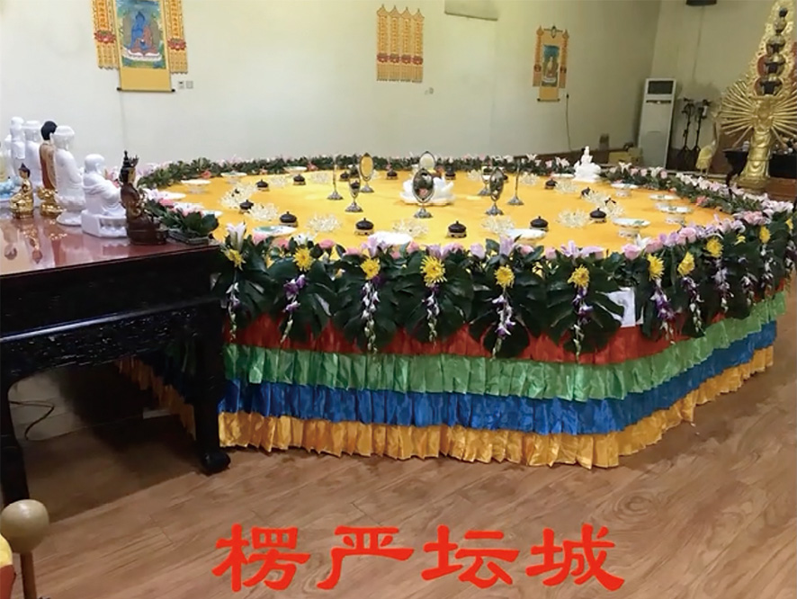
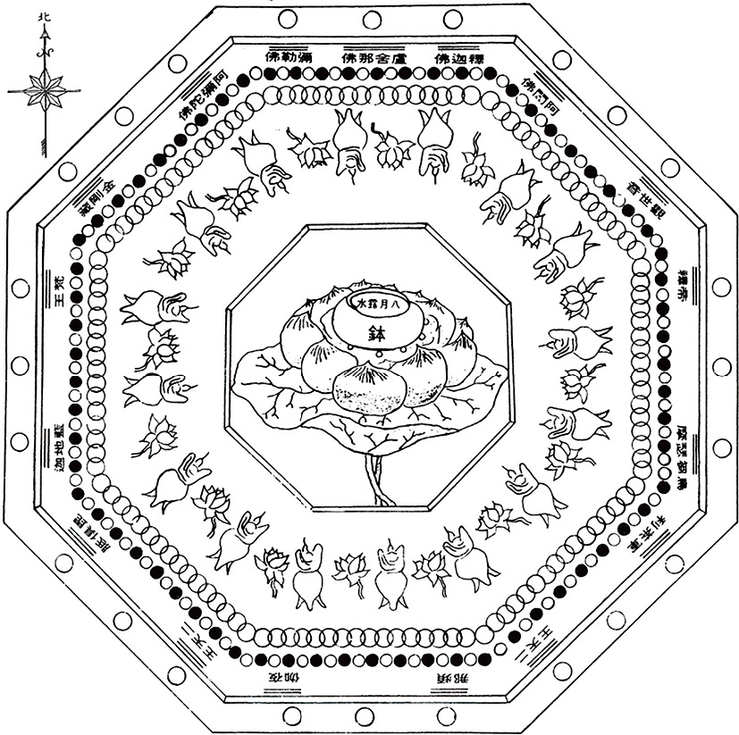

# 第76课

2023年11月20日

《楞严经》第七卷主要宣说楞严咒。在此之前，关于严持戒律、安住寂静地、依止善知识、得佛灌顶等修学次第，佛陀已经为我们宣说圆满。

从今天开始，我将向大家介绍修持楞严咒时设立坛城的方法，这部分法义可以说是《楞严经》里最关键的内容之一。在藏传佛教中，在灌顶和修法时常常需要设立坛城。所谓坛城，实际上是由诸佛菩萨依靠特定缘起而集聚，并摄受或加被后学的一种方便法。

作为汉地最有名的咒语之一，楞严咒与藏传佛教中的大白伞盖咒其实是同一个咒语的不同版本。关于这一点，稍后还会详细说明。通过这次学习楞严咒，希望自他的一切魔障都能消于法界，修行善始善终。

「阿难重请说道场」

| 阿难白佛言：世尊！我蒙如来无上悲诲，心已开悟，自知修证无学道成。

阿难对佛陀说：“世尊！我承蒙如来无上慈悲的教诲，心已开悟。我知道依照佛陀的教诲修行，一定能证得无学果位。”

在前文中佛陀已经开示了观修的方法，此时需要设立坛城——其缘起也是因为阿难尊者。他对本师释迦牟尼佛说：世尊，我承蒙如来无上慈悲的教诲和加持，现在我的心已经“开悟”。

阿难尊者此时已经获得圣果，但是还没有证得阿罗汉果位。此处的“开悟”在藏文中被译为“开启智慧”。众所周知，在佛陀涅槃后诸位圣者结集三藏时，阿难尊者由于未证阿罗汉果位，差点没能入于结集者的行列中。

阿难尊者说：依靠佛陀无上慈悲的教诲，我已心开意解，智慧增上。“自知修证，无学道成”，我已明白可借修证而成就无学道，也就是小乘阿罗汉果位[^1]。阿难认为，依靠佛陀的加持，他清楚地知道如何修学，对修行没有疑惑了。当然，虽然是这么说的，但阿难仍有未通达之处。

| 末法修行，建立道场，云何结界，合佛世尊清净轨则？

“在末法时代，修行者要建立道场，应如何结界才能符合佛陀制定的清净轨则？”

阿难问：末法时代的众生想要建立道场、设立坛城而修行，应当如何结界？“结界”一词在藏汉两地都很常见，意为在设立坛城或修法道场时划定界限，使之符合佛陀所制的清净轨则。坛城的设立必须符合仪轨，如理如法。

本经所讲的结界仪轨与密宗续部中设立坛城的方法有类似之处，包括使用的材料、坛城的大小、布置的方位等等，无不蕴含着密宗的义理。结界设置后，能避免邪魔外道的损恼与干扰。密宗修行者之所以能战胜魔障，与设立坛城、观修护轮等有密切的关系。除此之外，坛城还有其他许多意义。

关于楞严坛城，目前有些汉地寺院中还存有壁画，但数量不多。在历史上比较著名的有杭州大佛寺的楞严坛城，如今只剩地基；北京潭柘寺以前也有一座著名的坛城，后来被毁，虽然重建了寺院，但坛城已不存于世了；此外还有浙江天台山高明寺内由传灯大师主持建造的楞严坛城[^2]，相关资料中还记载了这座楞严坛城的绘制和建造事宜。

道友们如果曾设立过楞严坛城，或在设有坛城的寺院中待过，应该知道一些。有些密宗寺院中设有总坛城，在我们朵芒寺，因为每次灌顶都需要坛城，所以去年专门设立了一个极为庄严的固定坛城。密宗有设立坛城的独特方法，而本经中所讲的坛城与密宗《时轮金刚》、《大幻化网》及许多大修仪轨中的有所不同。

设立坛城并不复杂，尤其在科技发达的今天，我们甚至可以依靠机器的帮助来完成。在有必要时，我们也可以自己设立如法的坛城。如果大家将来成为寺院的住持，也可以考虑设立楞严坛城，但注意要严格遵循仪轨，如理如法地设立。

「世尊重说道场建设」

◎ 所建坛式

接下来宣讲如何设立道场。首先详细说明设立道场所需的材料。

| 佛告阿难：若末世人愿立道场，先取雪山大力白牛，食其山中肥腻香草，此牛唯饮雪山清水，其粪微细。可取其粪，和合栴檀以泥其地。

佛陀告诉阿难：“在末法时代，若有人想设立道场，首先要找到雪山上强壮的白牛。这些牛只吃山中肥美芳香的草，只饮雪山的清水，它们的粪便细腻洁净。取这些牛的粪便，混合栴檀香，用来涂抹地面。”

设立坛城首先要平整地面，敷以一种特殊的泥。

佛陀说，如果末法时代有人发愿设立楞严大坛城，先要准备用做坛城地基的材料，必须去雪山找到大力白牛。憨山大师说大力白牛是没有杂毛的纯白牛[^3]。我以前放过牦牛，从未见过身上一根黑毛都没有的纯白牛。这样的白牛如果有的话，确实极为罕见。一般来说，只要皮上没有明显黑色的就可以算是白牛。

白牛象征吉祥和福德，如果牛群中有一头纯白的牦牛，牧民们会将其视为牛王，绝不会宰杀，因为它是牛群中的吉祥物，这是藏地的民间传统。以前我曾为合作社放牦牛，牛群中大概有几百头公牛，其中只有一头白牦牛。为了避免它被抓去宰杀，我到哪里都骑着它。白牦牛鼻子里套着一根绳索，有一天晚上，小偷牵着鼻绳将它偷走了。从脚印看，是一个人牵牛，一个人随后，翻山到了炉霍，脚印到公路上就不知所踪了。第二天我们去找，但没有找到，只好翻山越岭地去合作社汇报。根据当时的制度，如果不及时报告，我们会被扣工分。白牦牛虽然是吉祥的象征，但有时它们也自身难保。

雪山上的白牛唯以山中最肥美的香草为食，饮用雪山上的清澈雪水，所以其粪便细腻、清香。将白牛的粪便与檀香混合制成泥料，可以用来涂敷坛城的地面。梦参老和尚对此有一段有趣的评论，他说，虽然佛陀开示要取雪山白牛的粪便，但是我们很难去到雪山，去到也基本见不到白牛，更不用说找到其粪便。即使找到，将牛粪带回来也是一件麻烦事。他说，不要说我们这些穷和尚，即便有大福报的人也不一定能实现。可见佛陀的某些开示，我们也没办法做到。

此处还可以这样理解：雪山为雪域高原，藏地的白牦牛都是以香草为食，饮用雪山的水，那它的粪便就可以用于建设坛城。因为在特别高的雪山上只有极少数动物能存活，白牦牛因为食物稀少，无法在那样的地方生存，所以佛陀说的“雪山白牛”很有可能是指雪域高原的白牦牛。不夹一根杂毛的纯白牦牛太罕见了，不一定能找到，那条件稍微放宽一些应该也可以。同样的道理还适用于配药，比如汉地民俗中会用黑狗血来辟邪，藏药中也会用到黑狗胆等，如果实在找不到纯黑的狗，那么退而求其次也可以。总之，大家可以按实际情况来处理。

| 若非雪山，其牛臭秽，不堪涂地。

“如果不是雪山的牛，它们的粪便就比较臭秽，不适合用来涂地。”

如果不是雪山而是农区的牛，那它们的粪便就比较臭。很多人对牛粪不太了解，总觉得牛粪都是臭的，其实不然。低海拔地区的牛粪确实很臭，但高原的牛粪却非常清净[^4]。在高原牧民的共识中，烧牛粪不仅不臭，而且还有一种独特的清香。有些汉族弟子不了解，认为烧牛粪的气味很难忍受，但实际上，牦牛吃的是高原上的香草等珍贵药材，喝的是雪山清水，所以其牛粪有许多药用价值，还有些藏医认为烧牛粪可以防治感冒等疾病。

佛陀说：如果不是雪山的牛，其粪便就不适合用来涂地。

| 别于平原，穿去地皮五尺已下，取其黄土。和上栴檀、沉水、苏合、薰陆、郁金、白胶、青木、零陵、甘松、及鸡舌香，”

“在别处的平原上，挖取地表五尺以下的黄土，混合栴檀、沉水香、苏合香、薰陆香、郁金香、白胶香、青木香、零陵香、甘松香以及鸡舌香。”

如果实在找不到雪山白牛粪，也可以在平原地区从地表向下挖五尺深后，取其黄土。我们以前修木头房子、土坯房子时需要挖地基，土地的表面是黑土，大概挖到地下四五尺时，黄土就露出来了。这种黄土有很多用处，可以做房子的墙，也可以用来做擦擦、甘露丸等。

这里说，在平原的地上向下挖，把黑土挖去后取下层的黄土，与以下十种香料混合：第一是“栴檀”，即檀香；第二“沉水”，即常说的沉香；第三“苏合”，是一味药[^5]；第四“薰陆”，类似于桃胶或松树胶，柏树胶和松树胶可以放在口中咀嚼，我以前放牦牛时经常吃；第五“郁金”，又称“百草之华”[^6]，藏文本中说为藏红花；第六“白胶”，即娑罗树汁[^7]，也就是佛陀示现涅槃时所依的娑罗树；第七“青木”，即青木香；第八“零陵”，是防虫用的一种熏香；第九“甘松”，是一味除腹胀和下气的药；第十“鸡舌”，即丁香。

| 以此十种细罗为粉，合土成泥，以涂场地，方圆丈六，为八角坛。

“将这十种香料研磨成细粉，与黄土混合成泥，用以涂抹场地。场地的大小是方圆一丈六尺，建成八角形坛城。”

将以上十种香料磨成非常细的粉，与黄土混合成泥，涂在将要建坛城的地面上。这些原料主要是用于平地。将土地涂完后，在其上设立一个八角形的坛城。

楞严坛城方圆一丈六，约五米，这样看来是比较大的。坛城的形状是八角形的，有四方、四隅八个角，再加上“上”和“下”，代表十方世界。当然，上和下只是表法，从意义上了知即可，不必在实物层面设置。

下面为大家展示一个坛城，以便让你们有一点直观的感受。这是一个八角形的坛城，虽然图片有点模糊，但大致能看到坛城的核心有钵盂，周围供有莲花、净水、香炉等。

此外还有一张黑白照片，中间是花瓣，周围有香炉、鲜花以及各种饰品，前方有个小香炉。此坛城的布置方式来自传灯大师的传承，应该比较可靠。如果照片看不清楚，大家可以自己去找一找相关资料，但要注意甄别来源。

◎ 所设庄严

| 坛心置一金、银、铜、木所造莲华，华中安砵。砵中先盛八月露水，水中随安所有华叶。

“在坛城的中心安置一朵金、银、铜、木所造之莲花，花中安放一个钵。钵中先盛满八月的露水，水中随意放置各种花叶。”

坛城的中心安置一朵由金、银、铜、木制成的莲花。如《法华经》中所说[^8]，此花以阎浮檀金为茎，白银为叶，金刚为须，甄叔迦宝以为其台。如果条件允许，此莲花可以用纯金、纯银或纯铜来制作；若条件有限，用木头来做也可以。

坛城中央有这样一朵莲花，莲花中间安放一个钵盂，其中盛满八月的露水，因为仲秋的露水最为清澈纯净，水中随意安放一些花叶或者花瓣。这是坛城中心部分的布置。

按照经文所述，实际操作不算困难，主要是对高度等细节方面需要核实。

| 取八圆镜，各安其方，围绕华砵。镜外建立十六莲华，十六香炉。间华铺设，庄严香炉。纯烧沉水，无令见火。

“再取八面圆镜，分别安置在八个方向，围绕着钵和莲花。镜子外面再放置十六朵莲花和十六个香炉。莲花与香炉间隔摆放，用以装饰。香炉中只烧沉水香，不要让火焰显现出来。”

在莲花中间安置好钵盂后，由于坛城是八角形，所以将八面圆镜分别安置在八个方位——东、南、西、北、东南、西南、西北、东北各放置一面。镜子需围绕中央的钵盂摆放，镜子外围再放置十六朵莲花。从坛城的图片中可以清楚看到，十六朵莲花分别安置在八个方位，每个方位放置两朵。然后放置十六个香炉，与莲花间隔摆放，即一个香炉旁放一朵莲花，如此互相间杂，以莲花来庄严香炉。香炉中只烧纯净的沉水香，且不让火焰燃起来。

一般来说，烧香、供佛、做烟施时，火焰都不宜过于明显。供护法时有烟就可以，如果烧起来的火焰过大，需要立即浇灭。念诵烟施仪轨时也不能出现火焰，因为饿鬼众生以烟为食，见到火焰会感到恐惧而逃离。还有一种说法是，火焰中有火神或火天女，所以当火焰显现时天神天女会出现，饿鬼众生会因为畏惧而无法享用供品。

总之，坛城中央是莲花，周围有八面镜子，外围是十六个香炉和十六朵莲花间错放置。在密法中，《时轮金刚》、《大幻化网》及许多大修仪轨的坛城非常复杂，通常要绘制七八天。与之相比，楞严坛城的布置方法不算很难。

◎ 所献供养

坛城内部布置完成以后，需要准备供养诸佛菩萨的供品。

| 取白牛乳，置十六器。

“取白牛乳汁，分别放在十六个器皿中。”

取白牛乳汁装在十六个器皿中，作为饮料，在外圈围绕着坛城摆放，同样是在八个方位各放置两份。

| 乳为煎饼，并诸砂糖、油饼、乳糜、苏合、蜜姜、纯酥、纯蜜。于莲华外，各各十六，围绕华外，以奉诸佛及大菩萨。

“用这些乳汁制作煎饼，再加上砂糖、油饼、乳糜、苏合香、蜜姜、纯酥和纯蜜。在莲花外面，每样供品各放十六份，围绕莲花，供奉诸佛和大菩萨。”

前面的乳汁是供佛的饮料，此处所供的是食物。将乳汁制作成煎饼，加上砂糖、油饼、乳糜、苏合香、蜜姜、纯酥和纯蜜用以供佛。“纯酥”是乳汁的精华，类似于奶酪或醍醐，而“纯蜜”是鲜花的精华[^9]，二者皆是供佛的上妙之选。

将这些供品放置在莲花外围，每样各十六份，即煎饼十六份、砂糖十六份、油饼十六份……围绕中心，摆放在之前的十六朵莲花和十六个香炉外围。以上供品都是用来供养诸佛菩萨的。

| 每以食时，若在中夜，取蜜半升，用酥三合。

“每到用餐时间，或者在中夜时分，取半升蜜、三合酥。”

供养的时间为每天中午的“食时”，即佛陀日中受食的时间[^10]，或者在晚上的中夜时分，取纯蜜半升、纯酥三合用以供养。古代计量单位中的十合大致相当于现在的一升，可见纯蜜用量稍多，为半升。

| 坛前别安一小火炉，以兜楼婆香煎取香水，沐浴其炭，然令猛炽。

“在坛前另外安置一个小火炉，用兜楼婆香煎取香水浴炭，使其燃烧得猛烈炽盛。”

在坛城前方单独安置一个小火炉，在其上用兜楼婆香煎取香水。“兜楼婆香”也叫白茅香[^11]，是一种香草，据说中国不出产。在火炉上用这种香草煎制香水，然后用香水清洗木炭，取其清净芬芳之义。有注释中说[^12]，是将木炭清洗、晾干后再使用。为避免炭火熄灭，所以将其燃烧得十分炽盛[^13]。

在藏地的灌顶仪式或大修仪轨上，坛城前通常会放置一个小炉子，炉子中放檀香。所用的木炭如果是用材质疏松的木材烧制，就很容易燃尽，所以要用杜鹃木等质地坚实的木材烧制而成的木炭，其燃烧的时间会比较长。坛城旁通常会有香灯师负责照料火炉，不断添加供品、调整火势。汉地法会上应该也有类似的事宜。

| 投是酥蜜于炎炉内，烧令烟尽，享佛菩萨。

“将纯酥和纯蜜投入燃烧的火炉中焚烧，烧至烟尽，以此供养佛及菩萨。”

木炭先用香水沐浴，然后放入炉子中，燃烧至通红时再将纯蜜、纯酥投入火内，用以供养诸佛菩萨。

藏传佛教的修法中，香灯师会根据仪轨的内容，一边念诵，一边将各种供品投入火中，有许多复杂的仪式。

◎ 所奉尊像

接下来是在坛城周围悬挂佛像。坛城通常安置在经堂内，在其周围还要装饰幡华等。

| 令其四外遍悬幡华，于坛室中，四壁敷设十方如来及诸菩萨，所有形像。

“在坛城外面的四周挂满幡盖和花饰，在坛城所处室内的四面墙壁上，敷设十方如来及诸菩萨的画像。”

在坛城外面，四周处处悬挂着幡盖和花饰。在坛城所处的室内，四面墙壁上要悬挂十方如来和菩萨的像。

一般来说，经堂里供着许多佛像。尤其是藏地举办法会时，各种新制的唐卡都被挂出来供人礼敬。法会结束后，僧众就会把最珍贵的唐卡收起来。我们这里是佛学院，与一般寺院的做法不同，在我们这里，经堂中常年悬挂着唐卡，通常不会收起来。

挂唐卡的依据在这里也讲得很清楚，在坛城的四壁周围都可以悬挂佛像。

| 应于当阳张卢舍那、释迦、弥勒、阿閦、弥陀，诸大变化观音形像，兼金刚藏安其左右。

关于悬挂的位置，佛陀进一步开示：“应当在正中央向阳处供奉卢舍那佛、释迦牟尼佛、弥勒佛、阿閦佛、阿弥陀佛的像，以及诸菩萨的各种大变化像，尤其是观世音菩萨与金刚藏菩萨像安置于左右。”[^14]

“当阳”即向阳。在向阳明亮的地方，张挂毗卢遮那佛像，现在释迦牟尼佛、未来弥勒佛、东方阿閦佛（即不动佛）、西方阿弥陀佛以及诸菩萨的变化形象，包括忿怒马头明王和金刚藏菩萨等。有注释说[^15]，观世音菩萨代表显宗，金刚藏菩萨代表密宗。

中间悬挂诸佛形像，左右两侧分别悬挂观世音菩萨与金刚藏菩萨像。

| 帝释、梵王、乌刍瑟摩、并蓝地迦、诸军荼利，与毗俱胝、四天王等，频那夜迦，张于门侧，左右安置。

“帝释天、梵王、乌刍瑟摩与蓝地迦、诸位军荼利，还有毗俱胝、四天王等护法神像，以及频那夜迦，应安置在门的左右两侧。”

所悬挂的不仅有佛菩萨像，还有帝释天、梵天、乌刍瑟摩（火头金刚），蓝地迦（青面金刚）、军荼利（解怨结金刚）、毗俱胝（三目金刚），四大天王等像，并将频那夜迦（象鼻使者）[^16]之像悬挂在门的左右两侧。

实际上，藏传佛教很多寺院的布置方式与此非常相似：上方是佛菩萨像，中间及周围有四大天王像、轮回图、护法神像等，这样的布置具有甚深的缘起。

今天的内容比较容易理解，《指掌疏》中对此解释得很详细，其他注疏则比较简略。梦参老和尚提到，许多细节也许难以实现。从整体上看，各位祖师的解释基本一致。

以上讲述了如何悬挂诸佛菩萨像。

◎ 所取照映

| 又取八镜覆悬虚空，与坛场中所安之镜方面相对，使其形影，重重相涉。

“再取八面镜子，镜面向下覆悬在空中，与坛城中安置的八面镜子分别相对，使它们的影像相互映照，层层相涉。”

坛城中已经安置了八面镜子，现在再取八面圆镜，面朝下挂在坛城上方，分别与下方已经安置好的八面镜子面面相对。

现在有些餐厅中也是左右两边都有镜子，人站在镜子中间会有一种不真实之感，仿佛置身于另一个世界。唐朝的法藏大师（也称贤首国师）在为武则天宣讲《华严经》时，在经堂中安置了十面镜子，人在其中感到如梦似幻，产生一种不可思议的觉受，以此指示华严世界的境界[^17]。

本经中提到的镜子，是在坛城的上方悬挂八面，与下方的八面镜子上下相对，影像互相重叠，层层映照，镜中就会印现出无量的影像。上下圆镜互相照映，表示一种凡圣无异，显而无自性的境界[^18]。

有注释讲到[^19]，坛城中每一种布置都有特定的象征意义，如十种香料表示十波罗蜜，十六个香炉和十六朵莲花代表智慧中所发戒香，自行八正道，化他八正道，八面镜子象征众生的八识不离大圆镜智等。对于这些表示法，我们知道是最好的，但如果不知道，也并不影响修持。

如果要想修楞严咒，能设置实体的坛城自然很好，但如果条件不具足，也可以用绘制的平面坛城来代替。当然，由于我没有《楞严经》前八卷的传承，加上自己也没有实地布置过楞严坛城，因此以上所讲的内容仅供参考。

[^1]: 《楞严经指掌疏》（清·通理述）：“无学有二。一小乘四果。二大乘佛位。今就阿难。且约四果。谓阿难既已开悟。自知依之修证。虽不能即至佛位。而四果无学之道。聊可成矣。”
[^2]: 《高明讲寺：智者大师亲手创建的幽溪道场》：“传灯大师，字无尽，别号有门。俗姓叶，太末（今浙江省衢州市龙游）人。少年时在贤映庵出家，明万历八年（1580年）随百松法师在智者塔院研习止观之学，承其衣钵，成为天台宗第三十代传人。后住持高明讲寺，在太史冯开之和东邑居士赵海南等人资助下，陆续修建了大殿、禅堂、僧房、山门、两厢、钟楼、藏经阁等，精心制作了‘楞严坛’。此坛按经论构建，为全国仅有的3座之一，名闻海内。……楞严坛内有古井一口，名曰‘福泉’，坛前西方殿殿壁嵌有高一二尺、阔三四尺的‘楞严海印三昧坛仪碑’，记述传灯法师建造楞严坛之事，由虞淳熈撰文，董其昌手书，陈继儒篆额。”（来源：中国民族报，作者：辛永刚、梁飞炎。）
[^3]: 《楞严经通议》（明·德清述）：“雪山纯一无杂，白牛无染，香草纯味，清水纯洁，而茹退亦纯，栴檀其树无影，通表清净法身功德也！意显道场依法身建立也！”
[^4]: 《楞严经指掌疏》（清·通理述）：“雪山香草。丰肥油腻。以斯食牛。则其粪香而带腻。用以涂地。不唯避臭。且以益其坚也。雪山清水。不浊不染。以斯饮牛。则其粪纯而兼净。以斯涂地。不惟无杂。而且益其洁也。其粪微细者。精微细妙。乃统上香腻纯净而总言之。”
[^5]: 《大佛顶首楞严经讲义》（圆瑛法师著）：“苏合，《续汉书》云：出大秦国，合诸香煎其汁，谓之苏合，或曰苏合国，人采花笮汁，煞以为膏，以卖买客。”
[^6]: 《大佛顶首楞严经讲义》（圆瑛法师著）：“郁金，《说文》云：郁鬯chàng乃百草之华，远人所贡方物，郁人捣而煮之，和酒以降神也。”
[^7]: 《大毘卢遮那成佛经疏》（一行阿阇梨记）：“白胶香是娑罗树汁。”
[^8]: 《妙法莲华经》（姚秦·鸠摩罗什译）：“于是妙音菩萨不起于座，身不动摇，而入三昧，以三昧力，于耆耆阇崛山，去法座不远，化作八万四千众宝莲花，阎浮檀金为茎，白银为叶，金刚为须，甄叔迦宝以为其台。”
[^9]: 《楞严经文句》（明·智旭撰述）：“蜜为华之精。酥为乳之精。皆是味中上味。表于圆通妙理也。”
[^10]: 《大佛顶首楞严经讲义》（圆瑛法师著）：“温陵曰：佛以日中受食，故每日以日中致享。若在中夜，佛不受食，唯以酥蜜，烧令烟尽享之。盖午为日中，子为夜中，表诸圣位，必须中中流入也。”
[^11]: 《大佛顶首楞严经圆通疏》（明·传灯疏）：“兜罗婆。出鬼神国，此方无故不翻，或翻香草，旧云白茅香也。”
[^12]: 《大佛顶首楞严经浅释》（宣化上人述）：“用兜楼婆香（即白茅香），烧成香水，来洗所用之炭。待干，放炭于炉内，然后烧炭，烧至猛红的时候，将酥酪和蜜，投入火炉内，烧至烟尽为止。用这种烟，来供养诸佛菩萨。”
[^13]: 《楞严经指掌疏》（清·通理述）：“用此煎水浴炭者。取其净而芬故。恐为酥蜜所灭。故然令猛炽。”
[^14]: 《楞严经指掌疏》（清·通理述）：“诸大变化者。如明王变像。以文殊普贤等。皆有明王像故。又诸大变化中。特标观音及金刚藏者。显二菩萨。必不可少。”
[^15]: 《大佛顶首楞严经讲义》（圆瑛法师著）：“诸大变化，观音像者：如前文所明，众首臂目等，此是显教圆通之主。金刚藏者，常领金刚，护持咒人，伏魔除障，乃是密教圆通之主。安其左右者，表显密齐彰也。”
[^16]: 《续一切经音义》（宋·希麟集）：“毘那夜迦：梵语也。旧云频那夜迦，或毗那夜但迦，或云吠那野迦吠借。音微一反。此云鄣碍神，谓人形象头，能与一切作障碍故。”
[^17]: 《大方广佛华严经普贤行愿品别行疏钞》（唐澄观别行疏·宗密随疏钞）：“又尝为则天以十圆镜置八隅上下皆使相向，中安像佛，然烛炤之。则镜镜现像互相摄入，及观之者交罗齐现，以表刹海十界普容无尽之旨。”
[^18]: 《大佛顶首楞严经讲义》（圆瑛法师著）：“使其形影，重重相涉者：表生佛互融，圣凡无异，乃不可思议之境也。”
[^19]: 《大佛顶首楞严经讲义》（圆瑛法师著）：“和上旃檀等十种香，表十波罗密也。……八镜安方者：表众生本有八识，大圆镜智，不离当处也。镜外建立莲华香炉者：表依慧发行，从性起修也。各须十六者：表慧华戒香，自行八正，化他八正也。”
