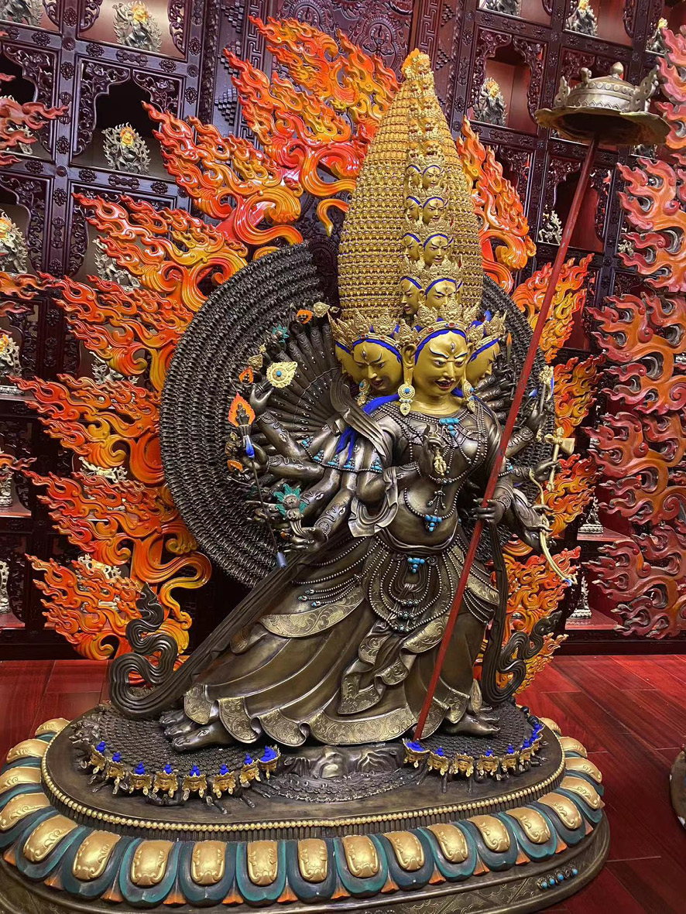
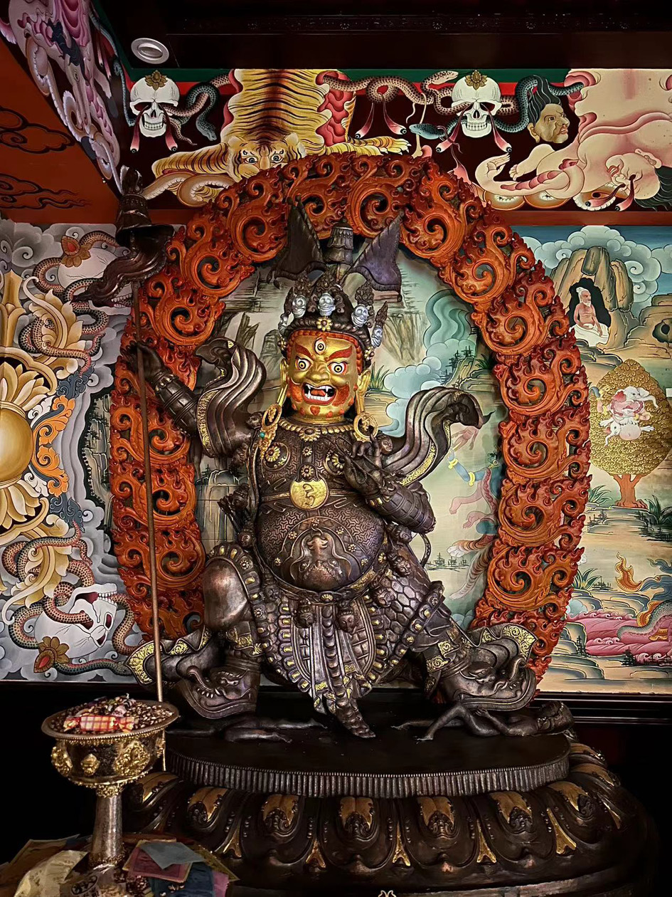

# 第78课

2023年11月23日

「如来重说神咒」

接下来，我们讲到了《楞严经》的咒语部分。虽然昨天晚上失眠，但我的心里很平静，没有因为失眠而着急，于是翻阅了楞严咒的梵文版。你们上次供养楞严咒时，十分钟就诵完了，而我可能念都要念半小时。因为咒语都是梵文，对我们讲藏语的人来说难度很大。虽然我学过一些梵语，可是文中有许多生僻字，念起来就比较慢。

下面的课程中，我打算每天用一点时间，将楞严咒的藏译本和汉译流通版对照着进行解释。具体而言，我先用藏语念一句咒语，然后对照着汉译本，解释这一句的意思。因为楞严咒比较长，所以每天只讲一小段，然后跳过没讲完的咒语部分，直接讲后面的经文。就这样，楞严咒会被分到六节课中进行对译。

也许有些人会想：“咒语只要念过去就可以了，不需要对照意义。”然而我认为，如果在念咒语时了解其大意，将有利于我们的修持。就像观音心咒、莲师心咒、百字明等咒语，在自宗传承中也都有相应的解释。在上一节课中，大家将楞严咒背得很好，但许多人都不知道其中的意义——其实可以大概了解一下。楞严咒中包含顶礼诸佛菩萨、护法神等许多内容，了解这些并没有坏处。毕竟咒语也是一种语言或表示法。

今天我们讲楞严咒的第一段，从明天开始直接讲解咒语之后的经文，每堂课的最后再对译一段咒语。这样讲解，你们听起来不至于枯燥，我也方便安排进度。

◎ 楞严咒简介

在正式讲解咒语之前，先为大家简单介绍一下楞严咒。

“楞严”可以理解为佛陀的勇健禅定，类似狮子奋迅三昧。以禅定的名称命名佛经，可见本经是关于修持禅定的一部要诀，此禅定的主要功能是破坏邪魔外道。

咒语也可以根据经名而取。有人认为，此咒应名为“大佛顶咒”或“大白伞盖咒”。然而，按照汉传佛教的传统，以经典名为咒语命名也是可行的。在这部经典中，楞严咒以隐秘和明显的方式出现了两次。

佛陀是在什么地方宣说楞严咒的呢？大致在人间和天界两处。

在人间，第一次是佛陀在秘密境界中宣说的。当时由于摩登伽女的扰乱，阿难遭遇违缘，佛陀在内证境界中为文殊等大乘眷属秘密宣说此咒。这一情节在第一卷中有所提及[^1]，但并未明显阐述：佛陀先是在秘密境界中为少数弟子宣说楞严咒，之后文殊菩萨持此密咒解开了摩登伽的咒术，使阿难免于危难。正因如此，阿难在前文中请求佛陀“再次”宣说此咒。

第二次在人间宣说的处所，是舍卫城祇桓精舍。这一次，是佛陀在所有眷属中公开宣说的，这段经历就是我们正在学习的第七卷中的内容。以上是楞严咒在人间两次弘扬的情况，这两次所说的咒语完全一致。

楞严咒在天界也有两次宣说：

第一次是佛陀在色究竟天所说。唐朝有一位善无畏大师，他是玄宗皇帝的国师，于公元716年前后翻译过一部《大佛顶广聚陀罗尼经》，其中提到佛陀在迦腻瑟吒天为无数天众讲大无畏佛顶心法[^2]。《楞严经》翻译于公元705年，与前者相差至少11年。善无畏翻译的这部经典收录在“大正藏”中，但咒语部分缺失，所幸在“敦煌藏”的部分版本中保留有咒语。佛陀在色究竟天宣说的陀罗尼咒与前两次在人间宣说的咒语略有差别。

此咒在天界的第二次宣说，是在三十三天的善法堂，佛陀入于三昧境界而示现的。据《佛顶大白伞盖陀罗尼经》记载[^3]，佛陀在善法堂中，为诸比丘、诸大菩萨和天王帝释等无量天众演出此咒。此经是由沙啰巴大译师在元朝期间由藏文翻译成汉文的。

总之，佛陀在人间天界等四个不同的地方，分别宣说了楞严咒。由于年代久远，流通于世的版本之间难免存在一些差异。尽管如此，不同的版本都有其机缘和合理性。就像两个人分别整理同一部讲记，在遣词造句上必然会有差别，或简或繁，其来源都是同一部讲记。

据说，大白伞盖陀罗尼有天界与人间的两种传承。所谓人间传承，就是指在汉地流行的楞严咒，而天界的传承主要出自前面提到的两部经典——《佛顶大白伞盖陀罗尼经》和《大佛顶广聚陀罗尼经》。

关于楞严咒的历史、传承及版本之间的差异，在许多学术论文中专门讨论过，对此我也研读了一些。由于因缘所限，今天无法为大家详细地介绍。我自己对楞严咒非常感兴趣，本来想好好地备课，让大家深入地了解这些内容，但或许是魔王波旬不希望这些秘密广为人知，令我今天身体不适——这是玩笑话。

◎ 了解世界的真相

因为我感冒的事，借此提醒大家要多注意健康。最近病毒盛行，听说一些城市里的学校已经停课了。现在网上有各种传言，说有人故意散播病毒，以便让医疗行业的股票上涨。这种说法应该是不合理的。在这个日益浊恶的世间，许多事情难以预料。与世界上正在发生的瘟疫、饥荒、战争等苦难相比，我们得个感冒、挨寒受冻的痛苦简直微不足道。

近期，加沙地带的医院被轰炸，食物和水源极度匮乏，这简直是人间地狱。一些有权有势的人虽然知道这些事，却对他人的苦难漠不关心。前几天央视报道[^4]，缅北地区电信诈骗的嫌疑人竟然多达31000人，真是触目惊心。这些犯罪活动在过去只是个别现象，而在如今这个越来越混乱的世界中，许多现象都令人难以置信。

出家人相对而言比较单纯，总觉得世界上应该有规矩，人们要依理办事，但事实是真正讲道理的人少之又少。许多人认为美国是一个民主、公平、正义的国家，我年轻时也曾这样认为。到了美国以后才发现，无论在哪里，都难免有为了自己的利益而不择手段的人。这次以色列袭击加沙事件中，无数平民死于非命，但美国却一直视而不见……当然，也许我只看到了别人的缺点，有这种可能性。

不管怎样，我深深地意识到，许多人为了追求自身的利益，不惜欺骗和伤害他人，对别人的痛苦漠不关心。只要能实现自己的利益，有的人甚至不管他人的死活。对于这些现象，大家应当有清醒的认知。

我们有机会身心安宁地修学大乘佛教，这固然是非常幸运的；但另一方面，大家也应当了解这个世界：无论关于自己的生老病死，还是外境的各种变化，大家都要心中有数。期望事事都符合规矩，这在现实中往往是难以实现的。虽然佛法中讲因明、中观以及世间的规矩，教导人们做事要合情合理，但在现实生活中，可能别人不一定会跟你讲道理。

作为佛教徒，了解这个世界的现状非常重要。

◎ 版本对照

楞严咒的意义非常深奥，我原本想为大家多讲一些。不过，如果只是单纯的学术性研究，对信心的增上不一定有利。有人说：“我们寺庙的师父说这个楞严咒非常好，但是只能念诵，不能翻译，如果追问咒文的意义就不是师父的好弟子。”他们再也不敢问咒语的意义。不管怎样，我认为了解咒语的意义对我们来说是有益的。

前面讲过，不同译本的《楞严经》中，对楞严咒的断句不同——其实这不算特别重要，但世间学者对此比较重视。

有版本中的咒语是439句[^5]，以“房山石经”[^6]和“高丽大藏经”中的《楞严经》为代表。

还有的版本是487句，出自“房山石经”中不空翻译的《大佛顶陀罗尼》。当今研究楞严咒的一些学者认为，因为有对照的梵文本，所以这是比较权威的一版。

此外还有481句的版本，同样由不空翻译，经名为《一切如来白伞盖大佛顶陀罗尼》。有一部现藏于法国国家图书馆的梵文文献保存得比较好，其中的咒文与此版本非常接近。

第四个版本有536句，由契丹国师慈贤[^7]翻译，篇幅相对较长，但有些学者对这个版本有所质疑。

还有一个版本是422句，这个译本的年代比较早，译者不详，可能在译出的一段时间内曾流传过。

目前在汉传佛教中影响较广的版本是427句，也称为流通版。这个版本译出的时间较早，我曾问过一些比较有经验的汉地修行人，他们在寺院中基本上都是诵这个版本。上节课大家背诵楞严咒时，我与427句版对了一下，没有发现差异。这个版本在明朝的（永乐）大藏经、清朝的“乾隆大藏经”中都可以找到，不过其渊源可以追溯到更早的时期。北宋的长水子璇在其注疏中就提到此427句的楞严咒[^8]，这表明汉传佛教的古德们至少从北宋时期就开始重视这个版本，乃至追溯到唐朝般剌密谛大师的时代，也不是没有可能。可见，427句的版本有着悠久的历史依据。

也许有人会想：“有这么多不同的版本，到底合不合理？我们念的是不是错的？”大家不必为此担心。历代许多大德也曾开示：前辈大德智慧高超、境界精深，如果翻译有误或不准确，427句的咒语不会广为流传。民国高僧圆瑛法师在其注释中也采用了427句的版本[^9]，可见无论是早期还是后来的大德，都主要沿用这个版本。

略有不同的是，有些大师认为[^10]，咒语的最后几句是咒心，也即整部咒语的核心，而有些大师并不认可这种说法[^11]。这是一个小问题，无伤大雅。

在藏传的《大白伞盖陀罗尼经》以及元朝翻译成汉文的《佛说大白伞盖总持陀罗尼经》中，楞严咒的最后还有大白伞盖短咒“吽玛玛吽呢索哈”。与此类似的咒在汉文大藏经的其他经典里也出现过，可见这不是藏传佛教的一家之言。

昨天在大家背诵楞严咒时，许多人都被震撼到了。这么长的咒语，大家异口同声、流利自如地诵出，确实令人惊叹。如果个别人实在觉得念全文有困难，也可以像我一样念诵“吽玛玛吽呢索哈”（堪布笑），这样也很有功德。

虽然在目前流传的《楞严经》中没有“吽玛玛吽呢索哈”这句咒语，但它在元朝翻译的《佛说大白伞盖总持陀罗尼经》中确有收录。这是最略的大白伞盖心咒。

◎ 楞严咒与大白伞盖咒

大白伞盖咒与楞严咒之间的差别，如果详细比对，有少数字词不同，句子的数量也有差异，此外大多数内容都是一样的。在藏文版的《大白伞盖陀罗尼经》中的大白伞盖咒，“顶礼佛、顶礼法、顶礼僧”这几句都是藏语长行文，然后才是梵音咒文，后面也这样一段藏文长行、一段梵音咒文；而楞严咒从“顶礼佛”开始就全都是梵音。二者在形式上仅有这一点差别而已。

出现差别的原因可能是，楞严经在天界和人间的宣说场合不同、经典的译者不同，从而出现了后来的差别。在藏传佛教中，二十一度母中的第十九位“天王所敬母”[^12]，就被称为大白伞盖佛母。记得当时讲解《二十一度母赞》时，我曾提到过这一点，大家应该还有印象。

有的藏地译师认为，楞严咒前面的顶礼句不属于咒语本身，所以将其翻译成长行文；而汉译本译师般剌蜜谛等则认为，顶礼句本身也是咒语的一部分，所以完全保留了梵音而没有进行翻译。按照惯例，咒语中蕴含着许多隐义，难以尽述，所以不翻。

据史书记载，藏传佛教前弘时期有《楞严经》的完整译本，但在朗达玛灭佛时期，佛法遭到毁灭性打击，此后流传于世的《楞严经》就只剩下第九卷和第十卷，前八卷的内容已无从考证。目前藏译《楞严经》中没有楞严咒，如果藏地的《楞严经》是从汉地传来的，那么，楞严咒就应该以汉译的版本为依据。

藏传佛教的前译时期大约从公元八世纪延续至九世纪，略晚于般剌密谛翻译《楞严经》的时期。前译时期的藏译与后来的汉译版本虽然不一定相同，但因为资料缺失，已经无从考据。本经仅存的第九、十卷的传承我是有的，准备在讲到的时候为大家传。

本经中的咒语既可以称为楞严咒，也可以称为大白伞盖咒。《大白伞盖陀罗尼经》在藏地一向受到极大的尊崇，是藏传佛教中格鲁、萨迦、宁玛等各个教派以及诸多大德日常持诵的一部重要经典。今年重修朵芒寺时，我们新塑了几尊佛像，其中一尊是乃琼护法神像。本来为了保持传统，一般来说寺院中不会随意增加佛像，但根据法王如意宝所著的相关仪轨，在征求寺院管委会的意见后，我们按照乃琼寺的造像方式新建了一尊乃琼护法神的像；还有一尊就是大白伞盖佛母像。虽然举办法会时并没有集体念诵《大白伞盖经》的习惯，但朵芒寺的出家人常常念此经——当时并没有想到此举与宣讲《楞严经》有关，但现在看来是有因缘的。我们在经堂里塑造了一尊极其庄严的大白伞盖佛母像，待会可以展示一下照片。

我有时会略微为大家介绍一些佛菩萨的形象和功德，对此有些上师认为：“你不讲五部大论，不讲修法，天天介绍这位菩萨、那位佛陀，是不是在做买卖、打广告？”其实不然。无论出家人还是在家居士，如果我们连佛菩萨都不认识，显然是不合理的。大白伞盖佛母的形象如何、千手千眼观音菩萨有什么功德、“莲师八变”是什么意思、佛菩萨的手帜有何差别……这些都是佛教徒应当了解的基本常识，也是我们产生信心的基础。2022年为大家宣讲《大乘庄严宝王经》后，我对十一面观音生起了更强烈的信心。虽然记不住具体的内容，但每当在寺院中看到十一面观音像时，对于“观世音菩萨具有无量功德”这一点，我的心中都非常肯定。

汉地佛教徒经常把楞严咒做成挂件，这是非常有意义的事。将此挂件作为护身符挂在车上或随身携带，对降伏魔障很有帮助。我们应当重视楞严咒。昨天大家在课堂上念了楞严咒，之前也有许多人在僧众前供养过，但为了遣除违缘，大家还要多念修此咒。我们计划为大家制作一些方便随身携带的大白伞盖佛母小像；当各方面因缘具足时，还可以塑一些在大经堂中供奉的大白伞盖佛母像。

朵芒寺的大白伞盖佛母和乃琼护法神像已经完工，僧众也为佛像进行了开光仪式，大家可以看一看：这是大白伞盖佛母像，还有护法殿中的乃琼护法神像。（堪布展示照片）

大白伞盖佛母

乃琼护法神

总之，佛陀宣说的楞严咒是以大白伞盖陀罗尼的方式呈现的，在相关的唐卡中也能看到，大白伞盖佛母的顶间幻化出无量无边的伞盖。我们在对照咒文时也能发现，大白伞盖咒与楞严咒的内容基本相同，只存在细微差别。

◎ 大白伞盖咒的传承

以后在方便的时候，我会为大家安排念《大白伞盖陀罗尼经》的传承。在藏文大藏经中，仅德格版就有不同时期三个版本的《大白伞盖经》，这部《大白伞盖陀罗尼经》略长。我虽然没有此经长行文的传承，但咒语部分的传承是有的。为了创造缘起，我将逐字逐句地为大家念诵咒语，并简单地对照解释。

在汉地大德中，清朝的续法大师[^13]曾对汉地流通版的楞严咒进行过对照解释，宣化上人为每一句咒语都做了赞颂偈[^14]，咒语只有427句，但上人的赞颂偈共有554颂，可能是段落划分不同所致。

汉地大德对《楞严经》的注解、研究及赞颂，历来都非常丰富，而藏传佛教徒则侧重对《大白伞盖陀罗尼经》的修持。寺院共修自不必说，民间也有请僧众念经的习俗：为了祈福禳祸，人们常常先请活佛打卦确定需要念的《大白伞盖经》数量，然后请若干出家师父来家里念诵。

在我小时候，我与邻居家的阿克如嘎和他的哥哥阿克荣珠，经常一起在朵芒寺对面的山上放牦牛。放牛的时候，他们总是带着经书去念诵。当他们念诵时，我就在山顶上“放哨”。如果发现有人来，就发出呼唤牦牛的声音。听到我发出的声音，两兄弟就立即把经书藏好，然后若无其事地从树丛里出来。

这对兄弟都会背《大白伞盖经》，而且经常在一起诵经。经文里有一句：“千眼千手”，还是小孩子的我在听到后觉得又好奇又害怕：“一千只眼睛、一千只手，到底是什么呢？”我总追着问他们。他们回答：“现在你还小，不懂这些。先教你念个简单的咒语。”我就从那时开始念诵短咒“吽玛玛吽呢索哈”。每当他们念到“一千只眼睛、一千只手”，我就念这个咒语。在我放牛的日子里，这样的情景常常出现。

如今我乘车去朵芒寺时，每当望见那些山头，这段往事就会浮现心头。两兄弟后来变成了两位老人，已经谢世多年了。现在算起来，我当时应该是五六岁，在如今孩子们上幼儿园的年纪，那时的我在山野间放牦牛。我从阿克如嘎两兄弟处第一次听到大白伞盖咒语，当我年纪尚小的时候，就已经在心里播下了这颗种子。

关于咒语，就介绍到这里。

「楞严咒对译1」

接下来，我将一边为大家念咒语一边解释，从第一句“南无萨怛他苏伽多耶”开始，念一句藏文，然后简单解释一句。你们最好做一下笔记。

| 南无萨怛他苏伽多耶阿罗诃帝三藐三菩陀写 萨怛他佛陀俱胝瑟尼钐

“敬礼如来善逝应供正等觉、如来佛陀俱胝顶髻”

| 南无萨婆勃陀勃地萨跢鞞弊

“敬礼一切诸佛、诸菩萨众”

| 南无萨多南三藐三菩陀俱知南 娑舍啰婆迦僧伽喃

“敬礼七俱胝正等觉、诸声闻众”

| 南无卢鸡阿罗汉跢喃

“敬礼世间阿罗汉”

| 南无苏卢多波那喃

“敬礼预流果众”

| 南无娑羯唎陀伽弥喃

“敬礼一来果众”

在其他有些版本中，此处后面还有一句，意为“顶礼不还果”[^15]。我们所用的427句版中没有。

| 南无卢鸡三藐伽跢喃 三藐伽波啰底波多那喃

“敬礼世间正行众、正向众”

正行指的是四果，正向是四向。小乘果位有四果四向，如阿罗汉分为阿罗汉向和阿罗汉果。

| 南无提婆离瑟赧

“敬礼天仙众”

关于咒语的读法，汉语音译和梵语的发音有所不同，但只要总体能对应上即可，想要统一发音是不太现实的。在学习咒语时，我们不必强求发音完全一致，也没有必要改变自己的发音。

| 南无悉陀耶毗地耶陀啰离瑟赧

“敬礼成就持明仙众”

仙人中有许多持明仙众，其咒力极强。

| 舍波奴揭啰诃娑诃娑啰摩他喃

“敬礼猛咒饶益堪能众”

即用咒语饶益一切众生之意。

| 南无跋啰诃摩泥

“敬礼梵天众”

| 南无因陀啰耶

“敬礼帝释天众”

今天对到这里。其余的咒语部分，我们每天也将以这种方式进行对译。

[^1]: 《大佛顶首楞严经》（唐·般剌蜜帝译）：“于时世尊，顶放百宝无畏光明，光中出生千叶宝莲，有佛化身结跏趺坐，宣说神咒。敕文殊师利，将咒往护。恶咒消灭。提奖阿难及摩登伽，归来佛所。”
[^2]: 《大佛顶广聚陀罗尼经》（唐·善无畏译）：“一时佛薄伽梵在迦腻瑟咤天住，有诸无数天众，迦腻瑟咤，及其眷属，百千万亿俱胝无数天众……我有毗卢遮那藏大坛，一切如来秘密心大咒印法术王，大无畏佛顶心法，放大光聚一切秘密心大咒术王法，种种变现，皆得不可思议自在变现。”
[^3]: 《佛顶大白伞盖陀罗尼经》（元·沙啰巴译）：“一时婆伽梵在三十三天善法堂中，与诸比丘、诸大菩萨、天主帝释无量众俱。尔时婆伽梵敷座而坐，即入普观乌瑟尾沙三昧。时婆伽梵忽从肉髻演出秘密微妙法行：南谟一切诸佛诸大菩萨众，南谟佛陀耶……”
[^4]: 据央视新闻客户端（2023年11月22日）消息，针对当前缅北涉我电信网络诈骗犯罪严峻形势，公安部部署云南等地公安机关持续推进边境警务执法合作，连续开展多轮打击行动，截至目前，缅北相关地方执法部门共向我方移交电信网络诈骗犯罪嫌疑人3.1万名，其中幕后“金主”、组织头目和骨干63名，网上在逃人员1531名。
[^5]: 见“房山石经”“高丽藏”“赵州金藏”等藏经中的《楞严经》（十卷）译本。
[^6]: 房山石经：房山云居寺石刻佛教大藏经（略称房山石经），是我国从隋代至明末绵历千年不断雕制的石刻宝库。它是研究我国古代文化、艺术，特别是佛教历史和典籍的重要文物，也是世界文化遗产的珍贵宝藏。现已发现大小经版共14278块，共计佛经1122部，是世界上最大的石刻图书馆。季羡林先生曾说：“云居寺是‘北京的敦煌’，敦煌是‘甘肃的云居寺’。两者皆为世界独一无二的文化宝藏。”
[^7]: 《佛学大辞典》（丁福保编）：“慈贤大师：五代译经僧。中印度摩揭陀国人。东游入契丹，被尊为国师，诏入译经院。译出金刚摧碎陀罗尼、如意轮莲华心如来修行观仪、妙吉祥平等秘密最上观门大教王经、妙吉祥平等观门大教王经略出护摩仪、妙吉祥平等瑜伽秘密观身成佛仪轨、梵本般若波罗蜜多心经、大悲心陀罗尼经、尊胜陀罗尼经。因赐号‘三藏大法师’，并赐紫衣。所译均收于至元法宝勘同总录卷六，其中五部九卷收于明本大藏经，传行后世。辽道宗清宁八年（1062）顷所完成之契丹本大藏经中，并未收录上举诸经，故此等经典或为清宁八年以后所译出者。生卒年及世寿均不详。”
[^8]: 《首楞严义疏注经》（宋·子璇集）：“此咒四百二十七句。前诸句数。但是归命诸佛菩萨众贤圣等。及叙咒愿加被离诸恶鬼病等诸难。至四百十九。云跢侄他。此云即说咒曰。从四百二十唵字去。方是正咒。”
[^9]: 《大佛顶首楞严经讲义》（圆瑛法师著）：“上来神咒今依绍兴海眼诸古本勘对考正。以上神咒，凡有五会，至一百三十七句止，是毗卢真法会；至一百七十八句止，是释尊应化会；至二百七十二句止，是观音合同会；至三百三十二句止，是刚藏折摄会；至四百十八句止，是文殊弘传会；哆侄他起至咒终，共四百二十七句。”
[^10]: 《楞严经指掌疏》（清·通理述）：“唵字下正说呪心……然此段既称呪心。则是五会中精要之义。如有力通前俱持。固为尽善。设或无力。则但持此。确信功极自收成效。”
[^11]: 《大佛顶首楞严经讲义》（圆瑛法师著）：“有谓哆侄他唵，下七句为咒心非也；以彼是五会神咒，都聚之处，结晶之义也。究之此咒，全如来藏心成咒，故曰心咒；全咒即是如来藏心，是名咒心。”
[^12]: 《二十一度母赞》（索达吉堪布译）：“顶礼天王所敬母，天人非人咸依止，披甲欢喜之威德，遣除争斗与恶梦。”
[^13]: 《佛学大词典》：“续法（1641-1728），清代僧。浙江仁和（杭州）人，俗姓沈。字伯亭，号灌顶，又名成法。九岁从学于杭州天竺山慈云寺明源，十九岁受具足戒，二十岁习讲经，历时七年，受明源付嘱，为云栖袾宏五世之法孙。师遍研诸经，融会众说，不拘泥一端。后每讲说，四众云集，盛极一时。历主慈云、崇寿、上天竺诸刹。雍正六年示寂，世寿八十八。”
[^14]: 《楞严咒句偈疏解》，宣化老和尚著，中美佛教总会法界大学，1980年。
[^15]: 敦煌422句经本：“南谟阿那伽弥喃”；房山487句不空本：“曩莫阿曩～誐弥南～”；房山536句慈贤本：“曩莫路计阿拏誐弥喃”。
