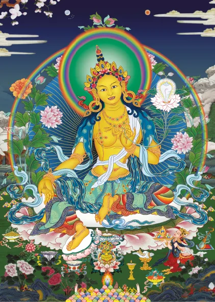

## 二十一度母赞讲解

## 有了度母加持，做什么事都容易成功

度母，在印度、藏地可谓家喻户晓，信仰者不计其数。但在汉地，了知其功德者却寥寥无几。有些人只知道“藏传佛教中有度母修法，这个修法来自于印度；还有像龙猛菩萨、龙菩提、寂天菩萨、阿底峡尊者等高僧，昔日都得到过度母的授记、开示和加持”，除此之外，自己从来也没有修过，充其量只念过几句度母心咒而已。

其实，度母具足圆满的智慧、悲心、威力，你若能经常修持，依靠其迅速、猛厉的加持，一方面可以遣除人生中的违缘、修行中的障碍，同时也能增上自己的智慧和福德。

在佛教中，文殊菩萨是诸佛的智慧总集，观音菩萨是诸佛的大悲总集，而度母，是诸佛的事业总集。

诸佛的事业是什么？就是遣除一切众生的痛苦，置其身心于安乐的境地。这方面，度母具有特殊的能力。所以，不管是什么人，只要信仰度母，经常念诵她的祈祷文，就一定会得到度母的加持。

我本人从小对度母就有极大信心。大概6岁半时，连字都不认识，就已经会背《二十一度母赞》了。从那时起，不管遇到任何违缘，我都会油然生起一种信念：“度母一定会加持我，度母一定会帮助我！”

10岁时，有个叫班玛丹增的修行人，送给我一尊很小的度母像。从小学、中学、师范到出家，我一直将它带在身边。虽然它不如现在的度母像做工精致，但对我来说却珍贵无比。那时，我将它包在一块黄布里，经常拿出来祈祷，感觉它的加持非常大。

这次给大家讲度母法，缘起的确特别好。本来几年前我就想讲了，但因缘一直没有成熟，直到2012年，尤其是年初以来，出现了许多跟度母有关的缘起——首先，国外一些高僧大德和佛教徒，给我寄来了许多度母的法本；另外，两三个月前，我见到了上师德巴堪布，他送给我一尊度母像；还有前不久，一位印度商人供养了我一尊从尼泊尔请的极为精美的度母像；前两天，石渠的一个考察团，送给我一张罕见的度母像照片，此像据说是文成公主入藏时留下的，属于国家级文物，平时被锁在保险柜里，一般人很难见到；还有前段时间，有居士想给我们经堂供养唐卡，竟然也是度母，我宣布要讲度母的当天，唐卡恰好到了学院……

所以，我相信，这次弘扬度母法，对大家会有不可思议的利益。通过学习这部《二十一度母赞》，很多人会对度母产生信心，并很快得到度母的特殊加持，这样，做各方面的事情都会圆满！

## 度母的加持非常快速

《二十一度母赞》讲了什么呢？就是讲了二十一尊度母，并且对每一尊度母，以一个偈颂进行了赞颂。

它实际上是一部佛经，不仅在藏文中有，汉文的《大藏经》中也有。元朝有位叫安藏的翰林学士，曾奉皇帝之命翻译的《圣救度佛母二十一种礼赞经》，就是《二十一度母赞》。这个译本我也看过，但有些地方过于直译，理解起来比较难懂，所以这次我对照藏文，并参考藏传佛教中《二十一度母赞》的解说，对此重新作了翻译。

阿底峡尊者认为，《二十一度母赞》属于事续，事续总共有35品，其中第3品就是《二十一度母赞》。日藏大师则认为，《二十一度母赞》属于瑜伽续，瑜伽续的第570品是《二十一度母赞》。后来，个别大德认为，《二十一度母赞》既属于事续，也属于瑜伽续。实际上，这些说法并不相违，就像《文殊真实名经》既有无上密法，也有普通密法的解释方法一样。

综上所述，我们可以这样理解：从究竟意义上讲，《二十一度母赞》可以按照无上密法解释，但根据所化众生的根基，也可以按照事续和瑜伽续解释。

在这部《二十一度母赞》中，提到的二十一尊度母，本体都是一个。之所以用二十一偈从不同侧面进行赞颂，是因为在不同众生面前，度母示现的形象、身色、功德等不尽相同。比如，度母有白、红、黄、蓝、黑、绿等色，白色表度母之身，红色表度母之语，蓝、黑色表度母之意，黄色表度母之功德，绿色表度母之事业。但不管是绿度母、白度母还是其他度母，只要我们经常念诵《二十一度母赞》，就会获得一切度母的加持。

在藏传佛教中，无论哪个寺院、哪个教派，格鲁派也好、萨迦派也好、宁玛派也好，平时课诵或给施主念经，僧人们都要祈祷度母。而且，藏地念《二十一度母赞》特别快，以体现度母加持非常快速，尤其是格鲁派的念诵速度，很多人根本跟不上。大家刚开始念时，可能不太熟练，但只要经常念诵、祈祷，慢慢就会熟能生巧。

## 度母是显现为女性菩萨形象的佛

除了《二十一度母赞》，佛经中还有很多其他的度母经典。前不久我翻阅藏文《大藏经》，发现了与度母有关的大量典籍和修法，另外，在藏传佛教的伏藏品中，也有许多度母仪轨。当然，大家不要因此就认为：度母法门是藏传佛教独有的。其实，在汉文《大藏经》中，也有很多度母修法。尤其在唐密中，度母被译为“多罗菩萨”，此法门在汉地也曾广泛弘扬。

有些人可能会想：“度母是菩萨还是佛呢？”从究竟上讲，度母早已成佛，《大幻化网》中讲到了五部佛和五部佛母，其中北方不空成就佛的佛母，就是誓言度母；但在某些所化众生面前，度母暂时显现为菩萨形象。

我们对度母要有这种认识：度母实际上是佛，只不过显现为女性菩萨的形象度化众生。

## 度母的含义就是度脱灾难和痛苦

度母可以遣除不同的灾难和痛苦，所以，我们遇到任何苦难时，应当一心一意祈祷度母。在汉传佛教中，有“救苦救难观世音菩萨”的说法，其实，这也可以用在度母身上——“救苦救难圣度母”。

“度母”的含义就是度脱众生的痛苦。依靠谁来度脱呢？度母。度脱者是谁呢？正在受苦的众生。以什么方式度脱呢？自己以信心祈祷度母，或者别人替自己祈祷度母。当这些因缘聚合时，我们就能得到度母加持，解脱一切苦难。

末法时代，假如没有诸佛菩萨加持，仅凭一己之力想远离痛苦，这是不现实的，就像风中的灯很快会被吹灭一样，自己的力量相当微弱。而若有了圣者的助缘，即便魔众再兴风作浪，自己也有应对的能力，依靠具足智慧、悲心、威力的圣尊，就像天降大雨一样，违缘的烈火一瞬间就会熄灭。

所以，大家要对度母生起信心。有了信心，什么事情都容易成办。

## 如何祈请度母的加持：对度母进行总顶礼

嗡 顶礼至尊圣度母！

“嗡”既是呼唤词，也是与诸佛菩萨的身口意相应的一种咒语。

“至尊”是对圣者度母的尊称。

此顶礼文的意思是：在圆满智慧、慈悲的圣者度母面前，我恭恭敬敬地顶礼。

在古印度，即使是不信佛的人，祈祷度母者也不计其数。从历史上看，那烂陀寺的壁画中，度母占的比例非常高；菩提迦耶的众多佛像中，度母像也可谓比比皆是。而在藏地，每一座寺院基本都有度母的塑像和唐卡，每一个藏族人几乎没有不念度母经咒的。

大家若想对度母生起纯净的信心，一定要先了解度母有何功德。这样，就如清水中可映现月影一样，自然可获得度母的迅速加持。

下面分别讲二十一尊度母。在具体观想时，她们的手印、坐姿完全相同，但身色和左手的法器略有差异。

## 第1尊 奋迅度母

> 顶礼奋迅救度母，

> 目如刹那闪电光，

> 三域怙主莲花面，

> 花蕊绽放从中现。

## 奋迅度母：加持极为迅速

## 奋迅度母的功德：加持快速、有力

奋迅度母，身体为红色或黄色，右手结救护众生的胜施印，左手持莲花，花上是右旋海螺。

所谓奋迅度母，“奋”是勇猛，“迅”是迅速，合起来指度化众生极其勇猛，加持相当迅速。

麦彭仁波切在《八大菩萨传》中说：“在所有的本尊中，度母的加持最快速。”因此，以前我们佛学院每次遇到违缘，或是修法方面的障碍时，法王如意宝都要求僧众祈祷度母，这样，违缘立即就消失了。

奋迅度母具有什么功德呢？“目如刹那闪电光。”就像黑夜中的闪电刹那照亮万物一样，度母的智慧双目一瞬间可照见万法的真相。

## 度母是观世音菩萨悲泪的化身

度母的来历是什么呢？“三域怙主莲花面，花蕊绽放从中现。”“三域”是欲界、色界、无色界，“三域怙主”就是指三界怙主观世音菩萨，“三域怙主莲花面”是形容观世音菩萨的面容犹如莲花，“花蕊绽放从中现”指度母是从莲花的花蕊——观世音菩萨的泪水中化现的。

佛典中记载过度母在因地的三次发愿：

第一次：很久以前，种光世界的鼓音如来出世，当时有一公主名“般若月”，天生善根深厚，礼敬三宝。那世界的人们寿命极长，般若月公主至心供养佛陀及僧众，长达一百万零八年。诸比丘都赞叹她：“你如此恭敬虔诚，一切所愿必能成就。你为何不发愿转女身成男身，以方便修行？”

公主回答：“我观此处无男亦无女，无人无识亦无我，男女名称皆虚假，世间劣智迷惑生。”随后她发下大愿：“以男身成佛者很多，可是以女身成佛的却很少。我今于佛前发愿：直至虚空毁坏之时，都以女身度化一切众生。”后来，公主于无量岁月精进修持，最终获得证悟，成就了大愿，鼓音如来授记她为“度母”。

第二次：度母又曾在不空成就佛面前，发愿道：“愿我能护持十方一切苦难众生，降伏一切魔障。从此九十五大劫中，每天都能度化百万众生，令其身心安稳快乐。”诸佛感佩她的愿行，故赐名“度母”。

第三次：往昔观世音菩萨以慧眼观察，发现自己虽然度化了无量众生，可六道众生并没有减少，他不禁悲从心来，流下两滴眼泪。泪水变成两朵莲花，从中出现白度母和绿度母，她们合掌同声说：“菩萨，您不要伤心，我们愿分担您救度众生的悲愿。”之后，两尊度母显现为二十一尊度母，协助观世音菩萨广度众生。因此，度母是观世音菩萨悲泪的化身。

此外，还有佛经中说：久远以前，有位叫无垢光的比丘，他得到十方如来的灌顶而成为观世音菩萨，观世音菩萨又获得五方佛的灌顶，心间出现了度母。

度母既然是观世音菩萨眼泪或心间化现的，二者实际上是一个本体。在汉地，观世音菩萨一般被认为是女性；而在藏地，观世音菩萨被认为是男性，但度母是观世音菩萨幻化的女身。从这个角度来看，汉地的观世音菩萨和度母，基本上是相同的，只不过没有这么描述而已。
