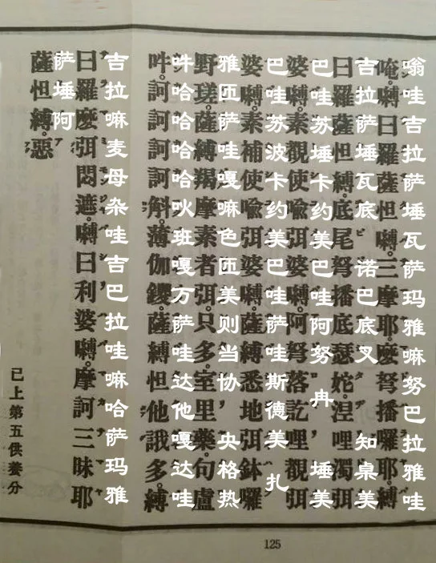
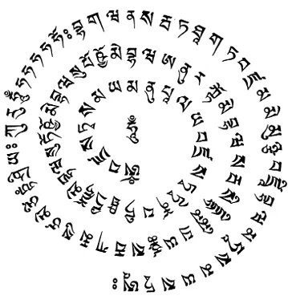

# 百字明到底讲了什么

索达吉堪布·传讲

2018年10月8日

今天我想给大家讲一下百字明。

百字明，顾名思义应该是一百个字，但不管是梵文还是汉文，其实都不止一百个字，我以前也数过。

百字明，又叫百字赞，唐朝好多佛经中都有，包括开元三大士——不空、金刚智、善无畏，他们翻译的佛经中也有百字明修法。我以前翻阅过唐密的很多续部，其中金刚萨埵心咒在唐密中讲得不多，百字明则讲得特别多，尤其在不空翻译的经典续部中，非常非常多。

百字明的念诵方法，藏密和唐密稍微有一些差别。我对照过不空翻译的百字明，比如，现在我们念的“班扎”，他翻译成“嚩日啰（发音：哇吉拉）”，其他的很多都基本上相同。

今天给大家讲讲百字明到底讲了什么。我是根据藏地喇拉曲智仁波切、玉科喇嘛对百字明的注释，以及藏地一些续部的注释来解说的，虽然他们的解释方法有所不同，但我总结性地给大家做一个介绍。

其实百字明究竟忏悔了什么，从解释出来的意思看不是特别明显，但实际上它是一种很甚深的忏悔方法，是以诸佛菩萨身语意的金刚三昧耶，与自己的身口意完全不超离、融入一体的方式来忏悔的。

当然，百字明有外续部的解释方法，有内续部的解释方法，还有大圆满不共的解释方法。今天在座的听众，有些可能连外续部的宝瓶灌顶也没有得过，所以我就以显宗和外续部相结合的、容易接受的、不会变成泄露秘密的方式，做个简单介绍。

嗡班扎萨埵萨玛雅、嘛努巴拉雅、班扎萨埵底诺巴底叉、知桌美巴哇、苏埵卡约美巴哇、苏波卡约美巴哇、阿努Ra埵美巴哇、萨哇斯德玛美扎雅叉、萨哇嘎嘛色匝美则当、协央格热吽、哈哈哈哈吙、班嘎万、萨哇达他嘎达、班扎嘛美母杂、班扎巴哇、嘛哈萨玛雅萨埵啊。

1．嗡班扎萨埵萨玛雅、嘛努巴拉雅

嗡：文首祈请诸佛菩萨的呼唤词，是开启下文的缘起。有呼唤、祈祷的意思，也有愿吉祥的意思。

班扎萨埵：班扎是金刚，萨埵是勇士，翻译过来就是金刚勇士。从本尊的角度讲，也可解释为金刚萨埵。从意义上讲，金刚指空性，万法本体皆空；萨埵指方便，也就是方便和空性无二无别。其实，悲空无二、显空无二的法界就叫金刚萨埵。

萨玛雅：意为誓言，有戒律和保密的意思。

嘛努：本来是阿努。阿是否定词，阿努是不要的意思，但念诵的时候，因为印度梵语的语法规则，发音变为嘛努，当然这要学了声明学以后才知道。梵语的变音规律，我在这里不讲，我也没有学过声明学，也不太好懂。我翻译《智者入门论》时，后面有一段内容涉及梵语和藏语的对照，当时我翻译也不是，不翻译也不是。如果不翻译，则篇幅不全，原文上有这一段；如果翻译了，谁也看不懂，因为涉及藏语、梵语很多语法规则。但最后我还是查阅了大量资料，给翻译出来了。所以，有时候也遇到过这类翻译上的困难。

巴拉雅：护持随后。

全句的意思就是：啊，金刚萨埵，请让我们永远不要离开三门誓言而随时护持我们。

当然，还可以解释为：祈求不要让我们离开金刚萨埵您曾发的誓言范畴——救度一切罪业深重的众生。您应该想起曾经发下的誓言，不要放弃我们这些众生，一定要护持我们。

大多数的解释方法是后者，即请金刚萨埵永远不要超离誓言，让我们得到护持。

每个众生都具有如来藏，本性永远没有离开过诸佛菩萨的身口意三密，只不过是我们没有认识而已。所以，从比较深的层面讲，众生反观自心时会发现，自己在金刚萨埵佛和其他诸佛的三门誓言中从来也没有离开过。如果离开了，祈请金刚萨埵加持，让我们再次回归。

2．班扎萨埵底诺巴底叉、知桌美巴哇

班扎萨埵：金刚萨埵。

底诺巴：您。

底叉：安住。

知桌：坚稳。

美：我。以下所有的“美”都是“我”的意思。

巴哇：请。

总结起来：啊，金刚萨埵，请您稳固地安住于我。

我们常说“底叉蓝”“底叉班扎”，底叉有融入自身的意思。迎请以后，祈请金刚萨埵永远不要离开而安住于我。

按照生圆次第来讲，这里观想自己是誓言尊者，金刚萨埵是智慧尊者，通过祈请，智慧尊者融入誓言尊者，生起次第中专门有这样的修法。当然，从更究竟的角度讲，誓言尊者和智慧尊者无二无别，我的自性光明跟金刚萨埵是一味一体的，没有自他之别。但如果你理解不了，可以解释为金刚萨埵是一尊佛，迎请他融入我的身口意，与我的身口意无二无别，以誓言尊者和智慧尊者融入一体的方法来修持。

3．1）苏埵卡约美巴哇

苏：圣妙。

埵卡约：享受、大乐。

美：我。

巴哇：请。

苏埵卡约美巴哇：请以大乐令我满足。

观修金刚萨埵时，金刚萨埵会降下甘露，令我获得俱生智慧，得到业障清净、满众生愿的悉地。

2）苏波卡约美巴哇

苏：圣妙。

波卡约：“无二智”或者“增长”之意。

美：我。

巴哇：请。

合起来是，请金刚萨埵赐予我无二智慧。

如果是修无上瑜伽，则通过四种灌顶，可令自己最后认识无二的自然本智。

4．1）阿努Ra埵美巴哇

阿努：随后。

Ra埵：贪欲、贪爱。

美巴哇：请赐予我。

阿努Ra埵美巴哇：随后请金刚萨埵贪爱我——慈悲我、摄受我。

所谓贪爱，就像《文殊真实名经》所讲，“离贪即大贪”，远离贪欲是大贪。实际上大悲心就是一种贪爱，但这种贪爱与世间的爱完全不同。

2）萨哇斯德玛美扎雅叉

萨哇：一切、全部。

斯德：悉地、成就。

美：我。

扎：极为、非常。

雅叉：赐予。

萨哇斯德玛美扎雅叉：请金刚萨埵赐予我一切悉地。

忏悔以后，我们要希求悉地。依靠观修金刚萨埵而清净罪障，获得一切共同与不共、世间与出世间的悉地。《胜乐金刚》中也讲，如果不具备清净的誓言，修行则无法成就。如果破了戒律、破了誓言，死的时候会堕入恶趣。虽然净土宗有带业往生的说法，但最好是罪业得以清净了，否则，罪业特别重的话，也是往生无望的。

5．1）萨哇嘎嘛色匝美

萨哇：一切。

嘎嘛：业。

色匝：虚词，没有什么意思。

美：我。

2）则当协央格热

则当：心。

协央：善良。

格热：这里的格热不是“上师”，而是“请赐予”。

合起来是，请赐我以善心来摄持一切业。

所有的业不要用恶心来摄持。希望在座的人也这样想，一切所作所为，哪怕没有无伪的善心而仅是一种改造，也要通过改造逐渐转变自心。心善则一切善，如果心恶，表面上修行也好，慈善也好，做什么都没有意义。

也许是前世的恶业吧，有些人的心经常产生恶念。前段时间我遇到一个佛教徒，他说很想杀人，“不管什么身份的人在面前，我精神不太正常的时候可能会杀人，你们要注意哦。看看我的眼睛红不红，如果眼睛红，不要坐在我附近，不然我都控制不住自己……”前世的业一旦现前，有时候确实无计可施。佛教有一种说法，如果众生的业非常深重，佛陀的妙手也无能为力。

所以，我们要注意自己的言行举止，否则心就没办法转变。

6．吽、哈哈哈哈吙

吽：是五方佛的种子字，也就是用五方佛的五种智慧来摄持。

哈哈哈哈：这四个字，分别代表四喜智慧——喜智慧、殊喜智慧、极喜智慧、俱生喜智慧。也就是说，通过以上祈祷，祈愿我相续中生起这四喜智慧。

修生起次第和圆满次第时，有时候会观想甘露降在身体的不同位置，如顶间、喉间、心间等，依次产生喜智慧、殊喜智慧、极喜智慧、俱生喜智慧。这四种智慧再细分的话，又分为十六种智慧。

当然，还有一种理解方式，就像《经庄严论》中所讲，四种智慧是妙观察智、大圆镜智……也可以这样解释。

吙：印持。印持什么呢？不管是现前的四喜智慧，还是佛种子所摄的一切，全是空性的对境、清净的有境，也就是说，能取和所取都得以清净，这用“吙”来印持。

我在网上看到一种百字明的解释，不知道是谁讲的，说“哈哈哈哈吙”是佛的五种智慧，但我查阅的相关资料中没有这么说，也不太清楚是对是错。

按照前辈大德的讲法，“哈哈哈哈”是四种智慧，“吙”是境与有境无二摄持的一种咒语。

总之，心很重要，心是一切的作者，最后我们得到清净时，获得了五方佛的智慧，以此来印持。

7．班嘎万、萨哇达他嘎达、班扎嘛美母杂、班扎巴哇

1）班嘎万、萨哇达他嘎达

班嘎万：出有坏。

萨哇：一切。

达他嘎达：“达他”是“善”，“嘎达”是“逝”，即善逝、如来。

合起来是一切出有坏善逝。

2）班扎嘛美母杂

班扎：金刚。

嘛：不。

美：我。

母杂：放弃。

合起来就是：祈请一切出有坏善逝，不要将我从金刚三昧中舍弃。意思是让我不要破誓言、让我不要离开如来的三昧耶。这里的金刚，指的不一定是金刚萨埵，而是如来的金刚三昧耶，也就是身口意的三大誓言。这是一句祈祷文，祈祷的对境是一切如来。祈祷他们加持，让我以后不要再犯错了，不要离开佛的金刚三昧耶。

3）班扎巴哇

班扎：金刚。

巴哇：赐予。

合起来是，请赐予我成为金刚者。

金刚者就是诸佛菩萨，诸佛菩萨在任何场合，心都是坚定的，根本不会退失誓言，绝对不会舍弃众生，舍弃正法。所以，请加持我的心也变成金刚心，不要变成玻璃心——遇到一点点坏事，又哭又闹又伤心；遇到一点点好事，开心得不得了，得到一个巧克力都连蹦带跳。我们藏地有种说法：“一根针丢了，心就碎裂了；得到一根线，心乐得爆炸了。”这样是不行的。

我们应该祈祷诸佛菩萨，让我不要离开金刚三昧耶，让我成为金刚者。

8．嘛哈萨玛雅萨埵啊

嘛哈：大。汉文佛经中常译为“摩诃”。

其实，咒语有不同发音也不要紧。比如观音心咒，用康巴语、拉萨语和安多语念起来都不同，“嗡美呢呗美吽”“嗡玛呢呗咪吽”“嗡玛呢叭咪吽”。如果你有信心，念哪一种都能得到同等的加持。

前面的“哈哈哈哈”，在唐密中发音是“呵呵呵呵”，我们可根据自己的口音，按哪一种来念都应该可以。

萨玛雅：誓言。

萨埵：金刚。

合起来是，请赐我安住于大誓言的无生智慧中。

萨埵，是勇士，这里指无生智慧。大誓言是诸佛菩萨的身口意，永远也不可摧毁的一种誓言。

啊：诸佛之语的种子字，即无生空性。

最后的“啊”字，指以上全部用空性来摄持。密法的有些念诵文中，经常有“啊、啊、啊……”包括修断法的很多仪轨里，最后也是用“啊”来摄持。

网上有人说，在“啊”字后面，还可以加“吽呸”，每个字代表不同的修法。但这种说法有没有依据也不太清楚。

以上简单解释了百字明的意思，希望大家一定要懂得它的功德。
