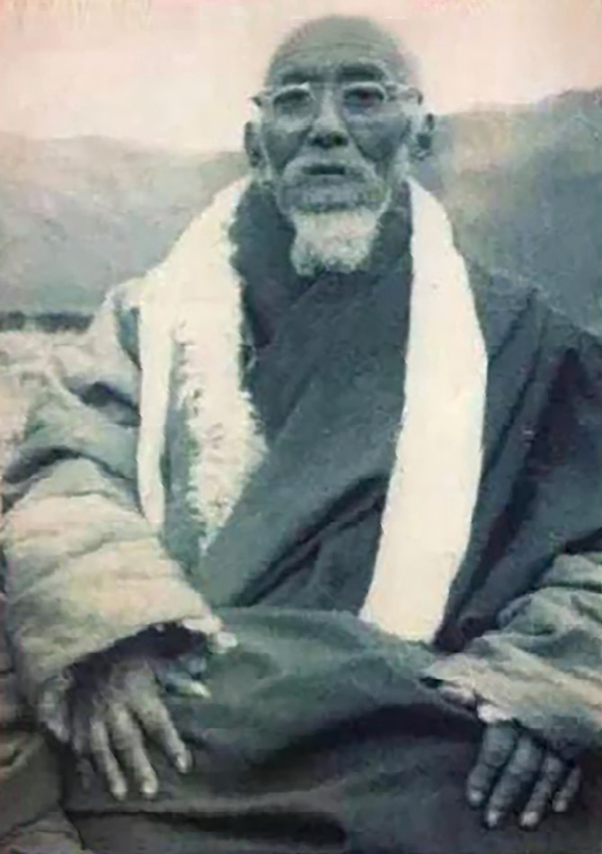
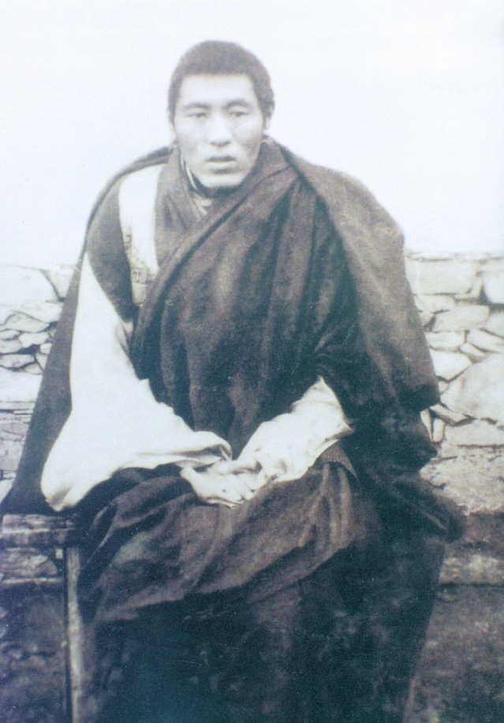
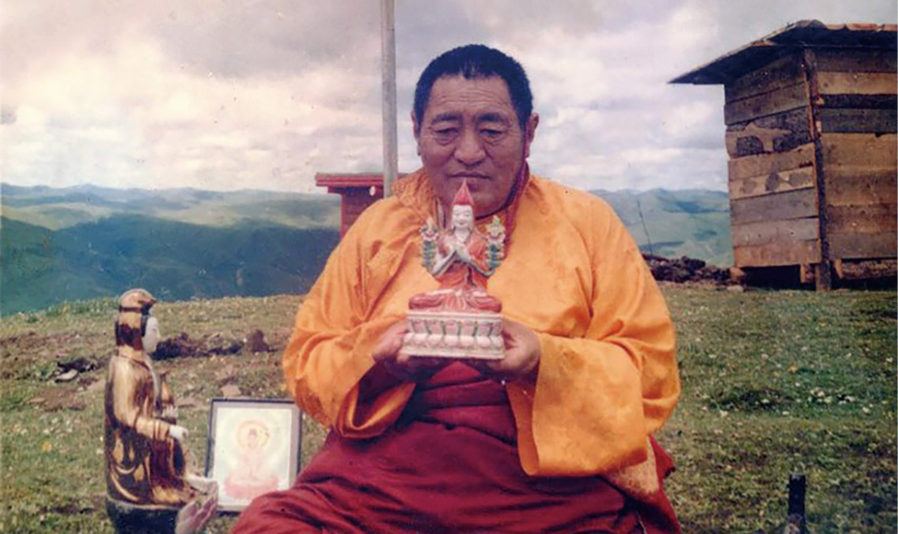

# 第10课

2022年8月20日

我们继续学习法王的《不凡》，最近主要是讲与麦彭仁波切相关的内容。

（堪布展示照片）

这里有一张托嘎如意宝的照片，这张照片在网络上流传得很广，但我不确定是不是托嘎如意宝本人。

还有一张法王年轻时的照片，这是以前我们写法王传记时得到的，后来向法王确认过，是他本人。

这张法王手持麦彭仁波切像的照片，是在南山的山顶上拍的。

### 第16节·语无内部相违首尾广略一致

上师麦彭仁波切的语言没有一句是自相矛盾的。如果你觉得有，那是你没有理解。

如果以智慧来观察，其实只要自己有信心，上师的语言不会有任何问题，但如果没有信心的话，可能经常会觉得上师的话语前后矛盾。但因为麦彭仁波切的智慧非常尖锐，他所造的论著中从来不会有前后自相矛盾的过失。

《殊胜赞》中云：“越于外道宗，反复深思维，越于怙主汝，吾更起信心。”与其他诸位智者的语言相比，显然他的语言比其他人更超胜。

此处引用了《殊胜赞》的教证。《殊胜赞》我以前翻译过，还翻译和传讲过另一篇佛陀的赞文《胜出天神赞》。这是一个很著名的教证，作者说：随着越来越深入思考外道各种宗派的教义，就对众生怙主本师释迦牟尼佛您更加有信心。我们在闻思的过程中，确实会有这样的感觉，对无垢光尊者、麦彭仁波切的教言和论典学习越多，就会对他们产生越大的信心。

当你领会到《楞严经》等佛陀经典的深义，再对比人类历史上的智者，不论东方的孔孟老庄，西方的苏格拉底、亚里士多德，还是后来的牛顿、爱因斯坦等等，他们的智慧与佛陀比较起来，在生死烦恼等终极问题的解释上，还是存在差距的，所以我们对佛陀的语言自然更起信心。同样，与其他诸位智者的语言相比，麦彭仁波切的语言显然更为超胜。

上师麦彭仁波切的语言，开头详略如何，结尾也是如此，没有虎头蛇尾之类的情况。他不卑不亢的圣者本性是显而易见的。

不论哪种身份的人看来，麦彭仁波切确实是一位不卑不亢的圣者，他的本性就是这样的。

我也知道，无论你修习萨迦派、格鲁派、噶举派、宁玛派的任何一种法，都可以获得遍知佛果，这些都是无误的正道。然而，在传讲前译大圆满法时，上师麦彭仁波切与众不同。

麦彭仁波切传讲的前译大圆满法是与众不同的，大家应该都有这样的共识。其实不论在汉传佛教还是藏传佛教中，任何一个派别，都有很好的成就之道。但就自宗而言，麦彭仁波切和无垢光尊者与我们有尤为殊胜的缘分，他们的教理和窍诀的确有与众不同之处。

比如，（他所造的）讲解宁玛派特法的《前译教法兴盛愿文》、讲解大圆满的《文殊大圆满愿文》，这些殊胜教言不仅在雪域，就算在印度圣地，可曾出现过？

这些都是大家常念的愿文。麦彭仁波切的《前译教法兴盛愿文》和《文殊大圆满愿文》，确实在整个世间都十分难得。这些法与大家非常有缘，我们要经常念诵。

虽然我心里有这个想法和分别念，但不知道你们是怎样想的。

法王是这样说的，我们也该想一想，对于这些天天学习、念诵的麦彭仁波切的教言，自己是否有同样的感觉？

### 第17节·句句有深义

上师麦彭仁波切的语言，如果你看一遍，会对其意义有所领悟。如果你看两遍，就会理解得更多。无论看多少遍，每次看都会有更进一层的理解。就像是佛的金刚语一样。

很多人学了麦彭仁波切的《大幻化网总说光明藏论》和《中观庄严论释》后都说：“我前几年也学过一次，但这次有不一样的感觉。”我自己也多次学过麦彭仁波切的论著，确实，无论看多少遍，每次都会有更新的体会、更进一层的理解，的确就如佛陀的金刚语一样。

当我把《直指心性》念了一万遍、把上师麦彭仁波切的祈祷文念了一百万遍的时候，心中才大体呈现出《心性直指》的句义。

法王在这里讲了一个自己的体验。念这么多遍其实要花很多时间，可见法王有多么虔诚。我们平时光是念个一遍两遍，是远远不够的。

最初念诵一两遍的时候，觉得没有什么不明白的，基本上已经懂了。但是，我总觉得持明传承的加持和上师麦彭仁波切的语言不可思议，一定还有比这更殊胜的含义。所以，我每念一百遍上师麦彭仁波切的祈祷文“觉空文殊童子加持力，密意界中解开八辩才，如海教证法藏之主尊，安兹达布匝雅前祈祷，于具缘分弟子身语意，恩赐加持予以胜灌顶”，就会再念一遍《直指心性》的教言。

这段麦彭仁波切的祈祷文我们平时也在经常念诵。“于具缘分弟子身语意，恩赐加持予以胜灌顶”，这两句是法王加在后面的。法王的念法是这样：每念一百遍祈祷文，就念一遍《直指心性》的教言。我们这里很多道友以前也一直在念《直指心性》，不知道现在怎么样。我以前也把《直指心性》放在“系解脱”里，每天都要念一遍，但要一直坚持下去的确不太容易，有时念着念着就懈怠了，有时因为琐事繁多而中断，总之我已经很久没念《直指心性》了。

当祈祷文被念了近一百万遍、《直指心性》被念了近一万遍时，“上师麦彭仁波切所说的真正意义就是这个”的定解才真正产生。

当时法王就这样大彻大悟了，所以我们也应该对《直指心性》好好重视。因为这是法王开悟的标志，法王还作了注疏，所以《直指心性》对我们确实非常重要。

以前我们小范围传讲过一次，我当时模仿法尊法师的风格，翻译得特别古，全是“之乎者也”。那时候我刚开始进行汉文翻译，觉得有点古意比较好，结果现在连我自己都看不懂了（众笑）。后来我又重新翻译了一版，以后有机会再给大家讲。

我们这里的人都对法王非常有信心。这次学习《不凡》，大家应该这样想：虽然我没有缘分亲自见到法王，但如果法王还在这里的话，也会对我说这些话。这里很多老弟子，包括我自己在内，都非常熟悉法王的语言。当初我在五六年间一直为法王做同步翻译，或是在法王讲完课的第二天进行翻译，所以，对于他老人家的话语，我记得很熟。

法王当时认为：“麦彭仁波切所说的真正意义就是这个。”因为他就在那时开悟了，所以真正生起了定解。

当时，我脱口而出的无伪词句是：“我漂险恶轮回深渊时，师尊舒展善巧方便手，置三传师会众行列中，无以回报恩德明在心。”依靠全知麦彭仁波切的加持，我终于进入了三传持明上师的行列，随后我萌生了“一定不需要再长久漂泊在轮回的险恶深渊里”的想法。

这个偈颂的意思是：当我漂泊于轮回深渊的时候，是上师麦彭仁波切您舒展善妙方便之手，把我放在如来密意传、补特伽罗耳传、持明表示传这三传承的上师行列当中，一想起这样的深恩厚德，便涌起无比感恩、无以回报的心情。

这段话我感触很深。法王圆寂后的一段时间里，我好像没有了心脏，每天活得毫无知觉，如同木头一样。别人有的大哭、有的伤心，可我似乎好长时间都反应不过来。后来有一天，我在家中翻阅法王的教言，读到这句话时，突然无比伤心，泪如雨下，大声哭了起来。就如法王对麦彭仁波切的心情一样，其实我们自己原本都是特别低劣的人，全靠依止了法王，他老人家把善妙的手放在我们头上，把我们安放在修行的行列当中。虽然不能代表三传承的上师，但我们毕竟已经进入了密宗弟子之列，不会再长久漂泊于轮回的险恶深渊，这份恩德真的非常厚重。所以，对于这段话，我有特别的感触。

### 第18节·教诲爱重自宗

你们永远不要低估全知麦彭仁波切的言教，我也从来没有轻视过。我反反复复地看了上师全知麦彭仁波切的言教，他的教诲有着不可思议的加持威德力。

对于这一点，我们大家应该牢记。

然而，他的法义只看一遍绝不会通达。我十三四岁的时候，曾以为《中观庄严论释》总义及其注释的意义，没有什么不明白的，其实并不是这样。

《中观庄严论释》前面有一篇总义，刚开始法王觉得那没什么难懂的，其实并非如此。我也希望大家对麦彭仁波切的法义不要轻忽对待。以前德巴堪布就非常重视麦彭仁波切的言教，他专门作过一篇祈祷文，祈祷麦彭上师、更桑上师、晋美上师三位上师的加持入于心间。麦彭仁波切的《中观庄严论释》和无垢光尊者的《如意宝藏论》，是德巴堪布一生之中最为重视，也最为精通的论典。

我们这里不论堪布、堪姆还是普通僧人，许多人都十分喜欢《中观庄严论释》，都觉得从中收获极大。我希望大家以后对《如意宝藏论》和《中观庄严论释》要着重弘扬，因为这些法对你们的确有一种近传加持。

因此，你们也应该深入细致地分析和探究，要着重于自宗的法本。前译持明传承的加持，有着殊胜的缘起，所以一定要得到全知麦彭仁波切的加持。你们平时闻思修行，应该尽可能地把注意力放在与他宗不共的自宗无误的法本上。

前文中法王如意宝讲过，遇到了莲花生大士的法，实在值得开心。得到全知麦彭仁波切的加持也同样。这里法王嘱咐我们：平时闻思修行要尽可能地把注意力放在自宗的法本上。这一点大家要切记。
