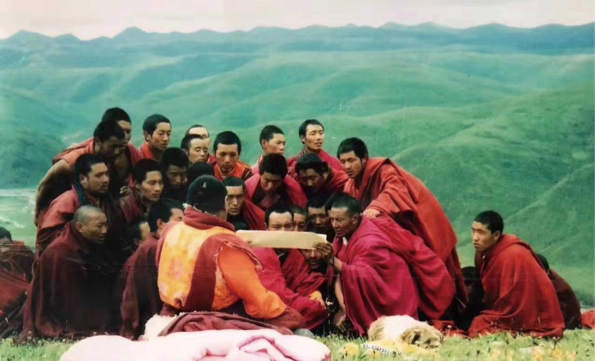

# 第12课

2022年8月24日

### 第21节·修行前要闻思

所谓“寂静深山”，确实是个殊胜的地方，比起承侍百千万佛陀，以居于寂静处的发心而向寂静处迈七步的功德更大。

如果你为了出家或修行，向着一个寂静的地方迈出七步，与在百千万佛陀面前供养相比较，前者的功德更大。

这样的话，是不是那些来喇荣旅游的人功德也很大呢？那要看他们有没有求解脱的心。如果他只是来参观、朝拜一下，看到佛寺和出家人，相续中会种下一个善根。所以这方面的功德根据不同发心，有很大区别。

《月灯三昧经》云：“若有乐求菩提者，能利众生厌世间，趣向空闲行七步，如是福报最为上。”很多经论中都有类似的教证，因为生起出离心或是立志修行，哪怕往寂静之处迈七步，也有很大的功德。

昨天、今天，我们都在讲闻思修行次第颠倒的现象。有人声称“不需要一丝一毫的闻思，只需要在林间静处闭关”，从而彻底放弃了闻思的一切事。如果认为这也是正道，那根本不符合智者的规则。

上节课我们讲过，年轻人修行，老年人闻思，这是一种颠倒。看来当时法王如意宝也是连续讲了这两段话。有些人认为自己不需要闻思，一来就开始修行，刚出家就想闭关，彻底放弃了闻思的一切事，那根本不符合佛陀和诸位菩萨的规则。

没有任何闻思就进入修行阶段，这没有什么可修的，就像旱獭一样，自然成就寂止的有情，停留在无所思维的状态中，没有太大的益处。因此，闻思不错乱尤为重要。

这样的人就像旱獭，也就是我们说的雪猪子，也叫土拨鼠。很多纪录片里都拍过土拨鼠，它夏天出来活动，冬天在洞里睡觉。最近这里很多土拨鼠就快冬眠了，再过一段时间它们就要消失了。布谷鸟也在准备离开。布谷鸟的叫声是夏天最后的声音，现在基本听不到了，天气一冷，它们就不爱说话。

大家要听法王的话，不要一来就马上闭关。“无闻只修行，如断臂攀岩”——萨迦班智达也这样说过，没有闻法的修行，就如断臂之人攀爬岩壁一样，根本修不成功。因此，闻思修行千万不要错乱。

作为一个真正想修行的人，首先在依止具相上师的时期，即使不能广泛闻思，也应该对专一平等安住的实修要点做到无有增益怀疑。

如果你做不到广闻博学，不能把五部大论、显宗密宗的法义全都学会，至少也要认真学习《入菩萨行论》《大圆满前行引导文》《大圆满心性休息大车疏》这些专业的实修要义，一定要做到没有任何怀疑和增益。有些人对广泛闻思实在没有兴趣，那至少也要把修行相关的论典学懂，否则在实修中会出现问题。我们看到，有些自己闭关的修行人，到了出关的时候，头发乱糟糟，眼睛红通通，走路都摇摇晃晃。有的人长期不与人接触，说话也变得非常奇怪，性情也变得特别敏感，很难与他沟通，有时稍微说了他一点，马上就大发雷霆。这样的人在闭关的时候到底修了些什么呢？土拨鼠也不会这样，它们是很温顺的。

当你达到即使没有上师、没有教言书，也不需要询问的境界时，住在寂静的深山里才会大有利益。

在有上师、有道友陪伴的时候，我们应该尽量通过闻思断除增益。这些天我看大家晚上还在互相探讨，这样真的挺好。在有智慧的同伴中，把自己的疑惑说出来，大家揉一揉、理一理，那些你原本觉得很大的疑问，被道友们一剖析，马上就烟消云散了。

人人都会有疑惑。依靠善知识，疑惑就会变成正决定；没有遇到善知识，疑惑就会变成邪决定。这个道理很重要。就像长了肿瘤，如果遇到良医，马上用药或者手术，就能治愈；但如果遇到了庸医，给你误诊瞎治，可能就会演变成恶性，这是很可怕的。所以大家如果真正想要修行，至少要学到对所修之法没有任何疑惑的时候，才可以到山里去闭关。

（堪布展示照片）

这张照片应该是在南山拍的。当时法王坐在那里，我们一群人在念护法仪轨。那时候我还有一点头发，现在已经时过境迁了。（众笑）

### 第22节·闻思精华需修行

闻思，就是为了修行。如云：“如以见闻水，不饮不解渴，正法亦如是。”如同你只看见和听见水而不喝水就不能解渴一样，闻思甚深正法并了知其意，但如果不修行，也不会有任何利益。

光闻思不修行也是不行的。现在大家都觉得闻思很重要，因为不闻思就通不过考试。可惜修行方面没办法考试，如果修行水平也能考一考试就好了。

《大宝积经·迦叶品》中云：“譬如一人溺海水，彼者干渴而死去，贪爱多法而放逸，虽住法海堕恶趣。”比如一个人被海水卷走，他以为在海里不会渴，但最后却因为干渴而死。同样，虽然我们听闻了正法，但如果不实修，也会像这个人一样。

这个教证法王以前经常引用，《华严经》里也有类似的偈颂：“如人水所漂，惧溺而渴死，于法不修行，多闻亦如是。”不过按现代科学来看，人要是漂在大海里，可不能随便喝海水，因为海水盐分很高，会导致身体里的细胞脱水，喝多了也会死的。

《诸法要颂经》也说：“设人多说理，放逸非如是，如牧数他畜，非得沙门缘。设人少说理，随法而行法，能断贪嗔痴，彼等是沙门。”

有些人嘴上很会说，讲得天花乱坠，但是自己却很放逸，没有实际修行，这就像有些牧人专门数他人的牦牛一样，这算不上是沙门。有些人看起来好像笨嘴拙舌，话也不多，但修行非常好。这个教证以前堪布曲恰经常引用，他最主要的窍诀就是这两句，让弟子们照此好好修行。不修行的话，光靠一张嘴，即使能说会道，又有什么用呢？我们也该好好学习这两个偈颂，借此观察一下自己。

比如有个放牛的人，整天在财主家里数着有多少头牛、有多少头牛犊，却连一碗牛奶的好处都没有得到。

放牦牛的人一般都会有得到一点牛奶的好处。以前搞合作社的时候，有个老乡总会趁放牛的机会偷一点牛奶。当时他把牛奶藏在一个牛犊皮的袋子里，后来被合作社的领导发现了，就让他提着装满牛奶的袋子站在合作社的帐篷外，对往来的人说：“你们看啊，偷牛奶的下场就像我一样。”那时候的惩罚方式是这样的。

同样，虽然我们具有无碍通晓显密教典中浩如烟海教义的辩才，但如果自己不去实修，就会断了沙门的缘分。相反，即使一个人不了知显密的诸多要点，只知道作为修行人如何成佛的完整无误、善巧方便的少许窍诀，从而进行实修，那么他也获得了沙门的缘分。

就如《忠言心之明点》所讲：“佛说浩瀚众法理，唯调自心之方便，复次劝请莫耽句，胜深要义融心底。”一个人如果获得了无误成就的道，并且实际修行的话，就已经得到了沙门的缘分。

说到沙门，居士也可以包括在其中。有些人说沙门只能指出家人，其实按广义来讲，佛的四众弟子都可称作沙门。因为沙门就是修善的意思，而佛的四众弟子都是修善的。

如果一个人光是嘴巴会讲，实际上修行特别差，这就不是沙门。我们应该观察一下自己，是不是光会嘴上空谈，却连一个人身难得、寿命无常都修不起来，更不用说出离心、菩提心了。如果天天只是飘在文字上，那很可能就会变成这样。

为此，大家必须真修实证。如果正法不与心相续结合，而以所谓的“寻思者”自高自大，很可能有一天对佛教也会产生“句义有矛盾”的恶劣怀疑。这叫邪慧，邪慧绝不是智慧，所以一定不能变成这样。

我们的闻思一定要到位、切要。这本《不凡》里还有很多法王的教言，后面还会讲些什么，我记不太清，但仅凭前面讲的这些教言，如果能够真正懂得，我们作为法王的传承弟子，也许就已经足够了。
