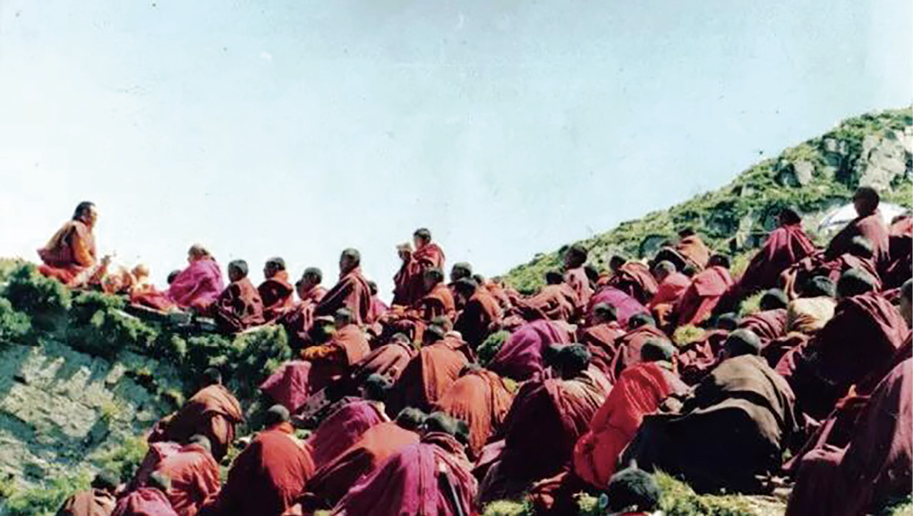

# 第13课

2022年8月25日

### 第23节·对教言需断除怀疑

世亲论师曾说：“守戒具足闻思慧，极为精勤而修行。”

这是《俱舍论》里的偈颂。作为修行人，一生中需要具备四点：基础是持戒，然后要有闻和思的智慧，继而精进修行。

不论是出家人还是在家人，至少要守住自己的根本戒。没有戒律的基础，一切都是空谈，根本起不到什么作用。光是自己不杀生或者不喝酒，这也算一种持戒，但层次比较低，所以一定要受持正式的戒律。出家人要守好出家的戒律，在家人要守好在家的戒律。

首先，我们需要有清净的戒律。打个比方，如果没有大地，那么所有的草木林苑都不会存在。同样，如果没有清净的戒律，你就不可能产生闻思修的任何功德。

就如《亲友书》云：“戒如动静之大地，一切功德之根本。”有了大地，万物才有生长的机会。同样的道理，有了戒律的基础，才可以谈得上闻思修行。有些人以破戒的缘故，闻思修行也不能救护，最后堕入地狱当中，感受无量的痛苦。

法王如意宝当初建立喇荣五明佛学院的时候，明确了三个宗旨：修道的基础是清净戒律，修道的核心是闻思修行，修道的结果是自他二利。所以我们学院一直把清净戒律、闻思修行、利益众生作为原则，这也是我们修行人初、中、后各阶段的主要目标。

然后，你需要真正去闻思。

有了持戒的基础，接下来就需要真正去闻思。如果戒律不清净，很难在一个清净的道场里待下去，心也不会放在闻思修行和利益众生上面，甚至连基本的道德规范都做不到。世间人也同样，一个人在社会上如果连基本的德行都没有，那他再有学问也没用，更谈不上给社会带来真正的帮助。

即使不能广闻博学，也必须闻思你所实修的大圆满、大手印、大中观等法，做到深究到底、无有怀疑。

作为修行人，最好能广闻博学，至少要把五部大论全部学完。但如果实在没有学习能力，也必须把你要修的法学懂。像我们宁玛巴行人，大圆满修得比较多；噶举派的话，大手印修得比较多；如果是格鲁派，主要是修大中观；等等。不论你修哪一种，一定要把自己一生当中所修之法彻底探究究竟，做到无有怀疑。

真正修行的时候，不需要带一些经书法本给一位老上师询问。当你住在静处的时候，不需要上师，也不需要反复阅读教言，只需要祈祷就能够修行。

到了实修的阶段，还带一大堆书去找上师请教，这是不行的，闻思的时候就应该断除怀疑。我以前发过一条微博，大概的意思是：父母在世的时候，世间的生活要能自理；上师在世的时候，出世间的修行要能自理。有的人之前没有闻思到位，真正要开始实修的时候，又抱着法本去请教上师该怎么修行，这是不对的。

如果你确实经过多年的认真闻思，断除了所有怀疑，那时候就可以独自去闭关了。不过我们现代人记性都不太好，到了闭关之处，可能什么都想不起来了，所以我建议，最后还是带一些修行方面的书籍，比如关于大圆满的法本，或是《前行引导文》，包括修上师瑜伽的引导。要是什么法本都不带，可能记不清修法方式。以前很多修行人都不用法本，我去过一些修行人家里，他们白天晚上都在打坐，除了一个转经轮之外什么也没有。真正修到一定程度时是这样的，一本书都不用看，该祈祷就祈祷，该安住就安住，该念咒就念咒。光会念咒的话，这只算是基础的修行，都不用到寂静之处，在家里也可以念；只有真正能安住，这才是修行。

先要做到戒律清净、闻思究竟，然后再去修行，法王在这里把这种次第的重要性讲得非常清楚。

### 第24节·活佛应闻思

年轻的活佛们，好好安住下来，真正地精进闻思修行。

当时学院里有一些年轻的活佛，现在好像不多了。藏传佛教的活佛确实是个争议较多的话题，真正弘扬佛法的活佛，可能只是凤毛麟角。以前有些老活佛真的很了不起。就像我们朵芒寺前几年圆寂的扬唐活佛，他在二十几岁的时候去一所寺院连续念了5个月零13天的《大藏经》传承。传承念完不久，就进入了民主改革的动荡时期。昨天那个寺院的一位老人给我讲了那段回忆，那时候扬唐活佛如此年轻，就能坚持念这么久的传承，确实不一般。我觉得，二十多岁的人有这样的耐心，还是很了不起的。现在有些二十几岁的年轻活佛能不能这样，也不好说。以前很多活佛确实很有功德，现在应该也有很多了不起的活佛，但是有的年纪尚轻，闻思还没有究竟，暂时还没有弘法利生的能力。

如果你们闻思修行，将会成为佛法之源，否则，如果到处跑来跑去，连戒律都很难保得住。

在闻思的过程中，没有必要时不要跑来跑去，不管你是活佛、堪布，还是普通的闻思者，人格稳重都是很重要的。我们学《二规教言论》时，先讲了稳重，然后才讲到智慧。从一个人身上可以看得出来是否稳重，不稳重的人，稍有一点小事，就今天往这里跑，明天往那里跑。有些人在喇荣沟里很多年都没有出去过，一直在好好地闻思修行；有些人随时嗅着有没有放假的气味，提前做好了外出的准备。这一方面是因为现在条件好了；但另一方面，我觉得现在上至某些上师，下至普通求学者，都不如前人稳重。以前的修行人十几二十年都不随便外出，而现在很多人虽然闻思修行也很努力，但有时候心态飘得厉害，我们也要看看该怎么办。

一开始，当你获得不同程度的功德时，就需要利他。达到《普贤行愿品》中所说“我于一切诸有中，所修福智恒无尽，定慧方便及解脱，获诸无尽功德藏”那样时，就不应该只想着自己快快乐乐，还要像文殊菩萨发愿“乃至有虚空，以及众生住，愿吾住世间，尽除众生苦”一样，乃至虚空存在之际一直利益有情。

等我们真正获得一定的功德时，就应该按照《普贤行愿品》和《入菩萨行论》里的发愿去行持利他。

（堪布展示照片）

这张照片是在五台山拍的，法王坐在上面，齐美仁真堪布应该是在念道歌。记得当时我好像坐在后面。

### 第25节·实修三主要道

三主要道是什么呢？

是意识到整个轮回都是痛苦的自性而想从中解脱的无伪出离心；想把一切有情都安置于佛果的菩提心；不住任何边的无二慧。

如来所说的八万四千法门的精要归纳起来，都包括在这里面。它也是一个修行人真实圆满成佛的完整无误之道。相当于宗喀巴大师所有言教的究竟精华，唯一是这三主要道。我的《胜利道歌》从以出离心、菩提心、无二慧为核心的角度看，与此也是相同的。

《三主要道论》讲了出离心、菩提心、无二慧这三个主要的道。法王在《胜利道歌》中以大圆满来讲无二慧，后面还补充了人格贤善和往生极乐世界，总共有五个方面的内容。

讲这个法，有非常殊胜的必要性。原因我之前跟你们说过，在我的境界中，曾经显现宗喀巴大师给我传授菩提道的三主要道，他无欺地承诺道：“如果你和你的弟子将来能为别人传讲，并守持八关斋戒，当你们要转生时，死去会立即往生到兜率天的欢喜持法宫。当我（宗喀巴大师）成为狮吼如来时，你们会降生于此赡部洲，受用大乘法。”

上世纪90年代的时候，有一次法王如意宝的清净境界和光明梦结合，现见了宗喀巴大师对他进行授记。

以前我们佛学院的所有弟子都背诵了《三主要道论》，我也广讲过这个法，直接间接鼓励大家守八关斋戒近一亿次。

法王在1986年走访了康区的很多寺院。道孚有一座嘎达寺，是格鲁派的寺院，第七世达赖喇嘛就降生在那里。当时法王带了二十五位堪布随行，让大家在嘎达寺僧众面前背诵《三主要道论》作为法供养。我们本来都是能背的，但是担心到时背不流利，所以头天晚上一直复习，结果第二天背得还不错。以前法王说过，《佛子行》《三主要道论》《修心八颂》这几部论是必须背诵的，这是对学院每一个人的要求。

特别是，作为宁玛派的代表，我去了班禅大师仁波切的（中国藏语系高级）佛学院，虽然当时讲的是《定解宝灯论》，但在此之前，因为很多重要的事情，我和班禅大师有一次特别的会面。当时我对他说：“每次传法的开头，我通常会讲《三主要道论》。这一次，我也想在传讲引导法之初讲一下……”我还向他汇报了宣讲这个法的特殊缘起和曾经的梦境等。

中国藏语系高级佛学院在北京，1988年，法王受第十世班禅大师额尔德尼确吉坚赞之邀，去那里讲课。班禅大师在1986年就来过我们佛学院下面的洛若乡。当时这边还没有公路，班禅大师就跟色达县政府说：“这里要修条公路，以后有机会我还要来。”当时班禅大师如此约定过，然而他在1989年突然圆寂，没有再来这里。

当时他说：“非常吉祥！如果你能背诵《三主要道论》，请给我一个传承。”于是我也给他供养了传承。

法王和班禅大师二人有过好几次会晤。第一次是1986年在色达；第二次是1987年法王去五台山之前，在北京见过班禅大师；第三次就是法王到藏语系高级佛学院讲《定解宝灯论》的时候。法王在北京讲法期间，也给班禅大师念过《三主要道论》传承。后来两位尊者还约定一起去了扎什伦布寺。当时法王先行离开。不久之后，班禅大师就在那里示现圆寂了。

这个《三主要道论》，不仅是宗喀巴大师在梦里传过，我也多次在许多上师面前接受过引导法和传承。

我们大家应该重视《三主要道论》，一是因为从近传和远传的方面来看，我们所得的传承都非常特殊，二是因为此法本身确实特别重要。

宗喀巴大师的大弟子叫查果阿旺扎巴，他当初离开宗喀巴大师的时候，大师给了他一串念珠，共有108颗，于是阿旺扎巴就发愿在藏地修建108座寺院，后来全部实现了。他建的很多寺院都在阿坝州的马尔康附近。这样一位大德，凭一己之力修了108座寺院，真是了不起！

我一生的实修法非此莫属，你们也没有比这更殊胜的实修法了。因此，大家应该坚持不懈地认真实修此法。

以此缘起，我今晚就给大家念一个《三主要道论》的传承。

（堪布念传承）
