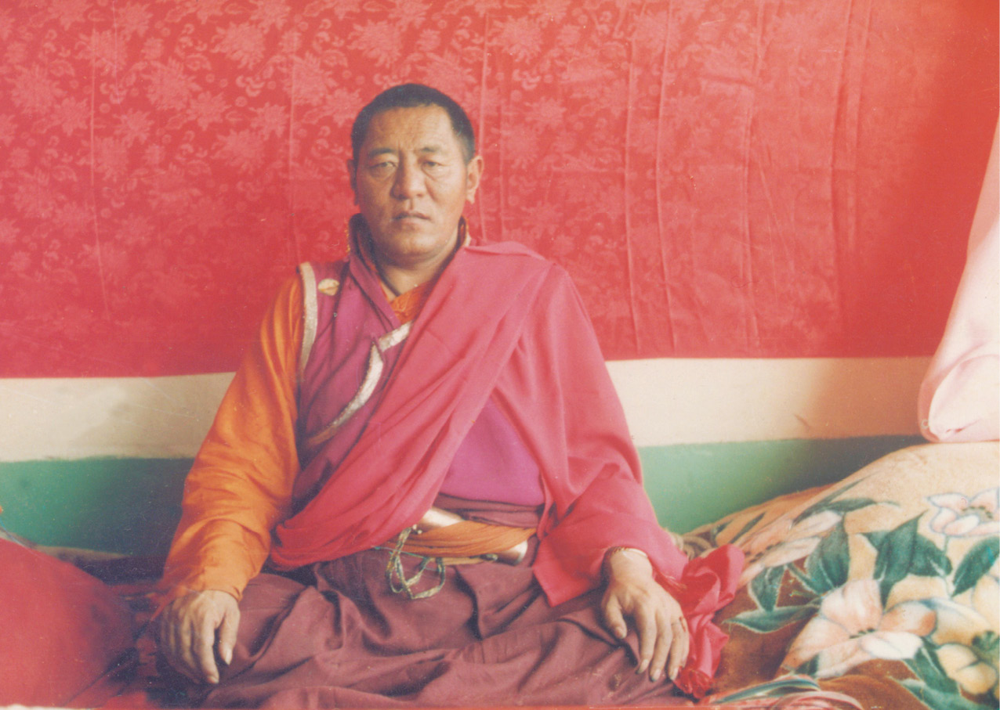

# 第14课

2022年8月26日

## 第5章 修大圆满

### 第26节·实修大圆满

我们要对上上下下的胜劣众生有一颗善良的心，

法王如意宝在此说的是“上上下下的胜劣众生”，这点我们一定要记住。法王的每一句话其实都很有深度，也很有窍诀性。我在前面也说过，虽然有些道友没能真正见过法王，但是能够遇到法王的教言，你们也可以说，自己是法王的弟子，得到过法王的窍诀。只要有信心，这些窍诀对我们都会有很大帮助。

我们对待上上下下的一切胜劣众生，都要有一颗善良的心。对上如此，对下也要如此，即使是非常下劣的众生，也要善良以待，这点一定要切记。我们有时候对一部分对象能报以善良的心，但对另一部分对象，尤其是发生矛盾的时候，保持善良并不那么容易。世间人，包括我们这里一些管理人员，时常会遇到这种处境，有时候起了一些恶心、害心，虽然自己也知道不应该，但是因为烦恼的驱使，实在无法控制情绪。有时候非但生起恶心，还忍不住做出了一些恶劣的行为，这可能就是我们身上最可怕也最可怜的地方。

除此之外，还应该看看相续中是否生起了大圆满的修行境界。若想让大圆满的实修境界在相续中生起，必须长时间实修上师的口诀。

我们要对上师的窍诀格外重视，一字一句都要如黄金般珍惜。只要自己有信心，从上师传的一个教证、一个窍诀之中，都会有所领悟。但如果自己没有信心，再听多少年法可能也仅此而已。

举个例子，就我而言，我依靠的是每念一百遍麦彭仁波切祈祷文的间隔，随句思义地念一遍《直指心性》，然后我再入定稍微观一下，看看能不能明白一点点。就这样，当我把《直指心性》念了将近一万遍时，上师祈祷文也念了将近一百万遍。也就是说，这两个念诵轮番念，怀着特别大的信心，每念一百遍祈祷文，就念一遍《直指心性》。当我在它的意义中入定时，觉得“心的法性真的就是这样啊”。

我所理解的一切，靠的就是这个不起眼的方法。这样的理解，也需要这么大的苦行和毅力。

这个例子，前面法王讲麦彭仁波切的功德时已经说过了，这可能是在不同场合中说的，也可能是不同的人整理的。

法王当年相当精进，他是先念一百遍祈祷文，然后念一遍《直指心性》，再稍微入定一下，以这种方式开悟的。通过这样不断努力、轮番念修，最后法王知道了心的本来面目，“原来我的心就是这个样子！”

（堪布展示照片）

法王这张照片应该是在五台山照的。早期的时候，法王和学院大多数出家人都穿这种衣服。法王腰上别着的是个金刚橛，我在《梦尘回忆录》里也叙述过一些。

20岁时，我觉得一个凡夫俗子不可能有比这更超胜的尖锐智慧了。即便如此，当我第一次看《直指心性》时，觉得没有什么不明白的，全部都领会了，但看了第二遍、第三遍，才发现里面有比以前更深的含义。

当法王20岁的时候，觉得在凡夫俗子当中，自己的智慧应该是非常厉害的。但是当他把《直指心性》看了两三遍以后，才发现其中有更甚深的含义。

其实我们学中观、学密法也是如此，好多人都说，自己第一次看《法界宝藏论》时，好像也可以理解，但学到第二遍、第三遍、第四遍的时候，才基本上明白，原来自己的心是这样的。

对于修行人而言，勤奋和信心都是非常重要的。所谓的开悟，其实也与自己的信心和精进有很大关系。《杰珍大圆满》和很多大圆满窍诀中都强调了信心和精进。如果没有信心，你再怎么精进可能也没多大意义；如果没有精进，光有一颗非常清净的心，也不一定有用。所以，我们不论做任何事情，信心和精进都很重要。

就这样，日复一日，我才真正明白，文殊菩萨特意化现为善知识形象的上师，他的言语与普通凡夫人截然不同。

所以，依靠麦彭仁波切的金刚语，法王获得了开悟。以后我们有机会也可以学一学《直指心性》。

### 第27节·浊世大圆满加持更速疾

如今是烦恼粗重的时代，这个大圆满法就显得更为甚深了。

在末法时代，大圆满法是尤其殊胜的。我们很多人都对大圆满法有信心，经常也会看一看、修一修。现在学院大多数人已经得到了“系解脱”，大家不要忘记随身佩戴。我们不知道自己什么时候会死，所以白天晚上都应该戴着，否则，无常突然降临的话，没戴“系解脱”是很可惜的。还有很多人一直在念诵“系解脱”，我也正在把其中意义翻译成汉文，至于藏语的发音，以前标注得应该比较准确，以后也不准备改动。如果你们要念诵，就先按藏音来念。最好坚持每天念一遍，原来我们发愿的时候也是这样的。如果每天一遍实在不行的话，两天一遍也可以，这个由你们自己发愿。

我有时候太忙，来不及念，今天早上我5点起床，就开始应对各种琐事，很长时间以来都是这样。有时候念诵中断了，又找时间补上。平时总是有课要上，有会要开，白天常常处于迷乱和忙碌当中，所以只有夜里晚一点睡，早上早一点起，除此之外也没有其他办法。

我想，大家遇到了这么珍贵的大圆满法，如果光是口头上说：“哇，大圆满真是非常好啊！”这样的赞叹也没什么用。我们每个人的生命都是有限的，能遇到这个法，而且获得了完整的灌顶和传承，这是法王离世以后极为难逢难遇的事。所以每个人最好都念一念“系解脱”，以前法王也开许大家按发音来念，念得快的话，其实用不了多长时间。很多道友在念诵方面还是很精进的，每天空出一点时间念一遍，那是非常好的。

一直以来都有人请我翻译“系解脱”，我有时候是不敢翻译，有时候是有点舍不得翻译，所以就这样拖到了现在。从去年起，我想，如果再不翻译，将来你们想要找到一个精确的译本，可能有些困难。所以这次我把嘎绕多吉的注释和德巴堪布的注释结合起来，准备翻译出一个非常完整的注释。现在我每天都会空出一点时间努力翻译，希望你们也能精进。

如果你想：“自宗的论典里是怎么讲的呢？”《句义宝藏论》中说：“上等精进者用三年、中等精进者用五年、下等精进者用七年十一个月零六天，就会现见法性尽相，而解脱为虹光身。”

后来，七大宗派的教主蒋扬钦哲旺波[^1]也说：“励力精进者，上等历经六个月、中等历经三年、下等历经十二年，有漏身体化为光。”可见，大圆满的加持力是如此之大，法也是如此之深。

我们这里有些人已经修了二十年了，还没有化为光，身体还越来越胖，所以可能还要继续努力哦。（众笑）

真正来说，一位能传讲大圆满真实道要的修行人，就是三传持明上师的加持合而为一融入了他的口和心，他就是真正的金刚持佛。

一位真正的好上师传大圆满时，传承上师们的加持会入于他的身语意。在这个末法时代，像法王如意宝那样弘传大圆满的人，可以称之为金刚持佛。

所谓上师，就是需要通过听受他的言传而产生决定道义的定解，而不是只讲以前一本书的内容而照本宣科。

真正的上师，不是光在口头上照本宣科讲一讲就行。他必须通过自己的教言和传法，让弟子的相续中真正生起道的意义。讲现观，就要让你通达现观的意义；讲因明，就要让你明白因明的道理；讲密法，就要让你的相续中生起密法的道义。这样才是真正的上师。

有些人拿着一本《俱舍论》或者《大圆满前行引导文》，只会按字面上讲，就像我一样。我以前就是拿着书给大家照字面念，有时候连念都念不标准。这不能算真正的上师，只能算一般的老师，或者辅导员。

现在的弟子，分别念五花八门，如果能讲一个与之相应的法，那么就具足了上师的法相。全知麦彭仁波切曾说：“浊世衰败如黑暗，莲师事业如皓月。”所说的密意也在于此。

五浊恶世的衰败确实如黑暗笼罩一样可怕，但莲师的加持和事业，就像照亮黑暗的月光一样清晰皎洁。我们依靠莲师加持的月光，即便在五浊的黑暗当中，也会到达自己的目的地。所以，身处浊世之时，祈祷莲师和修大圆满是非常重要的。

[^1]: 麦彭仁波切的上师。
