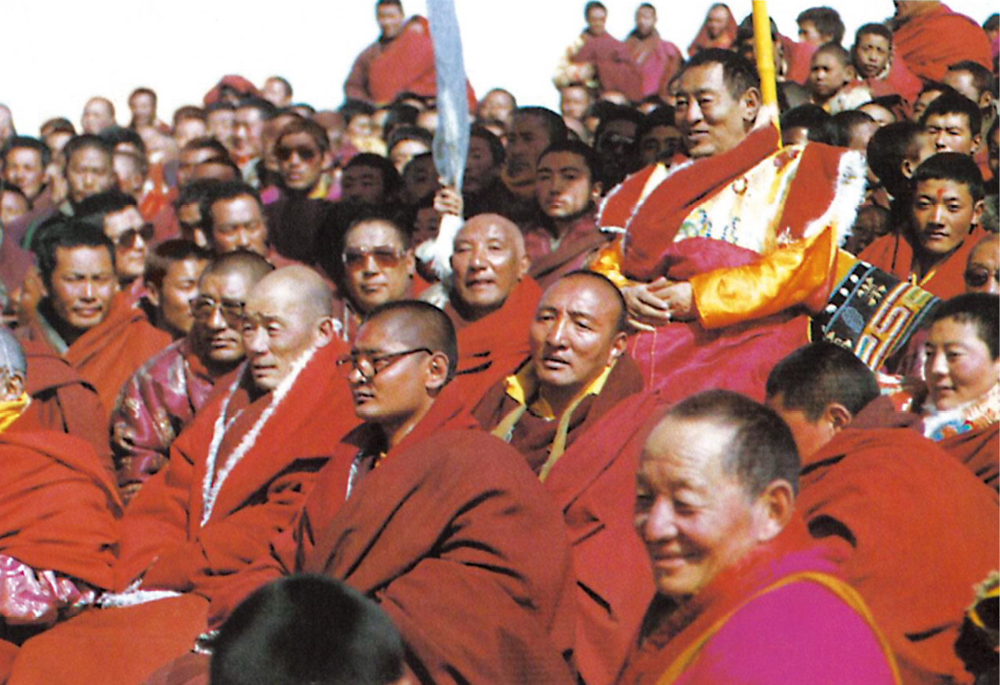

# 第24课

2022年9月24日

### 第43节·缘僧众要谨慎

我们师徒平日一定要小心，因为带来大利大害的业，就是以僧众为对境所做的事。

僧众是严厉的对境，缘僧众做一点点好事就会得到很大的利益，但做坏事也会造下很大的恶业。

在这样一个具足戒律的大僧团里，能讲法闻法、聚众共修等是一种很好的缘分。

在座的道友，大家不要认为在这里跟在城市里一样，反正人哪里都有，不要这么想。跟僧众共住是一种非常难得的缘分，确实应该珍惜。有些人觉得这里僧众太多了，“哎哟！这么多人，好烦啊！”——这是一种业障。等到末法时代的最后，连一片僧衣都看不到。如今大家值遇佛法兴盛的时代，而且能与这么多的僧众共住，其实是一件很幸福的事。

就算你不能成就其他法，光是随句忆义而多多少少了知《普贤行愿品》的功德，和僧众一起大声念一遍，功德也是不可思议的。

我们能跟这么多的僧众一同共住，每天随文解义念一遍《普贤行愿品》，哪怕其他什么法都不会修，也有不可思议的功德。前文中仲敦巴尊者也说过，四个出家人当中，肯定有一位菩萨。我们这里有多少菩萨数都数不完，今天我们这堂课上，至少就有好几百个菩萨，我看这里有一个，那里也有一个。你们四个人中谁是菩萨呢？也许脾气不太好的那个就是。（众笑）

如果一个人不具备修生起次第、圆满次第的要点，即使在寂静处闭关修行了一辈子，也不可能成办这么大的善行。

如果没有生圆次第的窍诀，哪怕在山洞里闭关一辈子，都不一定有和僧众们共念一遍《普贤行愿品》的功德大。所以我们每周能一起念六遍《普贤行愿品》，今年上半年也算很成功了，我自己很开心，大家也应该随喜。我们每天都能与这么多僧众一起发愿回向，这真的非常难得，将来不一定还有这么好的机会。

因此，依靠僧众有很大的利益。但是，如果你坐在僧众的群体中，对金刚道友品头论足、说三道四，那就是在积累无数劫中堕入恶趣受苦的因。

与僧众共住确实这样的，既能获得很大的利益，也是非常严厉的对境。如果我们在僧众当中，看不到别人的一点功德，整天评论道友的缺点，看这个也不行，那个也不行，对僧众说三道四、评头论足，那就是缘僧众造了极大的罪业。

有的人可能由于前世业力，说善事对他而言非常困难，而说恶事却特别有口才。所以大家一定要注意，不要随便说他人的过失，你的恶评对僧众不一定有损害，但会真正害了你自己。好比有人说我的过失，对我没什么影响，但是他自己造下恶业，最后只能自作自受。这方面大家一定要注意。

（堪布展示照片）

这里有张照片，多昂活佛等好多熟人都在里面，现在大家都老了。我遇上拍照片的时候，经常不好意思，总是躲得远远的，但现在回想起来当时应该到前面去。慈诚罗珠堪布也是这样，我们一般不大喜欢拍照，但现在看来，多留几张照片还是很有必要的。

尤其是，你不仅自己不闻思，还整天跑来跑去，在别人面前说一些引发贪嗔的话，妨碍别人看书和闻法等，而且在大家共修的聚会场合打开绮语伏藏门，打断别人的念经，那你就是以恶心出如来教法证法的法身的血。这在上师们的言教中也讲过。以恶心出如来色身的血，尚且是一大无间罪业，如果让法身出血，则比这罪过还大。

我以前讲过，你自己如果不想闻思的话，就算天天睡懒觉也没人管你，但如果你经常因为贪嗔痴而找别人说绮语，耽误他人的时间，这其实是一种最大的过失。不想闻思修行的话，最好自己离开学院，不要影响别人精进。特别是在大家念经、闻思修的时候，你说些乱七八糟的绮语打扰别人，这是出佛的法身血，比出佛的色身血还要严重，果报是非常可怕的。这有很多上师的教言为依据，托嘎如意宝以前也这么说过。所以，你们以后千万不要在别人闻思修行的时候打扰他们。人家正在好好念经，你凑上去：“哎哎哎，你知道最近俄罗斯和乌克兰的新闻吗？”这些跟念经有啥关系？

### 第44节·不要给人取外号

不管我们是谁，请不要给别人起外号。如果你叫别人的外号而不是真名，那么异熟果报是非常严重的。比如很久以前，有一个人叫别人“母狗”，结果他五百世中投生为母狗。为了忏悔这份罪业，他想尽一切办法还净，全心全意地承事僧众，终其一生行持善法，但也无法消除这一罪业。最后，他还是感受了叫别人母狗的不善业的异熟果报。

作为上师、僧尼、居士等，我们对此必须慎之又慎，请不要叫别人“大头”“瞎子”“大鼻子”“大嘴巴”等外号。

这个公案在《百业经》里讲得很清楚。这方面我们学院还好，我经常问大家，有没有给别人起外号。有些人说，读小学时会互相叫外号，但是现在不会了。可有些地方一直有这种习惯，“喂，那个大鼻子过来！”“矮个子过来！”全用外号称呼人，这其实是很不好的。自从当初法王讲了《百业经》以后，我们学院基本上就没有这种现象了，以后也不要有，不要叫别人什么“黑脸”“红脸”“大个子”“大鼻子”等等，特别是对残疾人，千万不能以别人的身体缺陷起外号。

《百业经》从头到尾，整本书主要讲的是口所造的业。想想《百业经》的全部内容，再仔细想想后世的异熟果报，我好心提醒你们：请记住这一点，不要互相冷嘲热讽，谢谢你们了！

法王以请求的口气提醒大家，以后再也不要这样了。确实，经法王这么一说，我们这里就再也没有这种现象了。大家以后也应该在语言上多加注意。
