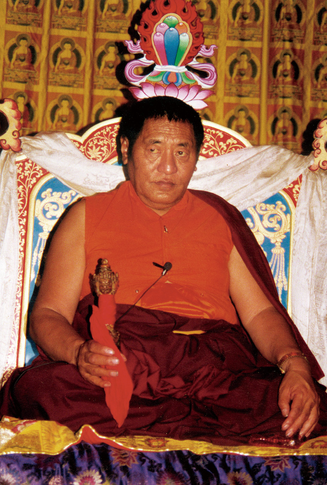

# 第25课

2022年9月26日

### 第45节·邪见断善根

邪见有很多分类，比如对果起邪见、对因起邪见、对人起邪见等。其中，对业因果的邪见是指，比如你认为造善因而无有乐果、造不善因而无有苦果。

有的人对果有邪见，认为不存在善有善报、恶有恶报；有的人对因有邪见，认为因不会引起什么后果，比如造下恶业也不会有苦果；有的人对人有邪见，比如对某位上师、某位高僧大德生邪见，或是对身边的金刚道友生邪见。

当然，只是觉得“造不善因真的会有苦果吗”的合理怀疑，或者觉得“实际上不会有苦果吧”的非理怀疑，并不能斩断善根。但如果生起“一定没有”的想法，则会断绝善根。

《俱舍论》中也说“唯以邪见断善根”——强烈的、决定性的邪见，会断送我们的善根，非常危险。所以一旦产生邪见，就要尽量忏悔，不要任其延续下去。邪见是很可怕的，很多人受从小到大的成长环境和观念影响，很容易产生邪见。相较而言，藏族人在这方面受到的影响会小一些，因为我们自小成长于一个有信仰的环境中，身边的父母亲人全都是相信因果的，所以我们在思想观念上与其他地方的人有一定的差别。因此，大家要注意，如果对上师、对道友、对佛法产生了邪见，马上要忏悔，否则你相续中的善根和戒律都会被毁坏的。

（堪布展示照片）

这张照片是法王在美国传金刚橛灌顶的时候照的。

### 第46节·还俗者莫对三宝生嗔

如今，一些僧人还俗变成在家人后，似乎并不认为是自己迷失了，完全舍弃了世出世法，相反，他们认为是上师三宝抛弃了自己。从此，他们对三宝怀恨在心，甚至用刀捅大慈大悲的佛像、在经论上面跨过去，也一点都不在乎，有这样的嗔恨心。

有些出家人还了俗，不仅没有惭愧心，反倒得意扬扬。前几天我就遇到一个这样的人，本来他以前对学院还是有过一些贡献的，但后来还俗了，还总是跑回来摆出一副很了不起的样子。我对他说：“你还来这里干什么？以后不要再来了。”

有些出家人因为业力现前，不得已而还俗，他们虽然舍了戒，但还是继续行持善法，根本不会参与诸如杀生、破坏三宝所依之类的恶行。但有的人还俗之后，就像法王讲的一样，认为是上师三宝抛弃了自己，对三宝怀恨在心，或者把当初出家视为一段失败的经历。这种情况可能汉地也有极少数。有的人去寺庙剃度出家，然后又选择还俗，还俗之后还要到处宣扬，说自己当时是受人蛊惑才出的家。其实说出这样的话，就是最为愚痴的一种表现。你当初既已选择了这条路，后来又反悔而去找另一条路，在有识之士看来，这说明你是一个人云亦云、极不稳重的人，不管话说得多么冠冕堂皇，都能被人一眼看透。

事实上，正是他自己被贪嗔痴所牵，毁了生生世世的永久大计，断了缘分。伤害他的不是三宝。

这样的人，应该对三宝更有信心，对自己更感惭愧。

### 第47节·受想之害

从无始三有轮回以来，我们就一直被受蕴、想蕴所毁坏。

世亲论师亲口说过：“成为争论之根源，轮回之因次第因，是故一切心所中，受想单独立为蕴。”五十一种心所不会那么有害，所有在家人都只是因为乐受、苦受（受蕴）而争吵，漂泊轮回；我们所有出家人，都只是因为想蕴，说“你的宗派、我的宗派”“这个不合理，那个不合理”而辩来辩去。

《俱舍论》中说，我们的心所本来有五十一个，其中受和想单独列在五蕴当中。为什么这两个可以立为蕴，其他心所没有这个资格呢？世亲论师讲了，因为其他心所不会那么有害。由于受蕴，人和人之间，国家与国家之间，为了快乐和痛苦而纷争不断。由于想蕴，许多出家人依靠分别念的种种思想，整天因为你的宗派、我的宗派，你的观点、我的观点而争执不休。包括辩论的时候也在动用分别念，“不是这样的”“这不合理”。所以，许多在家人和出家人，各因受蕴和想蕴而漂泊轮回。但现在有时也反过来，在家人因想蕴而辩，出家人因苦乐而争，也有这样颠倒的现象。

《胜乐续王略续》中说：“宣说甚深法，设若无信解，切莫作诋毁，法性不可思。”如果别人能宣讲甚深的法理，即使你没有信解，也要认为是对的，最好不要生邪见。因此，我们对其他教派和其他持教大德万万不可诽谤，生起邪见。

对甚深的佛法，即使实在生不起信心，也不要去诋毁。应该这样想：法性不可思议，我虽然现在没办法接受，但以后会接受的。

这个教证和我以前的翻译稍稍有点不同，我在《365个钻石》当中也引用过：“众生意乐不思议，佛陀游舞不思议，虽与自宗不相同，不可诋毁而舍弃，发愿一朝能通达。”
