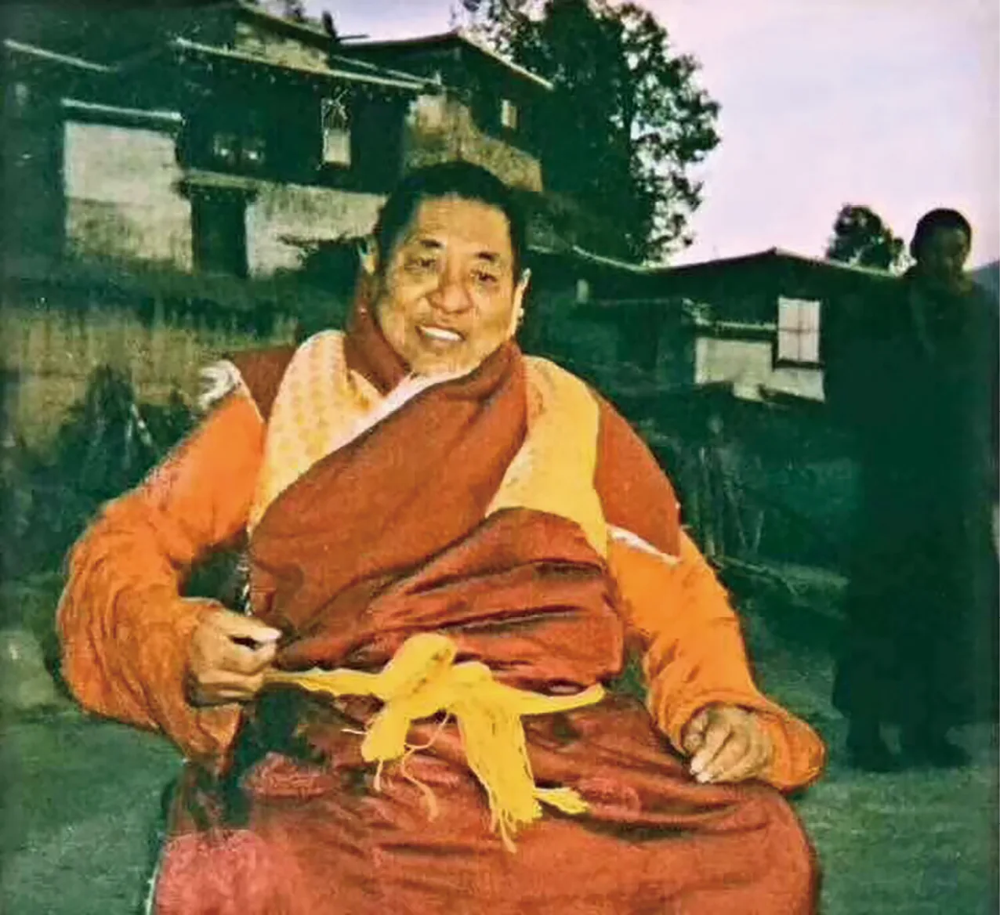
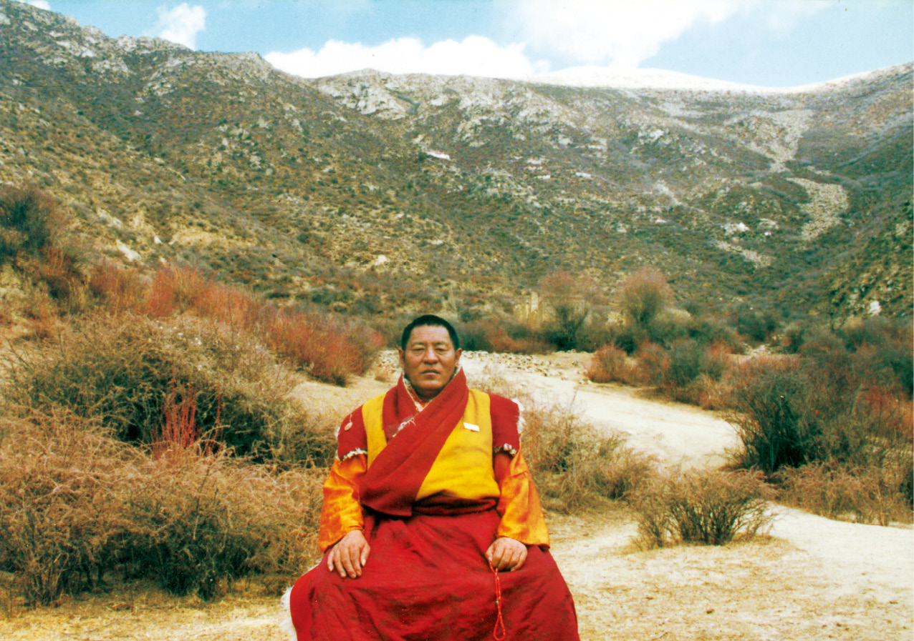

# 第26课

2022年9月27日

## 第8章 高尚净行

### 第48节·善良的人格

让我们来理解一下什么叫“好人”。

所谓“好人”，定义非常多。有些人觉得脾气好的是好人，有些人觉得修行好的是好人，有些人觉得记性好的是好人，有些人觉得长得好看的是好人……但其实在我们佛教中，真正的好人，应该不害众生，对谁都存有善心。当然，这是大乘佛法中好人的认定方式。如果你在军队里面，不分敌我，对谁都保持善良的心，那你就是这个军队里的坏人。（众笑）

对于所谓的好人，似乎大多数人都不懂。有人说英雄是好人，有人说智者是好人，有人说商人是好人……但其实这些都不叫好人。

还有不少人认为一个人生意做得大，事业有成，就是一个很好的人。所以现在人们喜欢追崇商界的成功人士。但法王在这里说得非常肯定，其实这些都不叫好人。

没有谄诳奸诈、对一切众生都有善心，这样的人才是好人。

这是大乘思想的标准，一个真正的好人，应该对谁都有一颗善良的心。今天我们也要按法王讲的这个标准，来看看自己到底是好人还是坏人。

总之，我们要知道，不管是上上下下什么人，谁有一颗善良的心，谁就是一个好人。如果唯一行持利他，这种人既能集福，也能集财。

在一切法中，最究竟的法就是它。

不管对谁，我们都应该想：“如果能让他获得快乐就好了。”如果只对自己的亲朋好友才有这样的心，而对自己嫉妒、嗔恨、竞争的对境，就用尽一切手段让他不快乐，怀着这样的心，那肯定不是好人。

按照《了凡四训》中的分类，善心也有满善、半善之分。以前有一个女子去寺庙，她当时只有两文铜钱，但她怀着极虔敬的心全部供养了出去，于是住持亲自为她回向。后来她当了王妃，带着价值连城的供品再次去寺庙供养，住持却只让徒弟来为她回向。她有点不满，就问住持，为何当初一点微薄的供养就能得到住持亲自回向，现在这么大的供养反而由他人代替回向？住持回答：以前你供养虽少，但心非常真诚，那个时候是满善，必须由我亲自回向才能报答；但现在你已经起了傲慢，布施之心不如当初纯洁，纵然供养了很多财物，也只是半善，所以由徒弟代为回向就可以了。

我们经常觉得自己是好人，自己很善良，可真的观察自己相续的时候，到底是满善还是半善，也不一定。做了一点善事，并不意味着一定是好人，关键要看以什么样的心对待他人。

（堪布展示照片）

这些照片应该是法王1988年去北京和拉萨的时候照的。

### 第49节·交友方法

刚开始不要和别人走得太近，不然用不了多久就会矛盾重重。不管你住在哪里，一开始都不要和任何人太亲密，也不要太有矛盾，最好保持平淡的关系。

有些人刚认识的时候吃住全都要在一起，连上厕所都要手拉着手，但一段时间以后就互不理睬了，路上见到都不打招呼。这种情况好像男众当中少一点（众笑）。这是法王对我们做人方面的一种教导，值得大家学习。

我们应该按照全知法王说的那样去做：“村落寺院以及深山等，虽住何处不应交亲友，于谁相处不怨亦不亲，稳重自主即是吾忠告。”

法王在这里引用了全知无垢光尊者《三十忠告论》中的偈颂。我刚来学院的时候，觉得这个教言很好，对谁都应当不亲不恨。这个说法确实很有道理，不管住在村落中，住在寺院内，还是住在深山里，与谁相处最好都不要太过亲热，也不要太过冷淡。“君子之交淡如水”，世间人不也这样讲吗。我们在人际关系中，既不要与别人产生矛盾，也不要过度热情，否则就像我们藏族的一种说法：熟悉了很好，但太过了解不一定好。所以，每个人都应该稳重自主。

不过现在可能不需要这样的忠告了，因为这个时代人情一般比较冷淡。以前喇嘛们经常一起吃饭，互相串寮，但现在很多人都不去别人家了。以前我们家乡的老乡外出办事时，经常会到亲戚家里去住一晚，但现在这个习惯基本没有了，但凡自己有一点条件，外出都住宾馆，亲友间来往越来越少。也许以后我们这些出家人的来往也会越来越少。

但有时候，人与人之间还是应该珍惜缘分，有些人的情谊可以十年二十年不变，这是很好的。并不是人人都能像无垢光尊者说的那样不交亲友，无垢光尊者也许是因为那时很多人都不理他，所以写《三十忠告论》时有点厌世（众笑）。不过作为修行人，确实不宜与人交往过密，今天分、明天合，这样可能对自己的修行会有影响。
