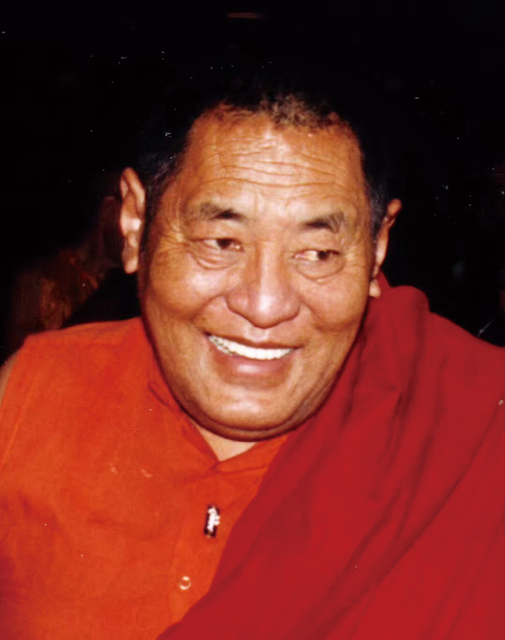
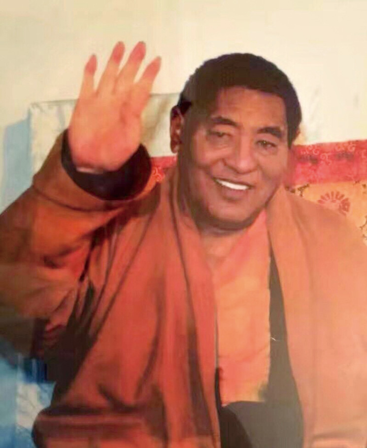

# 第28课

2022年9月29日

（堪布展示照片）

法王这张照片应该是在美国拍的。

我们今天讲第51节，代表法王的51岁。这本书中将法王的每一岁用一个小节来对应，并不是说这节内容是在这个年纪讲的，这只是一种象征性的表示。

学习了《不凡》，大家会发现，法王对每一件事情都考虑得十分细致。很多人经常想象，如果自己依止了法王如意宝的话，到底会怎么样？其实，如果你亲自见到法王，每天听他给你讲一句关于人生和修行的教言，得到的无非也就是这本书中的道理。我们这里有一些出家人，虽然一直没有见过法王，但后来通过阅读他的传记、学习他的教义，对法王生起了非常非常大的信心，自然而然获得了殊胜的加持。

如果我们以一般世间的眼光来看法王留下的教言，这些话可能谁都会说，没有什么特别之处；可如果你对法王有很大的信心，他的一字一句似乎都会融入你的心间，让你的生活、修行等方面发生很大的转变。这也许要看缘分，有些人跟法王缘分很深，书里哪怕小小一段教言，他也会一辈子奉行。如果你把法王看作一个普通的世间人，那就未必会重视他的教言。现在网上这样的语录千千万万，佛教的也有，非佛教的也有，有些看上去言辞还似乎更优美。所以，我们在学习的过程当中，关键是看自己有没有信心。有了信心，就会有更多的收获；有了收获，就能转变自己的心；转变了自己的心，就能依靠这种力量来转变他人的心。这是一种层层递升的规律。

我们在学习这些教言的时候，有些人可能没多少触动：“哦，照顾病人，对对对，管家也经常这么说，堪布、堪姆也经常这么说。”提起年迈的父母，“是是是，孝敬父母，这我早就懂了。我当初学儒家的时候可明白了。”如果这样想的话，学了法王的教言可能也没什么用。对于这种人来说，即使是佛陀亲口宣说的经典，或者莲花生大士和龙猛菩萨的教言，也不过是印在纸上的一些黑字，除此之外也没有什么。所以，我们要根据自己的缘分和修行，来看与这部法能否相应。如果相应的话，就应该多多地读诵。

我们之前学了《入大乘论》以后，有不少人反反复复看了好几遍，把《大幻化网总说光明藏论》看了好几遍的也大有人在。关键是自己的信心，如果你对一部法特别有信心，多多少少能得到收获。所以我们在学习中对法本和作者的信心是非常重要的。

法王讲了很多方面的事理，下面我们继续学习。

### 第51节·照顾病人

大家还要尽可能照顾久病的患者，帮助那些新出家的觉姆。

法王如意宝当初建立尼众佛学院，其实是一个全新的开端，纵观整个藏传佛教的历史，规模如此之大的觉姆寺是从来没有过的，一般寺院里只有寥寥几个尼众。这是整个藏地前所未有的创举，所以刚开始的时候，法王也遭到了很多诽谤，遇到了种种难题。加之我们学院当时的条件也特别艰苦，所以不得不面对各种各样的困难。

如果是无依无靠的觉姆，真的很可怜。有些生病的觉姆不仅不能出门，甚至卧床不起，真的有这么可怜的对境。那些根本不能来公众聚集场所的病人，即使念经钱只有十元，也必须给他们留一份。这叫“病人应得”。世尊不是在分配僧财一章中讲得很广吗？

法王很关心病人，也很关心新来的僧人。一些卧床不起的病人，没法念经，也没法听课，于是法王要求把僧众的念经钱也分给他们一份。有些人如果有念经的意乐，但因病实在不能念，他自己也愿意接受的话，我们也是可以把念经钱分给他的。不过有人是装病，如果只是稍微有一点不舒服就不念经，那可没资格领念经钱。今天说心脏痛，明天说生病了不能来，这种人不是大家照顾的对象。如果真是病到卧床不起，实在无法念经的话，那僧众可以开许，哪怕十元钱，也可以给病人留一份。

病人不可或缺的就是护理者，所以也要给护理人员留一份念经钱。

我们现在有没有给病人留念经钱？不留是吧？扶贫钱和念经钱是不同的，念经钱还是应该留。如果真是病得很重，或者不得不下山去看病，包括我们派救护车送到山下医院治疗的，对于这些人，念经钱可以给他留一份，随同护理病人的人，也应该留一份，我们以后也要这样安排。当然，个中情况要区分清楚，有的人以治病为借口随意离开，这是不能分念经钱的。

僧众每天下午从1点10分到3点这个时段要为施主念经，如果你不念，就不允许得这份钱。因为施主交钱是让你念经，并不是让你干其他事，所以在这段时间内，你就该好好念经。我刚来学院的时候，也领念经钱——从1985年一直到1987年，之后才基本上没有再领念经钱，在那之前，这份钱对维持生活还是很重要的。所以，领一下也没什么不好意思。

对于那些真正卧病不起的道友，大家都照顾得很好。我听说有些班的堪布、堪姆对病人非常关心，一些年轻人还主动作志愿者去看护病人。有些人突然生病，或者把脚摔断了，生活上是很麻烦的，这时候班里有志愿者就很好，经过一段时间的照顾，病人就能自理了。

我们的医院也很重要，很多人都从中受益，特别是藏族觉姆们。但现在有的医生稍有一点名气之后就离开了。我希望各位医生尽量在岗位上多坚持坚持，不要别人对你稍加赞扬，就产生傲慢，开始摆架子。作为医生，应该给大众带来真正的利益。

所以，在照顾病人方面，我们的医院很重要，护理人员也很重要。同时，病人也不要傲慢。有些病人特别难伺候，脾气也不好，性格也不好，忍耐力也不好，看护过程中稍微弄疼他一点，就“啊啊！哎哟哟！”照顾起来特别麻烦。人和人之间的差别是很大的，有些病人则非常坚强，虽然疼得很厉害，但面不改色，特别能忍。关心他的人心疼不已，他却说：“没事的，不用照顾我。”这样的人是很有德行的。

不管怎样，我们都应该对病人，对远方的客人还有年老的父母，悉心照顾，如果能够如理做到，那就如阿底峡尊者所说，跟修空性大悲藏没有区别。有些人修大悲空性一直修不成，那你就专门到医院去当护工吧。护工的费用可不便宜哦，一天就有好几百块。

有人可能会想：“做护理是善法吗？”《俱舍论》中说：“虽非圣者然而于，父母病人说法者，最后有者之菩萨，供养功德无有量。”这里面已经讲了，护理病人和供养圣者一样具有无量功德。很难找到比这更好的积资方法了，因此，我们要尽心尽力护理病患。

法王在前面也引用过这个教证。我们这里有些病人受到邻居的热心照顾，生病的时候，邻居马上把他们护送到医院，用心照料。世间人也说，远亲不如近邻。确实，有的人直到病死，远方的亲戚也未必能来看一眼。有些亲戚只在你有钱有势的时候来沾光，但当你真正需要的时候，他们不一定会出现。而我们金刚道友之间，虽非血亲，但是从佛法的层面来说，都是兄弟姐妹，这是一种法缘上的亲情。所以，道友间互相照顾也是很有必要的。

### 第52节·招待客人

大家不要看不起远道而来的客人，要帮助他们借住处、借衣服、提供饮食等等。

法王经常讲一些待人处事方面的教言，这里讲的是接待客人。

当然，现在有不少从远方来这里观光的游客，我们还是少接触为好，毕竟不太清楚他们是什么样的人。有些喇嘛和觉姆喜欢主动去跟游客结缘，有的是出于悲心，有的可能是出于其他目的。

按照我们以前的一些规矩，如果真的是刚来这个佛学院的孤苦僧尼，去乞讨一些东西也未尝不可。

有一些人初来乍到，没什么亲戚和熟人，在这里是很难立足的。就像我当初刚来喇荣的时候，一个熟悉的人都没有。这种时候，去跟别人乞讨一些东西也未尝不可。现在我们这里条件好了，这样的情况就不再有了。以前法王在世的时候，女众那边条件比较差，本来我们这个道场里男众女众是不能来往的，但法王特意开许，刚来的女众如果实在没有吃的，也可以让常住的人带她们到男众区去化一点缘，因为男众的条件相对稍好一点。有些准备出家，但还没剃度的女众，可能因为不好意思，用围巾裹着头，只露出一双眼睛，挨家挨户地去向大家乞讨，这在当时是法王特殊开许的。但后来这种情况基本上就没有了。从2017年以后，我们这里就不再接收新来的尼众。

此外，值得信赖的执事僧人（管家）和堪布应该负起责任，即使他们需要在道场的上院到下院之间乞讨化缘，也是无可非议的。

下院指的是下面的女众学院，上院指的是男众学院，如果女众这边实在没有条件的话，新来的人也可以到上院来找男众化缘，这是允许的。

财富受用这些东西，有时候有，有时候没有。尤其是，为了正法而历尽苦行的圣贤大德们，可以说基本上没有不曾乞讨过的。所以，乞讨并不是一件可耻的事情。

法王告诉大家，没必要因为乞讨而不好意思。有些时候人难免遇到贫困窘境，不要认为这是很羞耻的事，不要那么想，因为金钱本来就是有时候有，有时候没有。就连无垢光尊者、华智仁波切等高僧大德，在修行过程中都有过乞讨维生的经历，这样看来，乞讨也并不是一件可耻的事情。

（堪布展示照片）

法王这张照片应该是在加拿大照的。

请你们这些施舍者端正态度，把自己有的酥油、糌粑等，尽快给他们一些。

那时候条件比较差，现在我们学院里糌粑和酥油很多，有些可能送都送不出去——不过自己还是留一点比较好，因为现在的疫情很令人担心。前两天马尔康出现了三例阳性，整个城市就里里外外戒严起来。所以，万一学院有了疫情，那个时候大家手头有一点糌粑也是好的。

今年是很不确定的一年，有专家分析，过了2022年可能会好一些，这时候正值人类的一个拐点，确实比较难熬。现在看来整个形势确实不太乐观，原来很多人都喜欢出国旅游，后来改成出省旅游，然后是城市周边游，而现在，能出自己小区门口都已经感到非常庆幸了。今天我们在学院里还能自由自在、有吃有喝，对比外面整个世界的困局，我们还算是比较幸运的。

当今世界变化太快，也许将来的人回看我们现在这个时代，就像我们回看历史上的唐朝一样，一段时间人类的经济、智慧、财富，各方面都达到鼎盛，而过一段时间又开始走下坡路。我们以后会这样说：“这个转经轮是兴盛时期做的。”“这些青稞是人们有福报的年代的粮食。”我在这里并不是想吓唬大家，但我们手头有些储备的话，心里至少会比较踏实。如果没有出现什么特殊情况，到时候也可以再处理掉。不必害怕屯粮会过期，像糌粑一般放五六个月都没什么问题。藏地的青稞储存起来，就像普洱茶一样，时间越久反而越好，所以实在不行就买一点青稞，到时候天天煮青稞汤喝，也可以维持生活。

现在的形势下，谁也不知道以后会发生什么。有时候想想外面的城市，以前多么繁荣，经济、财富、资具各方面都十分丰足，可如今很多人连自己的生存都难以维系，可见人生中的财富并不可靠，一瞬间就会消失。在这个时候，大家如果手头有一点钱，最好不要马上花完，至少要给自己留一点应急钱。有的人一有钱就马上拿去上供下施，虽然这样功德很大，但你自己能活下去才是首要的。大家可以看到，不少企业家都在说，现在的目标是活下去。即便是国有企业，都面临着非常艰难的形势，许多都在苦苦支撑。全世界目前都已经走到了这样一个关头，这种时候，我们这里虽然有三宝的加持，但每个人自己也要有应对困难的能力。

有这样一个故事，一位修行人独自在山里闭关，每个月他的兄弟都会送来口粮。有一次，兄弟问他过得怎么样，他说：“挺好的，多亏三宝的加持，我才没有挨饿。”结果接下来的一个月，他的兄弟都没有出现，直到很久之后才送粮食来。修行人责问：“你为什么不给我送吃的，我差点就饿死了！”他的兄弟回答：“你那天不是说全靠三宝加持吗？既然你靠三宝的加持就能活下去，我就是多余的了。”于是这个修行人再也不敢这么说了。

所以，我们虽然依靠三宝的加持，现在还能衣食无忧，但我还是要提醒大家，不论个人还是集体，要随时做好最坏的打算。我也跟学院财务科说了，要储备一点粮食、药品，还有其他方面的资源。在这方面大家要多加考虑，因为这个喇荣山谷对于全世界而言都是一个非常重要的道场，未来的情势难以预料，所以我们需要做深远的观察和思考。

觉姆和喇嘛不管是谁，刚来的时候都有些困难，因此要好好关照爱护他们。

法王在这里要求，对远方来的人要多照顾。我们这里有些新来的人，确实刚开始时没有住处，没有资具，这种时候大家一定要多关照他们。我在过去很多年中，也会亲自去帮新来的人借房子、送吃的，到了后来，虽然我没时间亲自去做，但也会劝堪布、堪姆和管家，对身边那些生活困难又特别精进的人多给予帮助。我们也建立了一些扶贫会、功德会来提供各种支持，帮助他们度过暂时的难关。

法王以前也说过，一个人不可能永远身陷苦海，当他处在最艰难的瓶颈期时，只要帮他一把，很快他就会时来运转。有的人得了重病，这时候只要有人帮助他挺过来，过一段时间他就痊愈了；有的人刚来这里时处境艰难，钱也没有，熟人也没有，住处也没有，这时候只要有人帮他一下，很快他就能自己站稳脚跟。其实除了最艰难的时刻，他们并不需要你一直照顾。所以，看到有新来的人需要帮助的时候，希望大家都能给予一些关怀。
