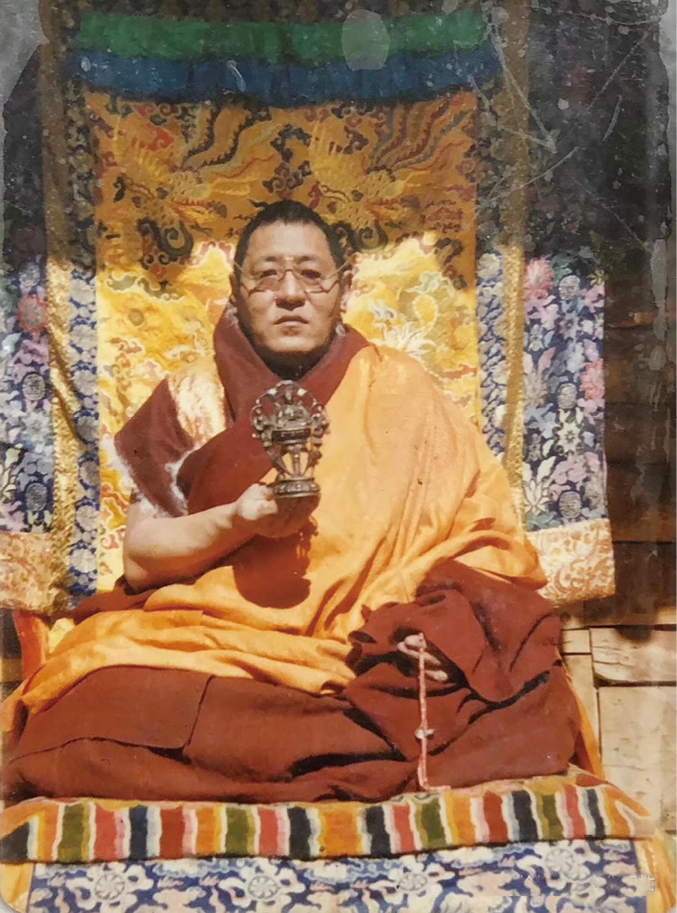
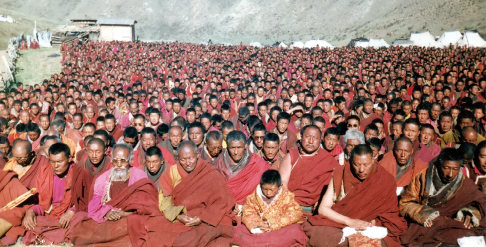
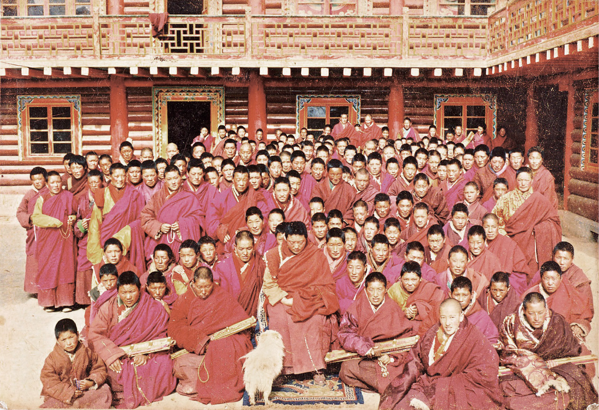

# 第2课

2022年8月9日

我们继续学习法王如意宝的《不凡》。

菩提金刚的授记中，第一句讲的是处圆满，第二句是本师圆满，第三句是眷属圆满。我们平时在法王的传记中都会一次性引用，而这里法王是分别讲解的。

以前我在美国加州大学洛杉矶分校做演讲时，校方要求我介绍喇荣的情况，我就凭记忆讲了一些。我们喇荣五明佛学院的人很有必要懂得这些。我和慈诚罗珠堪布每次去西方高校讲课，本想讲一讲出离心、菩提心，可他们都要求：“讲讲喇荣吧！”所以我们常常需要对外介绍喇荣沟。你们以后不管走到哪里，如果有人问起喇荣，就可以讲讲这个两百多年前菩提金刚留下的奇妙预言。

智悲光尊者是18世纪著名的大德，从1729年出生到1798年圆寂，住世共70年。他有四位以“晋美”为名的弟子，其中晋美成列沃色就是菩提金刚。我看过他的藏文自传，确实非常了不起。菩提金刚授记了未来两百年后的喇荣，法王当时也觉得非常奇妙。如果是今人做出这样的介绍，那并不稀奇，因为法王声名远播，很多人都熟知他的住地、眷属、事业，但在那么多年之前，现在的情况就已清清楚楚写在了那时的授记里，不可谓不神奇。

### 第2节·本师圆满

前面处圆满介绍了三座神山中间的喇荣山沟，下面讲第2节本师圆满。

关于本师圆满，菩提金刚的授记是这样说的：“邬金莲师化身名晋美。”

授记里说，邬金莲花生大士的化身转世名为“晋美”。当然，授记所指的也可能另有其人，毕竟叫“晋美”的人很多。但如果各方面条件具足，我们也可以得出一些明确的解释。如果你不接受这样的解释，觉得也许喇荣有另一位“晋美”，这样想也可以。但能拥有这么多的眷属、这么大的功德，这样的人很难另外找到。

当然，法王并不是特意要讲五圆满来证明自己是莲花生大士的化身，这些都是法王偶尔在讲课时顺口提起的，后来我们又从录音中整理出来。法王讲到自己的时候总是非常谦虚，就如下面说道：

平心而论，就像不净物中出现黄金一样，像我这样有百种过失而无一分功德、比不净堆更不净的人，之所以能建立起佛教道场，完全是因为如来王莲花生大士、怙主文殊菩萨的意加持入于我的口与心。

法王自谦道：我没有什么功德和能力，特别不清净，之所以能建立起这个道场，完全是因为如来王莲花生大士、怙主文殊菩萨的意加持入于我的口与心——虽然授记中说我是莲花生大士的化身，但这是有密意的，我肯定不是化身，只不过得到了莲花生大士和文殊菩萨的加持。

法王真正得到了佛菩萨的加持，我们自己如果经常祈祷上师，经常念修心咒，也会得到这样的加持。

正是考虑到行持利乐一切有情的无量事业，赞叹护持白法的境神、地神的威德，

为什么授记里这样说呢？“正是考虑到行持利乐一切有情的无量事业，赞叹护持白法的境神、地神的威德。”什么是境神和地神？许多地方都有住于此处的神，就像土地神、树木神等等。境神到处都有，一般存在于较小的范围；而地神是一个地区的土地神，有一定的威望和权势，比如我们喇荣的地神木天女。当然，我们也供喇荣五台的其他护法神，包括一些天龙八部等，其中也有很多受过前辈大德的委托。

息灭一切黑法魔众的气焰，减少疾病、饥荒、战乱等的缘起，才有必要授记本师圆满。

法王的意思是，他自己并不是莲花生大士的化身，但是他的一些事业能让护法神获得赞叹，摧灭魔力，减少世间的战乱灾祸。

我们确实可以把法王如意宝视为文殊菩萨或者莲花生大士的化身。虽然法王并不宣传自己，总说自己不是化身，而是得到加持所以事业广大，但实际上，我们可以用信心来这么说：法王确实是莲花生大士广弘佛法的一个了不起的身、语或意的化身。

（堪布展示照片）

这里有一张法王的照片，法王手中拿着的是一件伏藏品，当初拍照时我也看到过。

### 第3节·眷属圆满

关于眷属圆满，菩提金刚的授记中说：“彼于菩萨四众眷属中。”其中，“四众眷属”指的是比丘、比丘尼、优婆塞、优婆夷，也就是按照佛陀的四众眷属来说，我们佛学院也具足这四众眷属，而且他们都是学菩萨乘的。

“四众眷属”是指比丘、比丘尼、优婆塞、优婆夷。藏地很长时间以来都没有比丘尼，但法王1987年朝拜五台山之后，汉地很多比丘尼来到了喇荣，从那时候起，佛教的四众眷属就在我们这里俱全了。一些历史学家认为，藏地以前也有过比丘尼的传承，但后来消失了，而我们佛学院建立以后确实具足了这样的四众眷属。

为什么叫“菩萨四众”呢？因为他们学的都是菩萨乘。我们学院每个人都要学《入菩萨行论》，都要发菩提心。这就是“菩萨四众”的解释。

像这样的四众眷属，恐怕在整个大地上也很难看到。掌握这个不变的要点也很关键。

结合前面所说的本师圆满和处圆满，这里有名为“晋美”的本师，有三个方位的护法神，同时还具足四众眷属，要去别处寻找这样的地方，恐怕比较少见。

或者说，所谓的“四众眷属”，并不是理解为佛陀的四众眷属，而是喇荣佛教大学按照特有的四众眷属，分为四大学院，即研学五明的喇嘛学院、莲花空行聚集的尼众学院、汇集各族弟子的汉学院或国际学经会、信心具足的居士学院。

法王定义我们喇荣为一所佛教大学，这所大学由四个学院组成：研学五明的喇嘛学院，也就是现在男众区的五明佛学院；女众区是莲花空行聚集的尼众佛学院，我们一般称之为莲洲——莲花空行集聚之洲，所以这边有莲洲图书馆、莲洲餐厅、莲洲研究所，这些都是莲花空行集聚的地方；还有汇集各族弟子的汉学院或称国际学经会（当初中国佛教协会会长赵朴初题字为国际学经会）；以及信心具足的居士学院，也就是位于喇荣沟入口处的居士林。现在这四部分名称稍有不同。男众区是五明佛学院，汉学院现在叫技术学院（众笑），女众区是喇荣寺尼众学院，居士林如今叫阿交村。

法王在这里以另一种分类方式，将喇荣这四个学院称为四众眷属。菩提金刚的授记也可以这么解释。

这四众眷属，就是授记中的眷属圆满。

不管是佛陀的四众弟子，还是佛教大学的四大学院，都可以叫眷属圆满。有时候缘起确实不可思议，法王当时这样一讲，如今我们这么多人就已聚集在这个地方。

（堪布展示照片）

这里有两张照片。一张是1985年我刚来喇荣的时候照的，地点应该是大经堂旁的龙泉水附近。前排的好多人当时年事已高，包括帝察活佛、香秋喇嘛，后来都示现圆寂了。前面这个小和尚应该还在。我在后面的小屋附近，因为当时刚离开学校来这里出家，害怕被人认出来，就特意跑到远处去了。

这张是门措上师的照片，这好像是上师以前住的院子。这张照片拍摄于上世纪90年代，当时整个觉姆学院就只有这么些人。

书里这些老照片并不是对应文字来排列，而是随机穿插在各处，我遇到了解的再给大家介绍。
