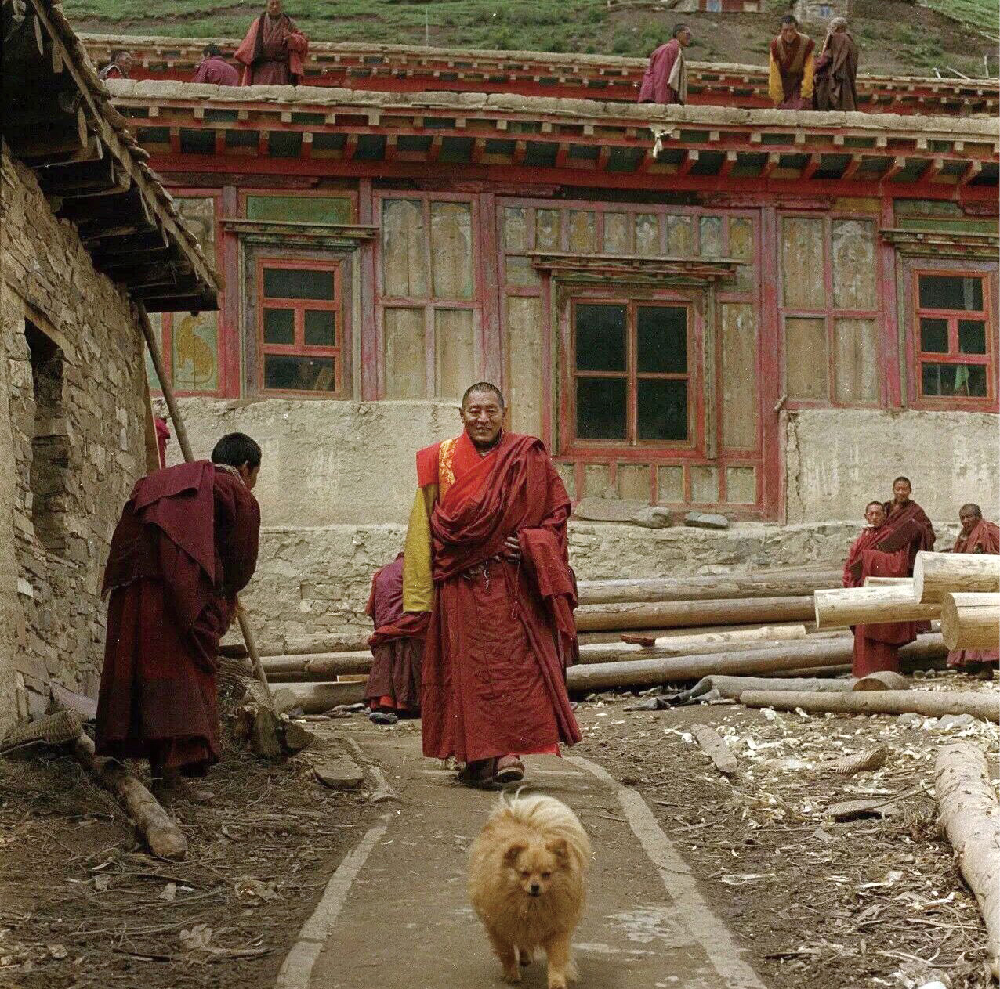

# 第31课

2022年10月4日

### 第55节·出家人要穿清净僧衣

一般来说，所谓“在家人”，是没有受过沙弥戒、比丘戒的人，也就是普通的俗家男女；“出家人”就是沙弥、比丘。僧与俗的穿着、行住坐卧各不相同，因此不应该相互混淆。

在家人有在家人自己行住坐卧、穿着打扮的方式，出家人也有出家人自己的威仪。在我们这里，除了个别人刚出家不太懂戒律，在这些方面尚有不足，其他出家人，不会随意去学俗家人打扮、化妆，做一些不如法的行为。我们降魔胜利洲在这方面做得比较不错，很少有出家以后还破坏纪律、舍戒还俗之类的情况。我希望你们就如世间说的“既来之则安之”，既然已经脱掉了世俗的衣服，走上这样一条永远不悔的路，就应该在这条路上一直走下去。我们藏族有一种说法：出家人死在出家的路上是最光荣的。如果回到俗世家中死去，那不一定光荣。所以说，出家人的穿着方面也应注意。

然而，当今时代的个别上师、僧人，如果得到一件可穿的在家衣服，似乎觉得很好看、很稀有。

有些上师到了城市里，就换上便装，后来被认出来：“原来是他，怎么穿着在家衣服？”有些僧人也是这样，穿上一件在家衣服，就觉得特别稀有。最近我们学院的管家也发现，有个别女众穿着在家衣服拍视频发在抖音上，还好不是我们降魔胜利洲的人。做这种行为，一旦被管家知道，就不得不离开学院了。

我们藏地的观念，和汉地有些不同。在汉地，子女如果出家，很多父母气得发疯；而在藏地，一个人如果出家了，他的父母家人全都希望他清净地度过这一生。去年我们寺院有一个出家人还俗了，他的父母都不肯理他，不久之后，两位老人就都伤心离世了，他们说：“要是早点死了就好了，我们不愿意看到他穿回世俗的衣服。”

在我们这里，大家都希望这身清净的僧衣一辈子都不要脱掉，这是出家人最大的愿望。但情况也可能变化，不知道将来会如何，因为汉地的环境确实不同于这里。在藏地，大家看见出家人都会很有信心，但以后如果这个僧团没有了，或者你们在这里待不下去了，不得不回汉地的城市，要是找不到寺院，只能住在小区里，不知道那时候出家人的装束方不方便，所以也要看具体情况。

藏地的出家人也有不同的穿着习惯。有的教派威仪特别清净，比如格鲁派；有的教派中也有个别不伦不类的现象。有些僧人白天穿出家衣服待在寺院，晚上穿在家衣服出去逛街。现在汉地有些地方也有所谓的“代理和尚”，就是假和尚，白天在寺院，晚上回家。所以藏地、汉地都有各种各样的现象。但我们在即生当中，能拥有这样一个出家身份是非常不易的，希望大家好好珍惜。

但事实上，不是说“具戒僧衣可清净一天僧财障”吗，单单是具有戒律者的僧衣，也能清净一天之内享用僧财的障碍。

这是华智仁波切说的，穿着清净具戒者的出家衣服，一天之中享用的僧众财产，比如饮食等方面的障碍都能消除。

我们这里的出家人真的都很不错。我有时候在城市里偶遇学院的道友，他们上上下下都穿得非常整齐。如果是提前约好见面，那可能会做一些准备，但突然碰见，这应该是一种可信的观察。所以总体上，我们大多数人这方面确实做得很好。

三世诸佛身上穿的衣服，也是这种出家僧衣。正如全知龙钦巴尊者所说：“三有尊主曾百遇，披袈裟袍唯此番。”

这个教证法王经常引用。各位道友，尤其是出家人，应该以自豪的心态，经常如此自我提醒。我们生生世世中可能已经当过很多次世间的天王、人王，但是披上袈裟的机会唯一就这一次，确实非常难得。“黄金白玉非为贵，惟有袈裟披肩难”，顺治皇帝的出家偈我们以前也讲过，黄金、白玉并不是最珍贵的，即生当中唯独披上袈裟是最为难得的。这两个说法其实意义相同。此生当中，我们拥有再多金银珠宝也不一定很有价值，穿上这身僧衣，对每个人来讲才是最重要的。

我们藏地对此很重视。包括我的父亲，他去世之前非常希望穿上出家的衣服，还好当时我们这里各方面都比较方便，他在临终前受了沙弥戒，遗体用法衣包裹。很多藏族人都觉得，人死的时候如果用俗家衣服来包裹，那是很可怜的，而用法衣来包裹遗体，亡者就不会堕落，这是一件很光荣、很有意义的事。

我们在多生累世中曾受生过帝释天王、大梵天王等三有世间的主尊，但身著出家僧衣，唯有今生这一次。此番具有身著僧衣的缘分时，一定要穿着清净的出家僧衣。

有些人不管在哪里，始终习惯穿着整齐，包括我们这里的一些堪布、堪姆，任何时候见到他们，威仪都十分清净，整洁的穿着让人尤增信心。所以大家以后对衣着应该重视。

（堪布展示照片）

这张照片是90年代拍摄的，这是甘多拉经堂。法王从经堂往下走的这条路，是我们学院的第一条水泥路。这条路从经堂一直通往法王的住处，也就是现在门措上师的院子。法王前面的应该是布廓，就是我在《梦尘回忆录》里写过的那只小狗。每次法王讲课的时候，它就一直待在法座上。等讲完课，念完《普贤行愿品》，法王即将起座时，它就跳下来，走在前面带路回去。它每次回去的时候都是一副很开心的样子，就像照片里这样，很有意思。

我反反复复这样讲的意思，也是当今出家人的衣服面料有绸缎、哔叽、氆氇等，

“哗叽”就是我们现在用的那种印度产的面料，比较厚实，但比氆氇薄一点。藏文当中叫“特玛”。

颜色有红、黄、紫色，就像夏天绚丽的鲜花一样应有尽有。得到一件在家男女的衣服并不罕见，

出家人的服装如此庄严，红色的、紫色的、黄色的都有。当然，夏天的鲜花还有蓝色、白色等等，但这里主要是表示鲜红的意思吧。而得到一件在家男女的衣服并不罕见，有什么值得稀奇的？

因此，出家人要按照本师佛陀所说的来穿衣服，不要做各种不伦不类的在家男女之事。再者，作为一个出家人，如果一边穿着出家僧衣，一边杀生、不与取、邪淫等，那真的是罪大恶极，完全没有必要。

一般来讲，出家人穿上僧衣，不仅以此而庄严，而且所有的非法行为都会断尽。所以法王在这里特别强调了穿出家僧衣的功德。
