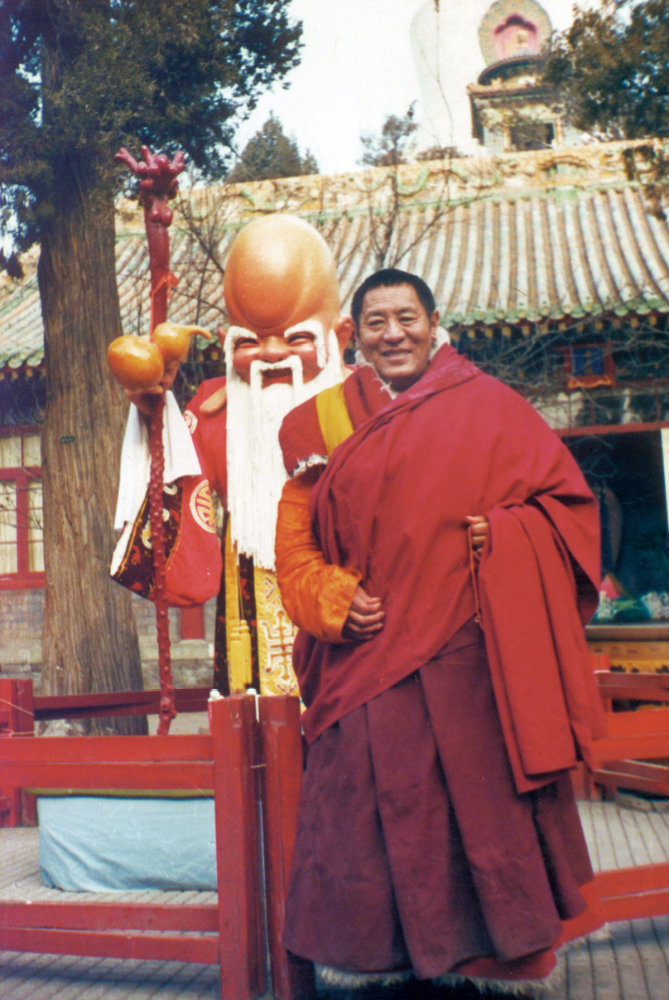

# 第32课

2022年10月5日

### 第56节·出家人衣服的颜色

出家人不要穿黑色的衣服，那是鬼神的穿着。

我们佛学院出家人穿的僧裙、披单、衣服，都不能带有黑色，偏黑的深红色也不允许。现在学院僧众的衣着基本上都是合规的。为什么要这样呢？因为黑色是魔鬼的衣服。

据说不同的颜色有不同的能量。这不仅是佛教中的习惯，在世间我们也能看到，不论东方西方，影视里天人、天使的形象，一般都是白色，代表正面力量，而恶魔、恶龙常常是黑色的。现在那些热门电视剧里，反派角色大多穿黑色的衣服。在家人穿什么颜色本来不应限制，毕竟有些人天生喜欢黑色，有些人天生喜欢白色。但一般来讲，穿黑色的衣服不是太好，尤其是出家人，黑色是不允许穿的，这是鬼神的衣服。

当人世间到处都是鬼神的时候，如果我们也穿上鬼神的衣服，鬼神就会来制造违缘。紫色中的紫黑色也基本是黑色。

那些鬼神如果被招来，不一定会帮你，它们更喜欢制造违缘，这才是它们的专业。如果鬼神看到你穿黑色衣服，会想：“这里有个跟我衣服同样的人，我要待在他的衣服里面。”于是就会经常给你制造违缘。也有这种说法。

此外，白色是在家人的衣服。我们出家人本来已经舍弃了在家相，如果再穿白色的衣服，那就是舍弃了中间出家戒。当你已经舍弃了中间出家戒，智者谁也很难承认你还理所当然地被称为比丘、沙弥。因此，出家人不应该穿白色。

佛典中以白衣一词指代在家人。作为出家人，如果再穿白色的衣服，那就等于舍弃了中间出家戒。所谓中间出家戒，就是在家居士即将受出家戒之前的一个专门的中间阶段。这个中间戒在有些寺院里有，有些没有。这个阶段戒条比较简单，主要是三种更换——名字要换，衣服要换，头发也要剃掉。这其实是受沙弥戒和沙弥尼戒的基础。以前印度有受中间出家戒的传统，现在有些地方也还在如此实行。这时如果再穿白色衣服，就等于舍弃了中间戒。中间戒是出家戒前面的基础，一旦舍弃，也就不能再称作比丘和沙弥了。

但在泰国等南传佛教地区，很多预备僧也穿一种特殊的白色衣服。因为在真正受出家戒之前，要求换掉在家衣服，这是为了表示区别。

法王这里的意思是，穿白色衣服就像在家人。前几天我也批评过，有些人衣服上有很明显的白色，虽然你穿在里面基本看不见，但这样穿很不庄严，出家人就不应该穿白色。

蓝色，虽然根据以往的律典，它属于可用的三种颜色之一，但是藏族的持戒大德们说，因为它接近汉地服装的颜色，所以藏族的出家人不可以穿蓝色僧衣。

这里主要是针对过去汉地的服装而言。历史上很长一段时间，特别是唐宋以来，汉地在家人中比较流行蓝色布料。另外，也为了避免跟汉传的蓝色僧衣混淆，所以藏地出家人一般不穿蓝色。其实印度很多高僧都穿蓝色，我们在二圣六庄严的唐卡上也能看到，他们的僧衣里经常穿着蓝绿色的背心。但在藏地，主要是苯波教会在一些“多嘎”[^1]上面用蓝色。所以，一般而言，藏传佛教僧人没有在外面明显穿蓝色的习惯。

大红和大黄也不可以，因为它们属于八种非理色之一。因此，如果你穿着大红大黄，就会犯堕罪，要尽力忏悔才能还净。年轻人几乎都不愿意穿淡红、淡黄、淡蓝等浅色的粪扫衣。

戒律里专门有八种不合理的颜色。现在有个别人，尤其是刚刚出家的时候，特别喜欢穿一些大红大黄的衣服。你在里面穿不要紧，但外面穿大黄色是活佛的穿法。不过现在好像活佛们也不流行这样穿了。以前宗教政策刚开放的时候，很多活佛都穿明黄色。

我们降魔胜利洲原来有一位出家人叫智能，她经常穿黄色的衣服，而且是很亮的明黄色。那时候汉族僧人不多，她的衣服又很显眼，于是藏族人都叫她“亚木赛吉”，意思是黄颜色的汉族尼姑，其实不太好听。我批评过她好多次：“你的衣服太显眼了。”可是她不肯听，当着我的面稍微穿淡一点，但在我看不见的地方又穿上亮黄的。

我们应该身穿红黄色的内衣、红紫色的披单和外裙。现在我的眼睛模糊了，只能大概看到一点点，但环顾四周，你们的衣装都很好。

我们学院僧众的穿着是比较得体的。人们常常这样说：“这个人衣着很整齐，应该是喇荣五明佛学院的。”所以法王如意宝也赞许，虽然看得不是很清楚，但是大家应该都穿得比较好。我以前经常给大家讲着装问题，现在堪布、堪姆讲得比我以前好多了。我常常在路上观察，大家基本上都很不错。作为出家人，穿着还是很重要的，希望大家穿好僧衣，这样很多人看见以后，自然而然会生起信心。

所以，在著装上，可以清楚地知道常住者和新来者的区别。

常住者的衣着通常比较文雅、整齐，颜色合规，威仪也比较如法，而新来的人常常穿得不伦不类，行为也颠颠倒倒。所以我们基本上一眼就能看出来谁是新来的，因为他在穿着等很多方面都不太合规矩。

在印度，因为天气太热，除了掩腋衣、丝绸布料的夏衣等很薄的衣服以外，其他都不可以穿。

掩腋衣相当于我们的内衫。印度当时的出家人，除了这样的衣服，其他上衣都不穿。泰国也同样，男性僧侣除了外面的袈裟，上身基本什么都不穿，最多在里面穿一件类似背心的衣服。我们学院的管家有一些着装参照图，哪些可以穿，哪些不能穿，大家一定要分清楚。

就像通过帽子推断鞋子的说法一样，藏地也有些人不穿嘎让（不带袖子的长袍），不同的地方有不同的传统。

法王对不能穿“嘎让”的说法不是很接受。以前我们学院很多人都穿嘎让，我去五台山、印度等很多地方时，都穿着一件长长的嘎让。这是一种不带袖子的长袍，有些带有立领，有冬天穿的人造毛嘎让，也有夏天穿的薄嘎让。嘎让是藏语，指一种长长的僧袍，不知道怎么翻译合适。如果只有上身的部分，这种衣服在藏语里叫多嘎。

法王说，就像世间的一种说法：用帽子来推断鞋子，肯定不合理。帽子有帽子的形状，是头上戴的，鞋子有鞋子的样式，是脚上穿的，二者不必非要一致。不能因为帽子是黄色的，就要求鞋子也必须是黄色。印度天气炎热，所以僧人不穿外套。但藏地有些人非要装成印度僧人，连嘎让都不许穿，所以法王对此有些不满——在寒冷的雪域高原，如果连嘎让都不穿，可能不太合理。所以，法王的态度是，嘎让可以穿。以前八九十年代的时候，我们学院的僧人全都穿着嘎让。

例如，世尊不开许在印度中部使用皮革，但在多坚（地名）等山区、冰雪覆盖的地带也开许适当使用皮革。

释迦牟尼佛不开许印度中部的僧侣使用皮革，包括皮衣、皮鞋，因为那里很热。但佛陀对于多坚这个冰雪覆盖的山区，是开许僧侣用皮革的。像多坚那样的寒冷之地，僧人穿皮袄、皮鞋，这都是佛陀在戒律中开许的。以此类推，藏地出家人穿有袖子的外衣，这应该也能开许。

再者，《毗奈耶经》说不能穿有袖子的衣服，所以有些人不穿内衣。但是如果你穿外面有袖子的上衣，两者也就没有任何差别了。

《毗奈耶经》里说，出家人不穿有袖子的衣服。所以有些人不穿内衣，这里说的内衣是指有袖子的内衫，不是里面贴身的内衣。有袖子和没有袖子的我们统称“囊拉”。法王这里的意思是，有些出家人一直不肯穿有袖子的内衣，但外面如果穿了有袖子的外套，那其实没有什么差别。

我以前去五台山的时候，里面常穿有袖子的衣服，从90年代开始，就只穿无袖的，现在也已经习惯了。你们不用怕，有袖子的也可以穿，没事的。尤其是女众，穿有袖子的囊拉更好一点。虽然戒律里说不要穿有袖子的，但你即便里面不穿，冬天外面还是照样要穿长袖。

一般来说，外裙为了表示三学、三藏，正面和两侧有两折三平，

这是以前喇拉曲智仁波切的说法。我们出家人下裙的穿法是两折三平，两折就是左右两边各折一次，三平就是左边、右边、身后都是平的，这表示戒定慧三学。现在我们很多人的穿法都是这样的。

所以，如何穿裙要不违背论中所说“裙不齐圆过高下，裙边上翻如象鼻，如香囊与蛇头状，上衣不圆高低十”的七条法要。

这是《三戒论》中的偈颂，我以前讲过，在这里就不赘述了。我们穿僧裙的时候，既不能过高，也不能过低，尤其不能像象鼻那样下面突出来一块。如果学过《三戒论》中出家戒的内容，应该对此很清楚。

（堪布展示照片）

这张照片是1988年法王去北京的中国藏语系高级佛学院时照的，后面有一个老寿星。那时候是冬天，我没有跟着法王去，但法王的照片我基本都知道是在哪里照的。

[^1]: 一种坎肩式的上衣。
