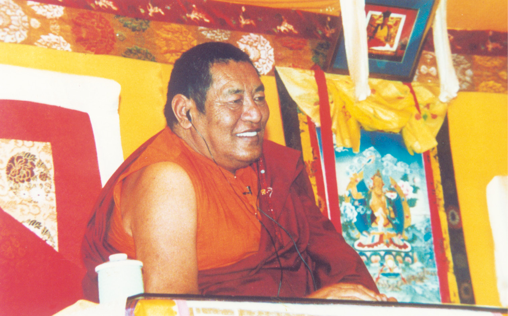

# 第34课

2022年10月7日

## 第10章 佛法无违

### 第58节·佛教诸大祖师同一意趣

比如，就噶举派而言，达波拉吉、噶玛巴巴协等都是邬金仁波切莲师的幻化。

法王在这里以噶举派为例，达波拉吉就是冈波巴尊者，噶玛巴巴协是第二世噶玛巴，他们都是邬金仁波切莲花生大士的化身。我在1994年写过一篇《略说佛教各派不相违》，距离现在已接近30年，其中有很多这方面的引证。我当年的文字风格跟后来不太一样，但不妨碍理解意思。如果你们有兴趣的话，可以看一看。那篇文章里引用了很多教证，其中也提到达波瓦尊者是莲花生大士的化身。

以文殊怙主萨迦班智达为例，《莲花生略传》说：“尔时我化名萨迦，上方父名为嘉花，母名卓玛子诞生，众怙根嘎嘉村尊，修复我之诸殿堂。”其中就讲了萨迦班智达是邬金仁波切莲师的化身。

莲花生大士的略传中有这样的授记：在那个时候，我会于萨迦地方出现，父亲的名字中有嘉花（文殊），母亲的名字中有卓玛，我会在这个家庭中降生为子，名叫根嘎嘉村，到时我会修复从前我所造的佛法之殿堂。

再者，就新派而言，大班智达罗桑秋坚说：“成就者王莲花生，幻化具德阿底峡，转世罗桑札巴尊，非汝我无余皈处。”

新派指的是格鲁派，大班智达罗桑秋坚就是第四世班禅大师，他是这么说的：莲花生大士幻化成阿底峡尊者，后又转世为罗桑札巴尊（宗喀巴大师），除了你们以外，我没有其他的皈依之处。也就是说，莲花生大士和阿底峡尊者、宗喀巴大师是同一化身。此外，第二世达赖喇嘛也同样说过，这些大德其实无二无别。

其依据是《噶当弟子问道录》记载，《佛子贡秋邦传》中云：

以上说法的依据是《噶当弟子问道录》中《佛子贡秋邦传》一文。法王经常提到传记中的这段记载。这是邬金国的一位比丘与另一位佛子之间的对话，他们商议以后要到藏地去弘法利生，于是分别化身为莲花生大士和赤松德赞，还有相关的一些译师。

《噶当弟子问道录》中的这些公案，学院一些老常住应该记得。法王以前经常会以一种回忆前世的方式讲这些故事，讲述的时候往往特别激动。我当时给法王做同步翻译，有时候法王兴奋起来，语速特别快，我都跟不上。人在激动的时候都会这样，我现在讲课有时候一快，翻译的人也没办法跟上，只能含糊而过。而且法王的语速本来就很快，这个时候要同步翻译很不容易。

公案讲道，无垢称比丘和佛子贡秋邦是师徒关系，贡秋邦是一位王子，无垢称比丘其实就是莲花生大士，贡秋邦化身为赤松德赞，他们二人后来在藏地有过一番共同经历。这里说得不是很明显。

“比丘无垢称言：‘于北方吐蕃国土无有悲心的野蛮众生前，派一位我之幻化具威德力者，先调伏野蛮众生，平息残暴损恼。

比丘无垢称说，要派一位幻化者去调服北方吐蕃国土的野蛮众生。以前很多经论里对我们藏地都没什么好印象，因为藏地当时到处都是没有悲心的野蛮众生。他要派出自己的幻化具威德力者去调服这些众生，这就是莲花生大士。藏地以前给人的感觉确实有点野蛮霸道，现在应该好些了。

你于他前派一幻化王，引导那些藏地众生。尔后，可以向生起信心的普通人宣说教言、受到藏地所有种姓高贵者的敬重时，你当受生。

这是比丘无垢称对贡秋邦的嘱咐，他让贡秋邦在莲花生大士面前幻化一位国王——赤松德赞，引导藏地众生。他说：待到可向有信心的人宣说教言、受到高贵种姓者敬重时，你就可以转生到那里。

派一名你加持的化身到印度迎请我，旨在把人们安置于暂时与究竟的安乐中。’

在莲师的传记里，这位化身就是法王的前世多杰登炯。当时赤松德赞与菩提萨埵修建桑耶寺，不断受到鬼神扰乱，无法进行下去。菩提萨埵说印度有位名为莲花生大士的大德，能降伏一切鬼神非人，于是赤松德赞派出使者去迎请莲花生大士。

化身的比丘们说：‘如果你们父子去了藏地雪域，谁来维护邬金这个地方？谁来摄集诸位空行？谁来镇压罗刹？’无垢称比丘说：‘派我的一个具威德力的化身到雪域，再前往罗刹境，怀柔诸位空行母，转会供轮，镇压诸罗刹。’”

当他们两师徒即将离开邬金刹土前往藏地之时，化身的比丘们提出了这些问题。可能当时他们那里受到一些罗刹的危害。于是无垢称比丘回答，会派他的化身先到雪域，度众圆满后再前往罗刹国，怀柔空行母，镇压诸罗刹。这个化身就是莲花生大士。

又如比丘无垢称说：“我去彼处降鬼神，一化身往汉地，一化身去尼泊尔，一化身去下多康，一化身游圣印度。比丘我虽无真有，常善作人君汝友。”

法王经常念这个偈颂。无垢称比丘幻化了多个化身，一个去往汉地，一个去往尼泊尔，一个去往印度，一个去往藏地多康。“比丘我虽无真有，常善作人君汝友”，“人君汝”指的就是王子贡秋邦。这里面的意思，法王没有直接说。这里其实讲了莲花生大士和赤松德赞是无二无别的。当时迎请莲花生大士的几位使者，也是无垢称比丘的化身。

邬金第二佛陀、阿底峡尊者、无等宗喀巴大师罗桑札巴等，都是无垢称比丘的同一个幻化。

这几位化身分属不同时代。去往印度的那位也许是阿底峡尊者。去到多康的应该是宗喀巴大师，他是安多人，诞生地就在塔尔寺那边，多康一词是康巴和安多地区的总称。不知道去汉地的是谁，有可能是西日桑哈。这些大德都是无垢称比丘的幻化。

无等阿底峡尊者也说：“印度吉祥黑日嘎说过，阿底峡尊者是密咒师海生金刚的化身。至于密咒师海生金刚，你们大多数密咒师都很清楚，所以我现在不需要多讲。而相继涌现的藏王都是仲敦巴·嘉瓦炯尼的转世，我要作详细宣说……”

因此，邬金第二佛陀、阿底峡尊者、宗喀巴大师三者是同一位上师。明明是一位上师，如果宁玛派说“邬金仁波切莲师好，宗喀巴大师不好”，实际上是在诋毁邬金仁波切莲师。如果诋毁其他宗派的教法和持教大德，那自然也诽谤了自宗的教法和持教大德。正是考虑到这一点，我才说诸大祖师的密意一致。

大意就是这样，有些地方不是很好解释，需要对照藏文。

（堪布展示照片）

法王的这张照片应该是在美国创巴仁波切的中心照的，右上角好像是一幅噶玛巴的法相。
