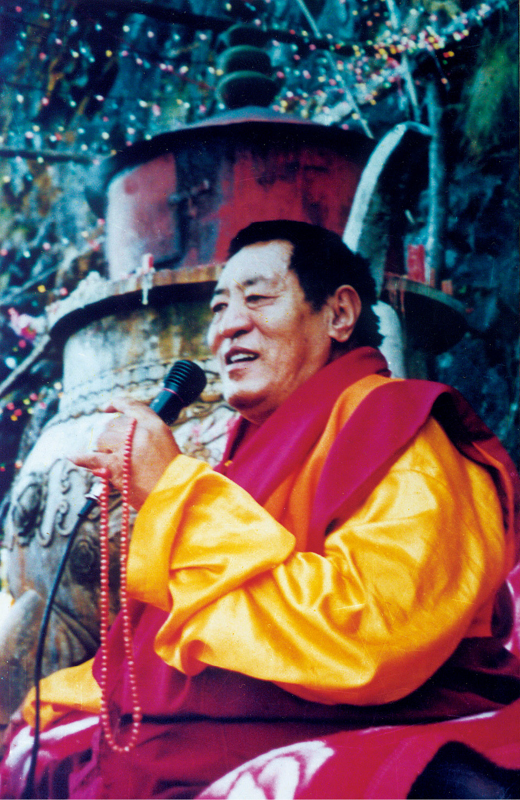

# 第35课

2022年10月8日

### 第59节·教法要点互不相违

通晓修传八大宗派、尤其是教传四大宗派的所有智者都明白，（各派教义）只是特法的提法略有不同，一句相违之处也没有。

我们一般讲的修传八大宗派，就是宁玛、格鲁、噶举、萨迦、觉囊、噶当、香巴噶举、息结。教传四大派就是格鲁、宁玛、萨迦、噶举。这些教派的所有智者都明白，各派的宗义，只是特法的提法略有差别，有些说大圆满，有些说大手印，有些说大中观等，实际上一句相违之处也没有。

虽然我不是智者，但应该是一个见多识广、经验丰富的修行人，我可以保证，佛教的要点决定无有相违。

法王谦虚地说，自己不是智者，但以修行人的经验，可以保证各教派的要点无有相违。这一点非常重要，不然总有些人存有疑惑：这个教派可不可以学？这是不是伪教？这是不是伪经？法王在这里已经讲得很清楚了。

班禅大师等所有圣贤大德都认同这种意趣，我们也深信佛教各派互不相违。我们必须懂得一切佛法互不相违的理念。

第十世班禅大师在世时也对此特别重视。上世纪80年代，班禅大师平反出狱后，视察过藏地很多地方。从我们学院去炉霍的路上，刚刚翻山的那个地方，下面有一个小小的亭子，法王如意宝和班禅大师都在那里讲过法，他们都倡导佛教各派互不相违的道理。我们作为法王的后学者，一定要知道，不管是藏传佛教、汉传佛教，包括汉传佛教中的八大宗派等，教义要点都是无有相违的，这很重要。

我们修传八大宗派的所有上师，其实都是同一位上师的幻化。无等阿底峡尊者在《噶当祖师问道录》中说：“最早辨别法规的是大堪布菩提萨埵，其他传承的所有堪布是他直接化现或加持的行人。”

辨别法规即开创佛法之意，这里可以说为：藏地佛法开创者是大堪布菩提萨埵（静命论师），其他传承的所有堪布都是他直接化现或加持的行人。这在《中观庄严论释》总义中有提及，大家应该记得，“正是在藏地树立起佛教的这位伟大亲教师，才使亲教师的源流代代延续、一脉相承，乃至未来佛法住世期间，凡是化现为亲教师身份的诸位大德，实际上与尊者静命论师均是一味一体。”

同样，所有大德也都是阿底峡尊者加持而幻化的。诸位上师是同一个智慧相续。

包括堪布堪姆们，应该都得到了一定的传承加持，所以从祖师的智慧相续上来说，我们应该对他们都观清净心。

如果有人问：“真的有别人不曾共称的密宗宁玛派‘内续三约嘎’吗？”

有人也许会问：“我们宁玛派不是有跟其他宗派不同的内三续吗？”

其实法王的这段话，是在北京的中国藏语系佛学院面向各派大德讲的，所以此处跟我们自宗的说法稍有不同。

总的来说，密宗所谓的“前译”和“后译”，是以前面翻译、后面翻译来安立的。在前译时期，密宗是共称的，如云：“囤弥桑布札，荣索秋桑前，所译诸经续，共称前译密。”在后译时期，如云：“仁钦桑波起，翻译诸经续，共称新后译。”这就是前译、后译的安立。

这个教证法王以前经常引用。《不凡》里的教证，我很希望大家全部背下来，以后也多用。这里说到了前译和后译的区分：从土弥桑布札一直到荣索秋桑（《入大乘论》的作者，荣索秋吉桑布）之间，这个时期所译的经续，属于前译派。从仁钦桑波（宝贤译师，阿底峡尊者来藏时会见的译师）之后翻译的经续属于新派或后译派。

在后译阶段，除了个别教典不是前译而只是后译的，其他的都是在前译阶段翻译过的。

前译派的水平是公认最高的。藏传佛教的《大藏经》中绝大多数都是前译的经典，后译的并不太多。

如果有人问：“那后译为什么要重译？”

在前译时期，教典基本都是古文，后译只是将一部分翻译成现代文，除此之外，后译时期，没有任何大的变动。所以，密宗四大续部是宁玛派（旧派）与新派一致承许的。

其实，前译经典也并非全部如此，只有一部分文辞特别古奥，后来又进行了改译。

如果有人想：“内续三约嘎是宁玛派特有的法吗？”

也不是，《密集续》和《密藏续》这二者基本是一个论体。大家仔细看一下，《密集续》和《密藏续》并没有什么大的差别。

法王在内续三约嘎当中举了两个例子。《密集续》就是《密集金刚》，《密藏续》就是我们的《大幻化网》，法王说这二者基本是同一论体。当然，在有些教义上，二者可以说大致相同，比如都有四灌顶的教法。法王当时可能是为了善巧引导那些听众，所以才这样讲。

如果问：“与大圆满也没有差别吗？”

与大圆满也基本相同。

法王故意把我们的大圆满说成和后译派密续没有差别。某种意义上也可以这么说吧。

你们大多数人都看过《甘露妙药》吧，但也有少数人没看过。这是南岩业金刚传授给宗喀巴大师的，里面说：“业金刚乃上师最，罗桑札巴（宗喀巴）弟子最，甘露妙药法之最。”关于《甘露妙药》，在宗喀巴大师没有出生之前，就已经有了一部（与之类似的）《空行心滴法类·金鬘问答录》，是邬金仁波切莲师传授给益西措嘉空行母，后来由伏藏大师班玛列则匝开取的伏藏品。

《甘露妙药》在宗喀巴大师全集中有收录，你们应该都没看过。这里的意思是，格鲁派的《甘露妙药》，跟宁玛派的《金鬘问答录》，很多内容都是相同的。比如，在《金鬘问答录》中，莲花生大士和益西措嘉空行母之间有一段对话，而在《甘露妙药》中，也有一段业金刚和宗喀巴大师之间的对话，二者意义相同，都是关于大圆满法。以前我们学院也印制过藏文的《甘露妙药》。

它们之间除了个别词句不同以外，只有一个差别就是，《金鬘问答录》里的“邬金仁波切告言”在《甘露妙药》中是“业金刚告言”，“益西措嘉问言”在《甘露妙药》中是“罗桑札巴问言”。

业金刚是宗喀巴大师传记中出现过的一位大德，是宗喀巴大师的上师，据说也是位伏藏大师。《甘露妙药》中业金刚的教言在《金鬘问答录》中是邬金仁波切所说。《金鬘问答录》中的问者是益西措嘉，在《甘露妙药》中则是罗桑札巴。二者除了这些差别，其他地方连词句都基本相同。

宁玛派没有比《金鬘问答录》更殊胜的一部所修大圆满了，这也是宗喀巴大师意趣的核心、究竟的归宿。“罗桑札巴弟子最，甘露妙药法之最”就是说，这是堪为之最的宗喀巴大师的究竟意趣。因此，法之间没有差别。

如果从前派、后派来讲，萨迦派、噶举派、噶当派、宁玛派等都叫藏传前派。至于后派，宗喀巴大师出世以后就称为后派。

关于前派和后派，或者说旧派和新派、前译派与后译派之间的划分，有各种说法，这里是以麦彭仁波切的说法为依据。

了知这点是很重要的，不然你们在藏地待了这么多年，连前译派和后译派之间的差别都分不清，那来到这里，除了学会吃糌粑以外也没什么用。现在有个人把糌粑叫做“滋粑”，说自己吃了好多“滋粑”。糌粑就是糌粑，不叫“滋粑”，知道吗？

上师麦彭仁波切说：“佛王龙钦绕降等，前派智者善说理，二佛罗桑札巴等，后派智者善说宗，多许印藏共称故，智宗实难下定论。我等今世生前派，是故唯随此宗言，虽不诋毁他之宗，不同承许立一方，少许不说不见故，如子随父略言说。”

麦彭仁波切的这个教证法王也经常引用。意思是什么呢？不论是佛王龙钦绕降等前派智者，还是第二佛罗桑札巴（宗喀巴大师）等后派智者，都留下了如海善说，对于这许许多多印藏共称的智者的观点，我们很难有决定之论。虽然前派后派诸位大德的观点和智慧浩瀚无垠，但麦彭仁波切说，自己今生有缘生于前派的教法之中，所以唯一追随这个宗派的说法。

我们在座所有人也应当如此。有一种说法是这样的：世上成就的上师有一百位，但与自己有缘的上师只有一位。虽然有林林总总的宗派和上师，但我们自己所学的是前译宁玛派。法王如意宝的教诫至关重要，虽然我们对所有宗派观点都应观清净心，但是自己所学的到底是什么，这绝不能错乱。

既然我等今生生于前译派当中，就一定要遵循本派的说法。虽然我不会诋毁其他宗派，但在不同的承许中，不建立自宗观点肯定是不行的，否则就根本无法见到真相。就像儿子应该随着父亲的说法而说一样，我们作为前译派的弟子，应该随着自己上师们的观点而言说。

对于麦彭仁波切的这个教证，希望你们重视起来。以前我为法王同步翻译的时候，只来得及译出大意，现在终于可以直接逐字翻译出来了。

这段教言应该成为我们今后人生的一种定位。不管怎样，这里很多人已经把自己人生的一部分投入到了前译派的教法当中了，我们念的经也好，修的本尊也好，依止的上师也好，得到的传承也好，基本都与这个教派有缘。既然如此，我们虽然不能诋毁其他宗派，但对于自宗的观点还是要牢牢记住，因为这是我们自己的定位。

有些人习惯人云亦云，没有什么立场。其实不管学藏传佛教还是汉传佛教，都应专注自己所学的法义。你学的是禅宗，就应以禅宗为主；学的是净土宗，就应以净土宗为主。所以，我希望你们对这个教证再再思考，深入理解。等一会儿我们就把麦彭仁波切的这个教证作为今天的讲考题目。

他的意思是，一般来说，前派有住地的如来王龙钦绕降等不可思议的大智者，后派也有至尊宗大师罗桑札巴等不可思议的大智者，如果以“这人的观点正确、那人的观点不正确”进行破立，那么像他这样的人实在无能为力。但这一世，他既然转生到了前译派中，如果子不随父而稍加说明，就不会见到自宗的意旨所在。所以，他稍微谈一下所谓的自宗、所谓的他宗，并不是带着嗔恨心……

麦彭仁波切说，如果要对各位智者的观点进行破立，那根本无能为力，也没有必要。所以，当我们谈及所谓自宗他宗的观点时，并不应该带着嗔恨心来诋毁任何一个教派。

这段内容有点多。听了那么长时间，还能专注，大家都很棒。你们能一直听下去，确实很厉害的，也许马上就要开悟了。

（堪布展示照片）

这张照片是法王在鸡足山照的。
