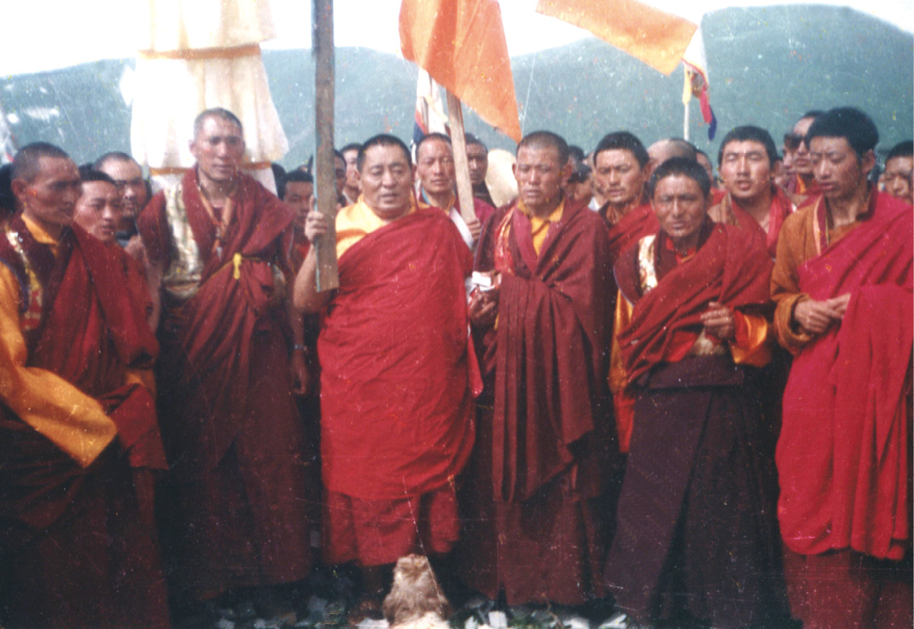

# 第37课

2022年10月11日

## 第11章 寺院法规

### 第61节·各寺必行三事

如果有人问：“你们学院对诸位上师、僧人有什么规定？”

那就是团结和合、清净戒律、闻思修行这三条。

法王讲道，如果别人问起我们学院有什么样的院规和基本纪律？那就是团结和合、清净戒律、闻思修行这三条。

“团结和合”是什么意思？

对上中下所有众生，以及萨迦、格鲁、噶举、宁玛等各派都不偏不倚，对所有持教大德都不嗔不谤，僧众都要团结和合。

团结和合是我们学院最根本的三个纪律、三个基本原则之一。这首先要求我们对上上下下的众生团结和睦。不论学院内部，各部门内部，还是各班内部，我们对待上中下的人都要如此。有时候对上可能相处得好，但对下却不一定，其实对下才更重要。同时，还要做到对各个教派不诽谤、不嗔恨。如果因为嗔恨说了一些诽谤之语，要在过夜之前马上忏悔。

否则，如果僧众之间发生内乱，那个地方会焚毁七层，谁也不会获得一点悉地。

戒律当中有这样的说法。某个地方的僧团里发生内乱，这一方的僧人和那一方的僧人产生了严重矛盾，这实际上就是一种破和合僧的行为。这种情况一旦出现，罪恶的火就会把那里七层的范围全部烧毁——就像原子弹爆炸过的地方寸草不生。所以，如果僧众中产生了严重的冲突，这种罪业会导致凡在此地的人都得不到任何悉地。

我们喇荣的僧团，一直以来都十分和合，从来没有发生过内部争端。但不管在藏地还是汉地，历史上都发生过一些僧众之间的内乱，甚至互相打杀。如果这样，就是毁坏了誓言，整个大地都会在无形中被烧毁，善根的种子在那个地方不可能开花结果。

因此，每个人都应该小心。寺院内部的上师之间要团结和合，僧人之间要团结和合，上师与僧人之间要团结和合，这就是团结和合。

法王是这样要求的，上师与上师之间、僧人与僧人之间、上师与僧人之间，以及各个部门之间、部门内部上下之间，都要团结和合。如果连和合都做不到，住在这里确实没有什么意义。

当然，我在这里并没有什么特别的所指。有些人天天觉得：“是不是在说我啊？”我看过一本书，里面这么说：如果感觉老师课堂上的话都是对自己讲的，说明你有进步。所以，也许这样想的人自己确实存有这种烦恼。

在我们学院，最关键的品质，就是跟大家合得来。很多发心人员，刚开始待人很热情，到了后面却与人矛盾重重，这是很不好的。人要有智商，但更重要的是情商，因为智商其实是建立在情商的基础上的。如果一个人情商不高、人际关系不好，即便他有特别超群的智慧，也派不上用场，最后还是利益不了众生。所以大家应该知道情商的重要性。所谓的情商，其实就是人与人之间的和合。有些人在这里待了十年，从来没跟别人吵过架，甚至没给过别人一个斜眼，心态一直非常平和，而有些人一天之中都会产生很多分别念、得罪很多人。

我现在愈发意识到人际关系的重要性，你想发心，想转法轮，想做任何事情，都离不开良好的人际关系。所以与人相处一定要和合，如果连和合的基本原则都没有，那什么事都无法做成，只不过是纸上谈兵和冰上建筑。

（堪布展示照片）

这张照片好像是在新龙拍的。那时候梅洛管家穿着那么漂亮的衣服，回头我要拿给他看一下。（众笑）

“清净戒律”是什么意思？

只要是出家的沙弥、比丘，最低限度要具备四根本戒和酒戒，一分都不能染污。

当然，出家人有比丘、比丘尼、沙弥、沙弥尼各自的戒条。对出家人的要求其实并不只是四根本戒，因为四根本戒一般在家居士都有受持。出家人至少要在四根本戒的基础上，具足出家戒。这段话可能是法王针对不同场合的受众讲的。

连四根本戒加酒戒这五戒都不具足的沙弥、比丘，是不会有的。这是此教法中唯一的本师——出有坏佛陀的言教，要慎之又慎。

这应该是法王在其他寺院讲的一些方便方法，是比较宽松的持戒方式。实际上出家人自己的戒律肯定要具足。

如果你是密宗行人，必须小心守护各大续部中提到的誓言。虽然有些人认为具足戒律和誓言只是出家人的事，所有密宗行人不需要守护什么。但实际上，密宗行人也必须守护誓言。

如果认为得过灌顶的在家人不需守什么戒律，这是不合理的。因为凡是密宗修行人，都必须守护誓言，这是密宗戒律所规定的。我们只要得过灌顶，就至少得遵守《大幻化网》的五种誓言或者密宗十四条根本誓言，这些是必须守护的。如果没有守护誓言，那你得到密法也没有多大意义，反而容易成为过失。

### 第62节·要了知佛教的特性

一般来说，我绝不会吝惜任何秘诀，不传给你们这些具缘弟子的话，又能传给谁？

法王确实给我们传了很多至高无上的大圆满法，任何秘诀都倾囊相授。

那天我开玩笑说：“我为你们该翻译的法本都翻译了，该讲的课都讲了，可你们有些发心人员，连技术都不肯教给别人。有些人的心很黑，跟别人交接工作时，因为自己心存不满，不但不给别人好好教技术，反而教了另一种很危险的方法。我若是也像这些人一样，岂不是要天天教你们下地狱的方法？这是很不道德的。”

法王如意宝确实是向所有弟子毫无保留地传授了窍诀，没有单独给谁传法，除非必要的时候，给堪布、堪姆传一点密法，而且也是大众以前听过的。除此之外，全都是在公众当中讲授窍诀，看每个人的缘分得到怎样的证悟。所以法王说，一直跟我这么多年的弟子，不给你们传，那我传给谁？

但是你们要按照我所传讲的去实修，就算是那些即将离开或者只想待一两年、一两个月的人，也都一样。

得到法以后一定要修。平时有些佛教徒说：“我听过上师一节课，我见过上师一面，这是我人生中最重要的经历。”那更何况我们有长年累月闻思修行的机会？如果对此一点都不重视，就太可惜了。

总之，每个人应该关心自己能否成就正法，没必要有过多的愦闹散乱。

大家来这里求学，最重要的是能不能得一点法、修一点法，离开的时候有没有收获满满。有的人下山时带走一大堆转经轮，其实这些有也可以，没有也可以。我们前阵子发的那个长长的转经轮，到时候你要走了，送给喇嘛也可以。关键是你的相续中能不能带走一些佛法，这才是最珍贵的。

最近各种事情都在进行，比如建造三宝所依、经堂等等。当然，这些土石不是佛教，大搞佛教排场也没什么用。

早期的时候，我们确实建了甘多拉经堂，喇嘛大经堂也修过几次。但法王这里说大搞佛教排场的，应该不是喇荣，而是别处。

佛法住世的时间量，按照时轮金刚的观点，到勇武轮王即位时，就只有三百年了。因此，一定要在佛法住世期间，以清净的意乐讲闻修行教法和证法。

关于佛法住世的时间量，法王在这里没有按照显宗经典的说法，而是依据《时轮金刚》的观点。这里意思是，勇武轮王即位的时间，距今还有三百年。历史上对此有不同的说法，说三百年、四百年、五百年的都有。勇武轮王是香巴拉二十五位国王中的最后一位。他即位之时，整个世界遍满边地野蛮人想要摧毁佛法，那时勇武轮王会显现忿怒相，以战争的方式降服一切野蛮边军。那个时候，麦彭仁波切和法王如意宝都会示现为勇武轮王的大臣来弘扬佛法。这是《时轮金刚》的说法，跟显宗的记载有些不同。因此，一定要在佛法住世期间，以清净的意乐讲闻修行教法和证法，这是非常重要的。
