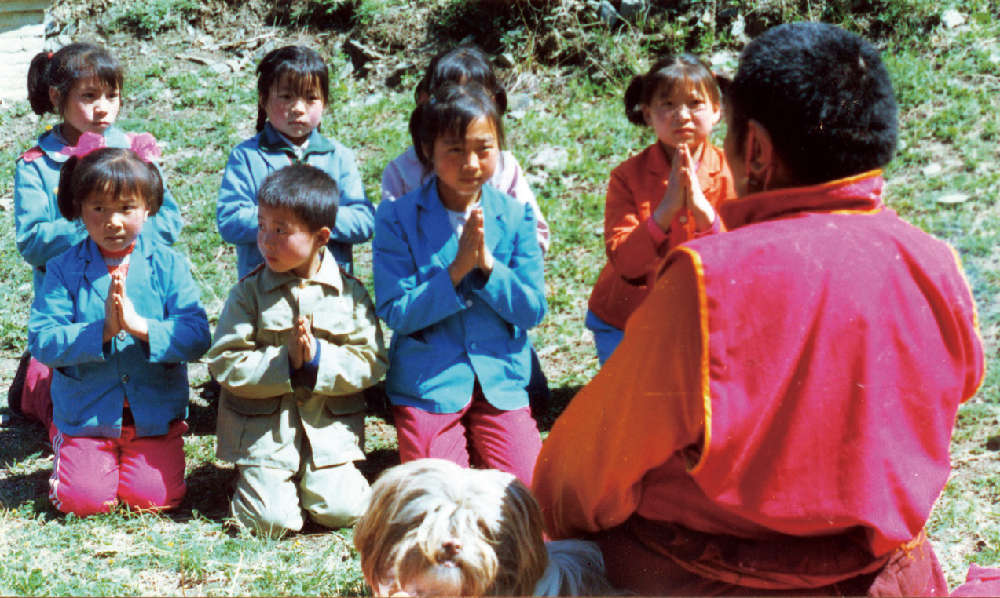

# 第38课

2022年10月12日

（堪布展示照片）

今天这一节里有一张特殊的照片。法王住在五台山的时候，有一天突然去了善财洞。当时我不在，法王身边的人说，那里突然来了七个孩子，他们都在法王面前恭敬合掌，法王也给他们传了一些法，过了一会儿，这些孩子就不知道跑到哪里去了。照片上可以看到，他们的衣服、表情，都很有意思。在藏地，可能会有这样的孩子集聚在一起听法，但一般来讲，汉地的孩子不会对佛法特别有信心，更何况他们还这么小，而且看起来年龄都差不多。那时候法王身边有一位名叫绕哲的警察，他和另外几个人都见到了这些孩子。没有见到这些孩子的人都觉得非常遗憾。所以这是一张很稀有的照片。

### 第63节·掏心掏肺的教言

总之，除了《胜利道歌·天鼓妙音》中所讲的毕生实修法以外，我再没有什么可讲的。虽然文句上没有漂亮的词语，但意思基本上是遵循如来及其随行者的诸位智者的言教传授的。所以，我觉得不会有大的相违之处。

《胜利道歌·天鼓妙音》就是《胜利道歌》。时语的意思是胜利之时的语言、教言。我们现在每年开始讲课之前，都会把这篇《胜利道歌》念一遍。法王说，其中的意义是很殊胜的。等一会儿我给你们念一遍传承。

你们各位要对集三世诸佛本体于一身的上师善知识有信心，对光明大圆满有正确的定解，要有菩提心，至少要守持别解脱戒中“居士四根本戒加酒戒”这五戒，并根据自己的心力尽可能地修行。

对上师善知识要有信心，这是前面顶礼句的意思。《胜利道歌》中，前面首先顶礼了文殊菩萨。对光明大圆满要有正确的定解，这是《胜利道歌》的第一层意思。要有菩提心，这是第二层意思。然后是要守持别解脱戒当中“居士四根本戒加酒戒”这五戒——在家居士是守五戒；居士以上，出家人应该守出家人的戒律。

尤其是实修甚深法的时候，要和具梵净行的同行道友见行一致，人格善良，然后要发愿往生极乐世界。

接下来一层意思是，要人格善良。最后要回向发愿往生极乐世界。

我以前讲《胜利道歌》的时候说过，此论内容在《三主要道论》的框架上又有不同。《三主要道论》讲了出离心、菩提心和无二慧，法王把无二慧诠释为大圆满，还讲了《三主要道论》中没有的内容，包括前面顶礼句中依止善知识，以及后面回向文中往生极乐世界的发愿。

我们每一个人首先要依止善知识，然后才能开始按次第修行。修大圆满需要有菩提心、出离心，还要以贤善人格为基础，有了这些，大圆满的高楼就能修成。最后再把一切善根回向，为往生极乐世界而发愿。

我们一生之中，所有的修行法要都包括在这六条里：先依止善知识，依教奉行；然后要有贤善的人格；守持清净戒律，居士守四根本戒加酒戒，出家人在这个基础上守好自己的出家戒；然后发菩提心；进而修大圆满；最后将所得到的一切善根回向给众生。

法王说，这篇《胜利道歌·天鼓妙音》是他的一生当中最深的教言。看起来似乎很简单，但实际上正如这节的标题——都是法王掏心掏肺的教言。

在《胜利道歌·天鼓妙音》中，除了这些全面完整的要点，再没有其他什么了。我一生的实修法也是它。对于我这些掏心掏肺的教言，你们应该表里如一去修行。作为传授者的我，虽然是个具有一切束缚的凡夫人，但我所传授的法，就像是从不净堆里得到的纯金。

法王在这里非常谦虚，说自己是个凡夫，但实际上他所说的都是纯金般的重要教言。

我觉得在这个《胜利道歌·天鼓妙音》中，绝对不可能有障碍你们修行解脱和获得遍知的错误之义。正因如此，《胜利道歌·天鼓妙音》所讲的教言无需再增、不可再减，这就是所谓“完整无缺的教言”。请大家牢记于心。

一个人要修行成佛，不需更多，也不能缺少，就是要有刚才所说的这六条——依止善知识，修持大圆满，发菩提心，守持清净戒律，具足贤善人格，以及发愿往生极乐世界。这六条如若不具，就有缺失；如果具足，就很完整。所谓“完整无缺的教言”就是这个意思。

为了一种缘起，我今天给大家再念一下这个传承。

（堪布念《胜利道歌》传承）

法王造《胜利道歌》的时间是1996年9月21日。法王说，他在近五千僧人中“即性而唱”。当时我们学院有五千多名僧众，现在这里合法常住的数字——喇嘛这边是一千五百人，觉姆那边是三千五百人，总共也是五千人。所以从1996年到现在，经历了几次整顿，有新增，也有清退，最后学院僧众的总体数字没减也没增，现在还是五千人，还算可以。
