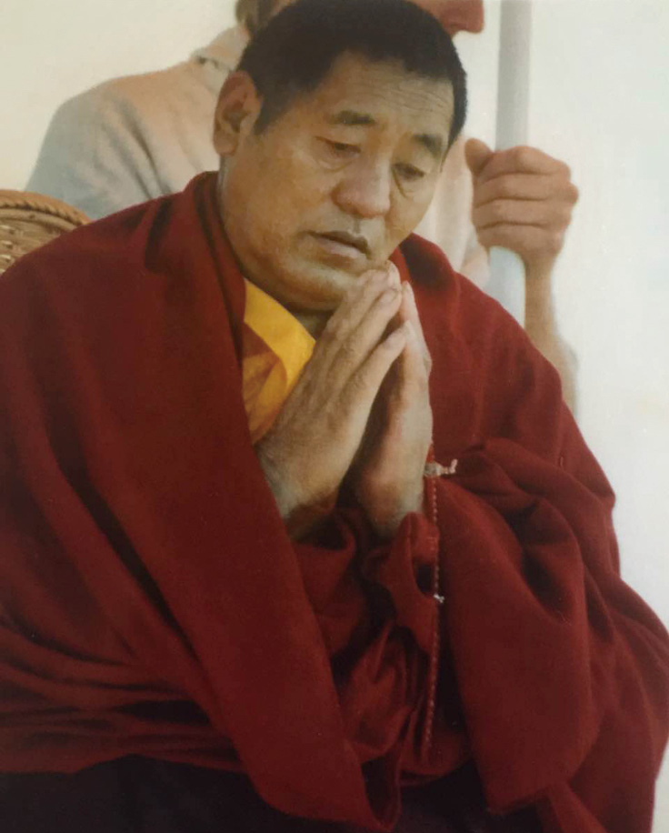

# 第39课

2022年10月13日

### 第64节·明明不是活佛不要冒充

在当今时代，有些人生为高贵种姓富裕家庭的儿子，一出生就被称为活佛，受到众人的尊重。

藏地以前有一段时间这种现象很多。一些比较高贵的家族，孩子一出生就被别人认定为活佛，这是一种很不好的现象。

有些人即使拥有高超的智慧、清净的戒律、贤善的人格，但如果种姓低贱、没有财富，也会受到歧视和羞辱。正如全知上师写给康巴人的信中所说：“愚较圣贤得势时。”

全知龙钦巴当时被康巴的一所寺院开除了，离开时他留下一封信，其中就有这句“愚较圣贤得势时”——愚笨的人比贤善的人更加受尊重、有势力，得到大家的欢喜。诚如当时全知上师所言，当今时代愚者反而非常受恭敬，有些人很会弄那一套，到处去化缘，欺骗了很多人。所以法王对某些活佛的行为比较不满。

自己明明没有功德，但如果无缘无故被别人称赞，那就是害人害己的因。

自己没有功德，别人说你是活佛，说你是法师，说你长得很好看，其实对你没有任何的好处。

当然，别人的相续不可揣度，我们在没有现前圣地之前，无法判断别人的相续是高是低。但是我们的心对自己是没有隐瞒、暴露无遗的，所以，自己要仔细观察自相续。

当然，人的相续都是隐藏的，除了极个别人外很难揣度。但一般来讲，自己应该知道，自己是不是真正的高僧大德，有没有真正超凡入圣的境界。所以，自己应该仔细观察自己的相续。

（堪布展示照片）

法王的这张照片应该是在法国拍的，当时是在一座山顶上。这张照片拍得很好。

当代，自己本不是某某活佛却说成是他的转世活佛，就算没有直接说，但假装冒充是他的人不乏其数。

有时候别人会说“你是某个活佛”。我们降魔胜利洲自从创立以来，从没出现过一个活佛，所以还不错。但有些人经常拿这个开玩笑，说这个是活佛、那个是活佛。即便是玩笑，这么说也不太好，万一对方信以为真，那就麻烦了。

活佛是藏地的“特产”，西方也有少数，其他地方很少有活佛。对于真正的活佛，我们也不会否认。历史上有些活佛确实是很了不起的，不管是智慧方面、戒律方面、人格方面，还是弘法利生的事业方面，都出类拔萃。从历代高僧大德的传记来看，他们确实非同一般，这样的活佛也是有，我们也承认。但也有一部分假冒“活佛”，这种现象不在少数。不过现在这方面稍好了一些，人们不再盲目追捧活佛了。即便你是活佛，如果没有功德，大家也不会因为一个身份而崇拜你。其实“活佛崇拜”，在某种程度上，也带来了很多不好的影响。

如果你是一个比丘，就有破别解脱根本戒的危险。

如果你明明不是活佛，别人认为你是活佛，你自己也承认的话，那就有说大妄语的可能性。

也有一些人，给非常非常小的孩子取上活佛的名字，这还不如给一个稍稍传授所有经论颂词注释的堪布取个活佛的名字要好。

法王这样说可能有什么特别的所指。给一个很小的孩子冠以活佛之名，他长大以后到底会变成什么样也不知道。如果他有很好的老师，也许还行，但这确实也很难把握。因为一位小活佛大概是五六岁、七八岁时认定的，然后他要一步一步地学习，真正说到弘法利生，可能要到二三十岁以后才可能出头，在此期间，他变成什么样都有可能。所以法王表态，还不如给稍微懂一些经论的堪布取个活佛之名。当时很多寺院也经常给堪布取各种各样的活佛称谓。

以前香港有一位活佛，他宣布不当活佛了。网上就有人评论说，这说明你根本不是活佛，如果是的话，就没有当不当的选择。好比世间一个官员，不想当的时候可以卸任，但活佛不存在卸任，即便你不想当，你也是活佛，那样宣布没有什么意义。

虽然很多堪布正在变成活佛，但我们佛学院的大多数堪布都稳重地安住着，说自己不是活佛，这很好。

“很多堪布正在变成活佛”，这句话带有一丝贬义。正在变成活佛，意思是原本并非活佛，但后来却当上了活佛。我们学院大多数堪布都比较稳重、安住，没有接受别人给自己安上某某活佛的名号。

（护士给堪布打吊针）可以了吧？我们的喇嘛护士手一直在抖。

法王的意思是，虽然有很多堪布正在被捧成活佛，但我们学院的大多数堪布都比较稳重，不被他转。当时确实有一股“活佛热”，现在好些了，活佛也没那么高的热度了。

如果你明明不是活佛却冒充活佛，就是犯了别解脱的他胜罪。你明明不是活佛，但有些愚笨的人认为你是而生信心，这就是欺骗众生的罪业，菩萨的大部分根本堕罪也将依此而生。

他胜罪就是破了根本戒。有的人自称是活佛，有的人则是想各种办法，比如到别人那里去说：“某某人说我是活佛，请你再认证一下。”别人以为他真被认定过，就附和道：“是是是，你是活佛。”然后他又把这话拿到另一个人面前寻求认定，经过这样几番“认证”，最后他就真成活佛了，这样的情况也有。

活佛转世确实是藏传佛教中一个比较复杂的现象。有些学者认为，取消活佛制度好一点，但也有些人认为，应该尊重历史传统，如果没有活佛制度，古往今来很多高僧大德的转世事迹都要被抹煞，那肯定不合理。

不管怎样，我们既不能相信所有活佛都是真的，也不能认为全部活佛都是假的。好比世间的珊瑚珠宝有真有假，活佛是这样，堪布、法师、格西也是这样。有些人是冒充的，有些人通过各种手段搞到这样一个学位，其实并没有真才实学。就像过去有段时间，我们这里学开车不用亲自考驾照，花钱就能办到。我认识的很多人，驾照都是买来的。虽然国家会发活佛证，网上也可以查询，但这只是政策层面的认证，真正从修证方面，或者从真正身份上来判别，真假也不好说。很多认定活佛的人，自己也未必搞得清楚——自相续中有一大堆贪嗔痴，自己要认定自己都很难，更何况认定别人的相续。

像法王如意宝那样了不起的大德，我们不得不承认，他肯定是某位圣者的化身，因为他的功德大家有目共睹。而有些“活佛”，前世赫赫有名，今世的表现却差距很大；中间只隔了一世两世，难道所有功德就全忘光了或者消失了？所以，法王在这里对某些“活佛”们说得很明确：欺世盗名，欺骗众生，菩萨的根本堕罪也会依此而来。

### 第65节·灌顶传法需有可靠传承

任何法，如果想弘扬给他人或自己实修，都需要一个可靠的传承。从自身来看，如果你还没有获得过灌顶，根本不可以实修、弘扬密宗法门。

我们修一个法，或给别人传讲，最好自己先有这个法的传承。尤其是密法，没有灌过顶的话，连法本都不能看。当然，有些情况下，如果得过无上大圆满的灌顶，比如《四心滴》的灌顶，即使没有亲自得过某个法，有些上师也开许修持。对于大圆满的有些法本，如果你曾得过某一个大圆满法的灌顶，其他法本你自己看也是可以的，但是不能给别人传。比如说，你得过《上师心滴》的灌顶，但是没得过《大幻化网》的灌顶，那能不能以前者来代替，给别人传《大幻化网》的灌顶？这是不允许的。你必须得过本传才能给别人传法。或者，我得过某位伏藏大师的灌顶，但另一位伏藏大师的法没有得过，那也不能给别人传没得过的法。

自己修法，最好先得过灌顶，但要是实在没机会该怎么办？法王下面也会讲。

当有些上师圆寂了，没办法在他们面前得受灌顶传承、引导传承的时候，可以按照《集上师密意》中所说“加持证悟入相续，自此可为他传讲”，即相续中获得了上师的加持证悟以后，即便没有传承，也可以把他们的法传给他众；

如果得到了上师幻化身的加持，就像智悲光尊者得到无垢光尊者的加持，法王如意宝得到麦彭仁波切的加持那样，虽然没有亲见上师，但在梦中或觉受中得到了上师的加持，相续中获得了加持证悟，即便没有传承，也可以把他们的法传给他众。

法王和乔美仁波切都讲过这种方式。如果实在无法在上师面前亲受，可以在上师的像前，或者观想上师在面前，通过书函的方式自己得受。但是这样得法之后能否给他人传，有两种说法，严格来讲，自己确实在上师前得到这个法以后再传给别人，这样更好。

再者，如果在梦里面见上师、听受言教，他亲口传授了完整的言教，自己也得到开许，那可以将此法弘扬给他众。除了这些情况之外，不管是什么法，没有来源、没有传承的话，都不能为别人传讲。

梦里见到某位上师，得到他的传承，这种情况可能许多人都有过。我也做过很多这样的梦，但一般来讲，自己是不敢以此来传法的。其实自己梦到的这些法，很多都是上师以前传过的。一些真正的大上师，他们确实可以在梦里得到传承，再给别人传授。虽然法王这样讲，但我们自己还是应该慎重一些比较好，最好亲自在某位上师面前得到传承，再传给别人，这样加持也会不同。包括我们自己修法时，最好也先得到这个法的传承。所以，传承是非常重要的。

尤其是密宗金刚乘，灌顶引导窍诀都需要有传承才可以宣讲。虽然有些人认为只要懂一点灌顶的仪轨就够了，但实际上，单单的灌顶仪轨，依靠法本没什么不会的，但它也必须是由一个传承金线未被破誓言之锈染污的人来灌顶，而不是随随便便就能灌顶的。

灌顶的仪轨和方式，一天就能学会，也没什么特别的。只要懂得灌顶流程，会念仪轨，就随便拿个铃杵给人灌，那是不合理的。

此外，考虑到后代的修行人，以金刚手菩萨为例，他是三世诸佛无分别智慧显现为菩萨的形象，虽然大家都知道他不需要求灌顶，但是显现上，为了遣除随便将灌顶引导弘扬给他众之人的邪分别念，他特意请求灌顶，前往东方、南方、西方弘扬密法。

金刚手菩萨是这样示现的。续部中有很多他的传记和故事，他经常为了遣除一些人随便传授灌顶的邪分别念，一会儿到东方去，一会儿到南方去，一会儿到西方去，特意在诸佛面前请求灌顶，之后才继续传授密法。所以我们只有真正得到了灌顶和传承以后，才可以自己修持。

我们这次学习《不凡》，字面上是很容易的，但我想，这里面的内容，除了极个别不太敢确定，我应该都在法王面前得过，所以把这个传承给大家，也是很好的。以后你们将法王的这个传承，给他人传讲也好，自己阅读修行也好，都比较方便。得过传承以后，对这个法的感情确实会大不一样，这就是所谓的加持吧。比如说，我们以前没有得过《妙法莲华经》时，就只是将它作为一部佛经来看待，好像离自己不远不近，但是得到了《法华经》的传承以后，自己随时都能与这部法相应，感觉跟以往完全不同。

所以，对于得到了传承的佛法，你们应该更加重视。即生中也许有弘扬的机会，也许没有，但只要得到了这样的传承，没有中途失去，将来生生世世中，就会有弘扬此法的殊胜因缘，这是很重要的。

我想，大家得到这些法，应该是很快乐的吧。在如今这个战争、瘟疫逼迫的五浊恶世，人们常常彼此怀着恐惧、嗔恨，或是对别人的财富、地位心生贪婪，社会也变得格外复杂。这个时候，我们能在寂静的山里，过着一种清净的生活，这是非常难得的。

今天我见了一些各种来头的领导，他们认为，喇荣的生活条件，显而易见跟大城市有很大差距，但从另一个角度看，这里的生活就像世外桃源一样。确实，我们大家每天在这里修自己的法，过清净的生活，与别人不争不恨，这种生活方式，即便是世间没有信仰的人，有时候也会羡慕。所以，我们自己不要身在福中不知福。现在得到了这些佛法传承，未来终有一天会庆幸：“那时候得的法确实很重要！那真是一段美好的回忆、精彩的故事！”每个人都会追忆往昔，那个时候，你们对自己人生中的这段特殊历程，会有一种别样的回味和美好的记忆。

所以，大家应该保持一个好心态，这是很重要的。我们平时听法、闻思、发心，应该在一个良好的心态中进行，这样一切都不是问题。可如果心态不好，哪怕我们身处黄金的宫殿，品味天人的佳肴，享受最好的侍奉，快乐也不一定能增上。其实，只要有一点知足心、一点感恩心，快乐很容易就能得到。我们应该感恩这里的山山水水，感恩这里的所有人，这很有必要。看看我们现在的环境和生活，这是许许多多人付出无数努力才形成的。

懂得了感恩，心就会变得柔和；心柔和了，外面的世界就会更加美好。心要是特别粗糙，充满嗔恨、嫉妒、恐惧、痛苦，外境即便像天界一般，感受到的也是残酷的处境。所以，我们在拥有的时候，应该怀着感恩的心。谁也不知道自己能活多长时间，但将来终有一天，我们会对这段闻思修行的历程，有刻骨铭心的感受。
