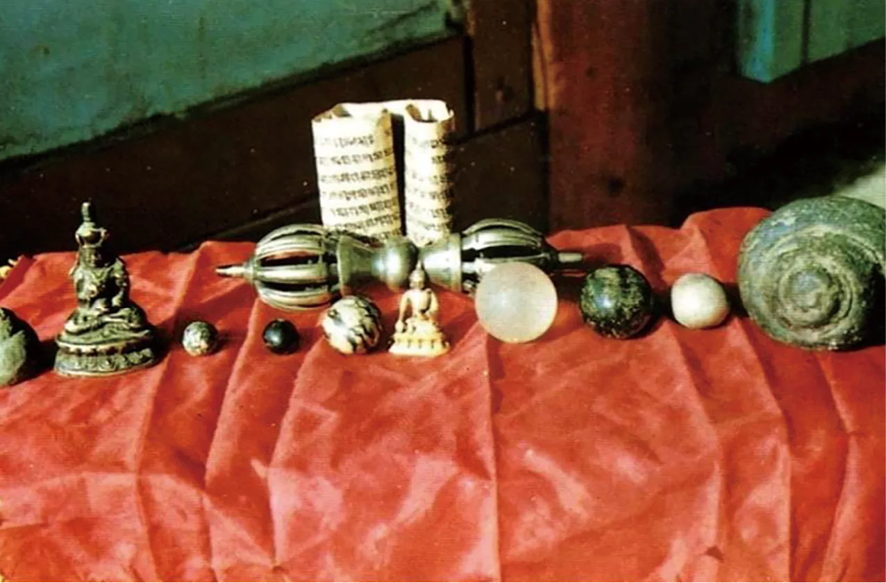

# 第3课

2022年8月10日

### 第4节·法圆满

关于法圆满，菩提金刚的授记中说：“广弘显密教法如明日。”总的来说，这所喇荣佛教大学的四众眷属，都正在学修下至四厌世心、上至大圆满的佛法。

就如《三主要道论》所讲[^1]，人身难得、寿命无常、轮回痛苦、因果不虚，修前二者能对今生产生厌离，而修后二者能对来世产生厌离，所以这些统称为四厌世心。在我们这所喇荣佛教大学，下至四厌世心，上至大圆满法，大家都在日夜学修。

如果有人问：“我们师徒实修法要的真正核心是什么？”

它是以别解脱戒为基础，以菩萨道为扩展，以大圆满为究竟，这样的窍诀是必不可少的。

这段话很重要，我们首先要有别解脱戒的基础，然后再以菩提心摄持，行菩萨道，最后以大圆满的见解来达到究竟。这三者也可以解释成出离心、菩提心和无二慧。这样的窍诀是必不可少的。

其中，就别解脱戒而言，汇集了如海律典的要义、比《根本律》更为超胜、具有五种特法的就是《戒律花鬘论》。

功德光尊者的《根本律》法王以前讲解过。这部论现在藏僧这边也在学习，但还没有译成汉文。法王说，比之更超胜的是《戒律花鬘论》。早期法王对这部论是很重视的，但现在学院里好像没怎么传讲。1985年我从金旺堪布那里得了这部法，1988年给一些藏族喇嘛讲过一遍。《戒律花鬘论》在汉传《大藏经》中名为《根本说一切有部毗奈耶颂》，共有三卷，是义净法师翻译的。汉僧这边以前也有一些堪布、堪姆传讲过，包括戒智堪布，记得出过一本厚厚的讲记。义净法师的翻译不是太好懂，但也可以学习。

我本想把这部论以浅显易懂的方式翻译出来，可是一直没有时间。当初还想连同荣敦班智达的注释一起翻译，但人生苦短。我认为翻译这部论是很重要的，希望以后能有这个机会。

虽然随着时间的推移，在这片雪域中讲闻这部论的传统似乎暂时隐没了，但现在我们师徒就像森林中的花朵，正在广兴讲闻它的事业。

虽然讲闻《戒律花鬘论》的传统在藏地一度隐没，但由于法王当时的重视，这部论又重新得以弘扬。说到个中缘由，其实法王的前世就是此论的作者——印度阿罗汉萨革拉。

接下来，菩萨的教言中，无与伦比的要算是《入菩萨行论》了。大圆满阿底约嘎中，具足所有窍诀精华的，就是《上师心滴如意宝》。

《入菩萨行论》大家都熟悉，我就不多介绍了。在我刚来学院的时候，法王最重视的就是《戒律花鬘论》、《入菩萨行论》和《上师心滴》这几部法。《上师心滴》今年大家都得到了灌顶和传承，但光是看看法本，你们也不一定能懂。有些法必须经过讲解才能明白，就像我们学过的《入大乘论》，光是把法本给你看，估计你也是一头雾水。只有听闻讲解，认真研习，才能真正通达法义。《上师心滴》也是如此，以后有机会，大家应该好好学习一下。

从这所佛教大学成立至今，一直在不间断地全面讲闻修行这些论典。只要喇荣佛教大学存在，你们诸位就必须不断弘扬这三种佛法。这就是法圆满。

上面讲到的《戒律花鬘论》、《入菩萨行论》和《上师心滴》，是法王如意宝特别重视的三种法。这就是法圆满。

（堪布展示照片）

这张照片是以前我和丹增活佛、慈诚罗珠堪布一起写法王略传时拍的。当时我们请示法王，能不能把他的伏藏品放在一起拍张照，法王同意了。照片里都是法王亲自取的伏藏。那个黑色的海螺宝箧取自桑耶青普，作明佛母的仪轨就是从那里面取出的。

照片里的这些伏藏品，其实就相当于世间的各种U盘。U盘里可以存储很多资料，通过一些特殊的方式打开后，就可以把里面的信息导出来。其实伏藏宝箧就是这样的原理，很多依靠空行的秘密手印印持的伏藏品，通过伏藏师的一些秘密手段，可以被开启，取出真实的经文。照片里的纸卷上写的就是空行文字。这些伏藏品就像特殊的U盘，只有在法王如意宝智慧的“电脑”上才能打开，一般的电脑可能型号不匹配。

[^1]: 《三主要道论》：“人身难得寿无常，修此可断今生执，无欺业果轮回苦，修此可断后世执。”
