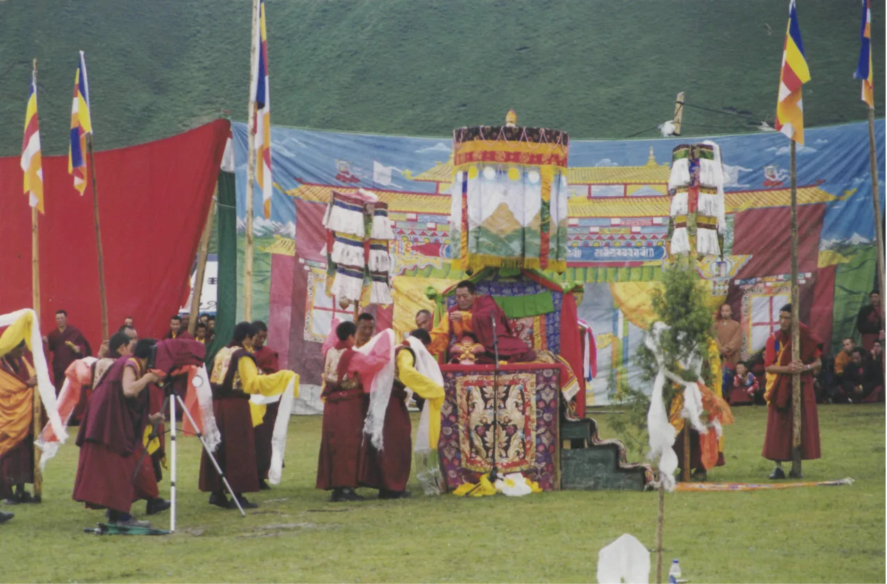
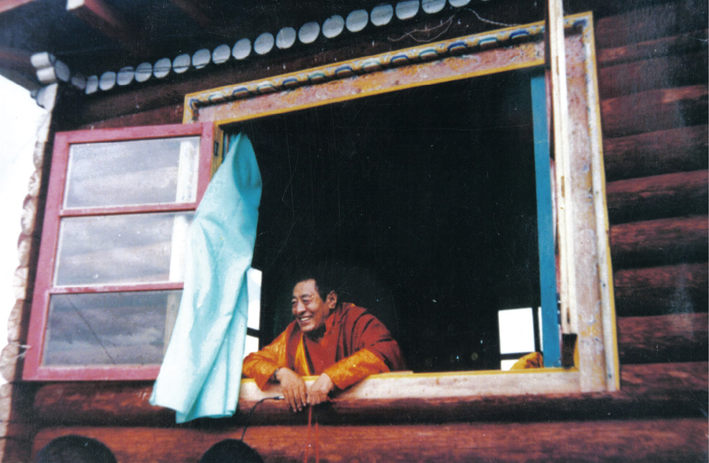

# 第40课

2022年10月14日

（堪布展示照片）

这张照片好像是一个跳金刚舞的现场，可能是在丹坚神山下面，觉姆们正在给法王献哈达。那边站着一位汉族僧人，不知道是谁。

这应该是早期法王院子里的照片，那时候法王还没有搬到大经堂上面。

### 第66节·做事平等

比如给僧众供斋时，有人说：“因为某某是我们那里的堪布、活佛，所以不能让他们做事。”谁也不能这样说啊。

这一点以后要注意，活佛也好，堪布、堪姆也好，大家做任何劳动，都应该把他们安排在里面。平时有活要干的时候，“堪布、堪姆肯定不用做。”不管卸货还是做其他事，总给他们搞特殊待遇，“您是最尊贵的，怎么能干这个！”他们自己也习惯了，听说有些堪姆住公寓里面，都不打扫公共卫生，因为值日都不安排她们。现在这个现象似乎比较严重，今天讲了以后，大家要改过来。

没有“堪布活佛不能去积资净障”的说法吧？不要搞特殊化！

法王说不要搞特殊化，这方面确实应该注意。一旦有人搞特殊的话，对学院非常不好。法王以前讲过，为了显示法的珍贵，堪布堪姆们讲经说法的时候，有必要给他们设置一个法座。堪布、堪姆来上课时，大家应该起立，迎送的时候都要这样。但除此之外，大家做事应该人人平等。除非有些堪布、堪姆身体特别不好，那可以开许不参加劳动。佛陀也允许身体不好或者年老体衰的人受特殊照顾，但也仅限于此。大家都是为僧众服务，正如法王所讲，这实际上就是积资净障，谁都不能免去。阿底峡尊者即使出行在外，也随时都在积资净障，所以谁也不能搞特殊化。

如果他们没有来做事，就必须遵循僧众内部的规定来执行。

如果他们不来做事，那该批评的要批评，该惩罚的要惩罚，该罚款的要罚款，一切要按规定处理。

有些不明事理的人说：“他们是非常尊贵的，不能让他们供灯供水。这些事情要由调皮的小僧人们来承担。”这种说法是不合理的。

很多寺院供灯、供水、扫地之类的杂务都是沙弥来做，而活佛、堪布是很尊贵的，什么都不用做。但依照法王的教言，有些规矩在我们这里改了。拿分念经钱来说，有些寺院的惯例是这样：给最大的上师发1000块，给重要的人物发500块，其他人发200块。这种情况在我们学院从来没有，我们这里一视同仁，你念了经就有一份念经钱，没念的话，即使你是活佛、堪布，也不能分钱。

但我听说有些班级分会供品时，经常给堪布、堪姆多分一点，其实这有很大的过失。为什么呢？因为这是僧众的财物，任何人都只能得一份，没有多分的资格。只有会供的主法者有一种特殊情况，当仪轨念到“喇嘛华沃钦波恭色所（上师大勇士垂念）”的时候，会做一个小食子，给他分一点点，有这样的规矩。除此之外，分东西的时候，千万不能偏待，“这是我们的堪姆，给她分三颗糖，其他僧人分一颗”——这样其实会犯戒。堪布堪姆们也不缺这一点点，但你这么做过失很大，会造下严重的恶业。你如果给谁特殊对待，其他人也会说：“这是我们的堪布，我们的堪姆，要多供养一些。”有的人分发会供品的时候，对关系好的人，“来，这个给你两份”，如果对方真的接受了，也会受很严重的果报。

你用自己的东西供养是可以的，但是对于僧众的财产，绝不能因为身份高一点、关系好一点，就分配不均。戒律中讲过，僧众的财产是非常严厉的对境，哪怕一针一线都必须平等分配。自己私人的财产，分给别人也可以，供养法师也可以，但僧众的财产，不管是谁，都不能搞特殊化。

所以，不论做事还是分配，一定要人人平等。堪布堪姆们本身是给大众讲经说法的人，自己也该懂道理，不要用特权随心所欲，“独揽大权”，这样肯定不行。所以希望大家做事的时候，给堪布、堪姆也同样安排任务。如果给他们搞特殊，那跟世间人有什么区别？世间很多人都是因为有点官位、有点权力，就毫无顾忌，为所欲为，最后变成了腐败分子。

所以我认为佛教团体中应该一视同仁，尤其是稍有权力和地位的人，更要低调谦虚，任何特殊化都不该有。大家都知道，我们学院向来是处处平等的。法王在世时，不论来了什么样的大德，都和大众一样，座位一样，收入一样。除了僧团安排的发心负责人以外，大家的权力也都是一样的。这就是我们这里与一般社会团体不同的地方。希望大家以后注意这一点。

## 第12章 细辨善恶

### 第67节·业果甚深

如《百业经》云：“众生之诸业，百劫不毁灭，因缘聚合时，其果定成熟。”

《百业经》主要讲的就是这个道理。这里的意思是，众生所造的业，纵使过了百劫也不会毁灭，一旦因缘具足，果报就一定会成熟。

所谓众生，就是具足业和烦恼依他起的身蕴者。即使他们造了一个小小的善业、不善业，过了千劫也不会虚耗。在没有真正感受到那个业果之前，由于因果不虚而不会灭尽。

众生就是如此，所生的善心、恶心，所做的善行、恶行，比如杀生或者是放生，所有这些善恶业，即使过了千劫也不会虚耗，并不会过一段时间就自己消散。每一个人必然要感受自己造业的果报，感果之前，业力是不会突然耗尽的。

如果有人问：“谁能了知业果的细微密要呢？”

只有遍知出有坏佛陀才能知道。除了佛陀，没有人能用分析智慧来了知业因果的细微奥秘。当今时代，在这个世界上被公认的智者可能对它略知一二，但只有获得了遍知佛陀的果位，才能真正被称为“遍知”。

业因果的真正奥秘，唯有佛陀才能完全了知。世间有些智者可能稍微明白一二。他们虽然不信仰佛教，但是也认为业因果很有道理，所以相信因果。我在外面交流时经常遇到这样的人，虽然不是真正的佛教徒，但他们对业因果也有所了知，在这方面有一定的见解。

大智者们也是根据出有坏佛陀和住地菩萨所说的来宣讲业因果。

业因果的真正道理，像龙猛菩萨、月称菩萨这些得地菩萨，或是功德光尊者、释迦光尊者这些大律师、大智者，也是依靠佛陀的遍知智慧所抉择的道理来宣说的。

怙主龙树也说过：“以理分析能解空性义，极难了悟因果甚深法。”

这个教证的意思是说，如果想要理解空性，可以学《中观四百论》《中观根本慧论》等论著，依靠理证分析就能了悟，不是很难。但是因果甚深法极难了悟，只有佛陀如来的境界才能了知。所以我们一般讲到戒律中的因果之理时，是无法用比量来推理的，只能用教证说明。因为佛陀是量士夫、是遍知，所以我们要相信佛陀说的道理，否则，很难用推理来证明善有善报、恶有恶报。某种意义上讲，因果法比空性法还要深，不能像空性那样能以理了达，但是大家一定要相信业因果，因为这是遍知佛陀所说。

只要相信因果，所有修行都会很容易成功。如果不信因果，那你表面上出家也好，修行也好，做什么事情都没有意义。所以，学习佛法的核心，就是在相续中对因果法理产生甚深的信解。有了这种不可动摇的信解，才算真正成为一名佛教徒。

有的人表面上做得很如法，但实际上心里对业因果并不相信。现在世间人大多都是这样，对“善有善报，恶有恶报”的说法半信半疑，没找到相信因果的理由。甚至有些出家人，也经常怀疑行善造恶到底会不会有果报。我们要对因果之理形成定解，应该多学习一些佛陀关于业因果的教言，这样自相续中的因果正见就会越来越稳固。
