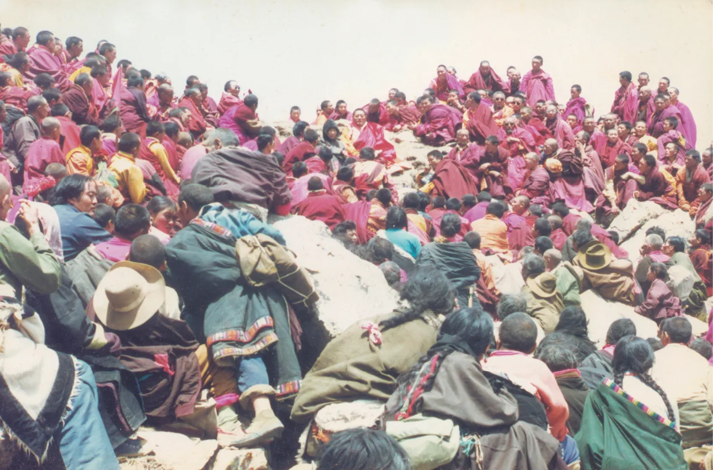

# 第41课

2022年10月15日

### 第68节·可享用信财的两种条件

上师、僧人中比较好的一类人，不享用信财。

藏地和汉地情况不同，藏地的出家人，因为有家里支持，所以一般不需要别人的供养。有些人在这方面非常注意，从不享用信财、亡财，这是比较好的。但法王这里的意思是，如果具足了下面的条件，作为出家人，也可以享用信财。

真正来说，享用信财需要具足两个条件：清净戒律、智慧。第一个是具备清净的戒律，这里戒律是否清净的标准，是按照《戒律海》所说，四根本戒加上酒戒要不染过患。

享用信财需要具足两个条件，一是清净戒律，二是有闻思修行的智慧。这里戒律清净的标准出自《戒律海》。《戒律海》是《根本律》的注释，意为律藏大海，篇幅浩大，比《释迦牟尼佛广传》还长，在藏传佛教中算是一部大部头，是后来的措玛瓦大师所造。里面说了持戒最低的底线，即杀盗淫妄四根本戒以及酒戒，这些不可染污。

在此基础上，我们还需要小心警惕自性罪。

自性罪有十种罪行，也就是我们说的十不善业。这是最基本的持戒要求，不用说出家人，即使是在家居士，远离十不善业也应该问题不大。

第二，在清净戒律的基础上，要尽心尽力精进闻思修行，具足智慧。如果满足这两个条件，就可以享用信财。如果这两个条件非常圆满，那么即使给你供养了三界全部财物，你也完全有资格享用，不需要害怕。这是出有坏佛陀说的，不是别人说的。

在这两个条件的基础上，闻思修行方面能做到日日夜夜不间断，戒律清净方面能守持好出家人的细微戒条，对比丘、比丘尼、沙弥、沙弥尼的戒律都能护持圆满，那么即使给你供养三界所有财物，也完全可以享用。

但有些人或因担心，或因懒惰，一直不愿享用信财。现在学院的念经钱很多人都不领，有的是担心念经耽误闻思修行，有的是害怕染上享用信财的过患。我那天问了一下，汉僧这边接受念经钱的人并不算多。这当然都凭个人自由，但如果经济方面比较紧张，出家人领点念经钱作为生活费，也没什么不好意思的。

有些人可能觉得：“很多人都不需要念经钱，我去念的话，有点难为情，还是不去了吧。”其实不必这么想，许多前辈高僧大德生活都很清贫。作为出家人，过得太富裕确实有点不好意思，但如果生活节俭，知足少欲，稍微贫寒一点，那是很正常的。这是从佛陀时代延续至今的生活方式，衣食从简，甚至日中一食。所以，生活条件不太好的人去领点念经钱，是很合理的。现在念经一个月领1000元左右应该没什么问题。听说有些人自己去念经，然后把领到的钱又交给僧众念经，这样有点奇怪。生活上没问题，非要拿念经钱再做功德，从僧众那边左手拿过来，右手再交上去，会不会有点累？但也可以，不管怎样做，都是你们的自由。

以前我刚来学院的时候，是很重视念经钱的。那时候纪律还没那么严，可以边念经边看书。不过你们在念经的时段里要好好念，如果不念，光坐在那里，是不能领钱的。现在基本上一个月念经有1000元，如果每天都念一个小时，那就是30小时，每小时应该合多少钱？如果这一小时中你什么经都没有念，拿这份钱是不行的。别人供养这份钱，是让你念经，不是让你坐在经堂里。这钱要么是活人的，要么是亡者的，既然交给你念经，就要按施主的要求去念。如果施主的要求实在不能一一做到，我们也有每天安排念的经咒，维那师会带领大家念。念的时候应该尽量认真，不好好念经，光是做个样子，是不能领钱的。

以前我念经的时候，在这方面还是很注意的，因为害怕自己消受不了。所以念经的时候，虽然偶尔会看看书，但除此之外不会互相说话分心。听说有些人在念经的一个多小时中，一直在交头接耳，这样拿念经钱到底合不合理，也不好说。甚至还有些人念经时一直在辩论，施主交钱可不是让你们辩论的，他们要么是为亡人超度，要么是为生者祈福，这才是交钱念经的目的。如果别人给你费用，让你做个水泥工程，你光是到工地上打坐，这是交不了差的。我早年大概有两三年的时间，都在很认真地念经，但后来就没怎么念了，尤其是去五台山以后，开始管理汉僧，渐渐就没时间了，去印度之后就彻底没再参加了。

我们各自的智慧和戒律到底怎么样呢？如果稍微符合要求，享用信财就不会有过失。尤其是，如果能以菩提心和慈心摄持，那是最好的。

刚才讲了享用信财的两个条件，这里法王进一步讲明，能以菩提心和慈心来摄持是最好的。这里只提到慈心，可能有些反体不同，但只要有了菩提心，悲心等也都会有的。念经时，要希望自己今天所念的经对这些有缘众生有真正的利益，然后认真进行这一个多小时的法行。正如华智仁波切在《大圆满前行引导文》中所说，“于人垫上净己障”，在别人的座位上，圆满自己的资粮。

（堪布展示照片）

这张照片应该是法王刚到五台山时拍的。本来我在上面打了记号，但书中没有印出来。法王的右边，是华觉嘉措上师，他是一位很了不起的高僧大德，原来住在法轮区那边。那次去五台山之后，没过多长时间他就示现圆寂了。

里面好像还有我，从披单看应该是，当时我们的披单全都放在这里，用一条线捆上。旁边后面那位是秋巴堪布，洛若寺的一位堪布，也非常好。我在《梦尘回忆录》里写过，他当时越过冈底斯山去印度，替我留在敏珠林寺任教，后来在美国圆寂了。

当时我们刚到五台山，有很多藏族老乡和出家人跟随。法王好像住在中台，大家聚集在那里，法王就顺便做了一些开示。后来念了十来天《普贤行愿品》，很多人，包括华秋嘉措上师，就先回去了。当时情况比较紧张，来自中央的、省里的、州里的工作组过来检查，让我们暂时躲开，大家就各自分散在山谷里面。法王去了善财洞，过了大概一个月，情况就平息了。后来我们到了那罗延窟，又去了清凉石，然后一同发愿。当时就是这样的情形。

我最近看到了这张照片，觉得很有意思，就分享给大家。看看当时我们藏族老乡，都是这样的穿着，那么多人来到五台山，在火车里也发生过很多精彩的故事。（众笑）

### 第69节·转经轮来源需要清净

从现在开始，所有住在喇荣佛教大学、以堪布活佛为主的僧众，无论是印经幡还是做转经轮，都是一样的：不要有很多混杂，要按照续部与窍诀中所说的去做。不然，用伪心去造作，说得特别漂亮，虽然没人敢说那是恶业，但也绝不会断言是善业。

不能用虚伪的心去做转经轮或者经幡。有些人是为了达到各种目的，以自私自利的心来做的。

我们以前做的观音心咒转经轮，只是单单把观音心咒放在里面，没有和其他内容混在一起。如果混杂了其他内容，暂且不说是不是善法，甚至不知道会不会变成罪业。

这段开示可能是法王在后期讲的。当时有一段时间，藏地出现了很多不同内容的转经轮，有些还把《大藏经》中一些续部经典放在里面。

如今，不仅在藏地，在印度和美国等地，据说我们这个小小的观音心咒转经轮也很有名。

喇荣的转经轮在那个时候很有名，现在应该更有名。藏地以前有一位玛尼喇嘛，他特别提倡用转经轮，那时候藏地到处都有《圣大解脱经》和观音心咒的转经轮。特殊年代中转经轮基本消失了，后来法王恢复了这个传统，转经轮又得以复兴。

他们都说喇荣的观音心咒转经轮不可思议，非常清净，首尾不颠倒，没有混杂，纯净无瑕。

很多人都赞叹我们的转经轮。法王有时候听到别人赞叹我们喇荣五明佛学院，也会在课堂上直接讲出来。

虽然有人随心做了一些《招财》《一子续》《别解脱经》等的转经轮，但不知道这是好是坏。

有些转经轮里把《一子续》还有各种各样佛菩萨的咒语放在一起，这样好还是不好很难说。

我从来没见过可以把佛陀的经典及其随行的大智者怙主龙树等的言语都做成转经轮的可靠依据，所以不敢说这是否正确。

我们最近刚做了《圣大解脱经》的转经轮，这是法王当时同意的。以前玉科喇嘛、玛尼喇嘛都做过《圣大解脱经》转经轮，这在藏地非常普遍。所以，跟其他经咒不同，用《圣大解脱经》做转经轮，是有可靠依据的。

但绝对正确无误的，是观音心咒做的转经轮。虽然时间不长，但我们这个小小的转经轮，被称为喇荣五明佛学院转经轮，已经名声大噪，正在广泛地利益众生。

此外，观音心咒转经轮的结尾，无需添加金刚萨埵心咒、莲师心咒、缘起咒等。

以前也有在观音心咒转经轮后面添加其他咒语的做法，所以法王在此专门指正。

虽然不是说这些不是正确清净的法，但只放入观音六字真言就足够了。从现在开始，无论你做什么转经轮，都应该遵循确凿可靠的圣教，那里面讲的才是千真万确的。

所以我们要遵循前辈大德们的教言和传统，这非常重要。

同样，我们印经幡的时候，也需要按照经续中所说的那样去印。尤其是“大自在祈祷文”这个经旗，上师麦彭仁波切老人家亲口说：“如果把它做成火轮、风轮等，会获得相当于念诵的功德。”

以前有的转经轮是用火力驱动的，还有风力吹动的，现在主要是电动的。这样转动的话，会得到与念诵等同的功德。所以“大自在祈祷文”是可以用来做转经轮和经幡的。

但是，它的结文中没有写五大陀罗尼咒、皈依偈、住世祈祷文等，所以不需要在最后写那些。否则，就算不成为罪业，又怎么知道会不会成为善法呢？请不要这样做。

我们有时在装藏中会用到五大陀罗尼咒，但装藏需要，做转经轮是不需要的。
