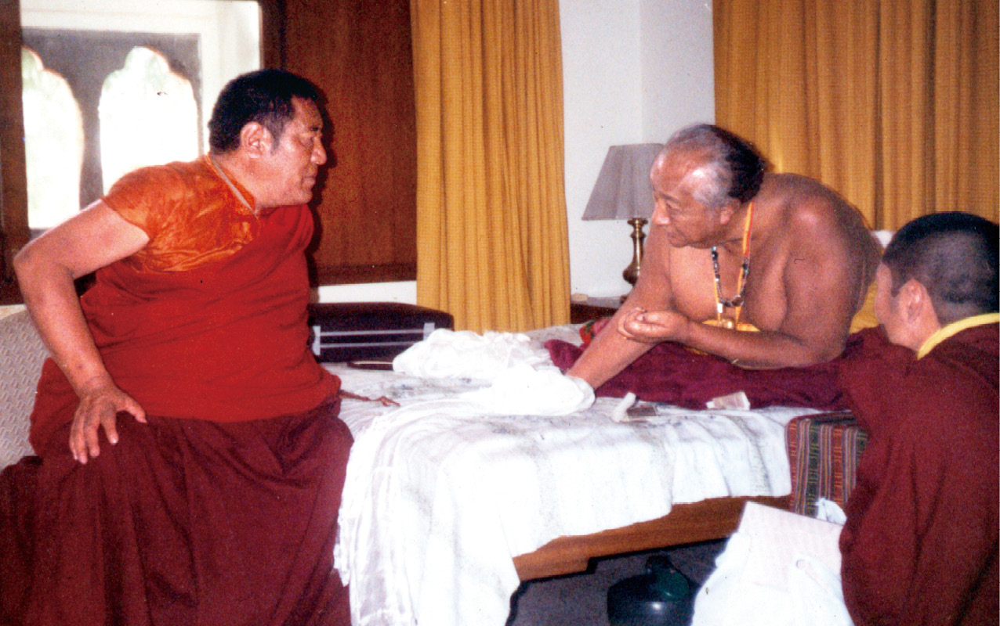

# 第47课

2022年10月22日

### 第76节·最深言教

在我写的许多意伏藏法中，具有近传加持的甚深法，是白文殊和大威德这两个灌顶；弘扬事业最广大的，是《文殊静修仪轨》和《文殊静修支分引导文·手中赐佛》；缘起始终没有被破坏的，是《项袋金刚橛》。

“白文殊”和“大威德”，前两年给大家灌过顶，也念过传承。《文殊静修支分引导文》和《文殊静修仪轨》，就是法王如意宝在五台山作的《文殊静修大圆满》的引导文和修法仪轨。《项袋金刚橛》，我们现在正在共修，平时也经常念诵。

如果你们好好实修这些法，必定无疑会获得共同悉地和殊胜悉地。

法王传下的这些法门中，白文殊主要是念修“阿”字；大威德我们学院每年都会念一念；《文殊静修支分引导文·手中赐佛》我以前翻译成了汉文，《文殊静修仪轨》没有翻译，不过其他人翻译过；《项袋金刚橛》我们每年也会共修。这几个法，有些特别有加持，有些弘扬非常广泛，有些缘起未被破坏过。总之，大家实修这些法门特别殊胜。

（堪布展示照片）

这张是《梦尘回忆录》里法王如意宝和顶果钦哲仁波切见面时的照片，边上这位是堪布南珠。当时我本想一次拍好，但是他老挡在镜头前，我只好避开他，打开闪光灯拍下了这张照片，结果挨了法王的批评。法王在印度时，因为拍照的事，批评过我两次。这次以后，好长一段时间我都不敢拍照。

后来在鹿野苑拍了一点，又被法王批评：“到圣地也不好好发愿，老是拍照干什么？”当时我哭着跟法王忏悔。如果上师不高兴，拍这些照片又有什么用呢？所以从那时起，我就没有再拍照。后来从蓝毗尼花园离开时，我很想拍一张集体合照，因为中间的行程中没有留下什么法王的照片，但又不敢说，只在法王看不见的地方拍了一点外景。

### 第77节·猴月初十聚会

以我自己的一生为例。第十六胜生周的木猴年，我12岁，第一次进入上面的洛若寺佛学院。当时的猴月初十，我参加了盛大的供养节日。

关于猴年猴月，莲花生大士的算法有点不同。按照现在的习惯，一月份是我们藏历的鸡月，所以猴月应该是十二月。但是以莲师的算法来看，猴月应该是藏历的六月，也就是纪念佛陀转法轮的这个月。所以法王有好几次在夏季六月做会供。六月初四是佛陀初转法轮的日子，初十是莲花生大士的猴月会供日。每种历算方式里，年度的开端是不同的，按照莲师的这种算法，藏历的七月份应该是一年中的第一个月。

法王回忆，自己12岁的时候，第一次进入洛若寺佛学院。当时洛若寺也是一所佛学院，里面开展讲学。法王在当年的猴月初十参加了盛大的供养节日。我算了一下，那一年应该是1944年。

后来，我24岁的火猴年，在托嘎如意宝住持的石渠江玛深山，与十方的几百名僧人一起，在猴年猴月初十吉日曾经共修。当时托嘎如意宝做施主，让我做金刚上师，我不敢违背言教。

当时的共修，托嘎如意宝做施主，意思是整个法会都由他来供养。这应该是法王在1956年的经历。

我36岁的土猴年，

法王36岁那年应该是1968年。说起年龄，藏历的算法跟公历有所不同。你们现在一般计算周岁，而我们藏族人过了年就可以加一岁，比如说，我今年按照公历来算是60周岁，但按藏历，是61岁，因为已经进入新的一年了。

那是局势非常动荡的时期，但我还是秘密来到喇荣这个地方，给少数眷属弟子灌顶，做会供，发愿弘法利生。那个地方就是现今罪聚自解脱洲（法轮区）的所在地。

法王在1968年的时候，在现在学院的法轮区度过了第二个猴年猴月。据说法王早期也在那个地方居住过很长时间，看来法轮区还是很厉害的。

再后来，我48岁的铁猴年，是喇荣佛学院成立的开始。猴月初十那天，我带着少数眷属弟子来到这个圣地，根据自己的经济条件准备了会供品，做了一次广大的会供。

法王如意宝48岁那年，也就是1980年的夏天，藏历六月初十，那是喇荣五明佛学院正式创立的日子。那个时候这里只有32个人，德巴堪布等大德都参加过那场会供。

从那以后，在这个圣地，我相应大家各自的根基，根据我所了知的程度，一直不断地弘扬显密及明处的完整法门。

医方明、工巧明、声明、因明、内明称为大五明，历算学、修辞学、韵律学、戏剧学、辞藻学称为小五明，这些都叫明处。

时至今日，弟子人数日益增多，光是常住学员就有数千僧人。

这应该是法王在1992年左右说的。我记得1990年学院的人数是三千，到了1996年，《胜利道歌》中提到过，当时有五千僧众。所以1992年的时候学院可能有三四千人。

其中，不仅有具足戒律、夜以继日精进闻思修行的人，而且在显密及明处方面的学识胜过我的，也大有人在。就像世人说的“父如凡牛，子如牛王”一样，他们一直常住在这个学院里。

法王谦逊地说道：我的弟子中有一部分，不管显宗、密宗，还是世间知识，都胜过我，这样的弟子大有人在，就像世间人说的“父如凡牛，子如牛王”——父亲像普通的牛一样平凡，可儿子像牛王一样出类拔萃。法王经常使用这些比喻，意思是说儿子超过了父亲，也可以说弟子超过了上师。这些具有智慧的僧才，一直居住在喇荣。这段话是法王如意宝的自谦之言。

今年猴月初十，我来做你们各位僧人的施主，进行前所未有的广大供养，会供法会的形式也会首屈一指。

这是1992年，法王如意宝60岁的那一年。我们学过的《句义宝藏论》和《般若摄颂》，都是法王在那一年传讲的。当时法王自己出资买会供品，进行了前所未有的广大供养。虽说当时会供规模很大，但跟我们现在完全不能相比。那个时候学院条件还比较差，当时想修汉僧经堂，我特意到成都去给新加坡的法师打电话求助，因为需要两三万块钱，但我们实在筹不出来。所以，尽管这个会供的规模在当时是首屈一指，但整体条件跟现在比，差距还是很大的。

今年初十这个供养节日，是我自己人生中第五次猴年猴月初十的聚会。我们师徒不离不弃，通过讲修来受持、护持、弘扬佛法，从现在算起，希望十二年后的大怀业猴月初十，我们师徒还有共同相聚的善缘。大家要好好发心发愿，这一点相当重要。

事实上，这个愿望后来没有实现。十二年后应该是2004年，法王原本准备在夏天的时候做一个大会供，然而他老人家在那年年初示现圆寂了——如果没有这样，那应该是法王的第六次猴月初十会供。

据印度圣地的一位持教大德说，我需要住世到95岁，那我们或许还会有第二次、第三次猴月初十聚会的机缘。丹增嘉措活佛的这个《喇荣简介》也是金刚语，可能在十三年里，还会有初十同聚的机会。

丹增活佛确实写过一篇《喇荣简介》，好像是以歌词的形式，内容是否提过下一次初十会供，我记得不是很清楚。法王当时说，他的语言是金刚语，可能在十三年里还有初十同聚的机会，但是最终未能实现。

但这是一件非常困难的事，因此，请你们僧众深切地发心发愿。

2004年如果法王在世的话，我们师徒也会做一场大会供。然后再过十二年，2016年6月，也就是学院成立三十六周年的时候，又是猴年猴月。等到下一回，就是2028年的6月了，不知道以后会怎样，一切都是无常的。

师徒不离共相伴，身寿不变永固坚，见面闻语不间断，快乐弘法愿吉祥！

法王最后念了这样一个吉祥颂，这在很多念诵仪轨中也有——“师徒不离共相伴，身寿不变永固坚，见面闻语不间断，快乐弘法愿吉祥。”
