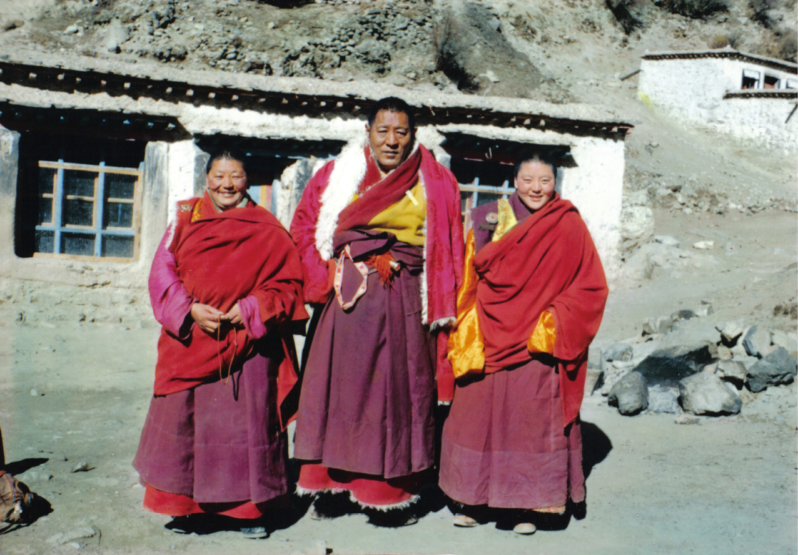

# 第49课

2022年10月25日

下面继续讲阿里美珠空行母。我们藏族人的名字都有各自的含义，“美珠”是“美朵卓玛”的略称，美朵意为花朵，合起来就是花朵度母的意思。门措上师的名字是“门梅益西措姆”的略称，解释意义就是无边智慧海。

这应该是真的。看她死时暖气消失的情况，从小乘有部到大乘大圆满都讲过，转生到地狱、饿鬼、旁生、人、天、清净刹土等处时，暖气消失的方式是不同的。

前面说到阿里美珠往生极乐世界了。法王说，这应该是真的，因为从她死时暖气消失的情况可以看得出来。不管是往生到清净刹土，还是堕落恶趣，都可以从遗体暖气消失的顺序上看出一二。如果先从头顶开始，慢慢往下变凉的话，说明亡者下堕了；如果先从脚底开始凉，最后头上热气保留了很长时间，说明亡者向上往生了。很多不同的法门中都讲过死亡后暖气消失的情况。

她暖气消失的情况，主要是我的侄子华卓和泽仁医生两人详细观察到的。

花措是指华作喇嘛，他和慈诚，还有贡秋宝玛，都是法王的侄子，他们一直居住在学院。阿里美珠圆寂的时候，华作喇嘛和一位名叫泽仁的医生就在身边，他们二人详细观察到了暖气消失的情况。

阿里美珠的圆寂比较突然，我当时正在浙江，一边住院看病，一边翻译《大圆满心性休息》、《三自解脱》和《俱舍论释》这三部论典。我刚刚把《大圆满心性休息》和《三自解脱》翻译完毕，就听到阿里美珠圆寂的消息，于是将《俱舍论释》暂时搁下，当天立即赶回学院。阿里美珠是在2003年圆寂的，2002年她在北京做了一场大手术，本来恢复得还不错，但后来可能因为心脏病或是其他原因，突然在学院示现圆寂了。

（堪布展示照片）

这张照片不知道是什么时候拍的，应该是比较早期的时候，门措上师看上去很年轻。

从暖气前后消失的情况来看，想必她已经踏上了解脱道。当时天空中也出现了彩虹、各种光芒，如（《佛一子续》）云：“谁即得佛果，尔时此三遍，腾越真虚空，五自光此现。”

这里引用了《佛一子续》的教证，意思是，谁得到佛果，就会出现这样的光和相。

比如夏天，先前有太阳，后来出现乌云，空中飘着微微细雨，出现彩虹的因缘一旦齐全，自然而然就会显现彩虹。但在她去世的那天，并没有任何这种因缘，当时已是夕阳西下了，天空中出现的不是普通的彩虹，而是白色的云、黄色的云、红色的云，随后呈现出线状的红色光辉。

一般来讲，天空出现彩虹，应该有细雨、阳光这样的缘起。但是阿里美珠圆寂那天，并没有这些因缘，天空中却出现了彩虹一样的彩色祥云，还有线状的红色光辉，这也是一种成就相。当时我们学院的很多喇嘛目睹了这一瑞相，也感到非常稀有。

从我的空行会供殿里，也传来悦意动听的声音，正在传颂似乎解脱于寂静刹土的瑞相。虽然外面的人听不到，但是里面的人明显能听到。

法王当时住的地方就在大经堂的上面，那边有一座大房子，叫空行会供殿。阿里美珠圆寂的时候，那里面传出了悦耳动听的声音。

不是说“如果在寂静本尊的本体中成佛，就会传出悠扬悦耳的音声；如果在忿怒本尊的本体中成佛，就会传出剧烈震撼的声响”吗？

续部当中有这样的说法。当天空行会供殿传出的声音到底是寂静的还是忿怒的，法王没有细说，但这也是一种成就之相。

一般在传出某种声音时，基本就接近死亡了。大概就在那之前传出某种声音，但也有稍微延后的现象。如果看看所有前辈大圆满上师的传记，就会想到可能会有轻微延迟的情况。如果那是解脱的验相和成佛的验相，是最好的了。

这本来应该是圆寂之前传出的声音，但也会有稍许延后的现象。以前很多大德的传记中也有类似的记载，圆寂时的声响可能会稍微延迟，有这样的情况。

假设她已经往生到了极乐世界，就会圆满具足地道的功德。她会以欢喜的眼神注视着我们，以慈悲的心垂念着我们，恒时以天眼清晰地看到留在人间的亲属、僧人、弟子等。如（《极乐愿文》）云：“愿天眼明见，生前友侍徒，加持并护佑，亡时接彼刹。”

《极乐愿文》中说过，如果谁先往生到清净刹土，他会用天眼来明观生前的亲友、弟子，加持他们，最后在死亡之时，将他们引领到极乐世界。

我们祈祷在极乐世界的她，以五眼六通恒时关注着我们这些留下来的僧人和远近的亲属等，凡与她结缘者，命终之时被接引到极乐世界。

阿里美珠曾和法王一同发愿往生极乐世界，所以当她示现圆寂时，大家非常担心法王会不会也很快圆寂。因为他们共同发过愿，对于一些生死自在的成就者来讲，会有这种情况。而且法王以前说过，一旦对自己有恩德的妹妹离世，他也不一定会久住世间，所以当时大家都很担心。按公历来算，阿里美珠圆寂的时候大概是2003年10月，距离极乐法会还有一段时间。后来大家觉得应该没事了吧，可过了两个多月，2004年1月的时候，法王也示现圆寂了。按照藏历，那时还是年底，所以他们二人是在同一年中离开的。

当时法王如意宝让大家祈祷阿里美珠，这样在临终的时候，她会接引我们到极乐世界。阿里美珠确实是一位很了不起的修行人。

她最初也发下了往生极乐世界的清净愿。所以，如果你们能在她的遗体前承诺念诵一百万遍阿弥陀佛圣号，我觉得这会有特别大的功德和利益。

法王应该是在她的遗体还未火化的时候，讲了这一番话。
